# 11.3 인공신경망: 비선형 곡선을 근사하는 딥러닝 아키텍처

단순한 직선 예측을 뛰어넘어 세상의 모든 복잡한 비선형 관계를 유연하게 학습해 내는 **다층 인공신경망(Artificial Neural Network)**을 공부합니다. 

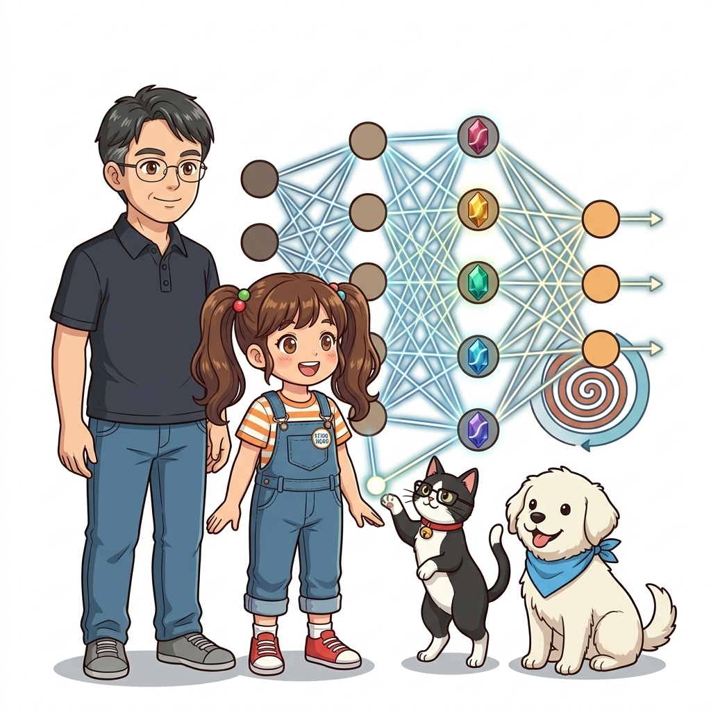
**그림 11-3-1** 입력층, 은닉층, 출력층으로 이루어진 마법 전구 발판을 밟아나가며 ReLU 활성화 함수의 특성을 필기하는 도로시와 지니

---

선형 변환(Linear) 계층과 비선형 활성화 함수(Activation Function: Sigmoid, ReLU)를 층층이 결합하여 표현력을 극대화하고, 파이토치와 동일한 구조의 `Model`, `Layer`, `Optimizer` 모듈을 구축해 봅시다!

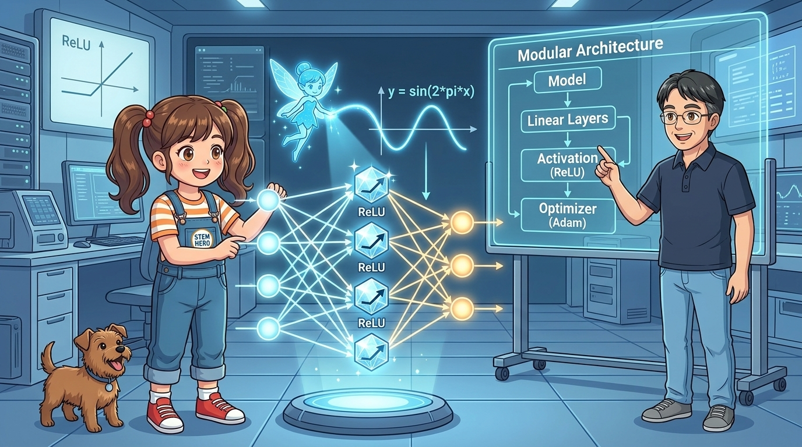
**그림 11-3-2** 2층 신경망 노드들을 조율하는 도로시와 비선형 사인 파동 *y* = sin(2*πx*)을 홀로그램으로 투사하는 지니, 그리고 `Model` → `Linear` → `ReLU` → `Optimizer`로 이어지는 객체지향 딥러닝 모듈 구조를 설명하는 이호진 교수님


---

## 11.3.1 직선의 한계와 비선형 데이터셋

11.2절의 선형 회귀는 데이터가 대략 직선 형태로 놓여 있을 때만 위력을 발휘합니다. 


---

하지만 자연계와 복잡한 의사결정 문제는 대부분 심한 굴곡과 파동을 지닌 비선형입니다. 

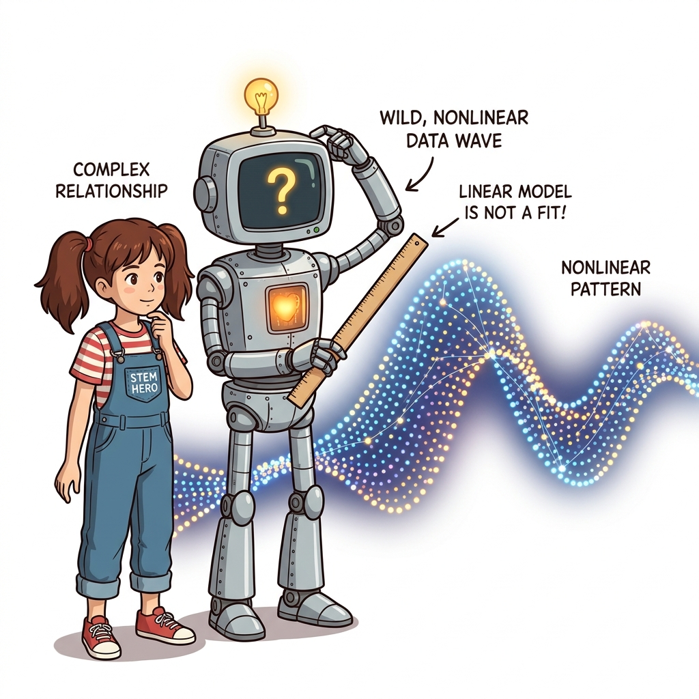

---

사인(sin) 파동에 노이즈가 섞인 100개의 데이터를 만들어 봅시다:

```python
import numpy as np

np.random.seed(0)
x = np.random.rand(100, 1)
y = np.sin(2 * np.pi * x) + np.random.rand(100, 1) # 구불구불한 사인 파동
```


---


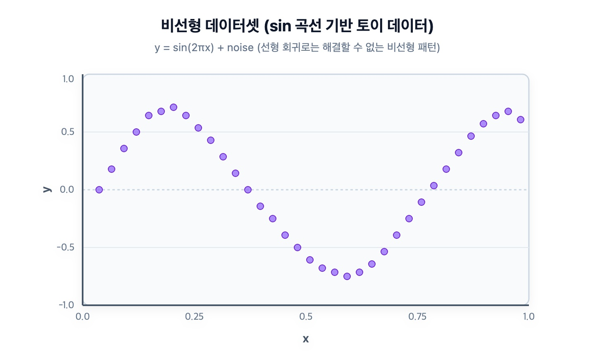
**그림 11-3-3** 사인 파동 형태로 구불구불하게 출렁이는 비선형 데이터셋

---

아무리 뛰어난 선형 회귀 알고리즘을 사용하더라도, 태생이 1차 함수 직선인 모델로는 [그림 11-3-3]의 S자 곡선을 결코 따라잡을 수 없습니다. 모델 자체에 **"곡선을 표현할 수 있는 능력(비선형성)"**을 부여해야 합니다!

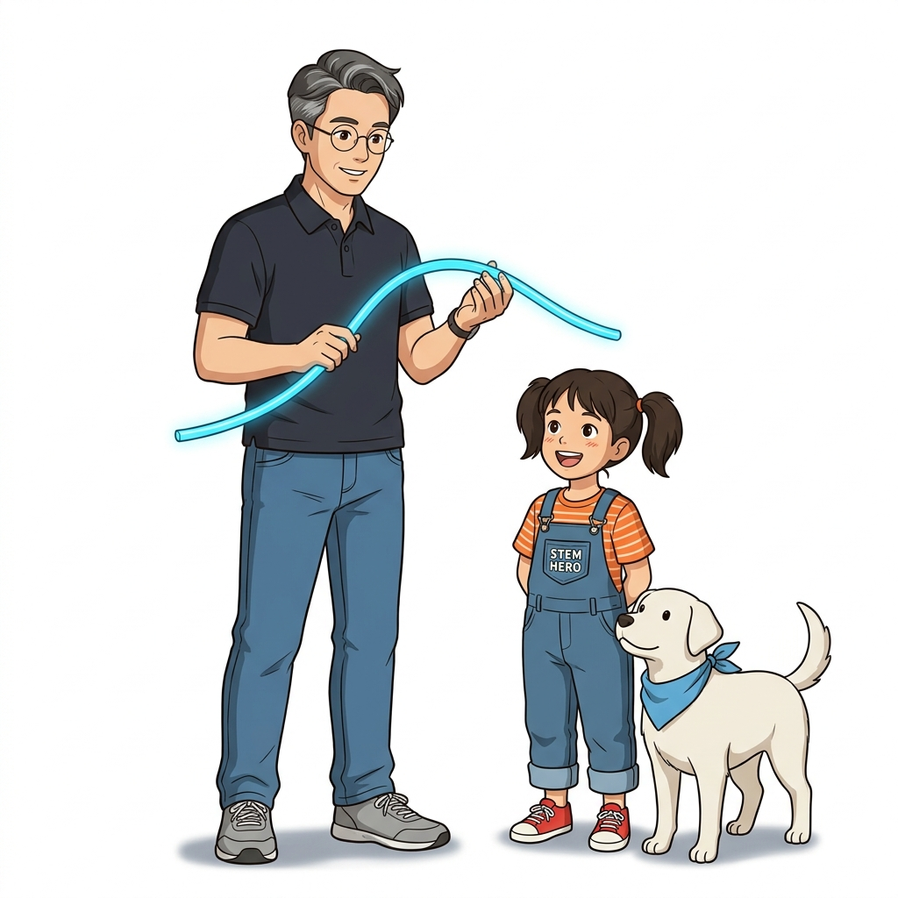

---

## 11.3.2 선형 변환과 활성화 함수의 마법

인공신경망의 각 층(Layer)은 다음의 두 연산이 톱니바퀴처럼 맞물려 작동합니다:


---

### 1) 선형 변환 (Linear / Affine Transformation)
입력 벡터에 가중치 행렬을 곱하고 편향을 더하는 연산입니다:
$$
y = x \cdot W + b
$$

DeZero에서는 이를 `F.linear(x, W, b)` 함수로 지원합니다.

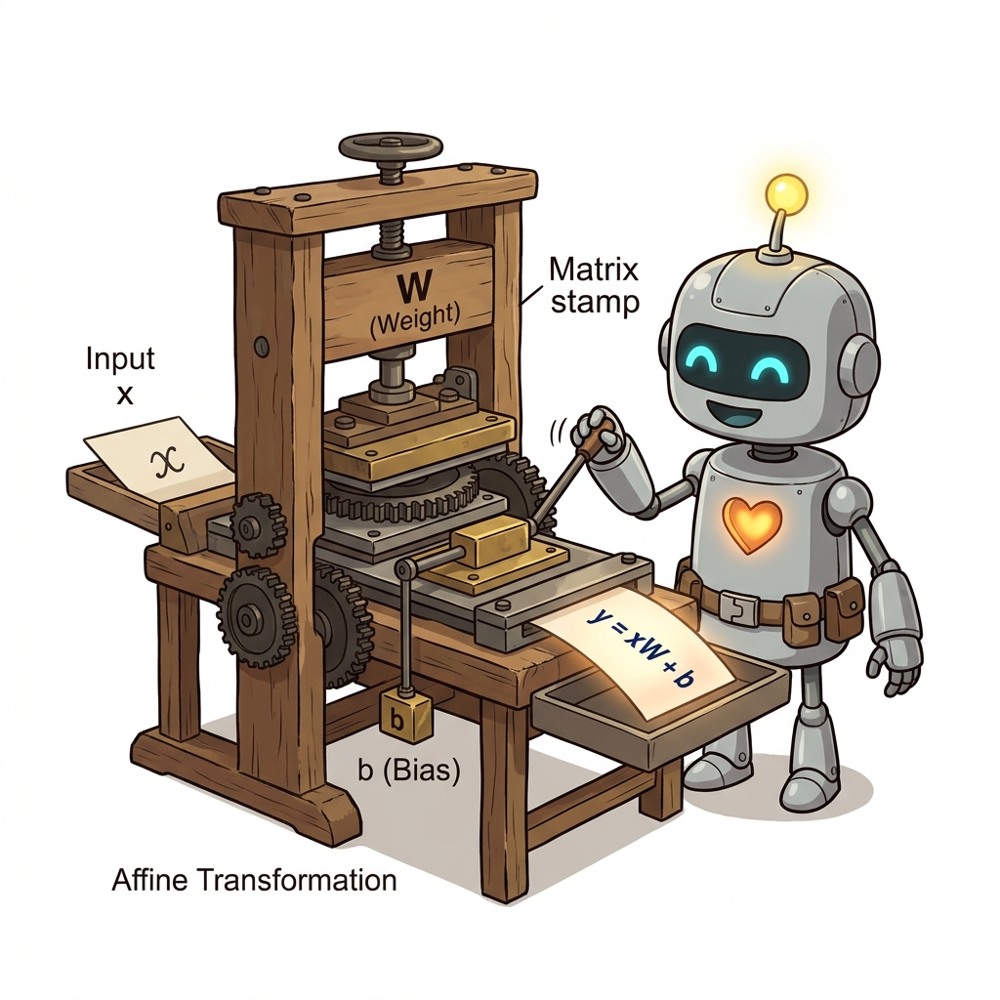

---

### 2) 비선형 활성화 함수 (Activation Function)
만약 선형 변환만 100층, 1000층을 쌓으면 어떻게 될까요?
- 1층: $y_1 = x \cdot W_1 + b_1$
- 2층: $y_2 = y_1 \cdot W_2 + b_2 = (x \cdot W_1 + b_1) \cdot W_2 + b_2 = x \cdot (W_1 W_2) + (b_1 W_2 + b_2)$
- 행렬 곱의 결합 법칙에 의해, 아무리 깊게 쌓아도 결국 **하나의 단일 선형 변환($y = xW' + b'$)으로 완전히 축약**되어 버립니다!

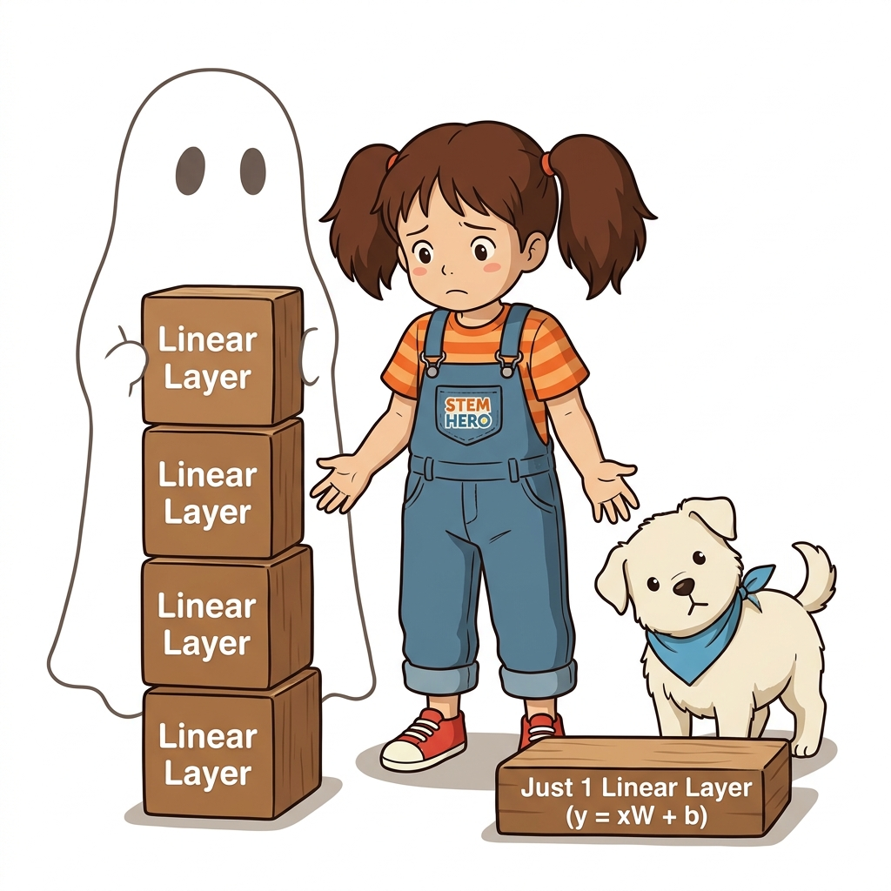

---

따라서 선형 계층 사이에 반드시 **비선형 활성화 함수**를 끼워 넣어 선형 결합의 고리를 깨뜨려야만 신경망이 고차원의 구불구불한 곡면을 자유자재로 근사할 수 있게 됩니다.

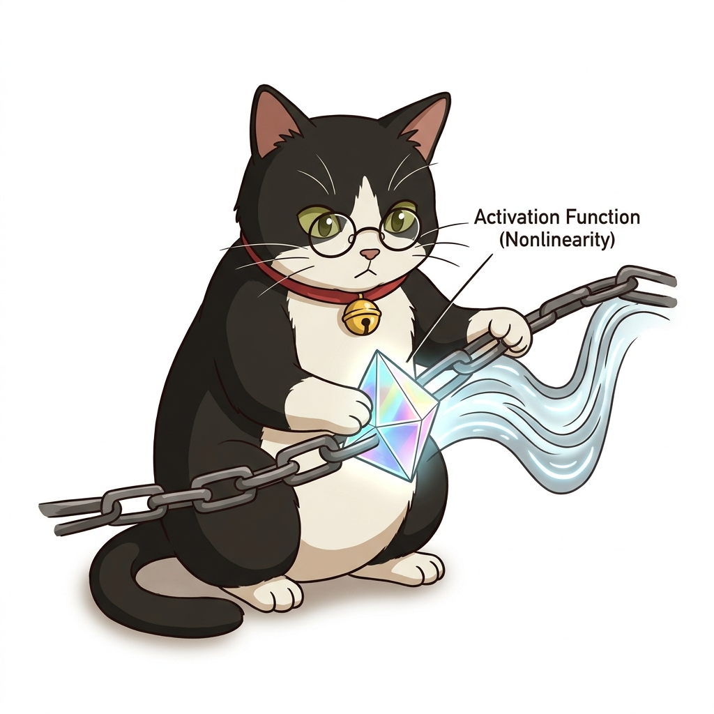

---

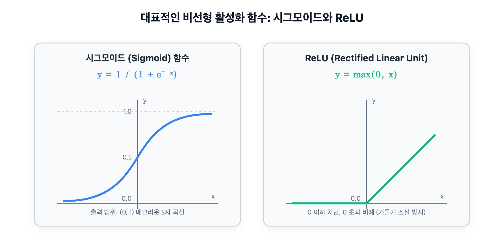
**그림 11-3-4** 대표적인 활성화 함수인 시그모이드(Sigmoid)와 렐루(ReLU)

---

- **시그모이드(Sigmoid) 함수**:
  $$
y = \frac{1}{1 + e^{-x}}
$$

[식 11.4] 시그모이드 함수
  - 입력값을 0과 1 사이의 부드러운 S자 곡선으로 압축합니다.

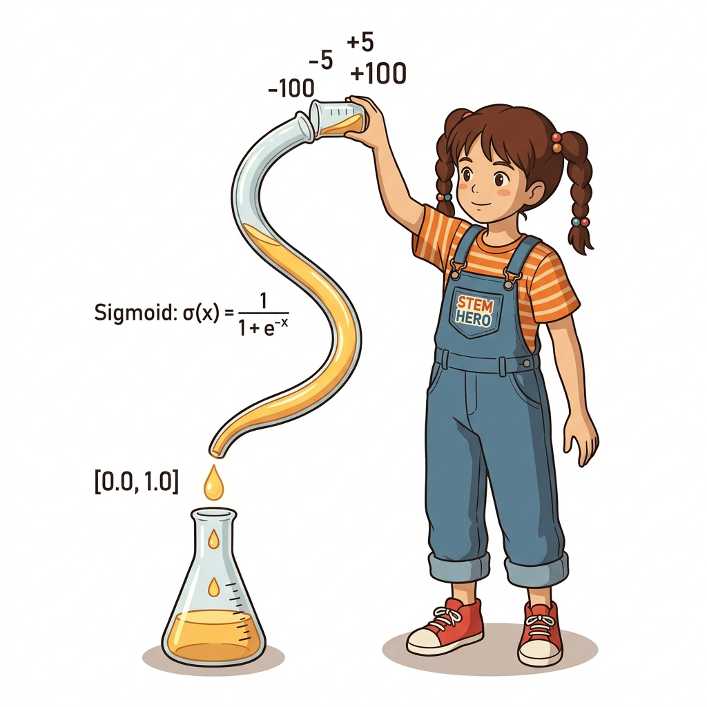

---

- **렐루(ReLU: Rectified Linear Unit) 함수**:
  $$
y = \max(0, x)
$$

[식 11.5] ReLU 함수
  - 0 이하의 값은 0으로 차단하고, 양수 값은 그대로 통과시킵니다.
  - 연산이 극도로 단순하여 계산 속도가 빠르고, 깊은 층에서도 기울기 소실(Vanishing Gradient) 문제가 발생하지 않아 **현대 딥러닝과 DQN의 절대적인 표준**으로 쓰입니다.

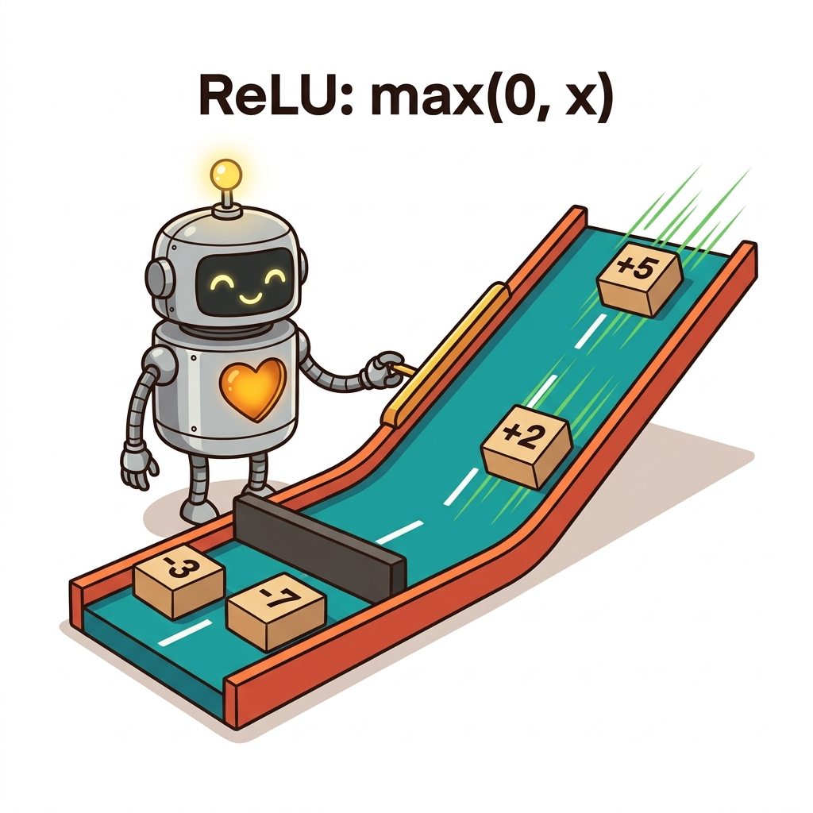

---

## 11.3.3 2층 인공신경망의 직접 학습

입력 차원 *I*=1, 은닉 뉴런 *H*=10, 출력 차원 *O*=1인 2층 신경망을 밑바닥부터 작성하여 사인 곡선을 학습시켜 봅시다.

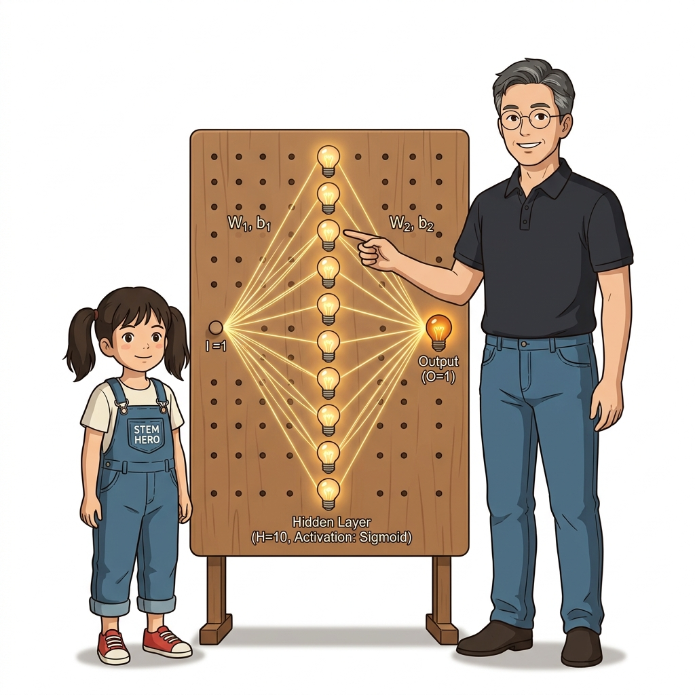

---

```python
import numpy as np
from dezero import Variable
import dezero.functions as F

# 데이터셋
np.random.seed(0)
x = np.random.rand(100, 1)
y = np.sin(2 * np.pi * x) + np.random.rand(100, 1)

# 가중치 파라미터 초기화
I, H, O = 1, 10, 1
W1 = Variable(0.01 * np.random.randn(I, H)) # ❶ 가중치는 작은 무작위 난수로 대칭성 파괴
b1 = Variable(np.zeros(H))
W2 = Variable(0.01 * np.random.randn(H, O))
b2 = Variable(np.zeros(O))

# 신경망 추론 (선형 변환 -> 활성화 함수 -> 선형 변환)
def predict(x):
    y = F.linear(x, W1, b1)
    y = F.sigmoid(y)        # 비선형 시그모이드 활성화
    y = F.linear(y, W2, b2)
    return y

lr = 0.2
iters = 10000

for i in range(iters):
    y_pred = predict(x)
    loss = F.mean_squared_error(y, y_pred)

    W1.cleargrad(); b1.cleargrad()
    W2.cleargrad(); b2.cleargrad()
    loss.backward()

    W1.data -= lr * W1.grad.data
    b1.data -= lr * b1.grad.data
    W2.data -= lr * W2.grad.data
    b2.data -= lr * b2.grad.data

    if i % 2000 == 0:
        print(f"반복 {i:05d} | 손실(MSE): {loss.data:.4f}")
```

---


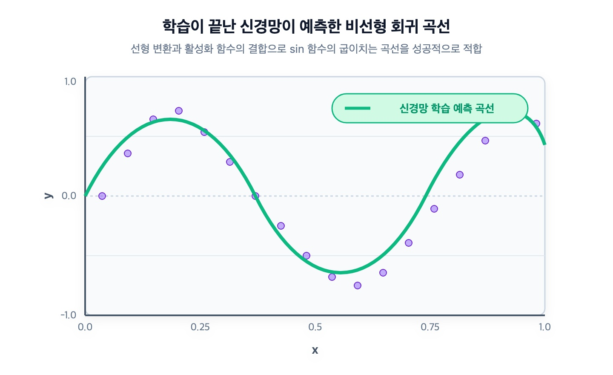
**그림 11-3-5** 학습이 완료된 2층 신경망의 예측 곡선. 사인 파동의 굴곡을 정확하게 따라가고 있습니다.

---

## 11.3.4 객체지향 딥러닝 모듈: `Layer`, `Model`, `Optimizer`

위의 코드는 파라미터가 늘어날 때마다 `W1`, `b1`, `W2`, `b2`를 일일이 관리해야 하므로 번거롭습니다. 

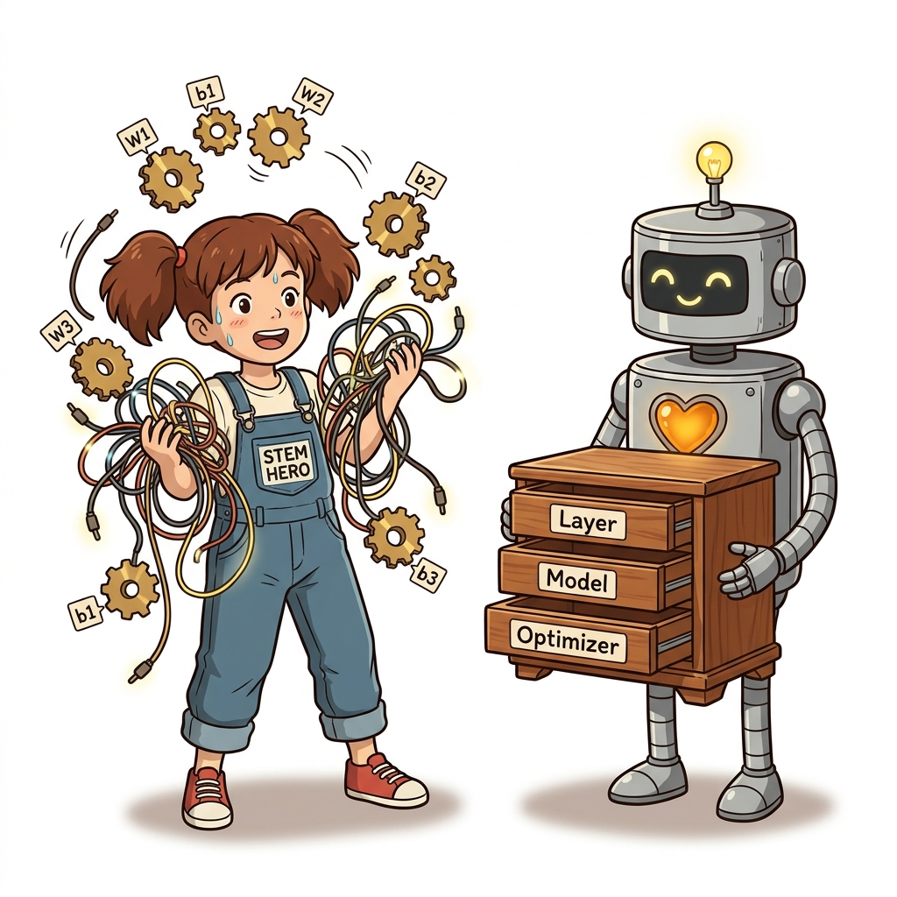

---

DeZero는 파이토치와 동일한 강력한 객체지향 모듈들을 제공합니다:

1. **`dezero.layers.Linear`**: 가중치와 편향을 내부에서 자동으로 생성하고 관리하는 선형 계층
2. **`dezero.Model`**: 여러 계층을 감싸서 `params()`와 `cleargrads()`를 한 번에 처리하는 신경망 모델 클래스
3. **`dezero.optimizers`**: 경사 하강 갱신(`update()`)을 전담하는 최적화 도구 (SGD, Adam 등)

---

### 최종 완성된 모듈식 딥러닝 파이프라인

<div align="right"><b>ch07/dezero4.py</b></div>

```python
import numpy as np
from dezero import Model
import dezero.layers as L
import dezero.functions as F
from dezero import optimizers

# 1. 2층 인공신경망 클래스 정의 (PyTorch의 nn.Module과 동일!)
class TwoLayerNet(Model):
    def __init__(self, hidden_size, out_size):
        super().__init__()
        self.l1 = L.Linear(hidden_size) # 첫 번째 선형 계층 (은닉층 10개)
        self.l2 = L.Linear(out_size)    # 두 번째 선형 계층 (출력층 1개)

    def forward(self, x):
        y = F.sigmoid(self.l1(x))       # 은닉층 통과 후 시그모이드 활성화
        y = self.l2(y)                  # 최종 출력
        return y

# 2. 모델 및 옵티마이저 초기화
model = TwoLayerNet(hidden_size=10, out_size=1)
optimizer = optimizers.Adam(lr=0.2)     # 최신 모멘텀 기반 Adam 옵티마이저 사용
optimizer.setup(model)                  # 모델의 모든 파라미터 자동 등록!

# 3. 훈련 루프
iters = 10000
for i in range(iters):
    y_pred = model(x)                   # 순전파
    loss = F.mean_squared_error(y, y_pred) # 손실 계산

    model.cleargrads()                  # 모든 계층의 기울기 일괄 초기화
    loss.backward()                     # 자동 미분 역전파

    optimizer.update()                  # 옵티마이저가 모든 파라미터 자동 갱신!

    if i % 2000 == 0:
        print(f"에포크 {i:05d} | 손실: {loss.data:.4f}")
```

---

#### 코드 핵심 개선점:

- `model.cleargrads()` 단 한 줄로 수십~수백 개의 가중치 기울기를 깨끗이 비웁니다.
- `optimizer.update()` 단 한 줄로 학습률과 모멘텀 알고리즘(Adam)을 적용해 모든 파라미터를 최적화합니다.
- 계층의 추가나 활성화 함수 변경(예: `F.relu`)이 레고 블록처럼 손쉽게 이루어집니다.

---

이제 완벽한 딥러닝 엔진이 우리 손에 들어왔습니다. 다음 11.4절에서는 이 `Model` 신경망을 10장의 Q-러닝과 전격 결합하여, **신경망 기반 Q-러닝 에이전트**를 직접 구현해 봅시다!


