# 11.4 Q-러닝과 신경망: 심층 강화학습으로의 진화

테이블형 강화학습의 한계를 깨부수고 드디어 **신경망 기반 Q-러닝(Neural Q-Learning)**을 구현합니다. 

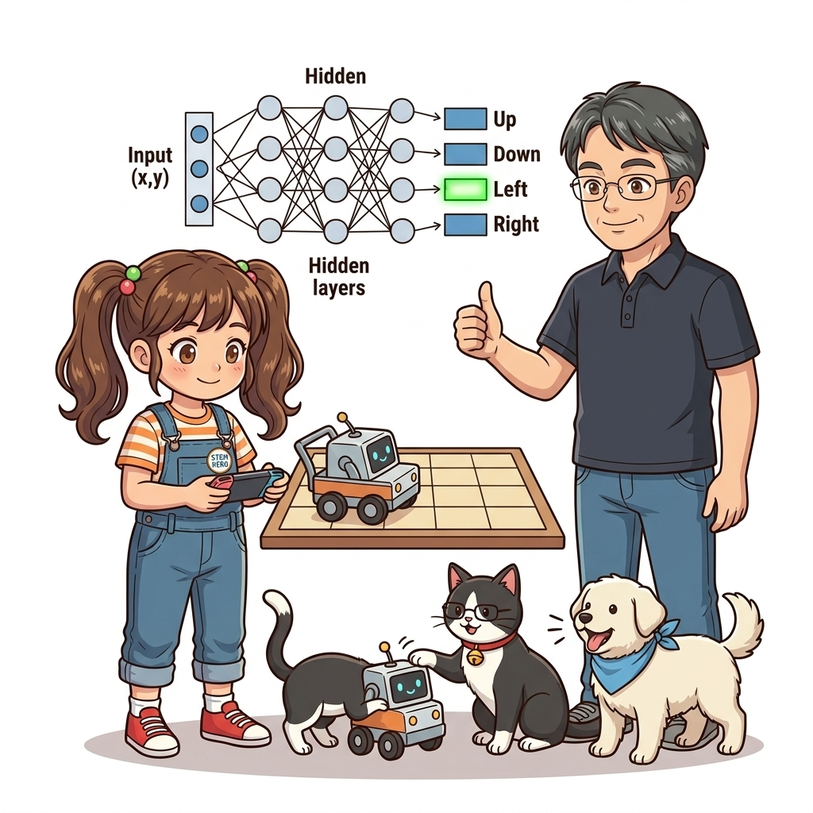
**그림 11-4-1** 현재 상태를 입력받아 각 행동 방향(상, 하, 좌, 우)의 예측 Q 가치들을 입체적으로 출력하는 마법 전광판을 확인하는 지니와 도로시

---

상태(State)의 원-핫 인코딩 전처리부터, 행동 가치 테이블을 인공신경망으로 대체하여 병렬로 Q값을 예측하고, 준기울기(Semi-gradient) TD 오차를 MSE 회귀 손실로 변환하여 역전파하는 전 과정을 깊이 있게 정복해 봅시다!

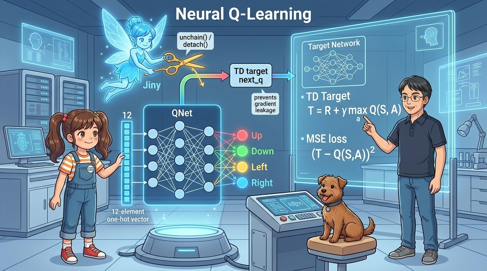
**그림 11-4-2** 12차원 원-핫 상태 벡터를 2층 신경망 QNet에 입력하여 4개 행동의 Q값을 한 번에 뽑아내는 도로시와, TD 타깃의 역전파 선을 가위(*unchain()*)로 끊어 기울기 누수를 방지하는 지니, 그리고 회귀 손실 결합 원리를 강의하는 이호진 교수님


---

## 11.4.1 상태 전처리: 범주형 데이터와 원-핫 벡터

인공신경망은 사칙연산(행렬 곱과 덧셈)을 수행하므로 문자열이나 튜플 좌표 `(2, 0)`를 그대로 입력받을 수 없습니다. 반드시 **숫자 벡터** 형태로 변환해야 합니다.

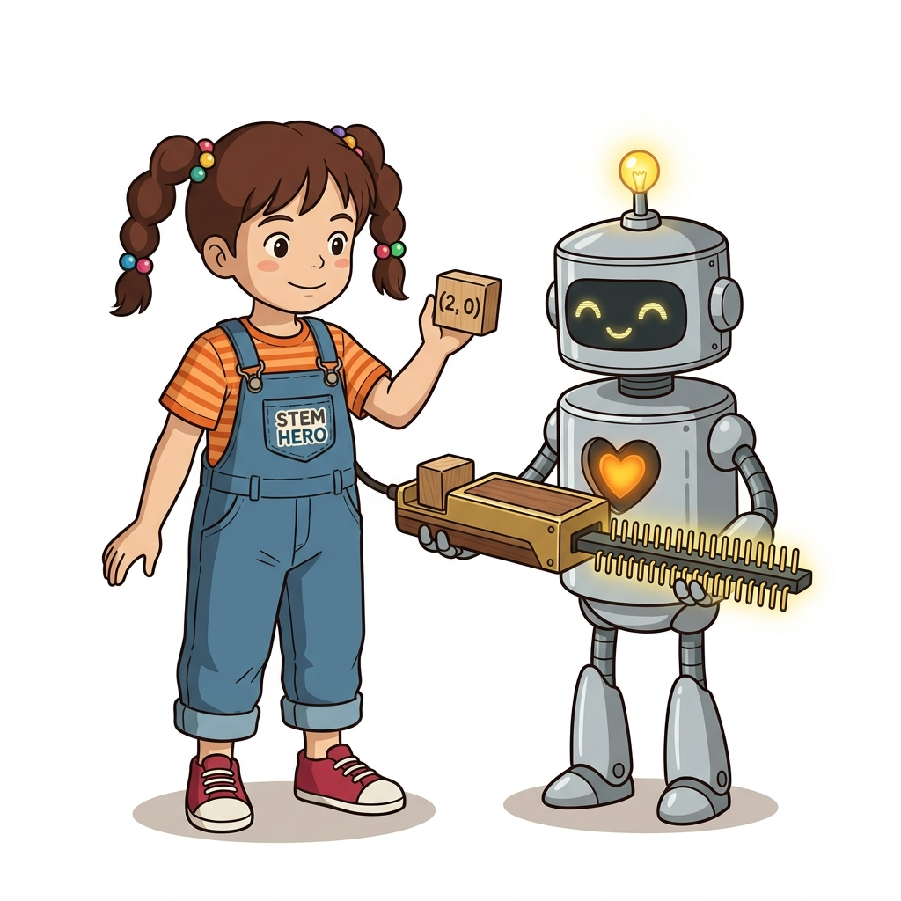

---

'3x4 그리드 월드'의 상태는 총 12개의 격자 칸 중 하나를 가리키는 **범주형 데이터(Categorical Data)**입니다. 

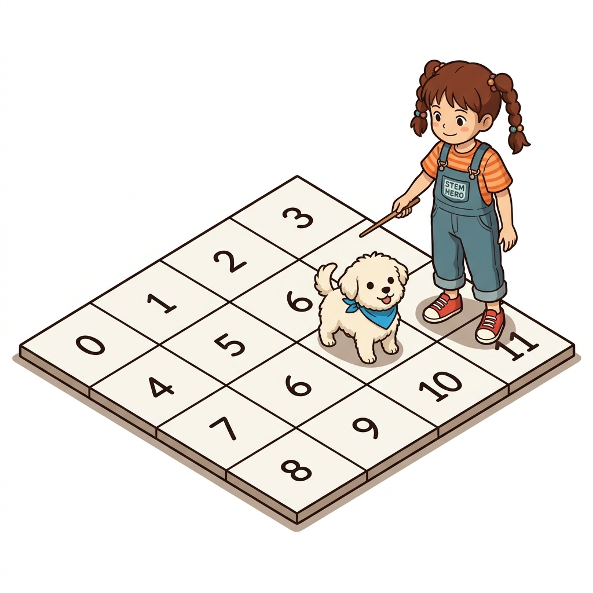

---

이러한 범주형 데이터를 표현하는 가장 표준적인 방법이 바로 **원-핫 벡터(One-Hot Vector)**입니다.

- **원-핫 벡터(One-Hot Vector)**:
  전체 원소 중 해당 상태에 대응하는 단 하나의 원소만 **1.0**이고, 나머지 모든 원소는 **0.0**으로 채워진 벡터입니다.

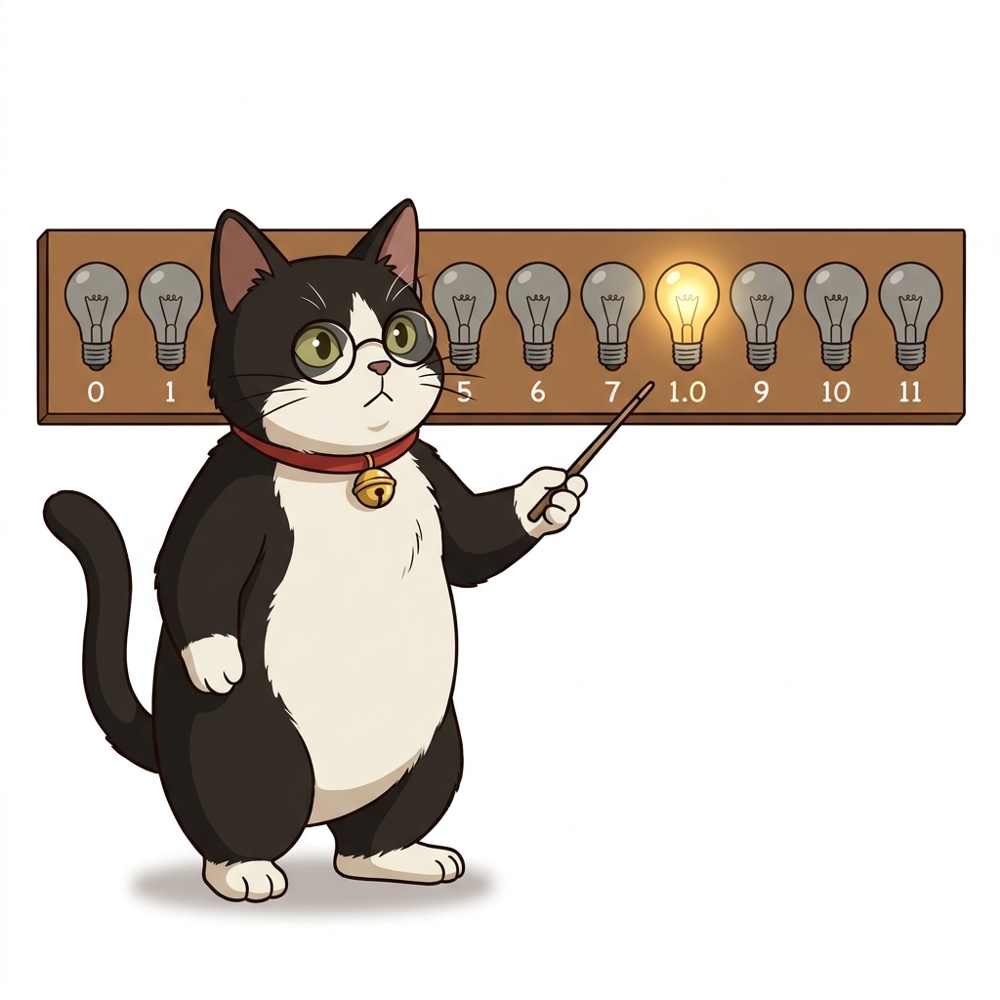

---

```python
import numpy as np

def one_hot(state):
    HEIGHT, WIDTH = 3, 4
    vec = np.zeros(HEIGHT * WIDTH, dtype=np.float32) # 길이 12의 0 벡터 생성
    y, x = state
    idx = WIDTH * y + x                              # 2차원 좌표 (y, x)를 1차원 인덱스로 변환
    vec[idx] = 1.0                                   # 해당 칸만 1.0 점등!
    return vec[np.newaxis, :]                        # 배치 처리를 위해 (1, 12) 형상으로 반환

state = (2, 0)
x = one_hot(state)
print("형상:", x.shape)
print("원-핫 벡터:\n", x)
```

---

**출력 결과**:

```text
형상: (1, 12)
원-핫 벡터:
 [[0. 0. 0. 0. 0. 0. 0. 0. 1. 0. 0. 0.]]
```

---

## 11.4.2 Q 함수를 신경망으로 설계하기

테이블 방식에서는 `Q[state, action]`처럼 상태와 행동의 모든 조합(12 × 4 = 48개)을 딕셔너리에 개별 보관했습니다. 

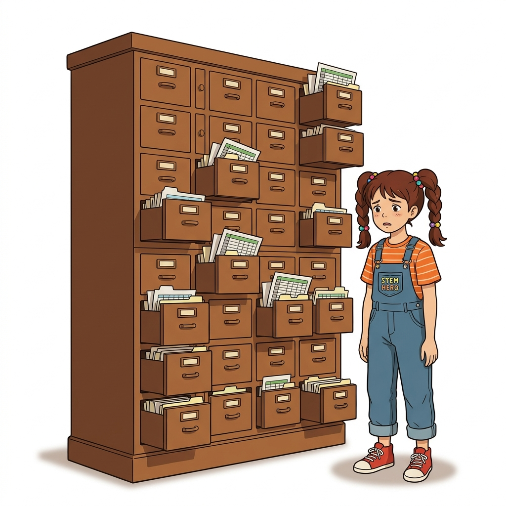

---

이제 이 테이블을 **입력을 받아 출력을 계산하는 신경망 함수 근사기**로 바꿉니다.

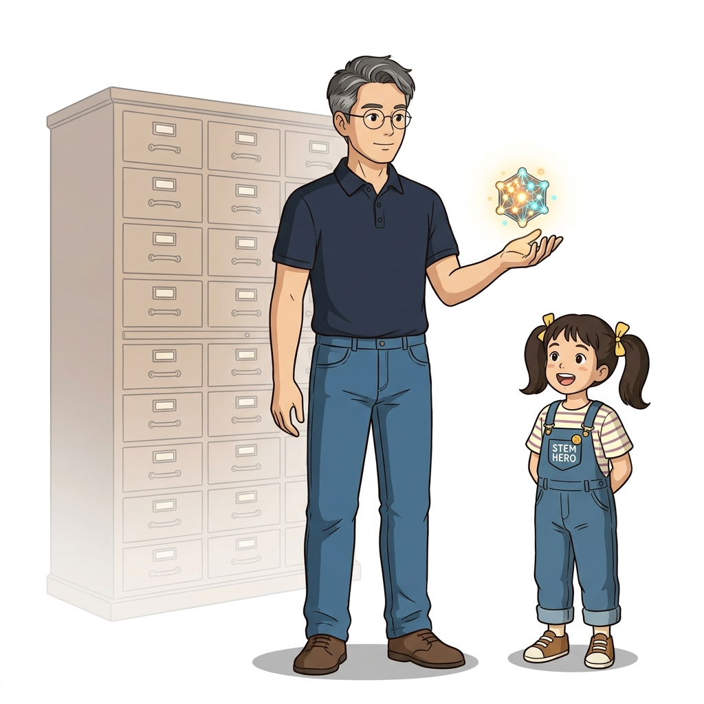

---

신경망의 입출력 구조는 크게 두 가지를 생각할 수 있습니다:

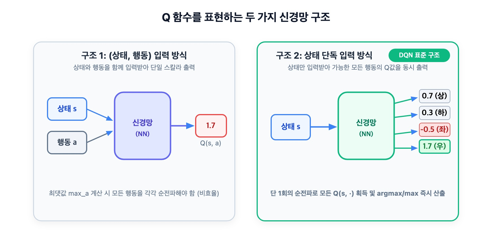
**그림 11-4-3** Q 함수를 표현하는 두 가지 신경망 아키텍처 비교

---

### 구조 A: 상태와 행동을 모두 입력받아 단일 Q값을 출력 (`[s, a] → scalar Q`)
- 최적 행동을 찾으려면 가능한 모든 행동(상, 하, 좌, 우 4개)에 대해 **신경망 순전파를 4번 반복 실행**해야 합니다.
- 행동 수가 수십~수백 개로 늘어나면 계산 비용이 감당할 수 없을 만큼 폭증합니다!

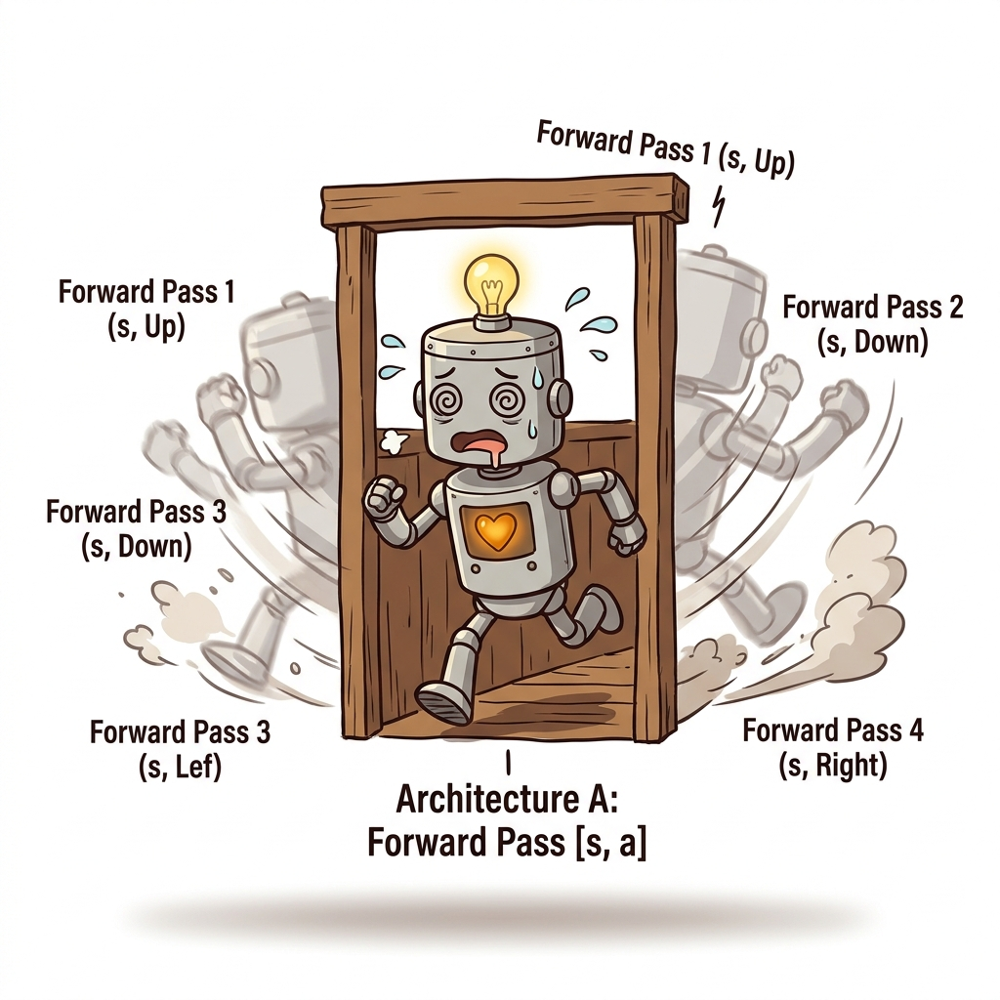

---

### 구조 B: 상태만 입력받아 모든 행동의 Q값을 벡터로 출력 (`[s] → vector [Q(s, a0), Q(s, a1), ...]`)
- 상태 *s*를 신경망에 단 **1번만 통과(순전파)**시키면 4개 행동의 Q값이 동시에 한꺼번에 계산됩니다!
- 최댓값 추출 또한 `qs.argmax()`로 즉시 완료되므로 **계산 효율이 압도적**입니다.
- 따라서 **딥 강화학습(DQN)의 표준은 무조건 구조 B**를 채택합니다!


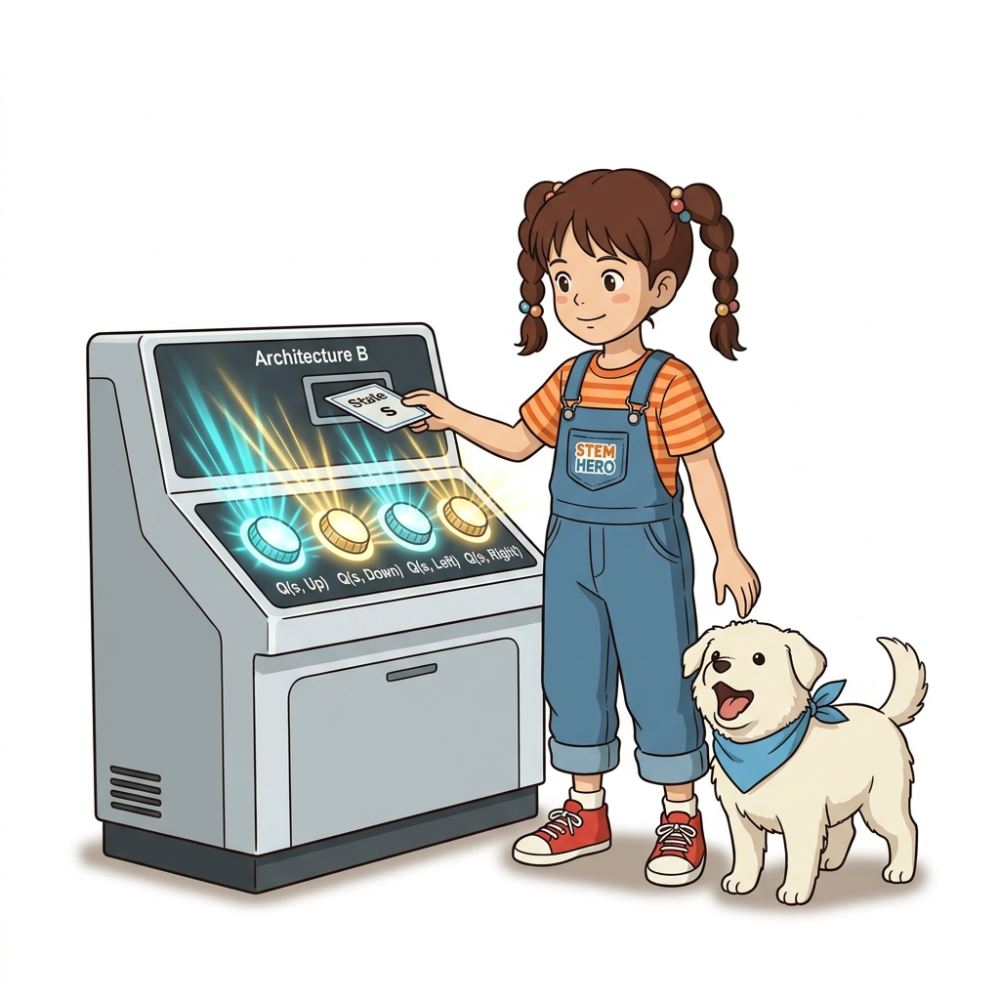

---


### QNet 신경망 클래스 구현

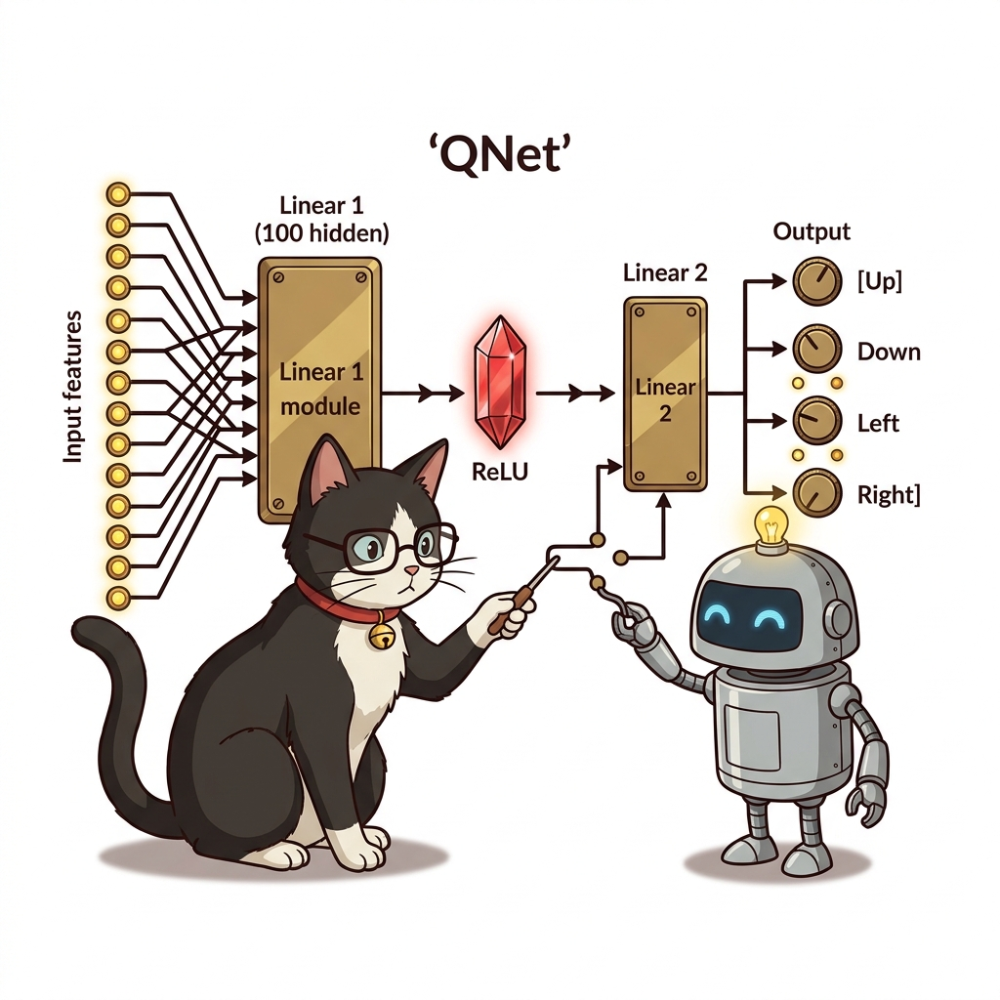

---

```python
from dezero import Model
import dezero.functions as F
import dezero.layers as L

class QNet(Model):
    def __init__(self):
        super().__init__()
        self.l1 = L.Linear(100) # 은닉층: 100개의 뉴런으로 비선형 특징 추출
        self.l2 = L.Linear(4)   # 출력층: 4개 행동(상, 하, 좌, 우)의 Q값 출력

    def forward(self, x):
        x = F.relu(self.l1(x))  # ReLU 활성화 함수 적용
        x = self.l2(x)          # 최종 4차원 Q 벡터 출력
        return x
```

---

## 11.4.3 강화학습의 TD 갱신식을 딥러닝 회귀 문제로 전환하기

10장에서 배운 Q-러닝의 갱신 점화식은 다음과 같았습니다:

> ***Q*(*S*<sub>*t*</sub>, *A*<sub>*t*</sub>) ← *Q*(*S*<sub>*t*</sub>, *A*<sub>*t*</sub>) + *α* · [*R*<sub>*t*</sub> + *γ* max<sub>*a*</sub> *Q*(*S*<sub>*t*+1</sub>, *a*) - *Q*(*S*<sub>*t*</sub>, *A*<sub>*t*</sub>)]** &nbsp;&nbsp;&nbsp;&nbsp; *(식 11.6: Q-러닝)*

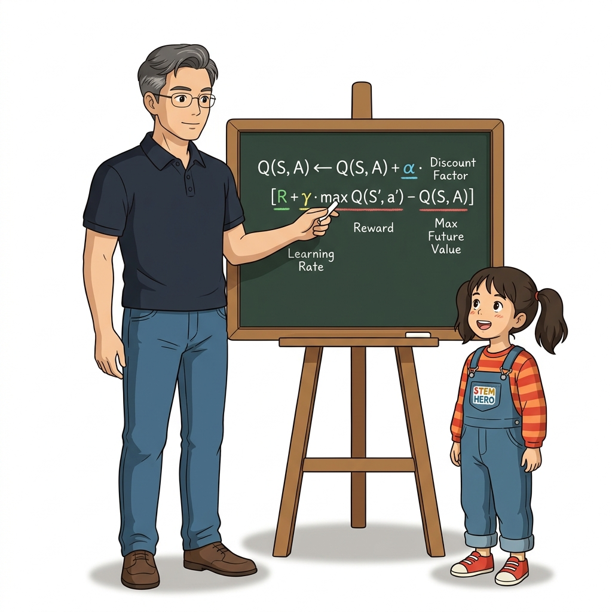

---

여기서 목표 항인 **[*R*<sub>*t*</sub> + *γ* max<sub>*a*</sub> *Q*(*S*<sub>*t*+1</sub>, *a*)]**를 타깃 레이블 ***T***로 묶어봅시다:

> ***Q*(*S*<sub>*t*</sub>, *A*<sub>*t*</sub>) ← *Q*(*S*<sub>*t*</sub>, *A*<sub>*t*</sub>) + *α* · [*T* - *Q*(*S*<sub>*t*</sub>, *A*<sub>*t*</sub>)]** &nbsp;&nbsp;&nbsp;&nbsp; *(식 11.7)*

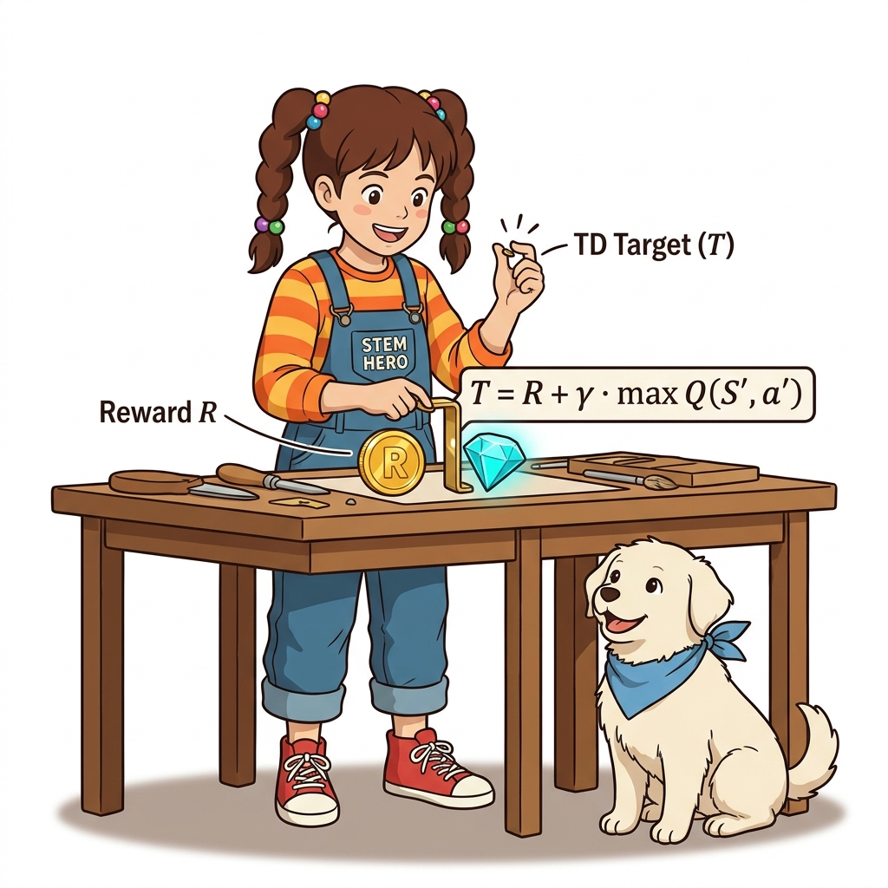

---

이 식의 의미를 딥러닝 관점에서 해석하면 놀라운 통찰을 얻게 됩니다:

- **입력 데이터**: 상태 *S*<sub>*t*</sub>에서 선택한 행동 *A*<sub>*t*</sub>
- **모델의 예측값**: 신경망이 추정한 *Q*(*S*<sub>*t*</sub>, *A*<sub>*t*</sub>)
- **정답 정답 레이블(Target)**: 환경 보상과 다음 상태 가치로 계산된 타깃 *T*
- **손실 함수(Loss)**: 둘 사이의 평균 제곱 오차!

> ***L* = (*T* - *Q*(*S*<sub>*t*</sub>, *A*<sub>*t*</sub>))<sup>2</sup>** &nbsp;&nbsp;&nbsp;&nbsp; *(식 11.8: Q-러닝의 회귀 손실)*

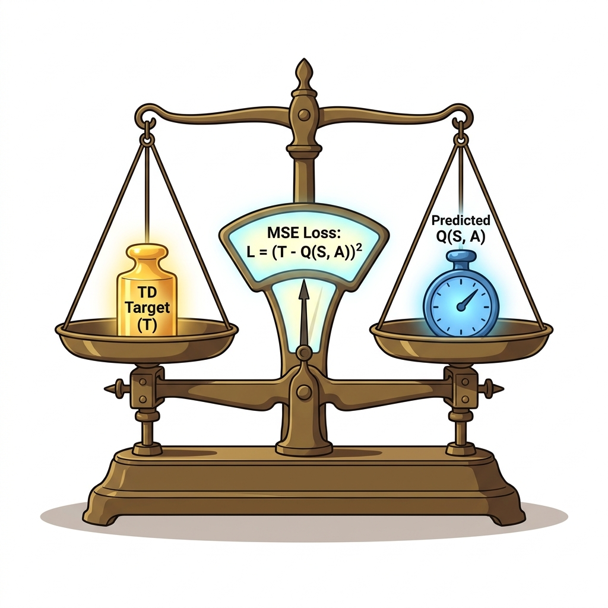

---

즉, 강화학습의 Q-러닝은 **"신경망의 출력 *Q*(*S*<sub>*t*</sub>, *A*<sub>*t*</sub>)가 TD 타깃 *T*에 가까워지도록 오차역전파를 수행하는 지도 학습 회귀 문제"**로 완벽하게 치환됩니다!

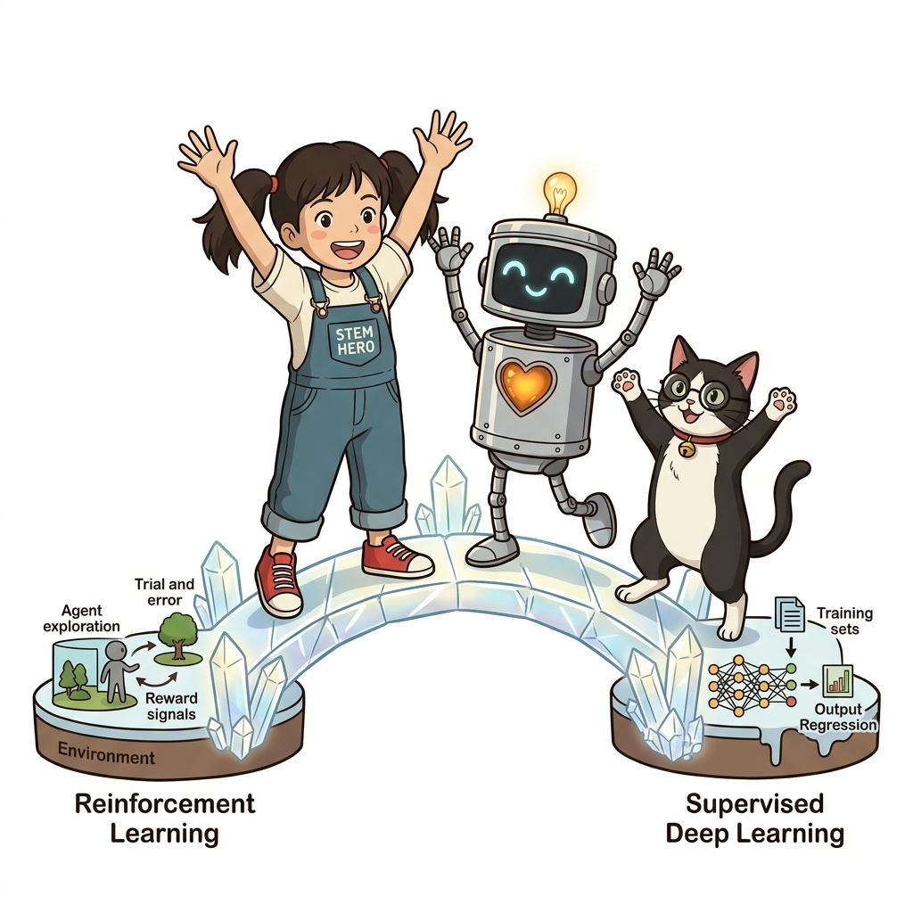

---

### 💡 핵심 주의: `next_q.unchain()`(PyTorch의 `.detach()`)은 왜 필수일까?

타깃 **$T = R_{t+1} + \gamma \max_a Q(S_{t+1}, a)$** 안에도 신경망 $Q$ 가 들어있습니다!

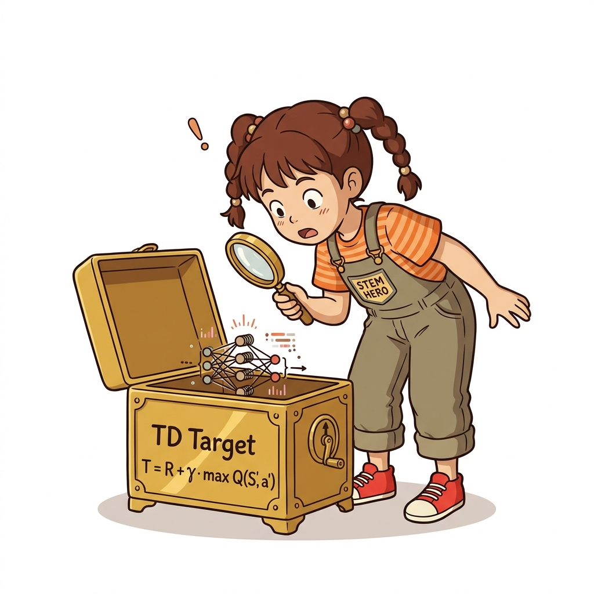

---

- 만약 아무 조치 없이 `loss.backward()`를 실행하면, **정답 레이블이어야 할 타깃 *T* 내부의 신경망 가중치까지 미분이 흘러들어가는 심각한 오류(기울기 누수)**가 발생합니다.

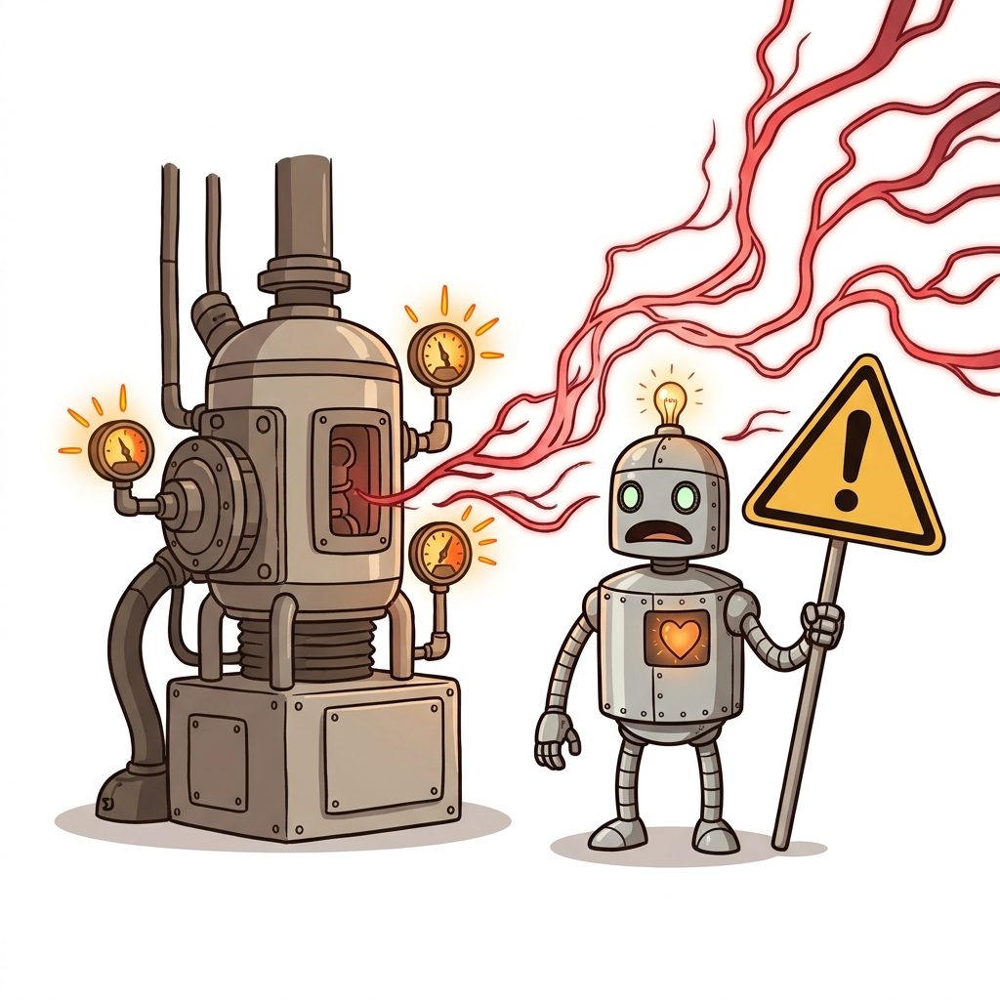

---

- 강화학습 이론(준기울기 TD, Semi-gradient TD)에서는 타깃을 현재 순간의 고정된 '상수 정답'으로 취급해야 합니다.

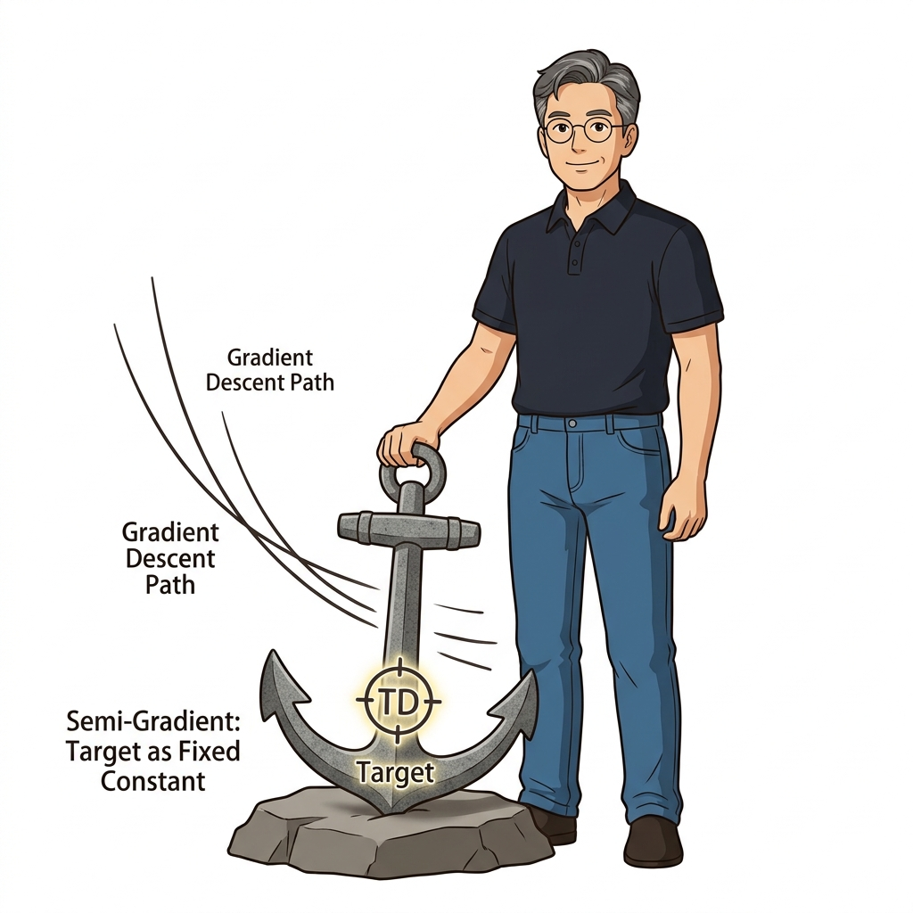

---

- 따라서 `next_q.unchain()`(파이토치에서는 `next_q.detach()`)을 호출하여 **계산 그래프의 사슬을 끊어줌으로써 불필요하고 왜곡된 역전파를 완벽히 차단**해야 합니다!

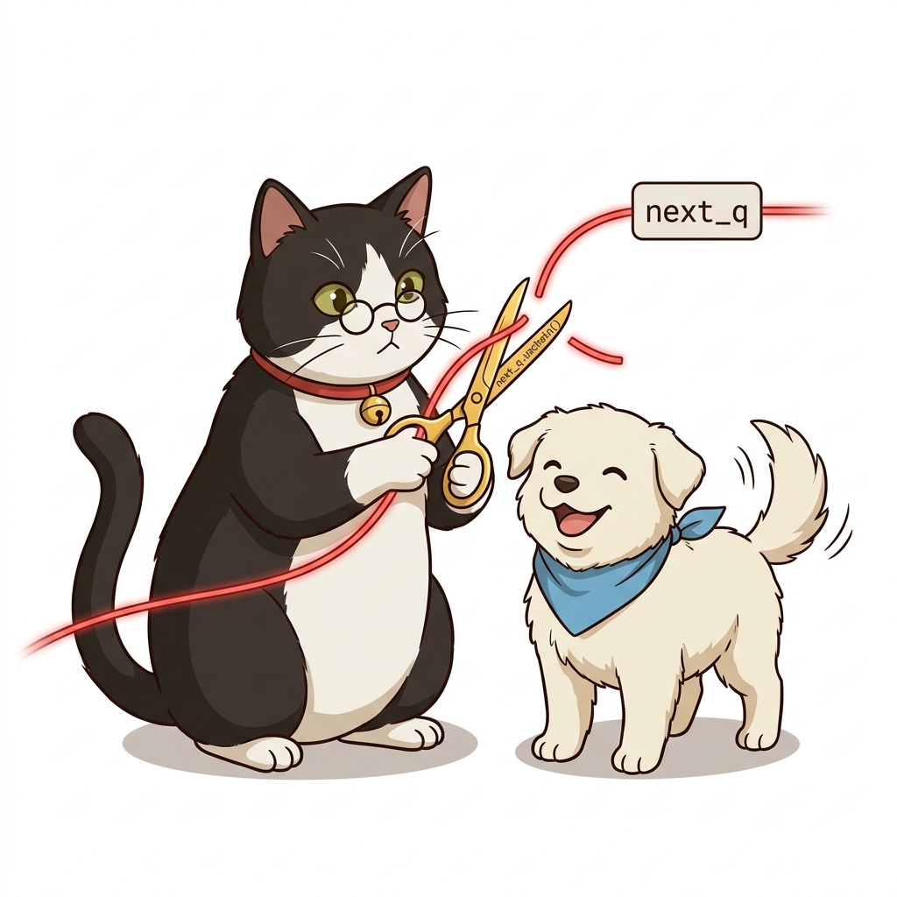

---

## 11.4.4 신경망 Q-러닝 에이전트 구현

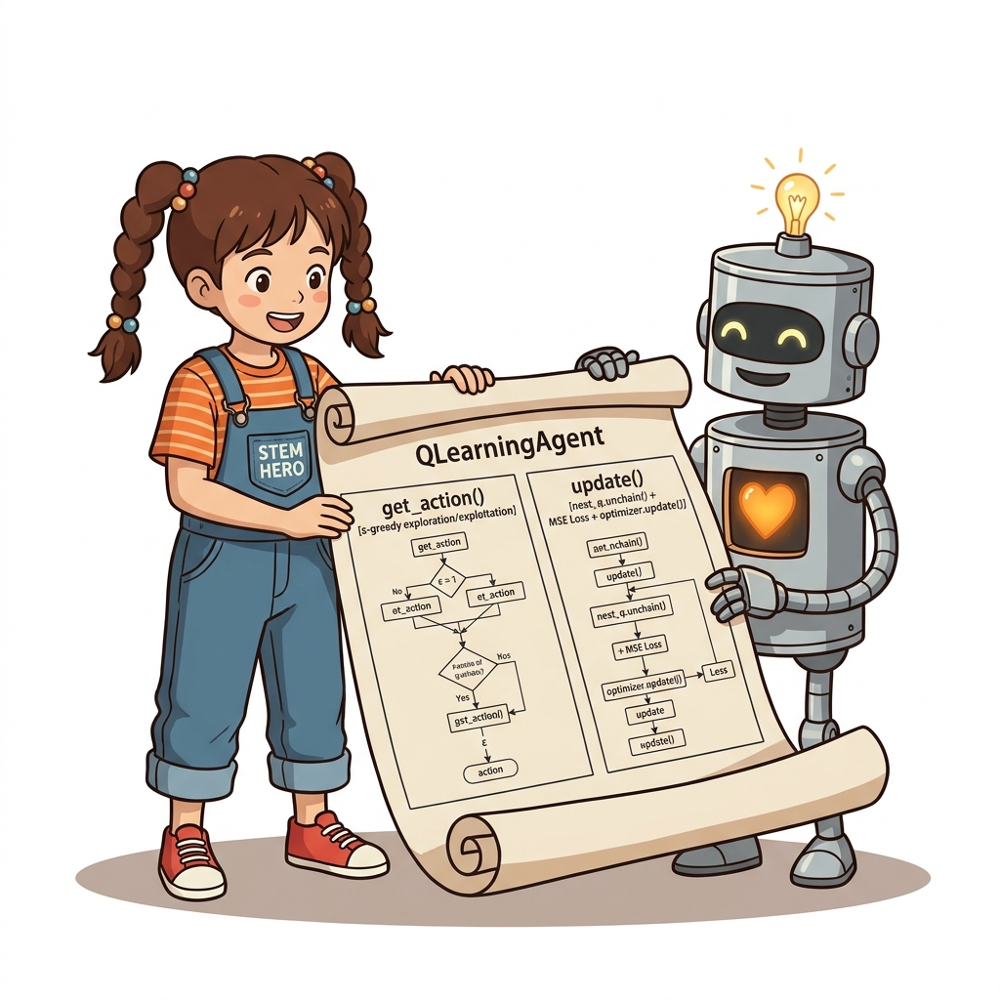

---

<div align="right"><b>ch07/q_learning_nn.py</b></div>

```python
import numpy as np
from dezero import optimizers
import dezero.functions as F

class QLearningAgent:
    def __init__(self):
        self.gamma = 0.9
        self.lr = 0.01
        self.epsilon = 0.1
        self.action_size = 4

        self.qnet = QNet()                       # ❶ Q 신경망 인스턴스
        self.optimizer = optimizers.SGD(self.lr) # ❷ 확률적 경사 하강법 옵티마이저
        self.optimizer.setup(self.qnet)

    def get_action(self, state):
        # ε-탐욕 행동 선택
        if np.random.rand() < self.epsilon:
            return np.random.choice(self.action_size)
        else:
            qs = self.qnet(state) # 1번의 순전파로 4개 Q값 일괄 획득
            return qs.data.argmax()

    def update(self, state, action, reward, next_state, done):
        # ❸ 다음 상태의 최대 Q값 계산
        done = int(done)
        next_qs = self.qnet(next_state)
        next_q = next_qs.max(axis=1)
        next_q.unchain() # 중요: TD 타깃을 역전파 그래프에서 분리(detach)!

        # ❹ 종단 마스킹 (1 - done)을 적용한 TD 타깃 계산
        target = reward + (1 - done) * self.gamma * next_q

        # ❺ 현재 상태에서 실제로 취했던 행동의 Q값 추출
        qs = self.qnet(state)
        q = qs[:, action]

        # ❻ MSE 손실 계산 및 역전파 가중치 갱신
        loss = F.mean_squared_error(target, q)
        self.qnet.cleargrads()
        loss.backward()
        self.optimizer.update()

        return loss.data
```

---

## 11.4.5 그리드 월드 훈련과 학습 곡선 분석

1000 에피소드 동안 그리드 월드 환경에서 `QLearningAgent`를 훈련시켜 봅시다.

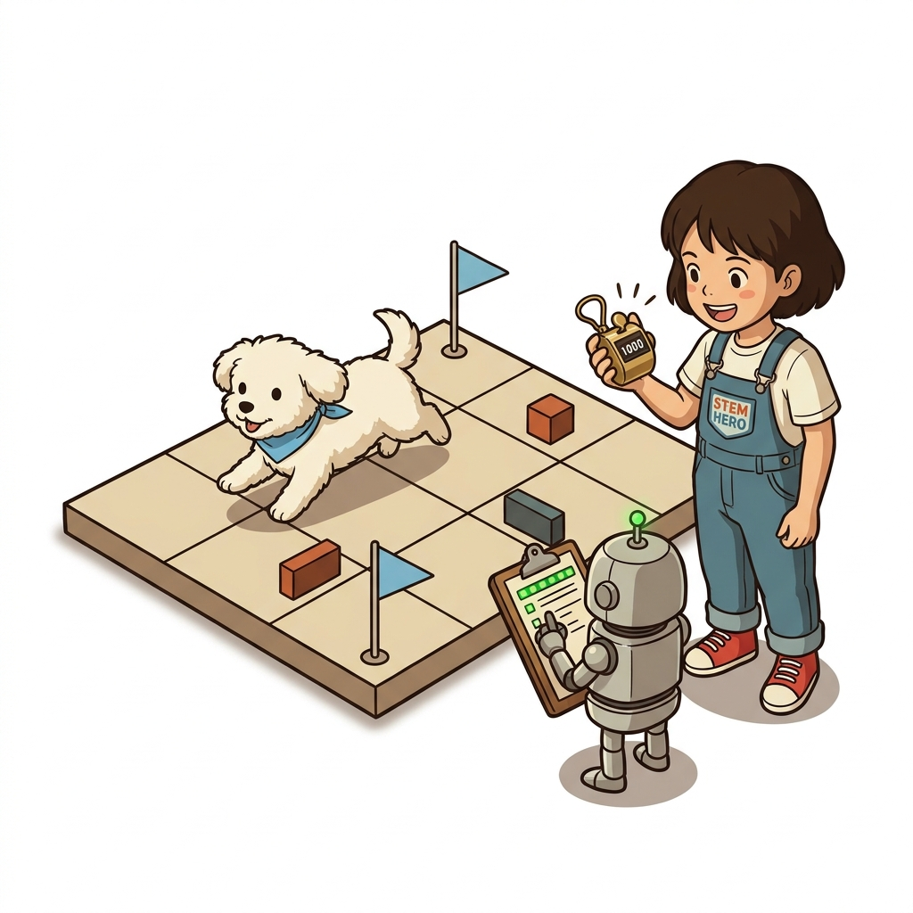

---

```python
from common.gridworld import GridWorld

env = GridWorld()
agent = QLearningAgent()

episodes = 1000
for episode in range(episodes):
    state = env.reset()
    state = one_hot(state) # 원-핫 인코딩
    done = False

    while not done:
        action = agent.get_action(state)
        next_state, reward, done = env.step(action)
        next_state = one_hot(next_state)

        agent.update(state, action, reward, next_state, done)
        state = next_state

env.render_q(agent.qnet) # 신경망 기반 Q 함수 시각화
```

---


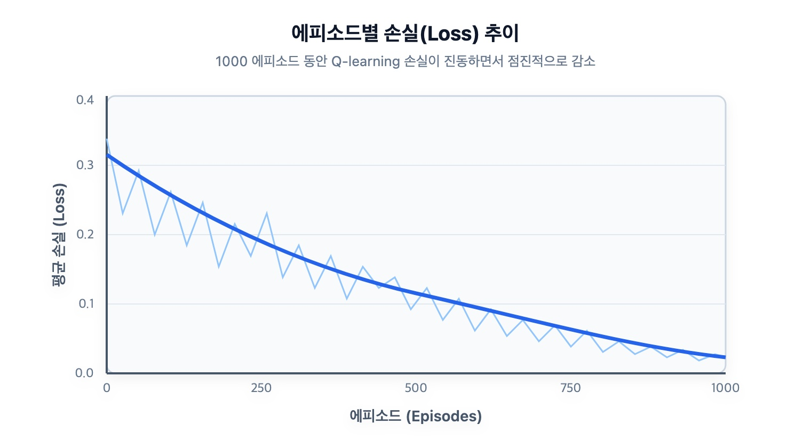
**그림 11-4-4** 에피소드 진행에 따른 손실(Loss) 추이. 일반적인 지도 학습과 달리 요동치면서도 전반적으로 우하향 수렴합니다.

---


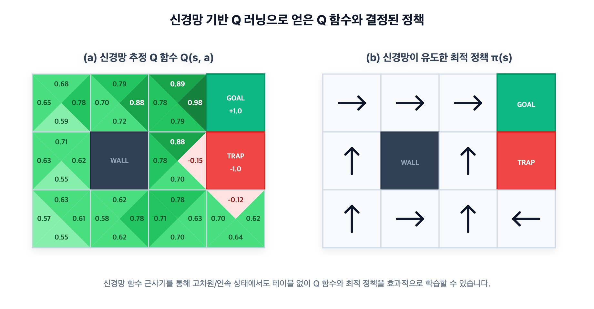
**그림 11-4-5** 신경망 Q-러닝으로 획득한 그리드 월드의 최종 정책. 최적 경로 화살표가 선명하게 형성되었습니다.

---


### 💡 왜 신경망 강화학습의 손실 그래프는 요동칠까?
[그림 11-4-4]를 보면 지도 학습처럼 매끄럽게 떨어지지 않고 톱니바퀴처럼 심하게 요동칩니다. 
그 이유는 강화학습의 고유한 특성 때문입니다:

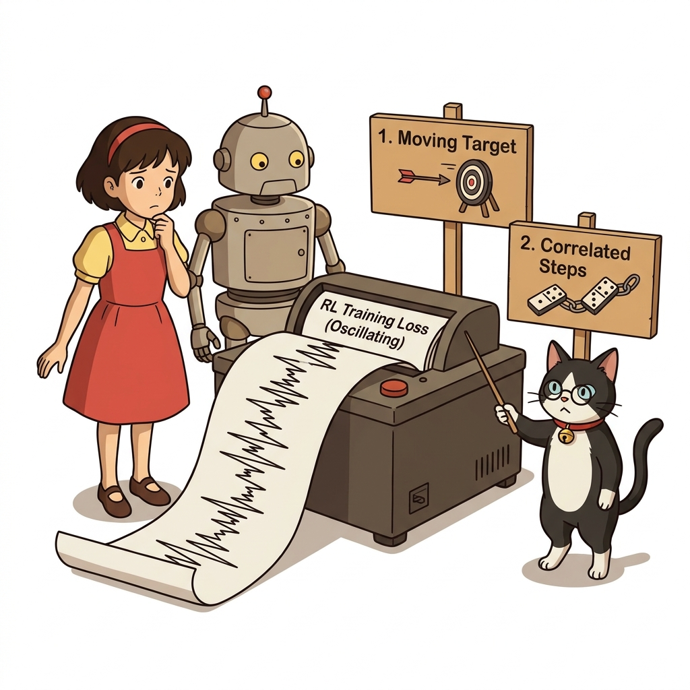

---


1. **타깃이 계속 움직인다 (Moving Target Problem)**:
   정답 레이블 *T* 자체가 아직 덜 학습된 신경망 `self.qnet`의 출력으로 만들어지기 때문에, 가중치를 갱신할 때마다 정답 기준선도 함께 흔들립니다.

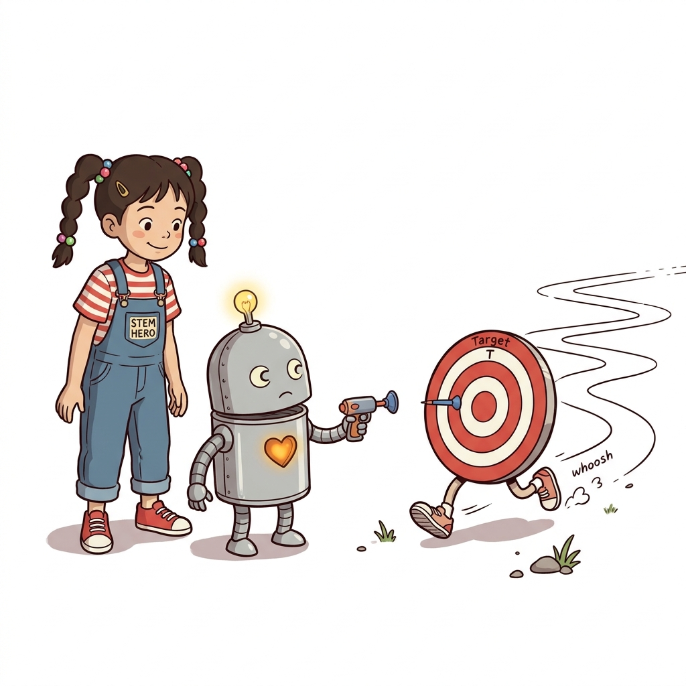

---


2. **샘플 간 강한 상관관계 (Correlated Samples)**:
   연속된 시간 스텝의 경험 ($S_t, A_t, R_t, S_{t+1}$) 은 서로 매우 비슷하여 데이터의 독립성(i.i.d) 가정이 깨집니다.

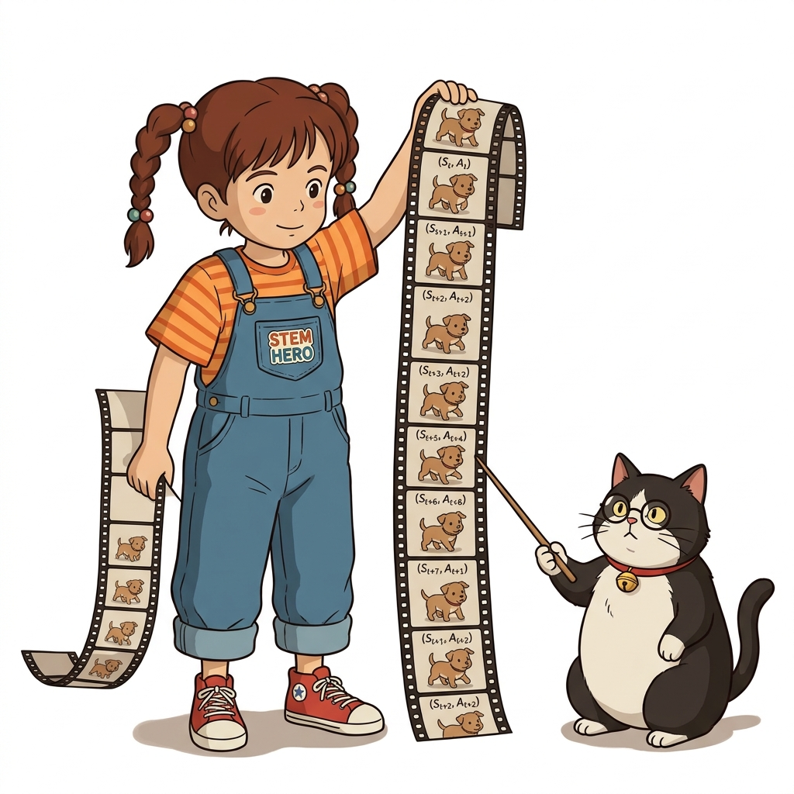

---


> [!IMPORTANT]
> **다음 장(12장 DQN)의 예고**:
> 바로 이 요동치는 불안정성을 잠재우기 위해 딥마인드(DeepMind)가 고안한 두 가지 혁신, **경험 재생(Experience Replay)**과 **타깃 네트워크(Target Network)**가 등장합니다. 12장에서는 이 두 핵심 기술을 탑재하여 진정한 심층 Q-네트워크(DQN)를 완성하게 됩니다!

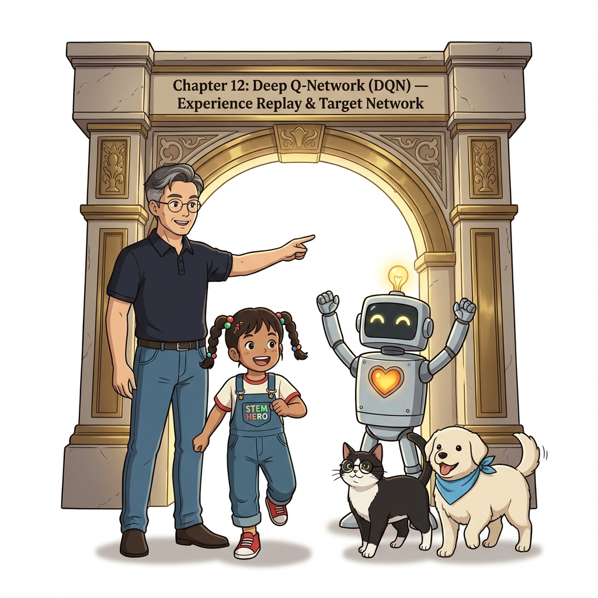
