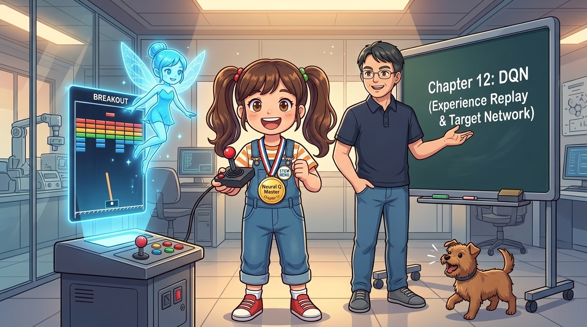
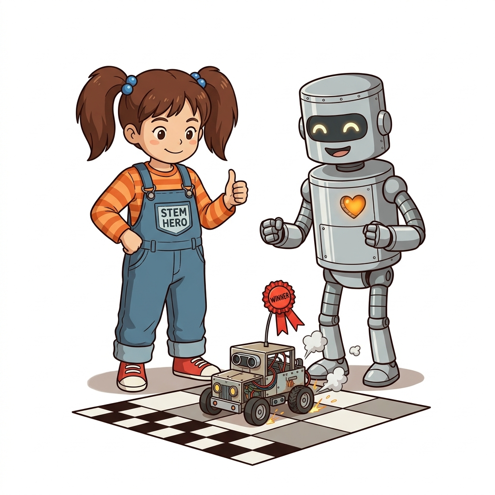
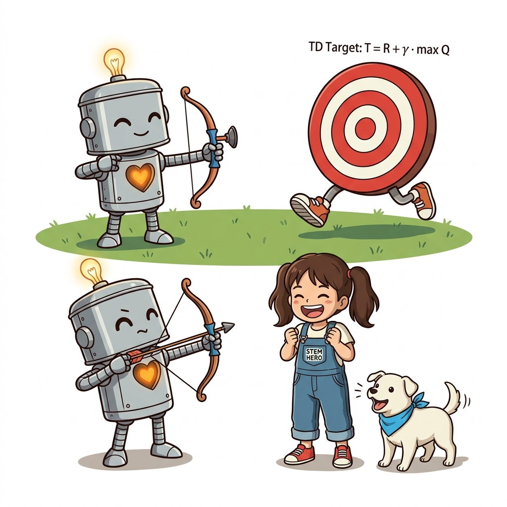
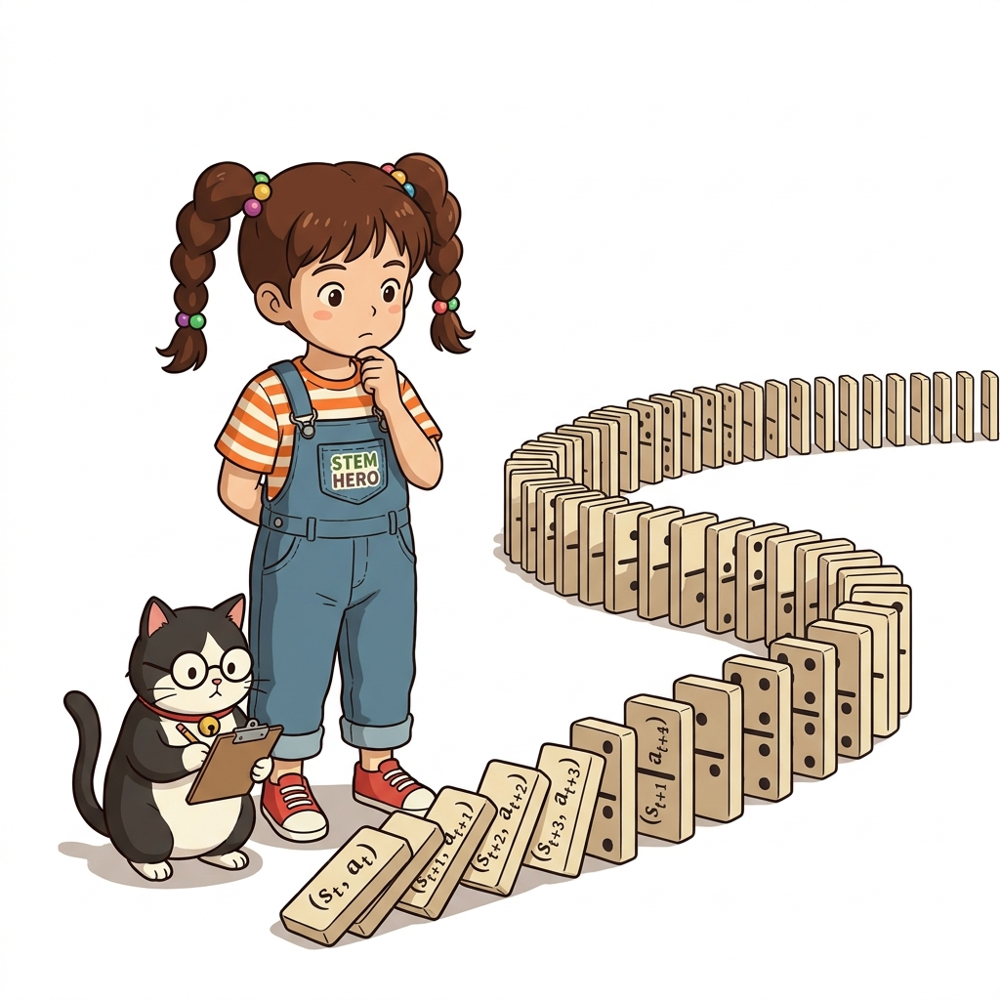
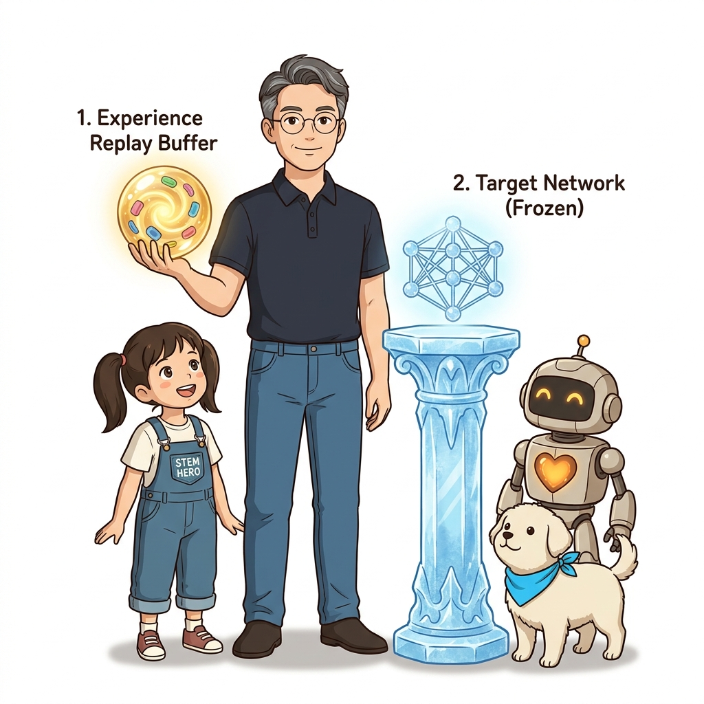
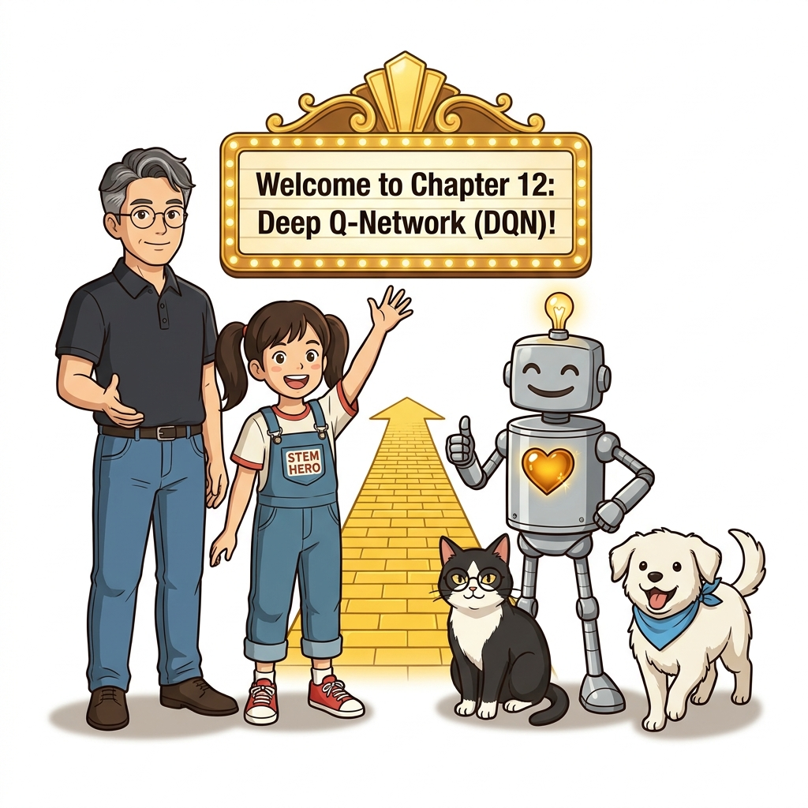

# 11.5 제11장 정리: 딥러닝과 Q-러닝의 융합, 심층 강화학습의 서막

강화학습이 테이블의 한계를 벗어나 무한한 차원의 바다로 항해할 수 있도록 만들어 준 **제11장 인공신경망과 Q-러닝**의 핵심 이론과 실습 내용을 총정리합니다. 

**그림 11-5-1** 뉴럴 네트워크 형태의 홀로그램을 보며 신경망에 의한 행동 가치 근사를 요점 복습하는 도로시와 지니

---

딥러닝 프레임워크 DeZero의 자동 미분부터 비선형 신경망, 그리고 QNet을 결합한 심층 Q-러닝의 원리를 정리하고, 딥마인드의 전설적인 **DQN**이 기다리는 12장으로 전진해 봅시다!

**그림 11-5-2** 11장 신경망 Q-러닝 마스터 메달을 목에 걸고 조이스틱을 쥔 도로시와 아타리(Atari) 벽돌깨기 게임 화면을 비추는 지니, 그리고 12장 DQN의 2대 비밀 병기(경험 재생 & 타깃 네트워크)를 소개하는 이호진 교수님과 토토

---

## 11.5.1 제11장 핵심 학습 내용 총정리

| 절 구분 | 핵심 주제 | 핵심 메커니즘 및 수식 |
| :--- | :--- | :--- |
| **11.1 DeZero 기초** | 자동 미분 & 계산 그래프 | `Variable.backward()`를 통한 역전파, 매 반복마다 `cleargrad()`로 기울기 누적 초기화 |
| **11.2 선형 회귀** | 머신러닝 최적화 | *y* = *Wx* + *b*, 평균 제곱 오차(MSE) 손실 함수: *L* = (1/*N*) ∑ (*Wx**i* + *b* - *y**i*)2 |
| **11.3 인공신경망** | 비선형 곡선 근사 | `Linear` 계층 + 비선형 활성화 함수(ReLU: max(0, *x*)), `Model`, `Optimizer(Adam)` |
| **11.4 Q-러닝과 신경망** | 심층 Q-러닝 (Neural Q) | 상태 원-핫 인코딩, `QNet(s) → [Q(s, a0), ...]`, TD 타깃을 레이블로 삼는 회귀, `next_q.unchain()` |

---

## 11.5.2 테이블형 Q-러닝 vs 신경망 Q-러닝 비교

| 비교 항목 | 테이블형 Q-러닝 (10장) | 신경망 기반 Q-러닝 (11장) |
| :--- | :--- | :--- |
| **Q 함수 표현 방식** | 딕셔너리(`defaultdict`) 2차원 표 | **다층 인공신경망 (`Model`, `Linear`)** |
| **상태 입력 형태** | 정수/튜플 좌표 `(y, x)` | **12차원 원-핫 벡터 (또는 실수 특징 벡터)** |
| **상태 공간 확장성** | 상태 수가 수천 개만 넘어도 메모리 폭발 | **수십만 차원 및 연속 실수 상태도 처리 가능** |
| **가치 갱신 방식** | 테이블의 해당 칸 숫자를 직접 수정 | **MSE 손실을 계산하여 가중치를 역전파(`backward`) 갱신** |
| **일반화 능력 (Generalization)** | 방문하지 않은 상태는 영원히 가치 0 | **비슷한 상태들의 가치를 신경망이 유기적으로 추론** |

---

## 11.5.3 단순 신경망 Q-러닝의 한계와 12장 DQN의 과제

11.4절에서 우리는 그리드 월드 문제를 신경망으로 멋지게 풀어냈지만, 동시에 심층 강화학습의 치명적인 불안정성을 목격했습니다:

---

1. **움직이는 표적 문제 (Moving Target Problem)**:
   - 손실을 계산할 때 사용하는 정답 레이블(TD 타깃 *T* = *R* + *γ* max *Q*(*S*&#39;, *a*)) 역시 **실시간으로 변하는 자기 자신의 신경망 가중치**에 의해 계산됩니다.
   - 사격 연습을 하는데 과녁이 이리저리 뛰어다니는 꼴이 되어 학습 곡선이 심하게 요동칩니다.

---

2. **데이터의 강한 시간적 상관관계 (Correlated Samples)**:

- 연속된 시간 스텝의 경험 (*S**t*, *A**t*, *R**t*, *S**t*+1)은 서로 매우 비슷하여 머신러닝의 독립 동일 분포(i.i.d) 가정을 정면으로 위반합니다.

---

> [!IMPORTANT]
> **제12장 DQN (Deep Q-Network)의 2대 혁신**:
> 2015년 딥마인드(DeepMind) 연구진은 국제 학술지 네이처(Nature)에 논문을 발표하며, 이 두 가지 고질병을 완벽하게 치료하는 두 개의 열쇠를 제시했습니다:
> 1. **경험 재생 (Experience Replay)**: 에이전트의 경험들을 거대한 버퍼에 저장한 뒤, 무작위 미니배치로 뽑아 학습시켜 데이터 상관관계를 완전히 분쇄합니다!
> 2. **타깃 네트워크 (Target Network)**: 타깃을 계산하는 전용 복사본 신경망을 별도로 분리하여 일정 주기 동안 얼려둠(Freeze)으로써 과녁을 확고하게 고정합니다!

---

이제 도로시, 지니, 토토, 그리고 이호진 교수님과 함께 12장으로 넘어가, 전 세계 인공지능 연구자들을 전율케 했던 진정한 **DQN(Deep Q-Network)**을 직접 만들어 봅시다!

