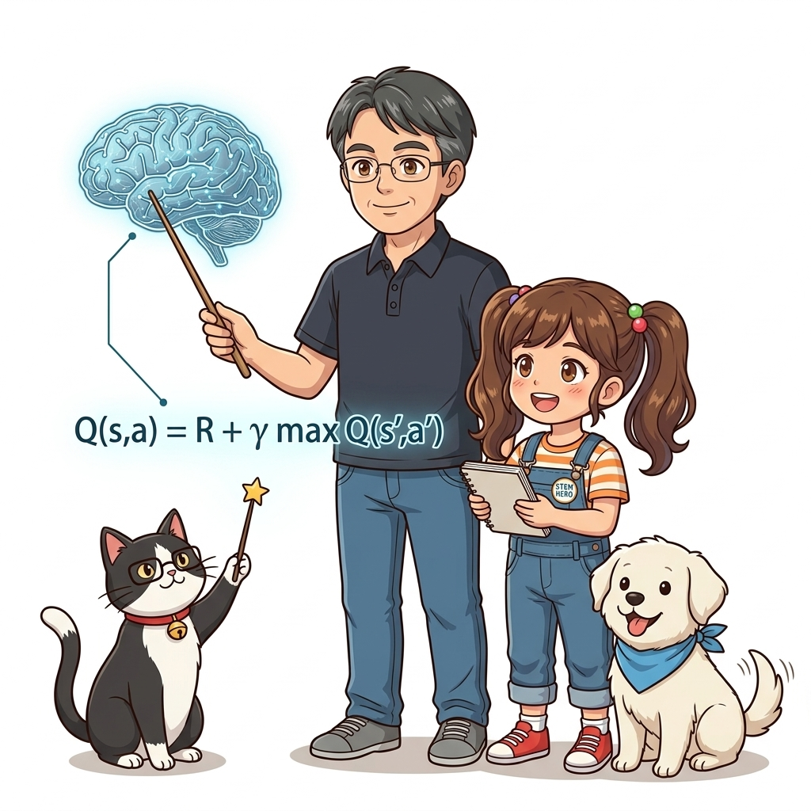
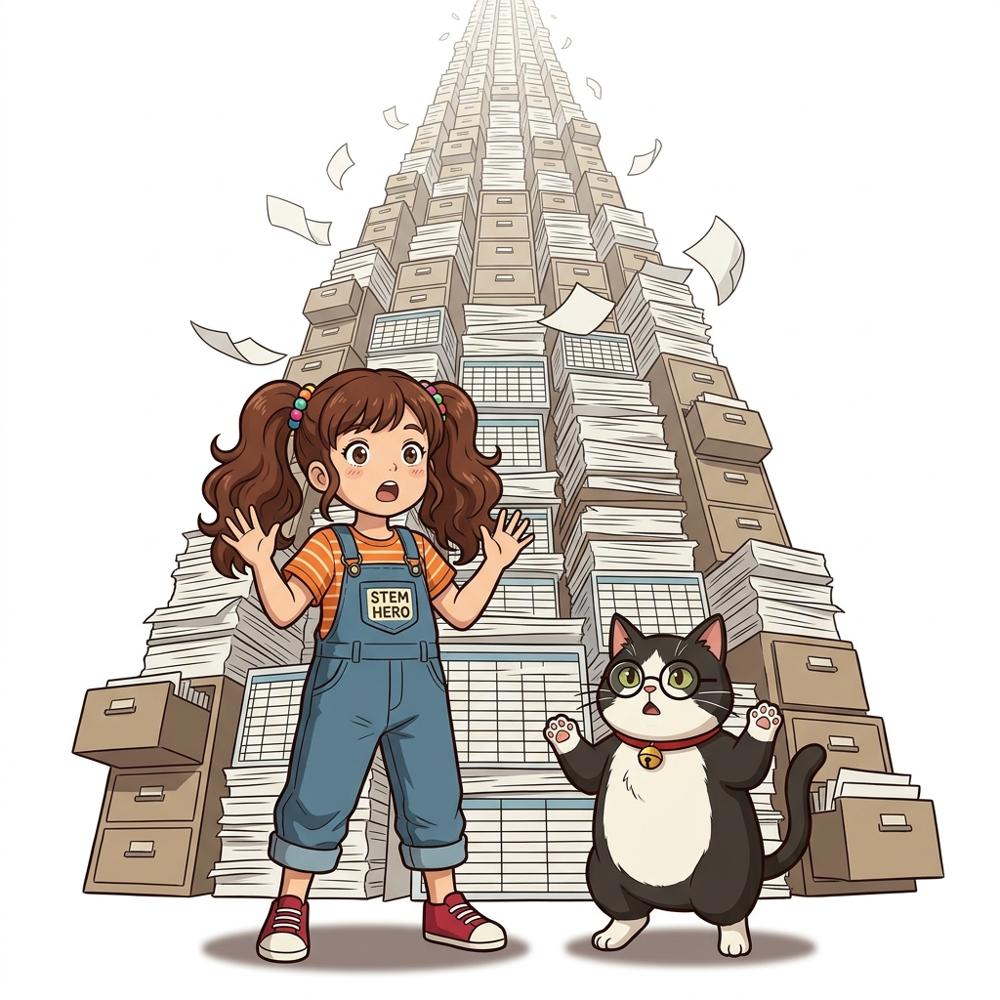
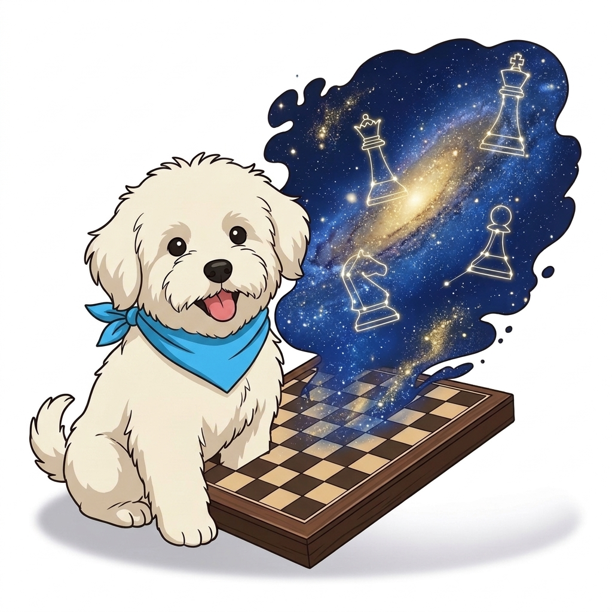
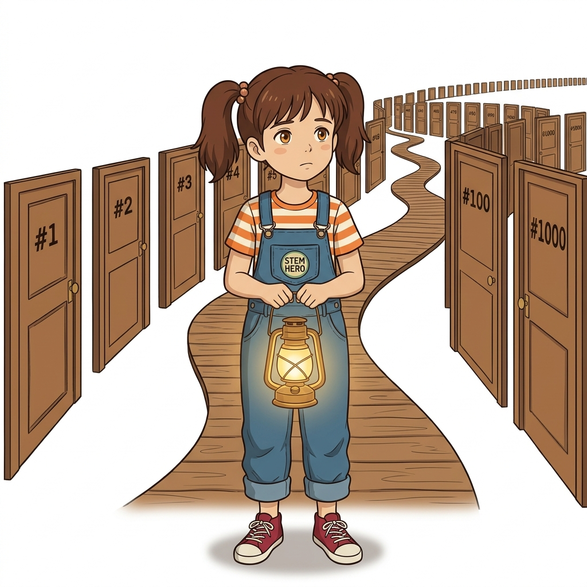
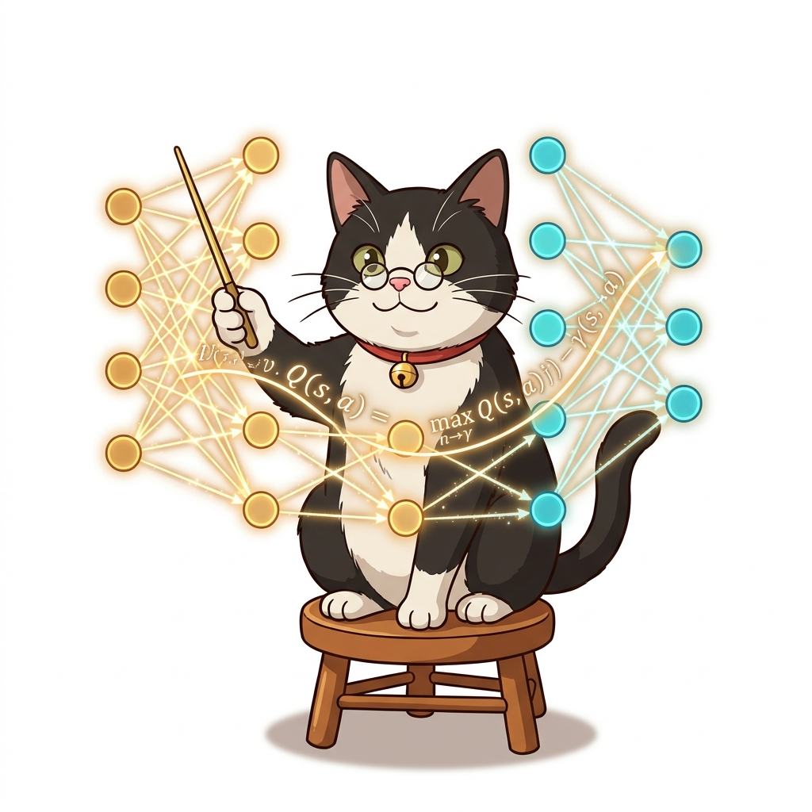
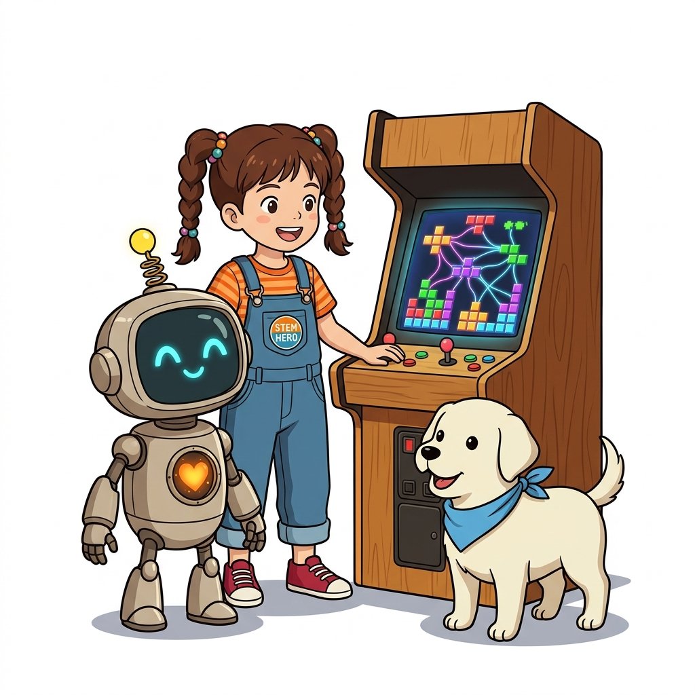
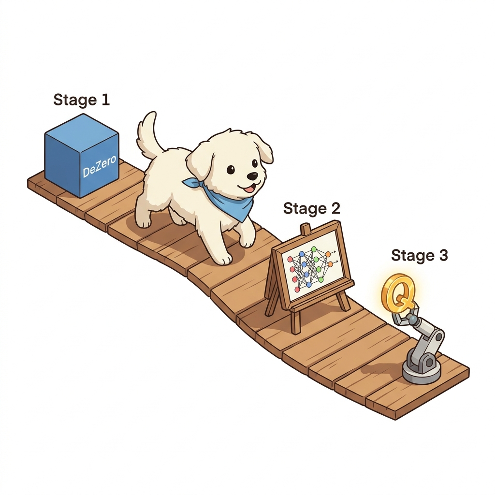
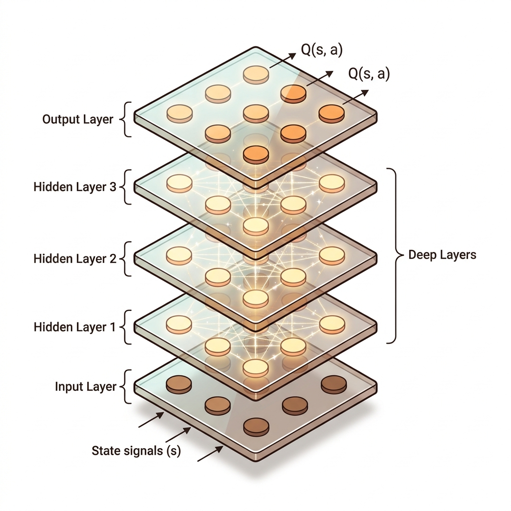

<b>CHAPTER 11</b>

# 신경망과 Q 러닝

---

> **도로시와 토토의 비유로 이해하기**:
> 도로시가 마법 요술봉을 지휘하자 거대하게 연결된 오색 전구망(인공신경망)이 켜집니다. 격자 세상 전체의 매 상태가 입력되면 신경망이 그에 맞는 최적 행동 가치(Q-value)를 스마트하게 예측해 냅니다. 이제 칠판에 일일이 적던 가치 표 없이도 무한히 넓은 세상의 상태 가치를 계산할 수 있게 된 것입니다!

---

지금까지는 상태와 행동의 가짓수가 적은 문제만 다뤘습니다. 예를 들어 '3 x 4 그리드 월드' 문제에서는 상태 후보가 12개이고 행동 후보는 4개뿐이라서 Q 함수 후보는 총 12 x 4 = 48개였습니다.

---

이 정도 크기라면 Q 함수를 테이블로 (파이썬 코드에서는 딕셔너리로) 관리하는 데 아무런 문제가 없습니다. 하지만 현실은 훨씬 복잡하죠. 상태와 행동의 후보가 엄청나게 많을 수 있습니다. 이러한 문제에서는 Q 함수를 테이블로 관리하도록 구현하는 건 현실적이지 못합니다.

---

예를 들어 체스는 보드의 배열 패턴이 $10^{123}$ 개나 될 만큼 다양합니다. 

즉, 상태가 이 수만큼 존재한다는 뜻입니다. 이 많은 상태를 테이블로 관리하는 건 현실적이지 못합니다. 

---

문제는 여기서 끝이 아닙니다. 더 큰 문제는 테이블의 원소 하나하나를 독립적으로 평가하고 개선해야 한다는 점입니다.

이만큼 막대한 수를 모두 경험해보는 건 현실적으로 불가능합니다.

---

해결책은 무엇일까요? 

---

Q 함수를 더 가벼운 함수로 근사하는 방법을 생각해볼 수 있습니다. 

이 방식에서 가장 유력한 후보가 바로 딥러닝입니다. 

---

실제로 강화 학습에 딥러닝을 결합하여 지금까지 많은 혁신을 이루어왔습니다. 

이제 우리도 드디어 심층 강화 학습 세계에 첫발을 내딛게 되었습니다.

---

이번 장에서는 먼저 DeZero라는 딥러닝 프레임워크의 사용법을 설명합니다. 

그런 다음 DeZero를 이용하여 신경망의 기초를 배우고 마지막으로 앞 장에서 구현한 Q 러닝을 신경망을 사용하여 구현해보겠습니다.

---

> [!CAUTION]
> 신경망의 층layer을 깊게 만든 것이 딥러닝입니다. 이 책에서는 '딥러닝'과 '신경망'이라는 용어를 구분하지 않고 사용합니다.

