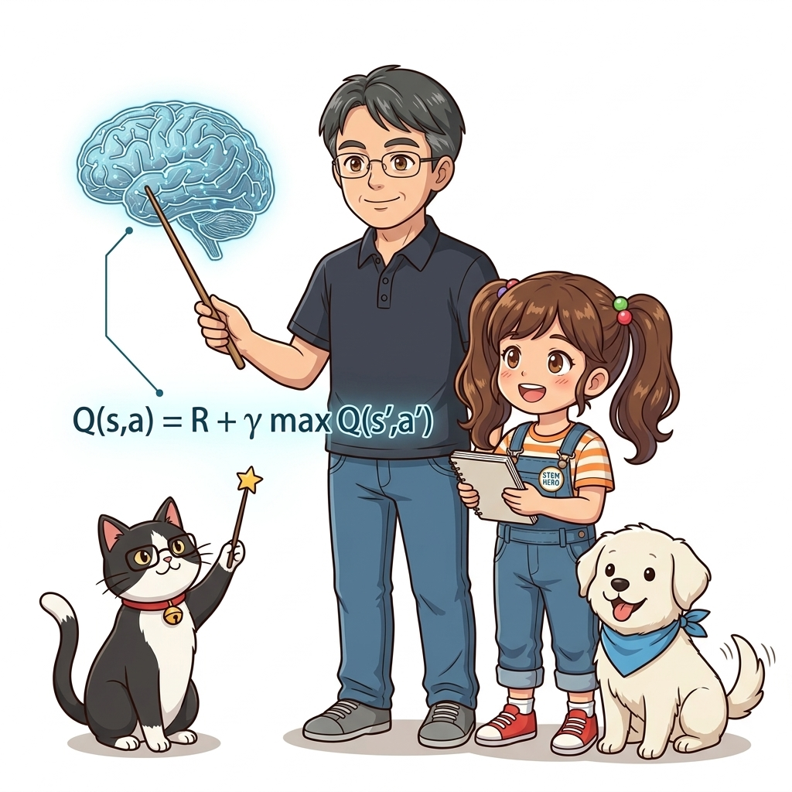
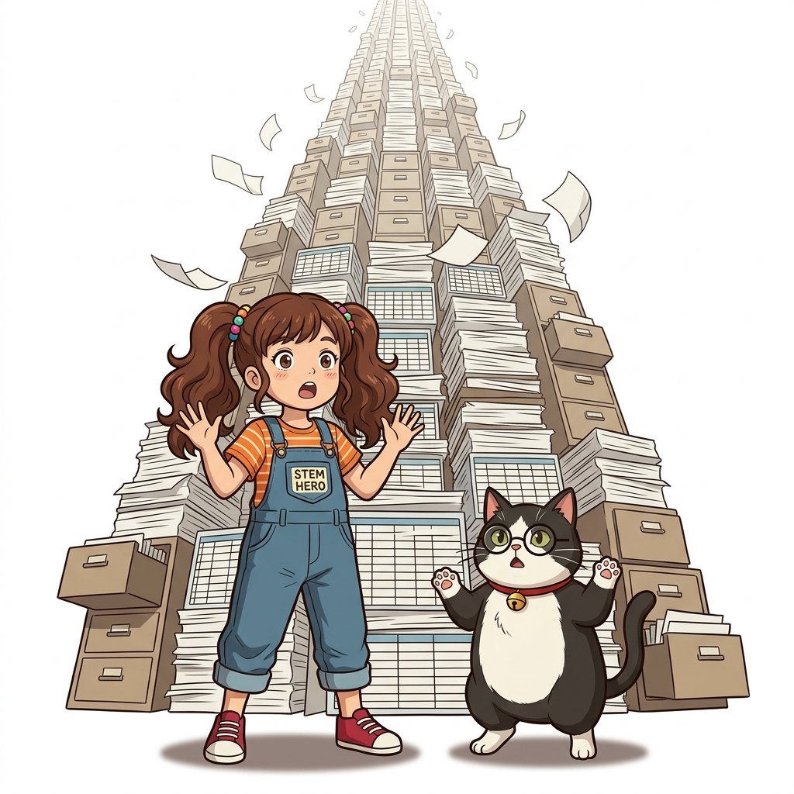
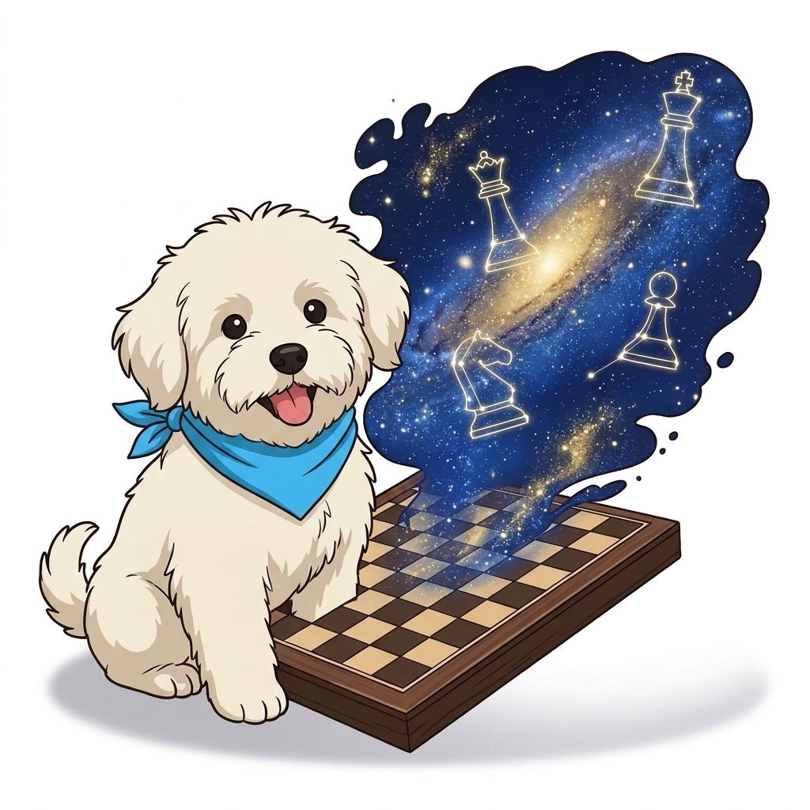
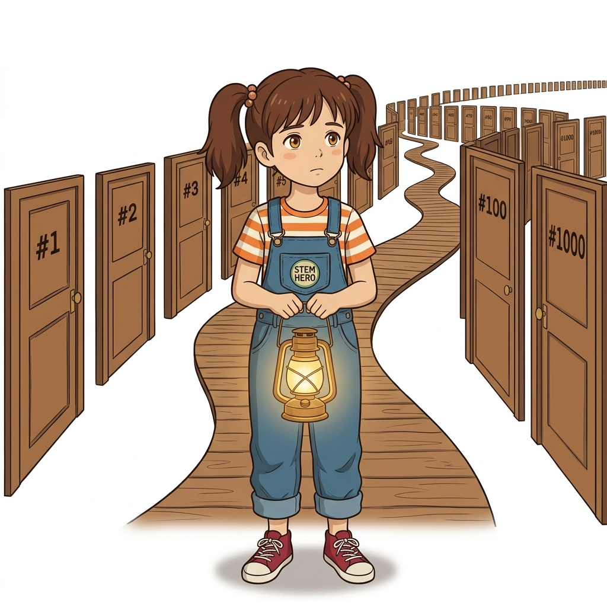
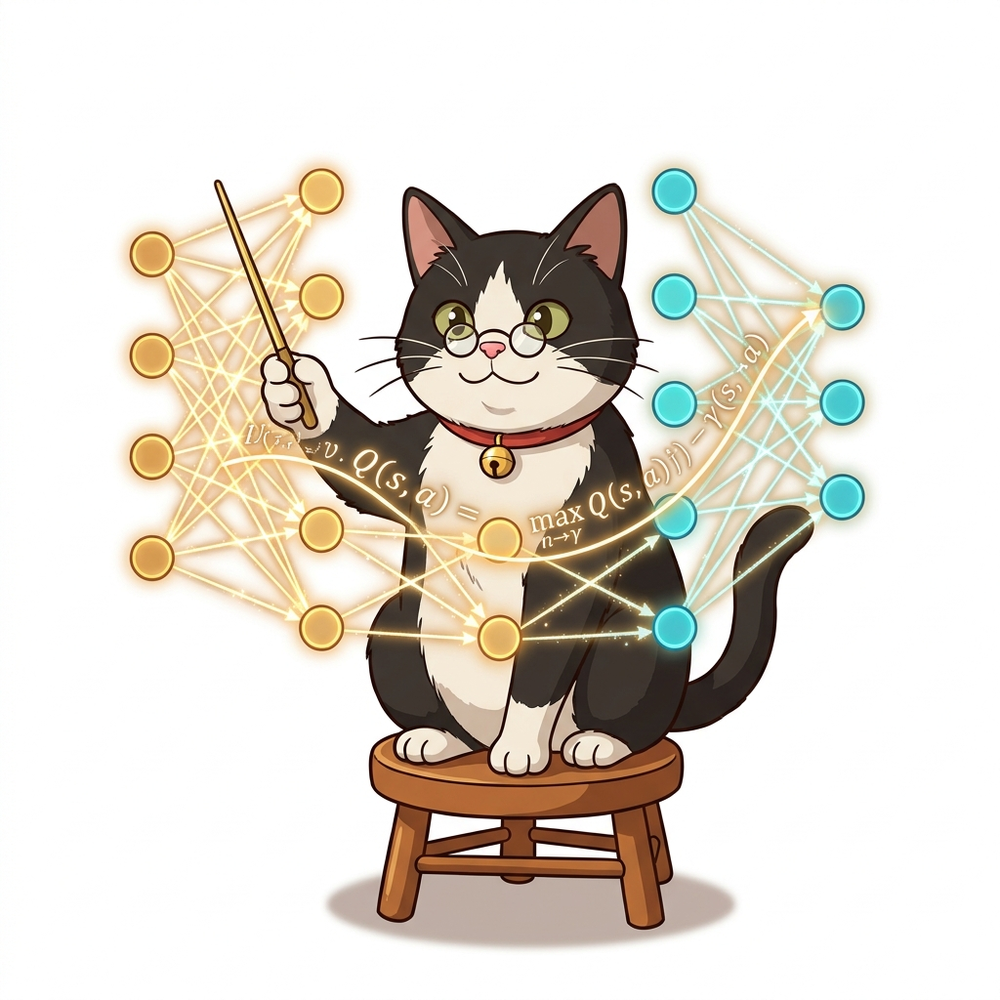
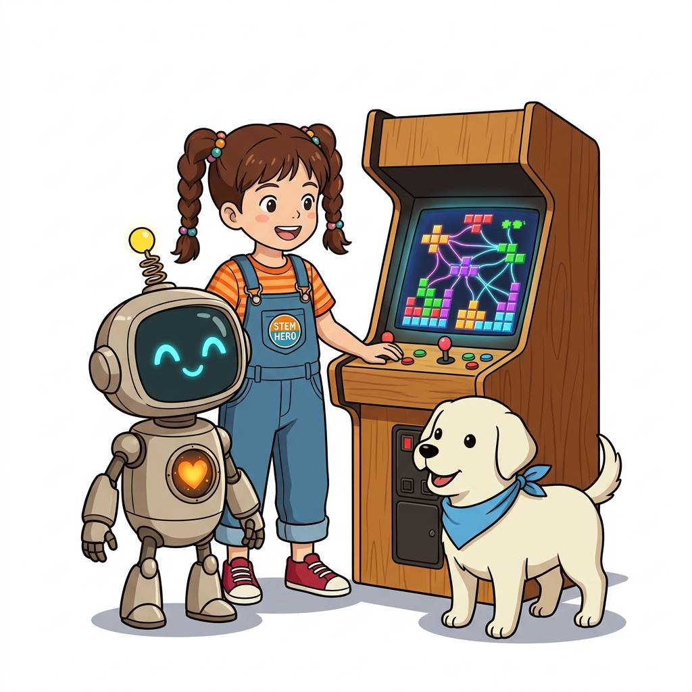
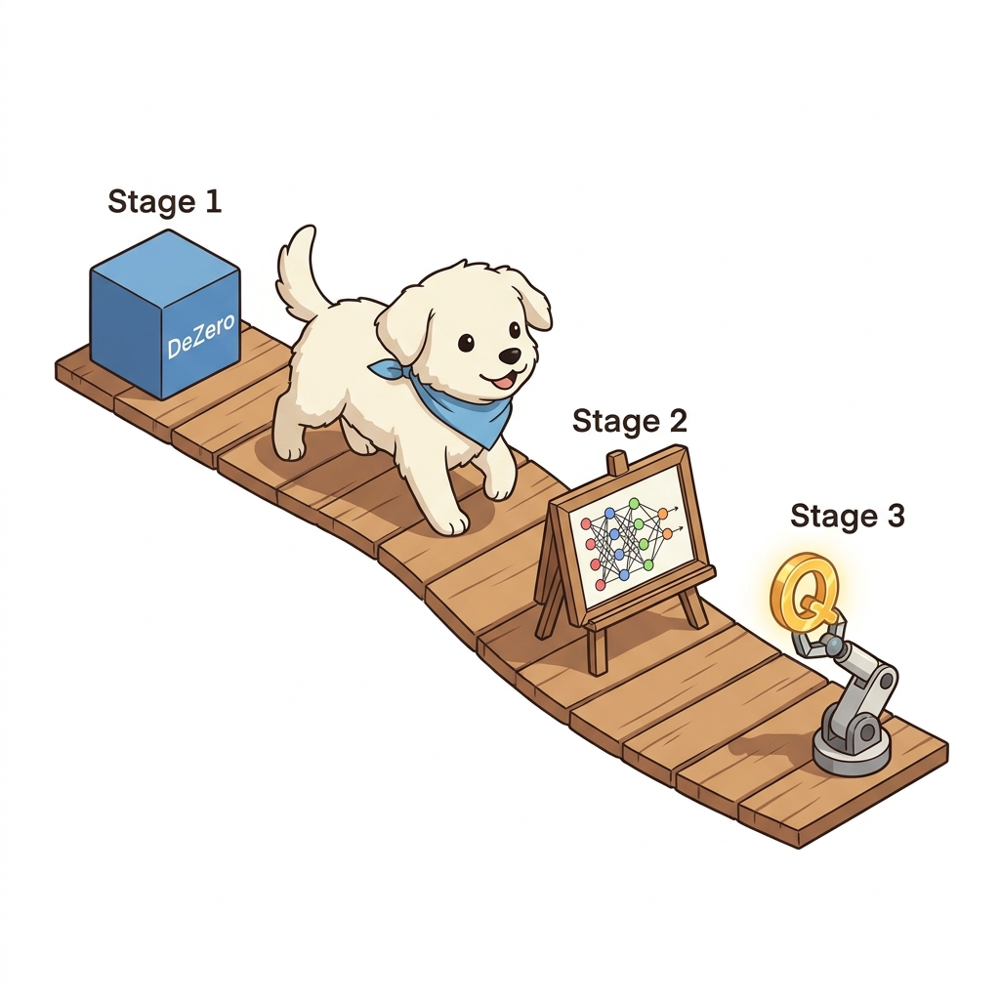
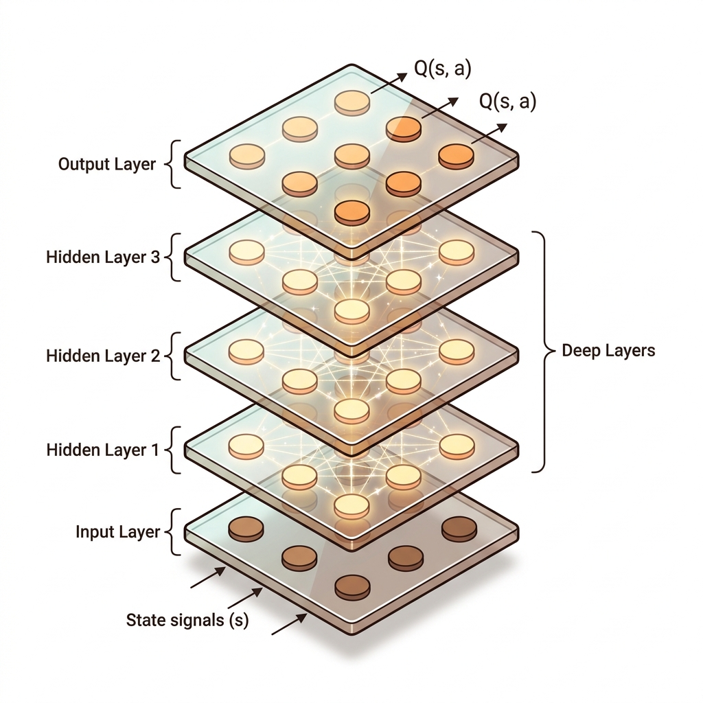

<b>CHAPTER 11</b>

# 신경망과 Q 러닝

> **[강의 스크립트]**
> 십일장에서는 테이블 기반 강화학습의 한계를 극복하고, 무한한 상태 공간을 다룰 수 있는 심층 강화학습의 핵심인 신경망과 큐러닝의 결합을 다룹니다. 화면의 그림에서 보듯, 수많은 뉴런이 얽힌 인공신경망이 복잡한 환경의 가치를 스스로 학습해 나가는 새로운 패러다임을 체계적으로 살펴보게 될 것입니다.

---

> **도로시와 토토의 비유로 이해하기**:
> 도로시가 마법 요술봉을 지휘하자 거대하게 연결된 오색 전구망(인공신경망)이 켜집니다. 격자 세상 전체의 매 상태가 입력되면 신경망이 그에 맞는 최적 행동 가치(Q-value)를 스마트하게 예측해 냅니다. 이제 칠판에 일일이 적던 가치 표 없이도 무한히 넓은 세상의 상태 가치를 계산할 수 있게 된 것입니다!

> **[강의 스크립트]**
> 비유를 통해 직관을 잡아봅시다. 과거의 강화학습이 칠판에 모든 상태와 행동의 큐값을 표로 일일이 적어두던 방식이었다면, 이제는 거대하게 연결된 신경망이라는 마법 전구망에 상태를 입력하여 최적의 행동 가치를 직접 출력해 내는 함수 근사 방식으로 전환하는 것입니다. 이를 통해 우리는 테이블의 크기 제약에서 완전히 해방될 수 있습니다.

---

지금까지는 상태와 행동의 가짓수가 적은 문제만 다뤘습니다. 예를 들어 '3 x 4 그리드 월드' 문제에서는 상태 후보가 12개이고 행동 후보는 4개뿐이라서 Q 함수 후보는 총 12 x 4 = 48개였습니다.

> **[강의 스크립트]**
> 우리가 지금까지 다루었던 문제들을 되돌아봅시다. 삼 곱하기 사 크기의 그리드 월드에서는 상태가 열두 개이고 행동이 네 개뿐이어서, 큐 함수 후보는 총 마흔여덟 개에 불과했습니다. 이처럼 상태 수가 극히 제한된 환경에서는 모든 가치를 표 안에 하나하나 기록하는 것이 매우 단순하고 명확했습니다.

---

이 정도 크기라면 Q 함수를 테이블로 (파이썬 코드에서는 딕셔너리로) 관리하는 데 아무런 문제가 없습니다. 하지만 현실은 훨씬 복잡하죠. 상태와 행동의 후보가 엄청나게 많을 수 있습니다. 이러한 문제에서는 Q 함수를 테이블로 관리하도록 구현하는 건 현실적이지 못합니다.

> **[강의 스크립트]**
> 마흔여덟 개 수준의 상태 공간이라면 파이썬의 딕셔너리 구조로 테이블을 관리하는 데 아무런 무리가 없습니다. 하지만 우리가 해결해야 할 현실 세계의 문제는 상태와 행동의 후보가 수백만, 수천억 개에 달하거나 연속적인 실수 공간으로 확장됩니다. 화면에 보이는 것처럼 상태가 폭발적으로 증가하는 순간, 테이블 기반 관리 방식은 물리적인 한계에 부딪히게 됩니다.

---

예를 들어 체스는 보드의 배열 패턴이 $10^{123}$ 개나 될 만큼 다양합니다. 

즉, 상태가 이 수만큼 존재한다는 뜻입니다. 이 많은 상태를 테이블로 관리하는 건 현실적이지 못합니다. 

> **[강의 스크립트]**
> 체스 게임을 예로 들어보겠습니다. 체스 보드 위의 기물 배열 패턴은 십의 백이십삼 제곱 개라는 천문학적인 수치에 달합니다. 우주의 모든 원자 수보다도 많은 이 막대한 상태들을 컴퓨터 메모리 테이블에 담는다는 것은 물리적으로 완전히 불가능한 일이지요.

---

문제는 여기서 끝이 아닙니다. 더 큰 문제는 테이블의 원소 하나하나를 독립적으로 평가하고 개선해야 한다는 점입니다.

이만큼 막대한 수를 모두 경험해보는 건 현실적으로 불가능합니다.

> **[강의 스크립트]**
> 메모리 용량 문제보다 더욱 치명적인 본질적 한계가 있습니다. 테이블 방식에서는 각 칸의 원소를 독립적으로 평가하고 갱신해야 한다는 점입니다. 즉, 십의 백이십삼 제곱 번의 경험을 일일이 겪어보지 않고는 한 번도 가보지 않은 상태의 가치를 전혀 알 수 없습니다. 이러한 탐색의 부담은 현실적인 시간 내에 해결할 수 없는 장벽입니다.

---

해결책은 무엇일까요? 

> **[강의 스크립트]**
> 그렇다면 우리는 이 상태 폭발의 딜레마를 어떻게 돌파해야 할까요? 화면의 전구처럼 새로운 발상의 전환이 필요합니다. 모든 상태를 일일이 표에 적어둘 수 없다면, 상태와 가치 사이의 관계를 수학적 패턴으로 요약해 주는 똑똑한 근사 도구를 도입해야 합니다.

---

Q 함수를 더 가벼운 함수로 근사하는 방법을 생각해볼 수 있습니다. 

이 방식에서 가장 유력한 후보가 바로 딥러닝입니다. 

> **[강의 스크립트]**
> 바로 큐 함수를 유연한 수학 함수로 근사하는 함수 근사 기법입니다. 상태를 함수의 입력으로 넣으면 해당 상태의 큐값을 수학적으로 계산해 내는 것이지요. 복잡하고 고차원적인 비선형 함수를 가장 뛰어나게 근사해 내는 현대 인공지능의 핵심 기술이 바로 딥러닝입니다.

---

실제로 강화 학습에 딥러닝을 결합하여 지금까지 많은 혁신을 이루어왔습니다. 

이제 우리도 드디어 심층 강화 학습 세계에 첫발을 내딛게 되었습니다.

> **[강의 스크립트]**
> 강화학습과 딥러닝의 결합은 현대 인공지능 역사에서 수많은 기적을 만들어냈습니다. 아타리 비디오 게임에서 인간을 능가하고 바둑에서 알파고의 승리를 이끌어낸 토대가 바로 이 심층 강화학습입니다. 우리는 이제 그 위대한 심층 강화학습의 첫 관문으로 들어서는 것입니다.

---

이번 장에서는 먼저 DeZero라는 딥러닝 프레임워크의 사용법을 설명합니다. 

그런 다음 DeZero를 이용하여 신경망의 기초를 배우고 마지막으로 앞 장에서 구현한 Q 러닝을 신경망을 사용하여 구현해보겠습니다.

> **[강의 스크립트]**
> 이번 십일장의 학습 로드맵은 삼단계로 진행됩니다. 일단계에서는 초경량 딥러닝 프레임워크인 디제로의 자동 미분 원리를 익히고, 이단계에서는 선형 회귀와 다층 인공신경망의 구조를 밑바닥부터 구축합니다. 그리고 삼단계에서는 앞서 배운 큐러닝 알고리즘에 신경망을 결합하여 심층 큐러닝 에이전트를 완성할 것입니다.

---

> [!CAUTION]
> 신경망의 층layer을 깊게 만든 것이 딥러닝입니다. 이 책에서는 '딥러닝'과 '신경망'이라는 용어를 구분하지 않고 사용합니다.

> **[강의 스크립트]**
> 한 가지 용어적 약속을 짚고 넘어가겠습니다. 신경망의 계층을 여러 겹 깊게 쌓아 올린 것을 딥러닝이라고 부릅니다. 본 강의와 교재에서는 딥러닝과 인공신경망이라는 용어를 본질적으로 같은 맥락에서 혼용하여 사용할 것이므로, 복잡한 비선형 관계를 학습하는 다층 구조로 이해하시면 되겠습니다.
