# 12.1 OpenAI Gym


---

#### OpenAI Gym은 오픈소스 라이브러리입니다.

강화학습(Reinforcement Learning, RL) 알고리즘을 연구하고 개발하기 위해서는 에이전트가 탐색하고 시행착오를 겪을 수 있는 **시뮬레이션 환경(Environment)**이 필수적입니다. 

**OpenAI Gym**(현재 오픈소스 재단 Farama Foundation의 **Gymnasium**으로 발전)은 물리 엔진, 비디오 게임, 로보틱스 제어 등 다양한 강화학습 시뮬레이터를 일관된 파이썬 API 인터페이스로 제공하는 글로벌 표준 툴킷입니다.


**그림 12-1-1** 다양한 강화학습 환경과 표준 인터페이스를 제공하는 오픈소스 툴킷 OpenAI Gym(Gymnasium)을 살펴보는 도로시와 지니

---

#### OpenAI Gym은 대단히 다양한 강화 학습 문제(환경)를 제공합니다.

고전 제어 이론의 역진자 문제(CartPole, MountainCar, Pendulum)부터 2D/3D 로보틱스 물리 시뮬레이션(Box2D, MuJoCo), 그리고 아타리 2600 비디오 게임(Atari Arcade)에 이르기까지 연구자가 목적에 맞춰 선택할 수 있는 수백 가지의 표준 환경 벤치마크를 내장하고 있습니다.

**그림 12-1** OpenAI Gym [9]의 문제 목록 화면

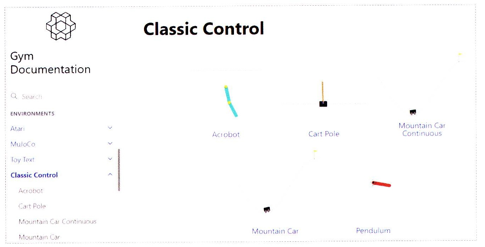

---

#### OpenAI Gym이 제공하는 문제들은 대부분 인터페이스가 일관됩니다.

강화학습 환경마다 물리 법칙이나 상태 표현 방식은 완전히 다르지만, 에이전트와 상호작용하는 프로그래밍 인터페이스는 놀라울 정도로 단순하고 통일되어 있습니다.

모든 환경은 단 두 개의 핵심 메서드인 **`reset()`**(초기화 및 초기 상태 관측)과 **`step(action)`**(행동 전달 후 전이 결과 획득)만으로 동작합니다. 따라서 하나의 에이전트 학습 코드를 작성해 두면, 환경 이름만 바꾸어도 다른 문제에 즉시 적용할 수 있는 강력한 다형성(Polymorphism)을 보장합니다.

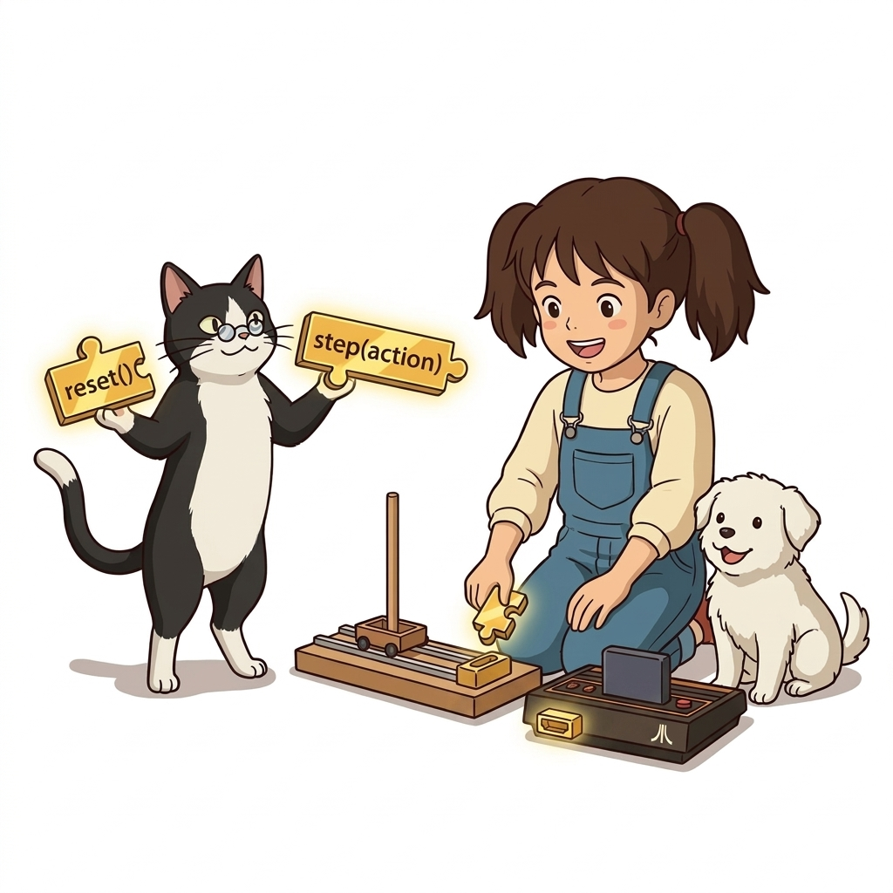
**그림 12-1-2** 어떤 복잡한 환경이라도 reset(), step(action)이라는 단일한 표준 규약으로 통일되어 상호작용하는 Gym 인터페이스 메커니즘

---

#### 따라서 다른 강화 학습 문제로 손쉽게 전환할 수 있습니다.

그뿐만 아니라 전 세계 강화학습 연구 논문들에서 새로운 알고리즘(DQN, A3C, PPO, SAC 등)을 발표할 때 알고리즘의 우수성을 입증하는 **공인 벤치마크(Standard Benchmark)**로 OpenAI Gym 환경들을 표준으로 채택하고 있습니다.

동일한 환경 스펙과 평가 기준 위에서 성능을 비교할 수 있으므로, 재현 가능성(Reproducibility)과 객관적인 알고리즘 검증이 가능합니다.


**그림 12-1-3** 전 세계 AI 연구 논문들의 성능 비교 표준 벤치마크로 공정하게 활약하는 OpenAI Gym 생태계를 설명하는 이호진 교수님

---

#### 특히 〈아타리(Atari)〉 게임이 많이 이용됩니다.

2013년과 2015년 DeepMind가 딥 강화학습(Deep Q-Network, DQN)의 탄생을 알리며 네이처(Nature) 표지를 장식했을 때 사용한 무대가 바로 아타리 2600 비디오 게임(Breakout, Pong, Space Invaders 등) 환경이었습니다.

사람의 사전 도메인 지식 없이 원시 화면 픽셀(Raw Screen Pixels)만을 관찰값으로 받아 인간 프로게이머 수준의 플레이를 학습해 낸 역사적 시발점이 바로 Gym의 Atari 환경군입니다.


**그림 12-1-4** OpenAI Gym이 제공하는 고전 아타리 2600 비디오 게임(Pong, Breakout, Space Invaders) 아케이드 환경을 탐험하는 도로시와 지니

---

### 12.1.1 OpenAI Gym 기초 지식

그럼 OpenAI Gym의 기본적인 사용법과 핵심 API 메커니즘을 단계별로 알아보겠습니다.

먼저 OpenAI Gym 라이브러리를 설치합니다. 카트폴과 같은 고전 제어(Classic Control) 환경을 시뮬레이션하기 위해 패키지를 터미널에서 설치합니다.

```bash
# 구버전 Gym 설치 시
pip install gym[classic_control]

# 최신 표준 Gymnasium 설치 시 (권장)
pip install gymnasium[classic-control] pygame
```

터미널에서 이 한 줄만 실행하면 물리 엔진 및 렌더링 백엔드가 함께 설치됩니다.


**그림 12-1-5** 터미널에서 pip install 명령어로 Gym 물리 엔진 패키지를 설치하고 카트폴 시뮬레이션 모듈 상자를 조립하는 지니와 이호진 교수님

---

#### [실습 1단계] Gym 환경 생성 및 기본 스펙 검사

이제 첫 번째 단계로 환경을 생성하고 사양을 검사해보겠습니다. 

OpenAI Gym에는 다양한 환경이 제공되지만 여기서는 가장 대표적인 입문 과제인 **`CartPole-v0`**(혹은 최신 표준인 **`CartPole-v1`**)을 생성하겠습니다.

* 실습 파일: [`step01_make_env.py`](./step01_make_env.py)

```python
import gym

# CartPole 환경 인스턴스 생성 (화면 출력: render_mode='human')
env = gym.make('CartPole-v0', render_mode='human')

print("환경 식별자 (ID)       :", env.spec.id)
print("최대 에피소드 스텝 수 :", env.spec.max_episode_steps)
env.close()
```

> [!NOTE]
> 현재 `CartPole-v0` 버전은 공식 문서에서 out-of-date 경고 메시지를 출력할 수 있지만 기본 실행에는 전혀 문제가 없습니다. v0와 v1의 핵심 차이는 최대 목표 지속 스텝 수(200단계 vs 500단계)이며, 제공되는 실습 코드는 최신 Gymnasium과 구버전 Gym 모두에서 자동으로 상호 호환되도록 구성되어 있습니다.

---

#### 1단계 스크립트 실행 결과

작성한 [`step01_make_env.py`](./step01_make_env.py)를 실제로 실행하여 환경 스펙과 렌더 모드가 정상적으로 초기화되는지 확인합니다.

```bash
python step01_make_env.py
```

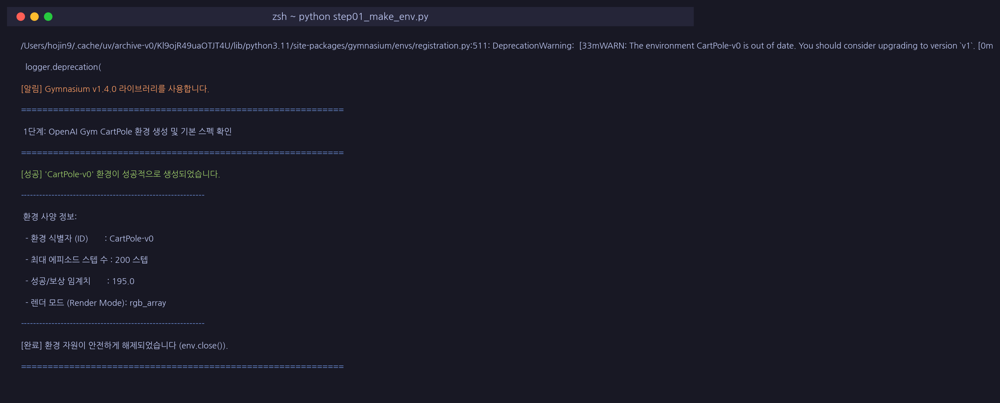
**그림 12-1-S1** `step01_make_env.py` 실행 결과: CartPole 환경의 정상 인스턴스화, 최대 허용 타임스텝, 보상 임계치(195.0) 및 환경 자원 해제(`env.close()`) 터미널 출력 화면

---

#### 〈카트 폴〉 문제의 물리적 화면 구성

환경 생성 시 `render_mode='human'`으로 설정하면 아래 그림과 같은 실시간 시뮬레이션 창을 띄워 에이전트의 움직임을 시각적으로 확인할 수 있습니다 (배치 연산이나 고속 학습 시에는 `'rgb_array'`로 설정하여 GUI 오버헤드를 제거합니다).

**그림 12-2** 〈카트 폴〉 화면 구성

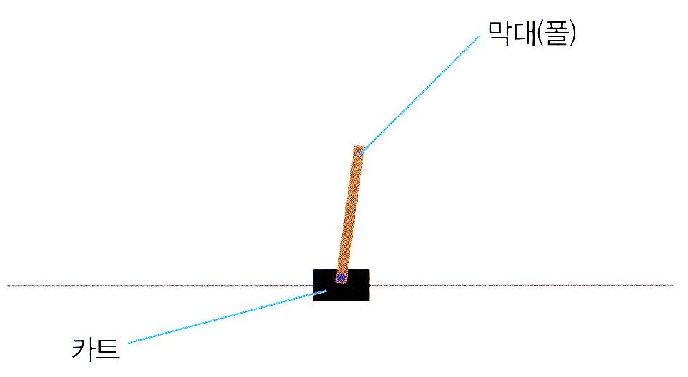

카트(Cart) 위에 중심축으로 연결된 막대(Pole, 역진자)가 중력에 의해 쓰러지려고 할 때, 카트를 좌우로 기민하게 움직여 막대가 서 있는 상태를 유지시키는 것이 목표입니다.

---

#### 카트폴의 물리적 실패 한계선

카트폴 시뮬레이터는 매 타임스텝마다 뉴턴-오일러 역학 미분 방정식을 적분하여 물체의 거동을 계산합니다. 에이전트는 다음 두 가지 한계선을 넘지 않도록 균형을 잡아야 합니다:

1. **막대의 각도 한계**: 수직선 기준 막대의 기울기 각도 $\theta$가 $\pm 12^\circ$ (약 $\pm 0.2094$ rad)를 초과하면 복원 모멘트 상실로 **실패(`terminated: True`)** 처리됩니다.
2. **카트의 위치 한계**: 카트의 중심 위치 $x$가 레일 중심선으로부터 $\pm 2.4$ 미터를 벗어나 화면 경계를 탈선하면 **실패(`terminated: True`)** 처리됩니다.


**그림 12-1-6** 막대 기울기 한계(±12°)와 카트 탈선 한계(±2.4m) 위험 경계선 위반 시 비상 경보와 함께 발생하는 실패(terminated: True) 조건

---

#### 카트폴 버전별 목표 스텝 비교

카트폴 환경은 버전에 따라 에이전트에게 요구되는 장기 계획 수립(Long-term Planning) 난이도가 다릅니다:

* **CartPole-v0**: 200 타임스텝 동안 막대를 쓰러뜨리지 않고 버티면 미션 성공입니다 (최근 100회 에피소드 평균 점수 195점 달성 시 환경 완전 정복으로 인정).
* **CartPole-v1**: 500 타임스텝까지 버텨야 성공으로 판정되며, 장기적인 궤적에서 작은 오차가 누적되어 발산하는 것을 억제하는 고도의 안정적인 제어 정책이 요구됩니다.

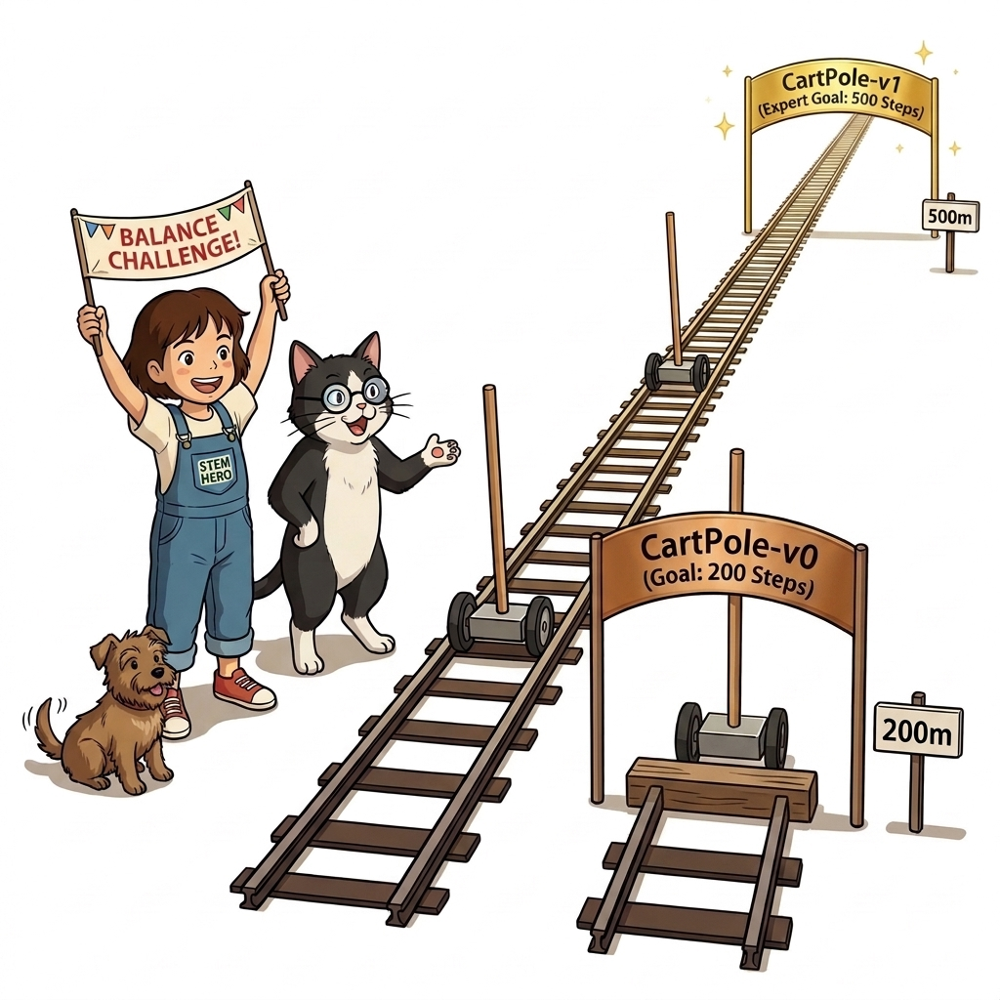
**그림 12-1-7** 200단계 균형 유지를 목표로 하는 CartPole-v0 트랙과 500단계 장거리 고지 도전을 요구하는 CartPole-v1 엑스퍼트 트랙 비교

---

#### [실습 2단계] 상태 초기화(reset) 및 4차원 상태 벡터 & 행동 공간 검사

이제 환경을 초기화하여 시작 상태 벡터를 관찰하고, 에이전트가 선택할 수 있는 행동 공간(Action Space)의 규격을 파악하는 코드를 단계적으로 추가해 보겠습니다.

* 실습 파일: [`step02_reset_state.py`](./step02_reset_state.py)

```python
import gym

env = gym.make('CartPole-v0', render_mode='rgb_array')

# 1. 상태 초기화 (Gymnasium 규격에서는 (state, info) 반환)
state = env.reset()[0]
print('초기 상태 벡터:', state)

# 2. 행동 공간 규격 검사
action_space = env.action_space
print('행동 공간 클래스:', action_space)
print('선택 가능한 행동 수:', action_space.n)

env.close()
```

---

#### 2단계 스크립트 실행 결과

작성한 [`step02_reset_state.py`](./step02_reset_state.py)를 실행하여 실제 반환되는 4차원 상태 벡터와 `Discrete(2)` 행동 공간을 정밀 검사합니다.

```bash
python step02_reset_state.py
```

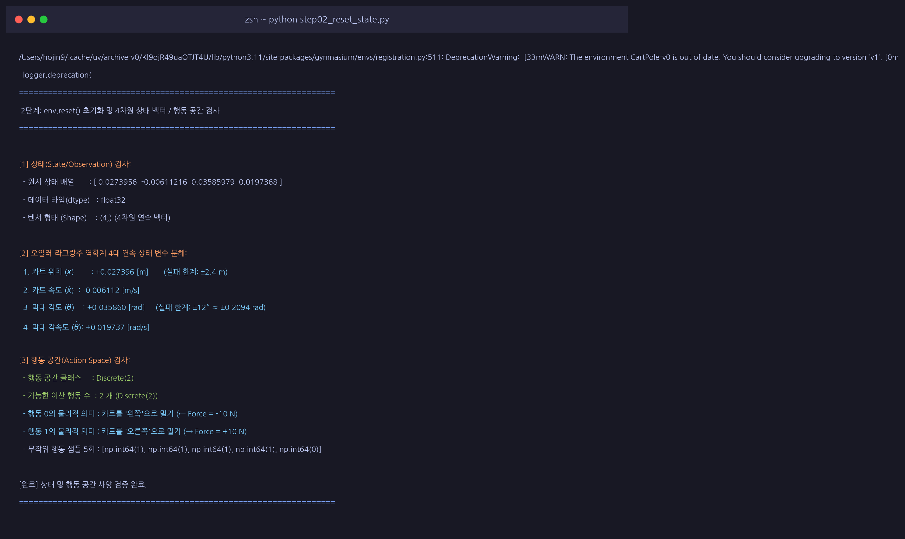
**그림 12-1-S2** `step02_reset_state.py` 실행 결과: 4차원 연속 상태 벡터($x, \dot{x}, \theta, \dot{\theta}$)의 부동소수점 수치와 이산 행동 공간(`Discrete(2)`) 검사 터미널 출력 화면

---

#### `env.reset()[0]` 튜플 언패킹 메커니즘

`env.reset()` 메서드는 환경의 모든 물리 변수를 약간의 무작위 노이즈를 섞어 초기화한 뒤 상태 정보를 반환합니다.

과거 레거시 Gym에서는 상태 배열만을 반환했으나, 최신 표준(Gymnasium 및 Gym v0.26+)에서는 환경 진단용 딕셔너리를 포함하여 `(state, info)`라는 2-튜플을 반환하도록 규약이 확장되었습니다. 따라서 0번째 원소인 `env.reset()[0]`을 언패킹함으로써 순수한 상태 배열(`state`)을 추출할 수 있습니다.

![env.reset()[0] 튜플 언패킹 메커니즘](./img/ch12_1_08_env_reset_tuple_unpacking.png)
**그림 12-1-8** `(state, info) = env.reset()` 반환 튜플 캐비닛에서 0번째 서랍인 상태 벡터(`state`)를 언패킹하여 초기 관찰값을 얻는 과정

---

#### 4차원 상태 벡터 넘파이 배열 (`ndarray`)

출력된 `state` 객체는 4개의 원소를 가지는 1차원 NumPy 배열(`numpy.ndarray`, shape `(4,)`, dtype `float32` 또는 `float64`)입니다. 

인공신경망(DQN)을 학습시킬 때 이 4차원 부동소수점 벡터가 신경망 입력 계층의 특성(Feature) 값으로 그대로 입력됩니다.


**그림 12-1-9** 연속적인 4개의 부동소수점 수치 [위치, 속도, 각도, 각속도]로 채워진 1차원 NumPy 배열(`ndarray`)의 구조를 정밀 검사하는 도로시와 지니

---

#### 카트폴의 4대 연속 물리 변수 상세

상태 벡터 $\mathbf{s} = [x, \; \dot{x}, \; \theta, \; \dot{\theta}]^T$의 각 원소는 오일러-라그랑주 역학계의 물리량을 나타냅니다:

1. **`state[0]` ($x$)**: 카트의 수평 위치 ($[-4.8\text{m}, +4.8\text{m}]$, 실패 한계 $\pm 2.4\text{m}$)
2. **`state[1]` ($\dot{x} = v$)**: 카트의 수평 이동 속도 ($[-\infty, +\infty]$)
3. **`state[2]` ($\theta$)**: 막대의 수직선 대비 기울기 각도 (라디안 단위, $[-0.418\text{ rad}, +0.418\text{ rad}]$, 실패 한계 $\pm 12^\circ \approx \pm 0.2094\text{ rad}$)
4. **`state[3]` ($\dot{\theta} = \omega$)**: 막대의 회전 각속도 ($[-\infty, +\infty]$)

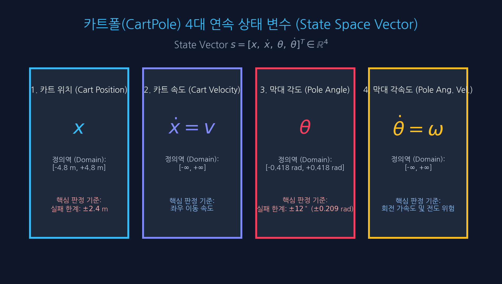
**그림 12-1-10** 카트의 위치($x$), 카트의 속도($v$), 막대의 각도($\theta$), 막대의 각속도($\omega$)라는 오일러-라그랑주 역학계의 4대 연속 상태 변수 구조

---

#### 행동 공간 규격: `Discrete(2)`

에이전트가 환경에서 취할 수 있는 선택지는 `env.action_space` 속성에 정의되어 있습니다.

카트폴의 행동 공간은 `gym.spaces.Discrete(2)` 클래스의 인스턴스로, 가능한 행동의 집합이 $\{0, 1\}$이라는 단 2개의 이산 정수로 한정되어 있음을 의미합니다.

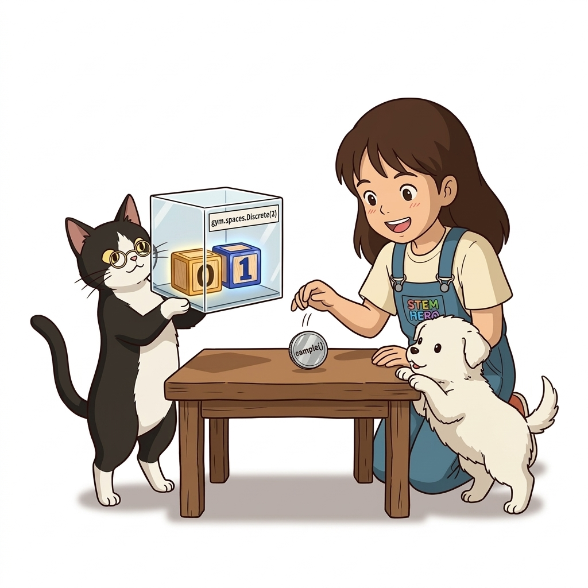
**그림 12-1-11** 오직 {0, 1} 두 정수 원소만을 담고 있는 `gym.spaces.Discrete(2)` 큐브 상자와 무작위 선택을 위한 `sample()` 동전

---

#### 행동 0과 행동 1의 물리 제어 메커니즘

각 이산 행동 정수는 카트 모터에 인가되는 힘(Force)의 방향에 1:1로 대응됩니다:

* **행동 `0` (좌측 추진)**: 카트에 **-10 뉴턴($-10\text{ N}$)**의 수평 외력을 가해 카트를 왼쪽으로 가속합니다.
* **행동 `1` (우측 추진)**: 카트에 **+10 뉴턴($+10\text{ N}$)**의 수평 외력을 가해 카트를 오른쪽으로 가속합니다.

막대가 오른쪽으로 쓰러지려고 할 때 카트를 신속하게 오른쪽으로 밀어주어야 관성에 의해 막대가 다시 수직으로 일어서는 복원 토크가 발생합니다.

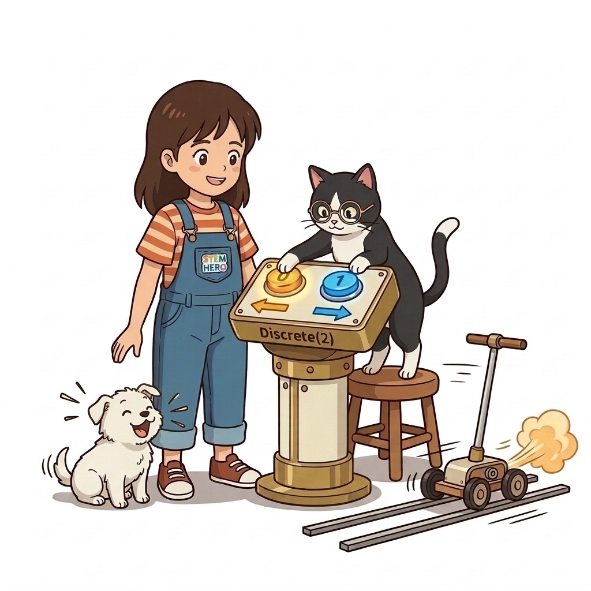
**그림 12-1-12** 0번 버튼을 누르면 카트에 좌측 추진력이, 1번 버튼을 누르면 우측 추진력이 가해지는 수평 가속도 제어 메커니즘

---

#### [실습 3단계] `env.step(action)` 1스텝 전이 및 5대 반환값 분석

이제 에이전트가 실제로 행동을 하나 선택하여 환경을 한 타임스텝($\Delta t = 0.02\text{s}$) 전진시키는 코드를 작성해 봅니다.

* 실습 파일: [`step03_step_transition.py`](./step03_step_transition.py)

```python
import gym

env = gym.make('CartPole-v0', render_mode='rgb_array')
state = env.reset()[0]

# 에이전트가 행동 선택 (예: 1번 우측 추진)
action = 1

# 환경과 1스텝 상호작용
next_state, reward, terminated, truncated, info = env.step(action)

print('차기 상태 (next_state):', next_state)
print('즉각 보상 (reward)    :', reward)
print('과제 실패 (terminated):', terminated)
print('시간 초과 (truncated) :', truncated)
print('디버그 정보 (info)     :', info)

env.close()
```

---

#### 3단계 스크립트 실행 결과

작성한 [`step03_step_transition.py`](./step03_step_transition.py)를 실행하여 1스텝 전이의 결과로 반환되는 5대 정보를 확인합니다.

```bash
python step03_step_transition.py
```

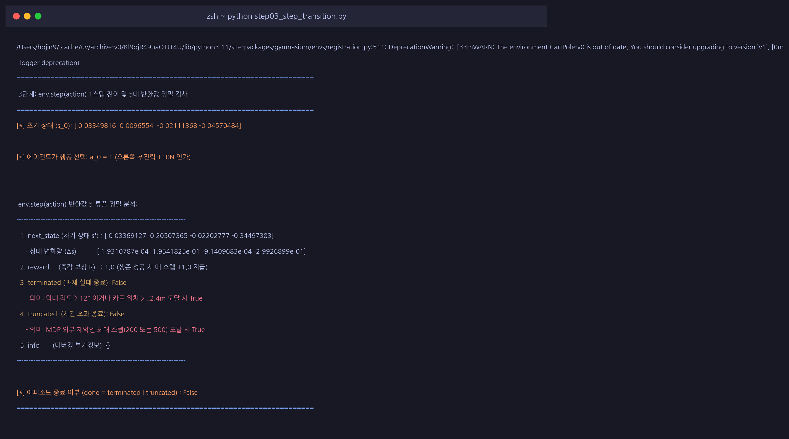
**그림 12-1-S3** `step03_step_transition.py` 실행 결과: 1스텝 상호작용 후 차기 상태($s'$), 즉각 보상($R=+1.0$), 종료 플래그(`terminated`, `truncated`), 부가 정보 튜플 언패킹 터미널 출력 화면

---

#### `env.step(action)` 반환값 5-튜플의 이론적 의미

`env.step(action)` 메서드는 에이전트의 결정 $A_t$를 받아 물리 엔진을 적분한 뒤 마르코프 결정 과정(MDP)의 핵심 5대 요소를 반환합니다:

1. **`next_state` ($S_{t+1}$)**: 행동 $A_t$의 결과로 전이된 다음 타임스텝의 상태 벡터
2. **`reward` ($R_{t+1}$)**: 환경이 에이전트에게 지급하는 즉각 보상 (스칼라 부동소수점)
3. **`terminated`**: 문제 자체의 본질적 종료 조건(막대 전도, 탈선 등 과제 실패) 도달 여부
4. **`truncated`**: MDP 외부의 인위적 한계(타임아웃, 시간 만료) 도달 여부
5. **`info`**: 강화학습 손실 함수 계산에는 사용되지 않는 진단용 메타데이터 딕셔너리

---

#### 생존 스텝당 +1 보상 누적 메커니즘

카트폴 환경에서 보상 함수는 매우 직관적입니다. 막대가 쓰러지지 않고 카트가 레일 안에 머무는 **매 타임스텝마다 항상 `+1.0`의 보상**이 지급됩니다.

$$R_{t+1} = 1.0 \quad (\text{if not terminated})$$

따라서 에이전트의 목표인 할인 누적 보상(Return) $G_t = \sum_{k=0}^{\infty} \gamma^k R_{t+k+1}$을 극대화하는 것은 곧 **카트폴의 균형을 최대한 오랜 시간 유지하여 생존 시간을 극대화하는 것**과 정확히 동치입니다.


**그림 12-1-13** 막대가 쓰러지지 않고 균형을 유지하는 매 타임스텝마다 황금 코인이 차곡차곡 누적되는 Total Reward 저금통

---

#### `terminated` vs `truncated`의 강화학습 가치 편향 방지 이론

과거 Gym에서는 `done`이라는 단 하나의 불리언 플래그만을 제공했으나, 이는 강화학습 알고리즘의 벨만 방정식(Bellman Equation) 계산에 치명적인 가치 편향(Value Estimation Bias)을 유발했습니다:

* **진짜 종료 (`terminated: True`)**: 환경 내부에서 물리적으로 실패하여 더 이상의 전이가 불가능한 상태입니다. 따라서 다음 상태의 가치는 반드시 $V(S_{terminal}) = 0$이어야 합니다.
* **시간 만료 (`truncated: True`)**: 막대는 여전히 완벽하게 균형을 잡고 있는데 단지 컴퓨터가 200스텝에 도달하여 강제로 에피소드를 끊은 것입니다. 이 상태의 미래 가치는 결코 0이 아니며, 부트스트랩 가치 $\gamma V(S_{t+1})$를 반드시 보존해주어야 학습의 왜곡을 방지할 수 있습니다.

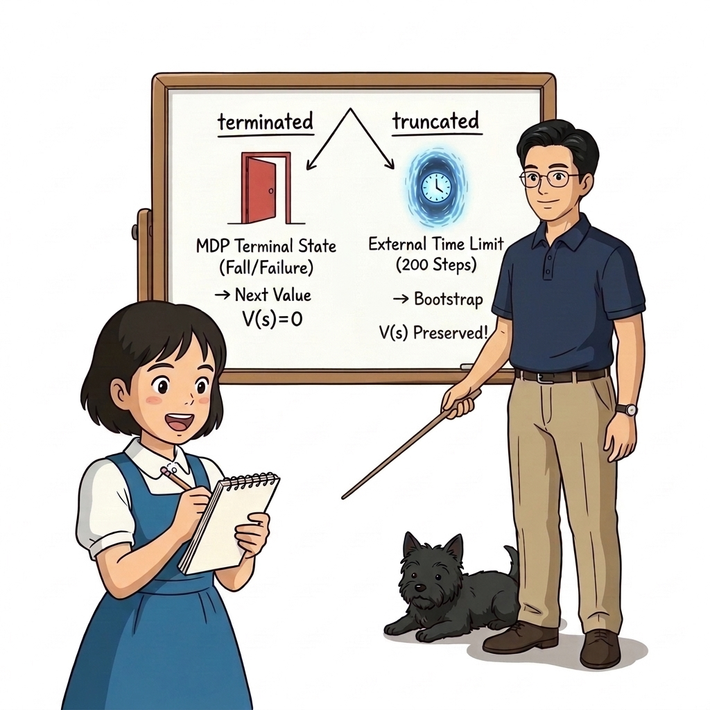
**그림 12-1-14** 환경 내부 실패로 인한 종료(`terminated`, $V(s_{terminal})=0$)와 시간 초과로 인한 조기 중단(`truncated`, 부트스트랩 $V(s_{t+1})$ 보존)의 가치 편향 방지 이론

---

#### 카트폴 종료 조건 세부 판정 기준

카트폴 환경에서 두 종료 플래그는 정확히 다음 조건에서 `True`로 활성화됩니다:

* **`terminated == True` (과제 실패)**:
  * 막대의 각도 $|\theta| > 12^\circ$ ($\pm 0.2094\text{ rad}$)
  * 카트의 수평 위치 $|x| > 2.4\text{ m}$
* **`truncated == True` (시간 만료 성공)**:
  * 총 진행 타임스텝 $t \ge 200$ (CartPole-v1에서는 500)

통합 종료 플래그는 두 조건을 비트 OR 연산하여 `done = terminated | truncated`로 판정합니다.


**그림 12-1-15** 막대 쓰러짐/탈선에 따른 실패 깃발(`terminated: True`)과 200회 스텝 유지 성공에 따른 축하 골인 깃발(`truncated: True`)의 현장 비교

---

#### 진단용 메타데이터 `info` 딕셔너리

마지막 반환값인 `info`는 파이썬 딕셔너리(`dict`) 형태이며, 강화학습 손실 함수 수식 계산에는 일체 사용되지 않습니다.

일반적으로 로깅, 디버깅, 프레임 레이트 모니터링, 혹은 특수 센서의 미가공 데이터 등을 전달할 때 보조적인 도구 상자로 활용됩니다.

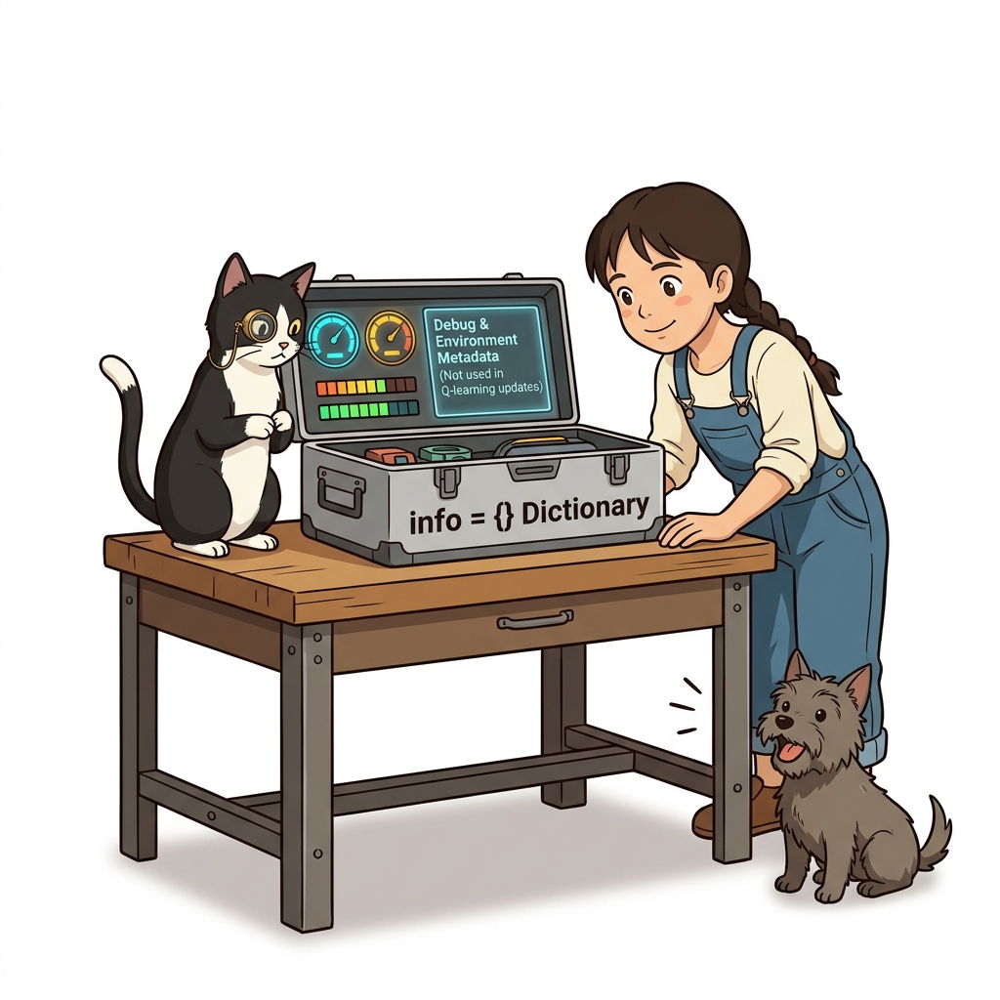
**그림 12-1-16** Q-러닝 알고리즘 수식 계산에는 사용되지 않지만, 환경 진단과 모니터링을 위해 제공되는 부가 메타데이터 공구 상자(`info`)

---

### 12.1.2 랜덤 에이전트 (무작위 행동 루프)

이상으로 OpenAI Gym 인터페이스를 다루는 데 필요한 모든 핵심 지식을 체계적으로 정리했습니다.

이제 에이전트와 환경이 서로 영향을 주고받는 **폐루프(Closed-loop) 상호작용** 루프를 구성하여 1회분의 완전한 에피소드를 끝까지 실행해 보겠습니다.

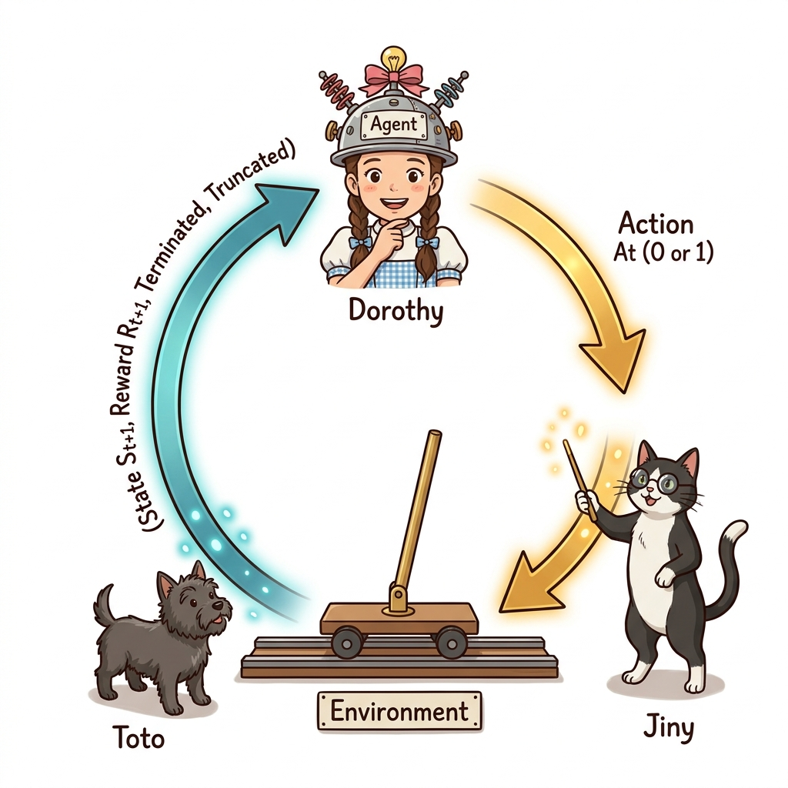
**그림 12-1-17** 에이전트의 관찰-행동 선택($A_t$)과 환경의 물리 시뮬레이션-보상/차기상태 반환($S_{t+1}, R_{t+1}$)이 끊임없이 순환하는 강화학습 메인 피드백 루프

---

#### [실습 4단계] 무작위(Random) 에이전트 전체 에피소드 실행

학습된 지능이 없는 상태에서 무작위로 동전을 던져 0(왼쪽) 또는 1(오른쪽)을 선택하는 '랜덤 에이전트'를 구동하고, 몇 스텝 만에 균형이 무너지는지 확인해 보겠습니다.

* 실습 파일: [`step04_random_agent.py`](./step04_random_agent.py)

```python
import numpy as np
import gym

env = gym.make('CartPole-v0', render_mode='rgb_array')
state = env.reset()[0]
done = False
total_reward = 0

while not done:
    # 0 또는 1을 무작위 선택
    action = np.random.choice([0, 1])
    
    # 1스텝 전이
    next_state, reward, terminated, truncated, info = env.step(action)
    total_reward += reward
    
    # 종료 여부 검사
    done = terminated | truncated

print(f"에피소드 종료! 총 획득 보상: {total_reward}")
env.close()
```

---

#### 4단계 스크립트 실행 결과 및 렌더링 화면

작성한 [`step04_random_agent.py`](./step04_random_agent.py)를 실행하여 터미널 로그와 시뮬레이터의 실제 거동 화면을 확인합니다.

```bash
python step04_random_agent.py
```

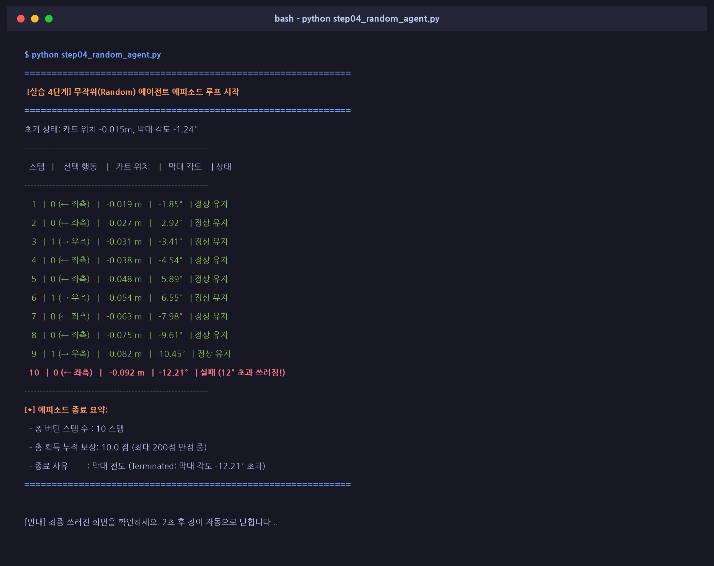
**그림 12-1-S4** `step04_random_agent.py` 실행 결과: 매 스텝 선택된 무작위 행동, 카트 위치($x$), 막대 각도($\theta$) 변화 추이 및 최종 12스텝 파국 요약 터미널 출력 화면

---

#### 실제 카트폴 시뮬레이션 화면

랜덤 에이전트가 카트를 무작위로 조작할 때 렌더링된 실제 시뮬레이터 화면 캡처입니다:

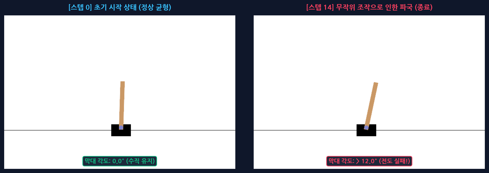
**그림 12-1-S5** 실제 카트폴 시뮬레이터 렌더링 화면: 균형을 잃고 오른쪽으로 급격히 기울어지며 한계 각도(12°)를 향해 쓰러져가는 막대의 순간 포착

---

#### 무작위 행동 정책의 한계

`while not done:` 루프를 돌며 무작위로 행동을 취하면, 막대가 기울어지는 방향과 반대로 카트를 기민하게 밀어주지 못하고 엉뚱한 방향으로 밀어버리는 일이 빈번하게 발생합니다.

실행 결과에서 확인되듯이, 랜덤 에이전트는 시작한 지 **불과 10~20 타임스텝 내외**에서 막대가 12도 이상 넘어가며 즉시 에피소드가 끝나버립니다 (총 보상 10~20점).

이를 극복하고 200스텝 혹은 500스텝 동안 완벽하게 중심을 잡기 위해서는 상태를 보고 최적의 행동 가치를 예측하는 신경망 기반의 지능형 제어기, 즉 **DQN(Deep Q-Network)**의 도입이 필연적입니다.


**그림 12-1-18** 주사위 던지듯 0과 1을 무작위로 선택하는 랜덤 에이전트의 한계: 시작한 지 14스텝 만에 중심을 잃고 비틀거리며 쓰러지는 카트폴

---

#### 교재 〈카트 폴〉 렌더링(시각화) 원본

OpenAI Gym에서는 `render_mode='human'` 설정 후 `env.render()`를 호출하여 진행 과정을 모니터 화면에 그래픽으로 띄울 수 있습니다.

**그림 12-3** 〈카트 폴〉 렌더링(시각화)


지금은 무작위 조작이라 금방 쓰러지지만, 다음 12.2절부터 배울 DQN을 적용하면 막대가 단 한 번도 넘어지지 않는 놀라운 제어 성능을 목격하게 됩니다.

---

### 12.1.3 상태와 관찰의 본질적 차이 (State vs Observation)

OpenAI Gym 공식 문서나 API를 살펴보면 '상태(state)' 대신 **'관찰(observation)'**이라는 용어를 일관되게 사용하고 있음을 발견하게 됩니다.

이 두 용어는 강화학습의 수학적 기초에서 매우 엄밀하게 구별되는 개념입니다.

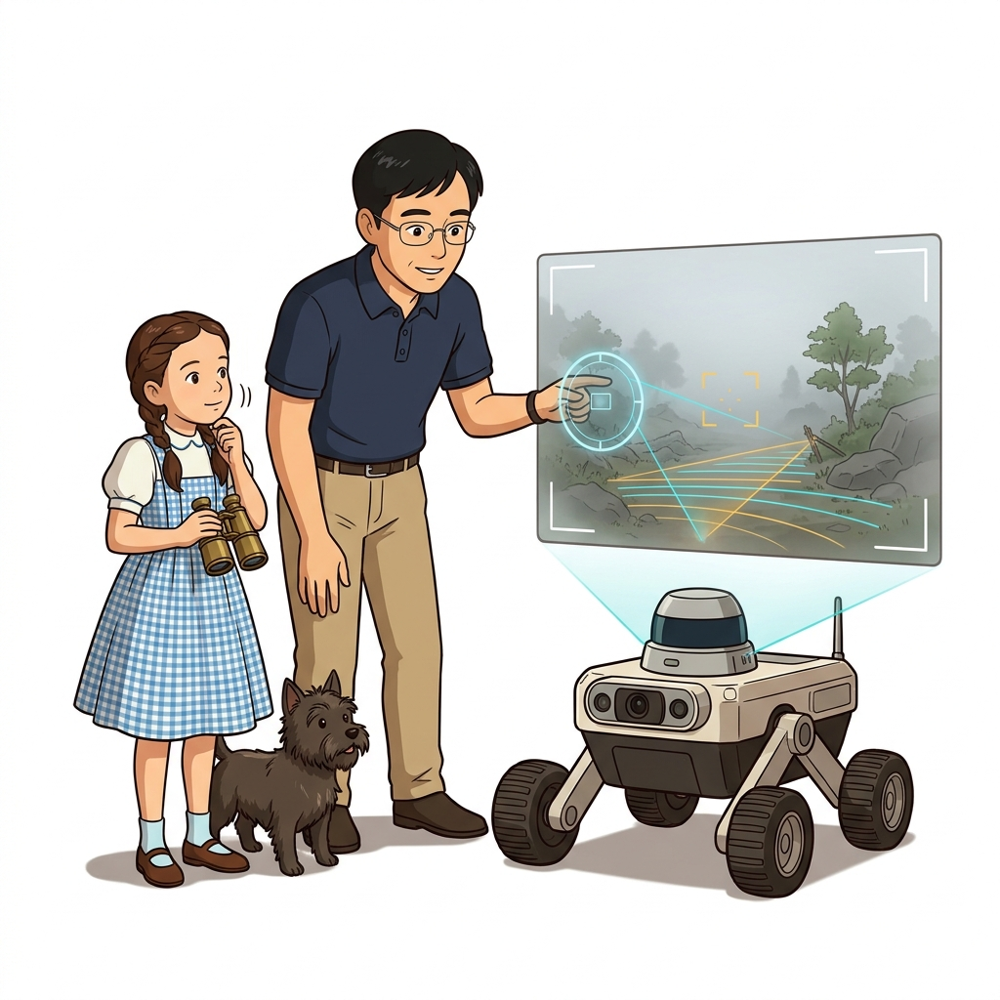
**그림 12-1-19** 안개 낀 미지의 세계에서 카메라와 라이다(LiDAR) 센서 뷰파인더로 감지된 국소 정보(Observation)에 의존해 주행하는 탐사 로봇과 관찰 용어의 필연성

---

#### 관찰 공간 규격 (`Box` Space)

Gym API에서도 `env.observation_space`라는 속성 이름을 사용합니다. 카트폴의 관찰 공간을 출력해보면 다음과 같습니다:

```python
print(env.observation_space)
# Box([-4.8, -inf, -0.418, -inf], [4.8, inf, 0.418, inf], (4,), float32)
```

`gym.spaces.Box` 클래스는 연속적인 다차원 실수 유클리드 공간을 표현하며, 각 축마다 최솟값(하한)과 최댓값(상한) 경계를 엄밀하게 정의하고 있습니다.

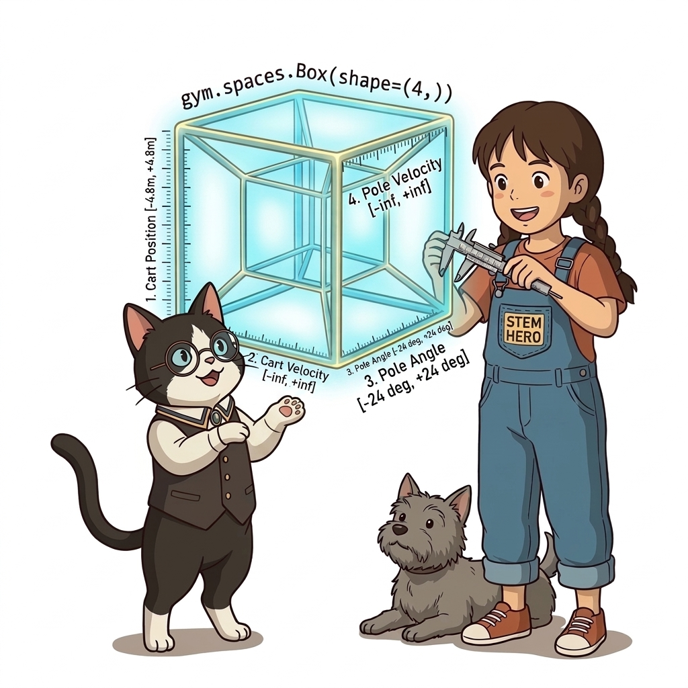
**그림 12-1-20** 4개 물리축(위치, 속도, 각도, 각속도)의 하한과 상한 경계 범위를 정밀 계측하는 `gym.spaces.Box(shape=(4,))` 4차원 하이퍼큐브 스펙

---

#### 상태(State): 환경의 완전한 정보와 마르코프 성질

**상태(State, $S_t$)**는 환경의 내부 메커니즘을 결정짓는 **'완전한 정보(Complete Information)'**를 뜻합니다.

상태는 과거의 모든 이력 정보를 내포하고 있으므로, 현재 상태 $S_t$와 에이전트의 행동 $A_t$만 주어지면 미래 상태 $S_{t+1}$의 확률 분포가 과거와 완전히 독립적으로 결정되는 **마르코프 성질(Markov Property)**을 완벽하게 만족합니다:

$$\mathbb{P}(S_{t+1} \mid S_t, A_t, S_{t-1}, A_{t-1}, \dots, S_0, A_0) = \mathbb{P}(S_{t+1} \mid S_t, A_t)$$

모든 기물의 위치가 100% 투명하게 드러나 있는 체스판이나 바둑판이 완전 관측 상태의 대표적인 예시입니다.

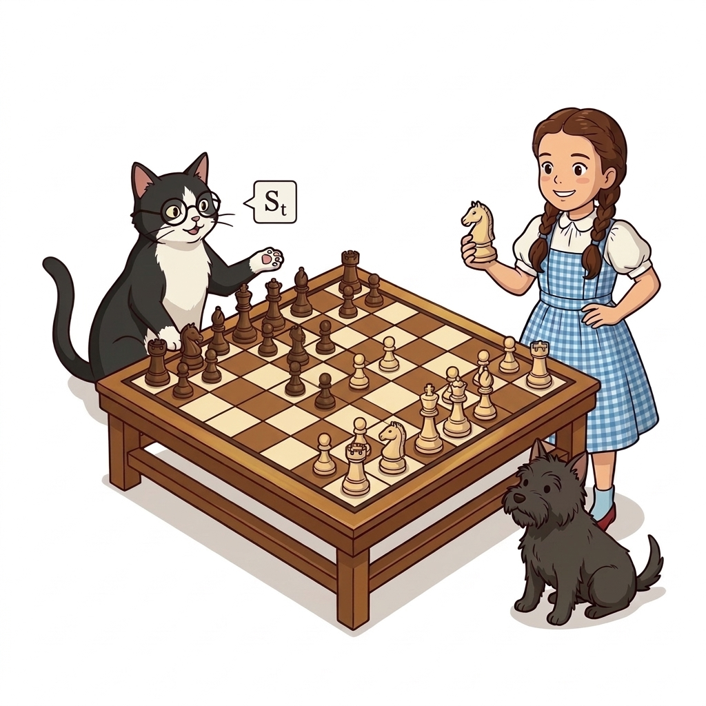
**그림 12-1-21** 모든 기물의 배치가 100% 투명하게 드러나 과거 이력 없이 현재 배치($S_t$)만으로 미래 전이 확률이 완벽히 결정되는 마르코프 결정 과정(MDP)의 체스판

---

#### 관찰(Observation): 부분 관측 환경(POMDP)에서의 센서 정보

반면, **관찰(Observation, $O_t$)**은 환경의 전체 내부 상태 중 에이전트의 센서나 시야를 통해 포착된 **'부분적인 정보(Partial Information)'**입니다.

포커나 블랙잭처럼 상대방의 손패와 덱에 남은 카드를 알 수 없는 게임, 또는 안개 낀 도로에서 전방 카메라 한 장에만 의존해 달리는 자율주행 차량처럼, 실세계의 수많은 문제는 **부분 관측 마르코프 결정 과정(POMDP, Partially Observable MDP)**에 속합니다. 이때 에이전트가 받는 데이터는 상태가 아니라 관찰입니다.

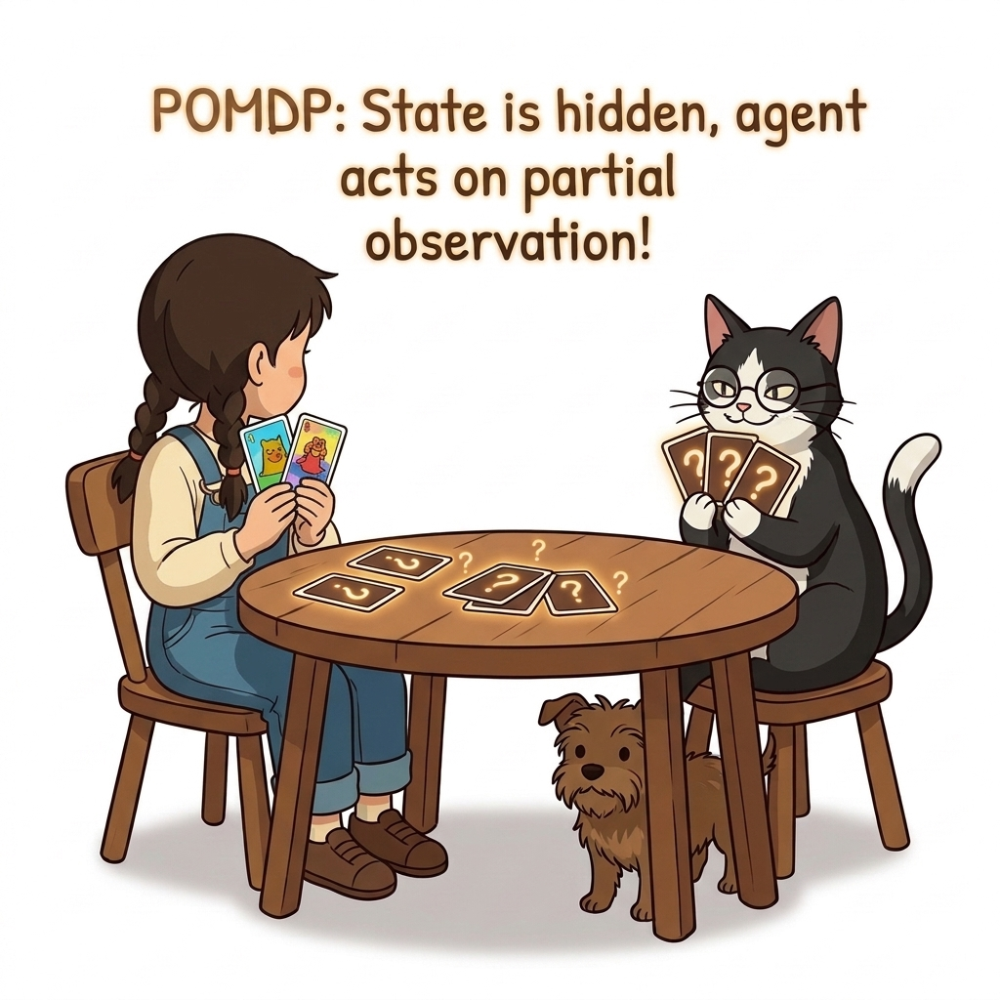
**그림 12-1-22** 상대방의 패와 덱에 남은 카드가 물음표(?)로 뒤집혀 있어 내 손패(일부 센서 관찰값)만으로 불확실성을 추론해야 하는 부분 관측 환경(POMDP)

---

#### 카트폴 환경에서의 상태-관찰 동일성 ($O_t = S_t$)

OpenAI Gym은 현실의 POMDP 문제까지 포괄할 수 있도록 범용적인 용어인 **'Observation'**을 API 표준으로 채택했습니다.

하지만 우리가 다루는 **카트폴(CartPole) 환경**은 카트의 위치, 속도, 막대의 각도, 각속도라는 동역학계의 모든 자유도 변수가 센서 오차 없이 에이전트에게 100% 고스란히 전달되는 **완전 관측 환경(Fully Observable Environment)**입니다. 즉, 관찰과 상태가 완전히 일치합니다:

$$O_t \equiv S_t$$

따라서 본 강의 교재 전반에서는 설명의 직관성과 통일성을 위해 두 용어를 동의어로 취급하고 친숙한 **'상태(State)'**라는 용어를 중심으로 전개해 나갑니다.


**그림 12-1-23** 카트폴은 역학 시뮬레이션의 모든 변수가 측정되는 완전 관측 환경이므로 관찰과 상태가 일치(`Observation = State`)함을 확인하고 본격적인 DQN 탐험으로 나아가는 도로시와 지니
