# 12.1 OpenAI Gym

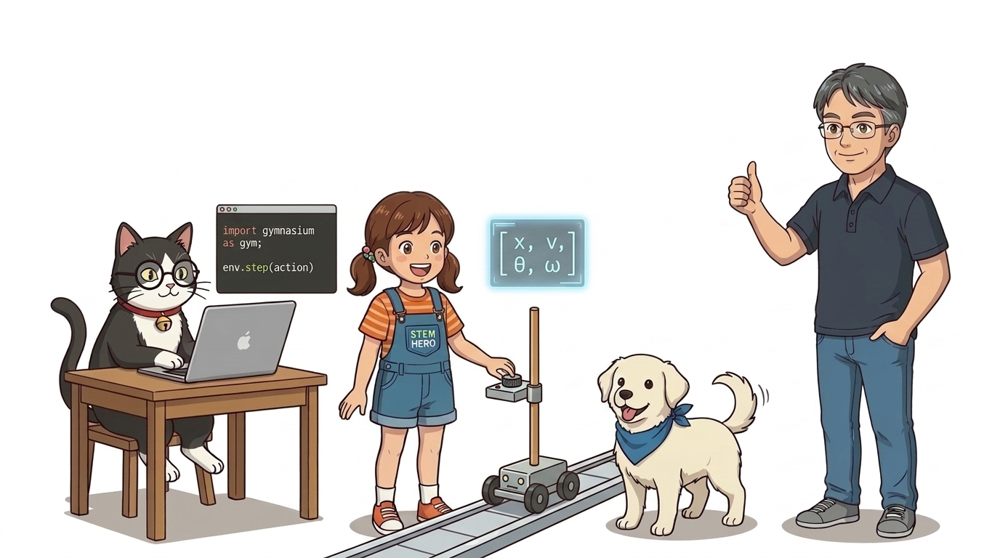


---

#### OpenAI Gym은 오픈소스 라이브러리입니다. 

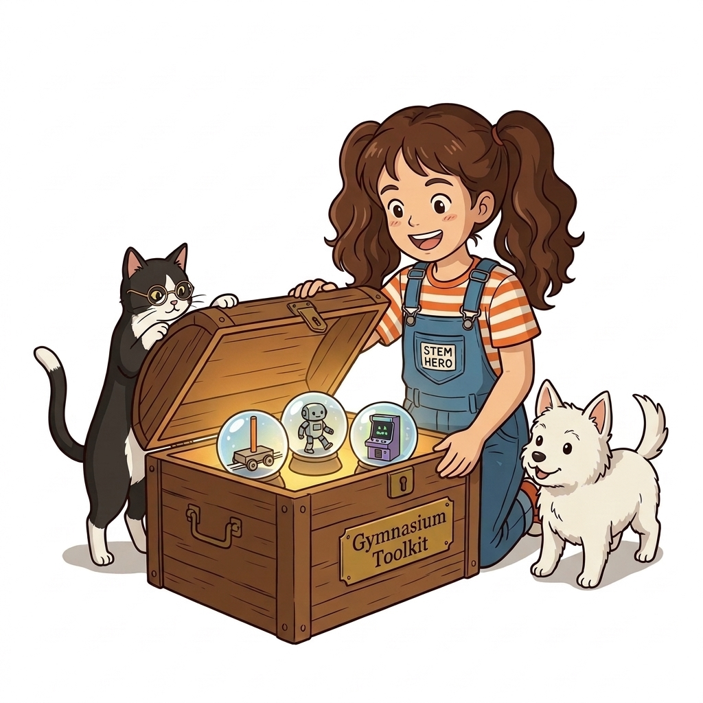
그림 12-1-1 다양한 강화학습 환경과 표준 인터페이스를 제공하는 오픈소스 툴킷 OpenAI Gym(Gymnasium)을 살펴보는 도로시와 지니

---

#### OpenAI Gym은 같이 다양한 강화 학습 문제(환경)를 제공합니다.


**그림 12-1** OpenAI Gym [9]의 문제 목록 화면


---

#### OpenAI Gym이 제공하는 문제들은 대부분 인터페이스가 일관됩니다. 


그림 12-1-2 어떤 복잡한 환경이라도 reset(), step(action)이라는 단일한 표준 규약으로 통일되어 상호작용하는 Gym 인터페이스 메커니즘

---

#### 따라서 다른 강화 학습 문제로 손쉽게 전환할 수 있습니다. 

그뿐만 아니라 강화 학습 관련 논문들에서 OpenAI Gym을 벤치마크로 많이 사용합니다. 

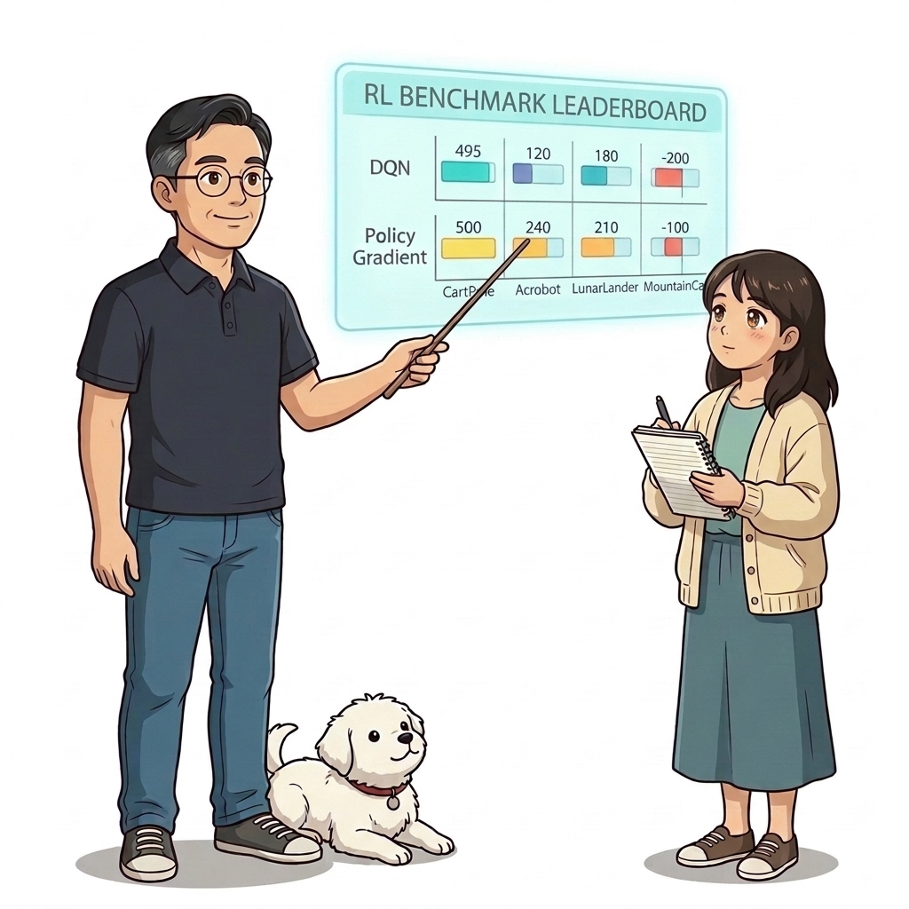

그림 12-1-3 전 세계 AI 연구 논문들의 성능 비교 표준 벤치마크로 공정하게 활약하는 OpenAI Gym 생태계를 설명하는  교수님

---

#### 특히 〈아타리(Atari)〉 게임이 많이 이용됩니다.

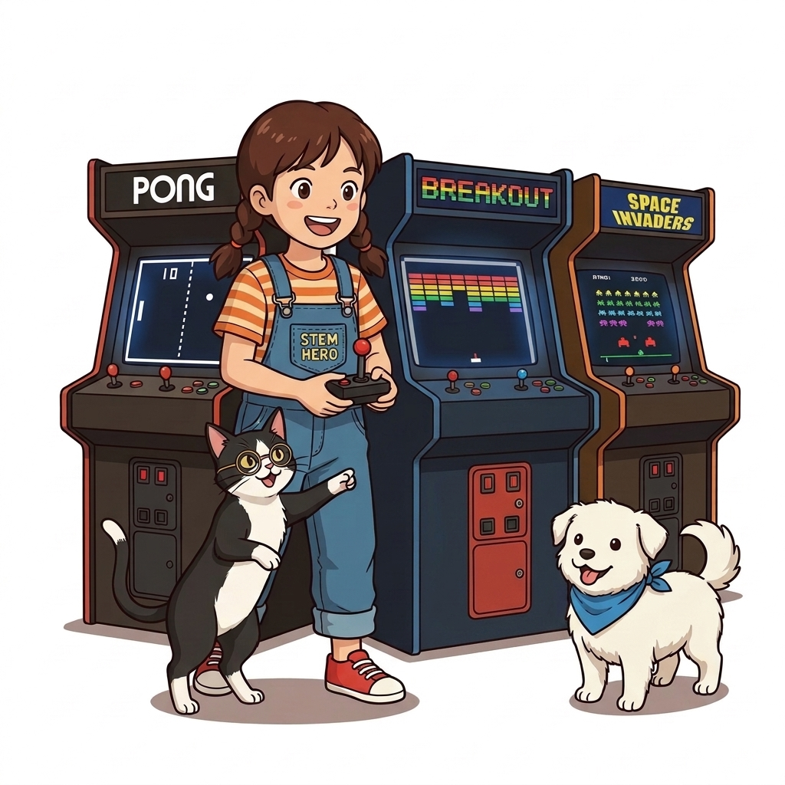
**그림 12-1-4** OpenAI Gym이 제공하는 고전 아타리 2600 비디오 게임(Pong, Breakout, Space Invaders) 아케이드 환경을 탐험하는 도로시와 지니


---

### 12.1.1 OpenAI Gym 기초 지식
그럼 OpenAI Gym의 기본적인 사용법을 알아보겠습니다.

먼저 OpenAI Gym의 `gym` 모듈을 설치합니다.

```bash
pip install gym[classic_control]
```

터미널에서 이 한 줄만 실행하면 설치가 완료됩니다. 

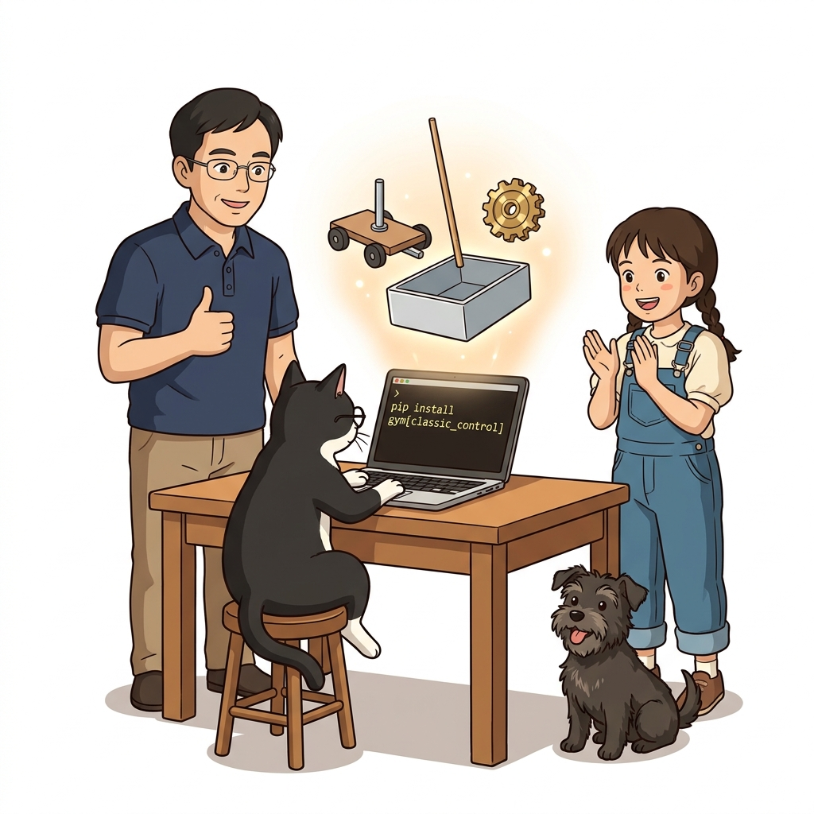
**그림 12-1-5** 터미널에서 pip install 명령어로 Gym 물리 엔진 패키지를 설치하고 카트폴 시뮬레이션 모듈 상자를 조립하는 지니와 이호진 교수님

---

이제 `gym` 모듈을 사용해보겠습니다. 

OpenAI Gym에는 다양한 환경이 제공되지만 여기서는 CartPole-v0로 생성하겠습니다.*

```python
import gym

env = gym.make('CartPole-v0', render_mode='human')
```


현재 v0 버전은 out-of-date라며 경고 메시지를 출력하지만 실행에는 문제가 없습니다. 혹시 지원이 중단되더라도 v0를 v1으로만 바꿔 실행하면 되도록 예제 코드를 모두 수정해뒀습니다. v1으로 바꾸면 예제 실행 시간이 다소 길어질 수 있습니다.

---


〈카트 폴〉이라는 문제 환경이 생성되었습니다. 

환경 생성 시 render_mode를 'human'으로 설정하면 [그림 12-2]와 같은 플레이 화면을 보여줍니다

(화면 출력을 원하지 않으면 'rgb_array'로 설정).

**그림 12-2** 〈카트 폴〉 화면 구성


---

#### 막대(폴), 카트

그림과 같이 카트를 좌우로 움직여 막대(폴)의 균형을 잡는 '균형 잡기' 게임입니다. 

막대가 넘어지거나(일정 각도 이상 기울어지거나) 카트가 정해진 범위를 벗어나면 실패입니다.

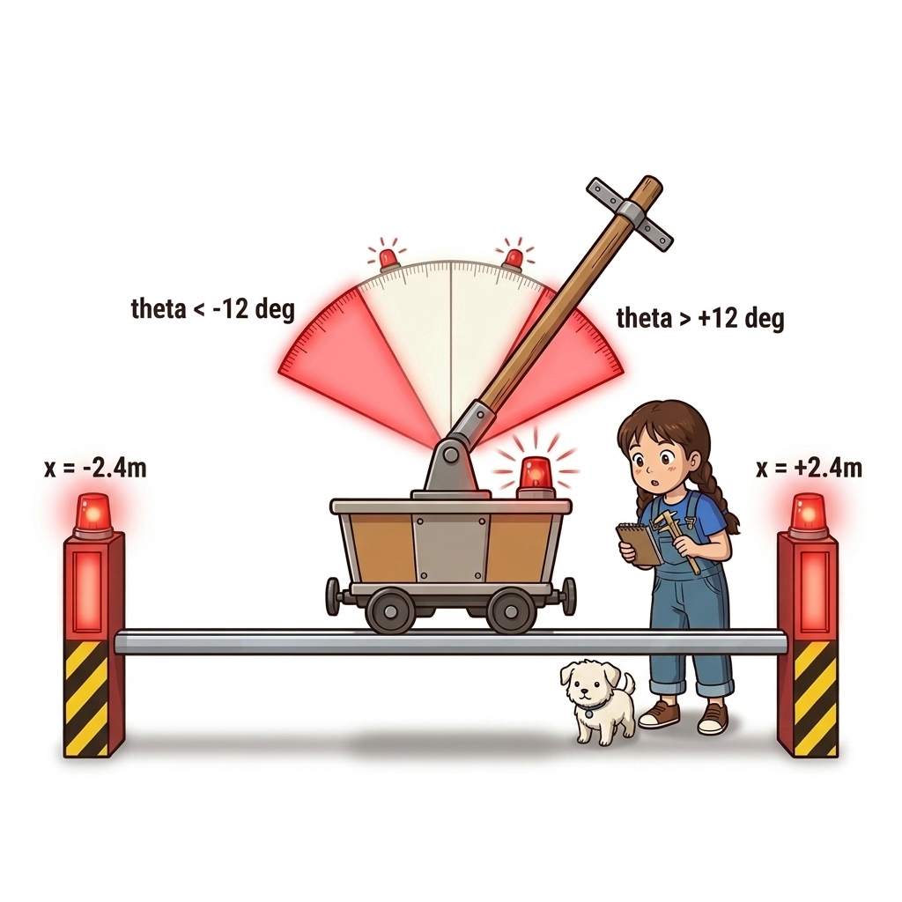
**그림 12-1-6** 막대 기울기 한계(±12°)와 카트 탈선 한계(±2.4m) 위험 경계선 위반 시 비상 경보와 함께 발생하는 실패(terminated: True) 조건

---

> [!NOTE]
> 〈카트 폴〉에는 버전 0(CartPole-v0)과 버전 1(CartPole-v1)이 있습니다. 버전 0은 200단계 동안 균형을 유지하면 성공이고 버전 1은 500단계까지 버텨야 합니다.


**그림 12-1-7** 200단계 균형 유지를 목표로 하는 CartPole-v0 트랙과 500단계 장거리 고지 도전을 요구하는 CartPole-v1 엑스퍼트 트랙 비교

---

앞의 코드에 이어서 다음 코드를 실행해보죠.

```python
state = env.reset()[0] # 상태 초기화
print('상태:', state)

action_space = env.action_space
print('행동의 차원 수:', action_space)
```

---


**출력 결과**

```text
상태: [ 0.03454657 -0.01361909 -0.02143636  0.02152179]
행동의 차원 수: Discrete(2)
```

---


`state = env.reset()[0]` 코드로 초기 '상태'를 얻습니다.

 `env.reset()` 메서드는 환경을 초기화한 후 상태와 기타 정보를 담은 배열을 반환합니다. 

![env.reset()[0] 튜플 언패킹 메커니즘](./img/ch12_1_08_env_reset_tuple_unpacking.png)
**그림 12-1-8** `(state, info) = env.reset()` 반환 튜플 캐비닛에서 0번째 서랍인 상태 벡터(`state`)를 언패킹하여 초기 관찰값을 얻는 과정

---

이 배열의 0번째 원소가 상태 정보입니다. 

출력 결과를 보면 state는 원소가 네 개인 배열임을 알 수 있습니다. 

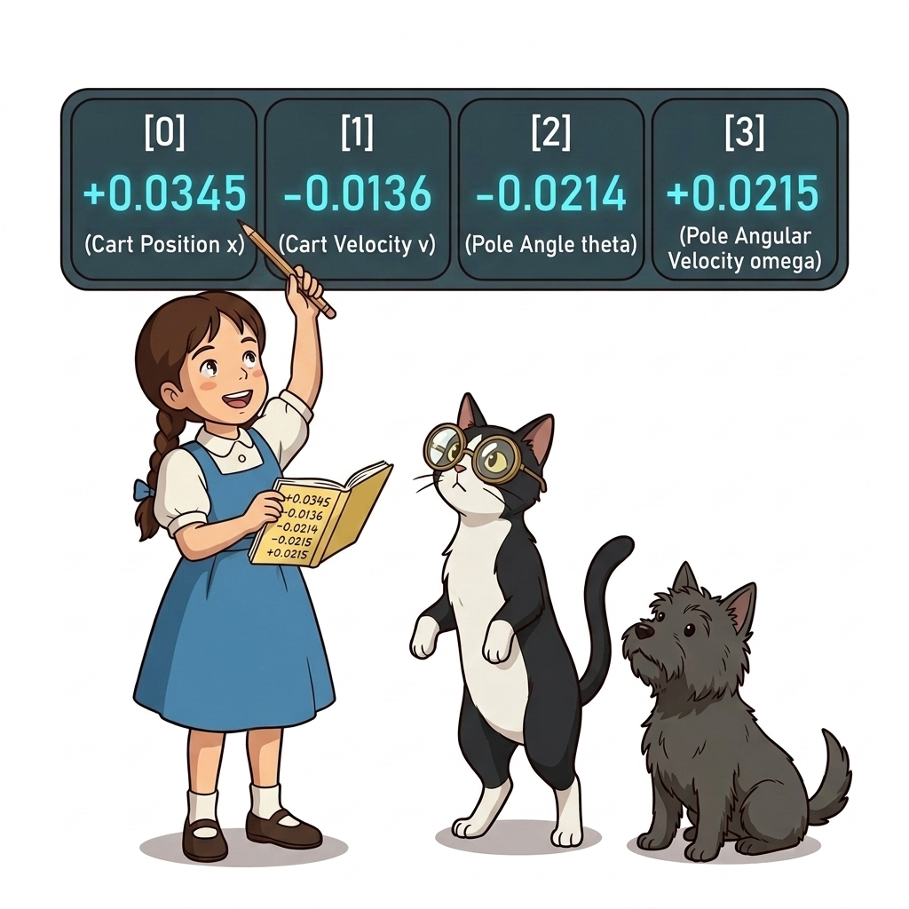
**그림 12-1-9** 연속적인 4개의 부동소수점 수치 [위치, 속도, 각도, 각속도]로 채워진 1차원 NumPy 배열(`ndarray`)의 구조를 정밀 검사하는 도로시와 지니

---

참고로 각 원소는 차례대로 다음을 뜻합니다.

* 카트의 위치
* 카트의 속도
* 막대의 각도
* 막대의 각속도(회전 속도)


**그림 12-1-10** 카트의 위치($x$), 카트의 속도($v$), 막대의 각도($\theta$), 막대의 각속도($\omega$)라는 오일러-라그랑주 역학계의 4대 연속 상태 변수

---

또한 행동 공간의 크기(취할 수 있는 행동의 개수)는 `env.action_space`를 보면 알 수 있습니다. 

이를 출력해보면 Discrete(2)라는 클래스의 인스턴스입니다. 


**그림 12-1-11** 오직 {0, 1} 두 정수 원소만을 담고 있는 `gym.spaces.Discrete(2)` 큐브 상자와 무작위 선택을 위한 `sample()` 동전

---

출력 결과로부터 행동의 후보가 두 가지임을 알 수 있습니다. 

0은 카트를 왼쪽으로, 1은 오른쪽으로 움직이는 행동을 뜻합니다.


**그림 12-1-12** 0번 버튼을 누르면 카트에 좌측 추진력이, 1번 버튼을 누르면 우측 추진력이 가해지는 수평 가속도 제어 메커니즘

---

이제 실제로 카트를 움직여 시간을 한 단계만큼 보내겠습니다.

```python
action = 0 # 혹은 1
next_state, reward, terminated, truncated, info = env.step(action)
print(next_state)
```

---

**출력 결과**

```text
[ 0.03454657 -0.01361909 -0.02143636  0.02152179]
```

이와 같이 `env.step(action)` 메서드로 행동을 취합니다. 

---

결과로는 다음 다섯 가지 정보를 얻습니다.

* next_state: 다음 상태(OpenAI Gym 문서에서는 'observation')
* reward: 보상
* terminated: 목표 상태 도달 여부
* truncated: MDP 범위 밖의 종료 조건 충족 여부(시간 초과 등)
* info: 추가 정보

---

보상 reward는 float 타입의 스칼라값입니다. 

〈카트 폴〉에서는 균형이 유지되는 동안에는 보상이 항상 1입니다.

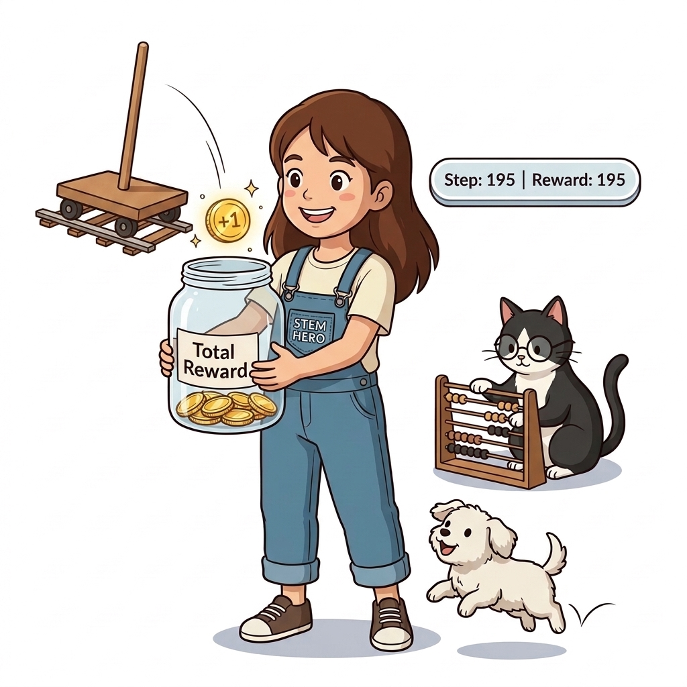
**그림 12-1-13** 막대가 쓰러지지 않고 균형을 유지하는 매 타임스텝마다 황금 코인이 차곡차곡 누적되는 Total Reward 저금통

---

terminated는 목표 상태에 도달했는지 여부를, truncated는 시간 초과처럼 MDP에서 정의하지 않은, 이번 문제만의 특수한 종료 조건이 충족됐는지 여부를 알려줍니다.


**그림 12-1-14** 환경 내부 실패로 인한 종료(`terminated`, $V(s_{terminal})=0$)와 시간 초과로 인한 조기 중단(`truncated`, 부트스트랩 $V(s_{t+1})$ 보존)의 가치 편향 방지 이론

---

〈카트 폴〉에서는 정확하게 다음 상황에서 True를 반환합니다.

* terminated: 막대 각도가 12도 초과(균형 잃음) 혹은 카트가 화면을 벗어남
* truncated: 행동 200회 초과(CartPole-v1에서는 500회)

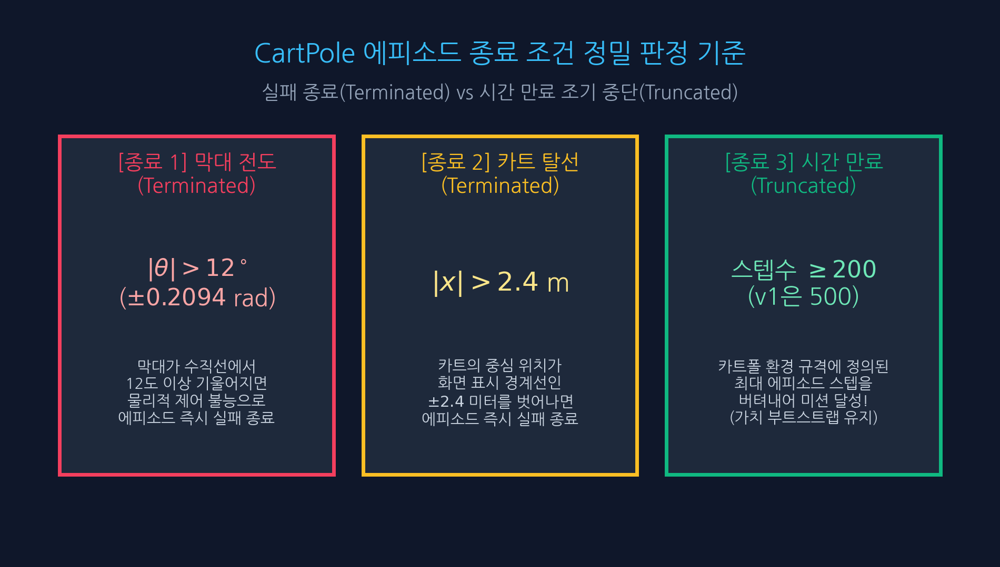
**그림 12-1-15** 막대 쓰러짐/탈선에 따른 실패 깃발(`terminated: True`)과 200회 스텝 유지 성공에 따른 축하 골인 깃발(`truncated: True`)의 현장 비교

---

마지막으로 info에는 디버깅에 유용한 정보가 담겨 있습니다(환경 모델 등). 강화 학습 알고리즘을 구현하고 평가할 때는 기본적으로 info는 사용하지 않습니다.


**그림 12-1-16** Q-러닝 알고리즘 수식 계산에는 사용되지 않지만, 환경 진단과 모니터링을 위해 제공되는 부가 메타데이터 공구 상자(`info`)

---

### 12.1.2 랜덤 에이전트

이상으로 OpenAI Gym을 다루는 데 필요한 지식은 모두 정리했습니다.

이제 코드를 하나로 묶어 움직여봅시다. 


**그림 12-1-17** 에이전트의 관찰-행동 선택($A_t$)과 환경의 물리 시뮬레이션-보상/차기상태 반환($S_{t+1}, R_{t+1}$)이 끊임없이 순환하는 강화학습 메인 피드백 루프

---

먼저 무작위로 행동하는 에이전트를 가정하여 1회분의 에피소드를 구동해보겠습니다.

**ch12/gym_play.py**

```python
import numpy as np
import gym

env = gym.make('CartPole-v0', render_mode='human')
state = env.reset()[0]
done = False

while not done: # 에피소드가 끝날 때까지 반복
    env.render() # 진행 과정 시각화
    action = np.random.choice([0, 1]) # 행동 선택(무작위)
    next_state, reward, terminated, truncated, info = env.step(action)
    done = terminated | truncated    # 둘 중 하나만 True면 에피소드 종료
env.close()
```

---

while문을 사용하여 에피소드가 끝날 때까지 행동을 계속하며, 행동은 0 또는 1을 무작위로 선택합니다.

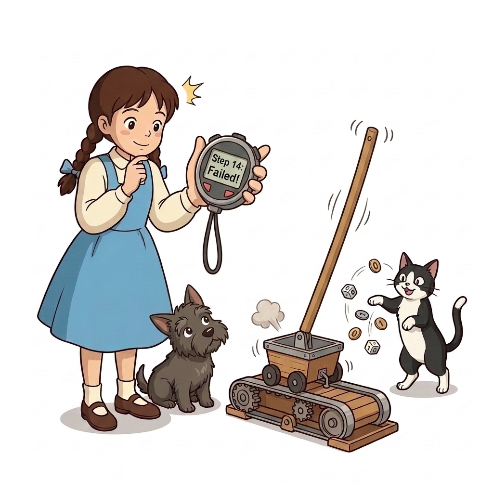
**그림 12-1-18** 주사위 던지듯 0과 1을 무작위로 선택하는 랜덤 에이전트의 한계: 시작한 지 14스텝 만에 중심을 잃고 비틀거리며 쓰러지는 카트폴

---

또한 OpenAI Gym에서는 `env.render()`를 호출하여 문제의 진행 과정을 시각화할 수 있습니다. 

〈카트 폴〉은 다음과 같은 창이 생성됩니다.


**그림 12-3** 〈카트 폴〉 렌더링(시각화)

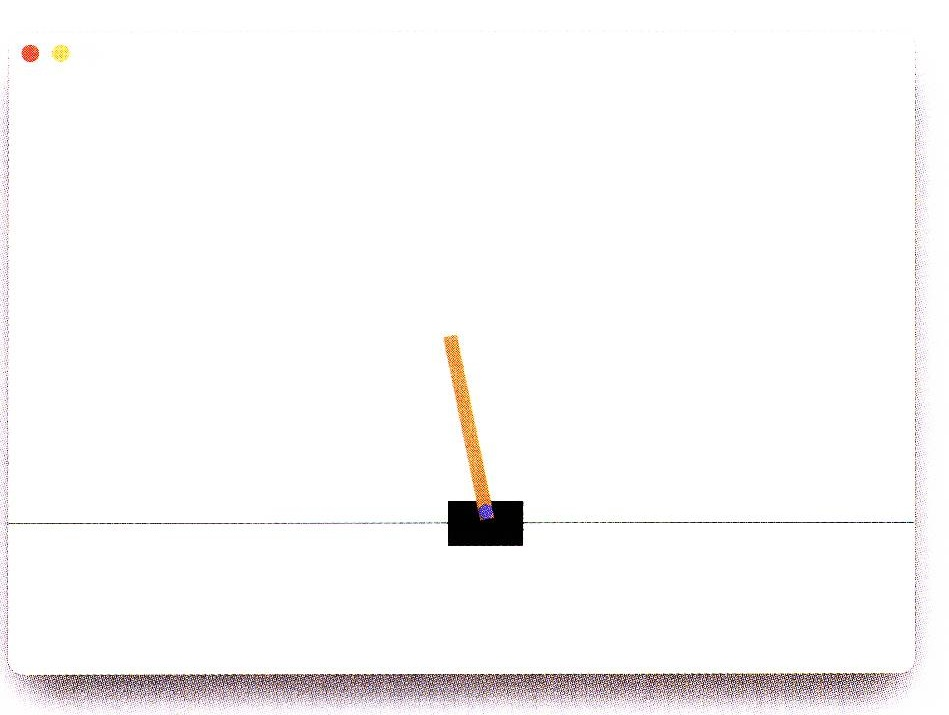

이번에는 행동을 무작위로 수행하기 때문에 오래 버티지 못하고 곧바로 균형이 무너질 것입니다. 

다음 절에서는 DQN을 사용하여 제대로 도전하겠습니다.

---

### 12.1.3 상태와 관찰

OpenAI Gym 문서에서는 '상태(state)' 대신 '관찰(observation)'이라는 용어를 사용합니다. 


**그림 12-1-19** 안개 낀 미지의 세계에서 카메라와 라이다(LiDAR) 센서 뷰파인더로 감지된 국소 정보(Observation)에 의존해 주행하는 탐사 로봇과 관찰 용어의 필연성

---

API에서도 'observation'을 씁니다(env.observation_space 등).


**그림 12-1-20** 4개 물리축(위치, 속도, 각도, 각속도)의 하한과 상한 경계 범위를 정밀 계측하는 `gym.spaces.Box(shape=(4,))` 4차원 하이퍼큐브 스펙

---

상태와 관찰은 다릅니다. 

상태는 환경에 대한 '완전한 정보'입니다. 상태를 알면 마르코프 결정 과정을 통해 다음 상태와 보상의 확률 분포가 완벽하게 결정됩니다. 


**그림 12-1-21** 모든 기물의 배치가 100% 투명하게 드러나 과거 이력 없이 현재 배치($S_t$)만으로 미래 전이 확률이 완벽히 결정되는 마르코프 결정 과정(MDP)의 체스판

---

반면, 관찰은 환경에 대한 '부분적 정보'입니다. 예를 들어 포커나 고스톱에서는 상대의 패를 알 수 없습니다. 이처럼 에이전트가 환경의 일부만 볼 수 있는 문제를 상상하면 쉽게 이해될 것입니다.


**그림 12-1-22** 상대방의 패와 덱에 남은 카드가 물음표(?)로 뒤집혀 있어 내 손패(일부 센서 관찰값)만으로 불확실성을 추론해야 하는 부분 관측 환경(POMDP)

---

문제에 따라서는 상태와 관찰이 동일시되는 경우도 있지만, 다양한 강화 학습 문제를 고려하면 '상태'보다는 '관찰'이 적절한 용어입니다. 그래서 OpenAI Gym에서는 '관찰'로 쓰고 있습니다. 

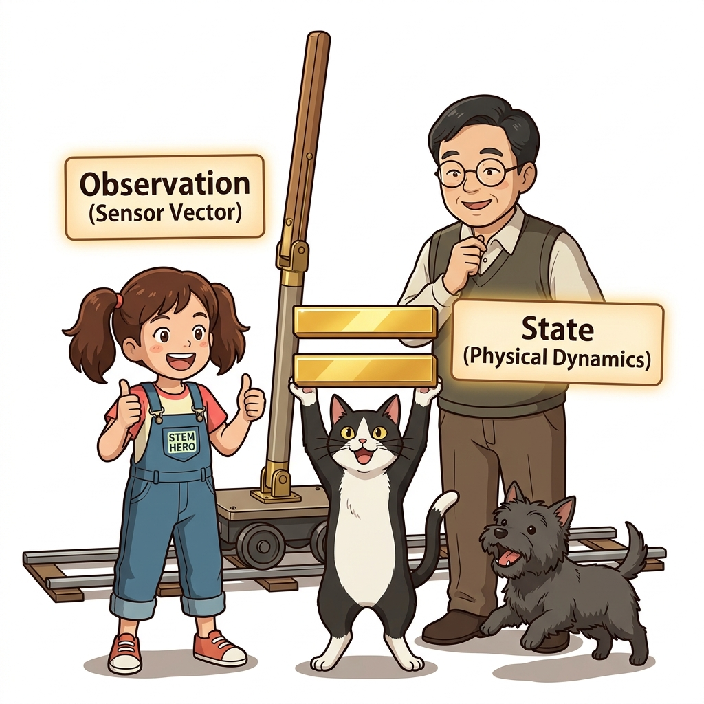
**그림 12-1-23** 카트폴은 역학 시뮬레이션의 모든 변수가 측정되는 완전 관측 환경이므로 관찰과 상태가 일치(`Observation = State`)함을 확인하고 본격적인 DQN 탐험으로 나아가는 도로시와 지니

다만 이 강의에서는 상태와 관찰이 똑같은 문제만 다루기 때문에 지금까지와 마찬가지로 '상태'로 쓰겠습니다.
