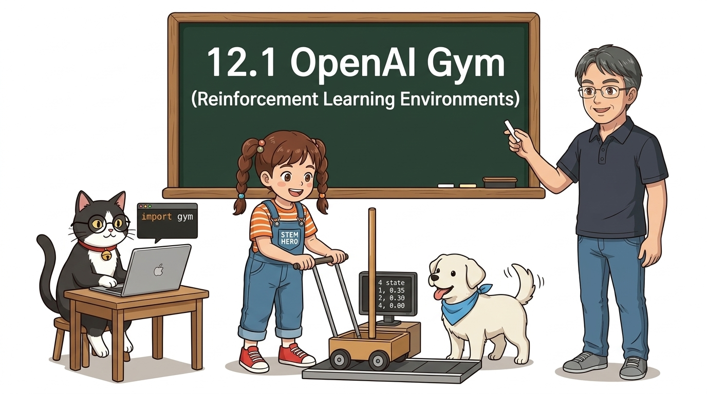
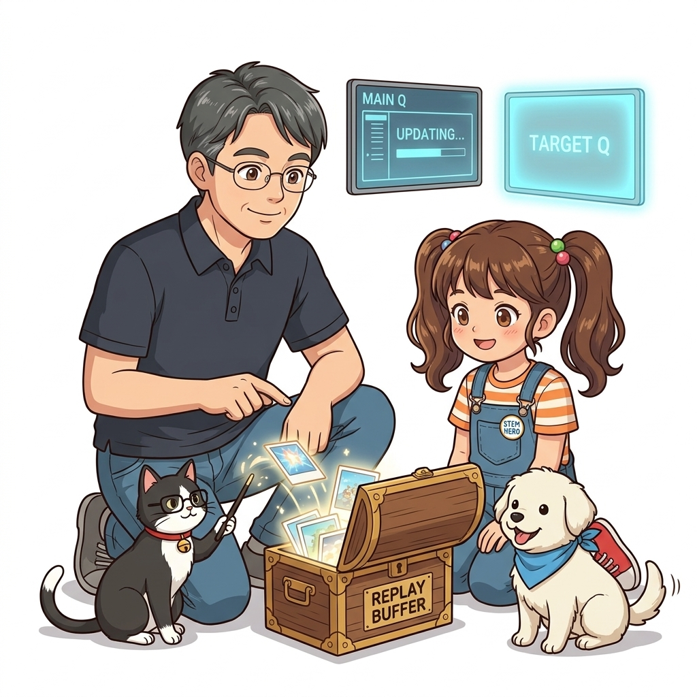
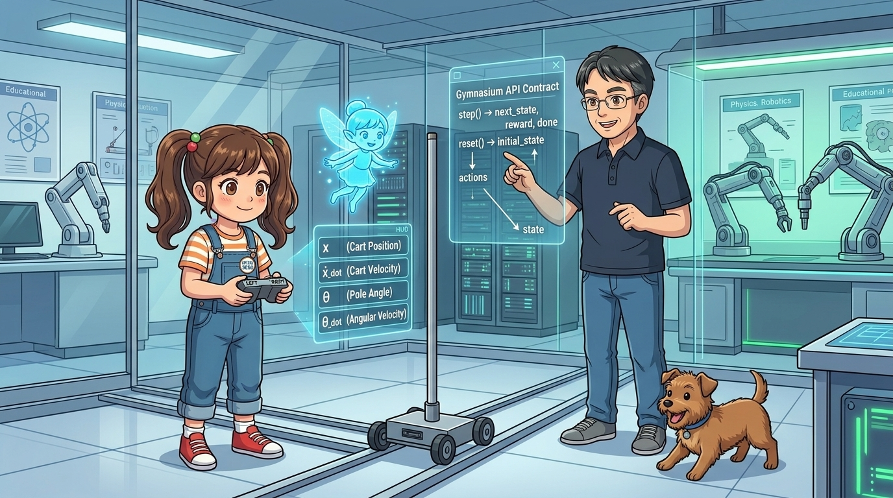
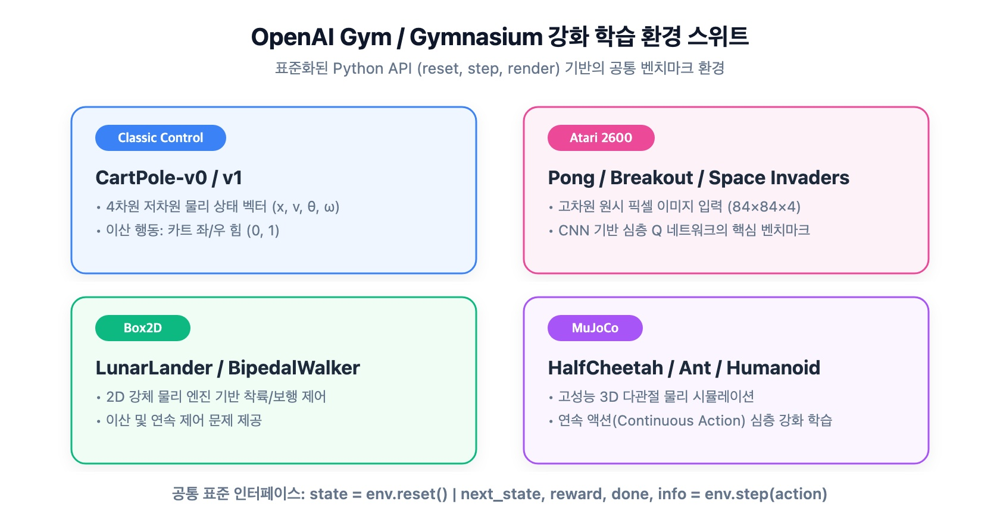
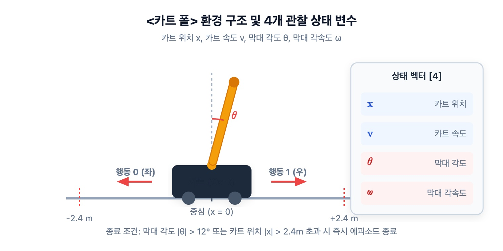
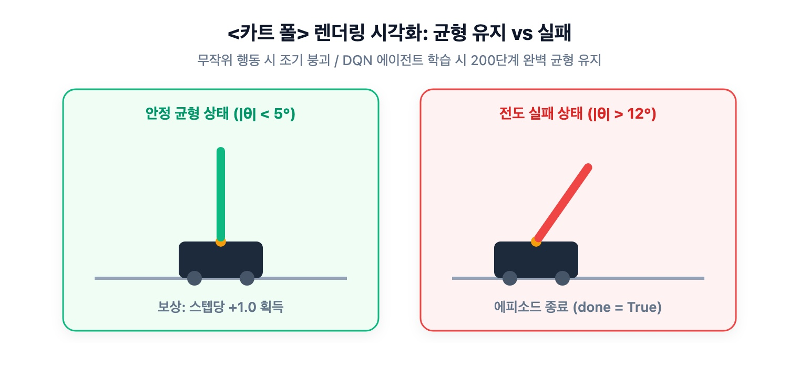

# 12.1 OpenAI Gym: 현실 세계 물리 제어로의 도약




**그림 12-1-1** 카트 폴(Cart Pole) 막대의 균형을 잡기 위해 실시간으로 좌우 조작을 연습해 보는 도로시와 지니


**그림 12-1-2** 레일 위의 수레와 회전 막대 균형을 잡는 도로시와, 4가지 연속 실수 상태 변수 [위치, 속도, 각도, 각속도]를 투사하는 지니, 그리고 Gymnasium 표준 API 규약(`reset()`, `step()`)을 설명하는 이호진 교수님

기존의 단순한 2차원 바둑판 그리드 월드를 벗어나, 전 세계 강화학습 연구의 표준 벤치마크 도구인 **OpenAI Gym(Gymnasium)** 라이브러리의 구조와 핵심 사용법을 배웁니다. 수레 위 막대를 쓰러뜨리지 않고 꼿꼿이 세우는 고전 역학 제어 과제 **CartPole(카트 폴)** 환경의 4차원 연속 상태 공간을 탐색하고, 무작위 행동을 취하는 랜덤 에이전트를 직접 구동해 봅시다!

---

## 12.1.1 강화학습의 표준 시험장: OpenAI Gym

우리가 지금까지 사용했던 '3x4 그리드 월드'는 학습 알고리즘의 기초를 다지기엔 좋았지만, 실제 로봇이나 게임과 같은 현실적인 복잡성을 반영하기에는 너무 단순했습니다.

인공지능 연구소 OpenAI는 전 세계 연구자들이 동일한 기준에서 알고리즘의 성능을 검증하고 겨룰 수 있도록 표준 시뮬레이터 라이브러리인 **Gym(현재의 Gymnasium)**을 오픈소스로 공개했습니다.


**그림 12-1-3** 아타리 비디오게임, 연속 로봇 제어(MuJoCo), 고전 역학 제어 등 다양한 강화학습 환경을 일관된 인터페이스로 제공하는 OpenAI Gym

Gym의 가장 위대한 점은 **모든 환경이 완벽하게 표준화된 인터페이스**를 공유한다는 것입니다:
- 체스든, 아타리 벽돌깨기든, 자율주행이든 에이전트는 항상 똑같이 `env.reset()`으로 시작하고 `env.step(action)`으로 상호작용합니다.
- 따라서 에이전트의 내부 알고리즘 코드 한 줄 바꾸지 않고도 환경 이름만 교체하면 즉시 새로운 문제를 학습시킬 수 있습니다!

---

## 12.1.2 고전 제어의 금자탑: CartPole 환경 해부

이번 12장에서 DQN으로 정복할 주인공은 **카트 폴(CartPole-v0 / CartPole-v1)** 환경입니다:

```bash
pip install gym[classic_control]
```

```python
import gym

env = gym.make('CartPole-v1', render_mode='human')
```


**그림 12-1-4** 카트 폴(CartPole)의 화면 구성. 레일 위를 달리는 검은 카트와 그 위에 힌지로 연결된 가느다란 수직 막대(폴)

### 1) 게임 규칙
- 레일 위를 움직이는 수레(Cart) 위에 중심이 불안정한 막대(Pole)가 올려져 있습니다.
- 막대가 중력에 의해 좌우로 쓰러지지 않도록, 에이전트는 매 순간 수레를 **왼쪽 또는 오른쪽**으로 밀어 균형을 유지해야 합니다.
- **성공 기준**: 막대가 쓰러지지 않고 500단계(CartPole-v0은 200단계) 동안 똑바로 버텨내면 에피소드 클리어입니다.

---

### 2) 4차원 연속 실수 상태 공간 (Continuous State Space)

초기 상태를 관찰해 봅시다:

```python
state, info = env.reset()
print("초기 상태 관찰값:", state)
print("행동 공간의 크기:", env.action_space)
```

**출력 결과**:
```text
초기 상태 관찰값: [ 0.03454657 -0.01361909 -0.02143636  0.02152179]
행동 공간의 크기: Discrete(2)
```

상태는 격자 번호가 아니라 **4개의 부동소수점 실수(float)**로 구성된 4차원 벡터입니다!
1. **상태[0] (카트 위치, *x*)**: 화면 중앙(0.0)을 기준으로 수레가 위치한 좌우 좌표 (-4.8 ~ +4.8)
2. **상태[1] (카트 속도, *x*&middot;)**: 수레가 좌우로 움직이는 선속도
3. **상태[2] (막대 각도, *θ*)**: 수직선(0 rad)을 기준으로 막대가 기울어진 각도 (약 &plusmn;24도)
4. **상태[3] (막대 각속도, *θ*&middot;)**: 막대가 회전하며 넘어지는 각속도

이처럼 상태가 연속적인 실수이므로 상태의 가짓수는 **무한대**입니다. 
따라서 10장에서 배운 테이블형 Q-러닝은 적용 자체가 불가능하며, **11장에서 배운 신경망(QNet)만이 이 문제를 해결할 유일한 열쇠**가 됩니다!

---

### 3) 2개의 이산 행동 공간 (Discrete Action Space)
에이전트가 내릴 수 있는 행동은 단순합니다:
- **0**: 수레를 왼쪽으로 밀기
- **1**: 수레를 오른쪽으로 밀기

---

### 4) `env.step(action)`과 5개 반환값

에이전트가 행동을 전달하면 환경은 1 스텝의 물리 법칙을 시뮬레이션한 후 5가지 값을 돌려줍니다:

```python
next_state, reward, terminated, truncated, info = env.step(action)
```

- **`next_state`**: 행동을 가한 후의 새로운 4차원 상태 벡터
- **`reward`**: 즉각 보상. 막대가 서 있는 매 타임스텝마다 **+1.0** 획득
- **`terminated` (자연적 종료)**: 막대의 기울기가 &plusmn;12도를 넘어가 바닥으로 고꾸라지거나 수레가 화면 밖(&plusmn;2.4)으로 이탈했을 때 `True`
- **`truncated` (시간 초과 종료)**: 에이전트가 균형을 너무 잘 잡아서 목표 타임스텝(200회 또는 500회)에 도달하여 게임이 정상 종료되었을 때 `True`
- **`info`**: 추가 디버깅 메타데이터

---

## 12.1.3 무작위 랜덤 에이전트의 한계

아무것도 모르는 상태에서 동전을 던지듯 0과 1을 무작위로 선택하는 랜덤 에이전트를 구동해 봅시다:

<div align="right"><b>ch08/gym_play.py</b></div>

```python
import numpy as np
import gym

env = gym.make('CartPole-v0', render_mode='human')
state, info = env.reset()
done = False
total_reward = 0

while not done:
    env.render() # 그래픽 화면 렌더링
    action = np.random.choice([0, 1]) # 50% 확률 무작위 좌우 조작
    next_state, reward, terminated, truncated, info = env.step(action)

    total_reward += reward
    done = terminated or truncated

print("랜덤 에이전트의 최종 버틴 스텝 수(보상):", total_reward)
env.close()
```


**그림 12-1-5** 무작위로 조작할 경우 시작한 지 10~20스텝도 버티지 못하고 순식간에 막대가 고꾸라집니다.

실행해 보면 막대가 기껏해야 10~20스텝을 넘기지 못하고 허무하게 쓰러집니다. 
수레의 속도와 막대의 각속도를 종합적으로 분석하여 적절한 타이밍에 정확한 방향으로 힘을 가하는 지능적인 정책이 절실합니다.

---

## 12.1.4 심화: 상태(State)와 관찰(Observation)의 차이

OpenAI Gym API 문서를 보면 `state` 대신 **`observation`**이라는 단어를 일관되게 사용합니다. 두 개념 사이에는 중요한 차이가 있습니다:

- **상태 (State)**:
  환경을 완벽하게 서술하는 **'완전한 정보'**입니다. 마르코프 성질을 완벽히 만족하며 현재 상태만 알면 과거 역사 없이도 미래가 결정됩니다 (MDP).
- **관찰 (Observation)**:
  센서의 한계나 장애물 때문에 에이전트에게 주어지는 **'부분적인 정보'**입니다 (부분 관측 마르코프 결정 과정, POMDP).
  - 예: 포커 게임에서 내 손패만 보이고 상대방 손패는 가려져 있는 상황.
  - 예: 자동차 주행 시 앞 유리창 시야만 보이고 사각지대 차량은 보이지 않는 상황.

CartPole 환경에서는 수레의 위치, 속도, 각도, 각속도라는 물리 시스템의 핵심 정보가 온전히 주어지므로 상태와 관찰이 거의 일치합니다.

이제 이 흥미진진한 연속 물리 세계에서 500스텝 만점을 달성하기 위해, 다음 12.2절에서 딥마인드의 천재적인 알고리즘인 **DQN의 2대 핵심 기술(경험 재생 & 타깃 네트워크)**을 배워봅시다!
