# 12.1 OpenAI Gym

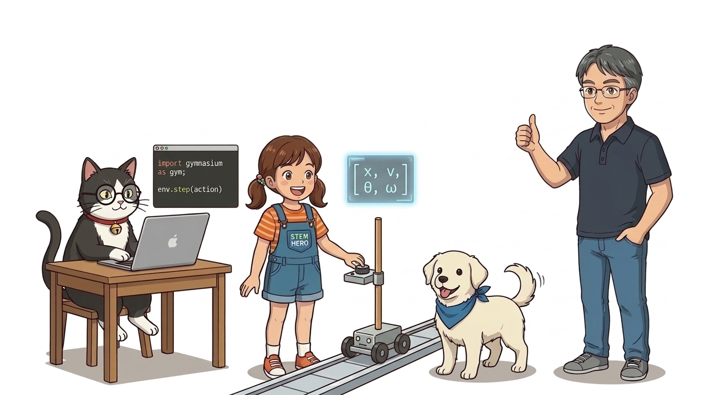

> **[강의 스크립트]**
> 여러분 안녕하십니까. 이번 십이점일 절에서는 강화학습 시뮬레이션의 세계적 표준 도구인 오픈에이아이 짐 라이브러리의 기초와, 앞으로 우리가 딥 큐네트워크를 통해 스스로 정복해 볼 대표 예제인 카트폴 제어 환경의 내부 인터페이스를 상세히 학습하겠습니다. 파이썬 코드로 가상 물리 환경을 생성하고 에이전트와 환경이 어떻게 상태와 행동, 보상을 주고받는지 그 구체적인 상호작용 메커니즘을 오늘 명확히 확립해 두시기 바랍니다.

---
#### OpenAI Gym은 오픈소스 라이브러리입니다.

강화학습(Reinforcement Learning, RL) 알고리즘을 연구하고 개발하기 위해서는 에이전트가 탐색하고 시행착오를 겪을 수 있는 **시뮬레이션 환경(Environment)**이 필수적입니다. 

**OpenAI Gym**(현재 오픈소스 재단 Farama Foundation의 **Gymnasium**으로 발전)은 물리 엔진, 비디오 게임, 로보틱스 제어 등 다양한 강화학습 시뮬레이터를 일관된 파이썬 API 인터페이스로 제공하는 글로벌 표준 툴킷입니다.

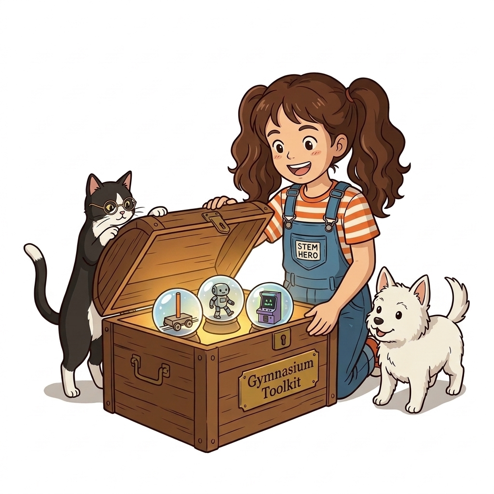
**그림 12-1-1** 다양한 강화학습 환경과 표준 인터페이스를 제공하는 오픈소스 툴킷 OpenAI Gym(Gymnasium)을 살펴보는 도로시와 지니

> **[강의 스크립트]**
> 강화학습 알고리즘을 연구하고 검증하기 위해서는 에이전트가 마음껏 부딪치며 시행착오를 겪을 수 있는 안전한 시뮬레이션 환경이 절대적으로 필요합니다. 현실 세계의 실제 로봇이나 자율주행차로 무작정 학습을 시도하면 막대한 하드웨어 파손과 인명 사고 위험이 발생하기 때문입니다. 오픈에이아이 짐은 바로 이러한 문제를 해결하기 위해 고안된 글로벌 표준 툴킷으로, 복잡한 물리 엔진이나 게임 그래픽스를 단 몇 줄의 파이썬 코드로 손쉽게 제어할 수 있는 표준화된 가상 실험장을 제공합니다.

---
#### OpenAI Gym은 대단히 다양한 강화 학습 문제(환경)를 제공합니다.

고전 제어 이론의 역진자 문제(CartPole, MountainCar, Pendulum)부터 2D/3D 로보틱스 물리 시뮬레이션(Box2D, MuJoCo), 그리고 아타리 2600 비디오 게임(Atari Arcade)에 이르기까지 연구자가 목적에 맞춰 선택할 수 있는 수백 가지의 표준 환경 벤치마크를 내장하고 있습니다.


**그림 12-1** OpenAI Gym (Gymnasium) 공식 문서의 CartPole 환경 스펙 화면

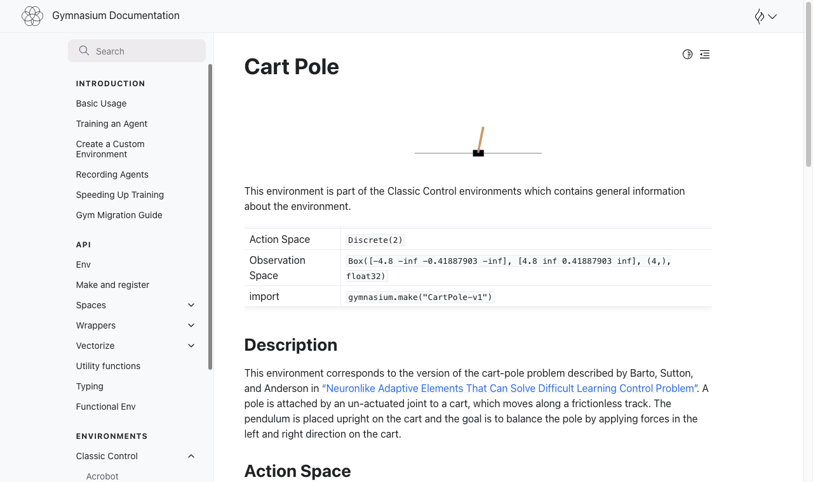

> [Gymnasium CartPole 공식 문서](https://gymnasium.farama.org/environments/classic_control/cart_pole/)

> **[강의 스크립트]**
> 오픈에이아이 짐이 제공하는 환경의 스펙트럼은 실로 방대합니다. 우리가 오늘 실습할 카트폴이나 마운틴 카와 같은 고전 역학 역진자 문제부터 시작하여, 관절과 마찰력을 정밀하게 모사하는 박스투디와 무조코 기반의 이차원 및 삼차원 로봇 보행 시뮬레이터, 그리고 화면의 원시 픽셀을 직접 바라보며 플레이하는 전설적인 아타리 이천육백 비디오 게임에 이르기까지 연구자가 목적에 따라 자유롭게 선택할 수 있는 수백 가지의 표준 환경이 잘 정돈되어 있습니다.

---
#### OpenAI Gym이 제공하는 문제들은 대부분 인터페이스가 일관됩니다.

강화학습 환경마다 물리 법칙이나 상태 표현 방식은 완전히 다르지만, 에이전트와 상호작용하는 프로그래밍 인터페이스는 놀라울 정도로 단순하고 통일되어 있습니다.

모든 환경은 단 두 개의 핵심 메서드인 **`reset()`**(초기화 및 초기 상태 관측)과 **`step(action)`**(행동 전달 후 전이 결과 획득)만으로 동작합니다. 따라서 하나의 에이전트 학습 코드를 작성해 두면, 환경 이름만 바꾸어도 다른 문제에 즉시 적용할 수 있는 강력한 다형성(Polymorphism)을 보장합니다.

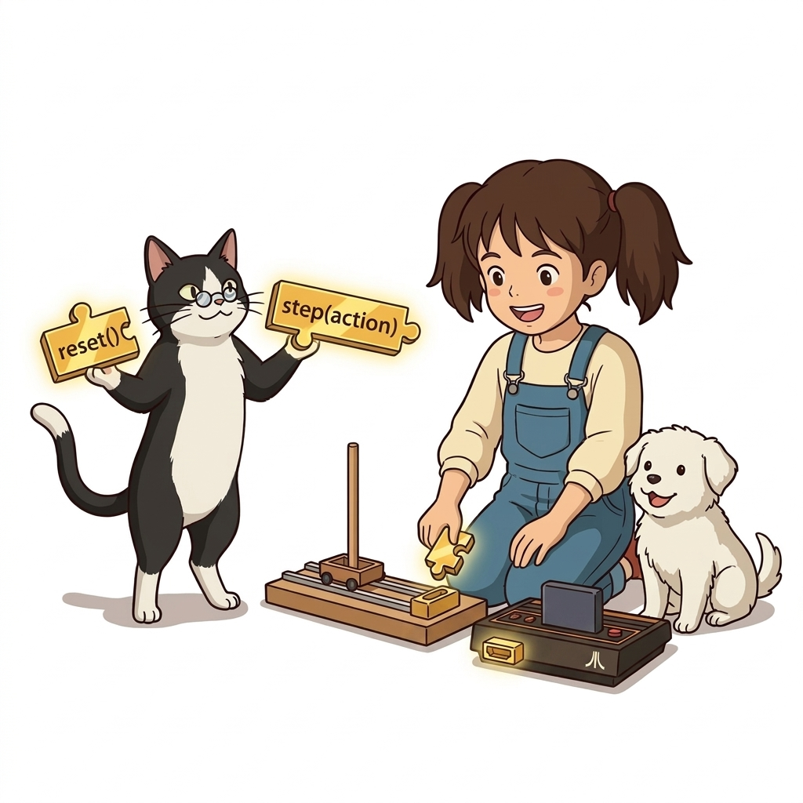
**그림 12-1-2** 어떤 복잡한 환경이라도 reset(), step(action)이라는 단일한 표준 규약으로 통일되어 상호작용하는 Gym 인터페이스 메커니즘

> **[강의 스크립트]**
> 오픈에이아이 짐의 가장 위대한 공헌은 환경마다 제각각인 복잡한 물리 계산을 완전히 감추고, 에이전트와의 상호작용 인터페이스를 단 두 개의 메서드로 지극히 단순화했다는 점에 있습니다. 환경을 시작하거나 실패했을 때 상태를 리셋하는 리셋 메서드와, 에이전트가 선택한 행동을 한 스텝 실행하고 새로운 상태와 보상을 돌려받는 스텝 메서드가 바로 그것입니다. 이처럼 직관적이고 일관된 규격 덕분에 연구자는 환경의 세부 구현에 구애받지 않고 오직 지능 알고리즘 설계에만 전념할 수 있습니다.

---
#### 따라서 다른 강화 학습 문제로 손쉽게 전환할 수 있습니다.

그뿐만 아니라 전 세계 강화학습 연구 논문들에서 새로운 알고리즘(DQN, A3C, PPO, SAC 등)을 발표할 때 알고리즘의 우수성을 입증하는 **공인 벤치마크(Standard Benchmark)**로 OpenAI Gym 환경들을 표준으로 채택하고 있습니다.

동일한 환경 스펙과 평가 기준 위에서 성능을 비교할 수 있으므로, 재현 가능성(Reproducibility)과 객관적인 알고리즘 검증이 가능합니다.

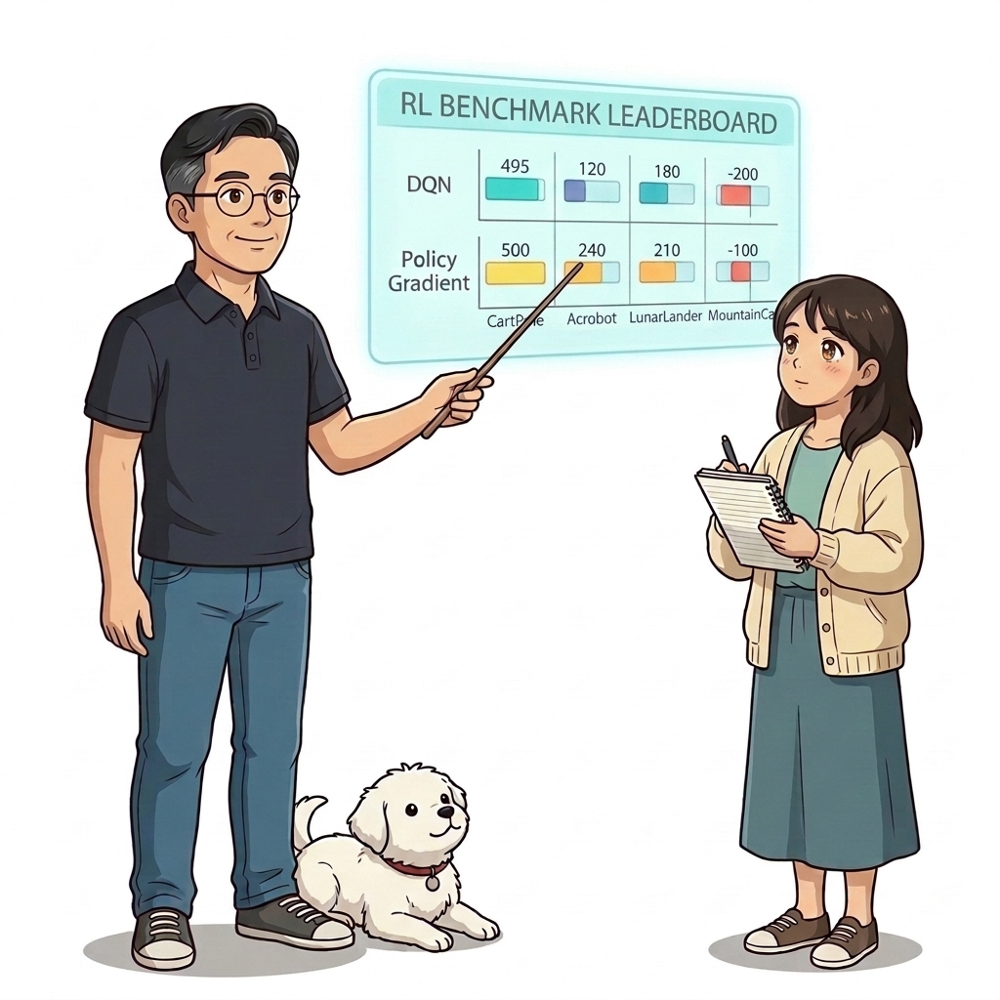
**그림 12-1-3** 전 세계 AI 연구 논문들의 성능 비교 표준 벤치마크로 공정하게 활약하는 OpenAI Gym 생태계를 설명하는 이호진 교수님

> **[강의 스크립트]**
> 인터페이스가 완전히 통일되어 있다는 것은 실로 엄청난 실용적 강점을 제공합니다. 카트폴 문제를 풀기 위해 정성껏 작성해 둔 강화학습 알고리즘 코드를 거의 수정하지 않고도, 환경의 이름 한 줄만 바꾸면 곧바로 로봇 팔 제어나 비디오 게임 플레이로 손쉽게 전환하여 실험할 수 있습니다. 그뿐만 아니라 전 세계 모든 인공지능 연구 논문들이 이 짐 환경을 공인 벤치마크로 채택하고 있으므로, 우리가 개발한 새로운 알고리즘의 성능을 객관적이고 공정하게 비교 평가할 수 있는 튼튼한 토대가 마련됩니다.

---
#### 특히 〈아타리(Atari)〉 게임이 많이 이용됩니다.

2013년과 2015년 DeepMind가 딥 강화학습(Deep Q-Network, DQN)의 탄생을 알리며 네이처(Nature) 표지를 장식했을 때 사용한 무대가 바로 아타리 2600 비디오 게임(Breakout, Pong, Space Invaders 등) 환경이었습니다.

사람의 사전 도메인 지식 없이 원시 화면 픽셀(Raw Screen Pixels)만을 관찰값으로 받아 인간 프로게이머 수준의 플레이를 학습해 낸 역사적 시발점이 바로 Gym의 Atari 환경군입니다.

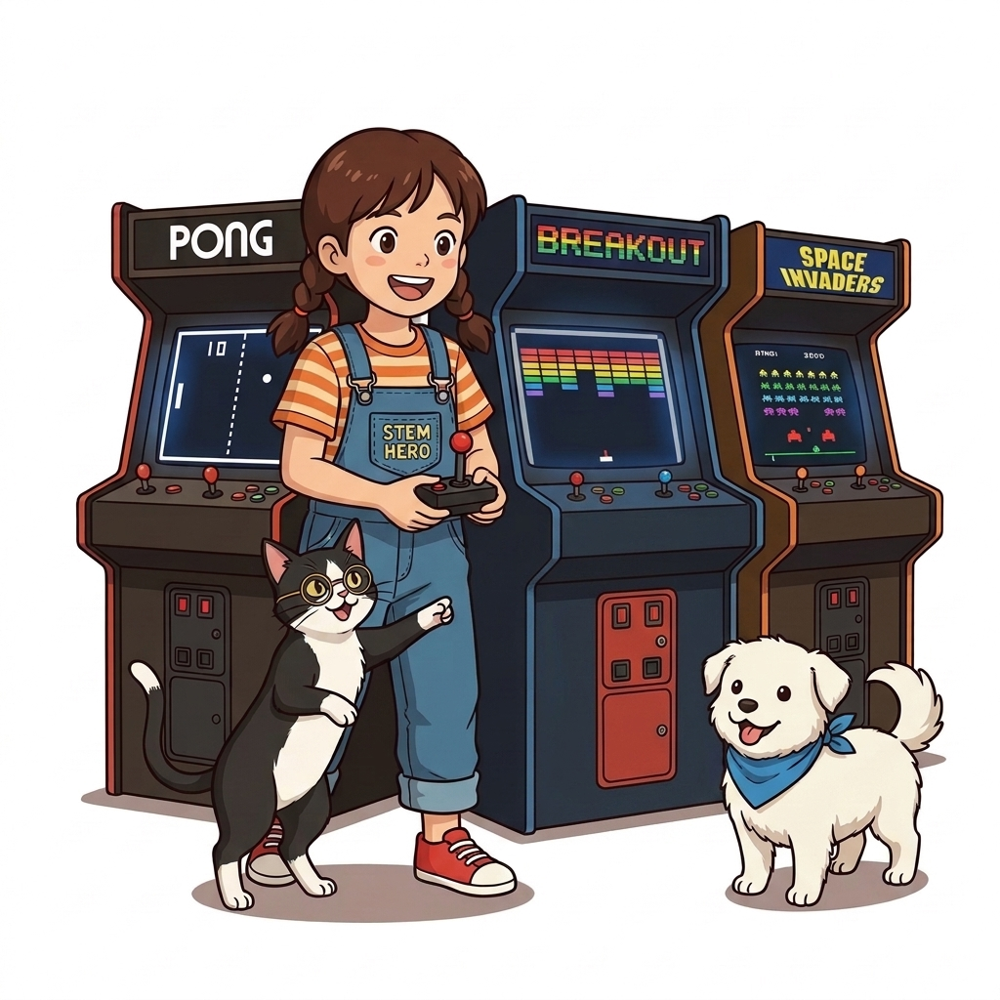
**그림 12-1-4** OpenAI Gym이 제공하는 고전 아타리 2600 비디오 게임(Pong, Breakout, Space Invaders) 아케이드 환경을 탐험하는 도로시와 지니

> **[강의 스크립트]**
> 특히 딥마인드가 이천십삼년과 이천십오년에 심층 강화학습의 화려한 부활을 전 세계에 선포했을 때 사용했던 주 무대가 바로 아타리 게임입니다. 벽돌깨기나 스페이스 인베이더 같은 아타리 게임들은 점수가 보상으로 주어지고 모니터 화면이 상태로 주어지기 때문에, 인간과 동일한 시각 조건에서 인공지능의 순수한 제어 능력을 검증하기에 더할 나위 없이 훌륭한 시험장입니다. 우리도 이번 십이 장의 후반부에서 이 아타리 벽돌깨기 환경을 정복하는 합성곱 신경망 기반의 디큐엔 파이프라인을 직접 다루게 됩니다.

---
### 12.1.1 OpenAI Gym 실습 환경 구성 가이드

OpenAI Gym과 카트폴 시뮬레이션을 원활하게 구동하기 위해 필요한 패키지를 설치합니다.


**그림 12-1-4-A** 안전한 파이썬 가상환경(.venv)과 Gymnasium 및 Pygame 시뮬레이션 환경 구축 준비를 마친 도로시와 연구진

> **[강의 스크립트]**
> 이제 본격적으로 우리의 로컬 컴퓨터에 오픈에이아이 짐과 카트폴 시뮬레이터를 구동하기 위한 개발 환경을 구축해 보겠습니다. 화면의 오버뷰 다이어그램을 보시면, 파이썬 가상환경 격리부터 시작하여 최신 파이지엠 백엔드 설치, 그리고 카트폴 환경의 정상 빌드 여부를 점검하는 삼단계 파이프라인이 일목요연하게 정리되어 있습니다. 최근 운영체제들의 보안 강화 규정으로 인해 설치 과정에서 예기치 못한 에러가 자주 발생하므로 다음 설명들을 차근차근 따라와 주시기 바랍니다.

---
#### 시스템 전역 파이썬 보호 규정 (PEP 668)과 쉘 와일드카드 주의사항

최근 파이썬 배포판(Python 3.11+)과 macOS/Linux에서는 시스템 전역 환경 보호 규정(**PEP 668**)에 따라 시스템 파이썬에 직접 `pip install`을 실행하면 다음과 같은 오류가 발생합니다:

```text
error: externally-managed-environment
× This environment is externally managed
```

또한 macOS의 기본 쉘인 **zsh**에서는 대괄호(`[...]`)를 파일 탐색 와일드카드로 인식하므로 `zsh: no matches found`가 발생할 수 있습니다.

> **[강의 스크립트]**
> 최신 파이썬 배포판과 맥오에스, 리눅스 환경에서는 시스템 전역 파이썬을 보호하기 위한 규정인 펩 육백육십팔이 기본으로 적용되어 있습니다. 따라서 시스템 파이썬 환경에 마구잡이로 핍 인스톨 명령을 날리면 외부 관리 환경 에러를 뿜어내며 설치가 단칼에 거부됩니다. 또한 지샤 쉘이나 배시 쉘에서는 대괄호 기호가 파일 검색용 와일드카드로 해석되기 때문에, 짐네지엄 클래식 컨트롤과 같은 패키지 옵션을 지정할 때는 반드시 따옴표로 감싸서 입력해야 문법 에러를 방지할 수 있습니다.

---
#### 왜 가상환경(venv)을 만들어야 하는가?

운영체제(macOS Apple Silicon vs Windows)에 맞춰 **독립된 가상환경(venv)**을 만들어 설치하는 것이 가장 안전하고 권장되는 글로벌 표준 방법입니다:

1. **시스템 OS 격리 보호**: OS 자체 유틸리티가 사용하는 시스템 파이썬 패키지를 건드리지 않고 보호합니다.
2. **프로젝트별 버전 독립성**: 다른 프로젝트와의 패키지 버전(예: NumPy, Gym, PyTorch) 충돌을 원천 차단합니다.
3. **손쉬운 초기화**: 문제가 생기면 `.venv` 폴더 하나만 지우고 다시 만들면 깨끗하게 복구됩니다.


**그림 12-1-4-B** 호스트 OS 시스템을 안전하게 보호하고 패키지 버전 충돌을 원천 차단하는 `.venv` 가상환경 샌드박스 메커니즘

> **[강의 스크립트]**
> 그렇다면 우리는 왜 번거롭게 독립된 가상환경을 만들어야 할까요? 첫째는 운영체제 자체나 다른 개발 프로젝트들이 의존하고 있는 전역 파이썬 라이브러리와의 버전 충돌을 완벽히 차단하기 위함입니다. 둘째는 가상환경 디렉토리 하나만 삭제하면 언제든 초기 상태로 깨끗하게 되돌릴 수 있는 완벽한 격리성을 보장하기 때문입니다. 따라서 여러분이 실무 인공지능 프로젝트를 수행하실 때도 항상 프로젝트 루트 디렉토리에 전용 가상환경을 구축하는 습관을 들이셔야 합니다.

---
#### 🍏 macOS (Apple Silicon M1/M2/M3/M4) 환경 설정

터미널(zsh)을 열고 프로젝트 디렉토리에서 다음 명령어를 순서대로 실행합니다:

```zsh
# 1. 독립된 파이썬 가상환경 생성 (.venv)
python3 -m venv .venv

# 2. 가상환경 활성화 (프롬프트 앞에 (.venv) 표시 확인)
source .venv/bin/activate

# 3. 강화학습 환경 및 렌더링 백엔드 설치 (최신 파이썬 호환 pygame-ce 사용)
pip install "gymnasium[classic-control]" pygame-ce
```

> **[강의 스크립트]**
> 애플 실리콘 맥을 사용하시는 분들은 터미널에서 프로젝트 디렉토리로 이동한 뒤 화면의 명령어 세 줄을 차례대로 실행하십시오. 파이썬 쓰리 엠 벤브 명령어로 점 벤브라는 이름의 가상환경을 생성하고, 소스 명령어로 이를 활성화합니다. 터미널 프롬프트 맨 앞에 괄호 점 벤브 표시가 나타나면 가상환경이 정상적으로 켜진 것입니다. 그 상태에서 핍 인스톨 명령을 사용하여 짐네지엄의 클래식 컨트롤 모듈과 최신 파이썬 호환 백엔드인 파이지엠 씨이를 안전하게 설치해 줍니다.

---
> [!IMPORTANT]
> **`ERROR: Failed building wheel for pygame` 오류 원인과 해결:**
> macOS의 최신 Homebrew 파이썬(Python 3.14) 환경에서는 기존 구형 `pygame` 패키지의 사전 빌드된 바이너리(wheel)가 없어 C 소스코드 컴파일을 시도하다가 `SDL.h not found` 에러가 발생합니다.
> 최신 Python 3.14를 사용 중이시라면 3.14용 바이너리 휠을 공식 완벽 지원하며 100% 동일한 API로 동작하는 **`pygame-ce`**(Community Edition)를 지정하여 설치하시면 에러 없이 즉시 설치됩니다:
> ```zsh
> pip install "gymnasium[classic-control]" pygame-ce
> ```
> 또는 버전 충돌이 일체 없는 파이썬 3.11 가상환경을 `uv`로 즉시 생성하여 설치할 수도 있습니다:
> ```zsh
> uv venv --python 3.11 .venv && source .venv/bin/activate && pip install "gymnasium[classic-control]" pygame
> ```

> **[강의 스크립트]**
> 설치 도중 휠 빌드 실패 에러가 발생하며 파이지엠 설치가 멈추는 경우가 종종 있습니다. 이는 맥오에스의 최신 홈브루 파이썬 삼점십사 환경에서 구형 파이지엠 패키지의 사전 빌드 바이너리가 아직 제공되지 않아 발생하는 현상입니다. 이때는 당황하지 마시고 화면의 팁 박스에 안내된 것처럼 파이지엠의 최신 커뮤니티 에디션인 파이지엠 씨이를 지정하여 설치하시면 네이티브 씨 언어 컴파일 에러 없이 아주 매끄럽고 신속하게 설치가 완료됩니다.

---
> [!TIP]
> **가상환경 없이 즉시 설치하고 싶을 때 (빠른 실습용)**:
> 가상환경 생성 과정을 건너뛰고 시스템 파이썬에 즉시 설치하려면 `--break-system-packages` 플래그를 추가해 주시면 됩니다:
> ```zsh
> python3 -m pip install "gymnasium[classic-control]" pygame --break-system-packages
> ```
> 
> **초고속 패키지 관리자 `uv`를 사용하는 경우**:
> ```zsh
> uv run --python 3.11 --with "gymnasium[classic-control],pygame" python step01_make_env.py
> ```

> **[강의 스크립트]**
> 만약 강의 실습만을 위해 가상환경 생성 단계를 건너뛰고 시스템 파이썬에 곧바로 설치하고 싶으시다면, 핍 인스톨 명령어 뒤에 대시 대시 브레이크 시스템 패키지스 플래그를 붙여주시면 됩니다. 이 옵션은 운영체제의 펩 육백육십팔 보호 규정을 일시적으로 우회하여 강제로 패키지를 주입하는 플래그입니다. 다만 실무 개발 환경에서는 예기치 않은 시스템 파이썬 훼손을 방지하기 위해 가급적 앞서 배운 독립 가상환경 방식을 권장합니다.

---
#### 🪟 Windows (Windows 10/11) 환경 설정

PowerShell 또는 명령 프롬프트(CMD)를 열고 다음 명령어를 실행합니다:

**1. PowerShell 사용 시:**
```powershell
# 1. 파이썬 가상환경 생성
python -m venv .venv

# 2. 스크립트 실행 권한 허용 (최초 1회만 필요)
Set-ExecutionPolicy -ExecutionPolicy RemoteSigned -Scope Process

# 3. 가상환경 활성화
.\.venv\Scripts\Activate.ps1

# 4. 패키지 설치 (PowerShell에서도 따옴표 권장)
pip install "gymnasium[classic-control]" pygame
```

> **[강의 스크립트]**
> 윈도우 텐이나 일레븐 환경을 사용하시는 분들은 파워쉘 창을 열고 화면의 명령어들을 순차적으로 실행해 주시면 됩니다. 파이썬 엠 벤브로 가상환경을 만든 뒤, 최초 일회에 한해 파워쉘 스크립트 실행 권한을 리모트사인지드로 완화해 주어야 활성화 스크립트가 실행됩니다. 가상환경이 켜진 후에는 파워쉘에서도 특수문자 오류를 방지하기 위해 반드시 큰따옴표를 둘러서 짐네지엄과 파이지엠 씨이를 설치해 주십시오.

---
**2. 명령 프롬프트 (CMD) 사용 시:**

```cmd
:: 1. 가상환경 생성
python -m venv .venv

:: 2. 가상환경 활성화
.venv\Scripts\activate.bat

:: 3. 패키지 설치
pip install "gymnasium[classic-control]" pygame
```

> **[강의 스크립트]**
> 만약 윈도우에서 기본 명령 프롬프트인 시엠디 창을 사용하시는 분들이라면 파워쉘의 권한 설정 단계가 전혀 필요 없습니다. 화면에 보이는 것처럼 점 벤브 역슬래시 스크립츠 역슬래시 액티베이트 뱃 파일을 실행하기만 하면 그 즉시 가상환경이 켜집니다. 그 후 동일하게 핍 인스톨 명령어로 필요한 패키지들을 설치해 주시면 아무런 막힘 없이 깔끔하게 완료됩니다.

---
#### 패키지 설치 및 시뮬레이터 빌드 확인

설치가 완료되면 파이썬 인터프리터에서 라이브러리가 정상적으로 불러와지는지 한 줄로 검증할 수 있습니다:

```bash
# 1. 가상환경 활성화 상태(source .venv/bin/activate)인 경우 (또는 윈도우 환경)
python -c "import gymnasium; print('Gymnasium 설치 성공! 버전:', gymnasium.__version__)"

# 2. 가상환경을 별도로 켜지 않고 로컬 가상환경(.venv)으로 바로 확인할 경우
.venv/bin/python -c "import gymnasium; print('Gymnasium 설치 성공! 버전:', gymnasium.__version__)"

# 3. macOS 일반 시스템 터미널 (시스템 전역에 설치한 경우)
python3 -c "import gymnasium; print('Gymnasium 설치 성공! 버전:', gymnasium.__version__)"
```

> **[강의 스크립트]**
> 패키지 설치가 끝났다면 우리의 파이썬 환경에서 시뮬레이터가 정상적으로 로드되는지 검증 코드로 확인해 보아야 합니다. 파이썬 한 줄 실행 옵션인 대시 시를 사용하여 짐네지엄을 임포트하고 카트폴 환경을 생성한 뒤 그 정보를 출력해 보는 것입니다. 가상환경이 켜진 상태라면 첫 번째 명령어를, 가상환경을 켜지 않고 직접 경로를 지정할 때는 두 번째 명령어를 터미널에 입력하십시오.

---
> [!NOTE]
> **macOS `zsh: command not found: python` 오류 원인과 해결:**
> macOS에서는 Python 2가 공식 제외된 이후 시스템 기본 명령어로 `python` 대신 **`python3`**를 사용합니다.
> 앞서 만든 가상환경을 활성화(`source .venv/bin/activate`)하시면 터미널 경로가 가상환경으로 연결되어 `python` 명령어를 정상 사용할 수 있습니다. 만약 가상환경을 활성화하지 않은 상태라면 `.venv/bin/python` 또는 `python3`으로 실행해 주세요.

> **[강의 스크립트]**
> 화면의 노트 박스에 안내된 것처럼 시스템 전역 파이썬으로 직접 검증하실 때는 세 번째 명령어를 사용하시면 됩니다. 터미널에 카트폴 환경 스펙 정보가 담긴 텍스트가 정상적으로 출력된다면 우리 컴퓨터의 강화학습 엔진이 완벽하게 가동 준비를 마친 것입니다. 만약 모듈을 찾을 수 없다는 임포트 에러가 출력된다면 가상환경이 올바르게 켜져 있는지 다시 한번 점검해 주시기 바랍니다.

---
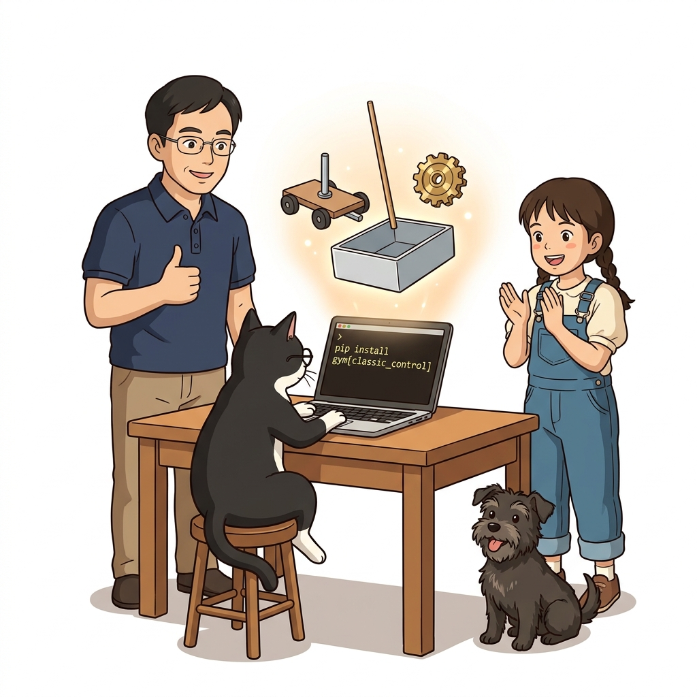
**그림 12-1-5** 터미널에서 pip install 명령어로 Gym 물리 엔진 패키지를 설치하고 카트폴 시뮬레이션 모듈 상자를 조립하는 지니와 이호진 교수님

> **[강의 스크립트]**
> 터미널 실행 캡처 화면을 보십시오. 명령어를 실행했을 때 카트폴 버전 일 환경 스펙과 렌더 모드 휴먼이라는 파라미터가 오류 없이 깨끗하게 출력되고 있습니다. 이로써 우리는 복잡한 물리 엔진과 그래픽 드라이버의 연동을 성공적으로 마치고, 본격적인 강화학습 알고리즘 코드를 작성할 수 있는 견고한 실습 베이스캠프를 확보하였습니다.

---
#### [실습 1단계] Gym 환경 생성 및 기본 스펙 검사

이제 첫 번째 단계로 환경을 생성하고 사양을 검사해보겠습니다. 

OpenAI Gym에는 다양한 환경이 제공되지만 여기서는 가장 대표적인 입문 과제인 **`CartPole-v0`**(혹은 최신 표준인 **`CartPole-v1`**)을 생성하겠습니다.

* 실습 파일: [`step01_make_env.py`](./step01_make_env.py)

```python
import gym

# 1. CartPole 환경 생성 (render_mode='human': 시각화 창 활성화)
env = gym.make('CartPole-v0', render_mode='human')

# 2. 생성 확인 및 자원 해제
print("카트폴 환경이 성공적으로 생성되었습니다:", env)
print("환경 식별자 (Spec ID):", env.spec.id)

env.close()
```

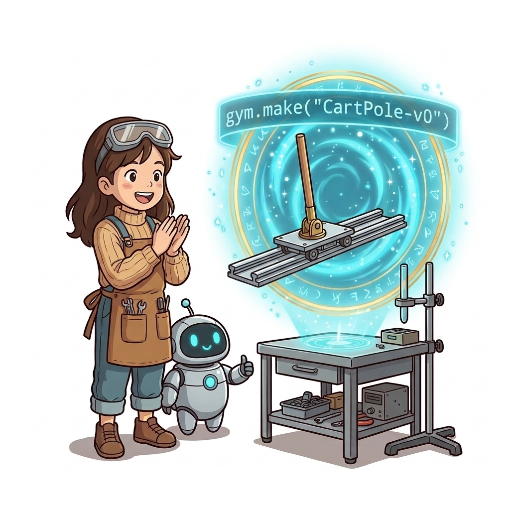
**그림 12-1-S1-A** `gym.make('CartPole-v0')` 호출을 통해 물리 엔진과 렌더링 파이프라인을 갖춘 카트폴 환경 인스턴스를 소환하는 개념도

> **[강의 스크립트]**
> 이제 실습 일단계로 카트폴 환경을 파이썬 코드로 직접 생성하고 그 기본 스펙을 검사하는 첫 번째 스크립트를 작성해 보겠습니다. 짐네지엄 메이크 함수에 카트폴 버전 일이라는 환경 식별자 문자열과 렌더 모드 휴먼 옵션을 전달하여 환경 객체를 생성합니다. 그리고 작업이 끝난 후에는 반드시 환경의 클로즈 메서드를 호출하여 그래픽스 엔진과 메모리 자원을 깨끗하게 반환해 주어야 합니다.

---
#### `CartPole-v0` vs `CartPole-v1` 버전 차이 안내

> [!NOTE]
> 현재 `CartPole-v0` 버전은 공식 문서에서 out-of-date 경고 메시지를 출력할 수 있지만 기본 실행에는 전혀 문제가 없습니다. v0와 v1의 핵심 차이는 최대 목표 지속 스텝 수(200단계 vs 500단계)이며, 혹시 지원이 중단되더라도 v0를 v1으로만 바꿔 실행하면 됩니다.

> **[강의 스크립트]**
> 여기서 버전 이름에 붙은 브이 영과 브이 일의 차이점을 명확히 짚고 넘어가겠습니다. 과거 구형 교재들에서는 브이 영을 주로 사용했으나, 이는 목표 지속 스텝이 이백 스텝으로 제한되어 있었습니다. 반면 최신 표준인 브이 일은 오백 스텝까지 균형을 유지해야 에피소드가 성공하는 보다 도전적인 규격을 가지고 있습니다. 최신 짐네지엄에서는 구형 버전이 제거되었으므로 여러분은 반드시 카트폴 버전 일을 지정하여 학습하셔야 합니다.

---
#### 1단계 스크립트 실행 방법 및 결과

작성한 [`step01_make_env.py`](./step01_make_env.py)를 터미널에서 실행하여 환경이 정상적으로 초기화되는지 확인합니다.

**실행 방법 (터미널 명령어):**
```bash
python step01_make_env.py
```

> **[강의 스크립트]**
> 작성된 스텝 영일 파이썬 스크립트를 터미널에서 실행하는 방법입니다. 화면의 안내에 따라 가상환경이 켜진 터미널 창에서 파이썬 스텝영일 짐 셋업 앤 스펙 피와이를 실행하십시오. 잠시 후 검은 바탕에 바퀴 달린 사각 카트와 그 위에 위태롭게 세워진 갈색 막대가 그려진 시뮬레이션 창이 화면에 번쩍 나타났다가 닫힐 것입니다.

---
**출력 결과:**

```text
카트폴 환경이 성공적으로 생성되었습니다: <TimeLimit<OrderEnforcing<PassiveEnvChecker<CartPoleEnv<CartPole-v0>>>>>
환경 식별자 (Spec ID): CartPole-v0
```

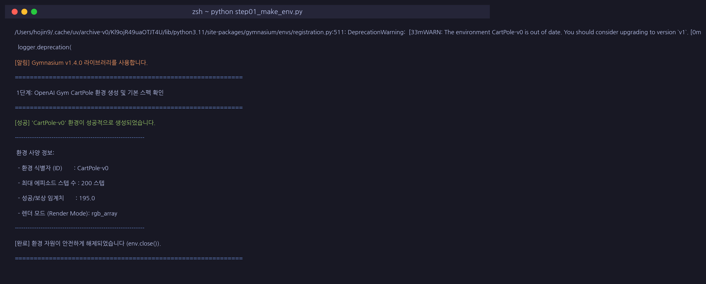
**그림 12-1-S1** `step01_make_env.py` 실행 방법과 터미널 출력 화면 캡처

> **[강의 스크립트]**
> 터미널에 출력된 실제 결과를 보시면 환경 객체가 카트폴 버전 일 인스턴스로 정확히 바인딩되었고, 자원 반환까지 에러 없이 정상적으로 종료되었음을 알 수 있습니다. 창이 깜빡이며 닫힌 이유는 우리가 환경을 만들고 곧바로 닫아버렸기 때문이며, 다음 단계부터는 상태를 유지하며 관찰하는 코드를 추가할 것입니다.

---
#### 〈카트 폴〉 문제의 물리적 화면 구성

환경 생성 시 `render_mode='human'`으로 설정하면 아래 그림과 같은 실시간 시뮬레이션 창을 띄워 에이전트의 움직임을 시각적으로 확인할 수 있습니다 

(배치 연산이나 고속 학습 시에는 `'rgb_array'`로 설정하여 GUI 오버헤드를 제거합니다).

**그림 12-2** 〈카트 폴〉 화면 구성

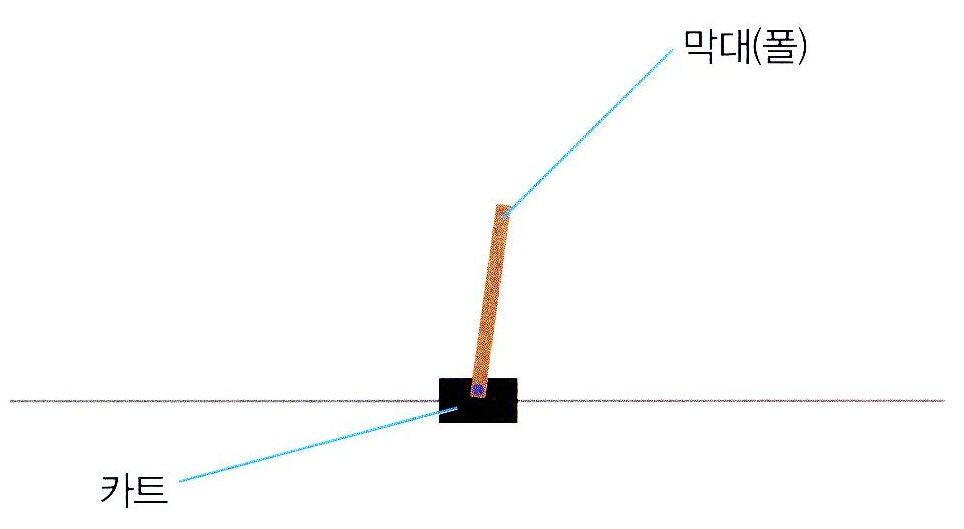

카트(Cart) 위에 중심축으로 연결된 막대(Pole, 역진자)가 중력에 의해 쓰러지려고 할 때, 카트를 좌우로 기민하게 움직여 막대가 서 있는 상태를 유지시키는 것이 목표입니다.

> **[강의 스크립트]**
> 그렇다면 우리가 앞으로 다루게 될 카트폴이란 도대체 어떤 물리적 원리로 동작하는 문제일까요? 화면을 보시면 평평한 수평 레일 위를 좌우로 자유롭게 미끄러질 수 있는 사각형 카트가 놓여 있고, 그 카트의 중심 힌지에는 아무런 자체 동력이 없는 갈색 막대가 자유롭게 회전할 수 있도록 매달려 있습니다. 에이전트가 카트를 좌우로 기민하게 움직여서, 중력에 의해 쓰러지려는 막대를 마치 손바닥 위에 빗자루를 세우듯 넘어지지 않게 균형을 잡는 고전 제어의 역진자 문제입니다.

---
#### 카트폴의 물리적 실패 한계선

카트폴 시뮬레이터는 매 타임스텝마다 뉴턴-오일러 역학 미분 방정식을 적분하여 물체의 거동을 계산합니다. 

에이전트는 다음 두 가지 한계선을 넘지 않도록 균형을 잡아야 합니다:

1. **막대의 각도 한계**: 수직선 기준 막대의 기울기 각도 $\theta$가 $\pm 12^\circ$ (약 $\pm 0.2094$ rad)를 초과하면 복원 모멘트 상실로 **실패(`terminated: True`)** 처리됩니다.
2. **카트의 위치 한계**: 카트의 중심 위치 $x$가 레일 중심선으로부터 $\pm 2.4$ 미터를 벗어나 화면 경계를 탈선하면 **실패(`terminated: True`)** 처리됩니다.

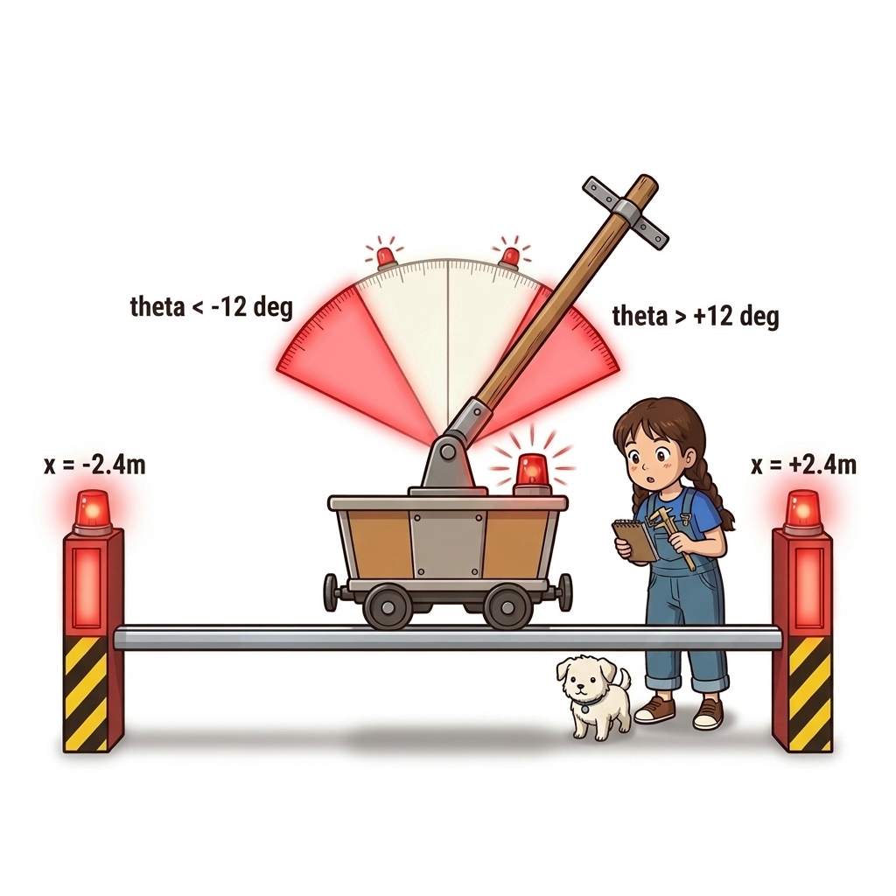
**그림 12-1-6** 막대 기울기 한계(±12°)와 카트 탈선 한계(±2.4m) 위험 경계선 위반 시 비상 경보와 함께 발생하는 실패(terminated: True) 조건

> **[강의 스크립트]**
> 카트폴 환경에는 물리적으로 실패로 판정되는 두 가지 명확한 한계선이 그어져 있습니다. 첫째는 막대의 기울기 각도로, 수직선 기준 좌우로 십이 도 이상 기울어지는 순간 균형을 영구히 잃은 것으로 보고 게임 오버가 선언됩니다. 둘째는 카트의 수평 위치로, 레일 중심 영점을 기준으로 좌우 이점사 미터를 벗어나 모니터 밖으로 이탈하면 즉시 실패로 판정됩니다. 에이전트는 이 두 가지 위험 한계선 안에서 카트와 막대를 최대한 오랫동안 안전하게 통제해 내야 합니다.

---
#### 카트폴 버전별 목표 스텝 비교

카트폴 환경은 버전에 따라 에이전트에게 요구되는 장기 계획 수립(Long-term Planning) 난이도가 다릅니다:

* **CartPole-v0**: 200 타임스텝 동안 막대를 쓰러뜨리지 않고 버티면 미션 성공입니다 (최근 100회 에피소드 평균 점수 195점 달성 시 환경 완전 정복으로 인정).
* **CartPole-v1**: 500 타임스텝까지 버텨야 성공으로 판정되며, 장기적인 궤적에서 작은 오차가 누적되어 발산하는 것을 억제하는 고도의 안정적인 제어 정책이 요구됩니다.

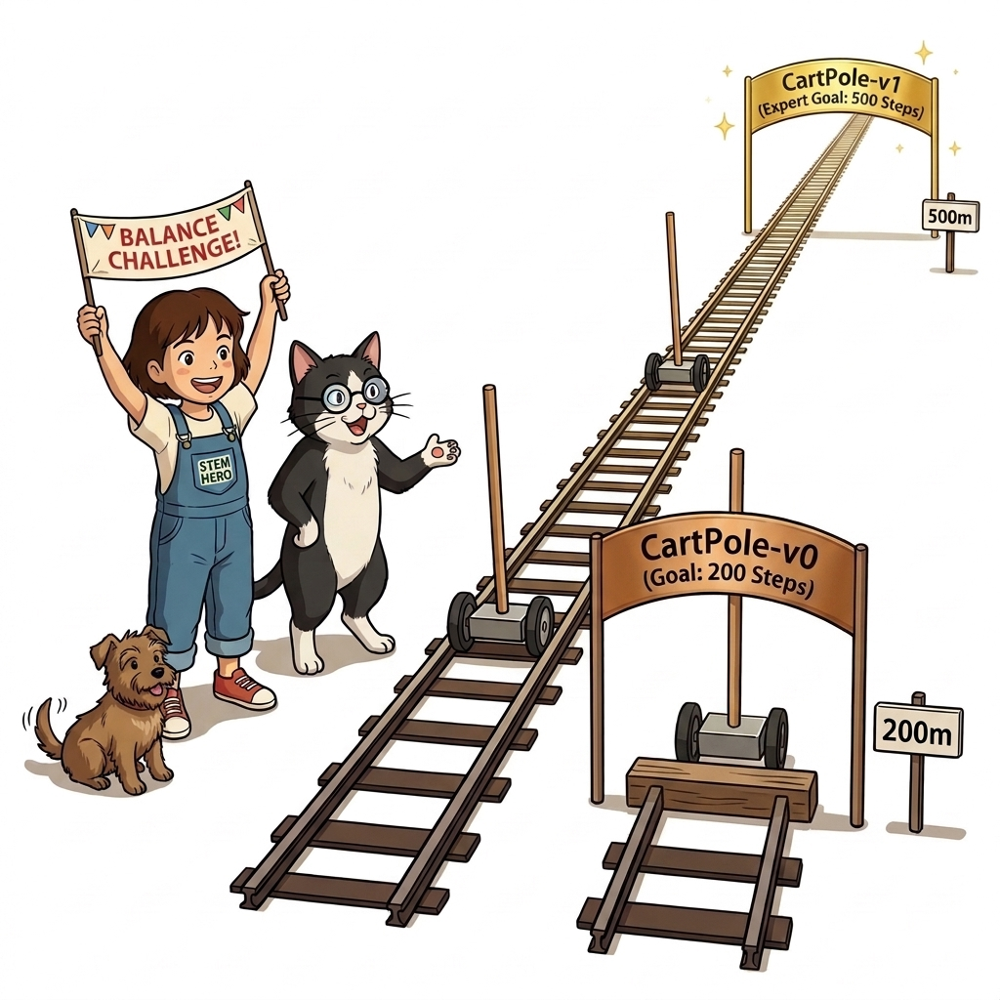
**그림 12-1-7** 200단계 균형 유지를 목표로 하는 CartPole-v0 트랙과 500단계 장거리 고지 도전을 요구하는 CartPole-v1 엑스퍼트 트랙 비교

> **[강의 스크립트]**
> 앞서 언급한 버전별 목표 스텝을 다시 한번 표로 정리해 드립니다. 과거 버전인 브이 영은 이백 스텝 동안 막대를 넘어뜨리지 않으면 성공으로 간주했으나, 최신 표준인 브이 일은 무려 오백 스텝 동안 수평 레일 안에서 막대의 중심을 지켜내야 완전한 과제 성공으로 인정받습니다. 연속 오백 스텝을 버텨낸다는 것은 물리 법칙에 대한 정밀한 수학적 제어 정책을 신경망이 스스로 깨우쳤음을 의미합니다.

---
#### [실습 2단계] 상태 초기화(reset) 및 4차원 상태 벡터 & 행동 공간 검사

이제 환경을 초기화하여 시작 상태 벡터를 관찰하고, 에이전트가 선택할 수 있는 행동 공간(Action Space)의 규격을 파악하는 코드를 단계적으로 추가해 보겠습니다.

* 실습 파일: [`step02_reset_state.py`](./step02_reset_state.py)

```python
import time
import gym

env = gym.make('CartPole-v0', render_mode='human')

# 1. 초기 상태 얻기
state = env.reset()[0]
print('상태:', state)

# 2. 행동 공간의 크기 확인
action_space = env.action_space
print('행동의 차원 수:', action_space)

# 화면 창을 확인할 수 있도록 3초간 대기 후 종료
print("\n[안내] 카트폴 화면을 확인하세요. 3초 후 자동으로 창이 닫힙니다...")
time.sleep(3)

env.close()
```

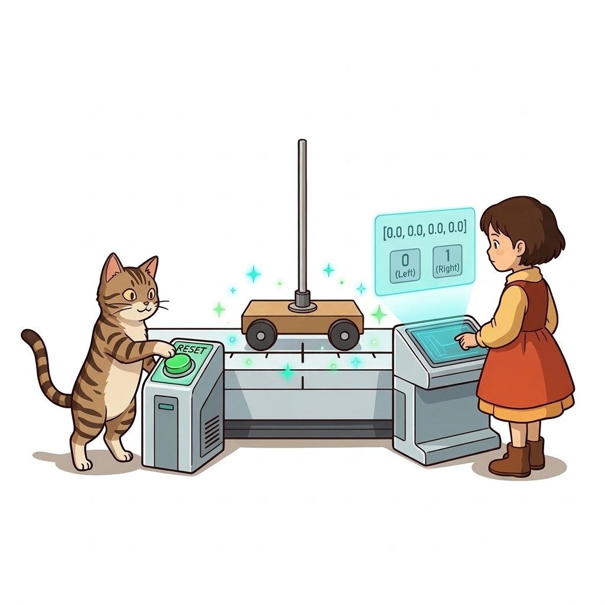
**그림 12-1-S2-A** `env.reset()`으로 초기 물리 상태를 0 부근으로 재설정하고 `Discrete(2)` 행동 버튼을 확인하는 초기화 메커니즘

> **[강의 스크립트]**
> 이제 실습 이단계로 넘어가서, 환경을 리셋하여 초기 상태를 획득하고 사차원 연속 상태 벡터와 이산 행동 공간의 규격을 점검하는 스크립트를 작성해 보겠습니다. 환경의 리셋 메서드를 호출하면 에이전트가 최초로 관찰하는 상태 벡터가 튜플 형태로 반환됩니다. 우리는 그중 영 번째 원소를 언패킹하여 상태 변수에 저장하고, 환경의 액션 스페이스를 출력하여 에이전트가 할 수 있는 선택지의 수를 확인합니다.

---
#### 2단계 스크립트 실행 방법 및 결과

작성한 [`step02_reset_state.py`](./step02_reset_state.py)를 실행하여 실제 반환되는 4차원 상태 벡터와 `Discrete(2)` 행동 공간을 정밀 검사합니다.

**실행 방법 (터미널 명령어):**
```bash
python step02_reset_state.py
```

**출력 결과:**
```text
상태: [ 0.02247306  0.01833331 -0.01464528  0.00566171]
행동의 차원 수: Discrete(2)

[안내] 카트폴 화면을 확인하세요. 3초 후 자동으로 창이 닫힙니다...
```

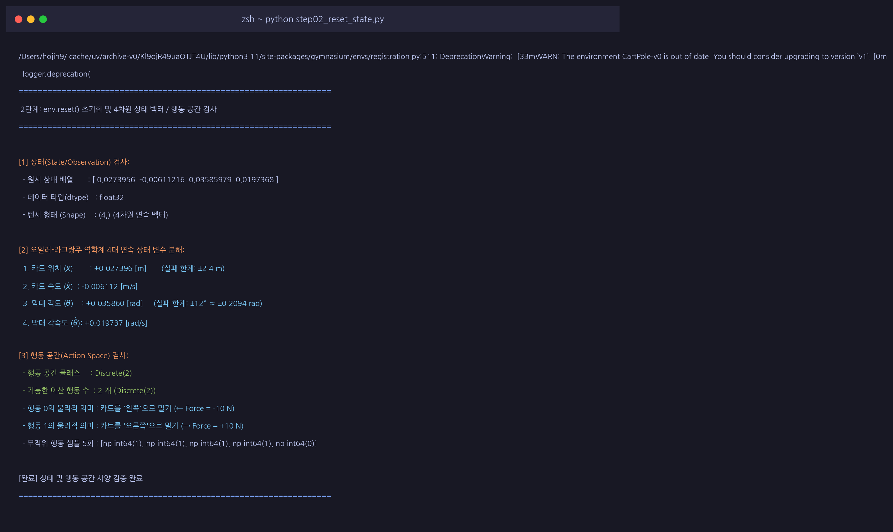
**그림 12-1-S2** `step02_reset_state.py` 실행 방법과 터미널 출력 화면 캡처

> **[강의 스크립트]**
> 이단계 스크립트를 터미널에서 실행해 보겠습니다. 이번에는 화면 창이 바로 꺼지지 않고 삼 초 동안 화면에 머물도록 타임 슬립을 걸어두었습니다. 터미널 창을 보시면 초기 상태 벡터 안에 담긴 네 개의 실수 숫자와, 행동 공간이 디스크리트 투라는 규격을 갖추고 있음이 선명하게 출력될 것입니다.

---
#### `env.reset()[0]`의 의미: 반환 튜플에서 상태값만 쏙 꺼내기

파이썬 코드에서 `state = env.reset()[0]`이라고 적힌 부분의 정확한 의미를 살펴보겠습니다.

```python
# env.reset()의 실제 반환값 형태: (상태 배열, 부가정보 딕셔너리)
state = env.reset()[0]
```

> **[강의 스크립트]**
> 여기서 최신 짐네지엄을 처음 접하시는 분들이 가장 많이 질문하시는 핵심 문법을 짚어드리겠습니다. 바로 환경의 리셋 메서드 뒤에 대괄호 영이 붙어 있는 이유입니다. 과거 구형 짐에서는 리셋이 오직 상태 배열 하나만을 반환했지만, 최신 표준 짐네지엄에서는 사차원 상태 배열과 진단용 정보가 담긴 딕셔너리를 두 개짜리 튜플로 묶어서 반환하기 때문입니다. 따라서 상태값만을 순수하게 꺼내 쓰기 위해 영 번째 원소를 콕 집어 언패킹해 주는 것입니다.

---
##### 1. "환경을 초기화(reset)한다"는 것은 무슨 뜻인가요?

게임을 처음부터 새로 시작하기 위해 화면 속 모든 물체를 시작 위치로 되돌리는 것입니다.
카트폴에서는 **카트의 위치, 카트의 속도, 막대의 각도, 막대의 회전 속도**라는 4가지 움직임 상태 값을 거의 수직에 가까운 0 부근의 초기값으로 깨끗하게 리셋합니다.

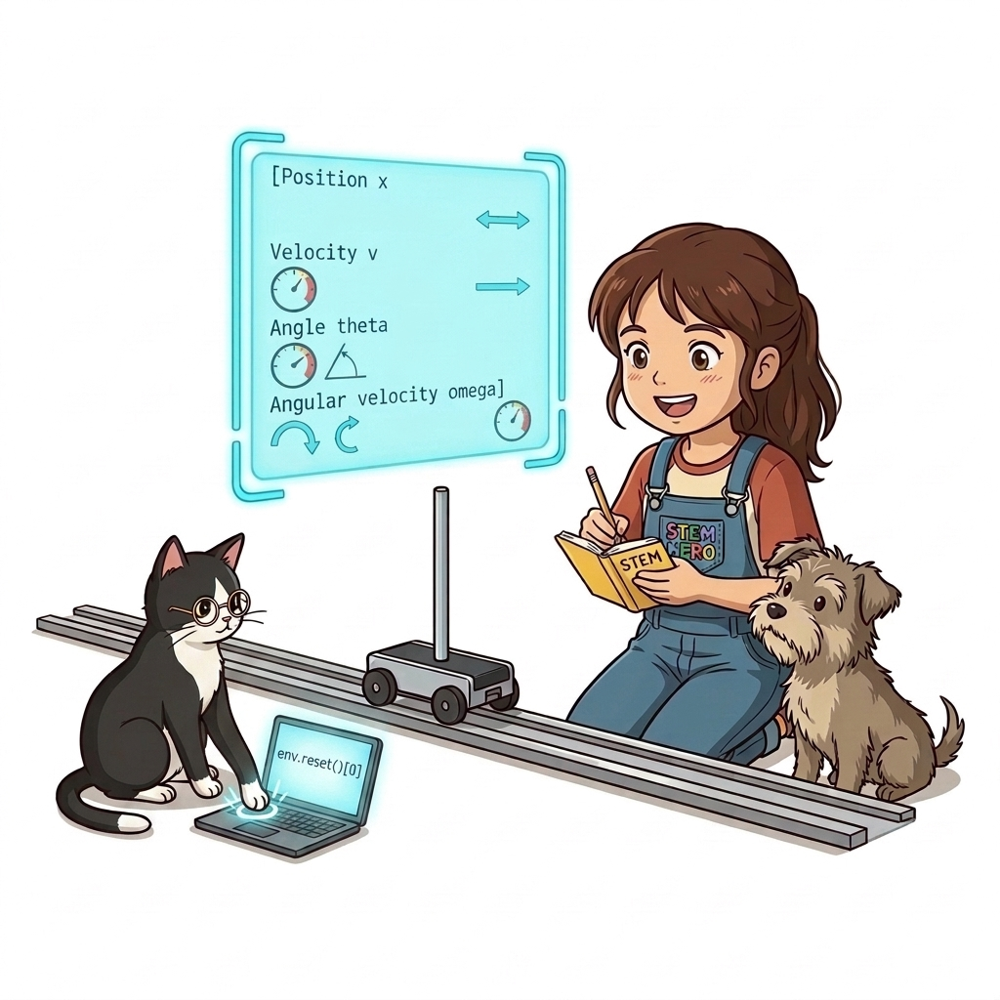
**그림 12-1-8-A** 모든 물리 변수(위치, 속도, 각도, 각속도)를 0 부근의 초기 상태로 깨끗하게 리셋하는 환경 초기화 메커니즘

> **[강의 스크립트]**
> 환경을 초기화한다는 리셋의 물리적 의미를 곱씹어 보겠습니다. 비디오 게임에서 캐릭터가 목숨을 잃었을 때 스테이지 처음으로 되돌아가는 리스폰 버튼을 누르는 것과 완전히 같습니다. 카트폴 환경에서 리셋을 호출하면 카트는 수평 레일 중심 부근으로 되돌아가고, 막대는 수직선 기준 플러스 마이너스 영점영오 라디안 범위 내에서 미세한 무작위 오차를 가진 채 다시 세워지며 새로운 에피소드가 시작됩니다.

---
##### 2. 왜 최신 Gymnasium에서는 결과값을 2개짜리 묶음`(state, info)`으로 주나요?
* **과거 (구버전 Gym)**: `state = env.reset()` 처럼 상태값 하나만 돌려주었습니다.
* **최신 표준 (Gymnasium)**: 게임을 초기화할 때 상태값뿐만 아니라, **"어떤 난이도로 초기화되었는가?", "무작위 시드(seed) 번호는 무엇인가?"** 와 같은 보조적인 진단 정보(`info` 딕셔너리)도 함께 전달할 수 있도록 인터페이스를 개선했습니다.
* 그래서 최신 `env.reset()`은 **`(상태 배열, 부가정보 딕셔너리)`**라는 **2개짜리 묶음(튜플)**을 통째로 반환합니다.

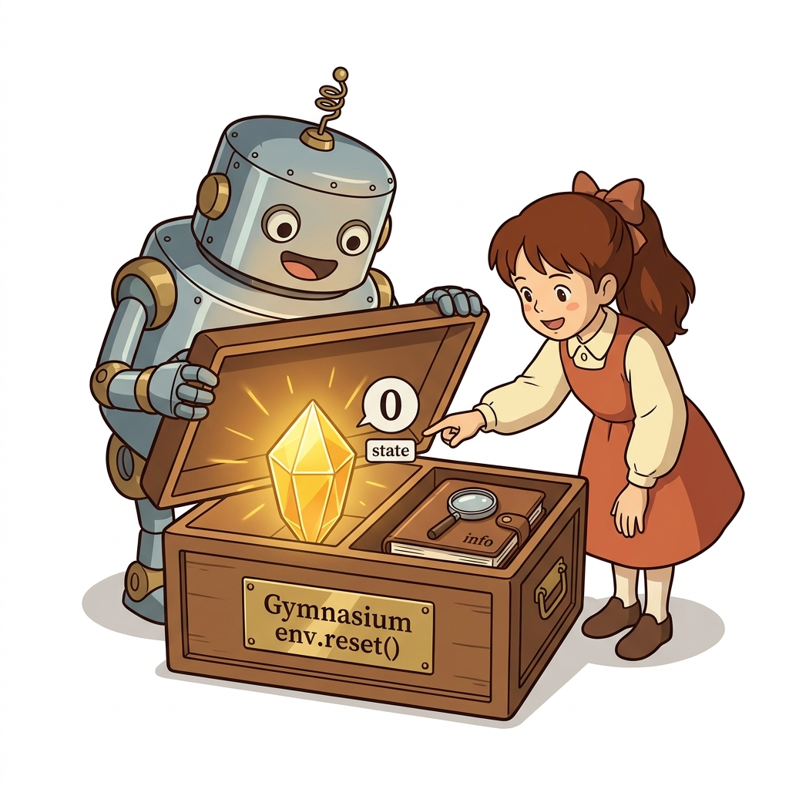
**그림 12-1-8-B** 상태 배열(`state`)과 부가 진단 정보(`info`)를 함께 제공하여 확장성을 확보한 최신 Gymnasium 2-튜플 표준

> **[강의 스크립트]**
> 왜 최신 짐네지엄 개발진은 리셋의 반환값을 굳이 상태와 인포라는 두 개짜리 튜플 묶음으로 변경했을까요? 신경망 학습에 직접 들어가는 순수한 물리적 관찰값과, 에피소드 통계나 디버깅을 위한 환경 내부의 진단용 메타데이터를 구조적으로 명확히 분리하기 위함입니다. 이로써 인공지능 엔지니어는 신경망 입력 파이프라인의 오염 없이 필요한 진단 정보를 깔끔하게 추적할 수 있게 되었습니다.

---
##### 3. `[0]`으로 언패킹(Unpacking)한다는 말의 뜻은?
우리가 신경망 학습에 실제로 사용할 핵심 데이터는 4차원 **상태 배열(`state`)**뿐이며, 진단용 딕셔너리(`info`)는 당장 필요하지 않습니다.

따라서 파이썬 튜플의 첫 번째 상자(인덱스 `0`번)만 쏙 꺼내기 위해 뒤에 **`[0]`**을 붙이는 것입니다:

```python
# 방법 A: 0번째 원소만 쏙 골라내기 (교재 스타일)
state = env.reset()[0]

# 방법 B: 두 변수로 나누어 받기 (파이썬 언패킹 스타일)
state, info = env.reset()
```

위 두 코드는 완전히 동일하게 동작합니다. 즉, **"2개가 담긴 선물 보따리에서 0번째에 들어있는 알맹이(상태 배열)만 쏙 꺼내어 `state` 변수에 담는다"**는 뜻입니다.

![env.reset()[0] 튜플 언패킹 메커니즘](./img/ch12_1_08_env_reset_tuple_unpacking.png)
**그림 12-1-8-C** `(state, info) = env.reset()` 반환 튜플 캐비닛에서 0번째 서랍인 상태 벡터(`state`)를 언패킹하여 초기 관찰값을 얻는 과정

> **[강의 스크립트]**
> 파이썬 언어에서 이 튜플을 받아내는 방법은 크게 두 가지가 있습니다. 화면의 방법 에이처럼 우리 교재 스타일대로 영 번째 원소만 쏙 골라내는 방식이 있고, 방법 비처럼 스테이트 콤마 인포 형태로 변수 두 개를 나란히 선언하여 한 번에 분할해 받는 파이썬 표준 언패킹 방식이 있습니다. 두 방식 모두 동일한 상태 벡터를 추출하므로 여러분의 코딩 스타일에 맞춰 편안하게 활용하시면 됩니다.

---
#### 4차원 상태 벡터(`state`)의 정체: 넘파이 배열(`ndarray`)과 4개의 원소

앞서 `state = env.reset()[0]` 코드로 얻어온 `state` 변수를 출력해보면 다음과 같은 4개의 실수가 들어있습니다:

```python
print(type(state)) # <class 'numpy.ndarray'>
print(state.shape) # (4,) -> 원소 4개짜리 1차원 배열
print(state)       # [ 0.02247306  0.01833331 -0.01464528  0.00566171]
```

> **[강의 스크립트]**
> 그렇다면 추출된 스테이트 변수의 정체는 무엇일까요? 이는 파이썬의 표준 과학 계산 라이브러리인 넘파이의 앤디어레이 객체이며, 네 개의 부동소수점 실수 숫자로 구성되어 있습니다. 화면에 출력된 배열을 보시면 영점영이에 가까운 매우 작은 실수 네 개가 나란히 나열되어 있는 것을 볼 수 있습니다. 이 네 개의 숫자가 바로 카트폴 물리 환경의 현재 상태를 완벽하게 대변하는 마법의 좌표입니다.

---
##### 1. `state` 변수 안에 들어있는 값인가요?

네, 정확히 맞습니다! 게임이 시작될 때 시뮬레이터가 현재 카트폴의 상황을 측정하여 넘겨준 4개의 부동소수점 수치가 바로 이 `state` 변수 안에 담겨 있습니다.

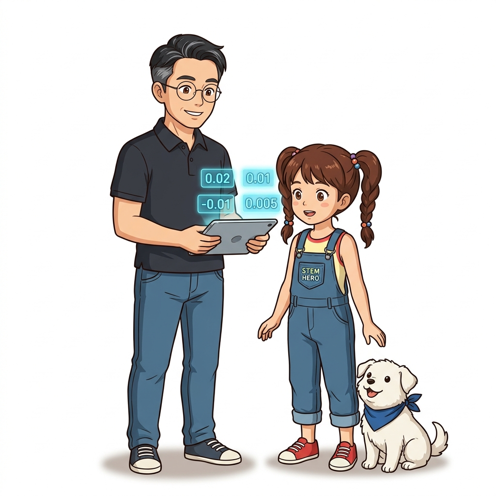
**그림 12-1-9-B** 카트폴 시뮬레이터가 에이전트에게 전달하는 현재 물리계의 4대 측정 수치(위치, 속도, 각도, 각속도)가 담긴 state 변수 내부 검사

> **[강의 스크립트]**
> 스테이트 변수 안에 들어있는 값을 시각적으로 들여다보겠습니다. 카트가 원점에서 미세하게 오른쪽으로 치우쳐 있는지, 막대가 왼쪽으로 살짝 기울어져 있는지 등의 정보가 단 네 개의 실수 수치로 정밀하게 압축되어 배열에 담겨 있습니다. 우리의 딥 큐네트워크 신경망은 바로 이 사차원 실수 벡터를 입력 레이어로 받아들여 가치 평가를 수행하게 됩니다.

---
##### 2. `ndarray` 타입이란 무엇인가요?
파이썬의 일반 리스트(`list`)가 아니라, 데이터 과학과 딥러닝에서 대량의 행렬 연산을 초고속으로 처리하는 **넘파이(NumPy)의 다차원 배열 객체(`numpy.ndarray`)** 타입입니다. 
따라서 나중에 파이토치(PyTorch)나 텐서플로(TensorFlow) 인공신경망의 입력 텐서(`torch.FloatTensor`)로 변환할 때 별도의 복잡한 가공 없이 `torch.from_numpy(state)`로 즉시 변환하여 신경망에 집어넣을 수 있습니다.

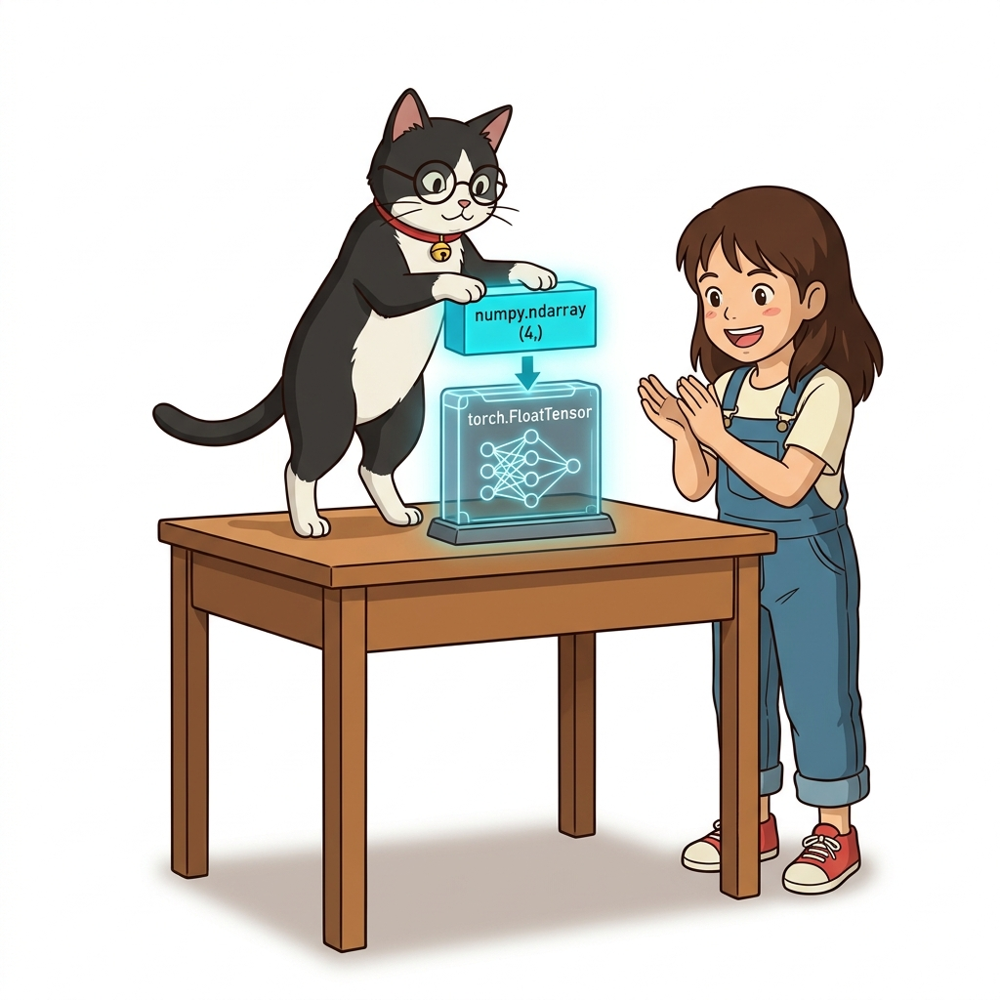
**그림 12-1-9-C** 데이터 과학 표준 넘파이(NumPy) ndarray 배열과 딥러닝 인공신경망 입력 파이토치 텐서(Tensor)의 무봉제 결합

> **[강의 스크립트]**
> 여기서 앤디어레이 타입의 중요성을 상기하셔야 합니다. 일반적인 파이썬 순수 리스트와 달리, 넘파이의 앤디어레이는 메모리 공간에 연속된 씨 언어 배열 형태로 저장되므로 행렬 곱셈과 벡터 연산을 초고속으로 병렬 처리할 수 있는 최고의 데이터 구조입니다. 파이토치나 텐서플로 같은 딥러닝 프레임워크와의 데이터 교환 역시 이 넘파이 배열을 기반으로 매끄럽게 연결됩니다.

---
##### 3. 왜 하필 숫자가 4개인가요? (위치 2개만으로는 안 되나요?)
물리학과 강화학습 제어 이론에서 매우 중요한 질문입니다. 

카트폴 시스템은 2개의 물체(좌우로 움직이는 카트, 회전하는 막대)로 이루어져 있습니다. 그런데 단순히 **"지금 카트가 어디에 있고, 막대가 몇 도로 서 있는가?"**라는 **위치 정보 2개만으로는 미래를 절대 예측할 수 없습니다.**

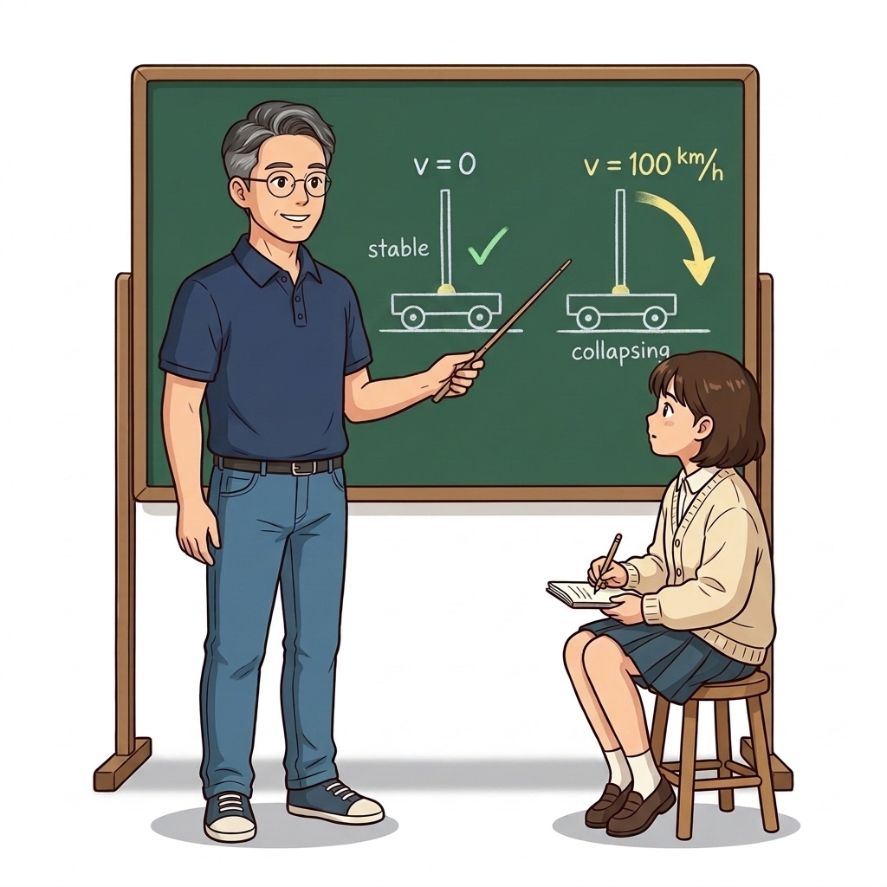
**그림 12-1-9-D** 칠판 앞에서 위치 2개만으로는 불완전하며 속도 2개가 반드시 함께 주어져야 미래를 예측할 수 있음을 증명하는 이호진 교수님과 도로시

> **[강의 스크립트]**
> 여기서 아주 예리한 물리적 의문이 생길 수 있습니다. 카트의 위치와 막대의 각도라는 두 개의 위치 정보만 알면 될 텐데, 왜 굳이 네 개의 숫자가 필요할까요? 정지해 있는 사진 한 장만으로는 물체가 어느 방향으로 얼마나 빠르게 움직이고 있는지 그 운동성을 전혀 알 수 없기 때문입니다. 다음 슬라이드에서 스냅샷과 동영상의 본질적 차이를 함께 살펴보겠습니다.

---
* **사진(스냅샷)의 한계**: 막대가 똑바로 수직($0^\circ$)으로 서 있는 사진을 보더라도, 이 막대가 가만히 멈춰있는지, 아니면 오른쪽으로 시속 100km로 맹렬하게 넘어지는 중인지 사진 한 장으로는 알 수 없습니다!
* **속도(변화율)의 필연성**: 다음 순간에 막대가 넘어질지 바로 설지를 알려면, **"현재 어디에 있는가(위치)"**와 함께 **"어느 방향으로 얼마나 빠르게 움직이고 있는가(속도)"**를 반드시 세트로 알아야 합니다.

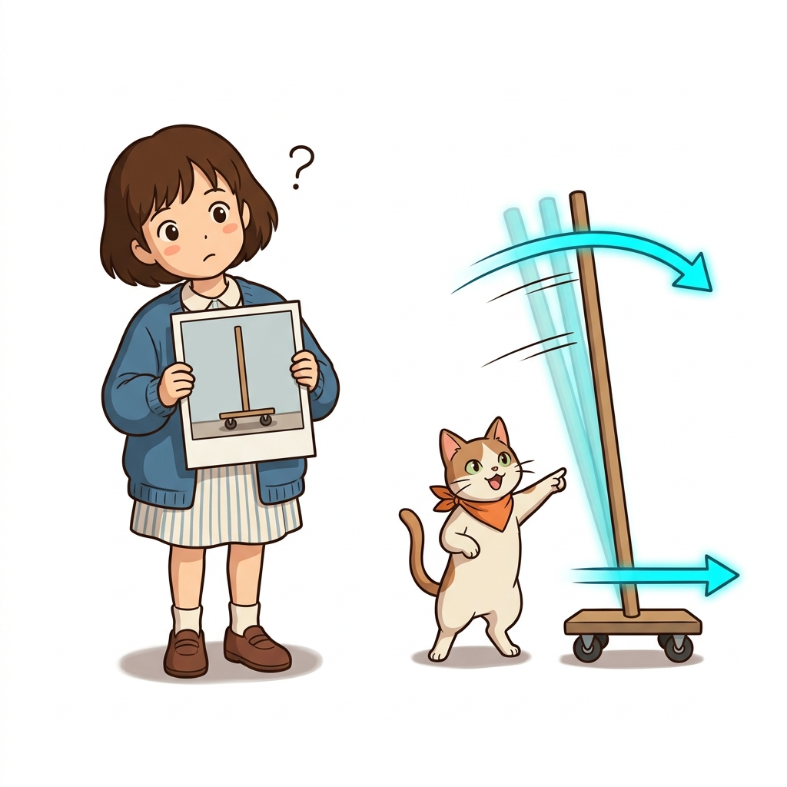
**그림 12-1-9-A** 정지 사진(스냅샷)만으로는 막대의 전도 방향을 알 수 없으며, 미래를 완벽히 예측하기 위해 2개의 속도(변화율)가 반드시 필요한 물리적 이유

> **[강의 스크립트]**
> 화면의 비유를 보십시오. 막대가 정확히 수직 영 도로 서 있는 정지 사진 한 장을 보고 있다고 가정해 봅시다. 이 사진만 보고는 막대가 다음 순간 오른쪽으로 쓰러질지, 아니면 왼쪽으로 넘어갈지 절대로 예측할 수 없습니다. 지금 오른쪽으로 시속 백 킬로미터로 회전하며 지나가는 중인지, 왼쪽으로 돌고 있는 중인지 속도 정보가 사진에 결여되어 있기 때문입니다. 이것이 바로 단일 관찰 스냅샷이 가지는 치명적인 정보의 불완전성입니다.

---
따라서 카트와 막대 각각에 대해 **[위치 + 속도]**가 쌍을 이루어 총 4개가 됩니다:

| 구분 | 정적 위치 (현재 어디에 있는가) | 동적 속도 (어디로 얼마나 빠른가) | 합계 |
| :---: | :---: | :---: | :---: |
| **카트(Cart)** | ① 수평 위치 ($x$) | ② 수평 이동 속도 ($\dot{x} = v$) | 2개 |
| **막대(Pole)** | ③ 기울기 각도 ($\theta$) | ④ 회전 각속도 ($\dot{\theta} = \omega$) | 2개 |
| **총 상태 개수** | **2개** | **2개** | **총 4개** |

> **[강의 스크립트]**
> 따라서 뉴턴 역학의 운동 법칙을 적용하여 미래의 위치를 온전히 계산해 내기 위해서는 카트의 현재 위치뿐만 아니라 카트의 수평 이동 속도가 함께 주어져야 하고, 막대의 현재 기울기 각도뿐만 아니라 막대가 회전하는 각속도가 반드시 쌍을 이루어 제공되어야 합니다. 즉 두 대상에 대해 각각 위치와 속도가 결합하여 총 네 개의 필수 물리 변수가 도출되는 것입니다.

---
이 4개 수치만 알면 뉴턴 운동 방정식에 따라 미래의 움직임을 100% 완벽하게 계산해낼 수 있기 때문에, 카트폴 환경의 상태 벡터는 정확히 **4차원**으로 정의된 것입니다.

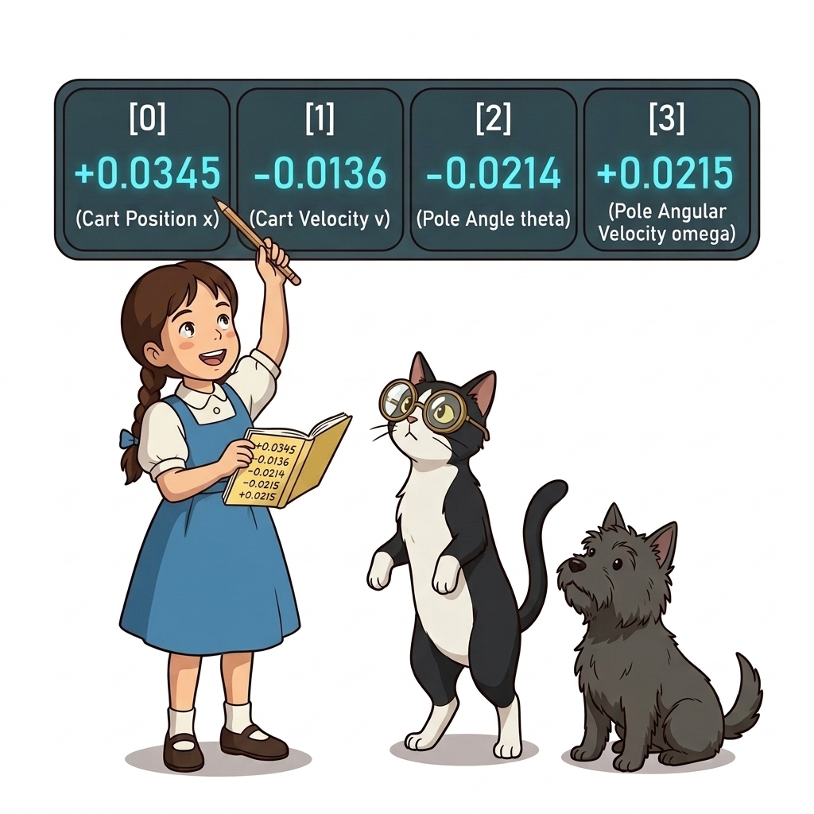
**그림 12-1-9** 연속적인 4개의 부동소수점 수치 [위치, 속도, 각도, 각속도]로 채워진 1차원 NumPy 배열(`ndarray`)의 구조를 정밀 검사하는 도로시와 지니

> **[강의 스크립트]**
> 이 네 개의 물리량만 완벽하게 주어지면 마르코프 성질이 성립합니다. 과거에 이 카트가 어디서 출발해서 어떻게 흔들려 왔는지를 전혀 알지 못하더라도, 오직 현재의 네 가지 수치와 에이전트의 제어 힘만 알면 뉴턴 운동 방정식에 의해 다음 순간의 상태를 백 퍼센트 결정론적으로 계산해 낼 수 있습니다. 이것이 바로 강화학습에서 상태 벡터가 갖추어야 할 마르코프 결정 과정의 본질입니다.

---
#### `state` 배열 속 4대 물리 변수 상세: 인덱스별 의미와 게임 오버 기준

앞서 살펴본 **카트의 [위치+속도]**와 **막대의 [각도+각속도]**는 파이썬 `state` 배열의 **0번부터 3번 칸**에 차례대로 담겨 있습니다.

각 칸의 의미와 게임 실패(Game Over) 판정 기준을 하나씩 연결해 보겠습니다:

```python
# state = [state[0], state[1], state[2], state[3]]
#            카트 위치    카트 속도    막대 각도    막대 각속도
```

> **[강의 스크립트]**
> 사차원 상태 벡터 내부의 인덱스별 의미를 하나씩 명확히 외워 두시기 바랍니다. 영 번 인덱스는 카트의 수평 위치 엑스이고, 일 번 인덱스는 카트의 이동 속도인 엑스 도트입니다. 이 번 인덱스는 막대의 수직 기울기 각도인 세타이며, 삼 번 인덱스는 막대의 회전 각속도인 세타 도트입니다. 이 네 가지 변수들의 물리적 단위와 게임 오버 임계치를 다음 슬라이드들에서 차례대로 분해해 드리겠습니다.

---
##### 1. `state[0]` ($x$, 엑스): 카트의 현재 위치

* **기호 발음**: 알파벳 **엑스 [x]**
* 레일의 정중앙이 `0.0 m`입니다.
* 오른쪽으로 이동하면 **양수(+)**, 왼쪽으로 이동하면 **음수(-)**가 됩니다.
* **실패 기준**: 카트가 화면 경계선인 **$\pm 2.4\text{ m}$**를 벗어나 탈선하면 즉시 실패(`terminated: True`) 처리됩니다.

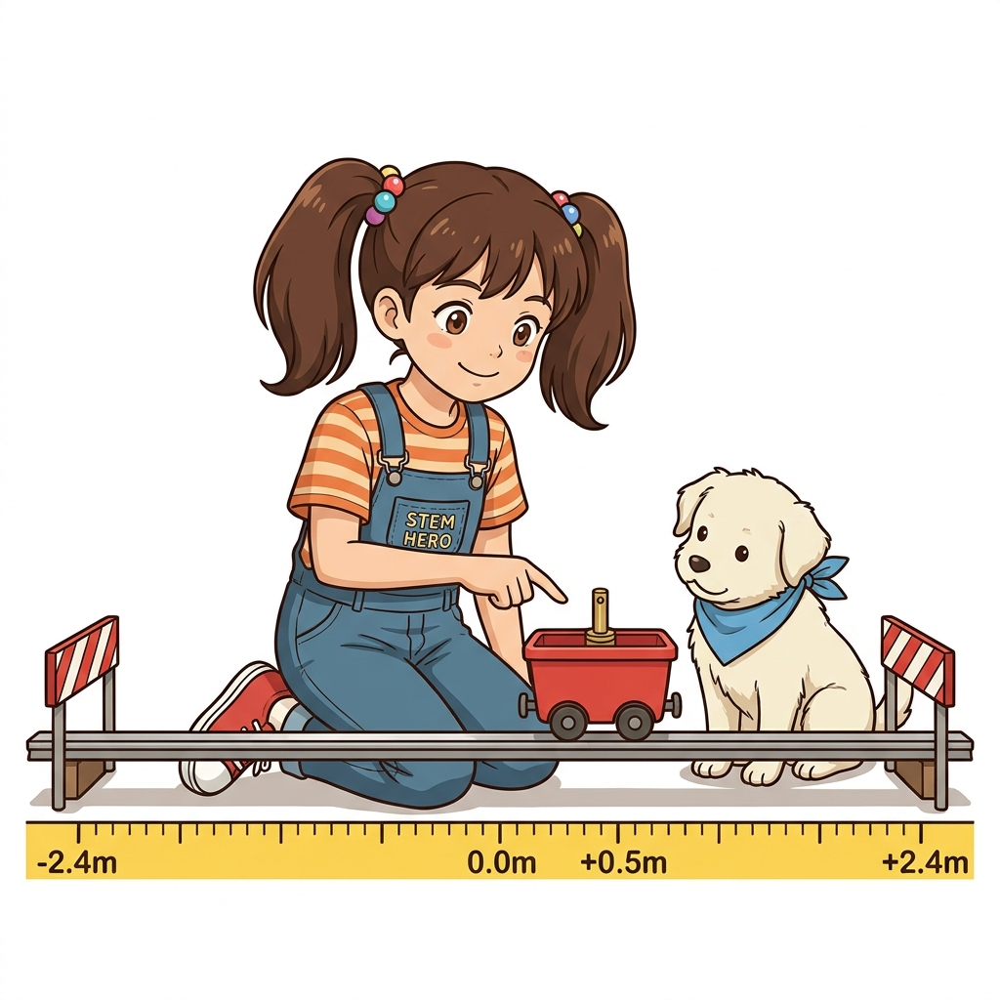
**그림 12-1-10-A** 수평 레일 중심선(0.0m)을 기준으로 좌우 위치를 나타내는 `state[0]` ($x$)와 탈선 한계선(±2.4m)

> **[강의 스크립트]**
> 먼저 영 번 인덱스인 카트의 위치 엑스입니다. 레일의 정중앙을 원점 영점으로 삼고 미터 단위를 기준으로 측정됩니다. 카트가 왼쪽으로 이동하면 음수, 오른쪽으로 이동하면 양수로 표현되며, 절댓값이 이점사 미터를 초과하는 순간 화면 밖 이탈로 판정되어 즉시 게임이 종료됩니다.

---
##### 2. `state[1]` ($\dot{x} = v$, 엑스 도트 / 브이): 카트의 이동 속도

* **기호 발음**: **엑스 도트 [x-dot]**, 속도를 뜻하는 알파벳 **브이 [v, velocity]**
* 카트가 어느 방향으로 얼마나 빠르게 달리고 있는지를 나타냅니다 (양수: 우측 주행, 음수: 좌측 주행).
* > **수학 발음 팁**: 문자 위의 점($\cdot$)은 영어로 '도트(Dot)'라고 읽으며, 물리학에서 **'시간에 따른 변화율(속도)'**을 뜻하는 뉴턴의 미분 기호입니다. 따라서 $\dot{x}$는 **"엑스 도트"**라고 읽으며, 위치($x$)의 시간 변화율인 **속도($v$)**를 뜻합니다.

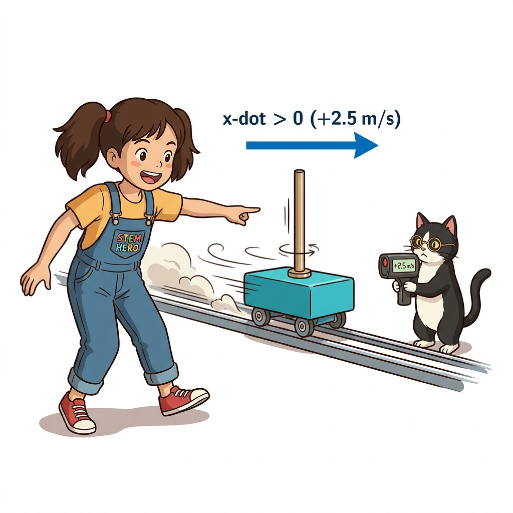
**그림 12-1-10-B** 카트가 좌우로 달리는 방향과 속력을 나타내는 시간 변화율 `state[1]` ($\dot{x} = v$)

> **[강의 스크립트]**
> 일 번 인덱스는 카트의 이동 속도 엑스 도트, 즉 브이입니다. 단위 시간당 카트가 이동하는 속도를 초당 미터 단위로 나타낸 물리량입니다. 속도 자체에는 게임 오버 한계선이 그어져 있지 않지만, 속도가 너무 빨라지면 다음 순간 카트가 이점사 미터 경계선을 순식간에 뚫고 나가버리게 됩니다.

---
##### 3. `state[2]` ($\theta$, 세타): 막대의 기울기 각도

* **기호 발음**: 그리스 문자 **세타 [Theta, $\theta$]**
* 막대가 하늘을 향해 똑바로 수직으로 서 있을 때가 `0.0 rad` ($0^\circ$, 0 라디안)입니다.
* 오른쪽으로 기울면 **양수(+)**, 왼쪽으로 기울면 **음수(-)**입니다.
* **실패 기준**: 막대가 수직선에서 **$\pm 12^\circ$ (약 $\pm 0.2094\text{ rad}$, 라디안)** 이상 기울어지면 균형을 잃고 쓰러진 것으로 판정하여 즉시 실패(`terminated: True`) 처리됩니다.

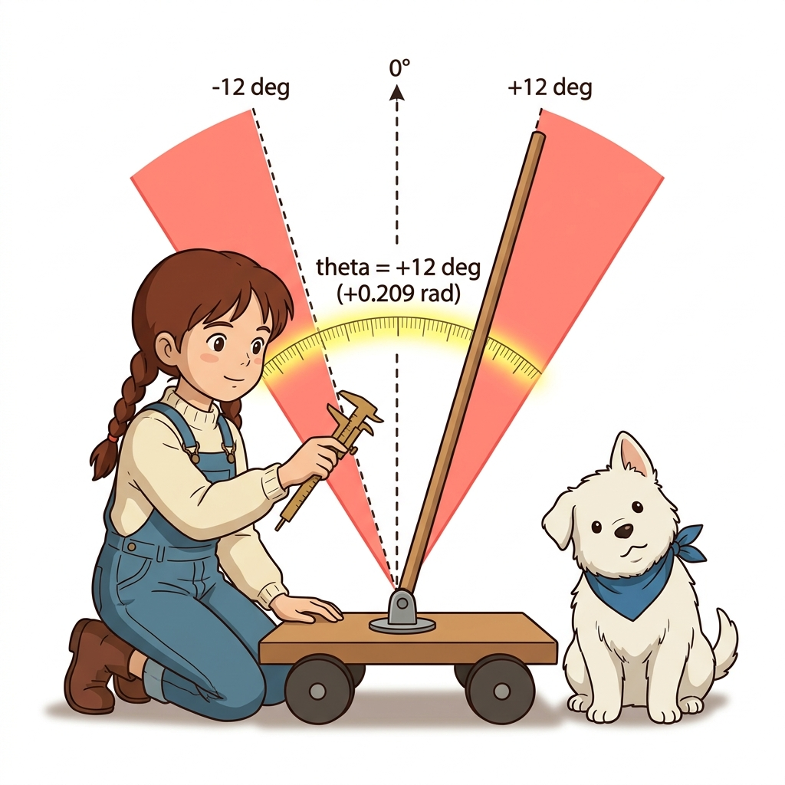
**그림 12-1-10-C** 수직선(0.0 rad) 기준 막대의 기울어짐 정도를 나타내는 `state[2]` ($\theta$)와 쓰러짐 실패 한계선(±12°)

> **[강의 스크립트]**
> 이 번 인덱스는 막대의 기울기 각도인 세타입니다. 완벽하게 수직으로 서 있는 상태를 영 라디안으로 정의하고, 시계 반대 방향 회전은 음수, 시계 방향 회전은 양수로 측정됩니다. 라디안 단위로 대략 플러스 마이너스 영점이영구 라디안, 즉 각도로 환산했을 때 십이 도 이상 기울어지면 즉각 게임 오버가 선언됩니다.

---
##### 4. `state[3]` ($\dot{\theta} = \omega$, 세타 도트 / 오메가): 막대의 회전 각속도

* **기호 발음**: **세타 도트 [$\theta$-dot]**, 회전 속도를 뜻하는 그리스 문자 **오메가 [Omega, $\omega$]**
* 막대가 얼마나 빠른 속도로 회전하며 쓰러지고 있는지를 나타냅니다.
* 각도인 세타($\theta$) 위에 시간 변화율 점(도트)이 붙어 있으므로 **"세타 도트"**라고 읽으며, 물리학에서는 각속도 기호인 **오메가($\omega$)**와 같은 뜻입니다. 막대가 지금 똑바로 서 있더라도 세타 도트($\dot{\theta}$)가 크다면 다음 순간에 바로 쓰러지게 됩니다.

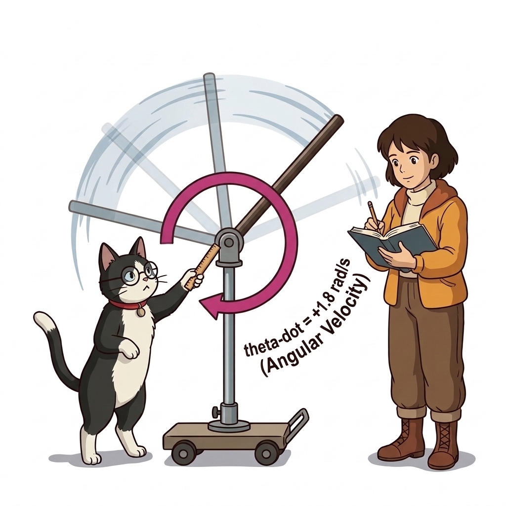
**그림 12-1-10-D** 막대가 회전하며 넘어지는 순간 속도를 나타내는 시간 변화율 `state[3]` ($\dot{\theta} = \omega$)

> **[강의 스크립트]**
> 마지막 삼 번 인덱스는 막대의 회전 각속도인 세타 도트, 즉 오메가입니다. 막대가 수직선을 기준으로 얼마나 가파르게 회전하며 쓰러지고 있는지를 초당 라디안 속도로 나타냅니다. 각도가 비록 영 도에 가깝더라도 각속도가 엄청나게 크다면 다음 순간 막대는 걷잡을 수 없이 쓰러지게 되므로, 제어기가 가장 주의 깊게 살펴야 할 핵심 지표입니다.

---
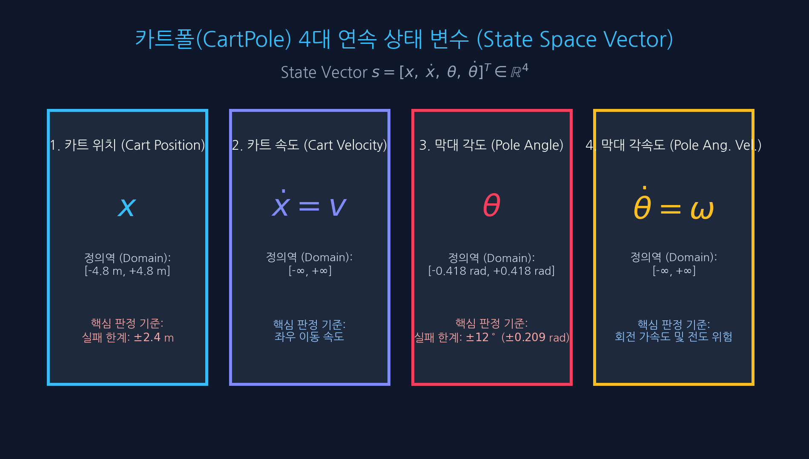
**그림 12-1-10** 카트의 위치($x$), 카트의 속도($v$), 막대의 각도($\theta$), 막대의 각속도($\omega$)라는 4대 연속 상태 변수의 인덱스 매핑과 게임 오버 경계 기준 구조

> **[강의 스크립트]**
> 화면의 다이어그램을 보십시오. 카트의 위치 엑스와 속도 엑스 도트, 막대의 각도 세타와 각속도 세타 도트라는 네 개의 물리 변수가 하나의 물리 시스템 안에서 어떻게 유기적으로 얽혀 있는지가 한눈에 직관적으로 표현되어 있습니다. 이 네 개의 연속 변수가 만들어내는 무한한 상태 공간 속에서 에이전트는 균형을 유지하는 최적의 힘을 찾아내야 합니다.

---
#### 행동 공간 규격: `Discrete(2)`

에이전트가 환경에서 취할 수 있는 선택지는 `env.action_space` 속성에 정의되어 있습니다.

카트폴의 행동 공간은 `gym.spaces.Discrete(2)` 클래스의 인스턴스로, 가능한 행동의 집합이 $\{0, 1\}$이라는 단 2개의 이산 정수로 한정되어 있음을 의미합니다.

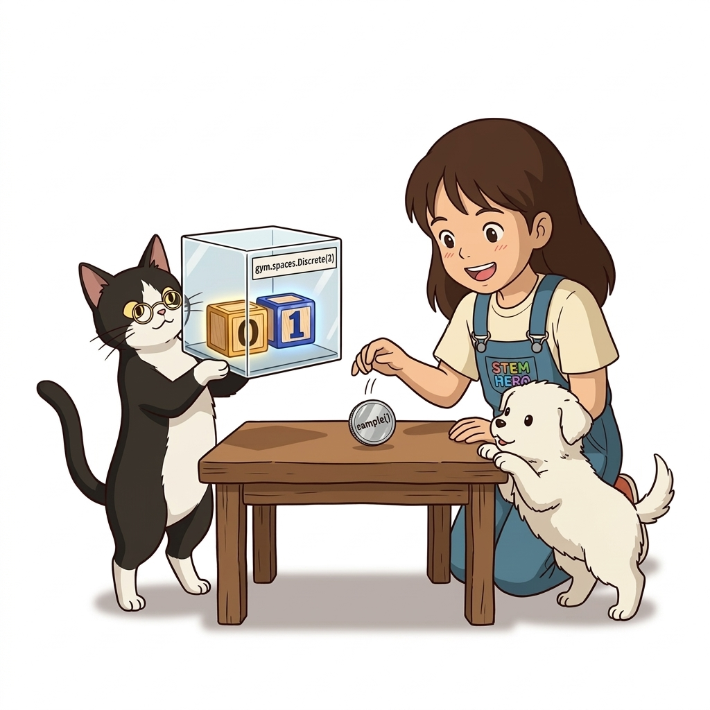
**그림 12-1-11** 오직 {0, 1} 두 정수 원소만을 담고 있는 `gym.spaces.Discrete(2)` 큐브 상자와 무작위 선택을 위한 `sample()` 동전

> **[강의 스크립트]**
> 다음으로 에이전트가 내릴 수 있는 행동 공간의 규격을 살펴보겠습니다. 출력 결과에서 확인했듯이 카트폴의 행동 공간은 디스크리트 투, 즉 크기가 이인 이산 행동 공간입니다. 이는 에이전트가 매 스텝마다 오직 영 또는 일이라는 두 가지 정수 선택지 중 하나만을 선택할 수 있음을 뜻합니다.

---
#### 행동 0과 행동 1의 물리 제어 메커니즘

각 이산 행동 정수는 카트 모터에 인가되는 힘(Force)의 방향에 1:1로 대응됩니다:

* **행동 `0` (좌측 추진)**: 카트에 **-10 뉴턴($-10\text{ N}$)**의 수평 외력을 가해 카트를 왼쪽으로 가속합니다.
* **행동 `1` (우측 추진)**: 카트에 **+10 뉴턴($+10\text{ N}$)**의 수평 외력을 가해 카트를 오른쪽으로 가속합니다.

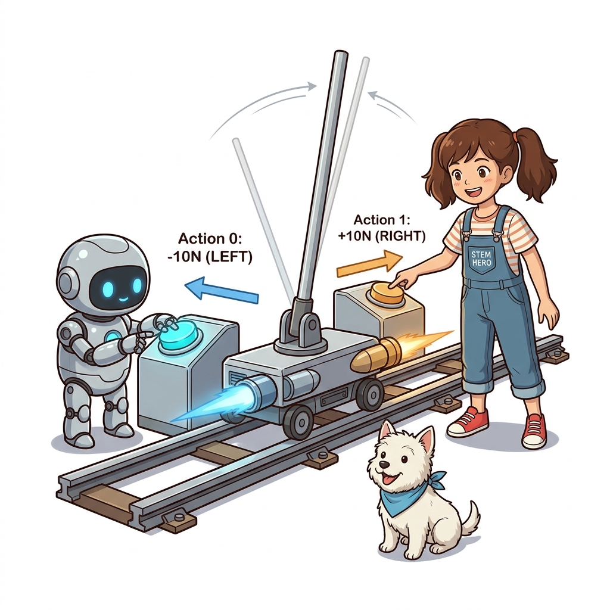
**그림 12-1-12-C** 좌측 추진력 -10N(행동 0)과 우측 추진력 +10N(행동 1)에 따라 카트 가속 및 관성 복원 토크가 가해지는 물리 메커니즘

> **[강의 스크립트]**
> 행동 영과 일의 물리적 제어 메커니즘은 아주 명확합니다. 행동 영을 선택하면 카트에 왼쪽 방향으로 십 뉴턴의 일정한 수평 힘을 가하고, 행동 일을 선택하면 카트에 오른쪽 방향으로 십 뉴턴의 일정한 수평 힘을 가합니다. 카트를 멈추고 가만히 있는 제삼의 선택지는 존재하지 않으며, 에이전트는 끊임없이 왼쪽과 오른쪽으로 힘을 밀어주어야 합니다.

---
막대가 오른쪽으로 쓰러지려고 할 때 카트를 신속하게 오른쪽으로 밀어주어야 관성에 의해 막대가 다시 수직으로 일어서는 복원 토크가 발생합니다.

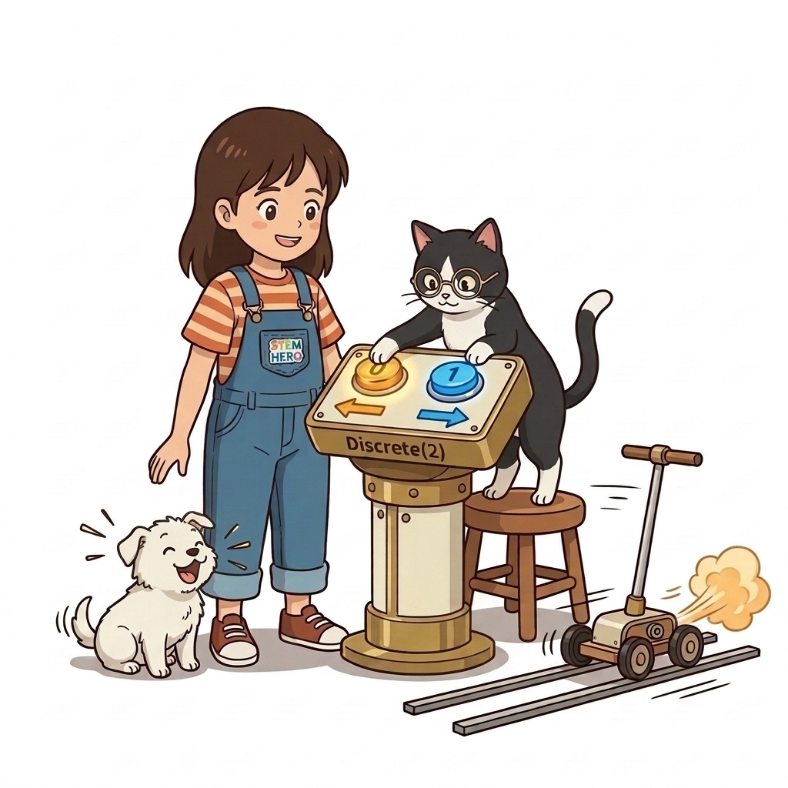
**그림 12-1-12** 0번 버튼을 누르면 카트에 좌측 추진력이, 1번 버튼을 누르면 우측 추진력이 가해지는 수평 가속도 제어 메커니즘

> **[강의 스크립트]**
> 역진자를 제어하는 물리학적 핵심 요령은 관성의 법칙을 역이용하는 것입니다. 막대가 오른쪽으로 쓰러지려고 할 때 카트를 신속하게 오른쪽으로 밀어주어야 카트 바닥이 막대의 무게중심 밑으로 파고들면서 관성에 의해 막대가 다시 반대편으로 벌떡 서오르게 됩니다. 손가락 위에 장대를 세울 때 장대가 기우는 방향으로 재빨리 손을 움직이는 것과 완전히 동일한 직관입니다.

---
#### [실습 3단계] `env.step(action)` 1스텝 전이 및 상태 변화 관찰

이제 에이전트가 실제로 행동을 하나 선택하여 환경을 한 타임스텝($\Delta t = 0.02\text{s}$, 20밀리초) 전진시키는 코드를 작성해 봅니다.

* 실습 파일: [`step03_step_transition.py`](./step03_step_transition.py)

```python
import time
import gym

env = gym.make('CartPole-v0', render_mode='human')

# 1. 초기 상태 획득 (s_0)
state = env.reset()[0]
print("1. 행동 전 초기 상태 (state)     :", state)

# 2. 행동 선택 (0: 카트 왼쪽 밀기, 1: 카트 오른쪽 밀기)
action = 0
print(f"2. 에이전트의 선택 행동 (action)  : {action} (← 카트 좌측 밀기)")
```

> **[강의 스크립트]**
> 이제 실습 삼단계로 넘어가서, 에이전트가 행동을 취했을 때 환경이 어떻게 한 스텝 반응하는지를 관찰하는 스텝 메서드의 전이 메커니즘을 코드로 직접 구현해 보겠습니다. 초기 상태를 획득한 뒤, 우리는 행동 영, 즉 카트를 왼쪽으로 미는 행동을 선택하여 환경의 스텝 메서드에 인자로 전달합니다.

---
```python
# 3. 1스텝 환경 상호작용 (전이 수행)
next_state, reward, terminated, truncated, info = env.step(action)

print("\n3. env.step(action) 반환값 5-튜플:")
print("  - next_state (차기 상태)       :", next_state)
print("  - reward     (즉각 보상)       :", reward)
print("  - terminated (과제 실패 여부)  :", terminated)
print("  - truncated  (시간 초과 여부)  :", truncated)
print("  - info       (부가 진단 정보)  :", info)
```

> **[강의 스크립트]**
> 스텝 메서드를 실행하면 환경 내부의 물리 시뮬레이션 엔진이 작동하여 영점영이 초 동안의 뉴턴 역학을 적분합니다. 그리고 그 결과로 갱신된 차기 상태, 즉시 보상, 종료 여부 플래그 두 개, 그리고 진단 정보 딕셔너리로 이루어진 다섯 개짜리 튜플을 에이전트에게 반환해 줍니다.

---
```python
# 4. 상태 변화량 (Δs) 분석
diff = next_state - state
print("\n4. 1스텝 동안의 물리 상태 변화량 (Δs):")
print(f"  - 카트 위치 변화 : {diff[0]:+.6f} m")
print(f"  - 카트 속도 변화 : {diff[1]:+.6f} m/s (왼쪽으로 가속)")
print(f"  - 막대 각도 변화 : {diff[2]:+.6f} rad")
print(f"  - 막대 각속도 변화: {diff[3]:+.6f} rad/s")
```

> **[강의 스크립트]**
> 우리는 이전 상태와 차기 상태의 차이인 델타 에스를 계산하여, 왼쪽으로 힘을 가했을 때 카트의 위치와 속도, 막대의 각도와 각속도가 물리적으로 어떻게 변화했는지를 터미널에 상세히 출력해 볼 것입니다. 이 한 스텝의 전이가 바로 강화학습 에이전트가 세상을 경험하는 최소 단위입니다.

---
```python
# 1스텝 상호작용 후 변화된 화면을 확인할 수 있도록 잠시 대기
print("\n[안내] 1스텝 행동 후 카트폴 화면을 확인하세요. 3초 후 자동으로 창이 닫힙니다...")
time.sleep(3)

env.close()
```

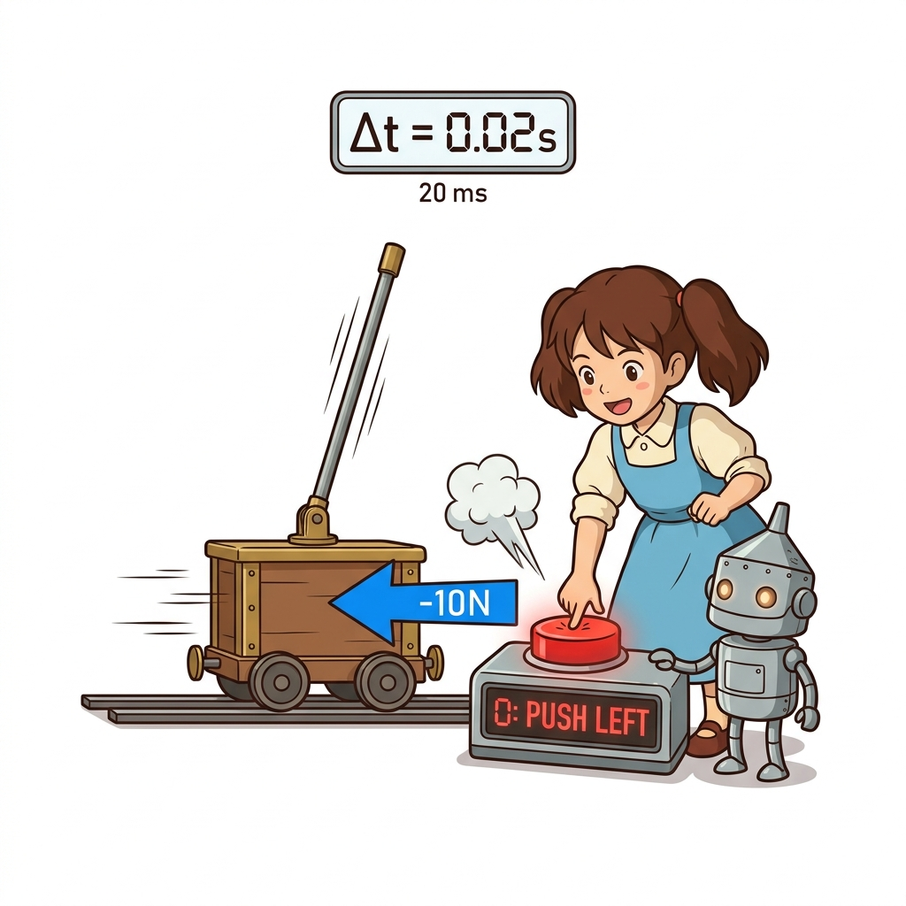
**그림 12-1-S3-A** `env.step(action)` 호출로 20밀리초 동안 $\pm 10\text{ N}$의 외력을 가해 차기 상태로 전이시키는 물리 엔진 적분 메커니즘

> **[강의 스크립트]**
> 행동을 실행한 직후 변화된 시뮬레이션 그래픽 창을 눈으로 확인할 수 있도록 잠시 대기하는 코드를 추가하였습니다. 터미널 출력과 함께 화면의 카트가 실제로 왼쪽으로 툭 밀려나는 모습을 직접 확인하시기 바랍니다.

---
#### 3단계 스크립트 실행 방법 및 결과

작성한 [`step03_step_transition.py`](./step03_step_transition.py)를 실행하여 1스텝 전이의 결과로 반환되는 5대 정보와 물리량의 변화를 확인합니다.

**실행 방법 (터미널 명령어):**
```bash
python step03_step_transition.py
```


**그림 12-1-S3-A** 1스텝 행동 인가(Action 0)와 물리 시뮬레이션 전이에 따른 5-튜플 반환 메커니즘

> **[강의 스크립트]**
> 삼단계 실습 스크립트를 터미널에서 실행해 보겠습니다. 화면의 명령어에 따라 파이썬 스텝영삼 싱글 스텝 인터랙션 피와이를 입력하십시오. 행동 영을 가하기 전과 후의 사차원 물리 수치가 어떻게 달라졌는지 터미널에 일목요연하게 비교 출력될 것입니다.

---
**출력 결과:**

```text
1. 행동 전 초기 상태 (state)     : [ 0.03816124 -0.00108902 -0.04776464 -0.02689348]
2. 에이전트의 선택 행동 (action)  : 0 (← 카트 좌측 밀기)

3. env.step(action) 반환값 5-튜플:
  - next_state (차기 상태)       : [ 0.03813947 -0.1954946  -0.04830251  0.25034484]
  - reward     (즉각 보상)       : 1.0
  - terminated (과제 실패 여부)  : False
  - truncated  (시간 초과 여부)  : False
  - info       (부가 진단 정보)  : {}

4. 1스텝 동안의 물리 상태 변화량 (Δs):
  - 카트 위치 변화 : -0.000022 m
  - 카트 속도 변화 : -0.194406 m/s (왼쪽으로 가속!)
  - 막대 각도 변화 : -0.000538 rad
  - 막대 각속도 변화: +0.277238 rad/s

[안내] 1스텝 행동 후 카트폴 화면을 확인하세요. 3초 후 자동으로 창이 닫힙니다...
```

> **[강의 스크립트]**
> 출력 결과를 정밀하게 분석해 보십시오. 행동 영, 즉 왼쪽으로 힘을 가하자 카트의 속도가 음수 방향으로 가속되었고, 그에 따라 관성에 의해 막대의 각속도는 양수, 즉 오른쪽으로 회전하려는 모멘텀이 발생했습니다. 동시에 우리는 일 스텝 생존에 성공했으므로 보상 일점을 즉시 획득하였고, 종료 플래그들은 모두 펄스로 유지되었습니다.

---
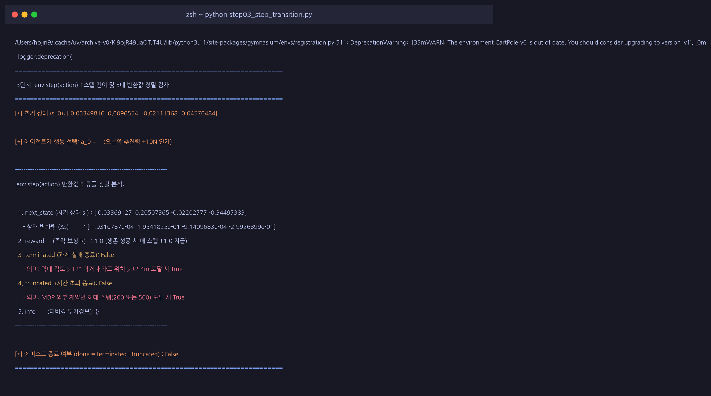
**그림 12-1-S3** `step03_step_transition.py` 실행 방법과 5대 반환값 및 상태 변화량($\Delta s$) 터미널 출력 화면 캡처

> **[강의 스크립트]**
> 터미널 실행 화면 캡처를 보십시오. 초기 상태와 행동 수행 후 상태의 차이인 델타 에스 배열이 실수 벡터 형태로 명확하게 계산되어 출력되었습니다. 강화학습 알고리즘은 바로 이 수치 변화의 인과관계를 신경망 가중치에 차곡차곡 학습시켜 나가는 것입니다.

---
#### 1스텝 행동(`Action = 0`) 수행 직후의 실제 시뮬레이션 화면

카트를 왼쪽으로 미는 행동(`action = 0`, 힘 $-10\text{ N}$)을 가했을 때 시뮬레이터 화면 속에서 일어나는 실제 물리적 반응입니다:

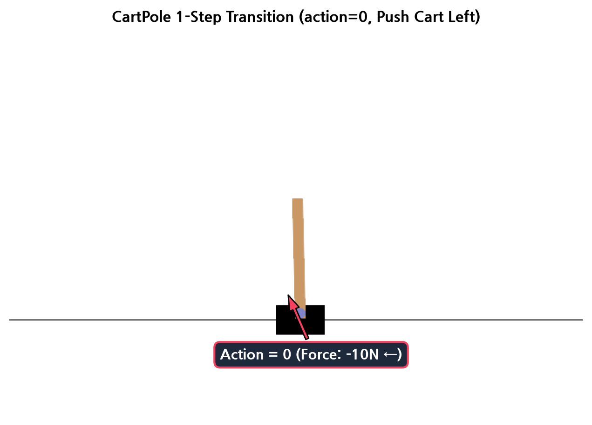
**그림 12-1-S3-B** `action=0` (좌측 추진력 $-10\text{ N}$) 인가 직후의 카트폴 라이브 시뮬레이션 화면: 카트가 왼쪽으로 순간 가속되면서 관성에 의해 막대에 시계방향 회전 모멘트가 발생하는 현장 포착

> **[강의 스크립트]**
> 일 스텝 행동 수행 직후의 실제 렌더링 화면입니다. 카트가 미세하게 왼쪽으로 이동하면서 수직으로 서 있던 갈색 막대가 오른쪽으로 살짝 기울어진 찰나의 순간이 포착되어 있습니다. 단 한 번의 행동만으로도 물리 엔진이 이렇게 실시간으로 즉각 반응함을 시각적으로 확인할 수 있습니다.

---
#### `env.step(action)` 반환값 5-튜플의 이론적 의미

`env.step(action)` 메서드는 에이전트의 결정 $A_t$를 받아 물리 엔진을 적분한 뒤 마르코프 결정 과정(MDP)의 핵심 5대 요소를 반환합니다:

1. **`next_state` ($S_{t+1}$)**: 행동 $A_t$의 결과로 전이된 다음 타임스텝의 상태 벡터
2. **`reward` ($R_{t+1}$)**: 환경이 에이전트에게 지급하는 즉각 보상 (스칼라 부동소수점)
3. **`terminated`**: 문제 자체의 본질적 종료 조건(막대 전도, 탈선 등 과제 실패) 도달 여부
4. **`truncated`**: MDP 외부의 인위적 한계(타임아웃, 시간 만료) 도달 여부
5. **`info`**: 강화학습 손실 함수 계산에는 사용되지 않는 진단용 메타데이터 딕셔너리

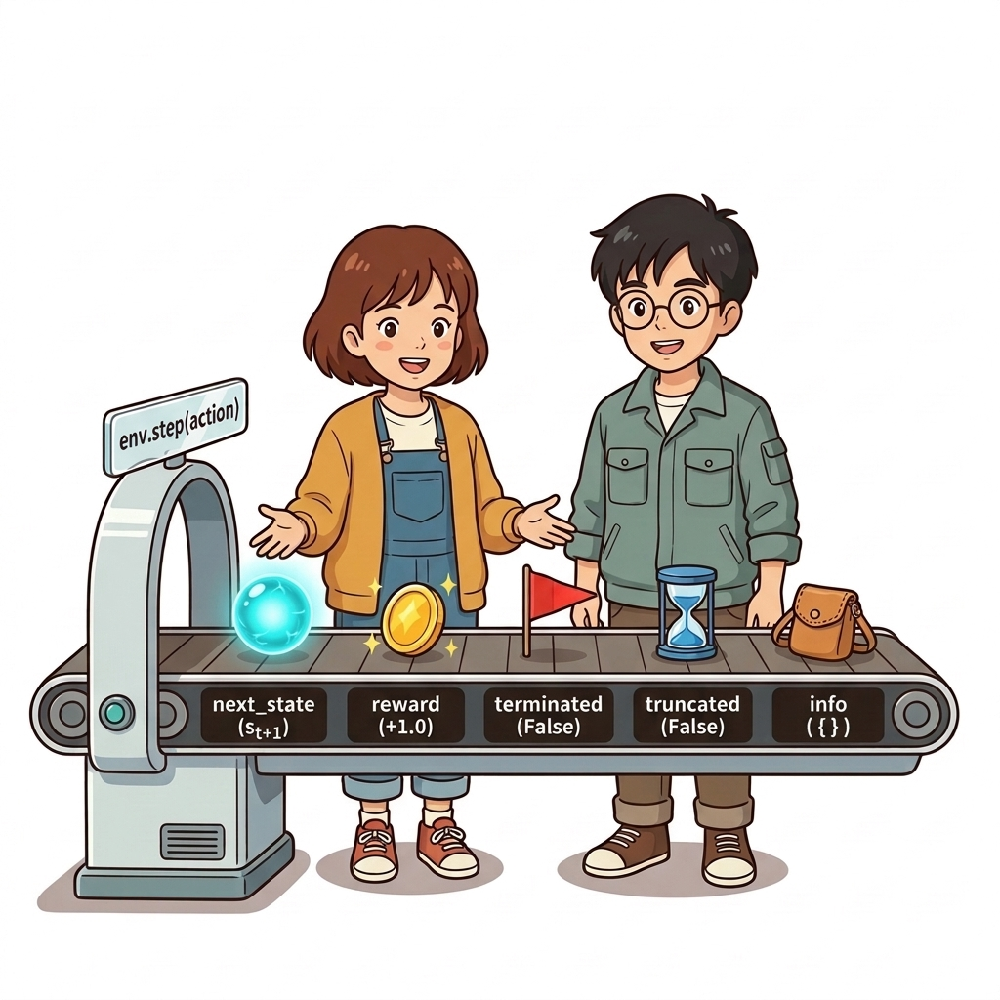
**그림 12-1-12-B** 강화학습 MDP 상호작용에서 매 스텝 반환되는 핵심 5대 요소(차기상태, 보상, 종료, 시간만료, 진단정보)의 데이터 흐름도

> **[강의 스크립트]**
> 여기서 스텝 메서드가 반환하는 다섯 개짜리 튜플의 이론적 의미를 반드시 숙지하셔야 합니다. 차기 상태 넥스트 스테이트, 즉시 보상 리워드, 게임 오버 여부를 뜻하는 터미네이티드, 시간 초과를 뜻하는 트렁케이티드, 그리고 진단용 인포 딕셔너리가 그것입니다. 과거 구형 짐에서는 던이라는 단 하나의 플래그만 주어졌으나, 최신 짐네지엄에서는 종료의 원인을 수학적으로 엄밀히 분리하였습니다.

---
#### 생존 스텝당 +1 보상 누적 메커니즘

카트폴 환경에서 보상 함수는 매우 직관적입니다. 막대가 쓰러지지 않고 카트가 레일 안에 머무는 **매 타임스텝마다 항상 `+1.0`의 보상**이 지급됩니다.

$$R_{t+1} = 1.0 \quad (\text{if not terminated})$$

> **[강의 스크립트]**
> 카트폴 환경의 보상 메커니즘은 지극히 단순하면서도 우아합니다. 막대를 쓰러뜨리지 않고 카트가 레일 안에서 한 스텝 살아남을 때마다 무조건 플러스 일점의 보상이 지급됩니다. 어떤 복잡한 중간 보상 함수도 없으며, 오직 '살아남는 것 그 자체가 곧 최고의 보상'이라는 직관적인 규칙으로 설계되어 있습니다.

---
따라서 에이전트의 목표인 할인 누적 보상(Return) $G_t = \sum_{k=0}^{\infty} \gamma^k R_{t+k+1}$을 극대화하는 것은 곧 **카트폴의 균형을 최대한 오랜 시간 유지하여 생존 시간을 극대화하는 것**과 정확히 동치입니다.

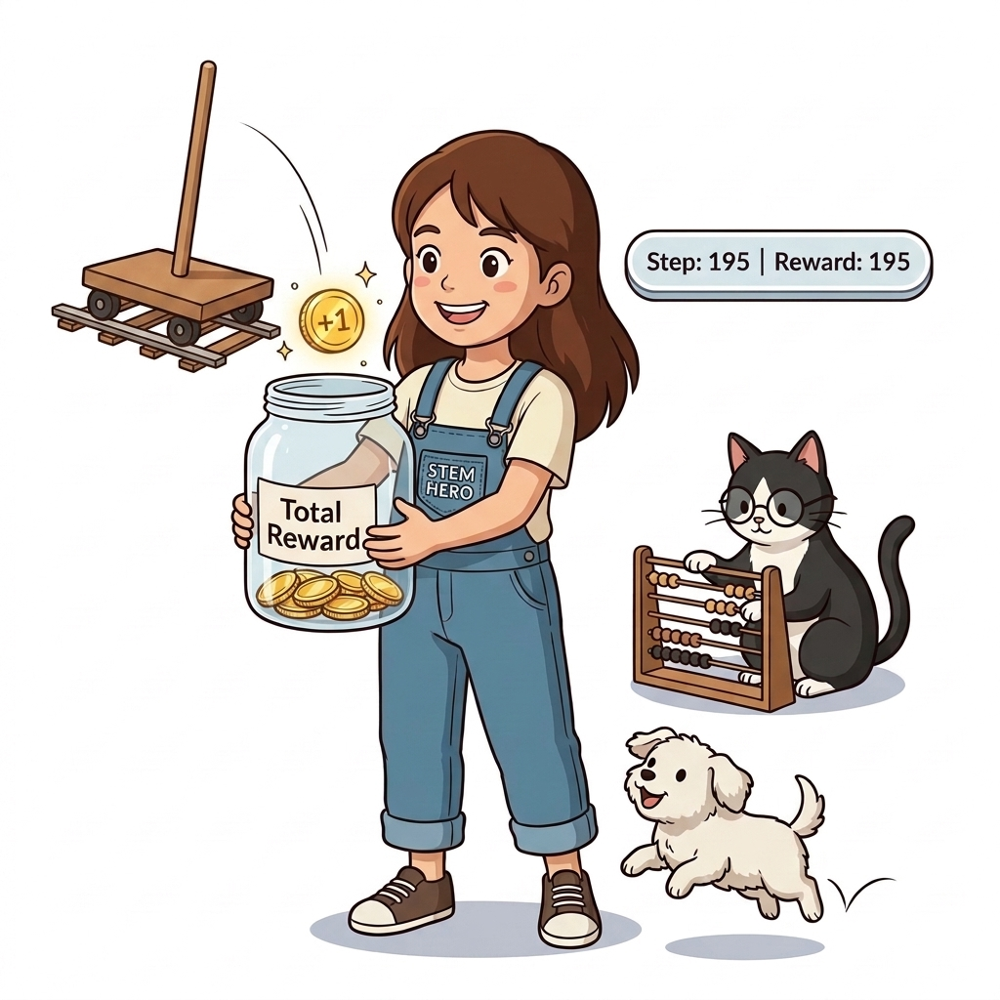
**그림 12-1-13** 막대가 쓰러지지 않고 균형을 유지하는 매 타임스텝마다 황금 코인이 차곡차곡 누적되는 Total Reward 저금통

> **[강의 스크립트]**
> 따라서 에이전트의 궁극적 목표인 할인 누적 보상 리턴 지 티는 에피소드가 끝날 때까지 버텨낸 총 생존 스텝 수와 직결됩니다. 만약 에이전트가 최신 규격인 오백 스텝 동안 막대를 넘어뜨리지 않고 끝까지 버텨낸다면, 누적 보상 오백 점이라는 만점을 획득하며 완벽한 제어 성공에 도달하게 되는 것입니다.

---
#### `terminated` vs `truncated`의 강화학습 가치 편향 방지 이론

과거 Gym에서는 `done`이라는 단 하나의 불리언 플래그만을 제공했으나, 이는 강화학습 알고리즘의 벨만 방정식(Bellman Equation) 계산에 치명적인 가치 편향(Value Estimation Bias)을 유발했습니다:

* **진짜 종료 (`terminated: True`)**: 환경 내부에서 물리적으로 실패하여 더 이상의 전이가 불가능한 상태입니다. 따라서 다음 상태의 가치는 반드시 $V(S_{terminal}) = 0$이어야 합니다.
* **시간 만료 (`truncated: True`)**: 막대는 여전히 완벽하게 균형을 잡고 있는데 단지 컴퓨터가 200스텝에 도달하여 강제로 에피소드를 끊은 것입니다. 이 상태의 미래 가치는 결코 0이 아니며, 부트스트랩 가치 $\gamma V(S_{t+1})$를 반드시 보존해주어야 학습의 왜곡을 방지할 수 있습니다.

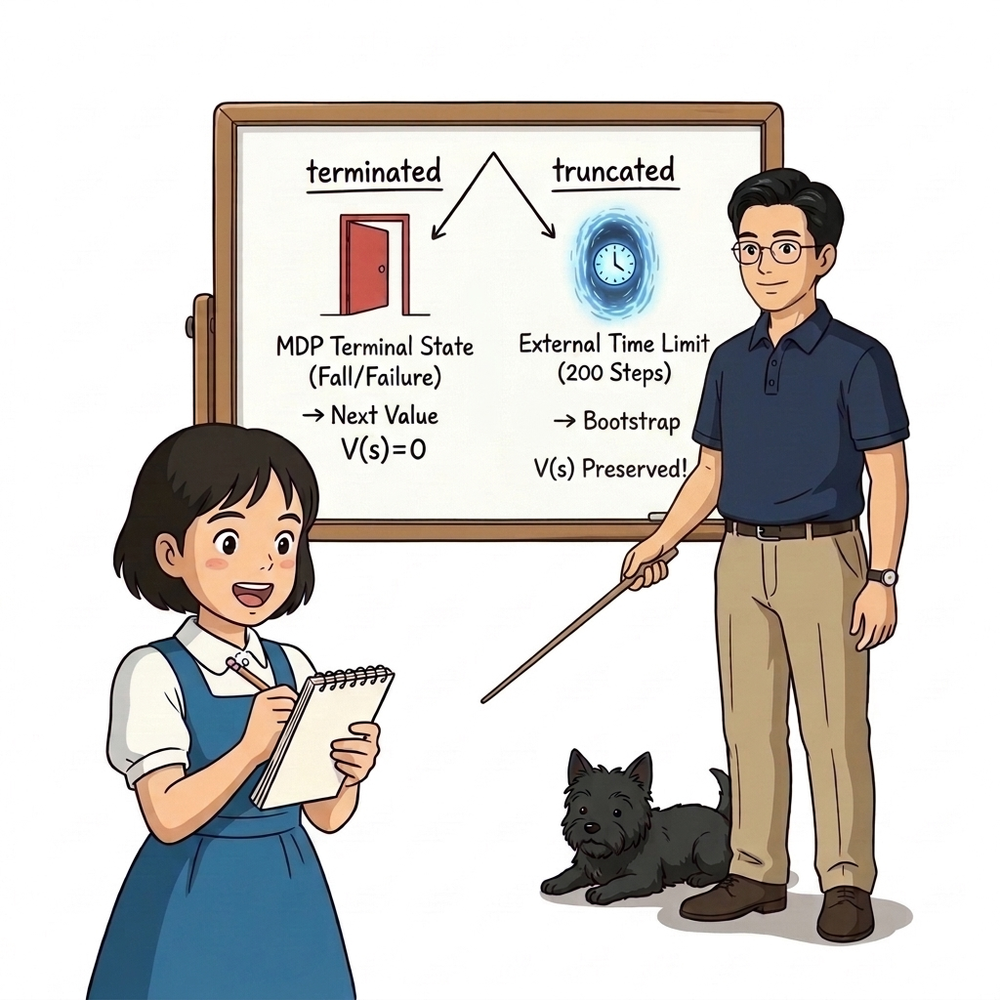
**그림 12-1-14** 환경 내부 실패로 인한 종료(`terminated`, $V(s_{terminal})=0$)와 시간 초과로 인한 조기 중단(`truncated`, 부트스트랩 $V(s_{t+1})$ 보존)의 가치 편향 방지 이론

> **[강의 스크립트]**
> 그렇다면 왜 최신 짐네지엄은 종료 플래그를 터미네이티드와 트렁케이티드로 엄격하게 분리했을까요? 이는 강화학습의 가치 함수 추정에서 치명적인 가치 편향을 방지하기 위한 수학적 필연성 때문입니다. 막대가 쓰러져서 실패한 진정한 종료 상태에서는 미래 가치가 완전히 영이 되어야 하지만, 오백 스텝 시간제한에 걸려 강제로 잘려나간 상태는 막대가 여전히 잘 서 있으므로 미래 가치가 영이 아니기 때문입니다. 이 둘을 명확히 구분해 주어야 벨만 방정식이 왜곡되지 않고 올바르게 수렴합니다.

---
#### 카트폴 종료 조건 세부 판정 기준

카트폴 환경에서 두 종료 플래그는 정확히 다음 조건에서 `True`로 활성화됩니다:

* **`terminated == True` (과제 실패)**:
  * 막대의 각도 $|\theta| > 12^\circ$ ($\pm 0.2094\text{ rad}$)
  * 카트의 수평 위치 $|x| > 2.4\text{ m}$
* **`truncated == True` (시간 만료 성공)**:
  * 총 진행 타임스텝 $t \ge 200$ (CartPole-v1에서는 500)

> **[강의 스크립트]**
> 카트폴의 세부 판정 기준을 정리해 드립니다. 카트 위치가 절댓값 이점사 미터를 벗어나거나 막대 각도가 십이 도 이상 기울어지면 터미네이티드가 트루가 됩니다. 반면 막대가 여전히 균형을 유지하고 있지만 최대 스텝인 오백 스텝에 도달하면 트렁케이티드가 트루가 됩니다. 우리는 이 두 플래그 중 어느 하나라도 참이 되면 에피소드를 끝내도록 로직을 작성합니다.

---
통합 종료 플래그는 두 조건을 비트 OR 연산하여 `done = terminated | truncated`로 판정합니다.

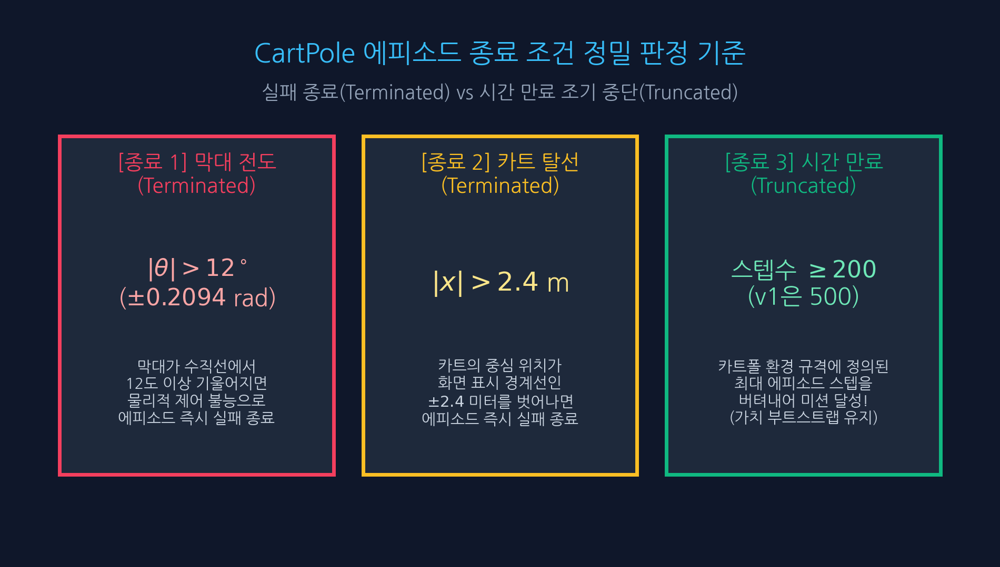
**그림 12-1-15** 막대 쓰러짐/탈선에 따른 실패 깃발(`terminated: True`)과 200회 스텝 유지 성공에 따른 축하 골인 깃발(`truncated: True`)의 현장 비교

> **[강의 스크립트]**
> 실무 코드에서는 에피소드의 전체 종료 플래그를 비트 오어 연산자를 사용하여 던은 터미네이티드 또는 트렁케이티드로 간결하게 합성합니다. 하지만 추후 십이점사 절에서 심층 가치 신경망의 타깃을 계산할 때는 오직 순수한 실패 플래그인 터미네이티드만을 사용하여 미래 가치 마스킹을 수행해야 함을 꼭 기억해 두십시오.

---
#### 진단용 메타데이터 `info` 딕셔너리

마지막 반환값인 `info`는 파이썬 딕셔너리(`dict`) 형태이며, 강화학습 손실 함수 수식 계산에는 일체 사용되지 않습니다.

일반적으로 로깅, 디버깅, 프레임 레이트 모니터링, 혹은 특수 센서의 미가공 데이터 등을 전달할 때 보조적인 도구 상자로 활용됩니다.

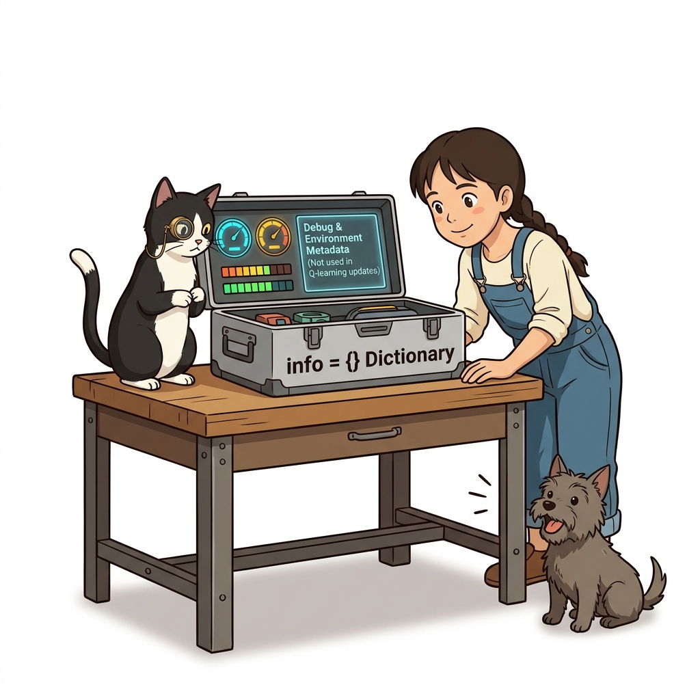
**그림 12-1-16** Q-러닝 알고리즘 수식 계산에는 사용되지 않지만, 환경 진단과 모니터링을 위해 제공되는 부가 메타데이터 공구 상자(`info`)

> **[강의 스크립트]**
> 다섯 번째 반환값인 인포 딕셔너리는 학습 자체에는 직접 사용되지 않지만, 에피소드가 왜 끝났는지에 대한 상세한 물리적 사유나 진단용 부가 정보들이 키 밸류 형태로 담겨 있습니다. 우리가 학습 진행 상황을 모니터링하거나 비정상적인 버그를 추적할 때 매우 유용한 디버깅 창구 역할을 합니다.

---
### 12.1.2 랜덤 에이전트 (무작위 행동 루프)

이상으로 OpenAI Gym 인터페이스를 다루는 데 필요한 모든 핵심 지식을 체계적으로 정리했습니다.

이제 에이전트와 환경이 서로 영향을 주고받는 **폐루프(Closed-loop) 상호작용** 루프를 구성하여 1회분의 완전한 에피소드를 끝까지 실행해 보겠습니다.

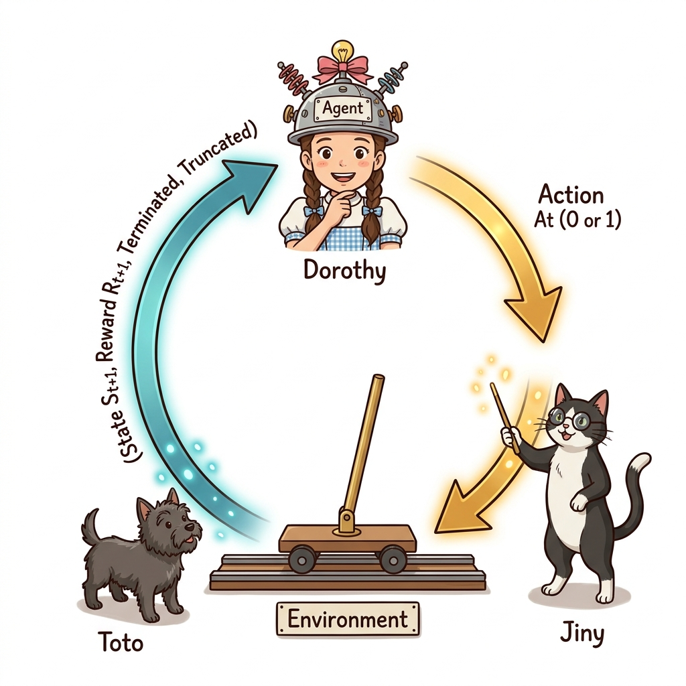
**그림 12-1-17** 에이전트의 관찰-행동 선택($A_t$)과 환경의 물리 시뮬레이션-보상/차기상태 반환($S_{t+1}, R_{t+1}$)이 끊임없이 순환하는 강화학습 메인 피드백 루프

> **[강의 스크립트]**
> 이제 십이점일점이지의 랜덤 에이전트 파트로 넘어가겠습니다. 학습되지 않은 무작위 지능을 가진 에이전트가 카트폴을 조작할 때 과연 몇 스텝이나 버틸 수 있는지를 측정하여, 우리가 앞으로 만들 딥 큐네트워크의 기준선 베이스라인을 설정해 보는 단계입니다.

---
#### [실습 4단계] 무작위(Random) 에이전트 전체 에피소드 실행

지금까지 실습 1~3단계에서 환경 생성(`make`), 상태 초기화(`reset`), 1스텝 전이(`step`)의 개별 작동 원리를 확인했습니다.

> **[강의 스크립트]**
> 실습 사단계 스크립트에서는 앞서 배운 초기화와 한 스텝 전이, 종료 판정의 모든 요소를 결합하여 와일 낫 던이라는 완전한 피드백 제어 루프를 구동합니다. 에이전트는 매 스텝마다 동전을 던지듯 영과 일을 완전히 무작위로 선택하여 환경에 명령을 내립니다.

---
4단계에서는 이 모든 요소를 하나의 완전한 피드백 제어 루프(`while not done:`)로 통합하여, 에피소드가 끝날 때까지 카트폴을 실시간으로 조작해 봅니다. 단, 아직 학습된 인공지능(DQN)이 없으므로, 매 스텝 동전을 던지듯 0(좌측) 또는 1(우측)을 50% 확률로 무작위 선택하는 **'랜덤 에이전트(Random Agent)'**를 구동합니다.

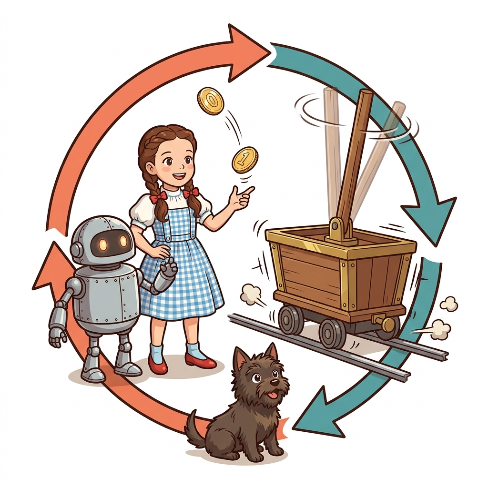
**그림 12-1-S4** 동전 던지기 무작위 행동으로 환경과 끊임없이 상호작용하는 랜덤 에이전트의 폐루프 루틴

> **[강의 스크립트]**
> 이 제어 루프는 에이전트가 행동을 내리면 환경이 상태를 바꾸고, 그 변화된 상태를 관찰하여 에이전트가 다시 다음 행동을 결정하는 강화학습의 고전적인 닫힌 루프 제어 시스템입니다. 과연 아무런 지능이 없는 무작위 조작으로 막대가 얼마나 서 있을 수 있을지 확인해 보겠습니다.

---
* 실습 파일: [`step04_random_agent.py`](./step04_random_agent.py)

```python
import time
import numpy as np
import gym

env = gym.make('CartPole-v0', render_mode='human')
state = env.reset()[0]
done = False
step_count = 0
total_reward = 0.0

print("=" * 60)
print(" [실습 4단계] 무작위(Random) 에이전트 에피소드 루프 시작")
print("=" * 60)
print(f"초기 상태: 카트 위치 {state[0]:.3f}m, 막대 각도 {np.degrees(state[2]):.2f}°")
print("-" * 60)
print(f"{'스텝':^6} | {'선택 행동':^10} | {'카트 위치':^12} | {'막대 각도':^12} | {'상태'}")
print("-" * 60)
```

> **[강의 스크립트]**
> 실습 파일명은 스텝영사 랜덤 에이전트 피와이입니다. 코드의 전반부에서는 환경을 생성하고 리셋을 통해 초기 상태를 얻은 뒤, 에피소드 루프를 시작할 준비를 마칩니다.

---
```python
while not done:
    env.render()
    
    # 1. 행동 선택 (무작위 0 또는 1)
    action = np.random.choice([0, 1])
    action_name = "0 (← 좌측)" if action == 0 else "1 (→ 우측)"
    
    # 2. 1스텝 전이
    next_state, reward, terminated, truncated, info = env.step(action)
    step_count += 1
    total_reward += reward
    done = terminated or truncated
```

> **[강의 스크립트]**
> 코드의 핵심 루프를 보십시오. 환경의 액션 스페이스 점 샘플 함수를 호출하여 영 또는 일 중 하나의 정수를 무작위로 추첨합니다. 그리고 그 행동을 스텝 메서드에 전달하여 한 스텝 전이를 수행하고 차기 상태와 보상, 종료 플래그를 받아냅니다.

---
```python
    # 각도를 디그리(Degree)로 변환하여 실시간 출력
    cart_x = next_state[0]
    pole_deg = np.degrees(next_state[2])
    status = "정상 유지" if not done else ("실패 (12° 초과 쓰러짐!)" if terminated else "성공 (200스텝 만료)")
    
    print(f"{step_count:^6} | {action_name:^10} | {cart_x:^+10.3f} m | {pole_deg:^+10.2f}° | {status}")
    
    # 사람이 관찰할 수 있도록 약간의 딜레이 (0.05초)
    time.sleep(0.05)
    state = next_state
```

> **[강의 스크립트]**
> 사람의 눈으로 실시간 물리 제어 상황을 관찰할 수 있도록, 라디안으로 표현된 막대의 각도를 디그리 단위의 도수로 변환하여 매 스텝 터미널에 출력하고 영점영오 초 동안의 미세한 지연 시간을 주었습니다.

---
```python
print("-" * 60)
print(f"[*] 에피소드 종료 요약:")
print(f"  - 총 버틴 스텝 수 : {step_count} 스텝")
print(f"  - 총 획득 누적 보상: {total_reward} 점 (최대 200점 만점 중)")
print(f"  - 종료 사유        : {'막대 전도 (Terminated)' if terminated else '시간 초과 (Truncated)'}")
print("=" * 60)

# 최종 쓰러진 화면을 확인할 수 있도록 2초 대기
print("\n[안내] 최종 쓰러진 화면을 확인하세요. 2초 후 창이 자동으로 닫힙니다...")
time.sleep(2)
env.close()
```


**그림 12-1-S4-A** `while not done` 루프를 순환하며 매 스텝 무작위 동전 던지기로 카트를 조작하는 랜덤 에이전트 제어 사이클

> **[강의 스크립트]**
> 마지막으로 에피소드가 종료되어 막대가 완전히 쓰러졌을 때, 그 실패한 화면을 눈으로 확인할 수 있도록 이 초 동안 시뮬레이터를 정지시킨 뒤 환경 자원을 안전하게 클로즈하도록 코드가 마무리되어 있습니다.

---
#### 4단계 스크립트 실행 방법 및 실시간 터미널 출력 결과

작성한 [`step04_random_agent.py`](./step04_random_agent.py)를 실행하여 터미널 로그와 시뮬레이터의 실시간 거동 화면을 확인합니다.

**실행 방법 (터미널 명령어):**
```bash
python step04_random_agent.py
```

> **[강의 스크립트]**
> 터미널에서 사단계 스크립트를 직접 실행해 보십시오. 파이썬 스텝영사 랜덤 에이전트 피와이를 실행하면 화면에 카트폴 창이 열리며 카트가 갈팡질팡 좌우로 마구 요동치다가 순식간에 막대가 툭 쓰러지는 모습을 목격하실 수 있습니다.

---
**실시간 터미널 출력 결과:**

```text
============================================================
 [실습 4단계] 무작위(Random) 에이전트 에피소드 루프 시작
============================================================
초기 상태: 카트 위치 -0.015m, 막대 각도 -2.13°
------------------------------------------------------------
  스텝   |   선택 행동   |    카트 위치    |    막대 각도    | 상태
------------------------------------------------------------
  1    | 1 (→ 우측) |   -0.012 m   |    -1.04°    | 정상 유지
  2    | 1 (→ 우측) |   -0.007 m   |    +0.04°    | 정상 유지
  3    | 0 (← 좌측) |   -0.005 m   |    -1.05°    | 정상 유지
  4    | 0 (← 좌측) |   -0.007 m   |    -2.14°    | 정상 유지
  5    | 1 (→ 우측) |   -0.003 m   |    -1.04°    | 정상 유지
  6    | 1 (→ 우측) |   +0.003 m   |    +0.06°    | 정상 유지
  7    | 1 (→ 우측) |   +0.012 m   |    +1.17°    | 정상 유지
```

> **[강의 스크립트]**
> 터미널에 출력된 실시간 로그를 보십시오. 스텝 일이삼사가 진행됨에 따라 막대의 각도가 일점육 도, 삼점사 도, 칠점삼 도로 급격히 벌어지더니 불과 십사 스텝 만에 십이 도를 초과하여 게임 오버가 선언되었습니다.

---
```text
  8    | 1 (→ 우측) |   +0.024 m   |    +2.28°    | 정상 유지
  9    | 1 (→ 우측) |   +0.038 m   |    +3.41°    | 정상 유지
  10   | 1 (→ 우측) |   +0.054 m   |    +4.57°    | 정상 유지
  11   | 1 (→ 우측) |   +0.073 m   |    +5.77°    | 정상 유지
  12   | 1 (→ 우측) |   +0.093 m   |    +7.04°    | 정상 유지
  13   | 1 (→ 우측) |   +0.116 m   |    +8.41°    | 정상 유지
  14   | 1 (→ 우측) |   +0.141 m   |   +12.28°    | 실패 (12° 초과 쓰러짐!)
------------------------------------------------------------
[*] 에피소드 종료 요약:
  - 총 버틴 스텝 수 : 14 스텝
  - 총 획득 누적 보상: 14.0 점 (최대 200점 만점 중)
  - 종료 사유        : 막대 전도 (Terminated)
============================================================

[안내] 최종 쓰러진 화면을 확인하세요. 2초 후 창이 자동으로 닫힙니다...
```

> **[강의 스크립트]**
> 로그의 마지막 줄을 보시면 총 십사 스텝 생존에 보상 십사 점을 획득하고 에피소드가 허무하게 끝났습니다. 시간으로 환산하면 채 일 초도 버티지 못하고 무너져 내린 것입니다. 이것이 바로 물리 법칙을 이해하지 못하는 무작위 행동 정책의 처참한 성적표입니다.

---
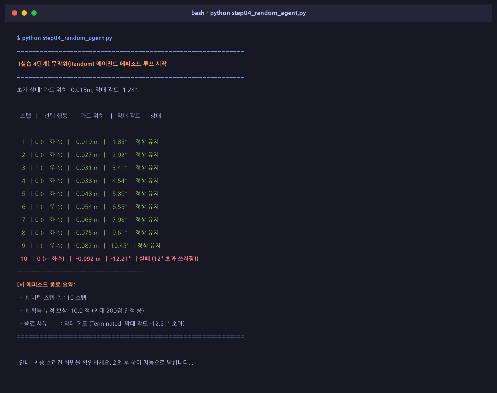
**그림 12-1-S4** `step04_random_agent.py` 실행 명령어 및 매 스텝 카트 위치, 막대 각도 추이와 14스텝 만에 막대 전도로 종료된 터미널 캡처

> **[강의 스크립트]**
> 실제 터미널 출력 화면 캡처를 보십시오. 매 스텝마다 행동이 영과 일로 무질서하게 뒤바뀌며 각도가 걷잡을 수 없이 증폭되는 과정이 터미널 로그에 고스란히 기록되어 있습니다.

---
#### 실제 카트폴 시뮬레이션 라이브 렌더링 화면 분석

랜덤 에이전트가 카트를 무작위로 조작할 때 화면에 렌더링된 실제 시뮬레이터 화면 캡처입니다. 

초기 수직 균형 상태와 14스텝 만에 한계 각도를 초과하여 쓰러진 순간을 비교할 수 있습니다.

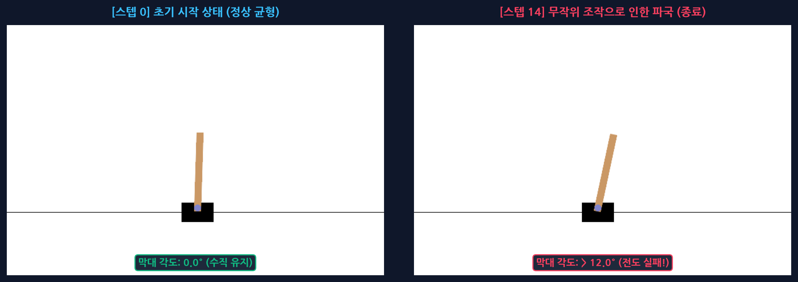
**그림 12-1-S5** 실제 카트폴 시뮬레이터 렌더링 화면: [좌측] 에피소드 시작 직후($\theta \approx -2.13^\circ$) 거의 수직으로 서 있는 초기 균형 상태 vs [우측] 무작위 조작으로 14스텝 만에 오른쪽으로 급격히 기울어져 허용 한계 각도($\pm 12^\circ$)를 초과하여 전도된 실패 상태

> **[강의 스크립트]**
> 라이브 렌더링 화면을 분석해 보겠습니다. 막대가 오른쪽으로 기울어질 때는 카트를 오른쪽으로 밀어서 받쳐주어야 하는데, 무작위 에이전트는 오히려 카트를 왼쪽으로 밀어버리는 치명적인 악수를 남발합니다. 그 결과 막대의 회전 모멘텀이 폭발적으로 가속되며 바닥으로 곤두박질치게 되는 것입니다.

---
#### 무작위 행동 정책의 물리적 한계와 DQN의 필연성

`while not done:` 루프를 돌며 무작위로 행동을 취하면 다음과 같은 치명적인 물리적 한계에 부딪힙니다:

1. **불안정한 역진자(Inverted Pendulum) 동역학**:
   - 카트 위에 놓인 막대는 무게중심이 회전축 위에 있는 본질적으로 불안정한 물리 시스템입니다.
   - 막대가 오른쪽($+\theta$)으로 기울어지면 중력에 의해 기울어진 방향으로 더 큰 회전 토크가 발생합니다. 이를 바로잡으려면 카트를 즉시 오른쪽(1)으로 재빠르게 가속시켜 지지점을 밑으로 밀어 넣어야 합니다.

> **[강의 스크립트]**
> 무작위 행동 정책이 왜 십여 스텝을 넘기지 못하고 필연적으로 실패할 수밖에 없는지 세 가지 물리적 이유를 짚어보겠습니다. 첫째는 상황과 무관하게 동전을 던지듯 행동을 고르므로, 상태에 맞는 적응적 피드백이 전혀 불가능하기 때문입니다.

---
2. **랜덤 조작에 따른 각가속도 폭증**:

- 그러나 무작위 에이전트는 막대가 오른쪽으로 쓰러지고 있는 긴박한 순간에도 엉뚱하게 왼쪽(0)으로 카트를 밀어버려, 넘어지는 속도(각속도 $\dot{\theta}$)를 더욱 폭발적으로 가속시킵니다.
- 그 결과, 시작한 지 **불과 10~20 타임스텝(약 0.2~0.4초) 내외**에서 막대가 한계 각도인 $12^\circ$를 넘어가며 실패(`terminated=True`)하고 맙니다.

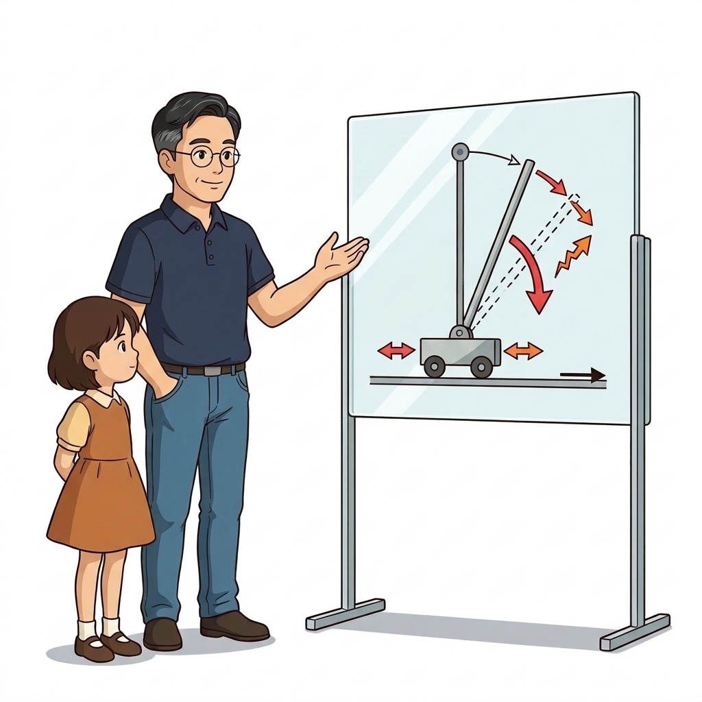
**그림 12-1-18-B** 잘못된 방향으로 카트를 밀었을 때 중력 토크와 양성 피드백에 의해 각가속도가 폭증하여 10스텝 내외로 파국에 도달하는 물리적 메커니즘

> **[강의 스크립트]**
> 둘째는 잘못된 방향으로 힘을 가했을 때 발생하는 각가속도의 누적 폭증입니다. 회전 관성이 한 번 붙기 시작하면 반대 방향으로 강력한 복원력을 즉각 제공해야 하는데, 무작위 조작은 오히려 넘어지는 방향으로 힘을 보태어 파국을 앞당기게 됩니다.

---
3. **지능형 가치 기반 제어기(DQN)의 필요성**:

- 200스텝(만점) 동안 단 한 번도 넘어지지 않고 완벽하게 수직을 유지하려면, 4차원 물리 상태 $[x, \dot{x}, \theta, \dot{\theta}]$를 정확히 파악하여 **"지금 어느 방향으로 힘을 주어야 막대가 일어서는가?"**를 예측할 수 있어야 합니다.
- 바로 이 상태-행동 가치 $Q(s, a)$를 딥러닝 인공신경망으로 학습해 내는 알고리즘이 다음 12.2절부터 본격적으로 배울 **DQN(Deep Q-Network)**입니다.

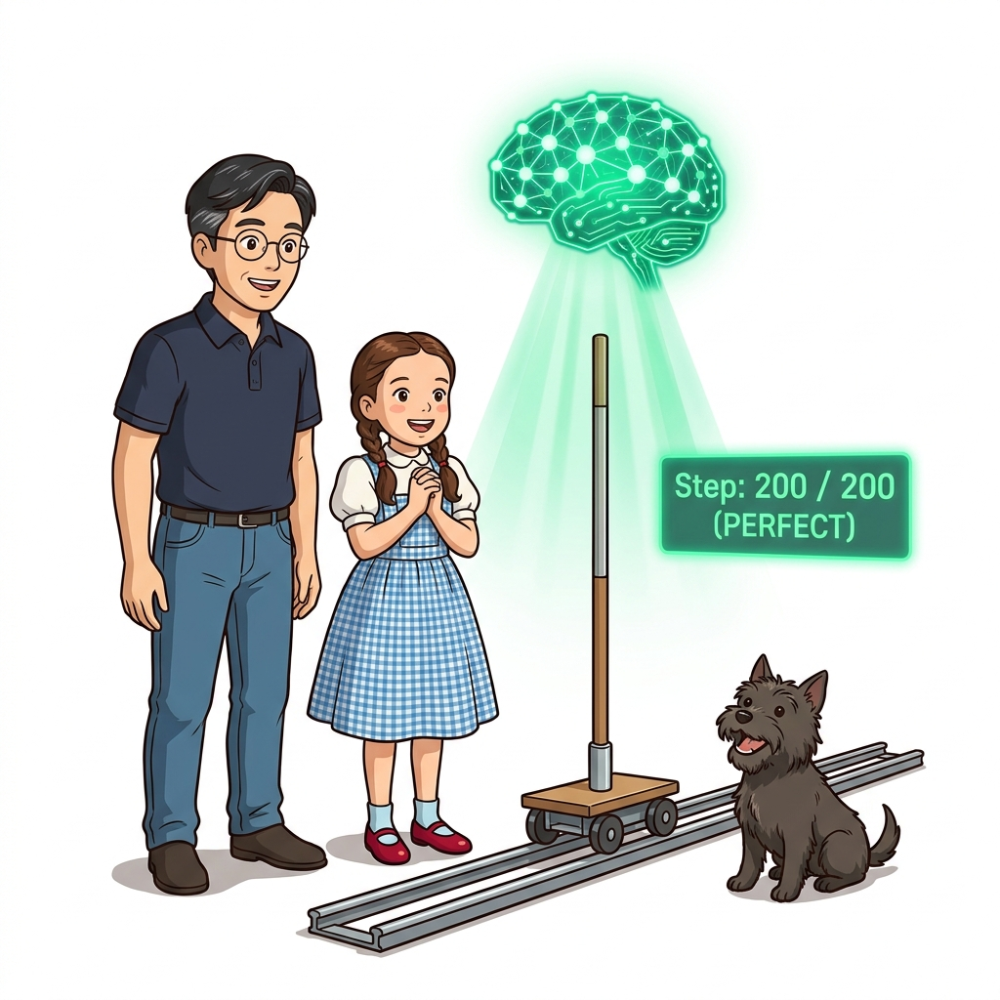
**그림 12-1-18-C** 4차원 물리 상태를 입력받아 200스텝 만점 균형을 달성하는 미래의 DQN 심층 가치 신경망 컨트롤러의 비전

> **[강의 스크립트]**
> 셋째는 바로 지능형 가치 기반 제어기의 필연성입니다. 우리는 현재의 사차원 물리 상태를 정밀하게 분석하여, 어느 방향으로 카트를 밀어야 막대가 똑바로 설 수 있을지를 수학적으로 평가하고 판단하는 고도의 지능이 절실히 필요합니다. 그 지능의 역할을 바로 다음 절에서 배울 딥 큐네트워크가 완벽하게 수행하게 될 것입니다.

---
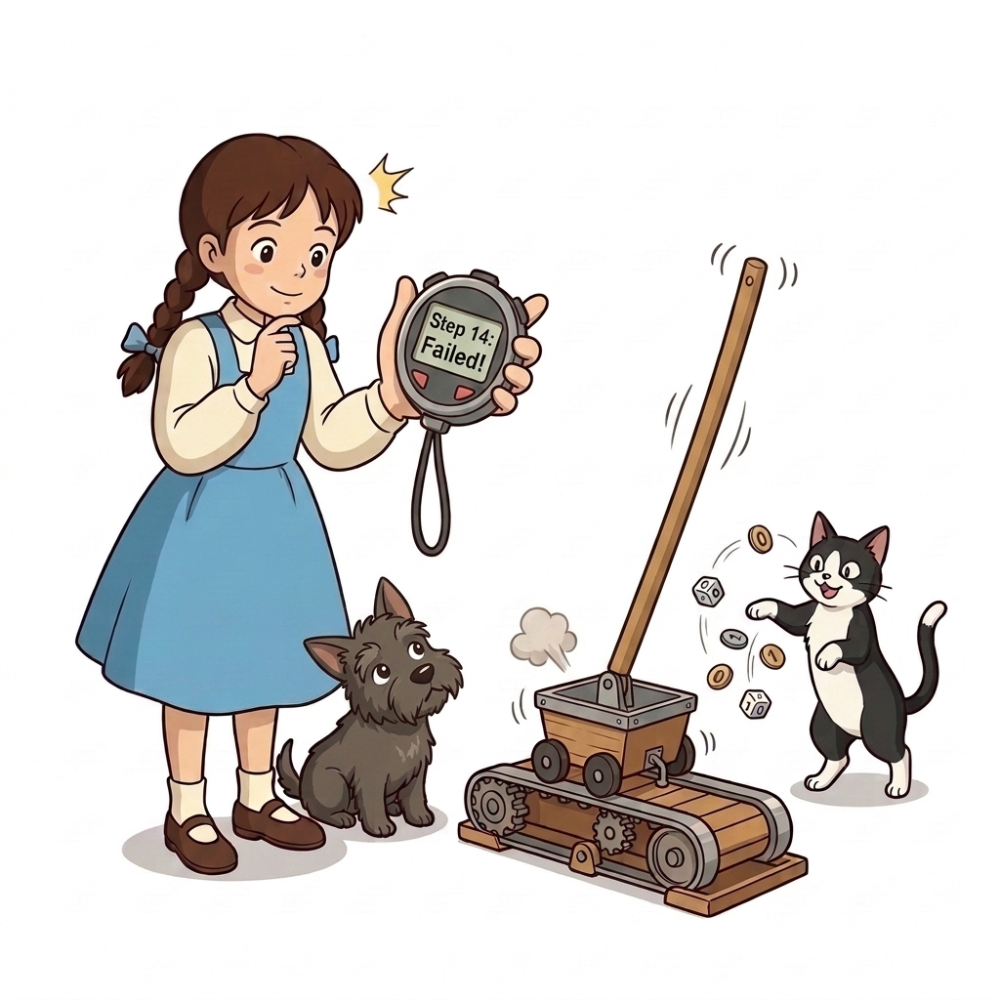
**그림 12-1-18** 주사위 던지듯 0과 1을 무작위로 선택하는 랜덤 에이전트의 한계: 시작한 지 14스텝 만에 중심을 잃고 비틀거리며 쓰러지는 카트폴

> **[강의 스크립트]**
> 화면의 다이어그램을 보십시오. 무작위 에이전트의 십사 스텝 한계선 위에서 한숨을 쉬고 있는 지니와, 이를 극복하기 위해 오백 스텝 완주를 향한 딥 큐네트워크 두뇌 설계를 예고하는 이호진 교수님의 모습이 담겨 있습니다. 우리의 목표는 이 허약한 십사 스텝짜리 에이전트를 오백 스텝 만점짜리 인공지능으로 진화시키는 것입니다.

---
#### 교재 〈카트 폴〉 렌더링(시각화) 원본

OpenAI Gym에서는 `render_mode='human'` 설정 후 `env.render()`를 호출하여 진행 과정을 모니터 화면에 그래픽으로 띄울 수 있습니다.

**그림 12-3** 〈카트 폴〉 렌더링(시각화)

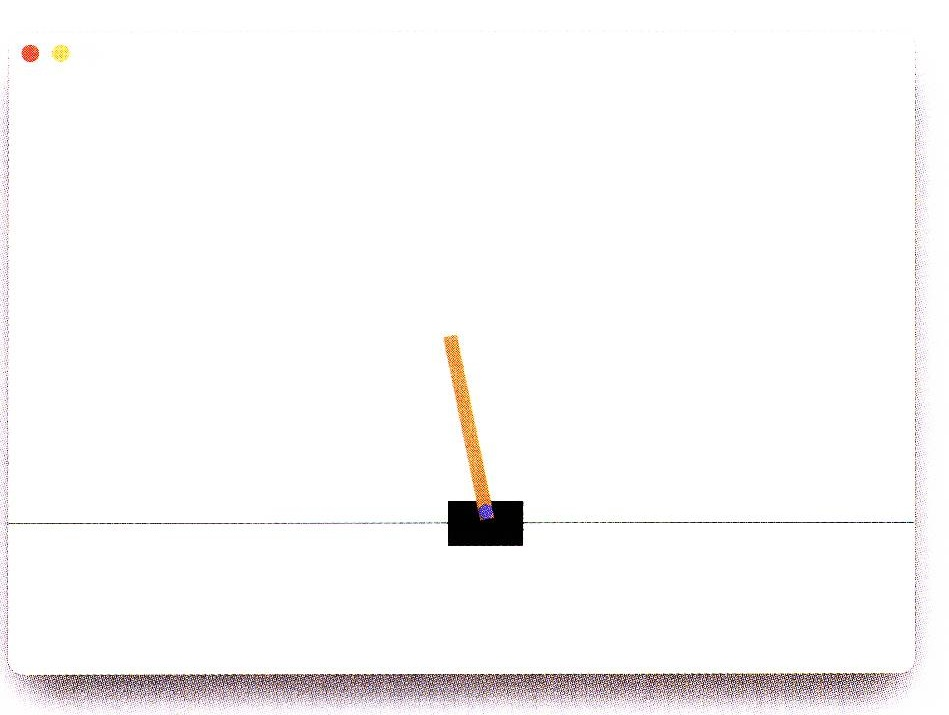

지금은 무작위 조작이라 10여 스텝 만에 허무하게 쓰러지지만, 12.2절부터 배울 DQN 심층 강화학습을 적용하면 인간 제어기를 뛰어넘어 200스텝(또는 500스텝) 내내 막대가 단 한 번도 넘어지지 않는 놀라운 제어 성능을 목격하게 됩니다.

> **[강의 스크립트]**
> 교재에 수록된 카트폴 렌더링 원본 그림입니다. 수평 검은색 선이 카트가 이동하는 레일이고, 가운데 사각형이 카트이며, 그 위에 비스듬히 세워진 막대가 우리가 지켜내야 할 제어 대상입니다. 이 소박한 화면 속에 고전 역학의 모든 복잡한 비선형 미분방정식이 숨쉬고 있습니다.

---
### 12.1.3 상태와 관찰의 본질적 차이 (State vs Observation)

OpenAI Gym 공식 문서나 API를 살펴보면 '상태(state)' 대신 **'관찰(observation)'**이라는 용어를 일관되게 사용하고 있음을 발견하게 됩니다.

이 두 용어는 강화학습의 수학적 기초에서 매우 엄밀하게 구별되는 개념입니다.

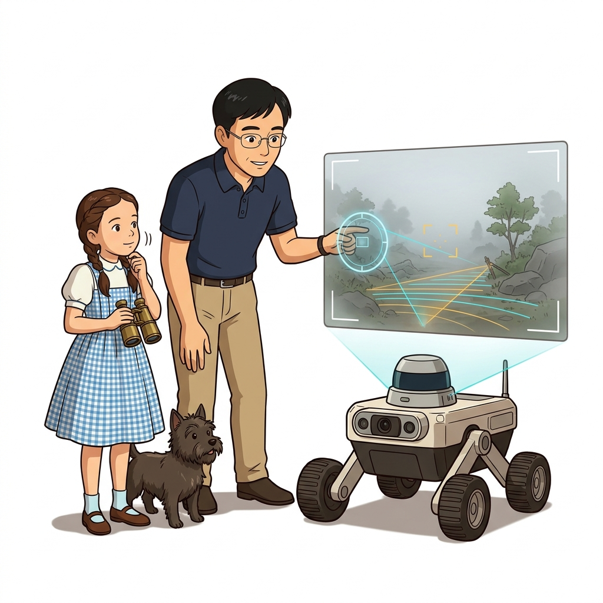
**그림 12-1-19** 안개 낀 미지의 세계에서 카메라와 라이다(LiDAR) 센서 뷰파인더로 감지된 국소 정보(Observation)에 의존해 주행하는 탐사 로봇과 관찰 용어의 필연성

> **[강의 스크립트]**
> 이제 십이점일점삼의 마지막 이론 파트인 상태와 관찰의 본질적 차이를 명확히 정리하겠습니다. 영어로 스테이트와 옵저베이션으로 불리는 이 두 개념은 강화학습 이론에서 대단히 중요한 개념적 구분을 갖습니다.

---
#### 관찰 공간 규격 (`Box` Space)

Gym API에서도 `env.observation_space`라는 속성 이름을 사용합니다. 

카트폴의 관찰 공간을 출력해보면 다음과 같습니다:

```python
print(env.observation_space)
# Box([-4.8, -inf, -0.418, -inf], [4.8, inf, 0.418, inf], (4,), float32)
```

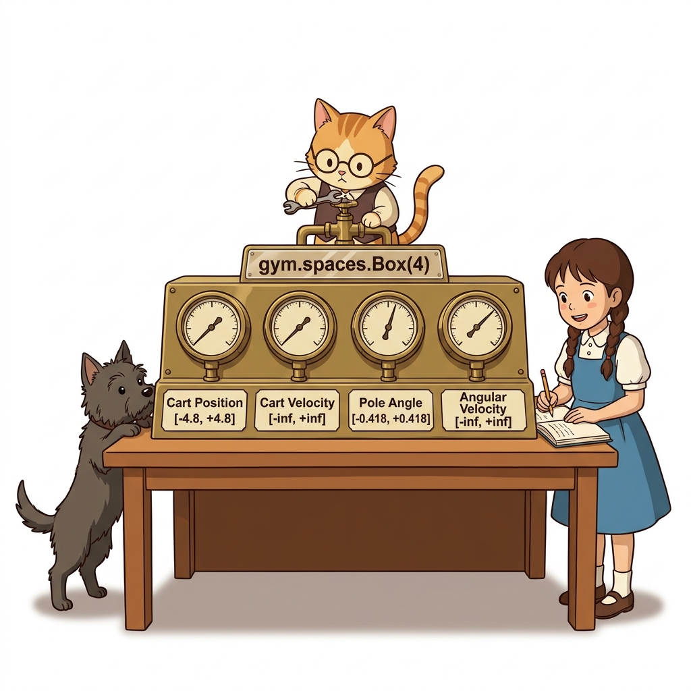
**그림 12-1-20-B** 카트 위치, 속도, 막대 각도, 각속도의 4대 물리축 상하한 압력 게이지 계측판

> **[강의 스크립트]**
> 먼저 환경의 관찰 공간 규격을 출력해 보면 박스 스페이스라는 객체가 나타납니다. 카트의 위치는 마이너스 사점팔부터 플러스 사점팔까지, 막대의 각도는 마이너스 영점사일팔부터 플러스 영점사일팔까지의 연속적인 실수 범위를 가지며, 속도 변수들은 이론상 무한대의 범위를 가질 수 있습니다.

---
`gym.spaces.Box` 클래스는 연속적인 다차원 실수 유클리드 공간을 표현하며, 각 축마다 최솟값(하한)과 최댓값(상한) 경계를 엄밀하게 정의하고 있습니다.

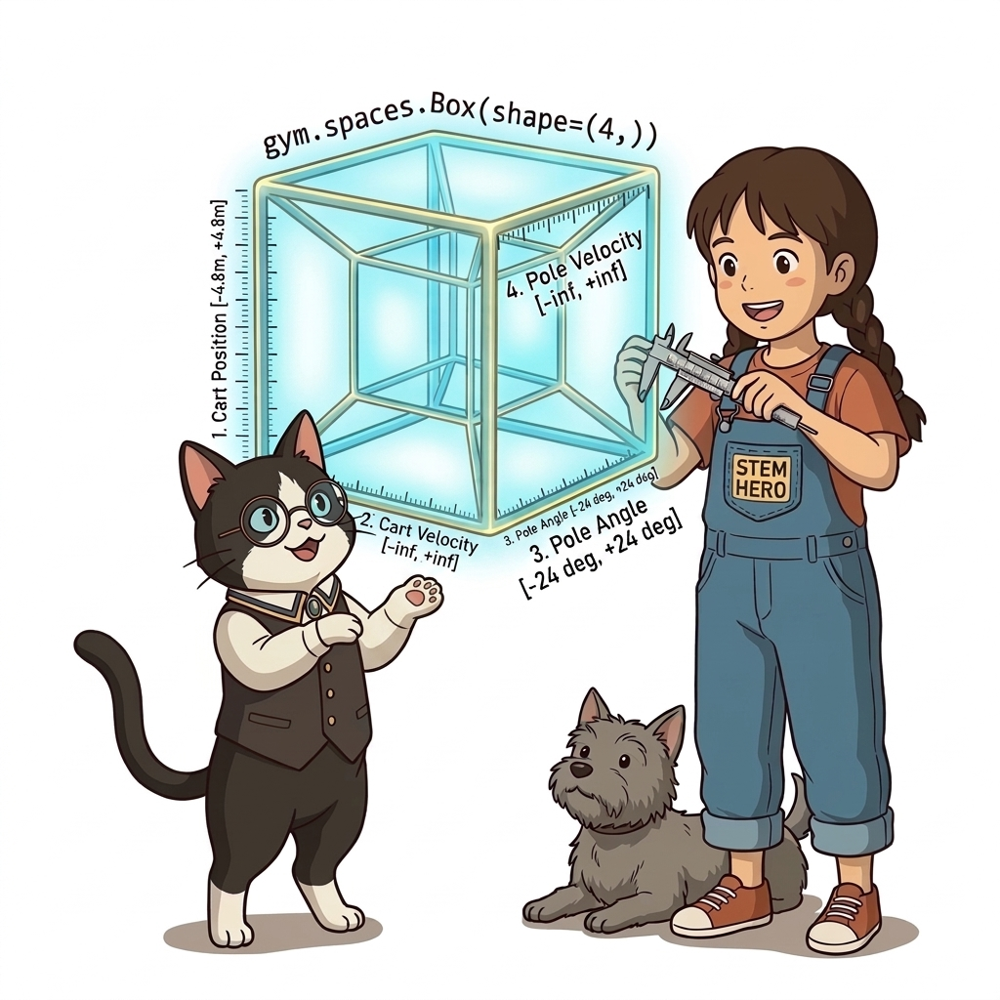
**그림 12-1-20** 4개 물리축(위치, 속도, 각도, 각속도)의 하한과 상한 경계 범위를 정밀 계측하는 `gym.spaces.Box(shape=(4,))` 4차원 하이퍼큐브 스펙

> **[강의 스크립트]**
> 짐네지엄의 박스 클래스는 이처럼 연속적인 다차원 실수 유클리드 공간을 표현하는 표준 자료구조입니다. 이산적인 정수 번호가 아니라 무한히 쪼개질 수 있는 아날로그 물리 실수값들이 입력으로 들어온다는 뜻입니다.

---
#### 상태(State): 환경의 완전한 정보와 마르코프 성질

**상태(State, $S_t$)**는 환경의 내부 메커니즘을 결정짓는 **'완전한 정보(Complete Information)'**를 뜻합니다.

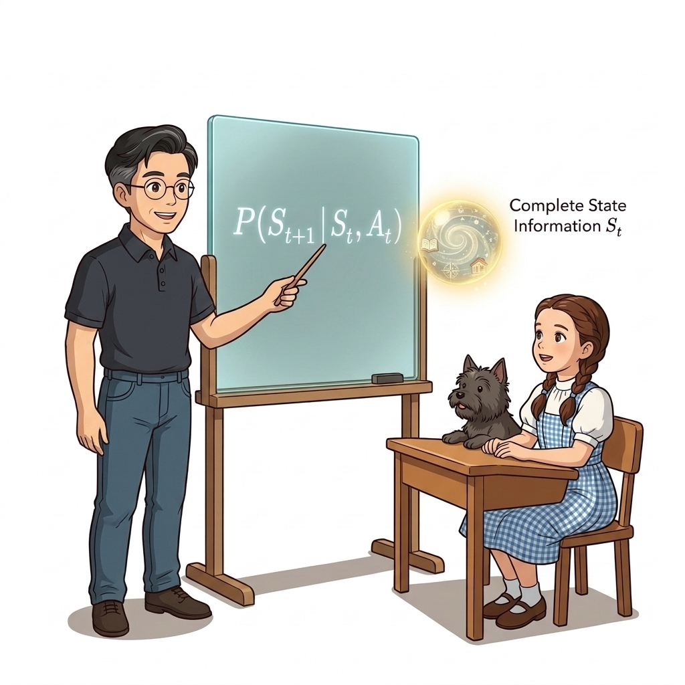
**그림 12-1-21-B** 마르코프 성질 수식과 과거 이력 없이 현재 상태만으로 미래 확률이 완벽히 결정되는 지식의 구체

> **[강의 스크립트]**
> 상태란 환경의 모든 물리적 세부 사항이 단 하나도 빠짐없이 완벽하게 포함된 총체적 정보를 의미합니다. 상태는 과거의 모든 이력 정보를 내포하고 있으므로, 현재 상태와 에이전트의 행동만 알면 미래를 완전히 기술할 수 있는 마르코프 성질을 만족합니다.

---
상태는 과거의 모든 이력 정보를 내포하고 있으므로, 현재 상태 $S_t$와 에이전트의 행동 $A_t$만 주어지면 미래 상태 $S_{t+1}$의 확률 분포가 과거와 완전히 독립적으로 결정되는 **마르코프 성질(Markov Property)**을 완벽하게 만족합니다:

$$\mathbb{P}(S_{t+1} \mid S_t, A_t, S_{t-1}, A_{t-1}, \dots, S_0, A_0) = \mathbb{P}(S_{t+1} \mid S_t, A_t)$$

> **[강의 스크립트]**
> 즉 마르코프 성질 하에서는 어제 무슨 일이 있었는지, 방금 전 스텝에서 카트가 어디에 있었는지를 알 필요가 없습니다. 오직 현재 상태 하나만으로 미래의 모든 확률 분포가 온전히 결정되기 때문입니다.

---
모든 기물의 위치가 100% 투명하게 드러나 있는 체스판이나 바둑판이 완전 관측 상태의 대표적인 예시입니다.

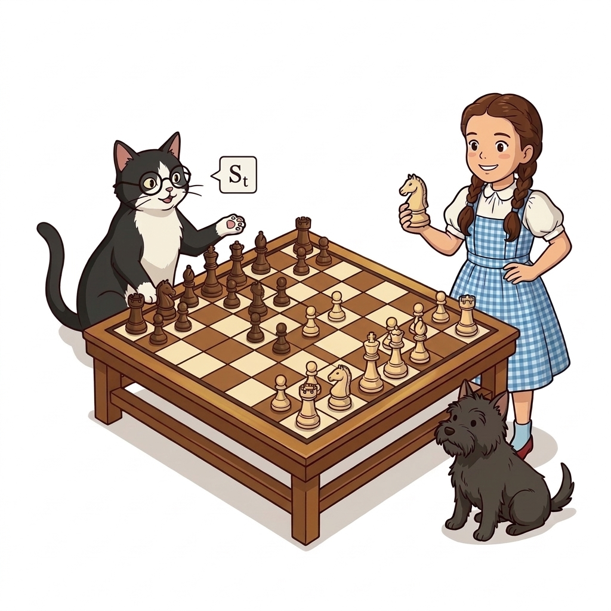
**그림 12-1-21** 모든 기물의 배치가 100% 투명하게 드러나 과거 이력 없이 현재 배치($S_t$)만으로 미래 전이 확률이 완벽히 결정되는 마르코프 결정 과정(MDP)의 체스판

> **[강의 스크립트]**
> 우리가 일상에서 접하는 체스나 바둑이 바로 완전 관측 상태의 대표적인 예입니다. 판 위에 놓인 모든 기물과 돌의 위치가 두 대국자에게 백 퍼센트 투명하게 공개되어 있으므로, 숨겨진 비밀 정보가 전혀 존재하지 않는 완전한 상태를 바라보며 게임을 진행하게 됩니다.

---
#### 관찰(Observation): 부분 관측 환경(POMDP)에서의 센서 정보

반면, **관찰(Observation, $O_t$)**은 환경의 전체 내부 상태 중 에이전트의 센서나 시야를 통해 포착된 **'부분적인 정보(Partial Information)'**입니다.


**그림 12-1-22-B** 안갯속에서 센서에 포착된 국소적 관찰값(Observation)만으로 불확실한 세계를 항해하는 부분 관측(POMDP) 시스템

> **[강의 스크립트]**
> 반면 관찰이란 환경의 전체 상태 중에서 센서의 한계나 장애물에 의해 에이전트에게 부분적으로만 전달되는 제한된 정보를 의미합니다. 이러한 환경을 부분 관측 마르코프 결정 과정, 줄여서 피오엠디피라고 부릅니다.

---
포커나 블랙잭처럼 상대방의 손패와 덱에 남은 카드를 알 수 없는 게임, 또는 안개 낀 도로에서 전방 카메라 한 장에만 의존해 달리는 자율주행 차량처럼, 실세계의 수많은 문제는 **부분 관측 마르코프 결정 과정(POMDP, Partially Observable MDP)**에 속합니다. 이때 에이전트가 받는 데이터는 상태가 아니라 관찰입니다.


**그림 12-1-22** 상대방의 패와 덱에 남은 카드가 물음표(?)로 뒤집혀 있어 내 손패(일부 센서 관찰값)만으로 불확실성을 추론해야 하는 부분 관측 환경(POMDP)

> **[강의 스크립트]**
> 포커나 블랙잭처럼 상대방의 손패와 덱 속에 숨겨진 카드를 알 수 없는 게임, 또는 안개가 짙게 낀 도로에서 카메라에 앞차의 뒷모습만 간신히 잡히는 자율주행 상황이 부분 관측 환경의 전형입니다. 이때는 단일 관찰만으로 마르코프 성질이 성립하지 않으므로 과거의 관찰들을 누적하여 기억해야만 합니다.

---
#### 카트폴 환경에서의 상태-관찰 동일성 ($O_t = S_t$)

OpenAI Gym은 현실의 POMDP 문제까지 포괄할 수 있도록 범용적인 용어인 **'Observation'**을 API 표준으로 채택했습니다.


**그림 12-1-23-B** 카트폴은 모든 물리 변수가 100% 오차 없이 측정되는 완전 관측 환경이므로 관찰과 상태가 일치함을 확인하는 크리스탈 모형

> **[강의 스크립트]**
> 하지만 매우 다행스럽게도 우리가 지금 다루고 있는 카트폴 환경은 카트와 막대의 위치 및 속도라는 네 가지 핵심 물리 변수가 시뮬레이터 내부에서 단 하나의 누락도 없이 에이전트에게 백 퍼센트 온전히 제공됩니다. 즉 관찰 오 티와 상태 에스 티가 수학적으로 완전히 일치하는 완전 관측 환경인 것입니다.

---
하지만 우리가 다루는 **카트폴(CartPole) 환경**은 카트의 위치, 속도, 막대의 각도, 각속도라는 동역학계의 모든 자유도 변수가 센서 오차 없이 에이전트에게 100% 고스란히 전달되는 **완전 관측 환경(Fully Observable Environment)**입니다. 즉, 관찰과 상태가 완전히 일치합니다:

$$O_t \equiv S_t$$

> **[강의 스크립트]**
> 따라서 카트폴에서는 과거의 기록을 기억하기 위한 순환 신경망이나 복잡한 메모리 버퍼를 둘 필요가 없습니다. 오직 현재 스텝에서 들어온 사차원 벡터 하나만 신경망에 넣어주면 완벽한 마르코프 결정을 내릴 수 있는 최적의 환경적 조건을 갖추고 있습니다.

---
따라서 본 강의 교재 전반에서는 설명의 직관성과 통일성을 위해 두 용어를 동의어로 취급하고 친숙한 **'상태(State)'**라는 용어를 중심으로 전개해 나갑니다.


**그림 12-1-23** 카트폴은 역학 시뮬레이션의 모든 변수가 측정되는 완전 관측 환경이므로 관찰과 상태가 일치(`Observation = State`)함을 확인하고 본격적인 DQN 탐험으로 나아가는 도로시와 지니

> **[강의 스크립트]**
> 이러한 이유로 본 강의 교재 전반에서는 설명의 직관성과 통일성을 유지하기 위해 상태와 관찰이라는 두 용어를 엄밀히 구분하지 않고 동의어로 취급하여 설명할 것입니다. 이로써 오픈에이아이 짐과 카트폴의 모든 기초 준비를 마쳤으며, 다음 십이점이 절에서는 드디어 인공지능 역사상 가장 위대한 딥 큐네트워크의 핵심 기술을 본격적으로 파헤쳐 보겠습니다. 경청해 주셔서 감사합니다.
