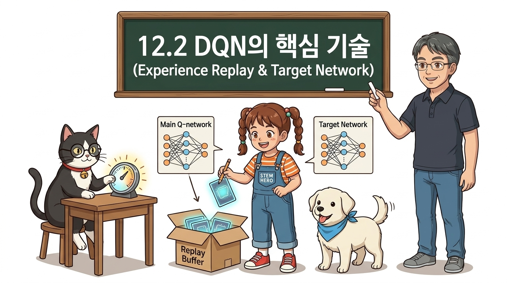
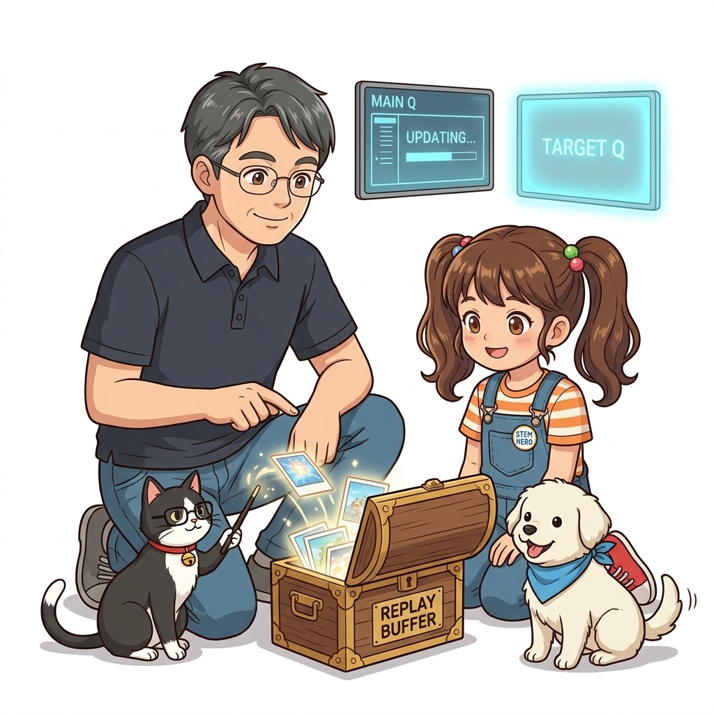
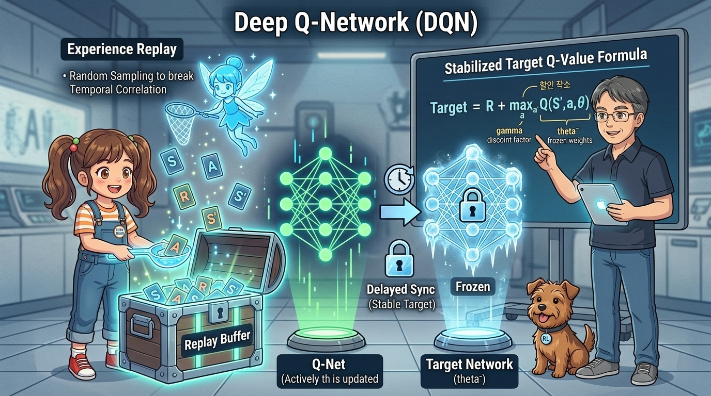
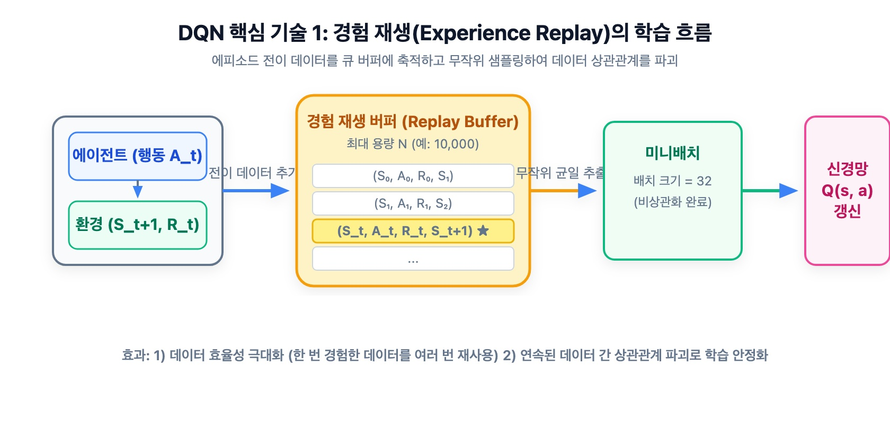
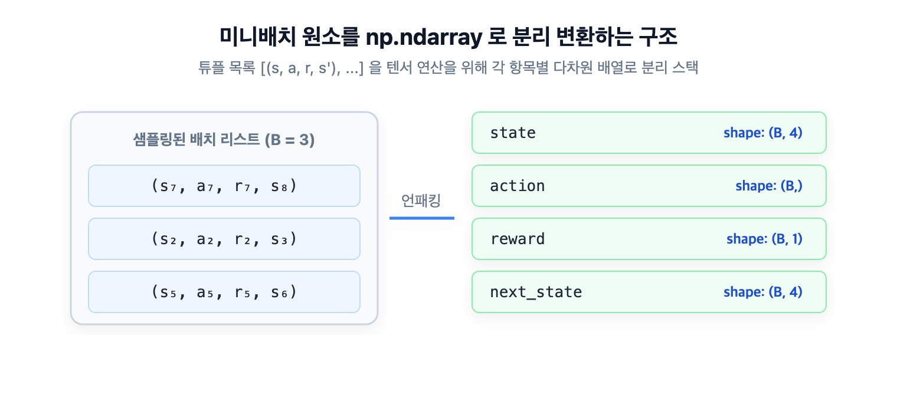
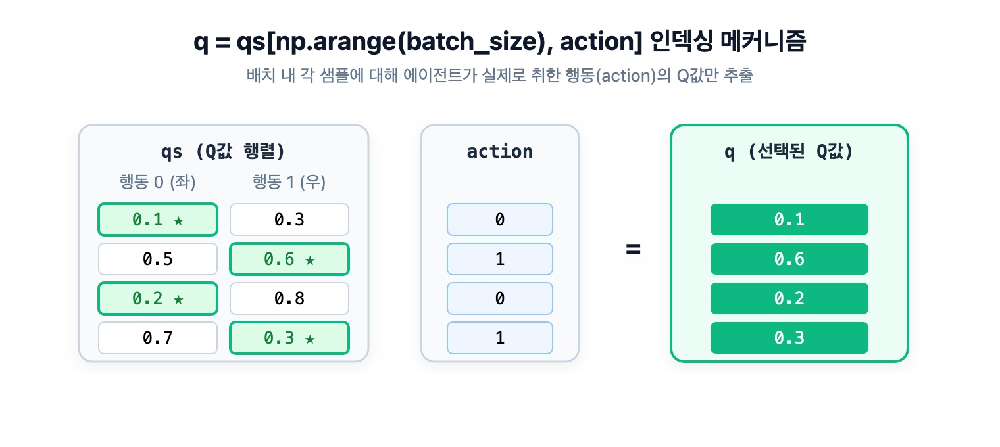
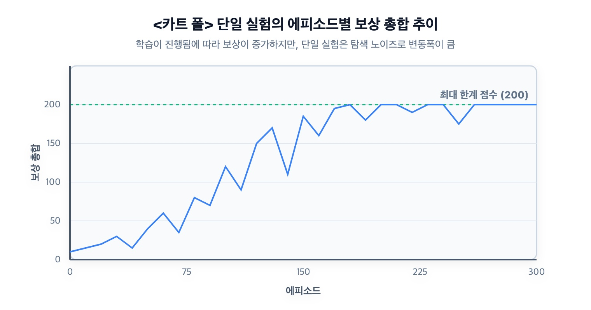
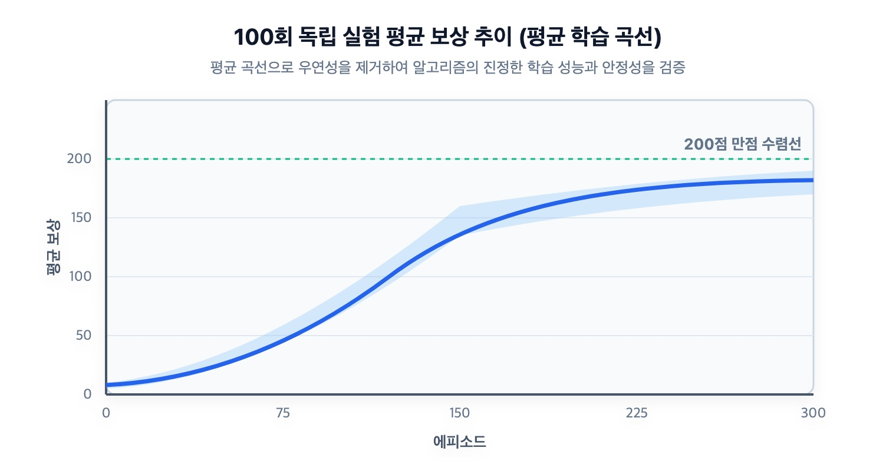

# 12.2 DQN의 2대 핵심 기술: 경험 재생과 목표 신경망




**그림 12-2-1** 과거 경험 카드 상자(Replay Buffer)에서 미니배치 샘플링을 진행하며 타깃 신경망의 학습 방향을 점검하는 지니와 도로시


**그림 12-2-2** 거대한 메모리 상자(Replay Buffer)에서 무작위로 경험 카드들을 국자로 건져 올려 데이터 간 시간적 상관관계를 분쇄하는 도로시와, 얼음 자물쇠로 고정된 목표 신경망(Target Network, *θ*<sup>-</sup>)을 통해 과녁을 고정하는 지니, 그리고 DQN 수렴 원리를 명쾌하게 해설하는 이호진 교수님

신경망과 Q-러닝의 결합을 마침내 성공 궤도에 올려놓은 딥마인드(DeepMind)의 2대 비밀 병기, **경험 재생(Experience Replay)**과 **목표 신경망(Target Network)**을 공부합니다. 딥 강화학습이 발산하지 않고 안정적으로 수렴하도록 만드는 수학적 배경과 `ReplayBuffer`, `DQNAgent` 클래스를 파이썬 코드로 밑바닥부터 구현해 봅시다!

---

## 12.2.1 심층 강화학습이 실패했던 이유와 '치명적인 삼총사'

2013년 딥마인드가 DQN을 발표하기 전까지, 인공신경망을 강화학습에 접목하려는 수많은 시도는 번번이 **학습 발산과 실패**로 끝났습니다. 

강화학습의 거장 리처드 서튼(Richard Sutton) 교수는 이를 **'치명적인 삼총사(The Deadly Triad)'**라는 개념으로 설명했습니다:
1. **함수 근사 (Function Approximation)**: 표현력이 너무 뛰어난 신경망을 사용할 때
2. **부트스트랩 (Bootstrapping)**: 추정치로 추정치를 갱신할 때 (TD 학습)
3. **오프-정책 (Off-Policy)**: 데이터 수집 정책과 학습 대상 정책이 다를 때

이 세 가지가 결합하면 신경망 가중치가 무한대로 발산하거나 0으로 붕괴하기 일쑤였습니다. 
딥마인드는 바로 이 치명적인 딜레마를 해결하기 위해 **경험 재생**과 **목표 신경망**이라는 두 가지 천재적인 장치를 도입했습니다.

---

## 12.2.2 핵심 기술 1: 경험 재생 (Experience Replay)

### 1) 지도 학습과 강화학습의 데이터 차이
- **지도 학습 (MNIST 손글씨 등)**:
  수만 장의 사진이 이미 데이터셋에 정적으로 모여 있고, 미니배치를 뽑을 때마다 무작위 셔플링(Random Shuffle)을 거칩니다. 데이터 간에 상관관계가 없는 **독립 동일 분포(i.i.d: independent and identically distributed)**가 성립합니다.
- **기존의 순차적 강화학습**:
  에이전트가 시간 *t*에 상태를 겪고 *t*+1에 즉시 학습하면, 시간적으로 바로 옆에 붙어 있는 경험 데이터 **(*S*<sub>*t*</sub>, *A*<sub>*t*</sub>, *R*<sub>*t*</sub>, *S*<sub>*t*+1</sub>)**와 **(*S*<sub>*t*+1</sub>, *A*<sub>*t*+1</sub>, *R*<sub>*t*+1</sub>, *S*<sub>*t*+2</sub>)** 사이에는 **지나치게 강한 시간적 상관관계(Autocorrelation)**가 존재합니다!
  이로 인해 신경망이 특정 상태에 극단적으로 편향(과적합)되어 전체적인 균형을 잃고 무너집니다.

---

### 2) 경험 재생의 해결책: 거대한 시간 버퍼와 무작위 샘플링


**그림 12-2-3** 경험 재생을 이용한 학습 흐름. 에이전트의 1-스텝 경험을 버퍼에 차곡차곡 모은 뒤, 과거와 현재가 뒤섞인 무작위 미니배치를 추출하여 신경망을 학습시킵니다.

1. **상관관계 분쇄**:
   버퍼에서 무작위로 샘플링하면 100보 전에 겪었던 경험과 방금 전 겪은 경험이 한 배치에 뒤섞이므로 시간적 상관관계가 완전히 제거되어 **지도 학습과 동일한 i.i.d 환경**이 조성됩니다.
2. **비약적인 데이터 효율성**:
   한 번 쓰고 버리던 경험 데이터를 버퍼에 간직하며 수십 번씩 재사용(Replay)하므로 적은 에피소드로도 고효율 학습이 가능합니다.

---

### 3) `ReplayBuffer` 클래스 구현

선입선출(FIFO) 방식으로 오래된 경험을 밀어내고 최신 경험을 유지하기 위해 `collections.deque`를 사용합니다:

<div align="right"><b>ch08/replay_buffer.py</b></div>

```python
from collections import deque
import random
import numpy as np

class ReplayBuffer:
    def __init__(self, buffer_size, batch_size):
        self.buffer = deque(maxlen=buffer_size) # 최대 크기 초과 시 오래된 데이터 자동 삭제
        self.batch_size = batch_size

    def add(self, state, action, reward, next_state, done):
        data = (state, action, reward, next_state, done)
        self.buffer.append(data)

    def __len__(self):
        return len(self.buffer)

    def get_batch(self):
        # ❶ 버퍼에서 batch_size(예: 32개)만큼 무작위 비복원 추출!
        data = random.sample(self.buffer, self.batch_size)

        # ❷ 넘파이 다차원 배열(배치 텐서)로 변환
        state = np.stack([x[0] for x in data])                   # 형상: (32, 4)
        action = np.array([x[1] for x in data])                  # 형상: (32,)
        reward = np.array([x[2] for x in data])                  # 형상: (32,)
        next_state = np.stack([x[3] for x in data])              # 형상: (32, 4)
        done = np.array([x[4] for x in data]).astype(np.int32)   # 형상: (32,)
        return state, action, reward, next_state, done
```


**그림 12-2-4** 리스트에 담긴 개별 경험 튜플들을 `np.stack`을 통해 배치 행렬 형태로 패킹하는 과정

---

## 12.2.3 핵심 기술 2: 목표 신경망 (Target Network)

### 1) 움직이는 과녁 문제 (Moving Target Problem)
지도 학습에서는 사진의 정답 레이블(예: 숫자 7)이 학습 도중 절대로 바뀌지 않습니다. 

하지만 Q-러닝의 TD 목표 수식을 다시 살펴봅시다:

> ### ***T* = *R*<sub>*t*</sub> + *γ* max<sub>*a*</sub> *Q*(*S*<sub>*t*+1</sub>, *a*; *θ*)**

- 가중치 *θ*를 갱신할 때마다, 정답이어야 할 목표값 *T*마저 동일한 가중치 *θ*에 의해 매 순간 함께 움직여 버립니다!
- 과녁판이 이리저리 도망치며 춤을 추는 상황에서 화살을 쏘는 것과 같아서, 학습이 수렴하지 못하고 소용돌이치며 튕겨져 나갑니다.

---

### 2) 목표 신경망의 해결책: 과녁을 얼려두는 복제본 (*θ*<sup>-</sup>)

DQN은 구조가 똑같은 신경망을 **두 벌** 운용합니다:
1. **행동 신경망 (Main Q-Net, 가중치 *θ*)**: 매 스텝마다 오차역전파로 실시간 학습을 진행하는 주력 네트워크입니다.
2. **목표 신경망 (Target Q-Net, 가중치 *θ*<sup>-</sup>)**: 오직 정답 레이블(TD 타깃)을 계산하는 데만 쓰이며, 평상시에는 가중치를 단단히 얼려둡니다(Freeze).

> ### ***T* = *R*<sub>*t*</sub> + *γ* max<sub>*a*</sub> *Q*(*S*<sub>*t*+1</sub>, *a*; *θ*<sup>-</sup>)** &nbsp;&nbsp;&nbsp;&nbsp; *(식 12.1: 목표 신경망 기반 TD 타깃)*
> 
> ### ***L* = (1 / *B*) · ∑ [*T* - *Q*(*S*<sub>*t*</sub>, *A*<sub>*t*</sub>; *θ*)]<sup>2</sup>** &nbsp;&nbsp;&nbsp;&nbsp; *(식 12.2: DQN의 MSE 손실 함수)*

그리고 일정한 주기(예: 20 에피소드마다)가 되었을 때만, 메인 신경망의 가중치를 목표 신경망으로 복사(`copy.deepcopy`)하여 과녁판의 위치를 한 번씩 동기화해 줍니다. 
이로써 정답 레이블이 안정적으로 고정되어 신경망이 차분하게 수렴할 수 있게 됩니다!

---

## 12.2.4 DQN 에이전트 클래스: `DQNAgent`

두 핵심 기술을 모두 탑재한 완성형 `DQNAgent`를 작성해 봅시다.

<div align="right"><b>ch08/dqn.py</b></div>

```python
import copy
import numpy as np
from dezero import Model, optimizers
import dezero.functions as F
import dezero.layers as L

# 1. CartPole용 3층 MLP 신경망 (입력: 4차원 상태 -> 은닉 128 -> 은닉 128 -> 출력: 2개 행동 Q값)
class QNet(Model):
    def __init__(self, action_size):
        super().__init__()
        self.l1 = L.Linear(128)
        self.l2 = L.Linear(128)
        self.l3 = L.Linear(action_size)

    def forward(self, x):
        x = F.relu(self.l1(x))
        x = F.relu(self.l2(x))
        x = self.l3(x)
        return x

# 2. DQN 에이전트
class DQNAgent:
    def __init__(self):
        self.gamma = 0.98               # 할인율
        self.lr = 0.0005                # 학습률
        self.epsilon = 0.1              # 탐험 확률
        self.buffer_size = 10000        # 경험 버퍼 용량
        self.batch_size = 32            # 미니배치 크기
        self.action_size = 2            # 행동 가짓수 (좌, 우)

        self.replay_buffer = ReplayBuffer(self.buffer_size, self.batch_size)
        self.qnet = QNet(self.action_size)        # ❶ 메인 행동 신경망 (학습 대상)
        self.qnet_target = QNet(self.action_size) # ❷ 타깃 신경망 (얼려둔 과녁)
        self.optimizer = optimizers.Adam(self.lr)
        self.optimizer.setup(self.qnet)           # 옵티마이저에는 메인 qnet만 등록!

    def sync_qnet(self):
        # ❸ 주기적 동기화: 메인 망의 가중치를 타깃 망으로 완전 복제(deepcopy)
        self.qnet_target = copy.deepcopy(self.qnet)

    def get_action(self, state):
        if np.random.rand() < self.epsilon:
            return np.random.choice(self.action_size)
        else:
            state = state[np.newaxis, :] # 배치 차원 추가: (1, 4)
            qs = self.qnet(state)
            return qs.data.argmax()

    def update(self, state, action, reward, next_state, done):
        # ❹ 경험 추가
        self.replay_buffer.add(state, action, reward, next_state, done)
        if len(self.replay_buffer) < self.batch_size:
            return # 최소 배치 크기(32개)가 쌓일 때까지 대기

        # ❺ 무작위 미니배치 샘플링 (i.i.d 충족)
        state, action, reward, next_state, done = self.replay_buffer.get_batch()

        # ❻ 현재 상태에서의 예측 Q값 (32개 데이터에서 에이전트가 취했던 행동만 인덱싱)
        qs = self.qnet(state)                      # 형상: (32, 2)
        q = qs[np.arange(self.batch_size), action] # 형상: (32,)

        # ❼ 타깃 신경망으로 안정된 다음 상태 Q 최댓값 계산
        next_qs = self.qnet_target(next_state)
        next_q = next_qs.max(axis=1)
        next_q.unchain() # 기울기 누수 차단!

        # ❽ 종단 마스킹과 MSE 손실 계산
        target = reward + (1 - done) * self.gamma * next_q
        loss = F.mean_squared_error(q, target)

        # ❾ 메인 신경망 가중치 갱신
        self.qnet.cleargrads()
        loss.backward()
        self.optimizer.update()
```


**그림 12-2-5** `qs[np.arange(batch_size), action]` 인덱싱 동작. 32행 2열의 예측 Q 행렬에서 각 샘플이 실제로 취했던 행동 번호의 Q값만 한 줄로 쏙 뽑아냅니다.

---

## 12.2.5 CartPole 환경 훈련 및 성능 검증

이제 CartPole-v0 환경에서 DQN 에이전트를 300 에피소드 동안 학습시켜 봅시다!

<div align="right"><b>ch08/dqn.py</b></div>

```python
import gym

env = gym.make('CartPole-v0', render_mode='rgb_array')
agent = DQNAgent()

episodes = 300
sync_interval = 20 # 20번째 에피소드마다 타깃 신경망 동기화!
reward_history = []

for episode in range(episodes):
    state, info = env.reset()
    done = False
    total_reward = 0

    while not done:
        action = agent.get_action(state)
        next_state, reward, terminated, truncated, info = env.step(action)
        done = terminated or truncated

        agent.update(state, action, reward, next_state, done)
        state = next_state
        total_reward += reward

    # 주기적으로 타깃 신경망 동기화
    if episode % sync_interval == 0:
        agent.sync_qnet()

    reward_history.append(total_reward)
    if episode % 50 == 0:
        print(f"에피소드 {episode:03d} | 총 보상(버틴 스텝): {total_reward}")
```


**그림 12-2-6** 1회 실험에서의 에피소드별 보상 추이. 초기 10~20스텝에서 시작하여 100~200스텝으로 눈부시게 향상됩니다.


**그림 12-2-7** 100회 독립 실험을 수행하여 통계적으로 평균한 학습 곡선. 50에피소드 전후로 급격한 학습 곡선을 그리며 높은 점수에 안정적으로 안착합니다.

### 학습 완료된 에이전트의 테스트 주행
탐험 확률을 0으로 끄고(`agent.epsilon = 0`) 순수 탐욕 정책으로 렌더링 주행을 시켜보면:
```python
agent.epsilon = 0 # 100% 최적 탐욕 행동
state, info = env.reset()
done = False
total_reward = 0

while not done:
    action = agent.get_action(state)
    next_state, reward, terminated, truncated, info = env.step(action)
    done = terminated or truncated
    state = next_state
    total_reward += reward

print("최종 달성 보상:", total_reward) # 200 만점 달성!
```

랜덤 에이전트가 10~20스텝 만에 쓰러뜨리던 막대를, **DQN 에이전트는 미동도 없이 꼿꼿하게 세운 채 200스텝 만점을 완벽하게 달성**합니다!

다음 12.3절에서는 이 DQN이 단순한 역학 제어를 넘어, 컴퓨터 화면 픽셀만을 보고 고전 비디오게임을 클리어했던 **딥마인드의 아타리(Atari) 혁명**의 비밀을 들여다봅시다!
