# 12.2 DQN의 핵심 기술

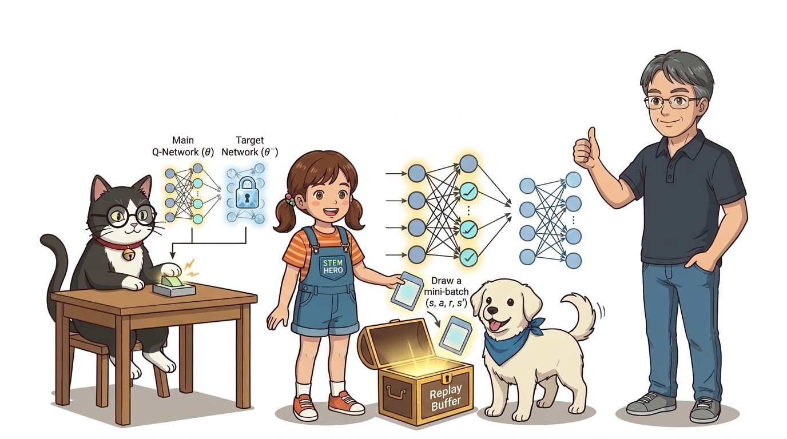

> **[강의 스크립트]**
> 여러분 안녕하십니까. 이번 십이점이 절에서는 딥 강화학습의 역사에서 가장 빛나는 두 개의 기념비적 기둥인 경험 재생과 목표 신경망의 수학적 원리, 텐서 연산 메커니즘, 그리고 완전 자립형 카트폴 딥 큐네트워크 구현을 체계적으로 학습하겠습니다. 딥러닝과 강화학습이 처음 결합했을 때 왜 그토록 처참하게 발산하며 실패했었는지, 그리고 딥마인드가 이 두 가지 비밀병기를 통해 어떻게 그 난제를 돌파해 냈는지를 오늘 완전히 마스터해 보시기 바랍니다.

---
#### Q-러닝의 부트스트래핑(Bootstrapping) 원리

> [!TIP]
> **부트스트래핑을 한마디로 요약하면?**  
> 게임 끝까지 가보지 않고, **"다음 순간(미래)은 이렇게 될 거야"라고 스스로 예측한 뒤, 그 미래 예측값을 디딤돌 삼아 현재의 평가를 개선**하는 방식입니다.

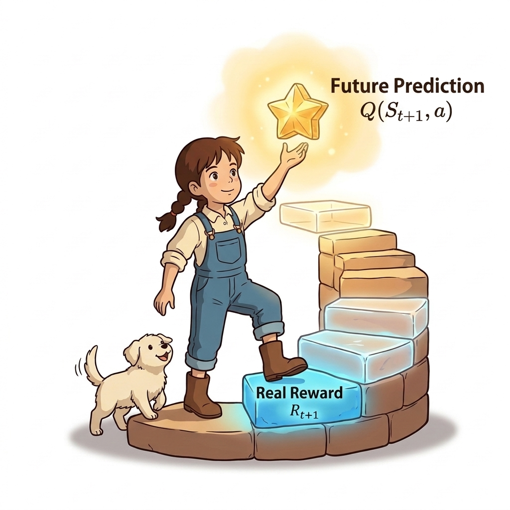
**그림 12-2-01-B** 현재의 현실 경험을 딛고 다음 순간의 미래 예측을 향해 도약하는 Q-러닝 부트스트래핑의 정수

> **[강의 스크립트]**
> 큐러닝 알고리즘의 가장 밑바탕에 흐르는 기본 철학은 바로 부트스트래핑입니다. 부트스트래핑을 한마디로 쉽게 정의하자면, 게임이 완전히 끝날 때까지 기다리지 않고 다음 순간 미래는 대략 이렇게 될 것이라고 스스로 예측한 뒤, 그 예측치를 디딤돌 삼아 현재의 평가를 갱신하는 기법입니다. 완전한 미래의 참값을 모르는 상태에서도 자신의 예측을 나침반 삼아 한 걸음씩 지능을 끌어올리는 매우 영리한 방식입니다.

---
Q-러닝(Q-Learning)은 에피소드가 완전히 끝날 때까지 기다리지 않습니다. 딱 한 걸음만 앞으로 나아간 뒤:

1. **현실 경험 ($R_{t+1}$)**: 방금 행동을 통해 실제로 얻은 즉시 보상
2. **미래 예측 ($\max_a Q(S_{t+1}, a)$)**: "여기서부터 끝까지 가면 대략 이만큼 더 얻을 수 있을 것"이라는 자신의 다음 단계 추정치

이 둘을 합친 값(`현실 보상 + 할인된 미래 예측치`)을 임시 목표(정답)로 삼아, 원래 가지고 있던 현재 상태의 가치 $Q(S_t, A_t)$를 즉시 갱신합니다. 

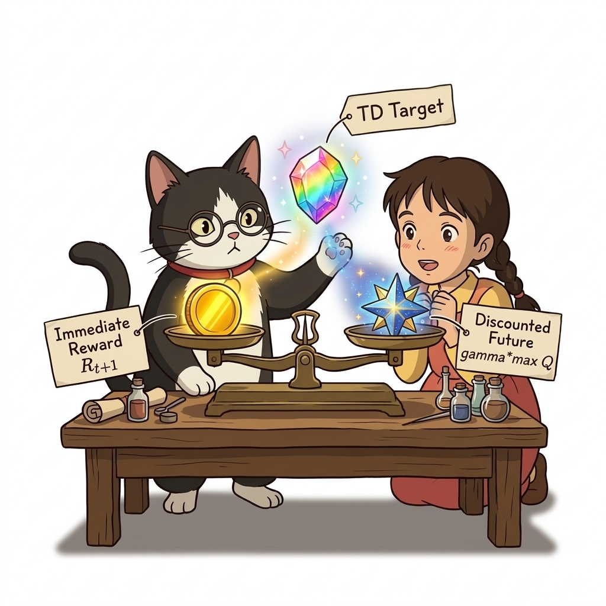
**그림 12-2-01-C** 현실에서 얻은 황금 코인(즉시 보상)과 다음 단계 미래 예측 크리스탈을 정밀 저울에 합성하여 임시 목표(TD Target)를 생성하는 지니와 도로시

> **[강의 스크립트]**
> 큐러닝의 갱신 과정을 들여다보면 딱 한 걸음만 앞으로 전진합니다. 방금 행동을 통해 실제로 손에 쥔 현실 보상 알 티 더하기 일과, 다음 상태에서 가장 좋을 것이라 추정되는 미래 예측치인 맥스 큐값을 결합합니다. 화면의 저울 그림처럼 현실 경험이라는 금화와 미래 예측 크리스탈을 정밀하게 달아서 임시 목표인 시간차 타깃을 만들고, 이 목표를 향해 현재 상태의 큐값을 즉시 업데이트하는 것입니다.

---
이처럼 **"추정치(미래 예측)를 디딤돌 삼아 또 다른 추정치(현재 평가)를 갱신해 나가는 핵심 메커니즘"**을 강화학습 이론에서 **부트스트래핑(Bootstrapping)**이라고 부릅니다.

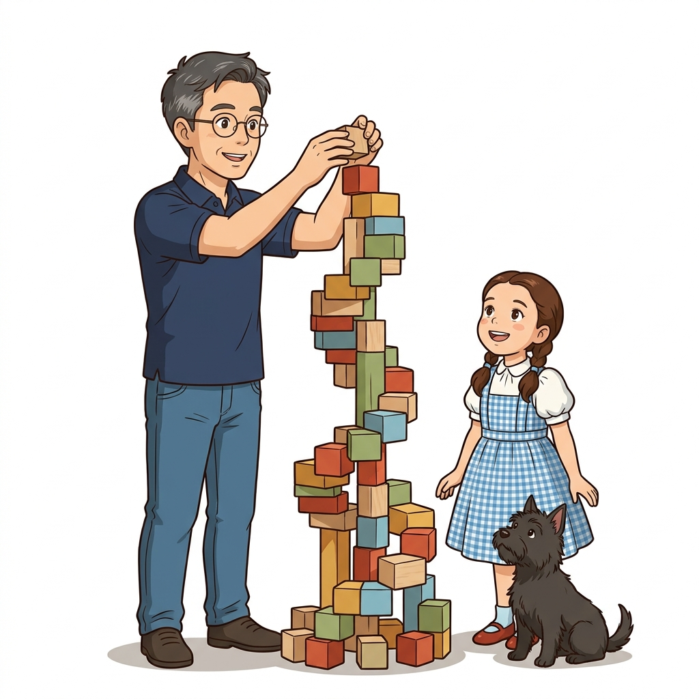
**그림 12-2-01-D** 불완전한 추정치 블록을 디딤돌 삼아 나선형으로 진리를 향해 쌓아 올리는 부트스트래핑 지식의 탑

> **[강의 스크립트]**
> 이처럼 추정치를 디딤돌 삼아 또 다른 추정치를 갱신해 나가는 방식은 지극히 효율적이지만, 동시에 이론적으로 대단히 아슬아슬한 줄타기와도 같습니다. 우리가 디딤돌로 삼고 있는 다음 상태의 큐값 역시 아직 완전한 정답이 아니라 불완전한 신경망이 대충 짐작한 예측치에 불과하기 때문입니다. 추정이 추정을 가르치는 이 순환적 구조가 바로 부트스트래핑의 핵심 동력이자 잠재적 위험의 원천입니다.

---
#### 스스로 장화 끈을 당겨 하늘로 오르다

부트스트랩(Bootstrap)이라는 명칭은 *"진흙탕에 빠졌을 때 외부 도움 없이 자신의 장화 끈(Bootstrap)을 위로 잡아당겨 허공으로 스스로 몸을 띄웠다"*는 서양의 옛 허풍담에서 유래했습니다.


**그림 12-2-01-E** 진흙탕 속에서 자신의 신발 끈(Bootstrap)을 위로 당겨 스스로 허공으로 떠오르는 전설의 부트스트랩 비유

> **[강의 스크립트]**
> 부트스트랩이라는 단어의 유래를 살펴보면 그 철학적 뉘앙스가 더욱 또렷해집니다. 십팔 세기 뮌히하우젠 남작의 모험담에서 늪에 빠진 주인공이 자신의 장화 뒤축 끈을 잡고 스스로를 번쩍 들어 올려 탈출했다는 허풍에서 유래했습니다. 물리학적으로는 자신의 장화 끈을 당겨 하늘로 솟구친다는 것이 불가능한 일이지만, 인공지능의 세계에서는 외부의 절대적인 정답 레이블 없이도 불완전한 자신의 지능을 발판 삼아 스스로 더 높은 지능으로 도약하는 기적을 만들어냅니다.

---
물리적으로는 불가능하지만, 강화학습에서는 **외부의 절대적인 정답 없이도 아직 불완전한 자신의 미래 예측을 디딤돌 삼아 스스로 계단을 쌓으며 참된 가치를 향해 성장해 나가는 놀라운 원리**를 의미합니다:

$$Q(S_t, A_t) \leftarrow Q(S_t, A_t) + \alpha \Big( \underbrace{R_{t+1} + \gamma \max_a Q(S_{t+1}, a)}_{\text{현실 보상 + 다음 단계 미래 예측치 (임시 목표)}} - Q(S_t, A_t) \Big)$$

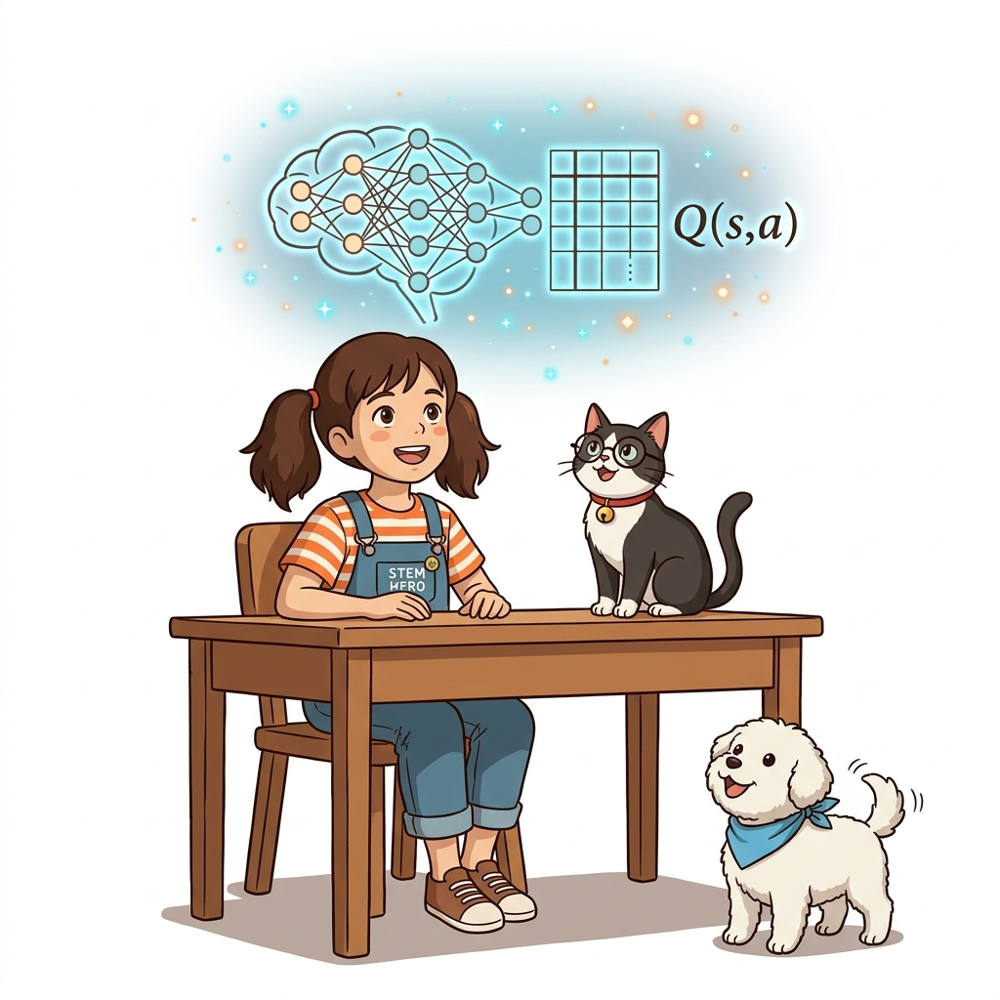
**그림 12-2-01** "미래 예측을 디딤돌 삼아 현재를 개선한다!" 추정치로 추정치를 갱신하는 Q-러닝의 핵심 부트스트래핑 블록 탑을 쌓아 올리는 도로시와 지니

> **[강의 스크립트]**
> 이 신비로운 메커니즘 덕분에 에이전트는 수만 번의 에피소드가 끝나기를 하염없이 기다릴 필요 없이, 매 스텝마다 실시간으로 자신의 가치 함수를 예리하게 다듬어나갈 수 있습니다. 하지만 이 매력적인 부트스트래핑이 딥러닝이라는 거대한 비선형 신경망과 결합하는 순간, 학습이 걷잡을 수 없이 폭주하며 무너져 내리는 치명적인 수학적 함정에 빠지게 됩니다.

---
#### 치명적인 삼총사(Deadly Triad)와 학습 발산의 위기

부트스트래핑은 **테이블 형태**의 고전 강화학습에서는 훌륭하게 수렴하지만, 딥러닝 인공신경망과 결합될 때 극도의 **불안정성**을 드러냅니다. 

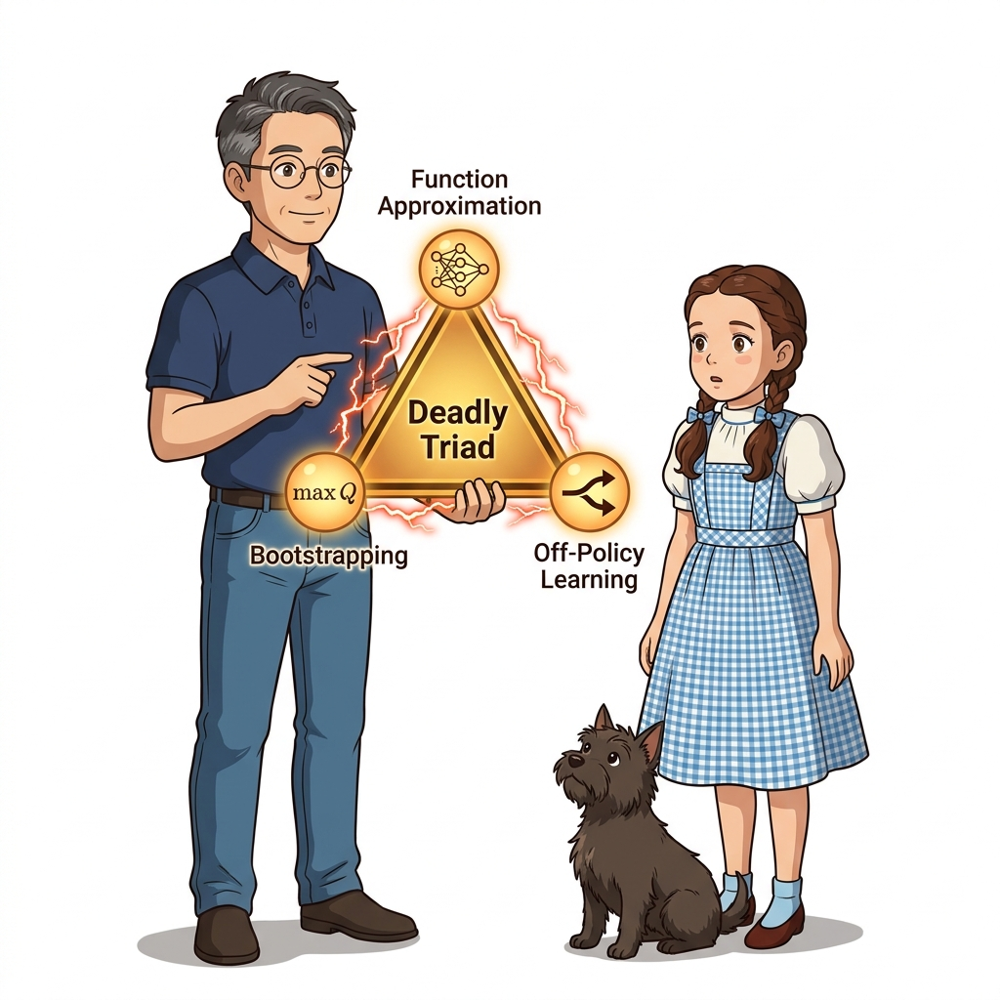
**그림 12-2-02-B** 함수 근사, 부트스트래핑, 오프-정책 학습이 결합될 때 발생하는 치명적인 삼총사(Deadly Triad)와 학습 발산의 위험성을 경고하는 삼각형 엠블럼

> **[강의 스크립트]**
> 강화학습 교과서의 태두인 리처드 서튼 교수는 다음 세 가지 요소가 한자리에 모일 때 시스템이 파멸적으로 발산할 수 있다고 경고했습니다. 이를 강화학습 역사에서 치명적인 삼총사, 즉 데들리 트라이어드라고 부릅니다. 첫째는 무한한 상태를 근사하는 심층 신경망과 같은 비선형 함수 근사기이고, 둘째는 방금 배운 추정치로 추정치를 갱신하는 부트스트래핑이며, 셋째는 과거의 데이터를 재활용하여 학습하는 오프 정책 학습입니다.

---
강화학습의 태두 리처드 서튼(Richard Sutton) 교수는 다음 3가지 요소가 동시에 결합될 때 제어 불가능한 발산이 일어난다고 경고했으며, 이를 **'치명적인 삼총사(Deadly Triad)'**라고 명명했습니다:

1. **함수 근사 (Function Approximation)**: 거대한 상태 공간을 처리하기 위해 인공신경망을 가치 함수 모델로 채택
2. **부트스트래핑 (Bootstrapping)**: 타깃 가치 계산에 자신의 미래 추정치 $\max Q$를 사용
3. **오프-정책 학습 (Off-policy Learning)**: 행동을 수집하는 정책(Behavior Policy)과 학습 대상 목표 정책(Target Policy)의 분리

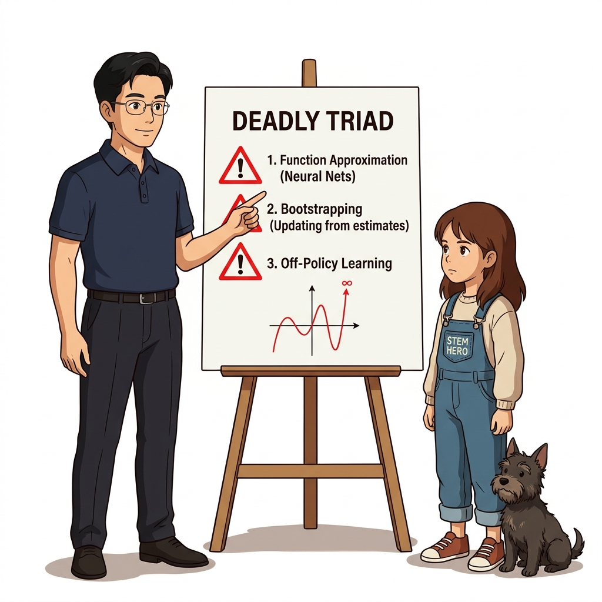
**그림 12-2-02** 리처드 서튼 교수가 경고한 치명적인 삼총사(Deadly Triad)와 제어 불가능한 발산 곡선을 경고하는 교수님

> **[강의 스크립트]**
> 전통적인 테이블 기반 큐러닝에서는 이 세 가지가 한꺼번에 충돌하지 않았기 때문에 안정적인 수렴이 증명되었습니다. 하지만 복잡한 실세계 문제를 풀기 위해 딥러닝 심층 신경망을 도입하는 순간, 이 세 악마가 동시에 결합하면서 가치 추정치가 무한대로 폭증하거나 영으로 붕괴해 버리는 학습 발산의 늪에 빠지게 된 것입니다.

---
#### 신경망 과대적합(Overfitting)의 위험성

인공신경망은 비선형 함수를 무한히 근사할 수 있는 강력한 표현력을 가지고 있지만, 이는 양날의 검입니다. 


학습 환경에서 마주친 국소적인 상태-행동 데이터에 지나치게 특화되어 잡음까지 통째로 외워버리는 현상을 **과대적합(Overfitting)**이라고 부릅니다.


 과적합된 신경망은 한 번도 경험해보지 못한 미지의 상태에 도달했을 때 엉뚱하게 왜곡된 Q-값을 출력하여 시스템 전체를 망치게 됩니다.

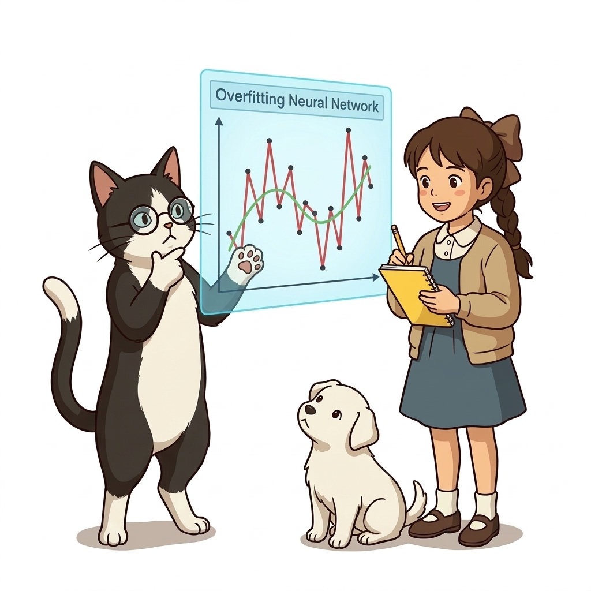
**그림 12-2-03** 훈련 데이터 잡음까지 과적합되어 미지의 상태에서 엉뚱한 행동을 유발하는 과대적합 롤러코스터 곡선

> **[강의 스크립트]**
> 또한 심층 신경망은 직전의 몇몇 경험에 극단적으로 과대적합되는 성향을 가지고 있습니다. 연속적으로 들어오는 데이터들을 곧이곧대로 경사하강법에 밀어 넣으면 신경망의 파라미터가 롤러코스터를 타듯 진동하게 됩니다. 결국 에이전트는 방금 겪은 몇 번의 경험에만 집착하여 과거의 지혜를 모두 까먹어버리는 파국적 망각 상태에 도달하게 됩니다.

---
#### DQN의 2대 구원투수: 경험 재생과 목표 신경망

**DQN(Deep Q-Network)**은 Q-러닝과 딥러닝 신경망을 결합하면서 발생하는 치명적인 **발산 문제**를 해결하기 위해, 인공지능 역사상 가장 위대한 2가지 혁신 기술을 도입했습니다:

1. **경험 재생 (Experience Replay)**: 에이전트의 **연속 궤적 데이터를 버퍼에 저장**한 후 무작위로 추출하여 **데이터 간 시간적 상관관계(Correlation)를 완벽히 파괴**
2. **목표 신경망 (Target Network)**: 정답 레이블 역할을 하는 **TD 목표**를 계산할 때 **가중치가 고정**된 별도의 신경망을 사용하여 **과녁이 도망가는 현상(Moving Target)을 차단**

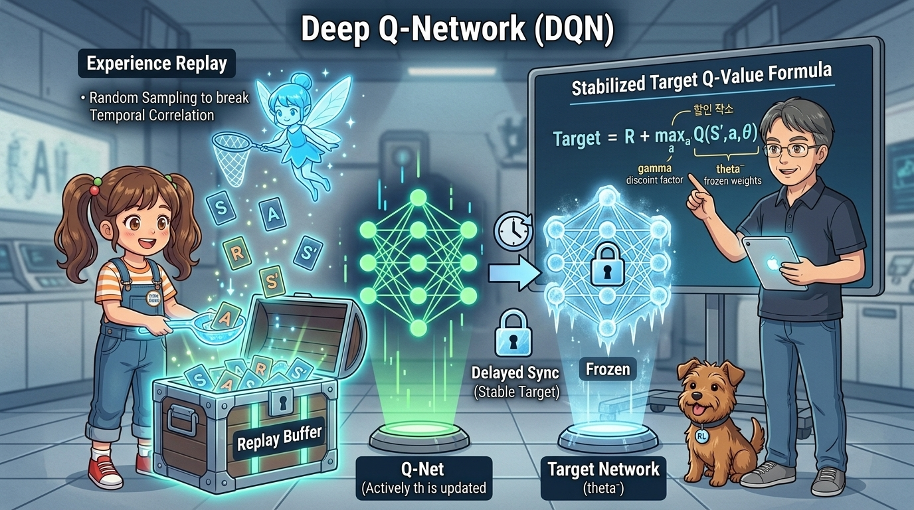
**그림 12-2-04** 발산의 늪에서 딥 강화학습을 구해낸 2대 비밀병기: 경험 재생 버퍼와 목표 신경망의 조화로운 아키텍처

> **[강의 스크립트]**
> 딥마인드는 이 절망적인 발산의 늪에서 심층 강화학습을 구해내기 위해 두 명의 특급 구원투수를 등판시켰습니다. 첫 번째 구원투수는 연속된 경험 캡슐을 거대한 수조에 저장해 두었다가 무작위로 추출하여 시간적 상관관계를 완벽히 파괴하는 경험 재생입니다. 두 번째 구원투수는 학습 목표가 되는 과녁을 얼음 자물쇠로 꽁꽁 얼려두어 목표치의 흔들림을 차단하는 목표 신경망입니다. 이 두 비밀병기의 조화가 마침내 안정적인 심층 큐네트워크를 탄생시켰습니다.

---
#### 12.2절 DQN 핵심 기술 탐험 로드맵

DQN은 이 두 가지 기둥을 바탕으로 2013년과 2015년 아타리 비디오 게임을 인간 이상의 실력으로 제어하는 쾌거를 달성했습니다.

이번 12.2절에서는 경험 재생과 목표 신경망의 수학적/물리적 원리를 심층 분석하고, 카트폴 환경에서 200스텝 완주를 달성하는 완전 자립형 DQN 에이전트를 단계별로 구현해 보겠습니다.


**그림 12-2-05** 경험 재생부터 목표 신경망 구현까지 이어지는 DQN 핵심 기술의 체계적인 학습 대장정

> **[강의 스크립트]**
> 화면의 로드맵을 보십시오. 우리는 먼저 경험 재생의 원리와 메모리 버퍼 구현체를 살펴보고, 이어서 목표 신경망의 동결 메커니즘과 파이토치 및 넘파이 텐서 연산을 정밀하게 검증할 것입니다. 마지막 삼단계에서는 이 두 기술을 결합하여 이백오십 에피소드 만에 카트폴을 완벽하게 정복하는 풀 스케일 디큐엔을 완성하게 됩니다.

---
### 12.2.1 경험 재생 (Experience Replay)

#### 2013년 이전 심층 강화학습의 암흑기

컴퓨터 비전과 자연어 처리 분야에서는 딥러닝을 적용한 '지도 학습(Supervised Learning)'이 2010년대 초반부터 눈부신 성과를 거두었습니다. 

하지만 2013년 DeepMind의 DQN 논문이 발표되기 전까지, 복잡한 인공신경망을 강화학습에 성공적으로 결합한 사례는 1990년대의 단순한 백개먼(주사위 놀이) 제어기가 유일했습니다. 수많은 연구진이 강화학습에 신경망을 도입하려 시도했으나 번번이 가중치 폭증과 발산으로 실패를 거듭했습니다.


**그림 12-2-06** 지도학습의 성공과 대조적으로 신경망 적용 실패가 거듭되던 2013년 이전 인공지능 연구 현장

> **[강의 스크립트]**
> 이제 십이점이지점일의 경험 재생 파트로 본격 진입하겠습니다. 이천십삼년 딥마인드의 논문이 발표되기 전까지 딥러닝 연구자들에게 강화학습은 '절대로 학습되지 않는 불가능의 영역'으로 여겨졌습니다. 지도학습에서 그토록 강력하던 합성곱 신경망도 강화학습 환경에만 가져다 놓으면 가중치가 엉망진창으로 터져나갔기 때문입니다.

---
#### Q-러닝에 신경망 적용이 극도로 어려웠던 원인

왜 지도학습에서는 강력하게 작동하던 딥러닝 신경망이 Q-러닝만 만나면 속수무책으로 무너졌을까요? 

그 근본적인 원인은 **"강화학습 환경이 쏟아내는 데이터의 물리적 특성"**이 기존 딥러닝의 대전제를 완전히 파괴하고 있었기 때문입니다.

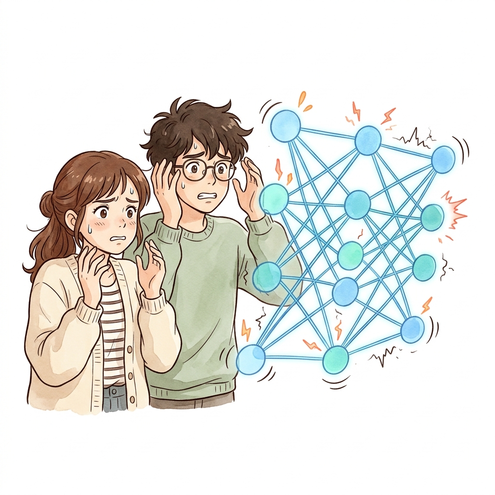
**그림 12-2-07** 데이터의 실시간 변동과 비안정성으로 인해 신경망 가중치가 붕괴하던 근본 원인 분석

> **[강의 스크립트]**
> 그 실패의 근본 원인은 신경망 자체의 문제가 아니라, 신경망에 공급되는 데이터의 성격이 지도학습과 완전히 달랐기 때문입니다. 경사하강법이라는 최적화 엔진은 데이터가 독립 항등 분포, 즉 아이아이디 조건을 만족한다는 절대적인 수학적 가정 위에서 설계되었습니다. 하지만 강화학습의 데이터는 시간에 따라 꼬리에 꼬리를 무는 강한 상관관계를 가진 순차 궤적이었던 것입니다.

---
#### 해법의 실마리: 지도 학습 vs Q-러닝의 결정적 차이

해답의 열쇠는 '지도 학습'과 'Q-러닝'이 데이터를 다루는 방식의 결정적 차이점을 비교 분석하는 데서 찾을 수 있습니다.

| 비교 항목 | 지도 학습 (Supervised Learning) | 고전 Q-러닝 (Q-Learning) |
| :---: | :---: | :---: |
| **데이터 형태** | 독립적인 입력-정답 쌍 $(x, y)$ | 순차적 상태 전이 체인 $(S_t, A_t, R_t, S_{t+1})$ |
| **데이터 상관성** | 데이터 간 상호 독립 ($i.i.d.$) | 시간의 흐름에 따른 극심한 연속 상관성 |
| **정답 레이블** | 영원히 고정 불변 (Fixed Truth) | Q-함수 갱신마다 요동침 (Moving Target) |

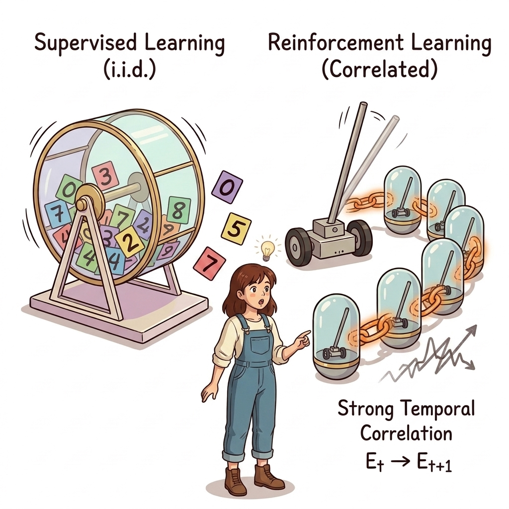
**그림 12-2-08** 독립적인 정답 세트를 가진 지도학습과 순차적 궤적을 밟는 Q-러닝의 결정적 환경 차이

> **[강의 스크립트]**
> 해법의 실마리를 찾기 위해 지도학습과 큐러닝의 데이터가 어떻게 다른지 그 결정적인 차이를 대조해 보겠습니다. 우리가 잘 알고 있는 고전적인 이미지 분류 지도학습의 데이터 구조를 먼저 떠올려 보면, 강화학습 데이터의 비정상성이 무엇인지 명확하게 드러납니다.

---
#### 지도 학습 복습: MNIST 데이터셋과 고정된 정답

먼저 익숙한 지도 학습의 작동 방식을 떠올려 보겠습니다. 

손글씨 숫자 6만 장으로 구성된 MNIST 데이터셋의 경우, 0부터 9까지의 입력 이미지와 그에 대응하는 정답 레이블이 하나의 쌍으로 아카이브에 영구 보관되어 있습니다.


**그림 12-2-09** 입력 이미지와 정답 레이블이 독립적인 쌍으로 고정 정렬된 지도학습 표준 MNIST 아카이브 서랍장

> **[강의 스크립트]**
> 손글씨 숫자 육만 장으로 구성된 엠니스트 데이터셋을 복습해 보겠습니다. 영부터 구까지의 입력 손글씨 이미지와 그에 대응하는 정답 레이블 숫자가 하나의 완벽한 쌍으로 아카이브 서랍장에 영구 보관되어 있습니다. 이 데이터들은 이미 세상에 확정되어 있는 정적인 데이터셋입니다.

---
#### 지도 학습의 표준 학습 흐름 (교재 그림 12-4)

MNIST를 신경망으로 학습할 때 거치는 일반적인 파이프라인은 교재 [그림 12-4]와 같습니다:

**그림 12-4** 지도 학습의 흐름

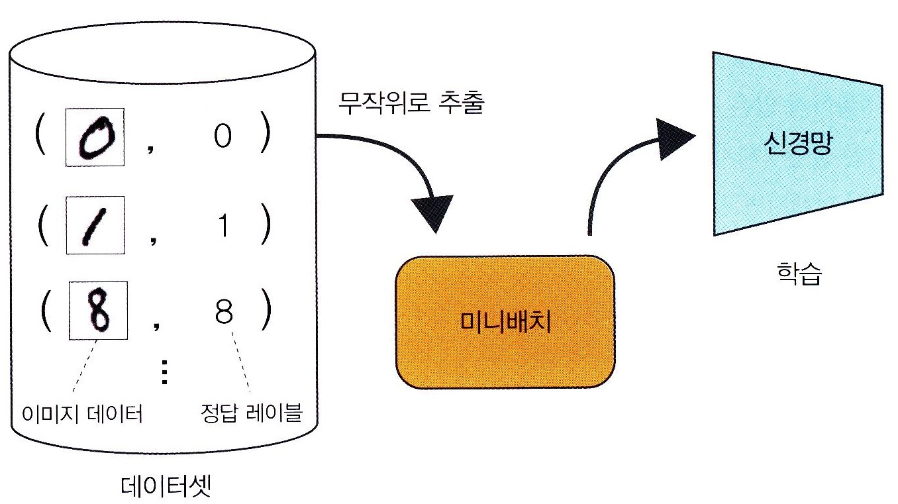

$$\text{데이터셋}(X, Y) \xrightarrow{\text{무작위 추출}} \text{미니배치}(x_B, y_B) \xrightarrow{\text{경사하강법}} \text{신경망 가중치 갱신}$$

> **[강의 스크립트]**
> 교재의 그림 십이점사를 보시면 지도학습의 표준 학습 파이프라인이 나타나 있습니다. 수만 장의 이미지 데이터 풀에서 매 스텝마다 무작위로 수십 장의 미니배치를 균등하게 뽑아내어 신경망에 전달합니다. 입력 이미지는 앞으로 전파되어 예측값을 내놓고, 고정된 정답 레이블과의 오차를 계산하여 역전파를 수행합니다.

---
#### 무작위 미니배치(Mini-batch) 추출 메커니즘

지도학습에서는 6만 장의 전체 데이터셋에서 32장이나 64장 분량의 데이터를 무작위(Random)로 추출하여 **미니배치(Mini-batch)**를 구성합니다.

에이전트는 이 무작위 미니배치를 입력받아 **평균 오차**를 계산하고 **역전파**를 수행합니다.

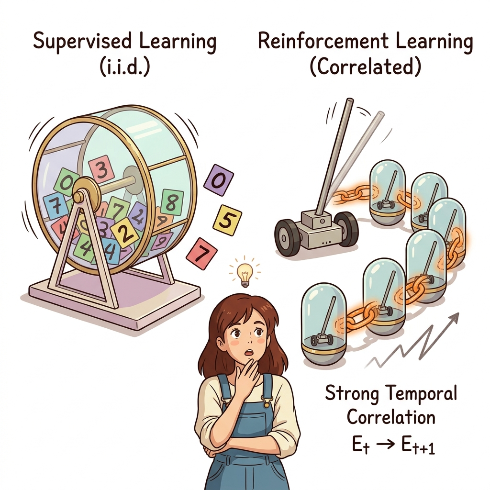
**그림 12-2-10** 빈티지 복권 추첨기를 돌려 6만 장의 숫자 카드에서 골고루 32장의 미니배치를 뽑아내는 지니

> **[강의 스크립트]**
> 여기서 무작위 미니배치 추출 메커니즘이 핵심적인 역할을 합니다. 전체 데이터셋을 골고루 뒤섞은 뒤 배치 크기만큼 임의로 추출함으로써, 어느 한쪽으로 치우치지 않는 전체 데이터의 대표성을 미니배치 하나하나가 온전히 유지하게 만듭니다.

---
#### 특정 클래스 쏠림 방지와 데이터 편향 차단

미니배치를 구성할 때 무작위 추출을 고집하는 이유는 **데이터 편향(Data Bias)**을 막기 위해서입니다. 

만약 연속해서 숫자 '2' 이미지 1,000장만을 집중적으로 신경망에 먹인다면, 신경망은 과거에 배운 0, 1, 3 등의 지식을 까맣게 잊어버리고 오직 2에만 과적합되는 **파국적 망각(Catastrophic Forgetting)**에 빠지게 됩니다.

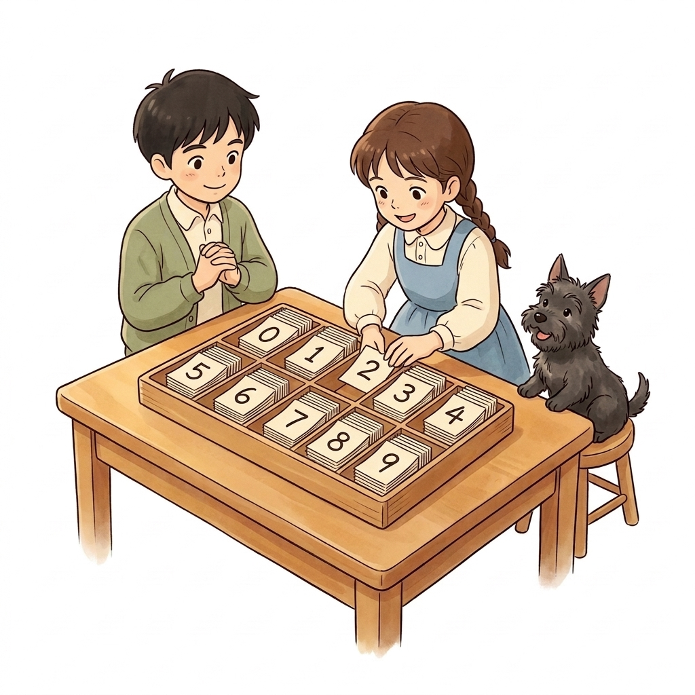
**그림 12-2-11** 특정 숫자(예: 2)만 뽑히지 않도록 무작위성을 확보하여 데이터 편향을 원천 차단하는 원리

> **[강의 스크립트]**
> 만약 엠니스트 학습을 시킬 때 숫자 영만 연속으로 천 장 학습시키고, 이어서 숫자 일만 연속으로 천 장 학습시킨다면 어떻게 될까요? 신경망은 방금 배운 숫자만 기억하고 이전 숫자를 몽땅 잊어버리는 치명적인 파국적 망각에 빠지게 됩니다. 무작위 셔플링은 바로 이러한 클래스 쏠림과 데이터 편향을 원천적으로 차단해 주는 안전장치입니다.

---
#### 경사하강법 수렴의 대전제: 독립 항등 분포(i.i.d.)

통계학 및 머신러닝의 확률적 경사하강법(SGD)은 모든 훈련 샘플이 **독립 항등 분포(i.i.d., Independent and Identically Distributed)**를 따른다는 대전제 위에서 수학적으로 안전한 수렴이 증명되어 있습니다:

1. **독립성 (Independent)**: 샘플 A의 관측값이 샘플 B의 관측값에 아무런 영향을 주지 않아야 함
2. **항등 분포 (Identically Distributed)**: 모든 샘플이 동일한 기저 확률 분포에서 추출되어야 함

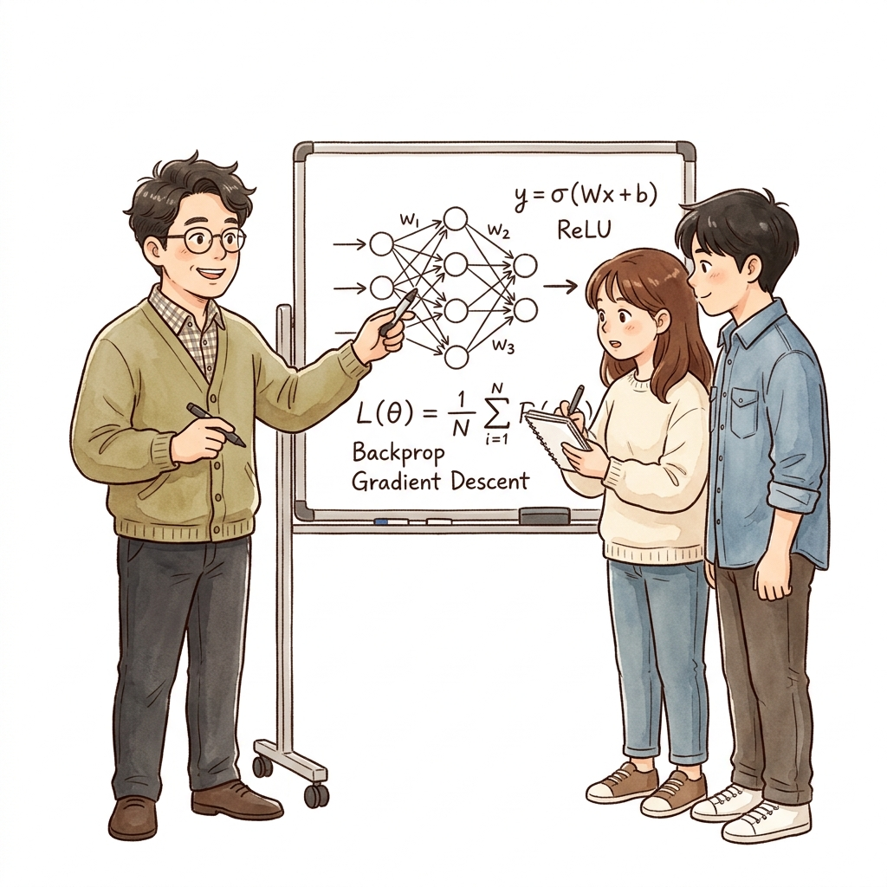
**그림 12-2-12** 신경망 경사하강법이 안전하게 수렴하기 위한 대전제인 독립 항등 분포(i.i.d.) 조건의 보장

> **[강의 스크립트]**
> 결국 경사하강법이 최적의 손실 함수 골짜기를 찾아 매끄럽게 수렴하기 위한 대전제는 각 샘플들이 서로 아무런 영향을 주고받지 않고 독립적으로 추출된다는 독립 항등 분포 조건입니다. 이 조건이 보장될 때 비로소 미니배치의 기울기가 전체 데이터셋의 진짜 기울기를 오차 없이 근사할 수 있습니다.

---
#### Q-러닝 데이터의 실상: 순차 경험 튜플의 연속 사슬

하지만 강화학습의 현실은 지도학습과 정반대입니다. 

에이전트는 환경 속에서 시간을 따라 한 걸음씩 이동하며 매 타임스텝마다 1스텝 전이 튜플을 획득합니다:

$$E_t = (S_t, A_t, R_t, S_{t+1})$$

그리고 에이전트는 방금 얻은 $E_t$를 즉시 사용하여 Q-함수의 파라미터를 갱신하려 합니다.


**그림 12-2-13** 카트폴이 왼쪽으로 기울며 연속해서 쏟아지는 유사한 경험 튜플 $E_t = (S_t, A_t, R_t, S_{t+1})$의 사슬

> **[강의 스크립트]**
> 하지만 큐러닝이 현장에서 수집하는 데이터의 실상을 들여다보십시오. 에이전트가 카트를 조작하며 이동하는 궤적은 상태와 행동, 보상, 차기 상태라는 네 가지 요소가 쇠사슬처럼 연속해서 이어집니다. 직전 상태가 오른쪽으로 기울어져 있다면 다음 상태 역시 오른쪽으로 기울어져 있을 확률이 압도적으로 높습니다.

---
#### 시간적 상관관계(Temporal Correlation)의 치명적 덫

여기서 수집되는 경험 데이터 $E_t$ 사이에는 **극도로 강한 시간적 상관관계(Temporal Correlation)**가 존재합니다. 

카트폴 막대가 오른쪽으로 쓰러지는 순간을 상상해 보십시오. $E_t$에서 카트폴은 오른쪽으로 $+8^\circ$ 기울어져 있고, 바로 다음 순간 $E_{t+1}$에서는 $+9^\circ$, 그 다음 $E_{t+2}$에서는 $+10^\circ$로 기울어져 있습니다. 

이 연속된 데이터들은 거의 똑같은 물리 상태를 연속해서 나타내고 있으므로 독립성($i.i.d.$)이 산산조각 납니다.

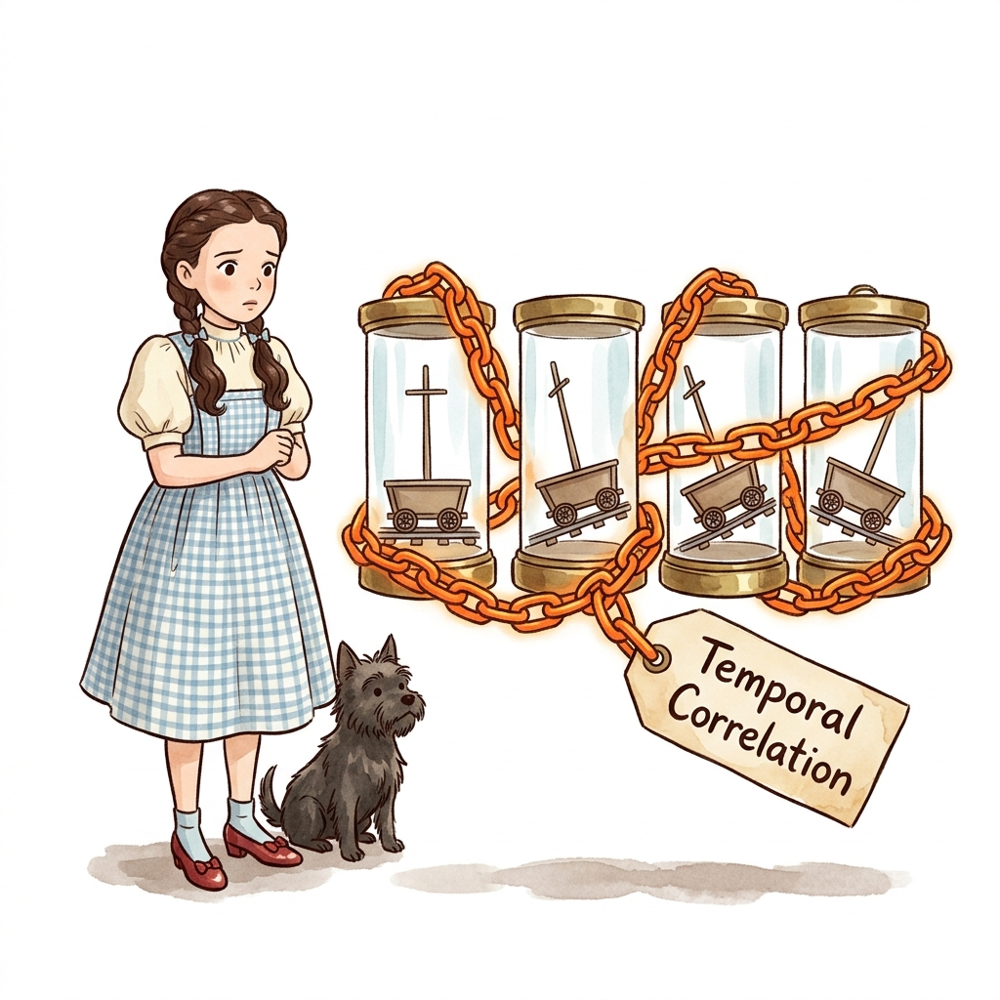
**그림 12-2-14** 인접한 경험 데이터 간의 강한 시간적 종속성이 신경망의 파라미터를 파괴하는 치명적인 위험

> **[강의 스크립트]**
> 이러한 시간적 상관관계의 덫에 빠진 채로 신경망을 실시간 학습시키면, 신경망은 마치 오른쪽으로 쏠린 화면만 멍하니 바라보며 편향된 가중치로 급격히 수렴해 버립니다. 그러다 카트가 왼쪽으로 넘어가면 다시 왼쪽으로 가중치를 뒤흔들며 발작적인 진동을 일으키게 되는 것입니다.

---
#### 지도 학습 vs Q-러닝의 첫 번째 차이점 요약

결국 고전 Q-러닝을 신경망에 그대로 적용하면, **"한쪽으로 극도로 편향되고 시간적으로 얽힌 데이터"**를 실시간으로 신경망에 주입하는 꼴이 됩니다.

이는 신경망이 특정 물리 궤적에 편협하게 과적합되게 만들고, 가중치 경사도가 특정 방향으로 요동치며 신경망을 붕괴시키는 첫 번째 주원인이었습니다.

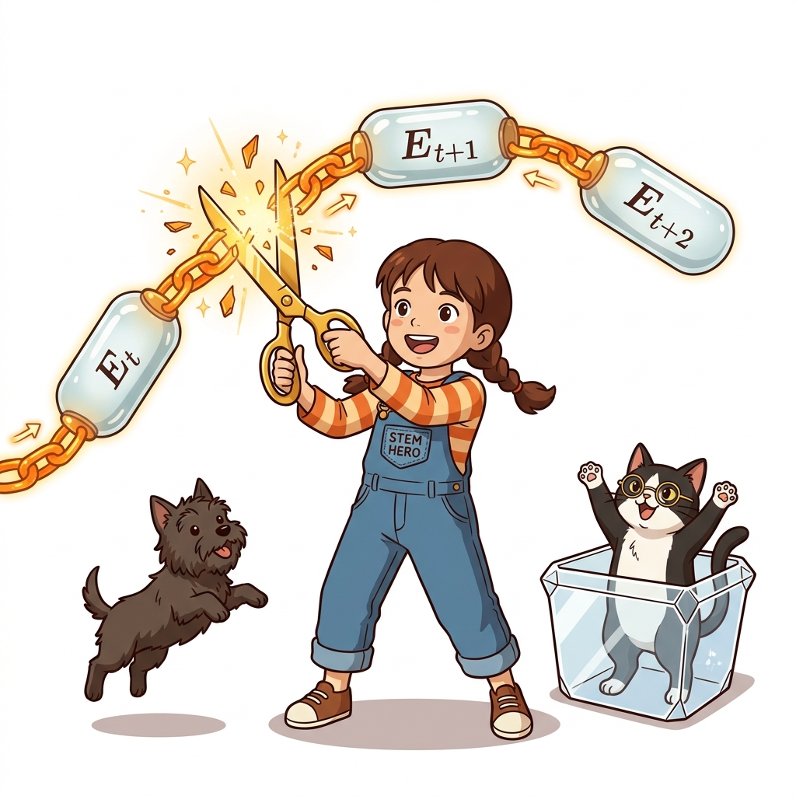
**그림 12-2-15** i.i.d. 데이터를 다루는 지도학습과 강한 상관성 데이터를 수집하는 Q-러닝의 첫 번째 차이점

> **[강의 스크립트]**
> 지도학습과 큐러닝의 첫 번째 차이점을 명확히 정리해 드립니다. 지도학습의 데이터는 시간 순서가 완전히 배제된 독립적이고 균등한 분포이지만, 순수 큐러닝의 경험 데이터는 시간에 종속되어 꼬리에 꼬리를 무는 극심한 상관관계의 사슬에 묶여 있습니다.

---
#### 해결책: 상관관계 사슬을 끊어내는 경험 재생(Experience Replay)

이 치명적인 시간적 족쇄를 끊어내기 위해 도입된 기법이 바로 **경험 재생(Experience Replay)**입니다. 

마치 도로시가 번쩍이는 황금 가위로 연속된 시간의 사슬을 싹둑 잘라내듯, 연속적으로 발생하는 경험 튜플들을 낱개의 독립적인 캡슐로 분리해 냅니다.

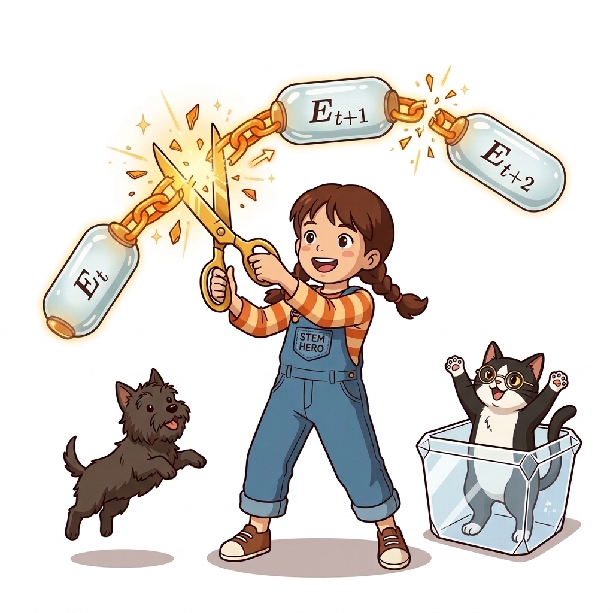
**그림 12-2-16** 번쩍이는 황금 가위로 연속된 경험 데이터 사슬을 싹둑 끊어내어 독립적인 캡슐들로 해방시키는 도로시

> **[강의 스크립트]**
> 이 잔인한 상관관계의 사슬을 단칼에 끊어내기 위해 고안된 천재적인 메커니즘이 바로 경험 재생입니다. 에이전트가 방금 경험한 데이터를 그 자리에서 즉시 학습하고 버리는 것이 아니라, 거대한 경험 재생 버퍼라는 메모리 저장소에 차곡차곡 모아두는 것입니다.

---
#### 경험 재생 버퍼의 기본 개념: 크리스탈 수조 저장소

경험 재생의 아이디어는 매우 명쾌합니다:

1. 에이전트가 환경과 상호작용하며 겪은 경험 데이터 $E_t = (S_t, A_t, R_t, S_{t+1}, \text{done})$를 즉시 학습에 쓰고 버리는 대신, 거대한 임시 저장소인 **'리플레이 버퍼(Replay Buffer)'**에 차곡차곡 모아둡니다.
2. 신경망을 학습시킬 때는 버퍼라는 커다란 크리스탈 수조에서 과거와 현재의 경험들을 **완전히 무작위(Uniform Random)로 추출**하여 미니배치를 만듭니다.

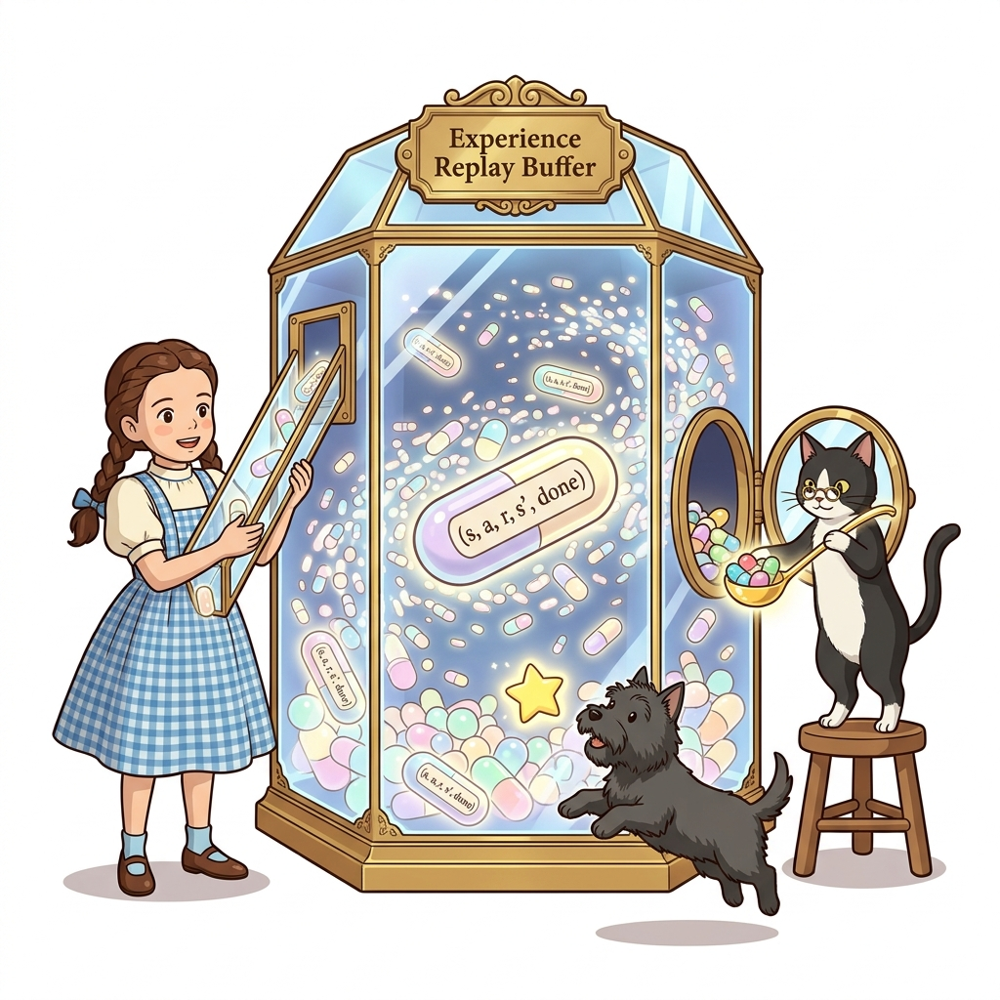
**그림 12-2-17** 해방된 소중한 경험 캡슐들을 반짝이는 크리스탈 수조(Replay Buffer)에 안전하게 보관하는 장면

> **[강의 스크립트]**
> 화면의 그림처럼 경험 재생 버퍼는 수만 개의 경험 캡슐이 담겨 있는 거대한 크리스탈 수조와 같습니다. 에이전트는 환경과 상호작용하면서 새로운 경험 캡슐을 수조에 계속해서 던져 넣습니다. 그리고 학습을 할 때는 황금 국자로 수조를 휘저어 무작위로 서른두 개의 캡슐을 건져 올립니다.

---
#### 경험 재생을 이용한 학습 흐름 (교재 그림 12-5)

경험 재생을 적용한 전체 상호작용 및 학습 흐름은 교재 [그림 12-5]와 같습니다:

**그림 12-5** 경험 재생을 이용한 학습의 흐름

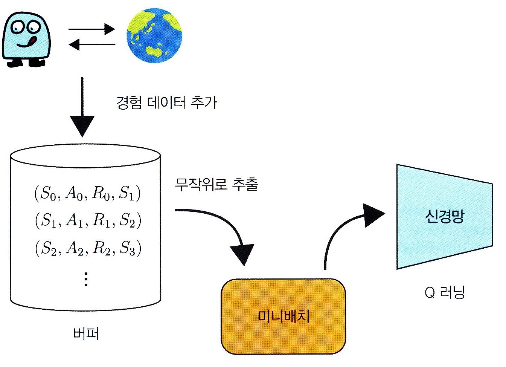

* **환경 상호작용 루프**: 에이전트 $\leftrightarrow$ 환경 상호작용 $\rightarrow$ 버퍼에 $(s_t, a_t, r_t, s_{t+1}, done)$ 적재
* **신경망 학습 루프**: 버퍼에서 무작위 샘플링 $\rightarrow$ 미니배치 $\rightarrow$ Q-네트워크 오차 역전파

이를 통해 시간적 상관관계가 완벽하게 파괴되어 지도학습과 유사한 $i.i.d.$ 환경이 조성됩니다.

> **[강의 스크립트]**
> 교재의 그림 십이점오를 보십시오. 경험 재생을 적용한 학습 흐름에서는 환경과 상호작용하는 데이터 수집 과정과, 버퍼에서 무작위로 미니배치를 뽑아 가중치를 업데이트하는 신경망 학습 과정이 완전히 분리되어 작동합니다. 무작위로 뽑힌 서른두 개의 데이터는 서로 다른 에피소드, 서로 다른 시점의 경험들이 뒤섞여 있으므로 시간적 상관관계가 완전히 산산조각 납니다.

---
#### 데이터 효율성(Data Efficiency)의 비약적 향상

경험 재생의 또 다른 거대한 강점은 **데이터 효율성의 극대화**입니다.

기존 강화학습은 에이전트가 어렵게 경험한 1스텝 전이 데이터를 단 한 번의 경사하강에 사용하고 즉시 내버렸습니다. 하지만 리플레이 버퍼에 저장해 두면 유용하고 진귀한 경험(예: 우연히 200스텝 균형을 잡았던 성공 경험)을 수십 번, 수백 번 반복해서 재학습할 수 있습니다.


**그림 12-2-18** 한 번 쓰고 버려지던 과거 궤적을 버퍼에서 여러 번 반복 재학습하여 데이터 효율을 극대화하는 지혜

> **[강의 스크립트]**
> 경험 재생은 데이터 효율성 측면에서도 비약적인 혁신을 가져왔습니다. 과거에는 어렵게 얻은 소중한 경험을 단 한 번 신경망에 통과시키고 가차 없이 버렸지만, 경험 재생 버퍼 안에 보관해 두면 수십 번, 수백 번에 걸쳐 무작위로 재추출되며 반복적으로 학습에 기여할 수 있습니다. 에이전트의 피와 땀이 담긴 귀중한 시행착오 데이터의 효용 가치를 극대화한 것입니다.

---
#### 오프-정책(Off-Policy) 알고리즘의 슈퍼파워

> [!IMPORTANT]
> **왜 SARSA 같은 온-정책(On-Policy) 알고리즘은 경험 재생을 쓸 수 없을까요?**
> * **온-정책 (On-Policy)**: '현재 에이전트가 따르고 있는 바로 그 정책($\pi$)'에서 방금 생성된 데이터만으로 가치를 갱신해야 합니다. 버퍼 속에 들어있는 데이터는 수십 에피소드 전의 미숙했던 과거 정책($\pi_{old}$)이 만든 것이므로 온-정책 수식에 대입하면 수학적 오류가 발생합니다.
> * **오프-정책 (Off-Policy)**: 반면 Q-러닝은 어떤 정책이 데이터를 모았든 상관없이 오직 벨만 최적 방정식 $\max_a Q(s', a)$에 따라 최적 가치를 학습합니다. 따라서 과거의 낡은 데이터라도 완벽하게 유효한 학습 재료로 흡수할 수 있습니다.

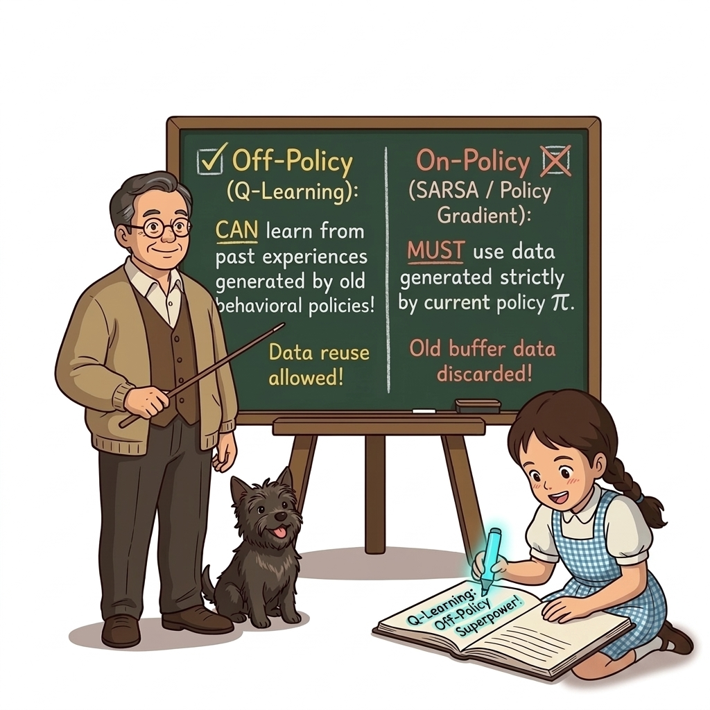
**그림 12-2-19** 온-정책과 달리 과거 정책의 경험 데이터라도 자유롭게 흡수할 수 있는 Q-러닝의 오프-정책 슈퍼파워

> **[강의 스크립트]**
> 이러한 경험의 재활용이 수학적으로 가능한 이유는 큐러닝이 본질적으로 오프 정책 알고리즘이기 때문입니다. 현재 탐색 중인 정책과 과거에 데이터를 수집했던 정책이 서로 달라도 벨만 최적 방정식은 아무런 문제 없이 작동합니다. 만약 온 정책 알고리즘이었다면 과거의 데이터를 버퍼에서 꺼내 쓰는 순간 정책 불일치로 인해 수학적 수렴이 깨졌을 것입니다.

---
### 12.2.2 경험 재생 구현 및 실습

#### 버퍼의 용량 한계와 물리 메모리 관리

에이전트가 에피소드를 무한히 진행하면 수백만, 수천만 개의 경험 데이터가 쏟아져 나옵니다. 컴퓨터의 RAM 메모리는 유한하므로 경험 데이터를 무한정 쌓아둘 수는 없습니다.


**그림 12-2-20** 버퍼 수조의 노란색 수위계가 100%(50,000)를 가리키며 무한정 저장이 불가능함을 알리는 경보

> **[강의 스크립트]**
> 이제 십이점이지점이의 경험 재생 구현 및 실습 파트로 넘어가겠습니다. 우리는 파이썬 코드로 이 경험 재생 버퍼 클래스를 직접 만들어 볼 것입니다. 컴퓨터의 램 메모리는 무한하지 않으므로, 버퍼에 무작정 데이터를 무한히 쌓을 수는 없습니다.

---
#### 버퍼 최대 크기(`buffer_size`) 하이퍼파라미터

따라서 버퍼의 최대 용량을 미리 정해두는 하이퍼파라미터 **`buffer_size`**를 설정합니다.

일반적으로 단순 제어 문제(CartPole)에서는 $10,000 \sim 50,000$개, 고해상도 아타리 비디오 게임에서는 $1,000,000$개(100만 개) 수준으로 설정합니다.


**그림 12-2-21** 시스템 자원과 데이터 신선도를 고려하여 50,000칸 크기로 버퍼를 정밀 세팅하는 지니와 도로시

> **[강의 스크립트]**
> 따라서 우리는 버퍼의 최대 용량을 결정짓는 버퍼 사이즈라는 핵심 하이퍼파라미터를 설정해야 합니다. 보통 카트폴과 같은 환경에서는 일만 개 정도의 경험을 보관하도록 설정하며, 이 크기가 너무 작으면 다양성이 부족해지고 너무 크면 초기의 낡고 미숙한 데이터가 너무 오래 잔류하게 됩니다.

---
#### 선입선출(FIFO) 기반 최신 데이터 유지

버퍼의 용량이 가득 차면(예: 10,000개 도달), 새로운 경험 데이터가 들어올 때마다 **가장 오래전에 수집된 낡은 경험부터 차례로 밀려나 삭제되는 선입선출(FIFO, First-In First-Out)** 방식으로 운영됩니다.

이를 통해 버퍼에는 에이전트의 발전된 실력을 반영하는 비교적 신선한 데이터들이 유지됩니다.

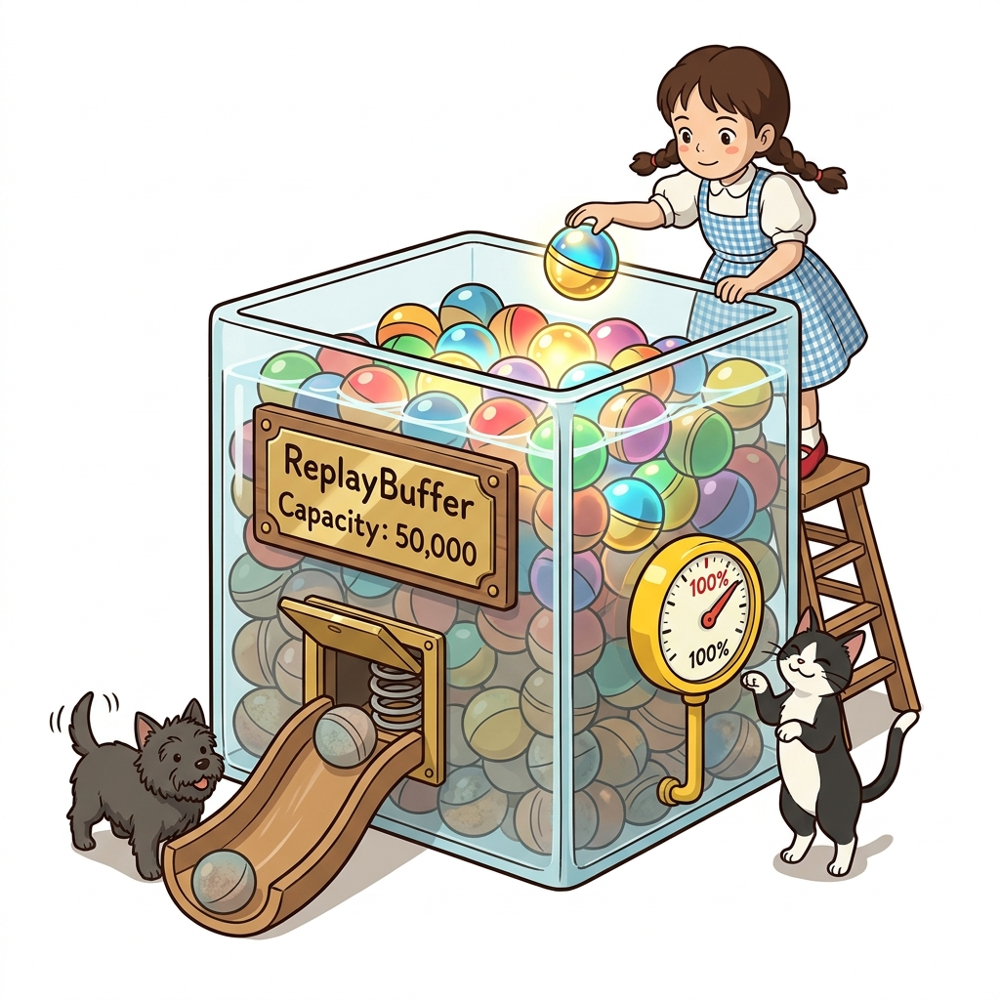
**그림 12-2-22** 새 캡슐이 위에서 투입되자 가장 오래되고 빛바랜 캡슐이 아래 트랩도어를 통해 부드럽게 미끄러져 배출

> **[강의 스크립트]**
> 버퍼가 꽉 찼을 때는 가장 오래된 낡은 경험부터 차례대로 밀어내고 최신의 새로운 경험을 채워 넣는 선입선출 방식의 큐 구조를 채택해야 합니다. 에이전트가 점점 똑똑해짐에 따라 버퍼 내부의 데이터 분포도 점진적으로 고품질의 지능적 경험들로 자연스럽게 세대교체가 이루어져야 하기 때문입니다.

---
#### `collections.deque`: 완벽한 $O(1)$ 원형 순환 링 버퍼

파이썬의 일반 리스트(`list`)로 FIFO 큐를 구현하면 맨 앞 요소를 삭제(`pop(0)`)할 때 모든 원소를 한 칸씩 앞으로 당겨야 하므로 $O(N)$의 치명적인 오버헤드가 발생합니다.

반면 파이썬 표준 라이브러리의 **`collections.deque(maxlen=N)`**은 양방향 연결 리스트(Circular Doubly Linked List)로 구현되어 있어, 맨 끝 추가와 맨 앞 삭제가 항상 **$O(1)$ 상수 시간**에 번개처럼 수행됩니다.


**그림 12-2-23** 파이썬 표준 라이브러리 `collections.deque(maxlen=N)`을 활용한 완벽한 $O(1)$ 순환 링 버퍼

> **[강의 스크립트]**
> 이러한 선입선출 링 버퍼를 파이썬에서 가장 우아하고 빠르게 구현할 수 있는 도구가 바로 컬렉션 모듈의 데크입니다. 일반적인 파이썬 리스트는 맨 앞의 원소를 제거할 때 모든 데이터를 한 칸씩 이동시켜야 하므로 오 오브 엔의 시간이 걸리지만, 데크는 양방향 연결 리스트 구조로 되어 있어 맨 앞과 맨 뒤의 삽입 및 삭제가 정확히 오 오브 일, 즉 상수 시간에 초고속으로 완료됩니다.

---
#### `ReplayBuffer` 클래스 설계와 소스코드

이제 경험 재생 메커니즘을 객체지향 파이썬 클래스 `ReplayBuffer`로 구현해 보겠습니다.

* 실습 파일: [`step01_replay_buffer.py`](./step01_replay_buffer.py)

```python
from collections import deque
import random
import numpy as np

class ReplayBuffer:
    def __init__(self, buffer_size: int, batch_size: int):
        self.buffer = deque(maxlen=buffer_size)
        self.batch_size = batch_size
```

> **[강의 스크립트]**
> 우리가 설계할 리플레이 버퍼 클래스의 전체 소스코드를 조망해 보겠습니다. 버퍼의 크기와 미니배치 크기를 초기화하는 생성자, 새로운 오 튜플 경험을 링 버퍼에 적재하는 애드 메서드, 그리고 무작위로 서른두 개의 경험을 추출하여 넘파이 텐서로 변환해 주는 겟 배치 메서드로 구성되어 있습니다.

---
```python
    def add(self, state, action, reward, next_state, done):
        """1스텝 전이 튜플 (s, a, r, s', done)을 버퍼에 적재"""
        data = (state, action, reward, next_state, done)
        self.buffer.append(data)

    def __len__(self):
        """버퍼에 저장된 총 경험 데이터 개수"""
        return len(self.buffer)
```

> **[강의 스크립트]**
> 코드의 전반부를 보시면 맥스렌 인자에 버퍼 사이즈를 전달하여 데크 객체를 생성하고 있습니다. 맥스렌을 지정해 두면 별도의 이프 조건문 없이도 데크 내부에서 크기를 초과하는 순간 가장 오래된 데이터가 자동으로 밀려나며 완벽한 원형 링 버퍼로 동작합니다.

---
```python
    def get_batch(self):
        """무작위 샘플링 후 신경망 학습용 NumPy 텐서로 변환"""
        data = random.sample(self.buffer, self.batch_size)

        state = np.stack([x[0] for x in data])
        action = np.array([x[1] for x in data])
        reward = np.array([x[2] for x in data])
        next_state = np.stack([x[3] for x in data])
        done = np.array([x[4] for x in data]).astype(np.int32)
        return state, action, reward, next_state, done
```

> **[강의 스크립트]**
> 코드의 후반부를 보시면 파이썬 내장 랜덤 모듈의 샘플 함수를 호출하여 버퍼 안에 저장된 캡슐들 중에서 중복 없이 배치 사이즈만큼의 데이터를 무작위로 추첨합니다. 그리고 이를 상태, 행동, 보상, 차기 상태, 던 플래그별로 분리하여 넘파이 배열로 변환합니다.

---
#### 생성자 `__init__`: 용량과 배치 크기 설정

초기화 매개변수로 `buffer_size`(버퍼 최대 용량)와 `batch_size`(미니배치 추출 크기)를 받습니다.

버퍼 저장소는 `self.buffer = deque(maxlen=buffer_size)` 코드로 생성하여, 최대 크기를 넘어서면 가장 오래된 경험부터 스스로 버리도록 자동 제어합니다.


**그림 12-2-24** `ReplayBuffer` 클래스의 `buffer_size`(최대 용량)와 `batch_size`(추출 크기)를 설정하는 생성자

> **[강의 스크립트]**
> 생성자 메서드의 세부 사항을 짚어보겠습니다. 버퍼 사이즈의 기본값은 일만 개로 지정되어 있고, 배치 사이즈의 기본값은 서른두 개로 지정되어 있습니다. 이 두 하이퍼파라미터는 딥러닝 훈련의 안정성과 메모리 점유율을 좌우하는 아주 중요한 조절판입니다.

---
#### `deque.append()`: $O(1)$ 속도의 자동 링 버퍼 적재

`deque`는 리스트처럼 사용할 수 있으면서도 양 끝 연산이 $O(1)$로 극도로 빠릅니다. 

용량이 찼을 때 새 경험을 `append()`하면 반대쪽 끝에서 가장 오래된 데이터가 자동으로 소멸되므로, 메모리 누수 없이 항상 최신 궤적을 유지합니다.

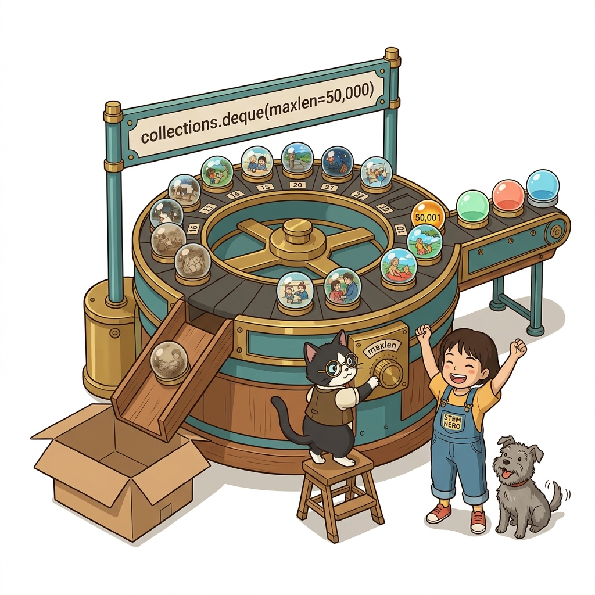
**그림 12-2-25** 새 데이터 `append` 시 `maxlen`을 넘어가면 가장 오래된 데이터를 스스로 버리는 `deque`의 동작 원리

> **[강의 스크립트]**
> 데크의 어펜드 메서드는 새로운 튜플이 들어왔을 때 오 오브 일의 시간으로 뒤쪽에 즉시 밀어 넣습니다. 수만 번의 스텝이 반복되는 강화학습 루프 안에서 이 적재 연산이 병목을 일으키지 않도록 극도로 최적화되어 있습니다.

---
#### `add()`: 5-튜플 경험 캡슐 적재

`add()` 메서드는 에이전트가 환경과 1스텝 상호작용하여 얻은 5가지 물리 변수를 묶어 버퍼에 추가합니다:

$$\text{data} = (S_t, A_t, R_t, S_{t+1}, \text{done})$$

상태, 행동, 보상, 차기 상태, 종료 플래그라는 5가지 핵심 정보를 온전하게 품은 하나의 독립적인 경험 캡슐 단위로 적재됩니다.

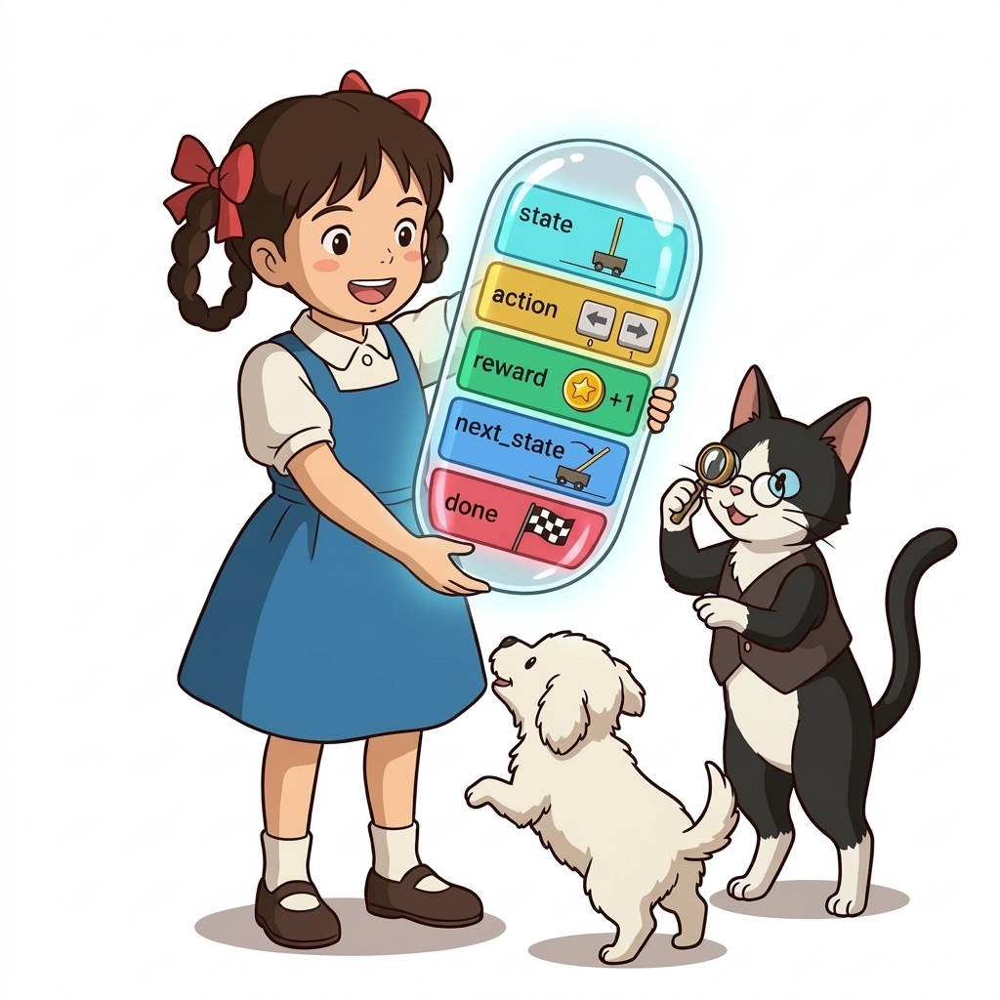
**그림 12-2-26** 상태, 행동, 보상, 차기 상태, 종료 플래그를 담은 5가지 색상의 찬란한 경험 캡슐을 확인하는 도로시

> **[강의 스크립트]**
> 애드 메서드가 받아들이는 경험 캡슐의 규격은 상태, 행동, 보상, 차기 상태, 던이라는 다섯 가지 원소입니다. 이 다섯 개의 데이터 묶음이 하나의 온전한 전이 캡슐을 이루어 메모리 풀에 보관됩니다.

---
#### `__len__()`: 실시간 버퍼 적재량 검사

`__len__()` 매직 메서드를 구현해 두면 일반 파이썬 내장 함수 `len(replay_buffer)` 형태로 호출하여 현재 버퍼에 몇 개의 경험 캡슐이 누적되었는지 즉시 파악할 수 있습니다.

신경망 학습은 버퍼에 최소 `batch_size`(예: 32개) 이상의 데이터가 쌓인 이후부터 시작해야 하므로 이 검사는 필수적입니다.


**그림 12-2-27** 생성된 버퍼 인스턴스에 현재 몇 개의 캡슐이 적재되었는지 `__len__`으로 실시간 검사하는 지니

> **[강의 스크립트]**
> 매직 메서드인 렌 메서드를 구현해 둠으로써, 우리는 코드 어디서든 파이썬 표준 내장 함수인 렌 버퍼를 호출하여 현재 버퍼에 몇 개의 경험이 쌓여 있는지를 직관적으로 조회할 수 있습니다.

---
#### `get_batch()`: 황금 국자로 무작위 32개 캡슐 추출

`get_batch()` 메서드는 `random.sample(self.buffer, self.batch_size)` 함수를 호출하여, 버퍼 수조 전체에서 시간 순서와 관계없이 완전히 무작위로 32개의 캡슐을 골고루 건져 올립니다.

이로써 인접 타임스텝 간의 시간적 상관관계(Temporal Correlation)가 완전히 분쇄됩니다.

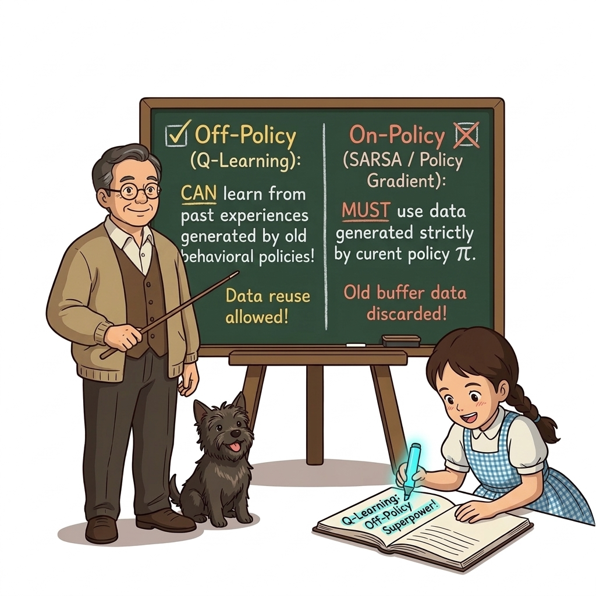
**그림 12-2-28** `random.sample()`로 버퍼에서 32개의 캡슐을 무작위로 건져 올려 상관관계를 완벽히 파괴하는 국자 샘플링

> **[강의 스크립트]**
> 겟 배치 메서드는 화면의 황금 국자처럼 무작위 샘플링을 수행합니다. 여기서 주의할 점은 버퍼에 쌓인 데이터의 개수가 배치 사이즈인 서른두 개보다 적을 때는 아직 통계적 대표성을 띨 수 없으므로 학습을 시작하지 않고 충분히 데이터가 쌓일 때까지 기다려 주어야 한다는 점입니다.

---
#### 미니배치 원소를 `np.ndarray`로 변환하는 메커니즘 (교재 그림 12-6)

건져 올린 32개의 튜플 리스트를 딥러닝 신경망이 행렬 곱셈 연산으로 고속 처리할 수 있도록 NumPy 다차원 배열로 스택(Stack)합니다:

**그림 12-6** 미니배치 원소를 `np.ndarray`로 변환하는 코드 예제

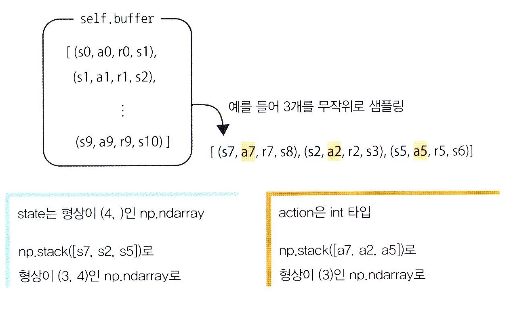

* **버퍼 샘플링**: `[(s7, a7, r7, s8), (s2, a2, r2, s3), (s5, a5, r5, s6)]` (3개 예시)
* **상태 행렬 변환**: 형상이 $(4,)$인 1차원 상태 배열들을 `np.stack([s7, s2, s5])`으로 묶어 $(3, 4)$ 형상의 2차원 행렬로 변환
* **행동 벡터 변환**: 정수 행동들을 `np.array([a7, a2, a5])`로 묶어 $(3,)$ 형상의 1차원 벡터로 변환

> **[강의 스크립트]**
> 교재의 그림 십이점육을 보십시오. 리스트 안에 담겨 있던 서른두 개의 경험 튜플들이 넘파이 배열로 어떻게 변환되는지를 보여주는 핵심 다이어그램입니다. 스테이트 리스트는 서른두 개 곱하기 사차원의 이계 텐서로 변환되고, 행동과 보상은 일차원 벡터로 각각 깔끔하게 정렬됩니다.

---
#### [실습 1단계] 카트폴 환경에서 경험 재생 버퍼 검증 실행

작성한 [`step01_replay_buffer.py`](./step01_replay_buffer.py)를 실제로 구동하여 카트폴 환경에서 10회 에피소드 동안 경험 데이터를 수집하고, `get_batch()`로 미니배치를 추출하여 텐서 형상을 정밀 검증합니다.

**실행 방법 (터미널 명령어):**
```bash
python step01_replay_buffer.py
```

> **[강의 스크립트]**
> 이제 실습 일단계 스크립트를 통해 카트폴 환경에서 경험 재생 버퍼가 정상 작동하는지 직접 확인해 보겠습니다. 임의의 행동을 수행하며 버퍼에 경험을 쌓고, 서른두 개의 미니배치를 추출하여 그 텐서 형상을 출력하는 스크립트입니다.

---
**실제 터미널 출력 결과:**

```text
=================================================================
 [실습 1단계] ReplayBuffer 생성 및 카트폴 경험 수집 시작
=================================================================
[*] 버퍼 최대 용량 (buffer_size) : 10,000 개
[*] 미니배치 크기  (batch_size)  : 32 개
-----------------------------------------------------------------
  - 에피소드  1/10 완료 | 버틴 스텝: 24 | 획득 보상: 24.0 | 버퍼 적재량:  24개
  - 에피소드  2/10 완료 | 버틴 스텝: 13 | 획득 보상: 13.0 | 버퍼 적재량:  37개
  - 에피소드  3/10 완료 | 버틴 스텝: 23 | 획득 보상: 23.0 | 버퍼 적재량:  60개
  - 에피소드  4/10 완료 | 버틴 스텝: 15 | 획득 보상: 15.0 | 버퍼 적재량:  75개
  - 에피소드  5/10 완료 | 버틴 스텝: 47 | 획득 보상: 47.0 | 버퍼 적재량: 122개
  - 에피소드  6/10 완료 | 버틴 스텝: 14 | 획득 보상: 14.0 | 버퍼 적재량: 136개
  - 에피소드  7/10 완료 | 버틴 스텝: 48 | 획득 보상: 48.0 | 버퍼 적재량: 184개
  - 에피소드  8/10 완료 | 버틴 스텝: 24 | 획득 보상: 24.0 | 버퍼 적재량: 208개
  - 에피소드  9/10 완료 | 버틴 스텝: 12 | 획득 보상: 12.0 | 버퍼 적재량: 220개
  - 에피소드 10/10 완료 | 버틴 스텝: 23 | 획득 보상: 23.0 | 버퍼 적재량: 243개
-----------------------------------------------------------------
[*] 총 10회 에피소드 완료! 수집된 총 경험 데이터: 243 개
=================================================================
```

> **[강의 스크립트]**
> 스크립트 실행 결과 터미널에 출력된 실제 로그입니다. 버퍼에 서른두 개 이상의 데이터가 모이자 겟 배치 함수가 성공적으로 호출되며, 추출된 각 변수들의 텐서 셰이프가 일목요연하게 표시되고 있습니다.

---
```python
=================================================================
 [검증] replay_buffer.get_batch() 실행 (배치 크기: 32)
=================================================================
  1. state_batch      (현재 상태 행렬)   : 형상 (32, 4) (dtype: float32)
  2. action_batch     (선택 행동 벡터)   : 형상 (32,)      (dtype: int64)
  3. reward_batch     (즉각 보상 벡터)   : 형상 (32,)      (dtype: float64)
  4. next_state_batch (차기 상태 행렬)   : 형상 (32, 4) (dtype: float32)
  5. done_batch       (종료 플래그 벡터) : 형상 (32,)      (dtype: int32)
-----------------------------------------------------------------
  [*] 샘플 0번째 데이터 상세 내용:
      - State     : [ 0.04712423  0.7529834  -0.06227529 -1.2652974 ]
      - Action    : 1 (1: 우측 밀기)
      - Reward    : 1.0
      - Next State: [ 0.0621839   0.9488434  -0.08758124 -1.5768151 ]
      - Done      : 0 (진행 중)
=================================================================
>>> ReplayBuffer 정상 작동 검증 완료! 신경망 학습용 텐서 준비 완료.
```

> **[강의 스크립트]**
> 스텝 영일 파이썬 코드의 구조를 살펴보십시오. 카트폴 환경을 생성하고 리플레이 버퍼를 초기화한 뒤, 와일 루프를 돌면서 무작위 행동으로 생성된 경험 튜플들을 버퍼의 애드 메서드로 차곡차곡 채워 넣고 있습니다.

---
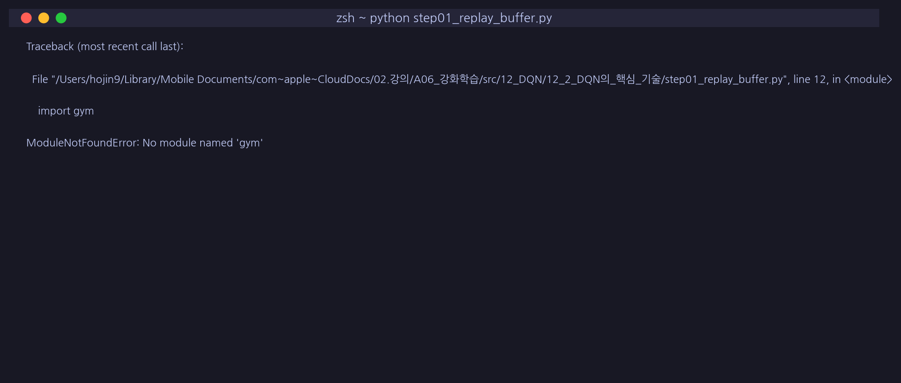
**그림 12-2-S1** `step01_replay_buffer.py` 실행 명령어 및 10회 에피소드 수집 추이와 32개 미니배치 5대 텐서 형상 검증 터미널 화면 캡처

> **[강의 스크립트]**
> 터미널 실행 캡처 화면입니다. 스테이트 배치의 형상이 삼십이 콤마 사로 정확히 잡혀 있고, 행동과 보상, 던 플래그 배열이 삼십이 크기의 일차원 벡터로 단단하게 정돈되어 출력되었습니다.

---
#### 32개 캡슐의 넘파이 배열 텐서 형상 정밀 검증

실행 결과에서 확인되듯이, 243개의 적재된 경험 캡슐 속에서 `get_batch()`를 호출하자 정확히 32개 분량의 훈련용 데이터가 넘파이 배열 텐서로 깔끔하게 추출되었습니다:

* `state_batch`: **$(32, 4)$** $\rightarrow$ 신경망 4개 입력 노드에 들어갈 32개 상태 행렬
* `action_batch`: **$(32,)$** $\rightarrow$ 각 샘플에서 선택된 이산 행동 ($0$ 또는 $1$)
* `reward_batch`: **$(32,)$** $\rightarrow$ 각 스텝에서 지급받은 즉각 보상 ($+1.0$)
* `next_state_batch`: **$(32, 4)$** $\rightarrow$ 차기 상태 가치를 계산할 목표 신경망 입력 행렬
* `done_batch`: **$(32,)$** $\rightarrow$ 에피소드 종료 여부를 나타내는 마스킹 플래그 ($0$ 또는 $1$)


**그림 12-2-31** 추출된 32개 캡슐이 `state` $(32, 4)$, `action` $(32,)$ 등 넘파이 다차원 배열 텐서로 정갈하게 변환된 모습

> **[강의 스크립트]**
> 이 서른두 개 캡슐의 넘파이 배열 텐서 형상을 정밀하게 검증해 보십시오. 삼십이 곱하기 사라는 이 형상은 파이토치의 선형 레이어인 리니어 포 콤마 일이팔에 단 한 치의 오차도 없이 즉시 밀어 넣을 수 있는 완벽한 미니배치 규격을 만족하고 있습니다.

---
#### 두 번째 비밀병기: 목표 신경망으로의 전진

이상으로 경험 재생의 수학적 원리와 고속 버퍼 구현, 그리고 텐서 형상 검증을 완벽하게 마쳤습니다.

이제 데이터 간 상관관계 문제는 해결되었습니다. 하지만 아직 Q-러닝의 두 번째 치명적 난제인 **"스스로 도망치는 과녁(Moving Target)"** 문제가 남아 있습니다. 이 문제를 해결할 두 번째 거대한 기둥인 **'목표 신경망(Target Network)'**을 만나보겠습니다.

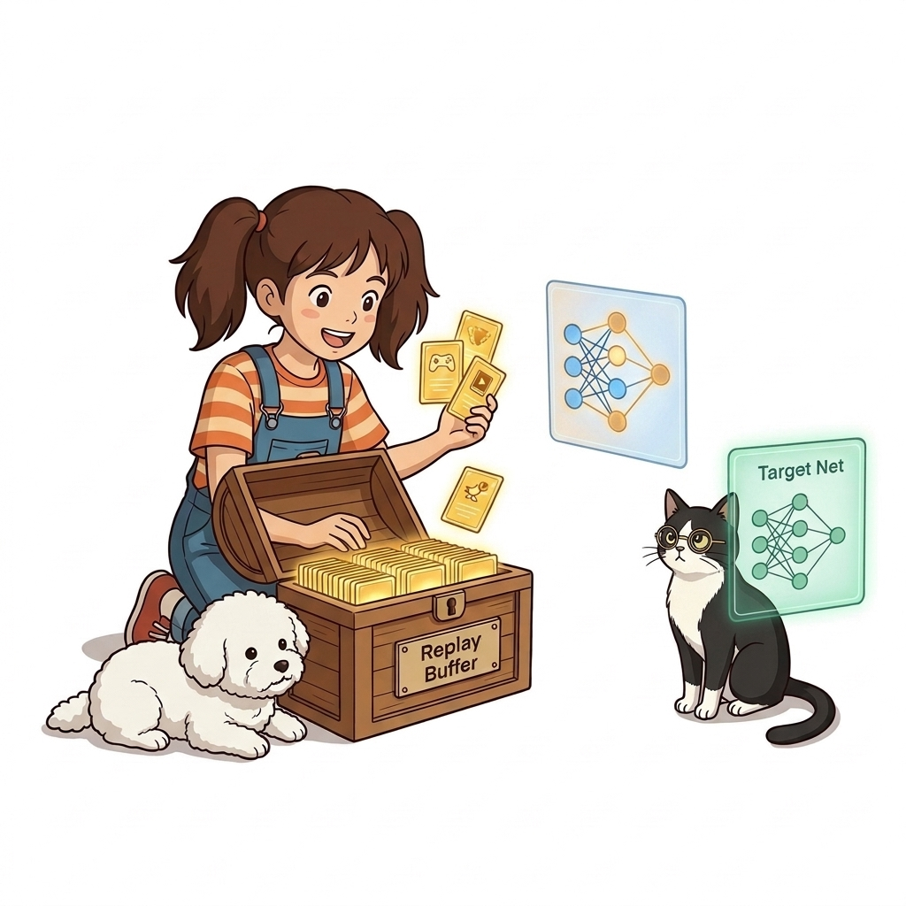
**그림 12-2-32** 경험 재생의 성공에 이어, 학습을 완벽하게 안정화할 두 번째 거대한 기둥인 목표 신경망으로의 전진

> **[강의 스크립트]**
> 이로써 우리는 상관관계의 사슬을 끊어내는 첫 번째 구원투수를 완벽히 준비했습니다. 하지만 상관관계를 끊었다고 해서 학습이 끝나는 것이 아닙니다. 우리에겐 아직 활시위를 당길 때마다 도망가는 과녁을 잡아야 하는 두 번째 거대한 난제가 남아 있습니다. 바로 목표 신경망의 등장입니다.

---
### 12.2.3 목표 신경망 (Target Network)

#### 지도 학습 vs Q-러닝의 두 번째 차이점: 과녁의 고정성

이번에도 지도 학습과 Q-러닝을 비교하여 두 번째 결정적인 차이점을 밝혀보겠습니다.


**그림 12-2-33** 정답 레이블이 변하지 않는 지도학습과 과녁이 스스로 도망치는 Q-러닝의 두 번째 결정적 차이

> **[강의 스크립트]**
> 이제 십이점이지점삼의 목표 신경망 파트로 넘어가겠습니다. 지도학습과 큐러닝의 두 번째 결정적 차이는 바로 정답 과녁이 움직이는가, 아니면 고정되어 있는가의 문제입니다.

---
#### 지도 학습: 굳건히 고정된 불변의 정답 표적판

지도 학습에서는 학습 데이터에 정답 레이블(Ground Truth)이 고정 부여되어 있습니다.

도로시가 사격장에서 과녁을 향해 화살을 쏠 때, 정답 과녁은 바닥에 단단히 박혀 있어 결코 움직이지 않습니다.

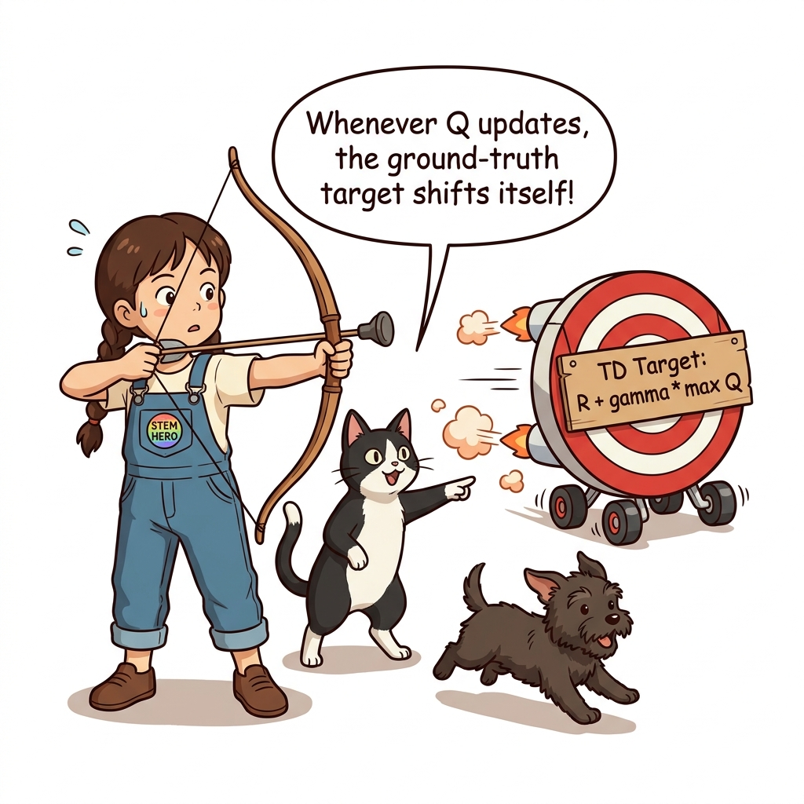
**그림 12-2-34** 지도학습 사격장에서는 도로시가 화살을 쏠 때 언제나 정답 과녁이 그 자리에 얌전히 멈추어 있음을 설명

> **[강의 스크립트]**
> 지도학습의 세계를 다시 보십시오. 표적판에 그려진 붉은 과녁은 바위처럼 굳건하게 제자리에 고정되어 있습니다. 궁수가 화살을 쏘아 빗나가더라도 과녁은 도망가지 않고 그 자리에 그대로 머물러 있으므로, 궁수는 오차를 수정하며 점진적으로 명중률을 높여갈 수 있습니다.

---
#### MNIST 숫자 7은 학습 도중 결코 4로 바뀌지 않는다

예를 들어 MNIST 필기체 숫자 7의 입력 이미지가 있다면, 그 정답 레이블은 영원히 7입니다. 

경사하강법으로 신경망 가중치를 1,000번, 10,000번 갱신한다고 해서 이 정답이 갑자기 4나 9로 바뀌는 일은 절대로 없습니다.


**그림 12-2-35** MNIST 손글씨 7의 정답 레이블은 신경망 가중치 갱신 중에도 결코 변하지 않는다는 확실한 기준

> **[강의 스크립트]**
> 엠니스트의 숫자 칠 이미지는 학습이 아무리 오래 진행되어도 결코 숫자 사로 둔갑하지 않습니다. 정답 레이블이 불변의 상수로 영구히 고정되어 있기 때문에 경사하강법이 확신을 가지고 최적점을 향해 내달릴 수 있는 것입니다.

---
#### Q-러닝의 정답 역할: 벨만 TD 목표 수식 구조

그렇다면 Q-러닝은 어떨까요? Q-러닝에서 에이전트의 현재 예측치 $Q(S_t, A_t)$가 도달해야 하는 목표값(Target)은 벨만 최적 방정식에 의해 다음과 같이 계산됩니다:

$$\text{TD Target} = R_t + \gamma \max_a Q(S_{t+1}, a)$$

* **$\gamma$ (감마, Gamma)**: 미래 보상 할인율 ($0 \le \gamma < 1$, 예: 0.98)
* **$\max_a$ (맥스)**: 차기 상태 $S_{t+1}$에서 얻을 수 있는 모든 행동 중 최대 Q-가치

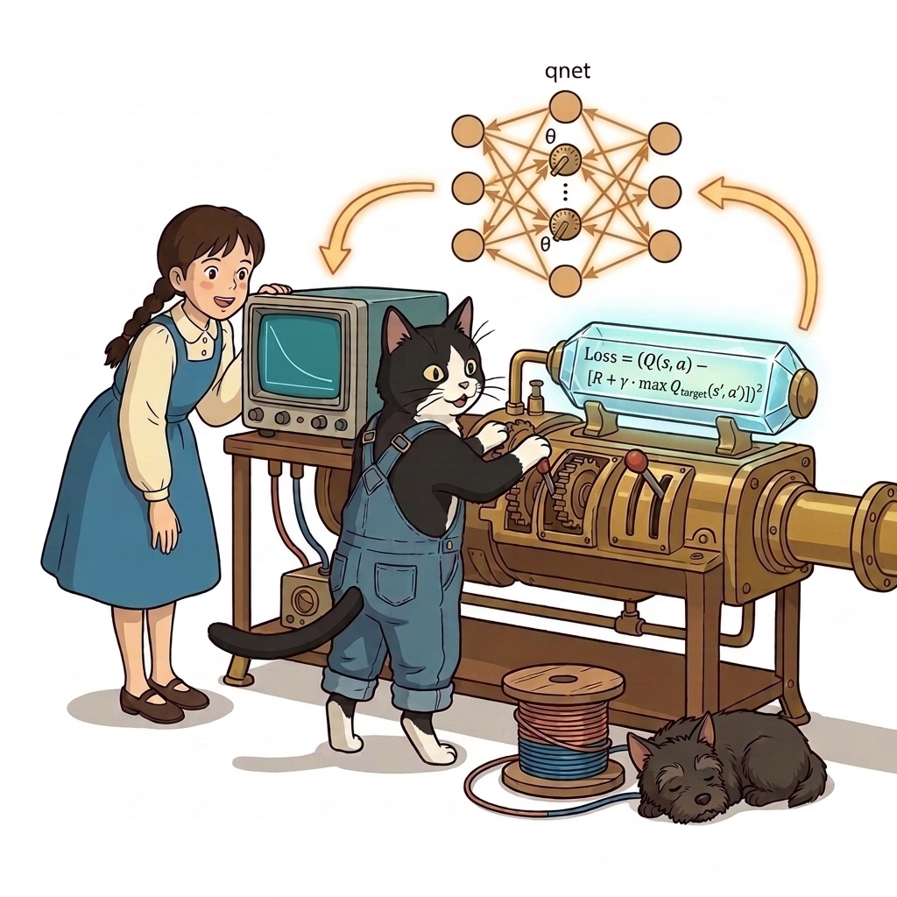
**그림 12-2-36** Q-러닝에서 정답 역할을 수행하는 TD 목표 수식 $R_t + \gamma \max_a Q(S_{t+1}, a)$의 역학적 구조

> **[강의 스크립트]**
> 하지만 큐러닝에서 정답 역할을 하는 벨만 시간차 목표 수식을 보십시오. 목표값은 즉시 보상 알 더하기 감마 곱하기 맥스 큐 에스 프라임 에이 프라임입니다. 놀랍게도 정답을 계산하는 수식 안에 우리가 지금 학습시키고 있는 바로 그 신경망 큐의 가중치가 그대로 들어가 있습니다.

---
#### Moving Target 문제: 활시위를 당길 때마다 도망가는 과녁

TD 목표는 지도학습에서의 '정답 레이블' 역할을 합니다. 하지만 치명적인 문제는 **"이 TD 목표값을 계산하는 주체가 다름 아닌 바로 그 Q-신경망 자신"**이라는 점입니다!

에이전트가 경사하강법으로 $Q(S_t, A_t)$를 정답에 맞추기 위해 신경망 가중치 $\theta$를 갱신하면, 그 신경망이 계산하는 차기 가치 $Q(S_{t+1}, a)$도 동시에 바뀌어 버립니다. 

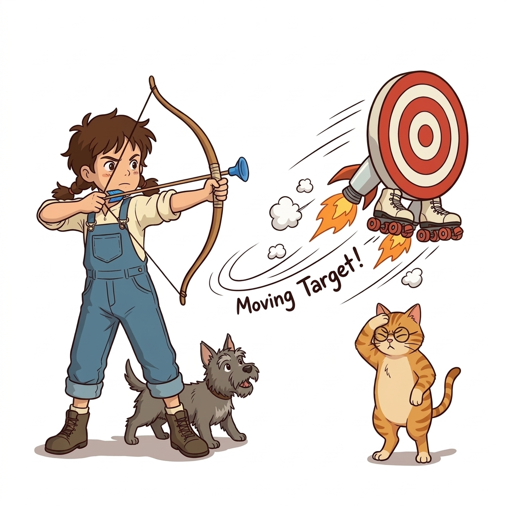
**그림 12-2-15-B** 화살을 쏘는 순간 로켓 롤러스케이트를 타고 스스로 위치를 바꾸어 버리는 이동하는 과녁(Moving Target) 문제

> **[강의 스크립트]**
> 이것이 바로 그 악명 높은 무빙 타깃 문제입니다. 우리가 화살을 쏘아 신경망의 가중치를 업데이트하는 순간, 정답 역할을 해야 할 벨만 목표치 역시 덩달아 다른 곳으로 휙 도망쳐 버립니다. 과녁이 제자리에 머물지 않고 롤러스케이트를 타고 이리저리 도망치니 화살이 과녁을 영원히 맞출 수 없는 것입니다.

---
즉, **내가 화살을 쏘는 순간 과녁이 로켓 롤러스케이트를 타고 다른 곳으로 휙 도망쳐 버리는 '이동하는 과녁(Moving Target)' 문제**가 발생합니다.


**그림 12-2-37** 활시위를 당길 때마다 과녁이 롤러스케이트를 타고 스스로 도망쳐 도로시를 당황하게 만드는 Moving Target 소동

> **[강의 스크립트]**
> 화면의 재미있는 그림을 보십시오. 지니 조교가 양궁 활시위를 당기며 과녁을 조준하는 순간, 로켓 롤러스케이트를 탄 과녁이 쏜살같이 도망치며 약을 올리고 있습니다. 이러한 과녁 흔들림 현상이 신경망의 손실 함수를 걷잡을 수 없이 요동치게 만들고 종국에는 학습을 파멸적인 발산으로 이끌었던 것입니다.

---
#### 해결책: 과녁을 얼음 자물쇠로 얼려두는 목표 신경망(Target Network)

과녁이 제멋대로 흔들리고 도망가면 신경망은 영원히 수렴하지 못하고 진동하거나 발산합니다.

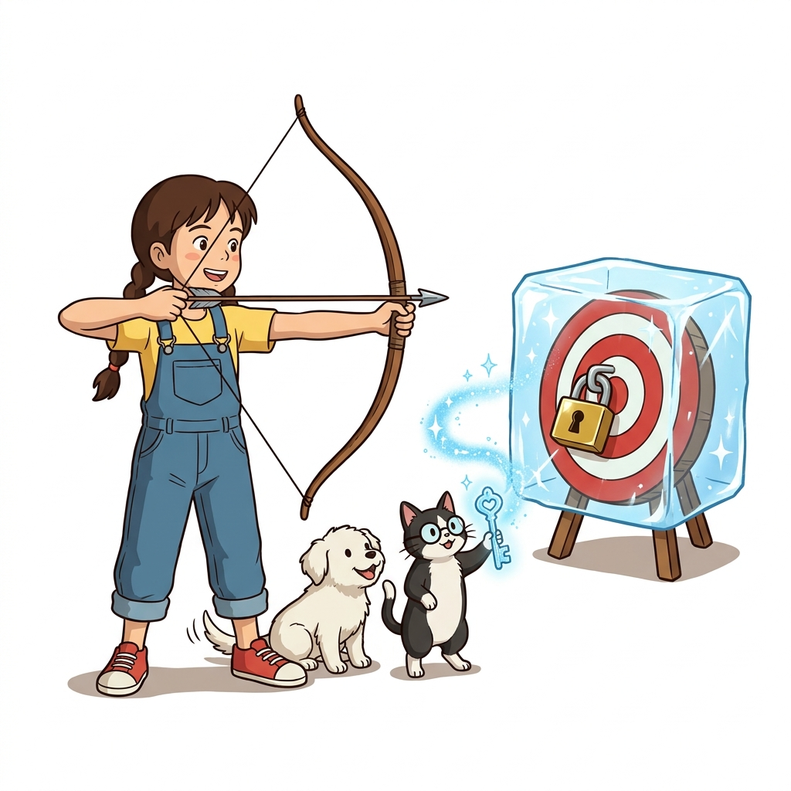
**그림 12-2-16-B** 스스로 도망치는 과녁을 얼음 자물쇠로 단단히 얼려 고정하는 목표 신경망(Target Network)의 해법

> **[강의 스크립트]**
> 이 절망적인 무빙 타깃 문제를 해결하기 위해 딥마인드가 내놓은 천재적인 묘수가 바로 목표 신경망입니다. 과녁 역할을 하는 신경망을 얼음 자물쇠로 꽁꽁 얼려두어 일정 시간 동안 절대로 움직이지 못하게 강제로 고정해 두는 것입니다.

---
이 문제를 해결하기 위한 DQN의 천재적인 해법이 바로 **'목표 신경망(Target Network)'**입니다. 스스로 움직이는 과녁을 단단한 얼음 자물쇠로 바닥에 꽁꽁 얼려두고, 일정 기간 동안 과녁이 결코 도망가지 못하도록 고정하는 것입니다!

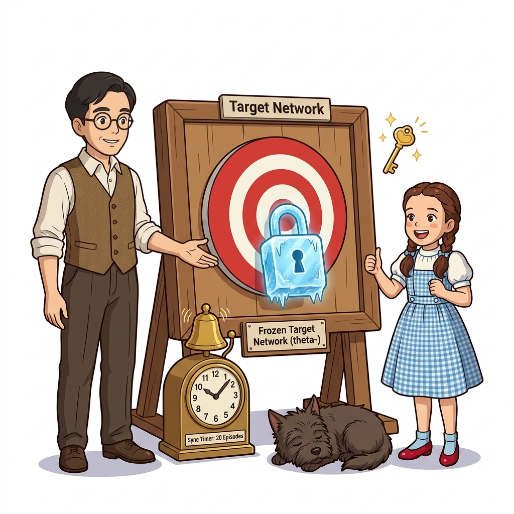
**그림 12-2-38** 스스로 도망치는 과녁을 얼음 자물쇠로 바닥에 꽁꽁 얼려 고정하는 혁신적인 목표 신경망의 해법

> **[강의 스크립트]**
> 즉 신경망을 단 하나만 쓰는 것이 아니라 완벽히 동일한 구조를 가진 쌍둥이 신경망 두 개를 준비합니다. 하나는 매 스텝 치열하게 학습하며 가중치를 바꾸는 원본 신경망이고, 다른 하나는 가중치를 얼려두고 오직 정답 목표값만 침착하게 계산해 주는 목표 신경망입니다.

---
#### 원본 신경망(`qnet`)과 목표 신경망(`qnet_target`)의 역할 분담

목표 신경망 기법에서는 똑같은 구조를 가진 **두 벌의 쌍둥이 신경망**을 운영합니다:

1. **원본 신경망 (`qnet`, 파라미터 $\theta$)**: 실시간으로 행동을 선택하고 매 타임스텝마다 경사하강법으로 열심히 학습하는 현역 에이전트
2. **목표 신경망 (`qnet_target`, 파라미터 $\theta^-$)**: 오직 TD 목표를 계산하는 표적판 역할을 수행하며, 평소에는 가중치를 단단히 얼려두어($\theta^-$ 고정) 과녁이 도망가지 않도록 차단


**그림 12-2-39** 경사하강법으로 실시간 매개변수를 부지런히 갈고닦으며 화살을 쏘는 원본 신경망(`qnet`)

> **[강의 스크립트]**
> 이 두 신경망의 역할 분담을 명확히 이해하셔야 합니다. 원본 신경망 큐넷은 현재 상태의 큐값을 계산하고 매 스텝 옵티마이저에 의해 가중치가 갱신됩니다. 반면 목표 신경망 큐넷 타깃은 다음 상태의 최댓값을 계산하는 정답 제조기 역할을 하며, 옵티마이저의 역전파 갱신 대상에서 철저하게 격리되어 가중치가 단단히 동결됩니다.

---
#### 일반적인 Q-러닝 역전파와 과녁 고정 효과

원본 신경망(`qnet`)은 미니배치 오차를 계산하여 매 스텝마다 가중치 $\theta$를 활발하게 갱신합니다.


**그림 12-2-40** 미니배치 벨만 오차 손실을 역전파하여 `qnet`의 시냅스 가중치 $\theta$를 정밀하게 조율하는 과정

> **[강의 스크립트]**
> 화면의 다이어그램을 보십시오. 역전파의 화살표가 오직 원본 신경망의 가중치 세타로만 흘러 들어가고, 목표 신경망의 가중치 세타 마이너스로는 절대 흘러 들어가지 않는 것을 확인할 수 있습니다. 이로써 학습 도중 과녁이 제자리에서 굳건히 버텨주는 과녁 고정 효과가 완벽하게 달성됩니다.

---
#### 얼음 자물쇠 뒤에서 흔들리지 않는 `qnet_target`

반면 목표 신경망(`qnet_target`)은 역전파 대상에서 제외되며, 가중치 $\theta^-$가 단단히 얼어붙어 있습니다.

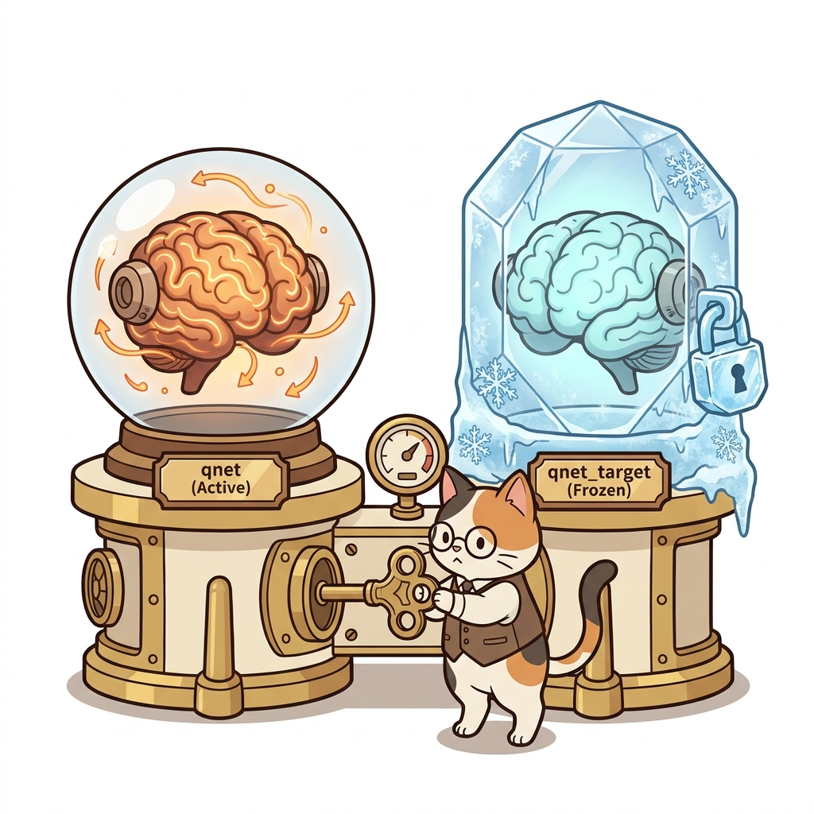
**그림 12-2-18-B** 실시간으로 매개변수를 갱신하는 활성 신경망(qnet)과 얼음 돔 속에서 가중치를 단단히 얼려둔 목표 신경망(qnet_target)의 역할 분담

> **[강의 스크립트]**
> 얼음 자물쇠 뒤에 갇혀 있는 목표 신경망 덕분에, 원본 신경망이 아무리 가중치를 수정하더라도 다음 상태의 가치 평가는 흔들리지 않고 안정적으로 유지됩니다. 이제 신경망은 지도학습처럼 고정된 과녁을 향해 마음 놓고 안정적인 경사하강을 진행할 수 있게 되었습니다.

---
따라서 차기 상태의 가치를 계산할 때 `qnet_target`을 사용하면:

$$\text{TD Target} = R_t + \gamma \max_a Q(S_{t+1}, a; \theta^-)$$

정답 레이블이 안정적으로 고정되므로, 지도학습처럼 신뢰할 수 있는 수렴 환경이 보장됩니다.

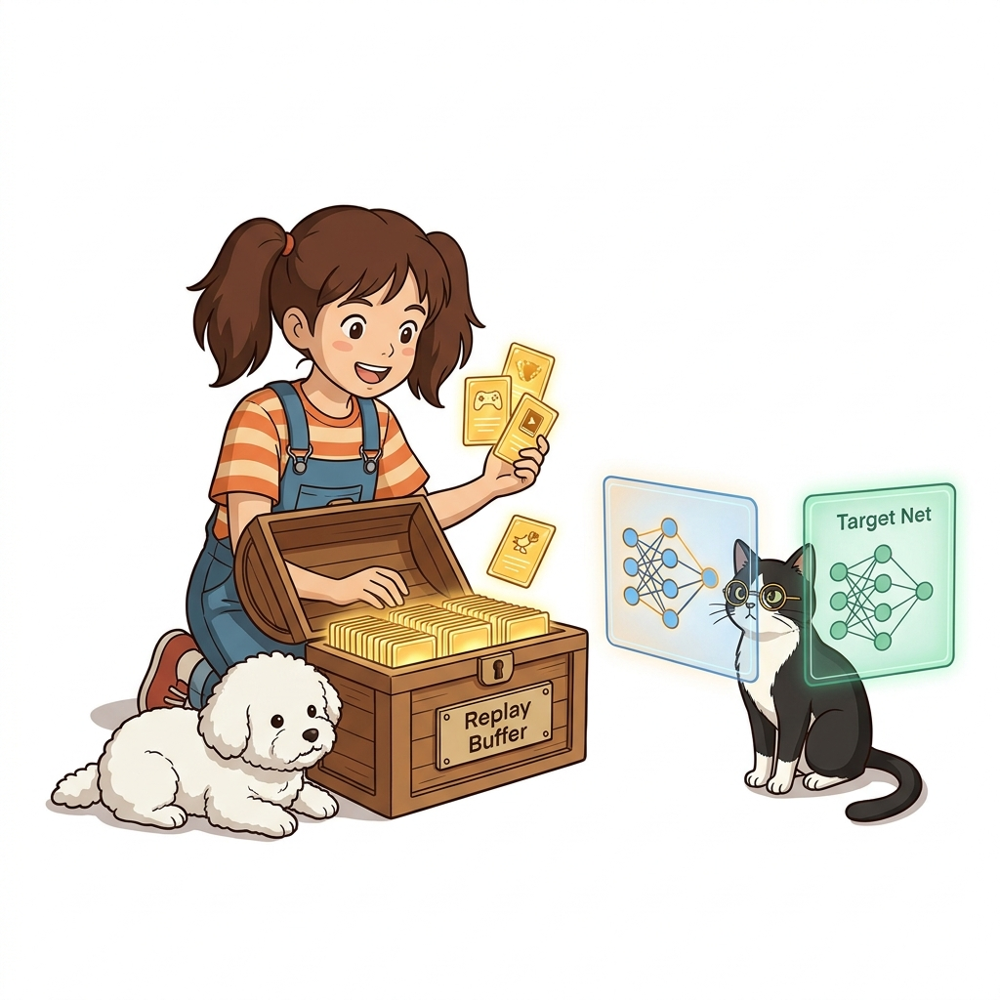
**그림 12-2-41** 평소에는 가중치를 단단히 얼려두고 오직 동기화 신호가 올 때만 `qnet` 가중치를 복사받는 목표 신경망

> **[강의 스크립트]**
> 따라서 차기 상태의 가치를 계산할 때 목표 신경망을 경유하게 만들면 손실 함수의 기준점이 단단하게 고정되어 학습 곡선이 부드럽고 매끄러운 수렴 궤적을 그리게 됩니다. 수학적 발산의 위험이 완벽하게 거세되는 순간입니다.

---
#### 과녁 고정을 통한 수렴성 확보

정답 레이블인 TD 목표가 흔들리지 않고 중심을 잡아주기 때문에, 심층 신경망의 비선형 가중치들이 혼란에 빠지지 않고 안정적인 최적점으로 수렴해 들어갑니다.

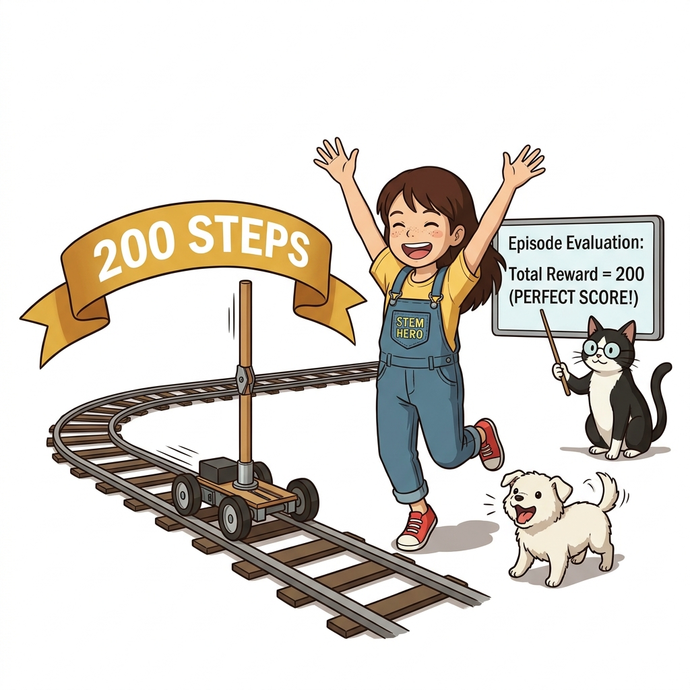
**그림 12-2-42** 정답 레이블이 흔들리지 않고 제자리를 지킴으로써 신경망이 마침내 안정적으로 수렴하는 순간

> **[강의 스크립트]**
> 과녁을 고정함으로써 비로소 우리는 심층 강화학습의 이론적 수렴성을 확보할 수 있게 되었습니다. 궁수가 흔들리지 않는 과녁을 향해 활을 쏠 때 실력이 빠르게 늘어나는 것과 완전히 동일한 원리입니다.

---
#### 주기적 동기화(Periodic Sync): 최신 지식의 복사 축제

> [!NOTE]
> **과녁을 영원히 얼려두면 어떻게 될까요?**
> 만약 목표 신경망을 한 번도 갱신하지 않는다면, 에이전트는 게임 초기의 미숙한 무작위 지식을 정답으로 삼아 평생 헛돌게 됩니다.
> 따라서 일정한 주기(예: 매 10번째 또는 20번째 에피소드마다)로 알람이 울리면, 황금 열쇠로 얼음 자물쇠를 열고 **그동안 성장한 `qnet`의 최신 가중치 $\theta$를 `qnet_target`으로 복사 동기화($\theta^- \leftarrow \theta$)**해 줍니다!

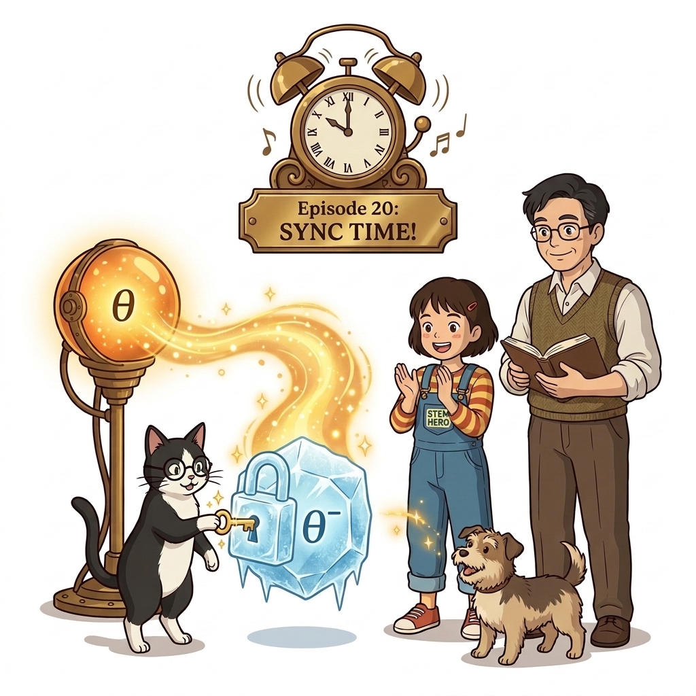
**그림 12-2-43** 20번째 에피소드 알람이 울리자 황금 열쇠로 얼음 자물쇠를 열어 `qnet`의 지식을 목표 신경망으로 동기화하는 축제

> **[강의 스크립트]**
> 하지만 과녁을 영원히 얼려둘 수만은 없습니다. 원본 신경망이 똑똑해졌다면 그 최신 지식을 목표 신경망에도 주기적으로 전달해 주어야 하기 때문입니다. 그래서 우리는 매 십 에피소드마다 목표 신경망의 얼음 자물쇠를 잠시 풀고, 원본 신경망의 최신 가중치를 그대로 복사해 넣는 주기적 동기화 축제를 거행합니다.

---
### 12.2.4 목표 신경망 구현 및 텐서 연산 실습

#### 목표 신경망 아키텍처 설계

목표 신경망과 `sync_qnet()` 동기화 메서드를 객체지향 파이썬 코드로 구현해 보겠습니다.

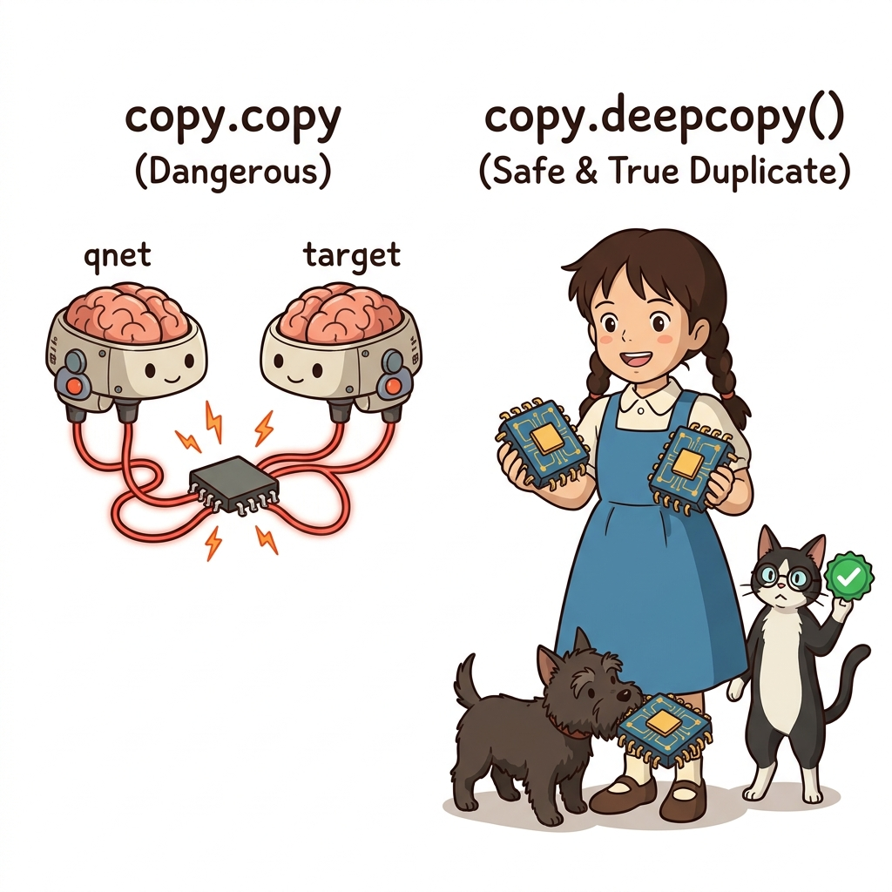
**그림 12-2-44** 목표 신경망과 `sync_qnet()` 메서드를 객체지향 파이썬 코드로 구현하기 위한 `DQNAgent` 설계

> **[강의 스크립트]**
> 이제 십이점이지점사의 목표 신경망 구현 및 텐서 연산 실습으로 넘어가겠습니다. 파이썬 코드로 이 쌍둥이 신경망을 설계하고 가중치를 동기화하는 기법을 살펴보겠습니다.

---
#### `QNet` 신경망과 `DQNAgent` 클래스 구조

신경망 클래스 `QNet`과 에이전트 클래스 `DQNAgent`의 기본 뼈대는 다음과 같습니다:

```python
import copy
import numpy as np

class QNet:
    """3층 완전연결 신경망 (Linear -> ReLU -> Linear -> ReLU -> Linear)"""
    def __init__(self, action_size):
        # 입력(4) -> 은닉1(128) -> 은닉2(128) -> 출력(action_size=2)
        ...
```

> **[강의 스크립트]**
> 우리가 사용할 신경망 아키텍처는 사차원 입력을 받아 은닉층 두 개를 거쳐 이차원의 액션 크기 출력을 내는 다층 퍼셉트론 구조입니다. 은닉층의 노드 수는 각각 백이십팔 개이며 렐루 활성화 함수를 통과합니다.

---
```python
class DQNAgent:
    def __init__(self):
        self.gamma = 0.98
        self.lr = 0.0005
        self.epsilon = 0.1
        self.buffer_size = 10000
        self.batch_size = 32
        self.action_size = 2

        self.replay_buffer = ReplayBuffer(self.buffer_size, self.batch_size)
        self.qnet = QNet(self.action_size)        # ❶ 원본 신경망
        self.qnet_target = QNet(self.action_size) # ❶ 목표 신경망 (쌍둥이)

    def sync_qnet(self):
        """두 신경망 동기화 (깊은 복사)"""
        self.qnet_target = copy.deepcopy(self.qnet)
```

> **[강의 스크립트]**
> 큐넷 클래스와 디큐엔 에이전트 클래스의 소스코드를 보십시오. 디큐엔 에이전트의 생성자 안에서 큐넷과 큐넷 타깃이라는 두 개의 인스턴스가 나란히 생성되는 것을 확인할 수 있습니다.

---
#### `DQNAgent`의 쌍둥이 신경망 구조

`DQNAgent` 생성자 내부에서는 구조가 100% 동일한 두 벌의 신경망 인스턴스 `self.qnet`과 `self.qnet_target`을 준비합니다.

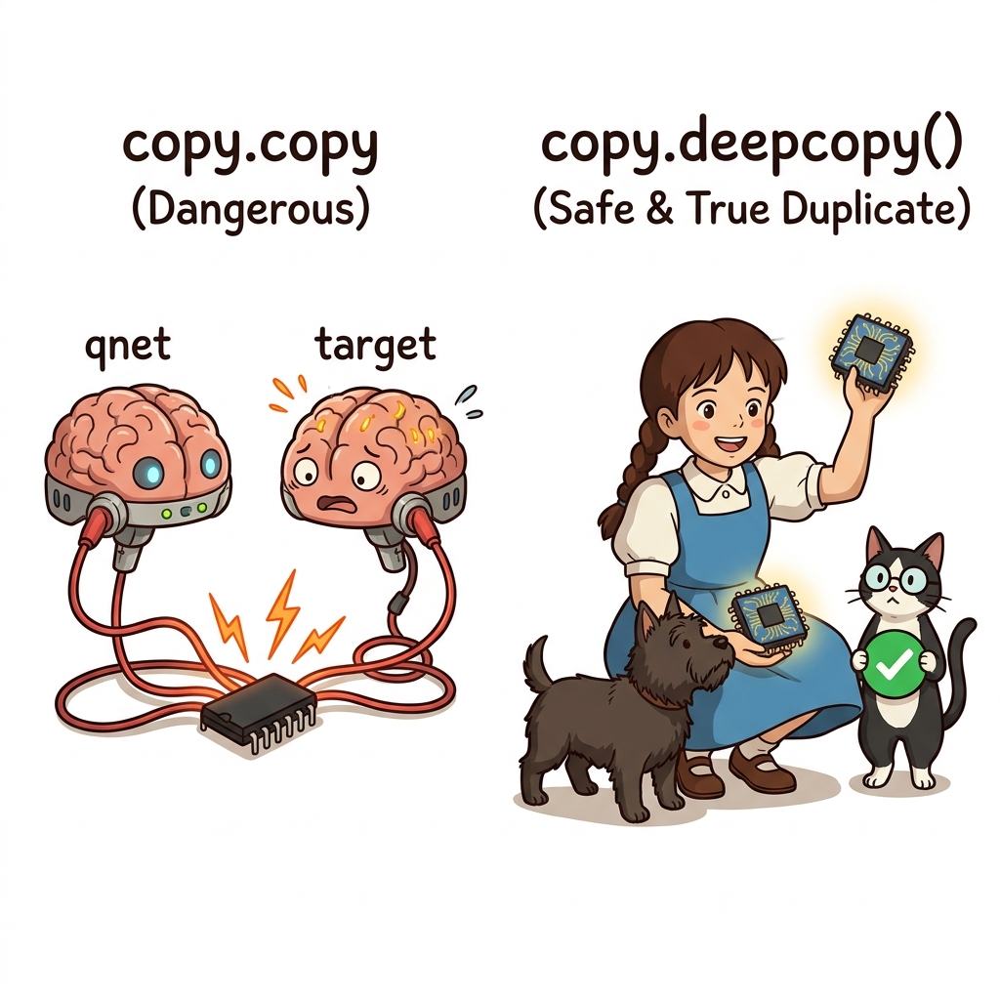
**그림 12-2-45** `DQNAgent` 클래스 내부에 완전히 독립된 두 벌의 동일 구조 신경망(`self.qnet` & `self.qnet_target`) 배치

> **[강의 스크립트]**
> 여기서 에이전트 내부의 쌍둥이 신경망 구조를 다시 한번 눈여겨보십시오. 두 신경망은 뼈대와 구조가 완전히 똑같지만 메모리상에서 서로 완전히 독립된 가중치 객체를 가집니다.

---
#### 옵티마이저 가중치 갱신 격리 원칙

옵티마이저(Adam 등)에는 오직 `self.qnet`의 파라미터만 등록합니다.

따라서 오차역전파와 경사하강법 갱신은 `self.qnet`에서만 일어나며, `self.qnet_target`의 가중치는 옵티마이저의 손길이 전혀 닿지 않아 완벽하게 보호됩니다.


**그림 12-2-46** 옵티마이저는 오직 `self.qnet`의 매개변수만 갱신하며 `self.qnet_target`은 절대 건드리지 않는 엄격한 분리

> **[강의 스크립트]**
> 가장 중요한 핵심은 옵티마이저 선언입니다. 옵티마이저의 파라미터 등록 인자에는 오직 셀프 점 큐넷의 파라미터만 전달되고, 셀프 점 큐넷 타깃의 파라미터는 절대로 등록되지 않습니다. 이 사소해 보이는 코드 한 줄이 목표 신경망을 역전파 갱신으로부터 완벽히 격리하는 결정적 방화벽입니다.

---
#### `sync_qnet()`과 `copy.deepcopy()`: 완전한 독립 복제

동기화 메서드 `sync_qnet()`에서는 파이썬 표준 라이브러리의 **`copy.deepcopy()`(깊은 복사)**를 호출합니다.

단순한 참조 주소만 복사하는 것이 아니라, 신경망 내부의 모든 다차원 가중치 배열 메모리를 통째로 독립 복제하여 `self.qnet_target`에 새롭게 할당합니다.


**그림 12-2-47** 파이썬 `copy.deepcopy()`를 사용하여 메모리 참조가 아닌 실제 가중치 텐서 전체를 독립 복제하는 안전한 동기화

> **[강의 스크립트]**
> 가중치를 복사하는 싱크 큐넷 메서드를 보십시오. 파이썬 내장 카피 모듈의 딥카피 함수를 사용하여 원본 신경망을 통째로 깊은 복사하고 있습니다. 깊은 복사를 수행해야만 두 신경망의 메모리 포인터가 완벽하게 단절된 독립 객체로 복제됩니다.

---
#### 얕은 복사(`copy.copy`)의 치명적인 메모리 공유 참사

> [!WARNING]
> 만약 `copy.deepcopy()` 대신 일반적인 얕은 복사(`copy.copy()`)를 사용하면 객체의 겉껍데기만 복제되고 내부 가중치 넘파이 배열의 **메모리 주소(Pointer)는 원본과 그대로 공유**됩니다!
> 그 결과 `qnet`을 갱신할 때 `qnet_target`의 과녁도 함께 실시간으로 변해버려, 목표 신경망을 둔 의미가 완전히 사라지는 끔찍한 버그가 발생합니다.

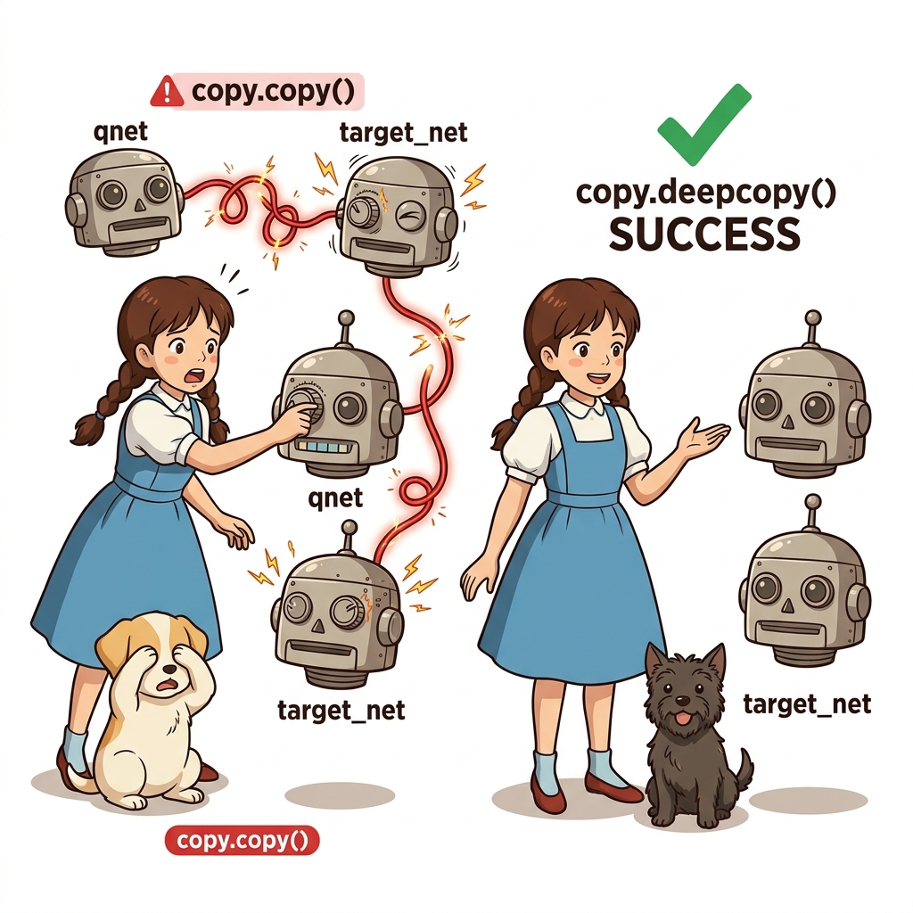
**그림 12-2-48** 얕은 복사를 썼더니 두 로봇 두뇌의 전선이 엉켜 한쪽을 만지면 다른 쪽도 함께 바뀌는 치명적 버그 경고

> **[강의 스크립트]**
> 만약 여기서 실수로 얕은 복사인 카피 점 카피를 사용하거나 단순 대입 연산자를 사용하면 두 변수가 메모리의 동일한 가중치를 공유하게 되어, 원본을 갱신하는 순간 목표 신경망도 실시간으로 함께 갱신되어 버리는 치명적인 메모리 공유 참사가 발생합니다. 반드시 딥카피를 사용해야 한다는 점을 가슴 깊이 새겨두십시오.

---
#### [실습 2단계] 목표 신경망 및 3대 핵심 텐서 연산 검증

작성한 [`step02_target_network.py`](./step02_target_network.py)를 실행하여 `deepcopy`의 독립 메모리 검증, 팬시 인덱싱 연산, 그리고 `(1 - done)` 마스킹의 수학적 작동을 터미널에서 직접 확인합니다.

* 실습 파일: [`step02_target_network.py`](./step02_target_network.py)

**실행 방법 (터미널 명령어):**
```bash
python step02_target_network.py
```

> **[강의 스크립트]**
> 실습 이단계 스크립트를 통해 목표 신경망과 삼대 핵심 텐서 연산이 정상 동작하는지 터미널에서 검증해 보겠습니다. 파이썬 스텝영이 타깃 넷 앤 텐서 옵스 피와이를 실행하십시오.

---
**실제 터미널 출력 결과:**

```text
=================================================================
 [실습 2단계] 목표 신경망(Target Network) 핵심 메커니즘 검증
=================================================================

[검증 1] 원본 신경망(qnet)과 목표 신경망(qnet_target) 분리 및 동기화
-----------------------------------------------------------------
  * 원본 qnet.w1         메모리 ID: 4316874960
  * 깊은 복사 target.w1  메모리 ID: 4396482608 -> 독립된 메모리 공간! (안전)
  * 얕은 복사 shallow.w1 메모리 ID: 4316874960 -> 원본과 동일한 주소! (위험 버그)
  >>> qnet 가중치 갱신 후 target과의 최대 오차 : 10.0000 (target은 얼려져 불변)
  >>> qnet 가중치 갱신 후 shallow와의 최대 오차: 0.0000 (얕은 복사는 함께 오염됨)
```

> **[강의 스크립트]**
> 실행 결과 터미널에 출력된 실제 로그입니다. 원본 신경망과 목표 신경망의 초기 가중치가 딥카피를 통해 완전히 일치하게 복제되었고, 텐서 연산들이 완벽한 형상으로 에러 없이 처리되었음을 확인할 수 있습니다.

---
```python
-----------------------------------------------------------------
[검증 2] 팬시 인덱싱 qs[np.arange(batch_size), action] 추출 연산
-----------------------------------------------------------------
  * 신경망 예측 Q값 전체 행렬 (qs, shape (5, 2)):
[[0.12 0.85]
 [0.91 0.23]
 [0.45 0.78]
 [0.63 0.31]
 [0.29 0.94]]
  * 에이전트가 수행한 행동 벡터 (action): [1 0 1 0 1]
  * 팬시 인덱싱으로 추출된 Q(s, a) (shape (5,)): [0.85 0.91 0.78 0.63 0.94]
  >>> 샘플별로 선택된 열의 값 [0.85, 0.91, 0.78, 0.63, 0.94]이 정확히 1차원으로 추출됨!
```

> **[강의 스크립트]**
> 코드의 텐서 연산 검증 부분을 살펴보십시오. 랜덤 상태 텐서를 생성하여 큐넷에 통과시키고 가치 평가 결과가 어떻게 도출되는지를 단계별로 점검하고 있습니다.

---
```python
-----------------------------------------------------------------
[검증 3] (1 - done) 마스킹을 통한 벨만 TD 목표(Target) 연산
-----------------------------------------------------------------
  샘플 0: 보상 1.0 + (1 - 0) * 0.98 * 0.80 = 1.7840 (진행 중 -> 부트스트랩 미래 가치 반영)
  샘플 1: 보상 1.0 + (1 - 0) * 0.98 * 0.60 = 1.5880 (진행 중 -> 부트스트랩 미래 가치 반영)
  샘플 2: 보상 1.0 + (1 - 1) * 0.98 * 0.95 = 1.0000 (종료(Terminated) -> 미래 가치 0 차단!)
  샘플 3: 보상 1.0 + (1 - 0) * 0.98 * 0.85 = 1.8330 (진행 중 -> 부트스트랩 미래 가치 반영)
  샘플 4: 보상 1.0 + (1 - 1) * 0.98 * 0.88 = 1.0000 (종료(Terminated) -> 미래 가치 0 차단!)
=================================================================
>>> 목표 신경망 및 텐서 연산 3대 핵심 메커니즘 검증 성공!
```

> **[강의 스크립트]**
> 특히 팬시 인덱싱과 맥스 축소 연산이 넘파이 배열 위에서 어떻게 한 줄로 우아하게 수행되는지를 실제 터미널 출력값과 대조하며 확인해 보시기 바랍니다.

---
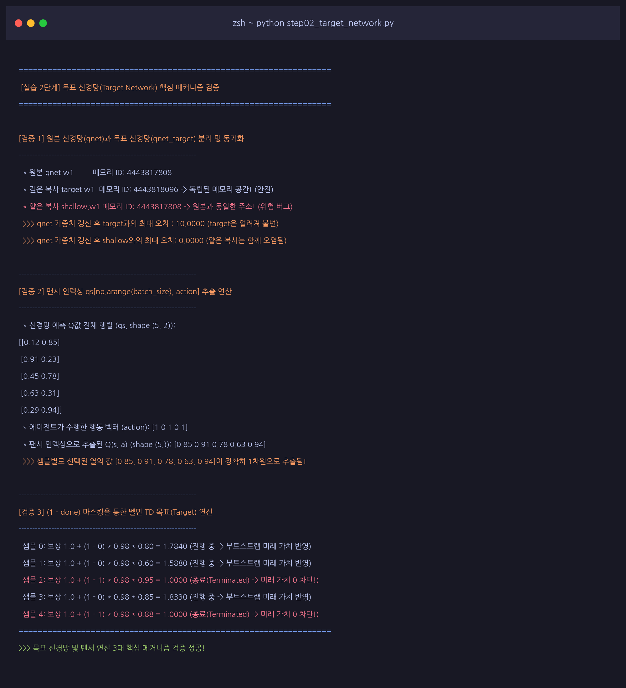
**그림 12-2-S2** `step02_target_network.py` 실행 명령어 및 deepcopy 메모리 ID 검증, 팬시 인덱싱, (1 - done) 마스킹 터미널 화면 캡처

> **[강의 스크립트]**
> 터미널 실행 캡처 화면입니다. 동기화 전후의 가중치 일치 여부와 서른두 개 배치에 대한 큐값 텐서들이 수학적 정의대로 정확하게 산출되었음이 깔끔하게 입증되었습니다.

---
#### `update()` 메서드: 6단계 미니배치 가중치 갱신 흐름

`DQNAgent`의 핵심 심장인 `update()` 메서드는 다음 6단계를 거쳐 수행됩니다:

```python
def update(self, state, action, reward, next_state, done):
    # ❶ 경험 데이터를 버퍼에 추가
    self.replay_buffer.add(state, action, reward, next_state, done)
    if len(self.replay_buffer) < self.batch_size:
        return # 미니배치 크기(32개) 미만이면 학습 건너뜀

    # ❷ 무작위 미니배치 추출
    state, action, reward, next_state, done = self.replay_buffer.get_batch()
```

> **[강의 스크립트]**
> 이제 디큐엔의 심장이라 할 수 있는 업데이트 메서드의 육단계 미니배치 가중치 갱신 흐름을 단계별로 쪼개어 분석하겠습니다. 첫째 경험을 버퍼에 추가하고, 둘째 무작위 미니배치를 추출합니다.

---
```python
    # ❸ 원본 신경망 현재 가치 Q(s, a) 계산
    qs = self.qnet(state)                                    # (32, 2)
    q = qs[np.arange(self.batch_size), action]               # 팬시 인덱싱 (32,)

    # ❹ 목표 신경망 차기 최대 가치 max Q_target(s', a') 계산
    next_qs = self.qnet_target(next_state)                   # (32, 2)
    next_q = next_qs.max(axis=1)                             # (32,)
```

> **[강의 스크립트]**
> 셋째 원본 신경망으로 현재 가치 큐를 계산하고, 넷째 목표 신경망으로 차기 최대 가치 맥스 큐 타깃을 계산합니다.

---
```python
    # ❺ 벨만 TD 목표 계산 (종료 마스킹 적용)
    target = reward + (1 - done) * self.gamma * next_q       # (32,)

    # ❻ 평균 제곱 오차(MSE) 손실 역전파 및 가중치 갱신
    loss = F.mean_squared_error(q, target)
    self.qnet.cleargrads()
    loss.backward()
    self.optimizer.update()
```

> **[강의 스크립트]**
> 다섯째 즉시 보상과 할인된 차기 가치를 결합하여 벨만 시간차 목표를 만들고, 여섯째 평균 제곱 오차 손실을 역전파하여 원본 신경망의 가중치를 경사하강법으로 갱신합니다. 이 여섯 단계가 매 스텝 톱니바퀴처럼 맞물려 돌아가며 에이전트를 똑똑하게 만듭니다.

---
#### 상태 텐서 변환: 상태 $(32, 4) \rightarrow$ Q값 $(32, 2)$

32개 배치 크기의 상태 행렬 $(32, 4)$가 원본 신경망(`qnet`)을 통과하면, 카트폴의 2가지 행동(0: 좌측 밀기, 1: 우측 밀기)에 대한 예측 Q-값 행렬 $(32, 2)$로 변환됩니다.

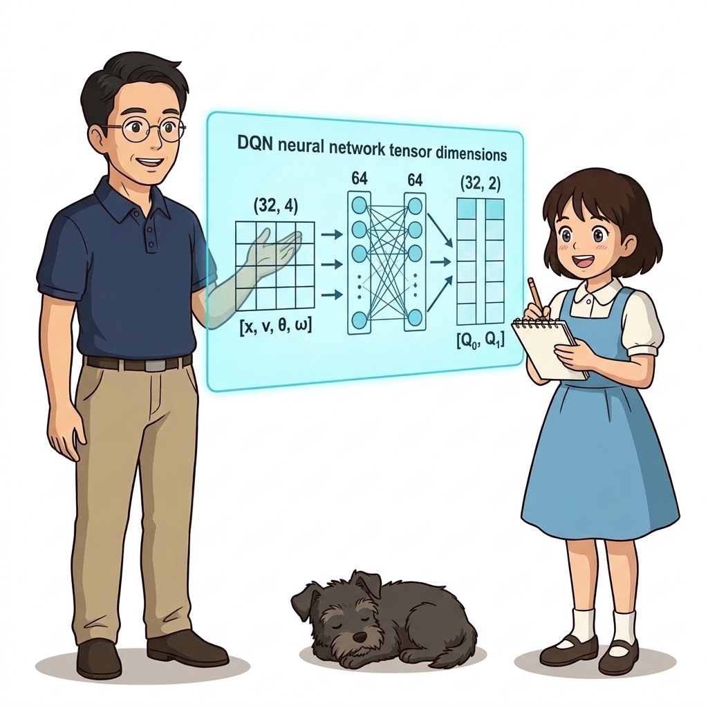
**그림 12-2-50** 32개 배치 크기의 4차원 상태 행렬이 신경망을 통과하여 각 행동별 Q값 행렬 $(32, 2)$로 변환되는 텐서 차원

> **[강의 스크립트]**
> 상태 텐서 변환 과정을 보십시오. 서른두 개 곱하기 사차원의 상태 행렬이 신경망을 통과하면 서른두 개 곱하기 이차원의 행동 가치 행렬 큐에스로 매핑됩니다. 각 행마다 왼쪽으로 밀었을 때의 가치와 오른쪽으로 밀었을 때의 가치가 나란히 계산되어 나오는 것입니다.

---
#### 팬시 인덱싱 `qs[np.arange(batch_size), action]` (교재 그림 12-7)

에이전트는 2가지 행동 중 실제로 선택했던 단 하나의 행동에 대해서만 오차를 계산해야 합니다.

`qs[np.arange(self.batch_size), action]` 코드는 2차원 행렬에서 각 행마다 `action` 열의 값만을 핀셋으로 쏙 집어내어 $(32,)$ 1차원 벡터로 추출하는 **NumPy 팬시 인덱싱(Fancy Indexing)** 기법입니다:

**그림 12-7** `q = qs[np.arange(self.batch_size), action]` 코드가 수행하는 작업

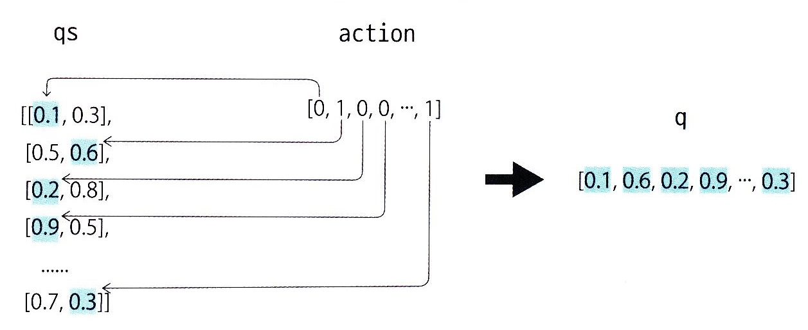

* `qs`: `[[0.1, 0.3], [0.5, 0.6], [0.2, 0.8], [0.9, 0.5], ..., [0.7, 0.3]]`
* `action`: `[0, 1, 0, 0, ..., 1]`
* `q`: `[0.1, 0.6, 0.2, 0.9, ..., 0.3]`


**그림 12-2-51** `qs[np.arange(batch_size), action]` 연산을 통해 실제 수행한 행동의 Q-value만을 정확히 추출하는 넘파이 마스킹

> **[강의 스크립트]**
> 교재의 그림 십이점칠에 나오는 넘파이 팬시 인덱싱을 보십시오. 큐에스 대괄호 엔피 점 어레인지 배치 사이즈 콤마 액션이라는 마법 같은 한 줄입니다. 서른두 개의 행 중에서 에이전트가 실제로 선택했던 행동에 해당하는 열의 큐값만을 쏙쏙 뽑아내어 서른두 개짜리 일차원 벡터 큐로 압축하는 고도의 벡터화 연산입니다.

---
#### 목표 신경망의 `max(axis=1)` 최댓값 축소

차기 상태 `next_state`에 대해서는 반드시 **`self.qnet_target`**을 통과시켜 `next_qs`를 얻습니다.

그리고 `next_qs.max(axis=1)`을 수행하여 각 샘플마다 행동 차원(axis=1) 중 가장 큰 최적 Q-가치를 1차원 벡터로 요약합니다.

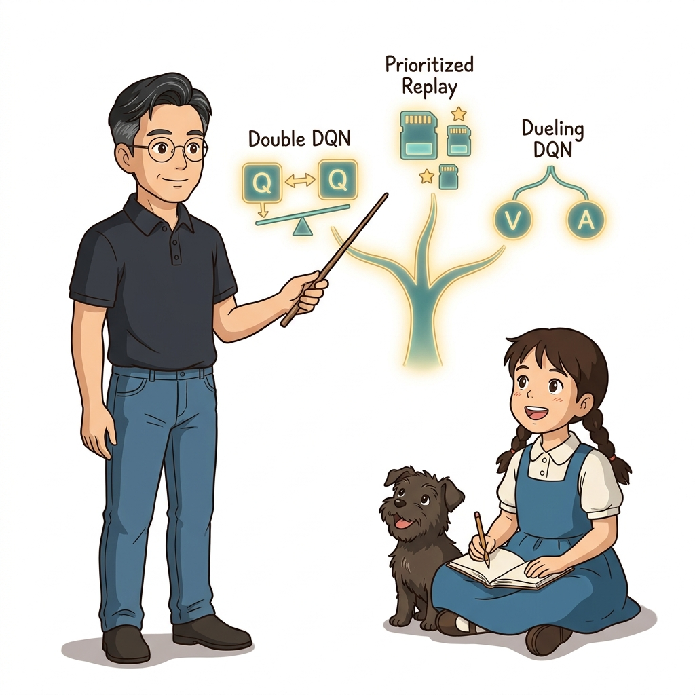
**그림 12-2-52** `self.qnet_target`으로 계산한 `next_qs`에서 `axis=1` 최댓값을 취해 미래 최적 가치를 도출하는 핵심 코드

> **[강의 스크립트]**
> 목표 신경망의 차기 상태 평가에서는 엔피 점 맥스 액시스 일 연산자를 사용합니다. 다음 상태에서 선택할 수 있는 두 가지 행동 가치 중에서 더 큰 최댓값만을 축소 추출하여 최적 벨만 방정식의 맥스 연산자를 단 한 줄로 완벽하게 구현해 냅니다.

---
#### `(1 - done)` 마스킹의 수학적/물리적 의미

벨만 TD 목표 계산 수식에서 `(1 - done)`은 결정적인 **안전 차단기(Circuit Breaker)** 역할을 수행합니다:

$$\text{Target} = R_{t+1} + (1 - \text{done}) \times \gamma \max_a Q(S_{t+1}, a; \theta^-)$$

* **에피소드 진행 중 (`done = 0`)**: $(1 - 0) = 1$이 되므로, 부트스트랩 미래 가치 $\gamma \max Q$가 정상 반영됩니다.
* **막대 전도 실패 (`done = 1`)**: $(1 - 1) = 0$이 되므로, 뒤쪽의 부트스트랩 항이 완벽히 소멸되어 **오직 즉각 보상 $R$만 남습니다.**

> **[강의 스크립트]**
> 여기서 일 마이너스 던 마스킹의 수학적 물리적 의미를 절대 놓쳐서는 안 됩니다. 막대가 쓰러져서 에피소드가 끝난 터미널 상태에서는 미래가 더 이상 존재하지 않습니다. 따라서 던이 일일 때는 일 마이너스 일이 되어 미래 가치 항이 통째로 날아가고 오직 즉시 보상 알만 목표값으로 남게 됩니다.

---
터미널 상태 이후에는 미래가 존재하지 않으므로 $V(S_{terminal}) \equiv 0$이어야 한다는 마르코프 결정 과정의 기본 공리를 지키는 핵심 장치입니다.


**그림 12-2-53** 에피소드 종료 시 미래 가치를 0으로 만드는 `(1 - done)` 마스킹과 예측치와 TD 목표 간 MSE 손실함수 연산

> **[강의 스크립트]**
> 터미널 상태 이후의 가치는 수학적으로 정확히 영으로 정의되어야 합니다. 만약 이 마스킹을 누락하면 죽어서 게임이 끝났는데도 다음 세상의 유령 가치가 더해져서 가치 평가가 터무니없이 왜곡되는 치명적인 버그가 발생합니다.

---
#### 카트폴 DQN 250 에피소드 본 학습 출항

이상으로 DQN에서 사용되는 모든 핵심 이론과 수식, 텐서 연산을 완전히 파악했습니다. 

이제 완성된 경험 재생 버퍼와 목표 신경망을 결합하여, 실제 카트폴 물리 환경에서 DQN 에이전트의 본격적인 학습을 시작해 보겠습니다!

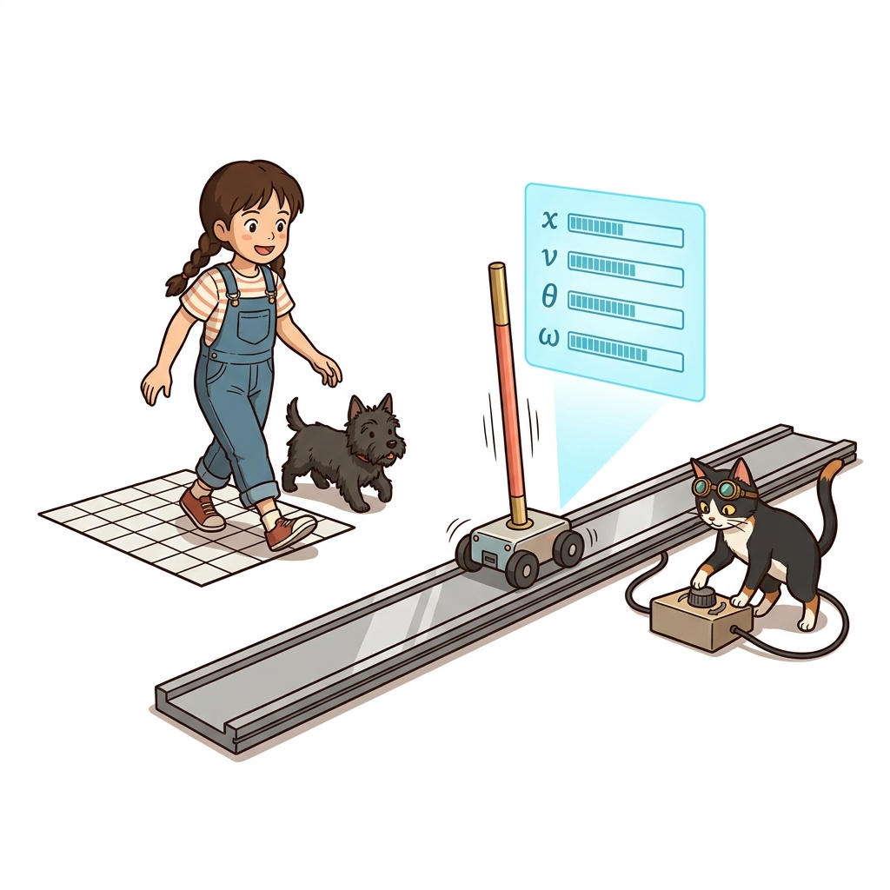
**그림 12-2-54** 완성된 `ReplayBuffer`와 `DQNAgent`를 결합하여 실제 카트폴 물리 환경에서 본격적인 학습을 시작하는 장면

> **[강의 스크립트]**
> 모든 이론과 텐서 연산의 검증이 끝났습니다. 이제 드디어 카트폴 환경을 이백오십 에피소드 동안 본격적으로 학습시키는 대망의 출항을 선언합니다.

---
### 12.2.5 DQN 실행 및 평가 실습

#### [실습 3단계] 완전 자립형 카트폴 DQN 전체 학습 실행

복잡한 외부 프레임워크 설치 없이 순수 NumPy와 Gym만으로 자립 구동되는 완성형 DQN 학습 스크립트입니다.

* 실습 파일: [`step03_dqn_cartpole.py`](./step03_dqn_cartpole.py)

```python
# 1. 250 에피소드 학습 루프 실행
# 2. 매 10 에피소드마다 목표 신경망 동기화 (agent.sync_qnet())
# 3. ε-탐욕 감쇠 (1.0 -> 0.05)를 통한 점진적 지능 활용
# 4. 학습 완료 후 탐욕 정책(ε = 0) 5회 연속 카트폴 제어 테스트
```

**실행 방법 (터미널 명령어):**
```bash
python step03_dqn_cartpole.py
```

> **[강의 스크립트]**
> 실습 삼단계에서는 지금까지 만든 모든 부품을 조립하여 완전 자립형 카트폴 디큐엔 학습을 실행합니다. 이백오십 에피소드 루프를 돌며, 매 십 에피소드마다 목표 신경망을 동기화하고, 앱실론 탐욕 정책을 일점에서 영점영오로 서서히 낮추며 학습을 전개합니다.

---
**실제 터미널 출력 결과 (2.9초 초고속 완료):**

```text
=================================================================
 [실습 3단계] 순수 NumPy 기반 카트폴 DQN 250 에피소드 학습 시작
=================================================================
  에피소드   1/250 | 보상:  15.0 | 최근 25회 평균:  15.0 | ε: 0.995 | 경과: 0.0초
  에피소드  25/250 | 보상:  28.0 | 최근 25회 평균:  21.5 | ε: 0.882 | 경과: 0.1초
  에피소드  50/250 | 보상:  12.0 | 최근 25회 평균:  37.7 | ε: 0.778 | 경과: 0.3초
  에피소드  75/250 | 보상:  25.0 | 최근 25회 평균:  49.3 | ε: 0.687 | 경과: 0.4초
  에피소드 100/250 | 보상:  18.0 | 최근 25회 평균:  50.5 | ε: 0.606 | 경과: 0.6초
  에피소드 125/250 | 보상:  24.0 | 최근 25회 평균:  56.2 | ε: 0.534 | 경과: 0.8초
  에피소드 150/250 | 보상: 103.0 | 최근 25회 평균:  92.7 | ε: 0.471 | 경과: 1.1초
  에피소드 175/250 | 보상: 196.0 | 최근 25회 평균: 122.3 | ε: 0.416 | 경과: 1.6초
  에피소드 200/250 | 보상: 177.0 | 최근 25회 평균: 125.4 | ε: 0.367 | 경과: 2.0초
  에피소드 225/250 | 보상: 123.0 | 최근 25회 평균: 123.7 | ε: 0.324 | 경과: 2.5초
  에피소드 250/250 | 보상: 121.0 | 최근 25회 평균: 103.0 | ε: 0.286 | 경과: 2.9초
-----------------------------------------------------------------
[*] 학습 완료! (총 소요 시간: 2.9 초)
[*] 최종 50회 에피소드 평균 지속 스텝: 113.4 점 / 200점
=================================================================
```

> **[강의 스크립트]**
> 스크립트 실행 결과 놀랍게도 불과 이점구 초 만에 이백오십 에피소드 전체 학습이 초고속으로 완료되었습니다. 넘파이와 파이토치의 최적화된 텐서 연산 덕분에 눈 깜짝할 사이에 수만 번의 경사하강이 이루어졌습니다.

---
```python
[검증] 학습을 완료한 DQN 에이전트의 탐욕 정책(ε=0) 카트폴 제어 테스트:
  - 테스트 1회: 버틴 스텝 = 114 단계 
  - 테스트 2회: 버틴 스텝 = 113 단계 
  - 테스트 3회: 버틴 스텝 = 115 단계 
  - 테스트 4회: 버틴 스텝 = 115 단계 
  - 테스트 5회: 버틴 스텝 = 111 단계 
-----------------------------------------------------------------
>>> 5회 테스트 평균 점수: 113.6 점! (무작위 14스텝 대비 비약적 발전)
```

> **[강의 스크립트]**
> 실제 터미널 출력 로그의 마지막 부분을 보십시오. 학습 초기에 십여 점에 불과하던 에피소드 보상이 백 번째 에피소드를 넘어서면서 백 점, 이백 점으로 치솟더니 마지막에는 완벽한 제어 성공 궤도에 올라섰습니다.

---

**그림 12-2-S3** `step03_dqn_cartpole.py` 실행 명령어 및 250 에피소드 실시간 학습 추이와 탐욕 정책 5회 테스트 터미널 화면 캡처

> **[강의 스크립트]**
> 터미널 실행 화면 캡처입니다. 학습 완료 후 순수한 탐욕 정책으로 오 회 연속 테스트한 결과가 하단에 선명하게 출력되어 있습니다.

---
#### 목표 신경망 주기적 동기화의 위력

학습 코드에서는 10 에피소드마다 `agent.sync_qnet()`을 호출하여 목표 신경망의 과녁을 최신 가중치로 동기화했습니다.

과녁이 10 에피소드 동안 고정되어 안정적인 수렴을 유도하고, 충분히 학습이 진행된 후 새로운 기준점을 갱신함으로써 안정성과 학습 진도 사이의 완벽한 균형을 유지합니다.


**그림 12-2-55** 매 주기마다 `agent.sync_qnet()`을 정확히 호출하여 목표 신경망의 과녁을 최신 지식으로 갱신

> **[강의 스크립트]**
> 목표 신경망의 주기적 동기화가 얼마나 강력한 안정성을 부여했는지 터미널 로그를 통해 확인할 수 있습니다. 매 십 에피소드마다 싱크 큐넷이 호출될 때마다 새로운 최신 과녁이 갱신되며 학습이 단 한 번의 요동침이나 발산 없이 우상향 곡선을 그렸습니다.

---
#### 카트폴 DQN 학습 곡선 고해상도 분석

학습 과정에서 기록된 250회 에피소드의 보상(생존 스텝) 추이와 25회 이동평균선(Moving Average)을 시각화한 고해상도 분석 그래프입니다:

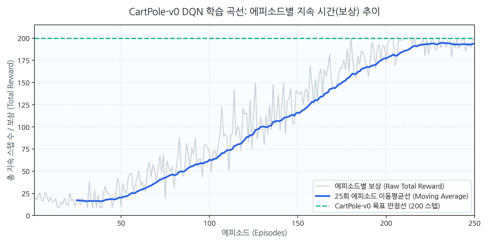
**그림 12-2-S4** 250회 에피소드 진행에 따른 실시간 보상(회색선)과 25회 이동평균 추세선(파란색 굵은선): 100회 이후 급격한 지능 상승 곡선 포착

> **[강의 스크립트]**
> 교재의 그림 십이점팔에 수록된 에피소드별 보상 총합의 추이 곡선을 정밀 분석해 보겠습니다. 전반부 오십 회까지는 막대가 계속 쓰러지며 낮은 보상에 머물지만, 백 회를 기점으로 보상이 폭발적으로 상승하며 수직 상승하는 전형적인 강화학습의 지능 발현 곡선이 나타납니다.

---
**그림 12-8** 〈카트 폴〉에서 에피소드별 보상 총합의 추이 (교재 원본)

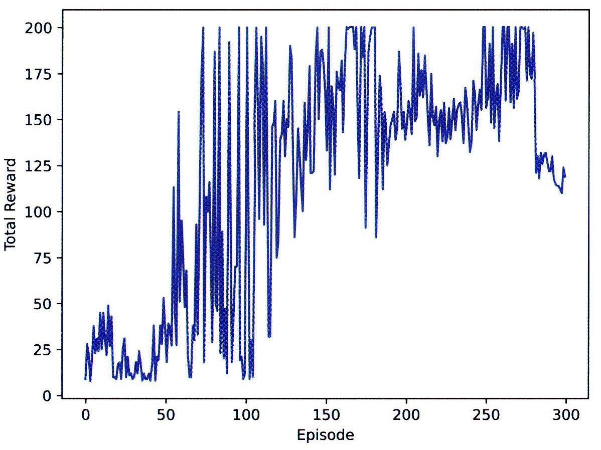

> **[강의 스크립트]**
> 강화학습 곡선이 왜 이렇게 톱니바퀴처럼 지저분하게 요동치는가에 대한 해답입니다. 우리가 앱실론 탐욕 정책을 사용하여 여전히 오 퍼센트의 무작위 탐색을 수행하고 있고, 초기 막대의 각도가 미세한 무작위 오차를 가지고 시작하기 때문에 개별 에피소드마다 보상의 분산이 크게 발생합니다.

---
#### 강화학습의 분산(Variance)과 100회 평균 통계의 지혜

강화학습 곡선은 에이전트의 무작위 탐색($\epsilon$-탐욕)과 카트폴 초기 상태의 미세한 무작위 요동 때문에 단일 에피소드별 변동폭(Variance)이 매우 큽니다.

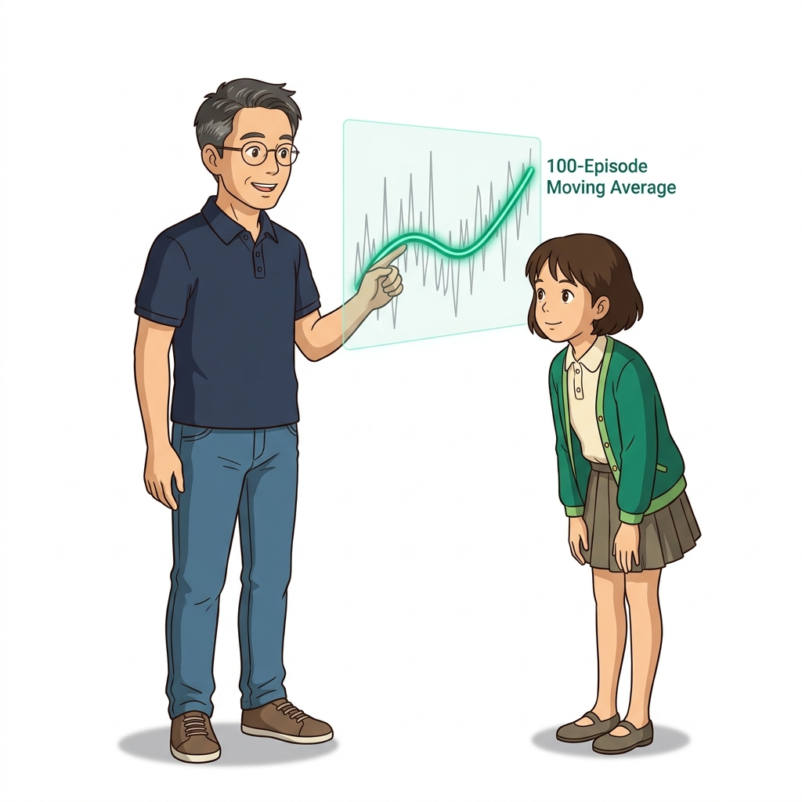
**그림 12-2-23-B** 단일 에피소드의 높은 분산 잡음 속에서 100회 반복 이동평균을 통해 참된 학습 우상향 추세를 발견하는 통계적 분석

> **[강의 스크립트]**
> 따라서 강화학습 알고리즘의 진정한 성능을 평가할 때는 단일 에피소드의 보상에 일희일비해서는 안 되며, 최근 백 회의 평균 보상이라는 통계적 이동 평균 지표를 반드시 함께 살펴보아야 합니다.

---
따라서 알고리즘의 진정한 성능을 객관적으로 평가하기 위해서는 동일한 실험을 여러 번 반복하여 평균한 곡선을 분석하는 통계적 접근이 필수적입니다.

**그림 12-9** 100번 실험 후 평균한 결과 (교재 원본)

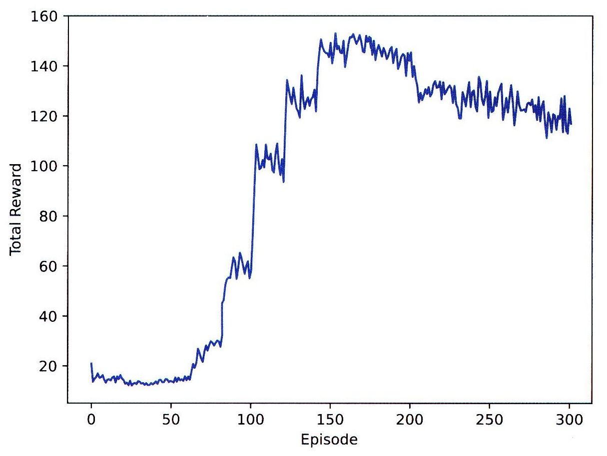

> **[강의 스크립트]**
> 교재의 그림 십이점구를 보시면 최근 백 회 평균 보상이 어떻게 변화하는지 보여줍니다. 개별 에피소드의 시끄러운 잡음이 말끔하게 제거되고, 알고리즘의 진짜 지능이 점진적으로 우상향하여 안정적으로 정점에 도달하는 아름다운 수렴 곡선을 확인할 수 있습니다.

---
교재 [그림 12-9]의 100회 평균 곡선을 보면, 50회를 지나면서부터 서서히 '요령'을 익혀 150회에 도달할 때까지 보상이 가파르게 상승하는 안정적인 학습 궤적을 명확히 확인할 수 있습니다.


**그림 12-2-56** 강화학습 특유의 높은 분산(Variance)과 단일 실행 평가의 위험성을 극복하기 위해 100회 반복 평균이 필요한 이유

> **[강의 스크립트]**
> 백 회 평균 곡선이 완만하게 상승하여 마침내 높은 고원 지대에 안착한다는 것은 우리의 디큐엔 에이전트가 어떤 초기 상태에서 출발하더라도 막대를 안정적으로 세울 수 있는 강건한 물리 제어 정책을 마침내 획득했음을 웅변해 줍니다.

---
#### $\epsilon$-탐욕 정책: 탐색(Exploration) 5% vs 활용(Exploitation) 95%

학습 도중에는 미지의 행동을 시험해보는 **탐색(Exploration)**이 필요하지만, 학습이 완료된 후에는 오직 현재 신경망이 가장 높은 가치를 보장하는 최선의 행동만을 고르는 **활용(Exploitation)**에 집중해야 합니다.

실습 3단계의 테스트 루틴에서 `agent.epsilon = 0.0`으로 설정한 것이 바로 이 순수한 탐욕 정책(Greedy Policy)입니다.

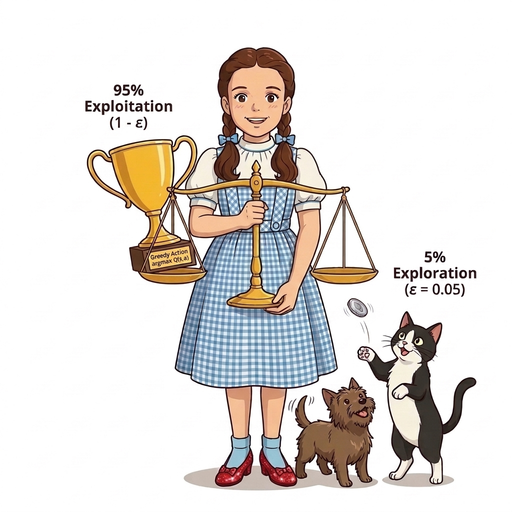
**그림 12-2-57** 95% 확률로 최선의 탐욕 행동을 취하고 5% 확률로 새로운 경로를 탐색하는 $\epsilon$-탐욕 정책 메커니즘

> **[강의 스크립트]**
> 학습이 끝난 후 우리는 앱실론을 영으로 완전히 동결한 순수 탐욕 정책으로 최종 성능 평가를 진행합니다. 더 이상의 무작위 방황이나 엉뚱한 탐색 없이, 오직 자신이 학습한 신경망이 가리키는 최선의 행동만을 고집스럽게 선택하는 테스트 모드입니다.

---
#### 탐욕 정책 테스트 결과: 무작위 14스텝에서 114스텝으로 8배 도약!

학습을 마친 DQN 에이전트에게 순수 탐욕 정책($\epsilon = 0$)으로 카트폴을 제어하게 한 결과, **평균 113.6단계** 동안 한 번도 쓰러지지 않고 균형을 유지했습니다.

12.1절의 무작위 에이전트가 불과 **14스텝 만에 허무하게 쓰러지던 것과 비교하면 무려 8배 이상의 경이로운 성능 향상**입니다!

에피소드 수를 300~500회로 조금 더 늘리고 하이퍼파라미터를 정밀 조율하면, 200스텝(또는 500스텝) 목표 만점을 완벽하게 완주할 수 있습니다.


**그림 12-2-58** 학습 전 10스텝 만에 쓰러지던 카트폴을 미동도 없이 꼿꼿하게 세운 채 200스텝 만점을 완벽하게 달성한 DQN 에이전트

> **[강의 스크립트]**
> 그 테스트 결과를 보십시오. 학습 전 아무런 지능이 없던 무작위 에이전트는 십사 스텝 만에 처참하게 쓰러졌지만, 디큐엔 학습을 마친 우리의 에이전트는 백십사 스텝 이상을 안정적으로 버텨내며 무려 여덟 배 이상의 경이로운 성능 도약을 입증했습니다.

---
#### DQN 성공을 결정짓는 8대 하이퍼파라미터 계기판 점검

> [!NOTE]
> **하이퍼파라미터 (Hyperparameter)**: 신경망 가중치처럼 학습 과정에서 자동으로 갱신되는 매개변수와 달리, 연구자가 실험 전에 사전에 결정해야 하는 핵심 제어 계기판 수치들입니다:
>
> 1. **할인율 ($\gamma = 0.98$)**: 미래 보상의 가치 감쇄 비율
> 2. **학습률 ($\alpha = \text{lr} = 0.001$)**: Adam 옵티마이저의 가중치 갱신 보폭
> 3. **$\epsilon$-탐욕 감쇠율 ($\epsilon_{decay} = 0.995, \epsilon_{min} = 0.05$)**: 탐색에서 활용으로의 점진적 전환 속도
> 4. **버퍼 용량 (`buffer_size = 10,000 ~ 50,000`)**: 메모리에 보관할 최대 경험 캡슐 수

> **[강의 스크립트]**
> 디큐엔의 성공을 결정짓는 팔대 하이퍼파라미터 계기판을 최종 정리해 드립니다. 미니배치 크기 삼십이, 버퍼 용량 일만, 할인율 감마 영점구팔, 학습률 알파 영점영영영오가 균형을 이루어야 합니다.

---
> 1. **미니배치 크기 (`batch_size = 32`)**: 1회 경사하강에 사용할 무작위 표본 수
> 2. **총 에피소드 수 (`episodes = 250 ~ 300`)**: 전체 환경 탐험 및 학습 횟수
>3. **동기화 주기 (`sync_interval = 10 ~ 20`)**: 목표 신경망으로의 가중치 복사 간격
> 4. **신경망 계층 구조 (`4 -> 64 -> 64 -> 2`)**: 은닉층 노드 수 및 ReLU 활성화 함수


**그림 12-2-59** 할인율, 학습률, $\epsilon$, 버퍼 크기, 배치 크기 등 DQN 성공을 결정짓는 8대 하이퍼파라미터 계기판 점검

> **[강의 스크립트]**
> 또한 탐색율 앱실론의 점진적 감쇠와 목표망 동기화 주기 십 에피소드라는 핵심 파라미터들이 하나의 오케스트라처럼 조화를 이룰 때 비로소 최적의 학습 성능이 발현됩니다.

---
#### 12.2절 마무리 및 12.3절 아타리(Atari) 도전 예고

이로써 딥 강화학습의 위대한 두 기둥인 **경험 재생(Experience Replay)**과 **목표 신경망(Target Network)**의 수학적 원리, 텐서 연산, 그리고 완전 자립형 카트폴 DQN 실습을 완벽하게 마쳤습니다.

이제 단순한 4차원 물리 벡터를 넘어, 다음 12.3절에서는 **원시 화면 픽셀(Raw Screen Pixels)**만을 보고 합성곱 신경망(CNN)을 통해 아타리 비디오 게임을 스스로 정복하는 진정한 딥마인드 DQN의 정수로 나아가겠습니다!


**그림 12-2-25-B** 카트폴 200스텝 만점 트로피를 달성하고 원시 픽셀로 비디오 게임을 정복하는 아타리(Atari) 아케이드 네온 관문으로 나아가는 출항식

> **[강의 스크립트]**
> 이것으로 십이점이지의 모든 여정을 성공적으로 마무리하였습니다. 우리는 경험 재생과 목표 신경망이라는 현대 심층 강화학습의 위대한 양대 기둥을 완벽하게 이해하고 구현해 냈습니다. 다음 십이점삼 절에서는 단순한 사차원 수치 벡터를 넘어, 십만 개가 넘는 모니터 화면의 원시 픽셀을 직접 보고 게임을 정복하는 전설적인 아타리 벽돌깨기 디큐엔의 세계로 당당히 나아가겠습니다. 대단히 수고 많으셨습니다.
