# 12.3 DQN과 아타리

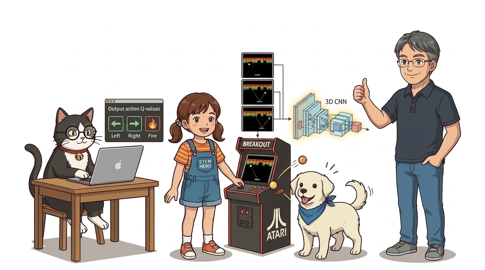

---

#### 아타리 DQN 파이프라인의 전체 조망

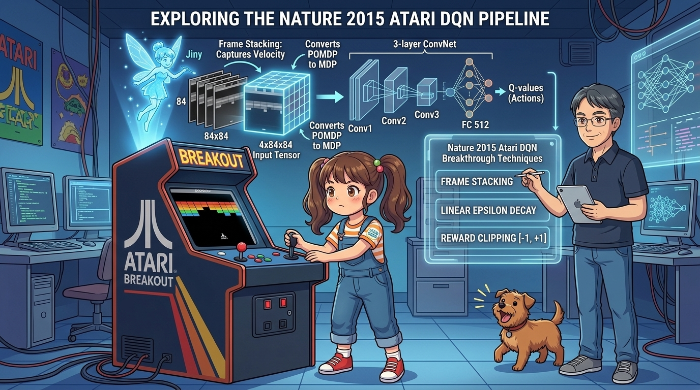
**그림 12-3-0** 아타리 벽돌깨기(Breakout) 캐비닛을 조작하는 도로시와, 공의 속도를 포착하기 위해 4개 프레임을 겹쳐 CNN으로 전달하는 파이프라인을 점검하는 지니, 그리고 딥마인드 네이처(Nature 2015)의 학습 공학 혁신을 설명하는 이호진 교수님

---

#### 심층 강화학습(DRL)의 위대한 탄생: NIPS 2013 논문

DQN은 2013년 딥마인드(DeepMind)가 발표한 역사적인 논문 「Playing Atari with Deep Reinforcement Learning」 [11]에서 처음 제안되었습니다. 

인간이 플레이하던 고전 아케이드 비디오 게임을 **인공지능이 화면 픽셀(Raw Pixel)만을 보고 스스로 학습하여 인간 이상의 실력을 달성한 최초의 사례**였습니다.


**그림 12-3-01** 2013년 딥마인드 NIPS 아타리 논문: 심층 강화학습의 위대한 탄생

---

#### 아타리(Atari)란 무엇인가?

논문 제목에 등장하는 'Atari(아타리)'는 1970~1980년대 비디오 게임 산업을 이끌었던 전설적인 게임 회사의 이름입니다. 

강화학습 연구 분야에서는 아타리 2600 콘솔용으로 제작된 수십 가지의 레트로 아케이드 게임군(퐁, 벽돌깨기, 스페이스 인베이더 등)을 통칭하여 **'아타리 벤치마크(Atari Benchmark)'**라고 부릅니다.

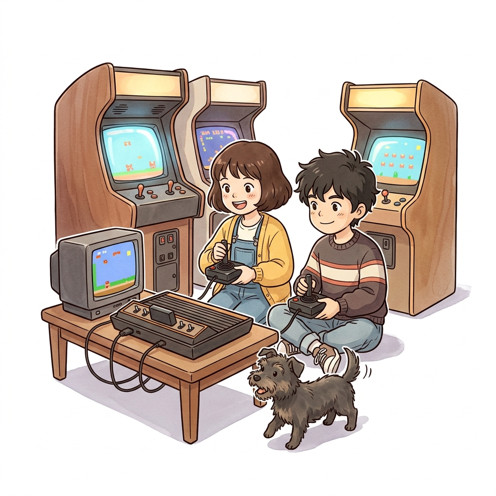
**그림 12-3-02** 1980년대 클래식 아타리 비디오 게임과 레트로 아케이드 역사

---

#### 인공지능 역사에 새겨진 이정표: Nature 2015

> [!NOTE]
> DQN은 2013년 첫 발표 이후 알고리즘 안정성을 대폭 개선하여, 2015년 세계 최고 권위의 과학 학술지인 **『네이처(Nature)』 본논문** [12]에 게재되었습니다:  
> **「Human-level control through deep reinforcement learning」**  
> 
> 이 연구는 인공신경망이 게임의 규칙이나 내부 물리 법칙에 대한 사전 지식 없이, 순수하게 화면 이미지와 점수(보상) 피드백만으로 49개 아타리 게임 중 절반 이상에서 전문 게이머 수준을 뛰어넘었음을 입증했습니다.

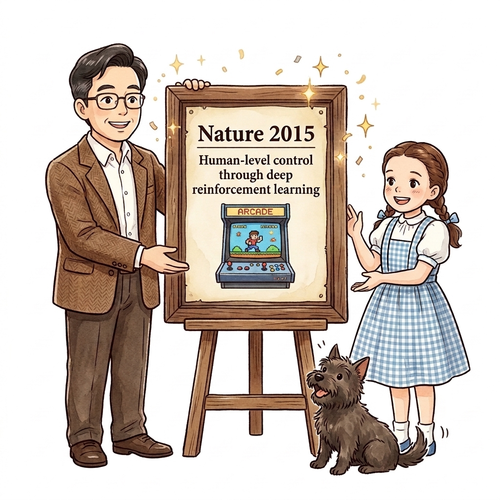
**그림 12-3-03** 2015년 네이처(Nature) 본논문 등재: 인간 수준 제어를 달성한 인공지능

---

#### 4차원 카트폴에서 210×160 픽셀 아타리 세계로의 도약

앞선 12.1절과 12.2절에서는 4개의 수치(위치, 속도, 각도, 각속도)로 정의된 〈카트폴〉 환경을 DQN으로 제어했습니다. 

하지만 인간이 실제 세상에서 마주하는 문제는 수치 몇 개가 깔끔하게 정돈되어 주어지지 않습니다. 

수만 개의 컬러 픽셀이 쏟아지는 **아타리 비디오 게임**과 같은 고차원 시각 환경에 직면했을 때, 과연 카트폴을 풀었던 우리의 DQN은 어떻게 확장되어야 할까요?


**그림 12-3-04** 단순 4차원 센서 카트폴에서 210x160 픽셀 아타리 세계로의 도약

---

#### 좋은 소식: DQN의 놀라운 범용성

여기에는 아주 놀라운 **'좋은 소식'**과 현실적인 **'나쁜 소식'**이 있습니다.

- **좋은 소식**: 앞 절(12.2절)에서 구현한 `step03_dqn_cartpole.py`의 핵심 뼈대인 **경험 재생(Replay Buffer)**과 **목표 신경망(Target Network)** 알고리즘 코드는 단 한 줄도 바꿀 필요 없이 아타리에 그대로 적용됩니다!
- 입력층과 신경망 구조만 시각 처리에 적합하게 교체하면 완전히 동일한 학습 루프가 동작합니다.

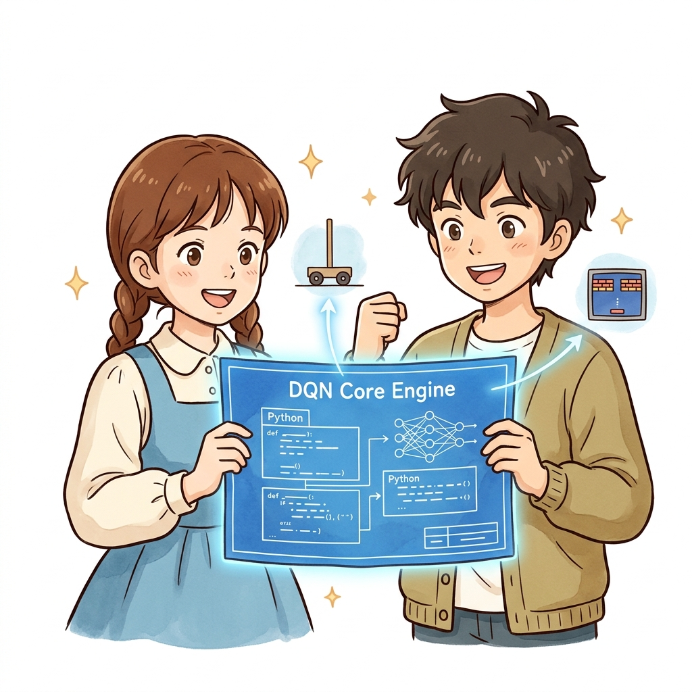
**그림 12-3-05** DQN의 놀라운 범용성: 카트폴 코드의 핵심 골격을 그대로 아타리에 재사용

---

#### 나쁜 소식: 엄청난 연산량과 GPU 학습의 장벽

반면 **'나쁜 소식'**은 계산 비용의 폭발입니다:

- 카트폴은 상태가 4차원 벡터에 불과하여 CPU에서 2~3초 만에 250 에피소드 학습이 끝났습니다.
- 하지만 아타리는 초당 60프레임의 고해상도 시각 데이터를 수백만 번 처리해야 하므로, **고성능 GPU를 탑재한 워크스테이션에서도 완전한 수렴까지 24시간에서 수일 이상의 연산 시간이 소요**됩니다.


**그림 12-3-06** 방대한 연산량의 장벽: 대규모 픽셀 처리와 GPU 24시간 학습의 인내

---

#### 카트폴 대비 아타리 DQN 3대 차이점

따라서 이번 절에서는 학생 여러분이 무거운 아타리 에뮬레이터를 며칠 동안 돌리지 않더라도 핵심 원리를 완벽하게 터득할 수 있도록, **카트폴 DQN과의 3대 결정적 차이점**을 집중 분석합니다:

1. **전처리(Preprocessing)와 프레임 스태킹(Frame Stacking)**: 시각 데이터 압축 및 POMDP 해결
2. **합성곱 신경망(CNN) 아키텍처**: 픽셀 공간의 2차원 특징 맵 추출
3. **학습 공학 기법(Training Tricks)**: $\epsilon$-선형 감쇠 스케줄, 보상 클리핑(Reward Clipping)

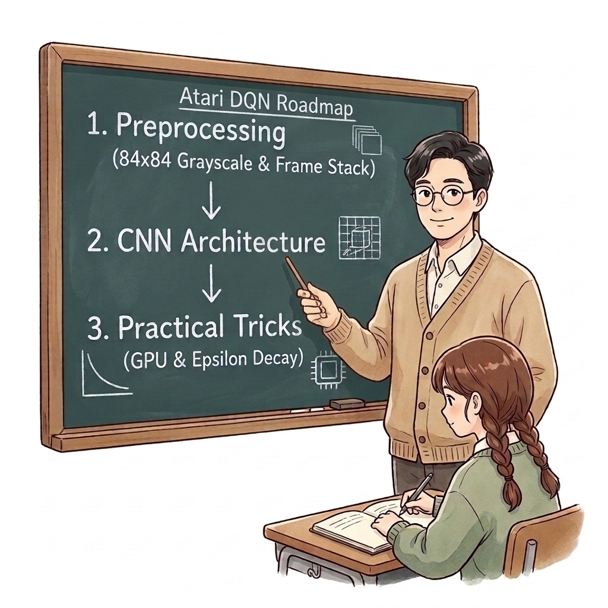
**그림 12-3-07** 카트폴 대비 아타리 DQN 3대 차이점: 전처리, CNN, 실전 훈련 팁

---

### 12.3.1 아타리 게임 환경

#### OpenAI Gym의 아타리 에뮬레이션 슈트

OpenAI Gym(및 최신 Gymnasium)은 고전 아타리 2600 게임을 강화학습 환경으로 즉시 구동할 수 있도록 `ALE(Arcade Learning Environment)` 라이브러리를 내장하고 있습니다. 

수십 종의 게임이 표준 인터페이스(`env.reset()`, `env.step()`)로 완전히 통일되어 있어, 카트폴 환경을 다루던 방식 그대로 아타리 게임을 교체할 수 있습니다.

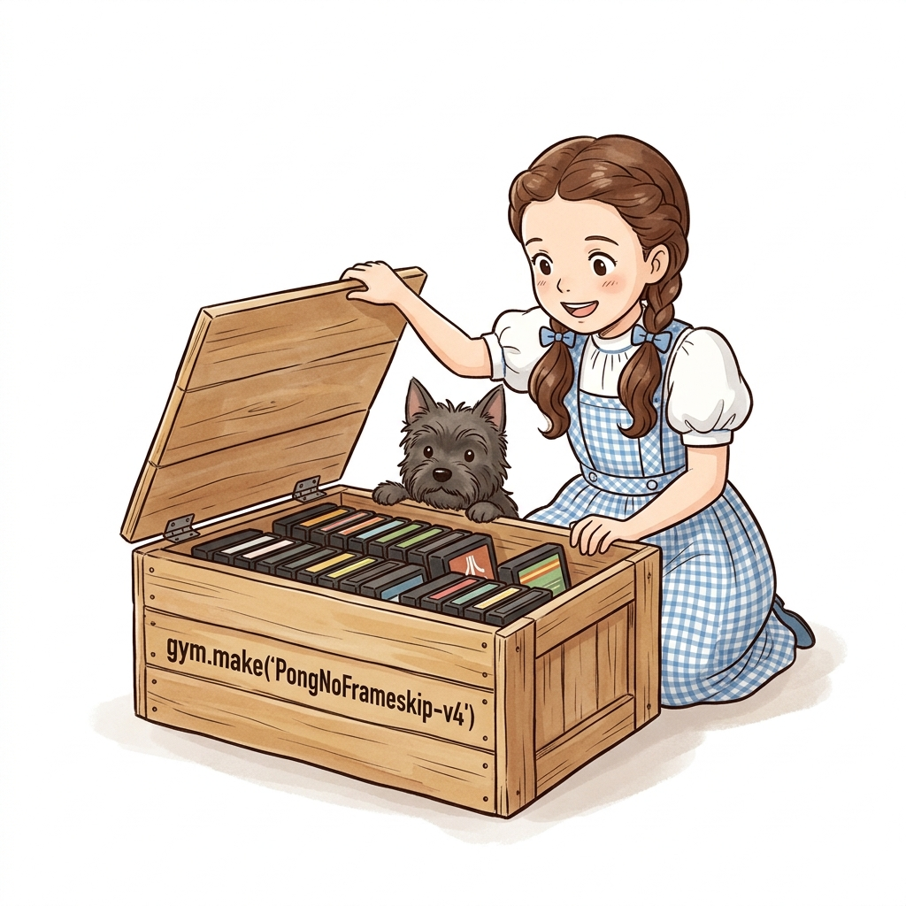
**그림 12-3-08** OpenAI Gym이 제공하는 표준 아타리 에뮬레이션 환경 컬렉션

---

#### 대표 예제: 클래식 탁구 게임 〈퐁(Pong)〉

이번 절에서는 아타리 환경 중 가장 대표적이고 직관적인 **〈퐁(Pong)〉** 게임을 중심으로 설명합니다.

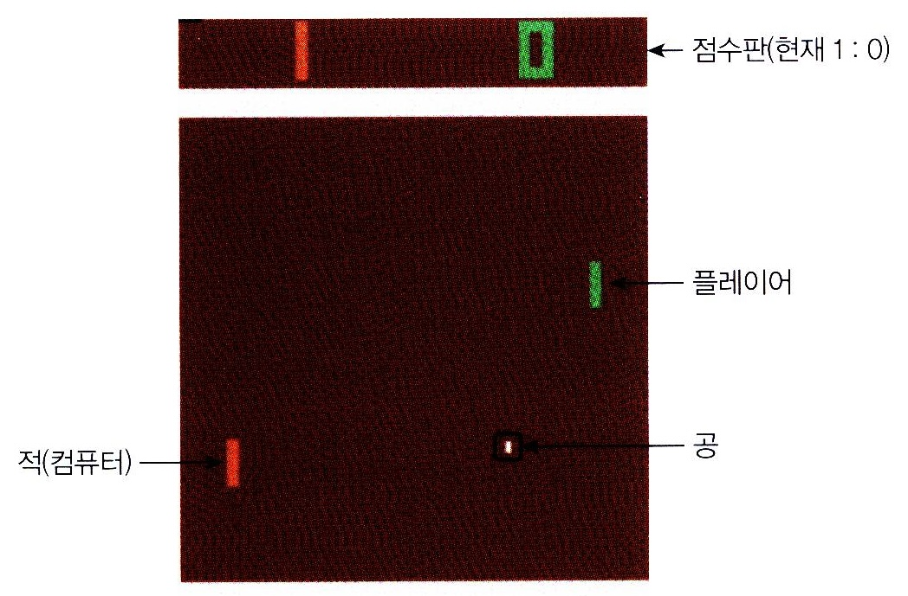
**그림 12-10** 게임 〈퐁(Pong)〉의 실제 플레이 화면 (점수판 1:0, 상대 패들, 탁구공, 플레이어 패들)

---

#### 〈퐁〉의 경기 규칙과 관찰 상태

- **게임 방식**: 2인용 탁구 경기를 위에서 내려다본(Top-View) 구조입니다. 
- **조작**: 화면 오른쪽의 녹색 막대(플레이어)를 위/아래로 조작하여 공을 받아쳐야 합니다.
- **점수 규칙**: 공이 상대편(왼쪽) 벽을 통과하면 $+1$점, 내 쪽 벽을 통과하면 $-1$점을 받습니다. 21점을 먼저 내는 쪽이 승리합니다.
- **날것의 관찰(Raw State)**: 에이전트가 매 스텝 받는 입력은 **'가로 210, 세로 160, RGB 3채널'의 이미지 배열 ($210 \times 160 \times 3 = 100,800$ 바이트)**입니다.

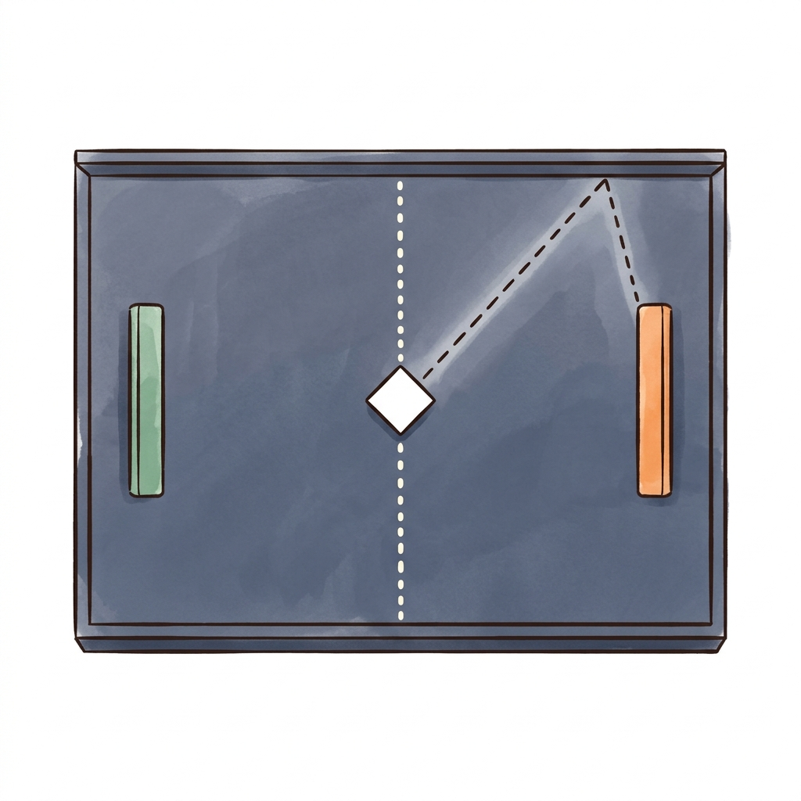
**그림 12-3-09** 탑뷰 탁구 게임 〈퐁(Pong)〉의 기본 규칙과 좌우 패들 인터랙션

---

#### 10만 개 픽셀이 주는 강화학습의 도전 과제

10만 개가 넘는 컬러 픽셀 값을 12.2절에서 다룬 완전 연결 계층(MLP)에 그대로 입력하면 어떻게 될까요?

- 가중치 파라미터가 수천만 개로 폭증하여 메모리가 고갈됩니다.
- 패들이나 공이 화면 어디에 위치하든 동일한 물리 법칙(충돌, 반사)이 적용되어야 하는데, 단순 일렬 나열 벡터는 공간적인 2차원 연관성을 전혀 보존하지 못합니다.

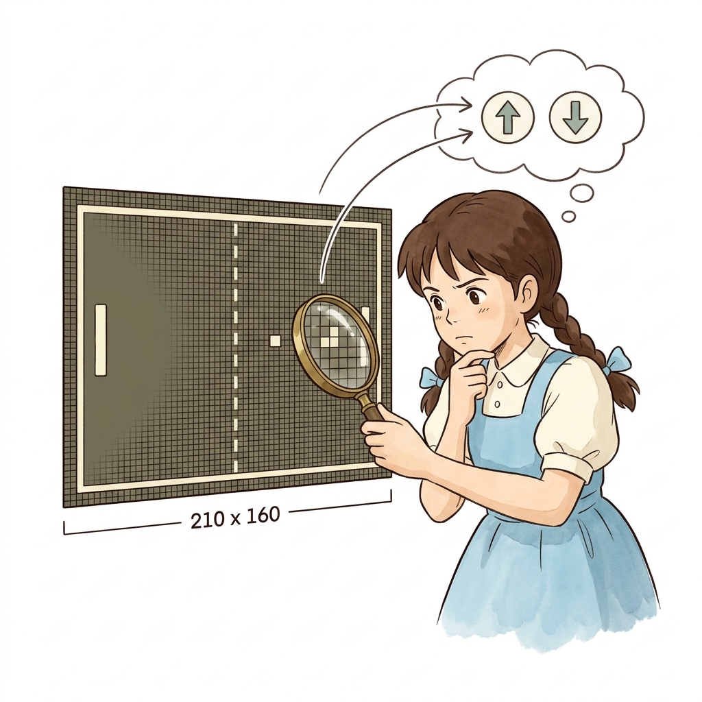
**그림 12-3-10** 가로 210, 세로 160 RGB 3채널 고해상도 픽셀 입력의 도전 과제

---

### 12.3.2 전처리(Preprocessing)

#### 마르코프 성질(Markov Property)의 복습

지금까지 우리가 배운 모든 강화학습 이론은 **마르코프 결정 과정(MDP)**에 기초합니다. 

마르코프 성질이란 **"현재 상태 $S_t$ 하나만 알면, 과거의 모든 역사($S_0, S_1, \dots, S_{t-1}$)를 몰라도 다음 상태 $S_{t+1}$와 보상 $R_{t+1}$의 확률 분포를 완벽하게 결정할 수 있다"**는 원리입니다.

$$P(S_{t+1} \mid S_t, A_t, S_{t-1}, A_{t-1}, \dots) = P(S_{t+1} \mid S_t, A_t)$$

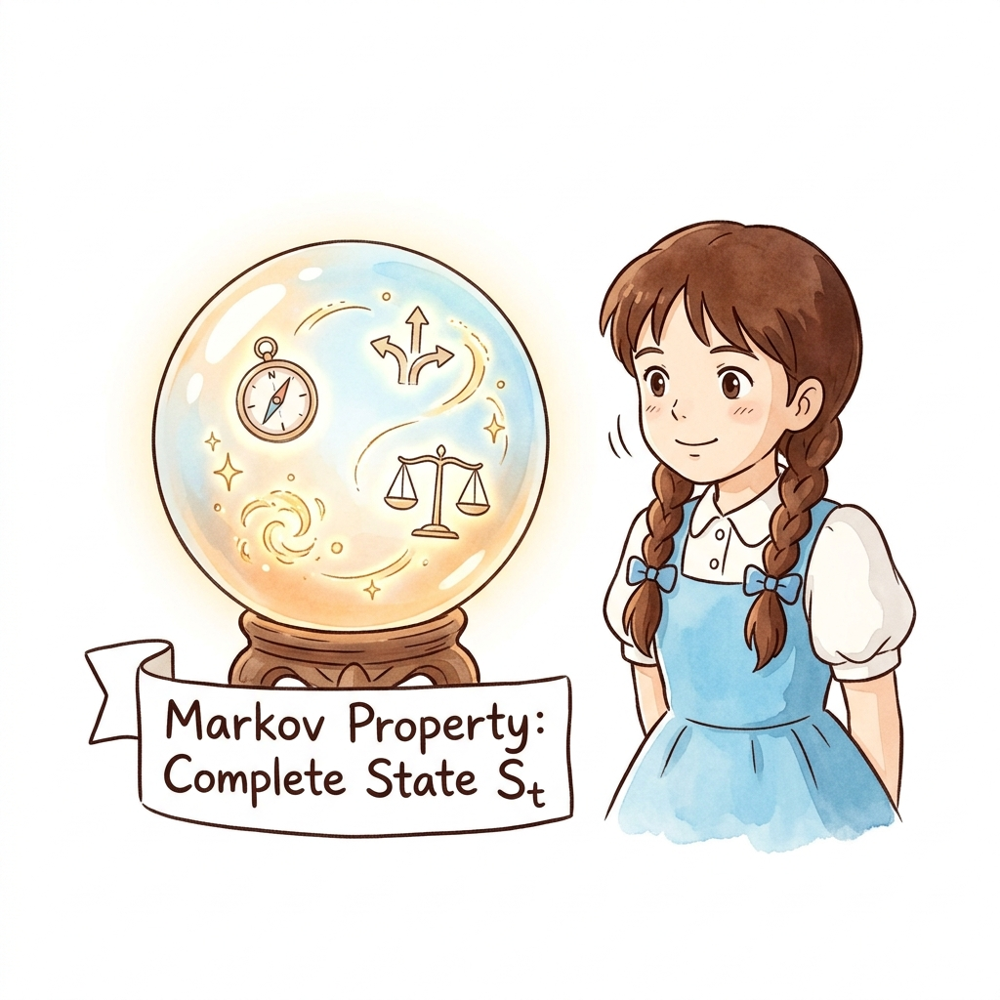
**그림 12-3-11** 마르코프 결정 과정(MDP): 현재 상태 하나만으로 다음 상태와 보상이 결정되는 완전성

---

#### 단일 정지 화면의 치명적 함정: POMDP의 덫

그런데 〈퐁〉의 스크린샷 단 한 장(정지 화면)을 가만히 들여다보십시오.

- 화면 가운데에 탁구공이 떠 있습니다.
- **질문**: 공이 지금 왼쪽으로 날아가는 중일까요, 오른쪽으로 날아가는 중일까요? 그리고 시속 10km로 느리게 가나요, 시속 80km로 총알처럼 날아가나요?
- **답변**: **단 한 장의 사진으로는 절대 알 수 없습니다!**

공의 진행 방향과 속도를 모르면, 플레이어 패들을 위로 올려야 할지 아래로 내려야 할지 판단할 수 없습니다. 이처럼 관찰 가능한 정보에 결함이 있어 환경의 참된 상태를 전부 보지 못하는 문제를 **부분 관찰 마르코프 결정 과정(POMDP; Partially Observable Markov Decision Process)**이라고 부릅니다.

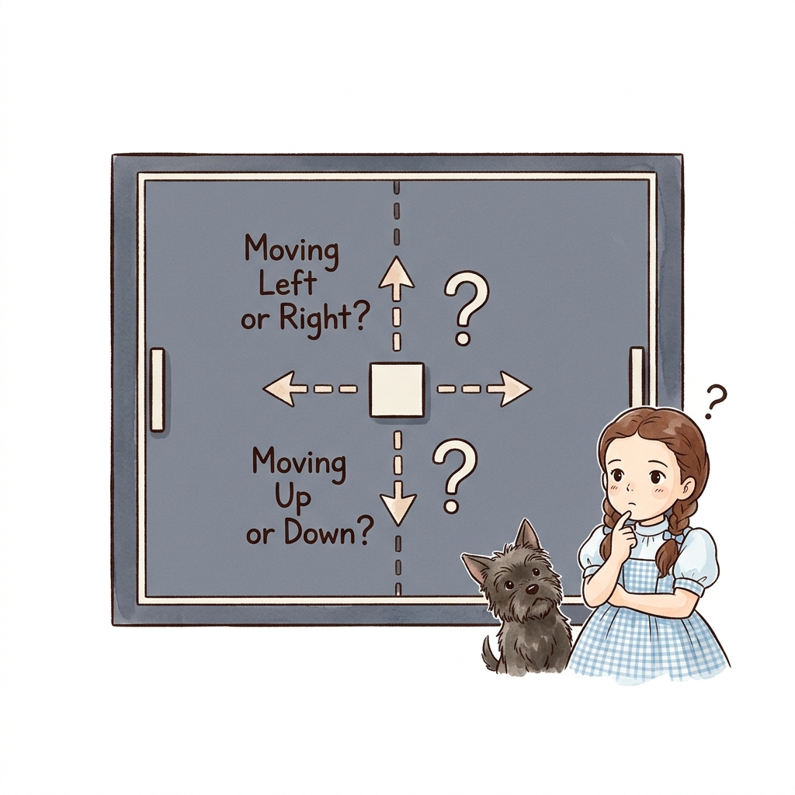
**그림 12-3-12** 단일 정지 화면의 치명적 한계: 공의 이동 방향과 속도를 알 수 없는 POMDP 상황

---

#### 딥마인드의 번뜩이는 묘수: 프레임 스태킹(Frame Stacking)

딥마인드는 복잡한 메모리 구조 없이 이 치명적인 POMDP 문제를 아주 우아하게 해결했습니다.

바로 **연속된 4장의 프레임을 시간 순서대로 겹쳐서 하나의 상태 텐서(State Tensor)로 묶어주는 프레임 스태킹(Frame Stacking)** 기법입니다!

- $t-3$, $t-2$, $t-1$, $t$ 순간의 화면 4장을 나란히 겹쳐서 4채널 텐서로 신경망에 입력합니다.

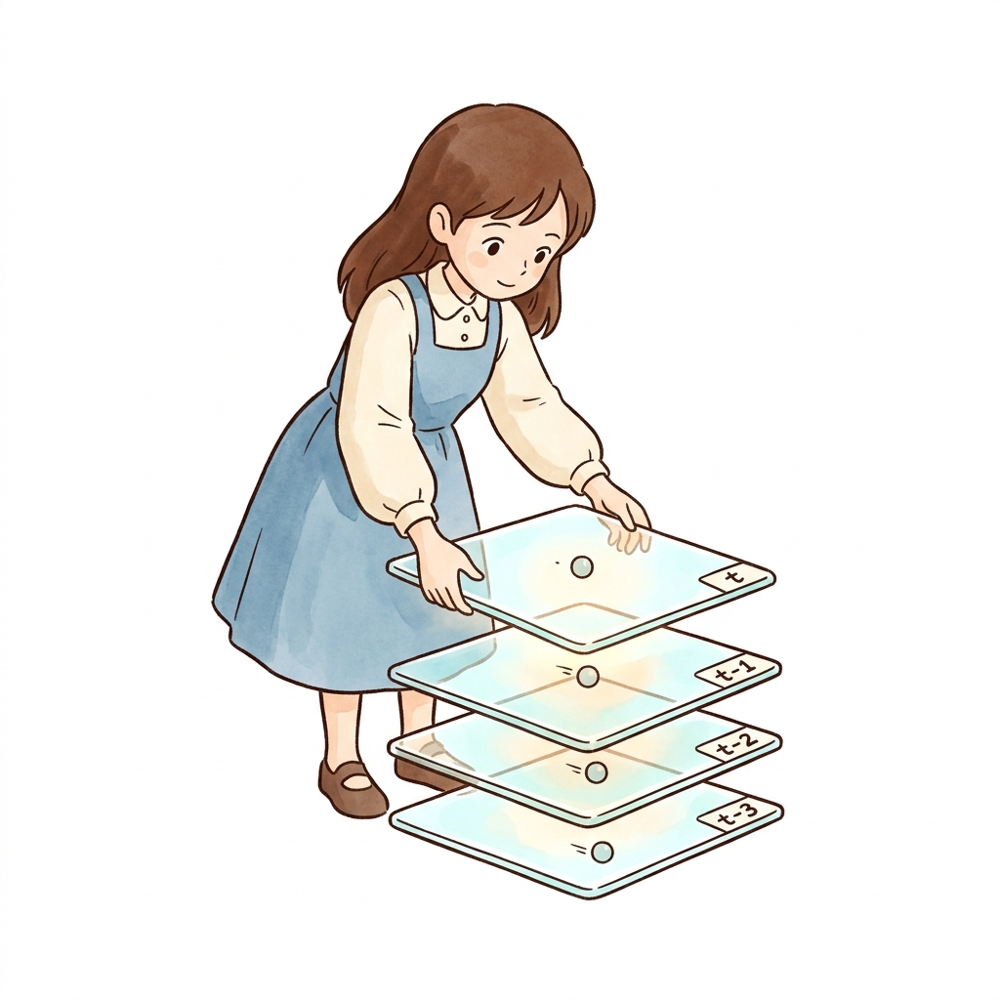
**그림 12-3-13** 프레임 스태킹(Frame Stacking): 연속 4개 화면을 포개어 하나의 상태 텐서로 구성

---

#### 잔상 효과: POMDP를 다시 MDP로 복원하다

만화경이나 애니메이션 플립북처럼 연속된 4장의 프레임을 겹치면, 공의 이전 위치와 현재 위치 사이에 **시간적 잔상(Trailing Ghost)**이 드러납니다.

- 공의 위치 변화량($\Delta x, \Delta y$)을 통해 **진행 방향(각도)**과 **속도 벡터(Velocity Vector)**가 즉시 복원됩니다.
- 이로써 에이전트는 과거 프레임을 따로 기억할 필요 없이, 입력된 4채널 텐서 하나만으로 공의 미래 궤적을 예측할 수 있는 **완전한 마르코프 상태(MDP)**를 되찾게 됩니다!

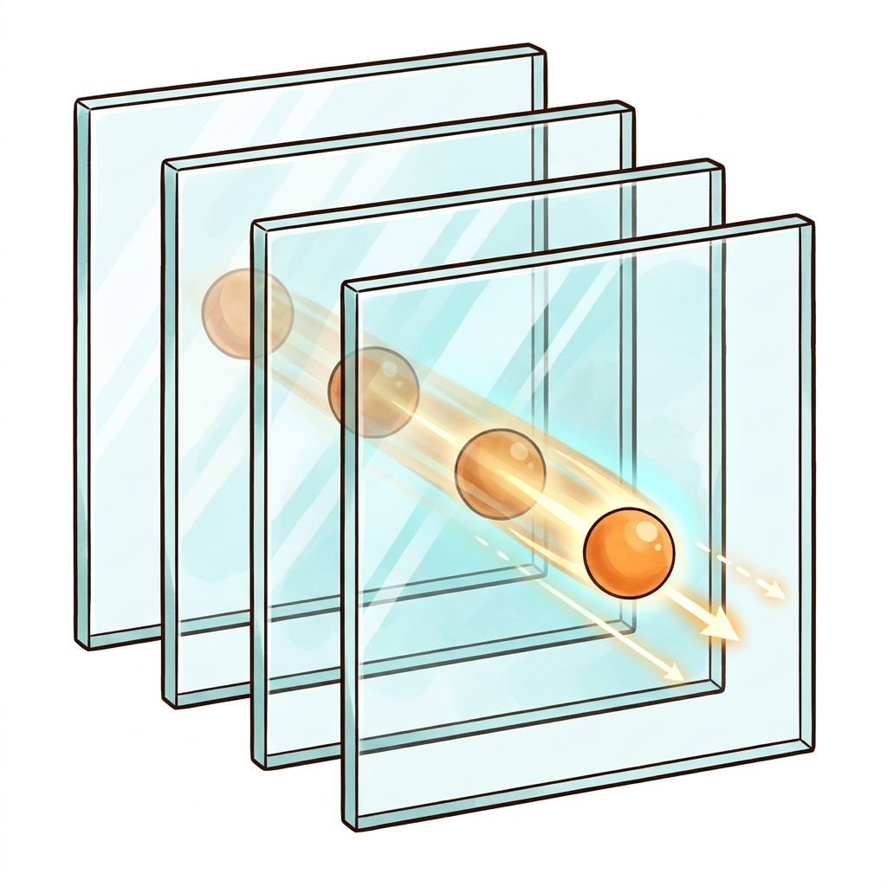
**그림 12-3-14** 4프레임 중첩으로 명확해진 공의 비행 궤적과 속도 벡터 (POMDP를 MDP로 변환)

---

#### POMDP 해결의 두 가지 대안: 프레임 스태킹 vs 순환신경망(RNN)

> [!NOTE]
> POMDP를 해결하는 방법은 프레임 스태킹 외에도 **순환 신경망(RNN / LSTM)**을 결합하는 방법이 있습니다(DRQN; Deep Recurrent Q-Network).  
> - **RNN 방식**: 이전 시점의 은닉 상태(Hidden State)를 기억해 시간 정보를 누적합니다. 긴 시간의 문맥을 기억할 수 있지만, 학습이 까다롭고 역전파 속도가 느립니다.
> - **프레임 스태킹**: 최근 4장의 프레임만 고정 크기 텐서로 묶어 일반 피드포워드 CNN에 전달합니다. 매우 단순하고 병렬 처리가 빠르며 안정적이어서 아타리 DQN의 표준이 되었습니다.

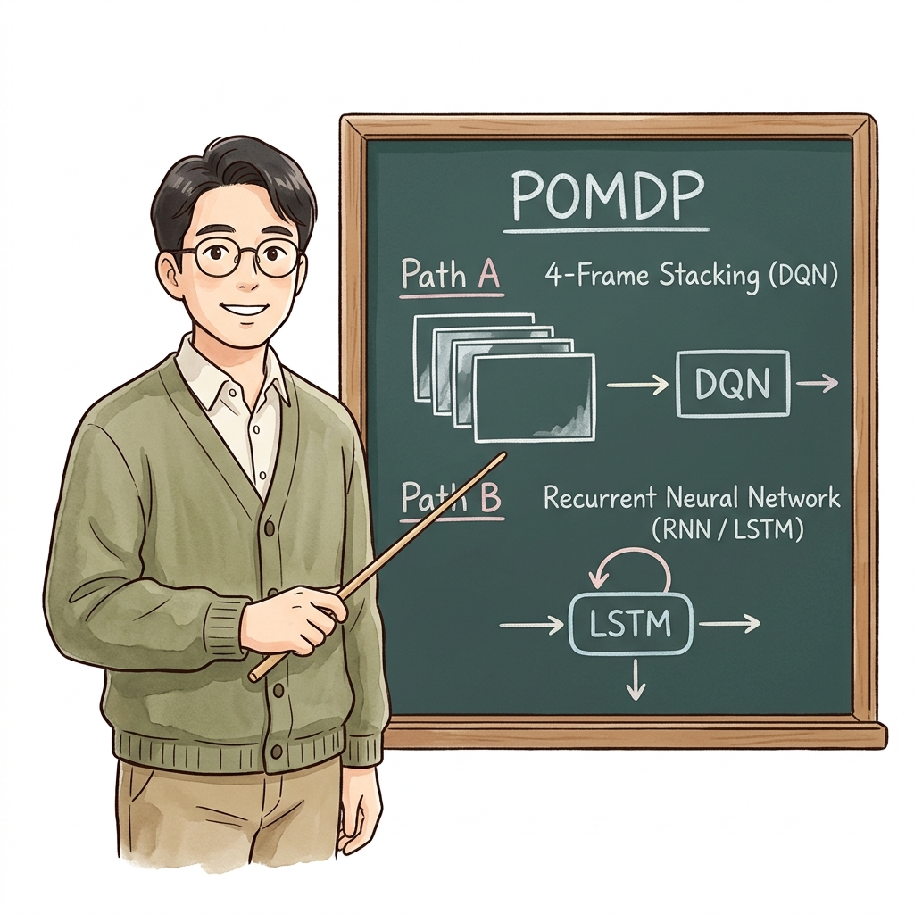
**그림 12-3-15** POMDP 해결의 두 갈래 길: 고정 프레임 스태킹 vs 순환신경망(RNN/LSTM) 대안 비교

---

#### DQN의 4단계 이미지 전처리 파이프라인

프레임 스태킹을 적용하기 전에, 딥마인드는 연산 효율을 극대화하기 위해 원본 $210 \times 160$ 컬러 이미지를 다음 **4단계 전처리 파이프라인**으로 압축 가공합니다:

1. **영역 자르기 (Cropping)**: 상단의 점수판이나 경기 외곽 불필요 영역을 제거하고 게임이 진행되는 핵심 사각형 영역만 추출
2. **그레이스케일 변환 (Grayscale)**: 컬러(RGB 3채널)를 1채널 흑백 명도값으로 변환하여 데이터양을 $1/3$로 축소
3. **크기 축소 (Resizing)**: $84 \times 84$ 픽셀의 정사각형 해상도로 다운샘플링
4. **값 정규화 (Normalization)**: $0 \sim 255$ 범위의 정수 픽셀값을 $0.0 \sim 1.0$ 부동소수점으로 스케일링

전처리된 $84 \times 84$ 이미지 4장을 포개어, 최종 상태 형상은 **$(4, 84, 84)$** 텐서가 됩니다.

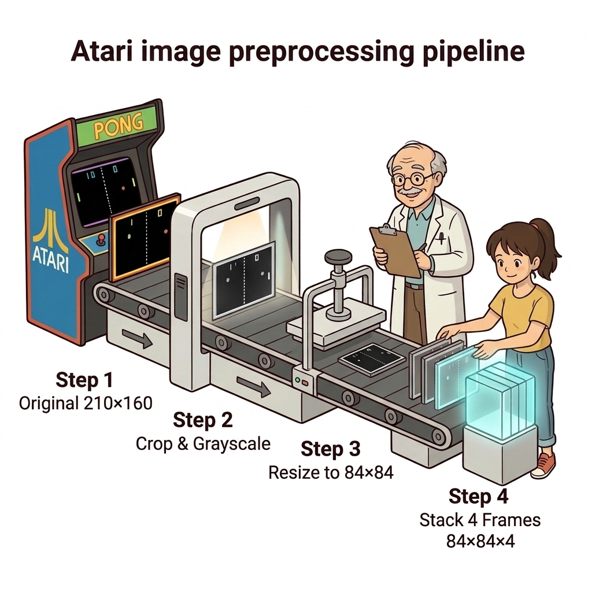
**그림 12-3-16** DQN의 4단계 이미지 전처리 파이프라인 (자르기 -> 회색조 -> 84x84 축소 -> 4프레임 중첩)

---

#### [실습 1단계] 아타리 4단계 전처리 및 프레임 스태킹 구현

실제 아타리 화면 데이터가 전처리되어 4차원 텐서로 변환되는 과정을 [step01_atari_preprocessing.py](file:///Users/hojin9/Library/Mobile%20Documents/com~apple~CloudDocs/02.강의/A06_강화학습/src/12_DQN/12_3_DQN과_아타리/step01_atari_preprocessing.py) 스크립트로 구현해 확인해보겠습니다:

```python
# step01_atari_preprocessing.py 핵심 전처리 함수
def preprocess_frame(frame_rgb: np.ndarray) -> np.ndarray:
    """DQN Nature 2015 규격 4단계 전처리 파이프라인"""
    # 1. 주변 불필요 영역 자르기: (210, 160) -> (180, 160)
    cropped = frame_rgb[15:195, :]
    
    # 2. 그레이스케일 변환: RGB -> 1채널 (명도 공식 적용)
    gray = np.dot(cropped[..., :3], [0.299, 0.587, 0.114]).astype(np.float32)
```
---
```python
    # 3. 84 x 84 크기 축소 (리사이징)
    resized = resize_to_84x84(gray)
    
    # 4. 0.0 ~ 1.0 값 정규화
    normalized = resized / 255.0
    return normalized

# 연속된 4개 프레임을 채널 축으로 스태킹
state_tensor = np.stack(preprocessed_frames, axis=0) # Shape: (4, 84, 84)
```

---

#### [실습 1단계 결과] 터미널 출력 및 텐서 형상 검증

스크립트를 실행하면 원본 3채널 프레임이 84×84 그레이스케일로 압축된 뒤, 4개 프레임이 결합되어 $(4, 84, 84)$ 상태 텐서로 완벽히 조립되는 과정을 확인할 수 있습니다.

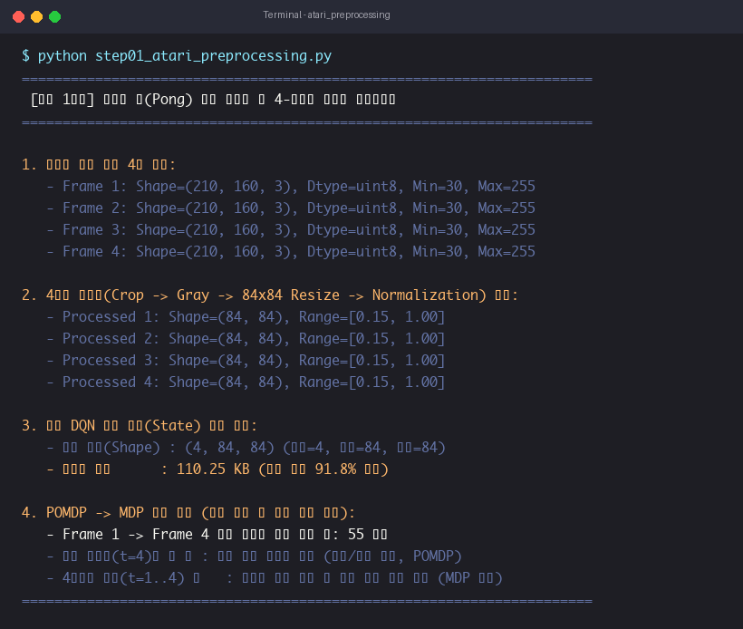
**그림 12-3-T1** 아타리 전처리 및 4-프레임 스태킹 터미널 실행 결과 (`ch12_3_step01_terminal.png`)

```text
======================================================================
 [실습 1단계] 아타리 퐁(Pong) 화면 전처리 및 4-프레임 스태킹 파이프라인
======================================================================

1. 아타리 원본 화면 4개 수집:
   - Frame 1: Shape=(210, 160, 3), Dtype=uint8, Min=30, Max=255
   - Frame 2: Shape=(210, 160, 3), Dtype=uint8, Min=30, Max=255
   - Frame 3: Shape=(210, 160, 3), Dtype=uint8, Min=30, Max=255
   - Frame 4: Shape=(210, 160, 3), Dtype=uint8, Min=30, Max=255

2. 4단계 전처리(Crop -> Gray -> 84x84 Resize -> Normalization) 완료:
   - Processed 1: Shape=(84, 84), Range=[0.15, 1.00]
   - Processed 2: Shape=(84, 84), Range=[0.15, 1.00]
   - Processed 3: Shape=(84, 84), Range=[0.15, 1.00]
   - Processed 4: Shape=(84, 84), Range=[0.15, 1.00]
```
---
```python
3. 최종 DQN 입력 상태(State) 텐서 구축:
   - 텐서 형상(Shape) : (4, 84, 84) (채널=4, 높이=84, 너비=84)
   - 메모리 크기      : 110.25 KB (원본 대비 91.8% 압축)

4. POMDP -> MDP 변환 입증 (공의 속도 및 진행 방향 검출):
   - Frame 1 -> Frame 4 사이 움직임 감지 픽셀 수: 55 픽셀
   - 단일 프레임(t=4)만 볼 때 : 공의 정지 위치만 보임 (방향/속도 불명, POMDP)
   - 4프레임 중첩(t=1..4) 시   : 우하향 이동 궤적 및 속도 벡터 명확 복원 (MDP 완결)
======================================================================
```

---

#### [실습 1단계 시각화] 원본 프레임 vs 전처리 프레임 비교

[step01_atari_preprocessing.py](file:///Users/hojin9/Library/Mobile%20Documents/com~apple~CloudDocs/02.강의/A06_강화학습/src/12_DQN/12_3_DQN과_아타리/step01_atari_preprocessing.py)가 생성한 시각화 그래프를 살펴보면, 복잡한 배경 노이즈가 제거되고 경기 패들과 공의 위치가 84×84 격자 위에 선명하게 추출되었음을 확인할 수 있습니다.

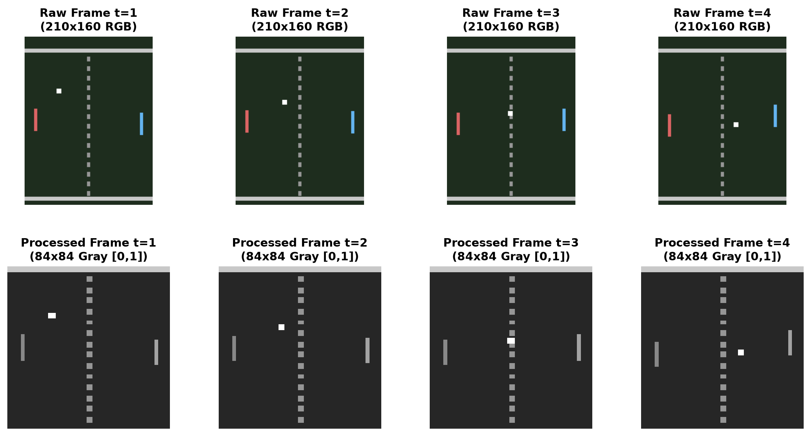
**그림 12-3-S1** 원본 210×160 RGB 프레임(1행)과 84×84 그레이스케일 전처리 프레임(2행)의 시간별 변화

---

### 12.3.3 합성곱 신경망(CNN)

#### 왜 MLP가 아니라 합성곱 신경망(CNN)인가?

카트폴에서는 단순 완전 연결 계층(MLP)을 사용했지만, 2차원 공간 정보를 가진 이미지에는 **합성곱 신경망(CNN; Convolutional Neural Network)**이 필수적입니다:

1. **공간적 평행이동 불변성(Spatial Translation Invariance)**: 공이나 패들이 화면 왼쪽 위에 있든, 오른쪽 아래에 있든 동일한 특징 필터가 작동해야 합니다.
2. **가중치 공유(Weight Sharing)**: 모든 픽셀마다 별도의 가중치를 두지 않고, 작은 커널(Filter)을 슬라이딩하여 파라미터 수를 획기적으로 줄입니다.

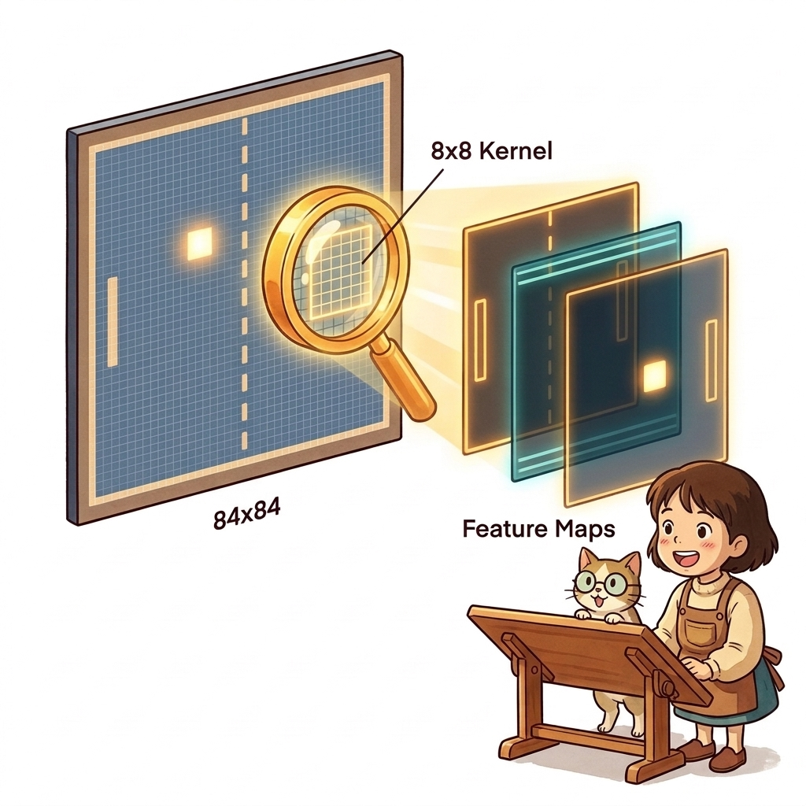
**그림 12-3-17** 합성곱 신경망(CNN): 84x84 화면 위를 이동하는 필터로 시각적 공간 특징 추출

---

#### DQN Nature 2015의 CNN 네트워크 구조

DQN 논문 [12]에서 채택한 공식 CNN 구조는 다음과 같습니다:

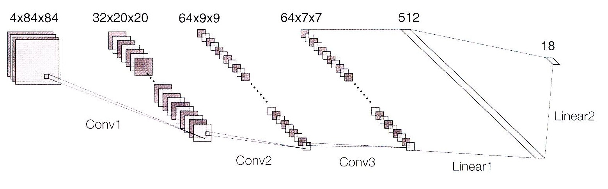
**그림 12-11** DQN에서 사용한 CNN 구조 ($4 \times 84 \times 84 \rightarrow \text{Conv1} \rightarrow \text{Conv2} \rightarrow \text{Conv3} \rightarrow \text{Linear1} \rightarrow \text{Linear2} \rightarrow \text{Actions}$)

---

#### 계층별 텐서 변환과 특징 추출 흐름

CNN 계층을 통과하며 고차원 픽셀 데이터가 저차원 행동 가치 벡터로 압축되는 과정은 다음과 같습니다:

| 계층 (Layer) | 입력 크기 | 필터 규격 (커널, 스트라이드) | 출력 크기 | 역할 및 특징 |
| :--- | :--- | :--- | :--- | :--- |
| **Input** | - | - | **$4 \times 84 \times 84$** | 전처리된 4개 연속 프레임 |
| **Conv 1** | $4 \times 84 \times 84$ | $8 \times 8$ 커널, 스트라이드 4, 채널 32 | **$32 \times 20 \times 20$** | 큰 윤곽선, 경계면, 물체 기초 형태 추출 |
| **Conv 2** | $32 \times 20 \times 20$ | $4 \times 4$ 커널, 스트라이드 2, 채널 64 | **$64 \times 9 \times 9$** | 패들과 공의 상대적 기하학적 형상 추출 |
| **Conv 3** | $64 \times 9 \times 9$ | $3 \times 3$ 커널, 스트라이드 1, 채널 64 | **$64 \times 7 \times 7$** | 미세한 움직임 및 국소 동역학 패턴 포착 |
| **Linear 1** | $3,136$ ($64 \times 7 \times 7$) | 완전 연결 (FC), 은닉 노드 512 | **$512$** | 시각 특징 종합 추상화 |
| **Linear 2** | $512$ | 완전 연결 (FC), 노드수 = 행동수 | **$|\mathcal{A}|$ (예: 6 or 18)** | 각 조이스틱 행동별 $Q(s, a)$ 출력 |

---

모든 은닉 계층의 활성화 함수로는 **ReLU($\text{Rectified Linear Unit}$)**가 사용되었습니다.

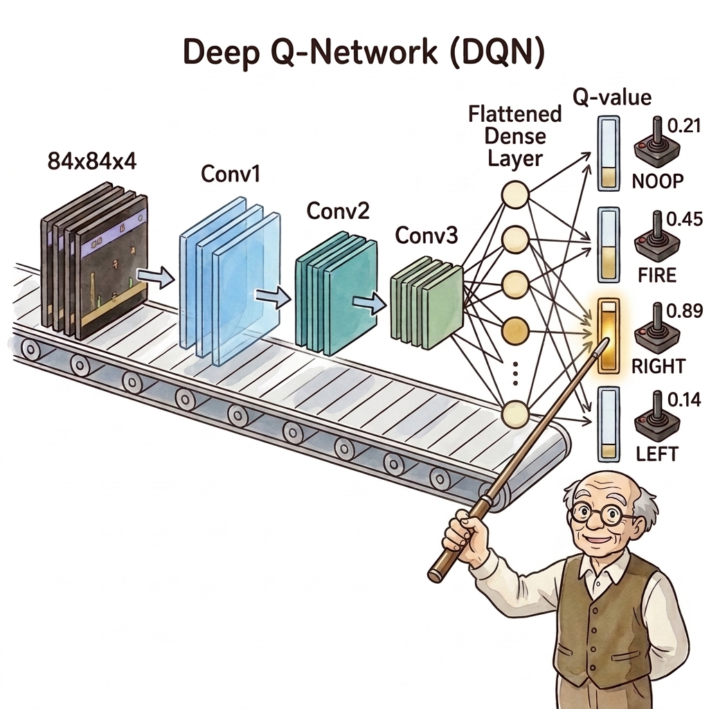
**그림 12-3-18** 합성곱 계층에서 완전연결 계층을 거쳐 아타리 조이스틱 행동 Q값 출력

---

### 12.3.4 실전 성능을 폭발시킨 3대 학습 공학 묘수

네트워크와 전처리 파이프라인 외에도, 딥마인드는 수십 종의 아타리 게임에서 안정적인 학습 수렴을 이끌어내기 위해 **3가지 핵심 엔지니어링 기법**을 도입했습니다.

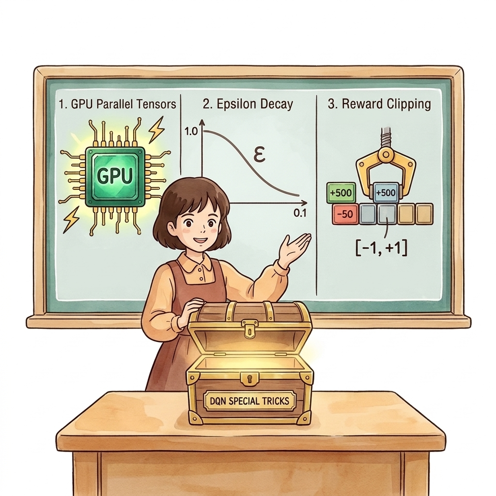
**그림 12-3-19** DQN 실전 성능을 폭발시킨 3대 묘수: GPU 가속, 엡실론 감쇠, 보상 클리핑

---

#### 12.3.4.1 고속 GPU 텐서 병렬 연산

아타리 1회 학습에는 수백만 프레임의 합성곱 순전파와 역전파 연산이 발생합니다.

- 단일 CPU 코어로 처리할 경우 1개 에피소드 학습에 수십 분이 걸려 실질적인 연구가 불가능합니다.
- 수천 개의 산술 연산 코어를 가진 **GPU(CUDA / CuPy)**를 통해 미니배치(32개)를 병렬 처리함으로써 연산 속도를 수십 배 이상 가속화했습니다.

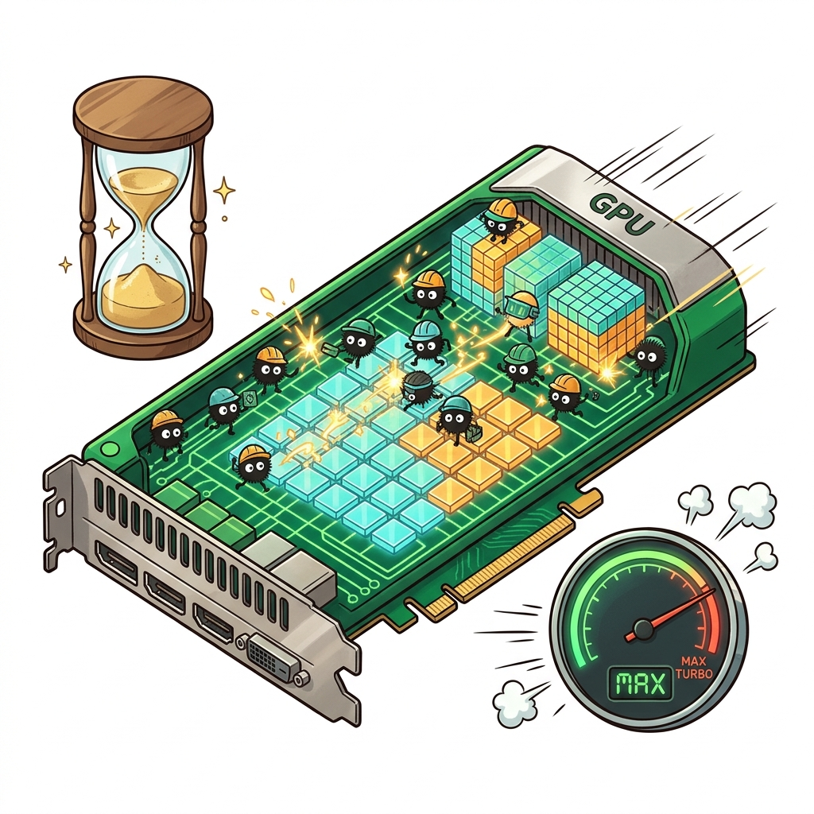
**그림 12-3-20** 초록빛 GPU 가속 엔진: 수천 개 코어의 대규모 텐서 병렬 연산 혁신

---

#### DeZero의 GPU 가속 스위치

본 교재의 베이스 프레임워크인 DeZero 역시 CuPy 라이브러리를 연동하여 코드 단 한 줄(`dezero.cuda.gpu_enable = True`)로 넘파이 배열 연산을 즉시 GPU 모드로 전환할 수 있도록 설계되어 있습니다.

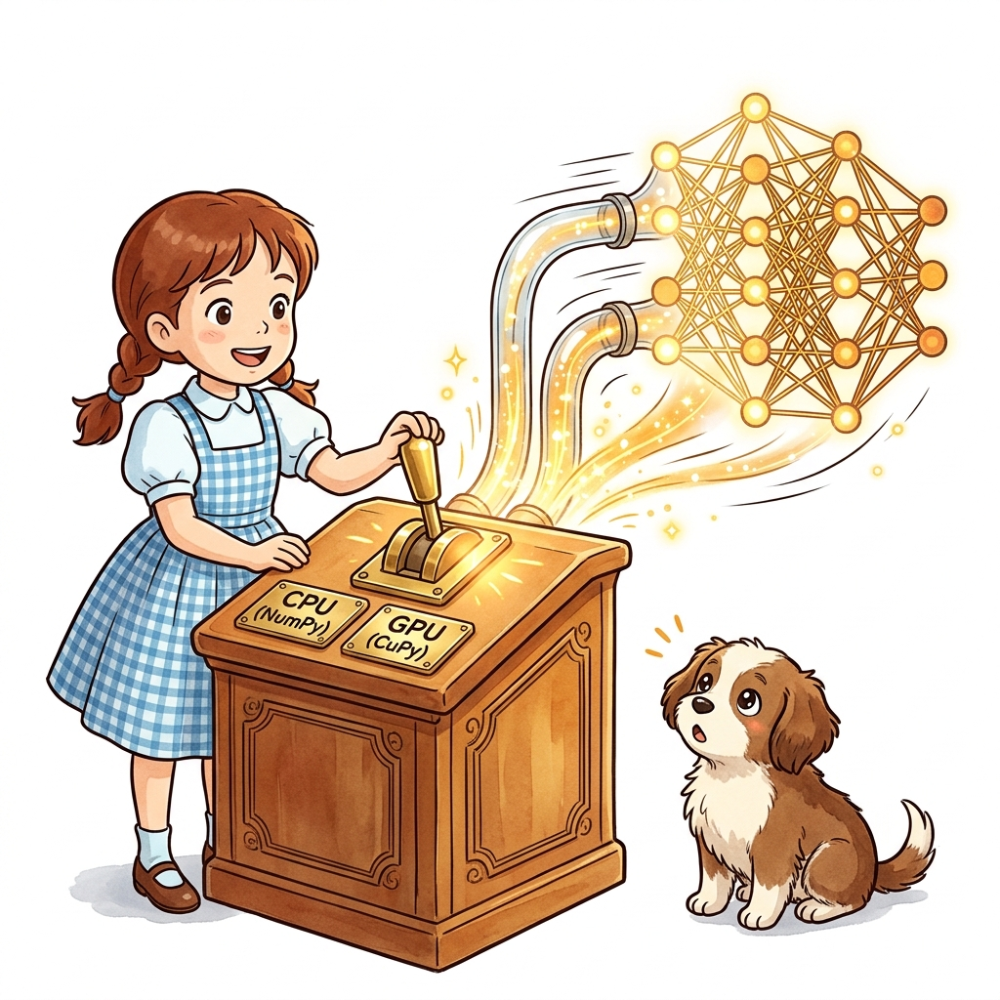
**그림 12-3-21** DeZero 프레임워크의 CuPy GPU 모드 전환 스위치와 고속 가속

---

#### 12.3.4.2 $\epsilon$-선형 감쇠(Linear Annealing) 스케줄

에이전트가 게임의 아무것도 모르는 초기 단계와, 100만 스텝을 거치며 게임의 물리 법칙을 충분히 깨우친 후반 단계의 탐색 전략은 달라야 합니다:

- **초기**: 아는 것이 없으므로 무작위 탐험(Exploration)을 적극적으로 시도해야 함 ($\epsilon \approx 1.0$)
- **후반**: 신경망의 가치 추정치가 정교해졌으므로 아는 지식을 최대한 활용(Exploitation)하여 고득점을 공략해야 함 ($\epsilon \rightarrow 0.1$)

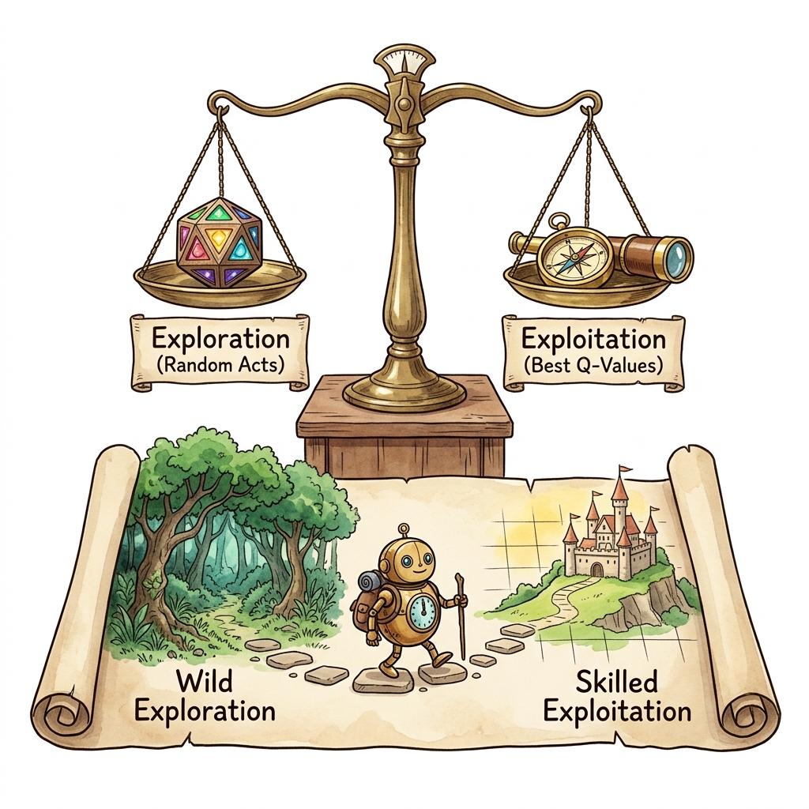
**그림 12-3-22** 에피소드 진행에 따른 탐색(주사위)과 활용(나침반)의 황금 균형 저울

---

#### DQN의 $\epsilon$ 감쇠 램프 곡선

DQN 논문에서는 처음 **100만(1M) 스텝까지 $\epsilon$을 $1.0$에서 $0.1$까지 일정한 기울기(선형)로 점진적으로 감소**시키고, 이후에는 $0.1$(10%의 최소 탐색)로 일정하게 유지하는 스케줄을 적용했습니다:

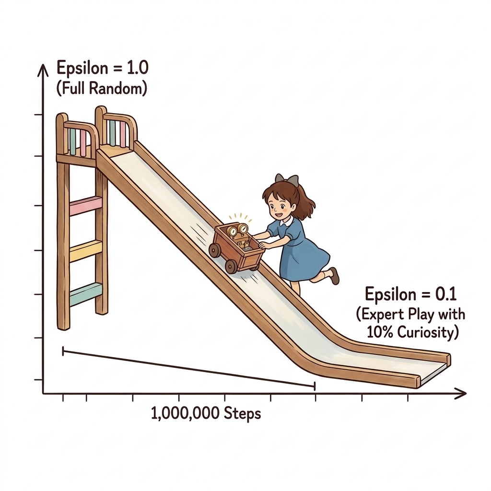
**그림 12-3-23** 선형 엡실론 감쇠 램프: 1.0(100% 랜덤)에서 100만 스텝 후 0.1(10% 탐험) 안정적 유지

---

#### 교재 원본 $\epsilon$ 감쇠 그래프

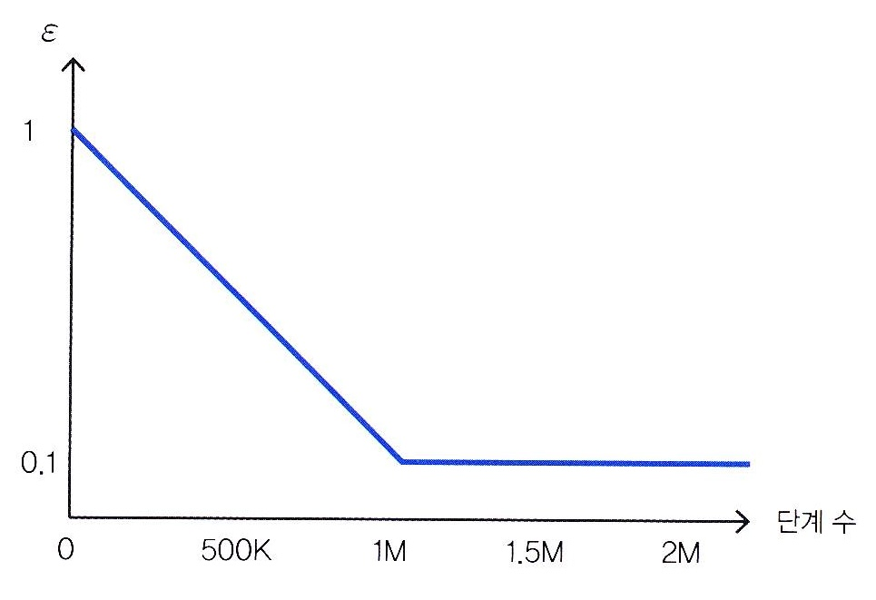
**그림 12-12** DQN에서의 $\epsilon$값 변경 추이 (가로축: 단계 수 $0 \rightarrow 1\text{M} \rightarrow 2\text{M}$, 세로축: $\epsilon = 1.0 \rightarrow 0.1$)

이러한 점진적 감쇠 덕분에, 에이전트는 초기에 다양한 플레이 방식을 폭넓게 수집하고 후반에는 정교한 컨트롤 기술을 흔들림 없이 완성할 수 있습니다.

---

#### 12.3.4.3 보상 클리핑(Reward Clipping)

비디오 게임마다 점수 체계는 천차만별입니다:
- 〈퐁〉: $+1$점 또는 $-1$점
- 〈벽돌깨기〉: 벽돌 하나당 $+1 \sim +7$점
- 〈스페이스 인베이더〉: UFO를 격추하면 한 번에 $+100 \sim +300$점

만약 점수 스케일이 제각각이라면, 점수가 수백 점씩 나오는 게임에서는 오차(Loss)와 기울기(Gradient)가 폭발하여 학습률 $\alpha$를 게임마다 완전히 다르게 튜닝해야 합니다.

---

이를 방지하기 위해 딥마인드는 **양의 보상은 무조건 $+1$, 음의 보상은 $-1$, 그 외는 $0$으로 일괄 압축하는 '보상 클리핑(Reward Clipping)'**을 적용했습니다:

$$R_{\text{clipped}} = \operatorname{sign}(R) \in \{-1, 0, +1\}$$

![보상 클리핑: 제각각인 게임 점수를 [-1, 0, +1] 규격 벽돌로 균일하게 압축 성형](./img/ch12_3_24_reward_clipping_clamp.png)
**그림 12-3-24** 보상 클리핑: 제각각인 게임 점수를 [-1, 0, +1] 규격 벽돌로 균일하게 압축 성형

> [!NOTE]
> 〈퐁〉의 경우 본래 보상이 이미 $-1, 0, +1$ 중 하나이므로 보상 클리핑의 영향을 받지 않지만, 다른 고득점 게임들에서는 하나의 통일된 하이퍼파라미터로 수십 개 게임을 안정적으로 학습시키는 일등 공신이 되었습니다.

---

#### 아타리 게임 완전 정복과 초인적 플레이 달성

이상의 기법(경험 재생 + 목표 신경망 + 4프레임 전처리 + CNN + GPU + $\epsilon$ 감쇠 + 보상 클리핑)을 결합한 DQN은 마침내 〈퐁〉 게임을 완벽하게 마스터했습니다. 

단순히 비기는 수준이 아니라, **상대방 컴퓨터의 빈틈을 파고들어 시속 100km의 강스매시를 꽂아 넣으며 21대 0으로 컴퓨터를 농락하는 압도적인 초인적 경지**에 도달했습니다.

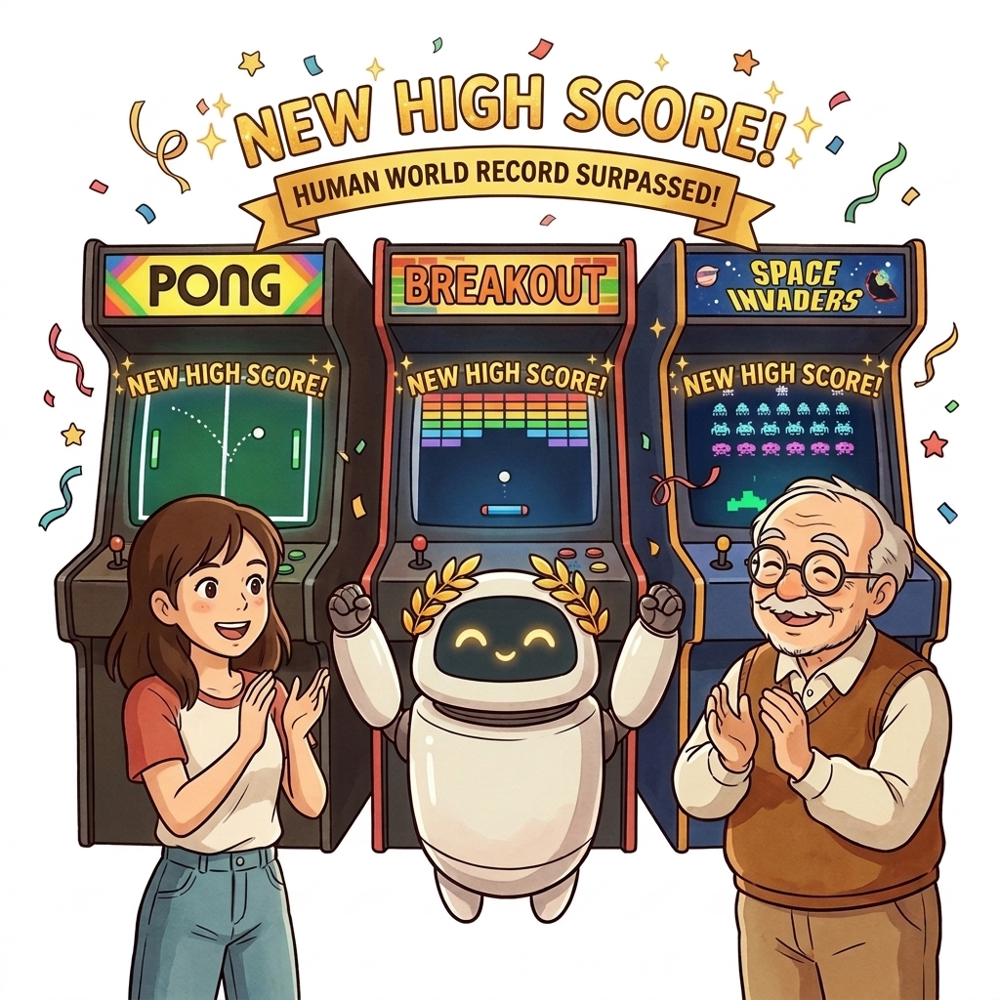
**그림 12-3-25** 퐁, 벽돌깨기, 스페이스 인베이더에서 인간 신기록을 돌파한 DQN 챔피언 에이전트

---

#### 범용 인공지능(AGI)을 향한 위대한 이정표

무엇보다 위대한 사실은, **코드를 단 한 줄도 바꾸지 않고 동일한 DQN 알고리즘과 신경망 구조를 〈벽돌깨기(Breakout)〉, 〈스페이스 인베이더〉, 〈엔듀로(Enduro)〉 등에 적용했을 때도 모두 인간 최고 기록을 갈아치웠다는 점**입니다. 

게임마다 특별한 규칙이나 요령을 인간이 코딩해 주지 않아도, **날것의 시각 픽셀만을 보고 스스로 지능을 진화시킬 수 있음을 증명한 DQN은 현대 딥러닝과 강화학습 역사상 가장 위대한 이정표**로 기록되었습니다.

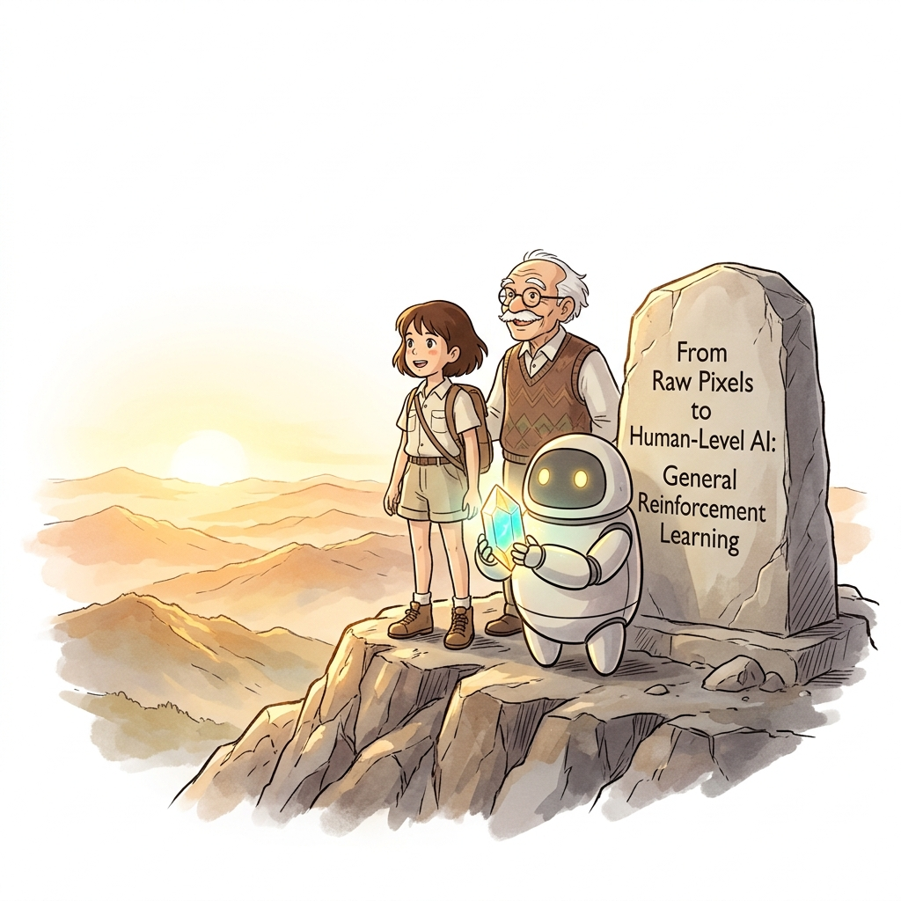
**그림 12-3-26** 날것의 픽셀에서 인간 수준 지능으로: 일반 인공지능(AGI)을 향한 위대한 이정표
