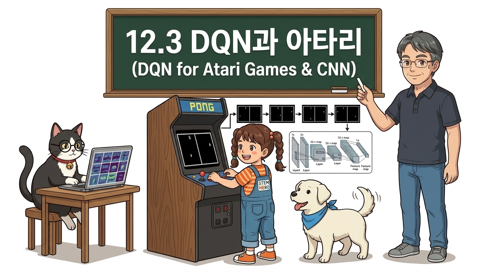
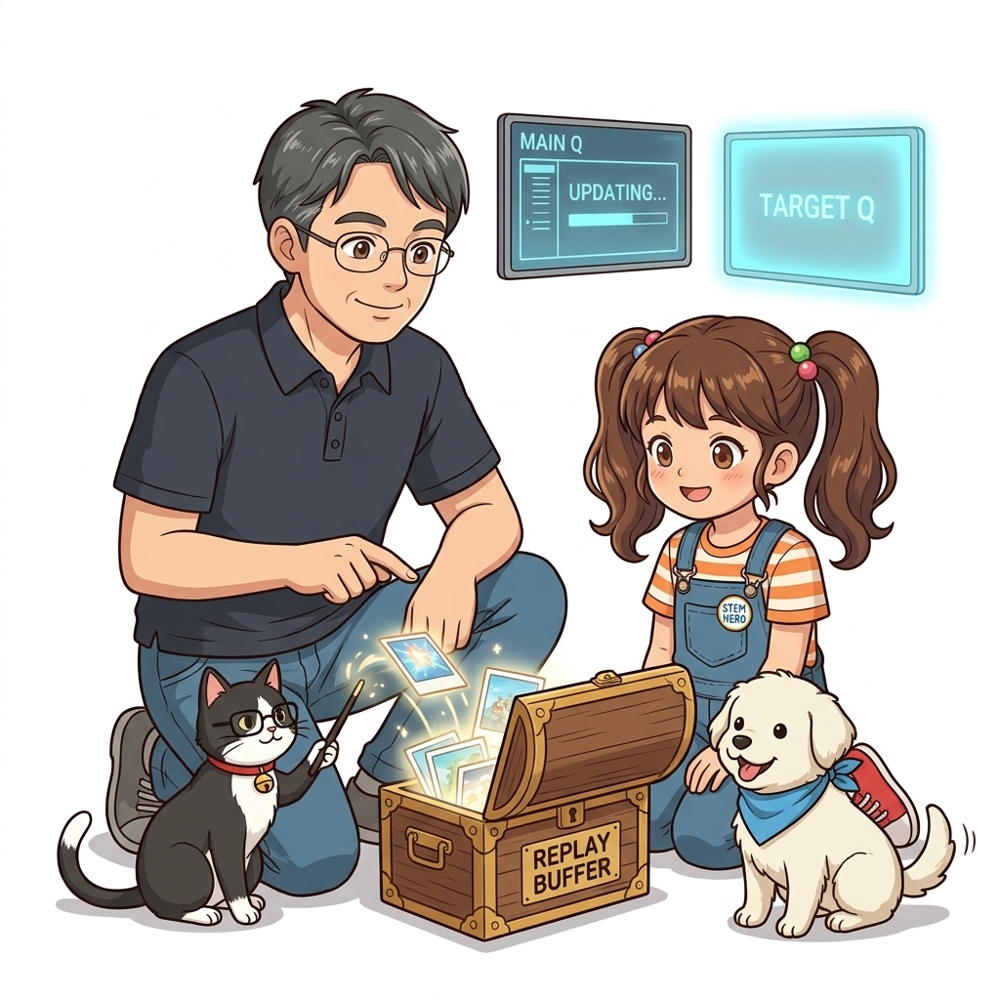
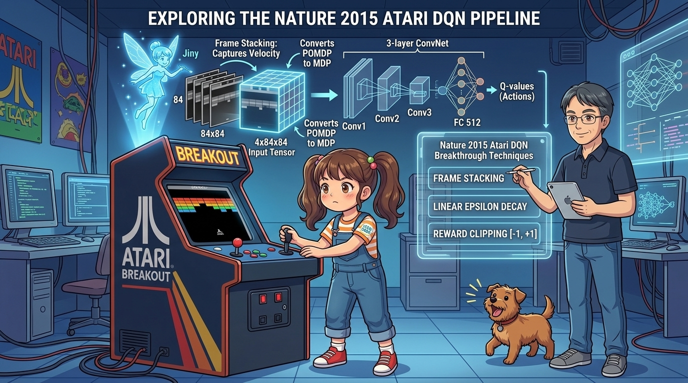
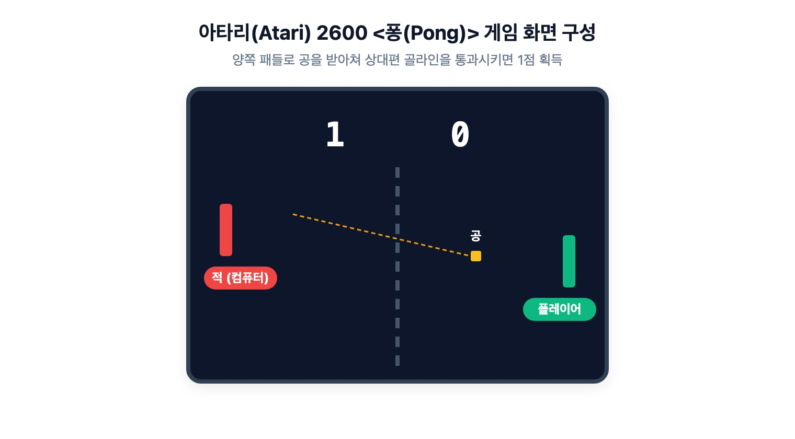
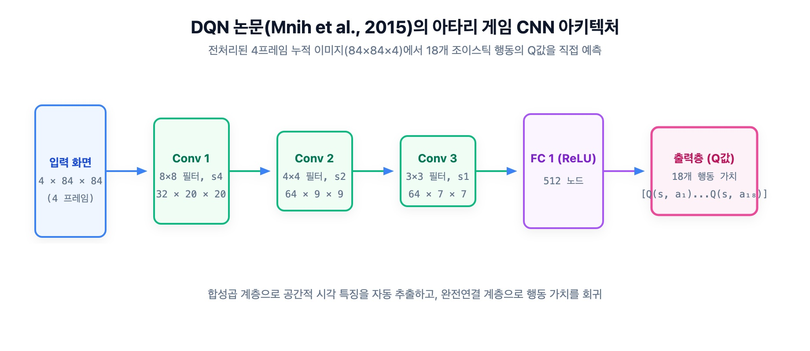
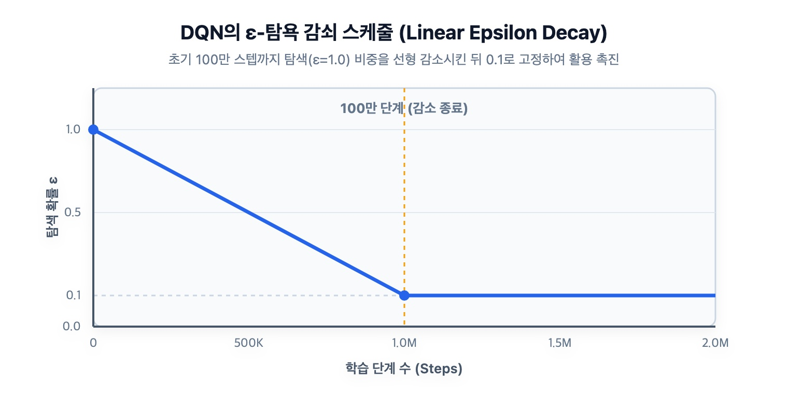

# 12.3 DQN과 아타리: 픽셀 화면으로 게임을 정복한 딥마인드의 혁신

**그림 12-3-1** 픽셀 화면 프레임 이미지 상태 입력을 CNN에 전달해 게임 액션 점수를 학습하는 도로시와 지니

**그림 12-3-2** 아타리 벽돌깨기(Breakout) 캐비닛을 조작하는 도로시와, 공의 속도를 포착하기 위해 4개 프레임을 겹쳐 4×84×84 텐서로 빚어내는 지니, 그리고 3층 CNN 구조와 3대 엔지니어링 혁신(프레임 스태킹, 입실론 감쇠, 보상 클리핑)을 설명하는 이호진 교수님

2015년 세계적인 학술지 『네이처(Nature)』 표지를 장식하며 인공지능 역사에 거대한 분수령을 만든 딥마인드의 **아타리 2600(Atari 2600) 비디오 게임 정복 사례**를 분석합니다. 사람이 눈으로 보듯 순수 픽셀 화면만을 입력받아 인간 프로게이머를 능가했던 **이미지 전처리 파이프라인**, **합성곱 신경망(CNN)** 구조, 그리고 실전 학습 트릭들을 깊이 있게 해부해 봅시다!

---

## 12.3.1 인공지능 역사의 전환점: 2015년 네이처 DQN 논문

2015년 2월, 딥마인드 연구진은 논문 **「Human-level control through deep reinforcement learning」**을 발표하며 세상을 경악시켰습니다:
- 사전 지식(규칙, 공의 물리 공식 등)을 일절 입력하지 않았습니다.
- 오직 화면 픽셀(RGB 이미지)과 조이스틱 버튼, 그리고 게임 점수(보상)만을 제공했습니다.
- 동일한 단 하나의 DQN 알고리즘과 신경망 구조로 **49개의 서로 다른 아타리 게임 중 절반 이상에서 인간 전문 게이머를 능가하는 초인적인 실력**을 달성했습니다!

이는 강화학습이 장난감 문제를 벗어나 **범용 인공지능(AGI)**으로 나아갈 수 있음을 증명한 최초의 역사적 사건이었습니다.

---

## 12.3.2 시각 기반 강화학습의 도전과 이미지 전처리

아타리 고전 게임 중 하나인 **\<퐁(Pong)\>** 환경을 살펴봅시다:

**그림 12-3-3** 아타리 게임 \<퐁(Pong)\>의 플레이 화면. 좌우의 패들과 날아다니는 공으로 구성된 2D 탁구 게임

### 1) 정지 화면의 치명적 한계: POMDP에서 MDP로
- 마르코프 결정 과정(MDP)이 성립하려면 현재 상태만 보고도 다음 상황을 예측할 수 있어야 합니다.
- 하지만 [그림 12-3-3]처럼 멈춰 있는 사진 한 장만 주어지면, **공이 왼쪽으로 날아가는 중인지 오른쪽으로 날아가는 중인지 속도와 궤적을 전혀 알 수 없습니다!**
- 상태의 일부가 가려진 **부분 관찰 마르코프 결정 과정(POMDP)**에 빠지게 됩니다.

---

### 2) 4-프레임 스태킹 (Frame Stacking)

딥마인드는 복잡한 순환 신경망(RNN) 대신 매우 천재적인 발상을 적용했습니다:

$$
\text{연속된 4장의 게임 화면을 겹쳐서 하나의 입력 텐서 } (4 \times 84 \times 84) \text{로 만든다!}
$$

사진 4장이 연속으로 겹쳐지면 공의 이전 위치와 현재 위치의 잔상이 생기므로, **공의 이동 방향과 속도, 가속도 정보가 텐서 내부에 완벽히 보존**됩니다! 이 간단한 조치로 POMDP 문제가 깔끔한 MDP 문제로 전환되었습니다.

---

### 3) 이미지 경량화 파이프라인
원래 아타리 화면은 가로 160 × 세로 210 크기의 3채널(RGB) 컬러 이미지입니다:
1. **그레이스케일 변환**: 색상 정보는 게임 플레이에 불필요하므로 1채널 흑백 이미지로 변환합니다.
2. **리사이즈 및 자르기**: 상단 점수판이나 불필요한 테두리를 걷어내고 정사각형인 **84 × 84** 크기로 축소합니다.
3. **픽셀 정규화**: 0~255 범위의 정수 픽셀값을 255.0으로 나누어 **0.0 ~ 1.0** 사이의 부동소수점 실수로 변환합니다.
4. **4-프레임 큐 적재**: 최종적으로 신경망에 입력되는 상태 형상은 **(4, 84, 84)**가 됩니다.

---

## 12.3.3 시각적 특징 추출기: 합성곱 신경망 (Nature CNN)

CartPole에서는 4차원 실수 벡터를 처리하기 위해 단순한 완전 연결 계층(MLP)을 사용했습니다. 
하지만 4 × 84 × 84 = 28,224개의 픽셀을 1열로 쭉 펴서 MLP에 넣으면 공간적인 기하학적 형태(공의 위치, 패들의 모서리 등)가 모두 파괴됩니다.

따라서 2차원 공간적 특징을 보존하며 국소 패턴을 추출하는 **합성곱 신경망(CNN)**을 사용합니다:

**그림 12-3-4** 딥마인드 Nature DQN 논문에서 사용한 표준 3층 합성곱 신경망(CNN) 아키텍처

| 층(Layer) | 연산 종류 | 필터 수 / 노드 수 | 커널 크기 | 스트라이드 (보폭) | 출력 텐서 형상 | 활성화 함수 |
| :--- | :--- | :--- | :--- | :--- | :--- | :--- |
| **입력 (Input)** | 4-프레임 스택 | - | - | - | **(4, 84, 84)** | - |
| **Conv 1** | 2D 합성곱 | 32개 | 8 × 8 | 4 | (32, 20, 20) | ReLU |
| **Conv 2** | 2D 합성곱 | 64개 | 4 × 4 | 2 | (64, 9, 9) | ReLU |
| **Conv 3** | 2D 합성곱 | 64개 | 3 × 3 | 1 | (64, 7, 7) | ReLU |
| **Flatten** | 1차원 평탄화 | 3,136개 | - | - | (3136,) | - |
| **Dense 1** | 완전 연결 계층 | 512개 | - | - | (512,) | ReLU |
| **출력 (Output)** | 완전 연결 계층 | 18개 (행동 수) | - | - | **(18,)** | **Linear** |

마지막 출력층은 조이스틱으로 취할 수 있는 18가지 가능한 게임 조작(상, 하, 좌, 우, 발사 버튼 등)에 대응하는 Q값을 벡터로 출력합니다.

---

## 12.3.4 실전 심층 강화학습의 4대 공학 노하우

Nature 논문이 성공할 수 있었던 진짜 비결은 신경망 뒤에 숨겨진 정교한 엔지니어링 트릭들에 있었습니다:

### 1) 탐험률 감쇠 스케줄링 (Linear Epsilon Decay)
- 초기에는 게임 룰을 아예 모르므로 무조건 100% 무작위 탐험(*ε* = 1.0)으로 시작합니다.
- 첫 100만 스텝 동안 *ε*을 **1.0에서 0.1까지 선형적으로 서서히 감소**시킵니다.
- 이후에는 10%의 최소 탐험 확률(*ε* = 0.1)을 영구히 유지하여 가치 갱신에 최선의 플레이를 집중시킵니다.

**그림 12-3-5** 학습 스텝 수에 따른 *ε*값의 선형 감쇠 추이

---

### 2) 보상 클리핑 (Reward Clipping: [-1, +1])
게임마다 점수 체계가 천차만별입니다:
- 벽돌깨기는 벽돌 하나에 1점~7점이지만, 스페이스 인베이더는 수백 점, 어떤 게임은 수만 점을 줍니다.
- 점수 스케일이 제각각이면 게임마다 학습률(lr)을 다르게 튜닝해야 합니다.
- 딥마인드는 **모든 득점 보상을 +1로, 모든 실점 감점을 -1로, 점수 변동이 없으면 0으로 클리핑**했습니다.
- 이를 통해 단 하나의 고정된 학습률(예: 0.00025)로 49개 게임 전체를 동일하게 학습시키는 놀라운 범용성을 달성했습니다.

---

### 3) 프레임 건너뛰기 (Frame Skipping)
- 비디오 게임은 1초에 60프레임이 지나갑니다. 매 프레임마다 신경망을 추론하고 학습하면 연산량이 지나치게 많습니다.
- 에이전트가 한 번 행동을 선택하면 **동일한 행동을 4프레임 동안 연속해서 유지**하고, 4번째 프레임의 결과만 관찰합니다.
- 계산 비용을 1/4로 대폭 절감하면서도 에이전트가 더 긴 시간 지평을 내다볼 수 있게 돕습니다.

---

### 4) 후버 손실 (Huber Loss / Smooth L1 Loss)
- 평균 제곱 오차(MSE)는 오차가 클 때 제곱으로 팽창하여 역전파 시 기울기가 폭발(Exploding Gradient)할 위험이 있습니다.
- 오차가 작을 때는 2차 곡선(MSE)으로 매끄럽게 수렴시키고, 오차가 &plusmn;1을 벗어나면 1차 직선(MAE)으로 전환하여 **기울기의 상한선을 &plusmn;1로 안전하게 제한하는 후버 손실(Huber Loss)**을 사용했습니다.

이로써 단순한 2차원 장난감 카트폴을 넘어, 실전 비전 인공지능이 작동하는 거대한 딥 강화학습 파이프라인의 전모가 드러났습니다. 
다음 12.4절에서는 기본 DQN의 과대평가 문제를 해결하고 성능을 한 차원 더 끌어올린 **DQN의 진화형 확장 기법들(Double DQN, Prioritized Replay, Dueling DQN)**을 공부해 봅시다!
