# 12.4 DQN 확장


---

#### DQN 3대 확장 기술과 Rainbow 아키텍처


**그림 12-4-0** 행동 선택과 가치 평가를 분리한 Double DQN 포드, 배울 게 많은 오차 카드를 우선 추출하는 PER 포드, 상태 가치와 행동 이득을 분리한 Dueling DQN 포드를 살펴보는 도로시와 지니, 그리고 이들을 통합한 Rainbow DQN의 위력을 강의하는 교수님

---

#### 심층 강화학습의 르네상스를 연 3대 확장

DQN은 딥러닝과 강화학습의 융합을 성공시킨 전설적인 알고리즘입니다. 

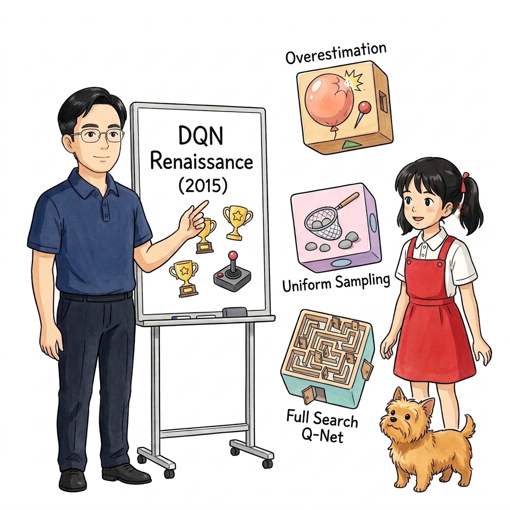
**그림 12-4-01-B** 심층 강화학습의 르네상스를 연 DQN의 역사적 성공과 극복해야 할 3대 한계(과대평가, 균등 샘플링, 구조적 비효율)를 설명하는 이호진 교수님과 도로시, 토토

---

하지만 초기 DQN 역시 몇 가지 수학적·구조적 한계를 안고 있었습니다:

1. **가치 과대평가(Overestimation)** 편향
2. **비효율적인 무작위 균등 샘플링**
3. **모든 행동을 일일이 다 해봐야만 알 수 있는 비효율적인 신경망 구조**

---

전 세계 연구자들은 이 결점들을 극복하기 위해 수많은 기법을 쏟아냈으며, 이번 절에서는 그중 가장 대표적인 **3대 핵심 확장 기술**을 집중 탐구합니다.

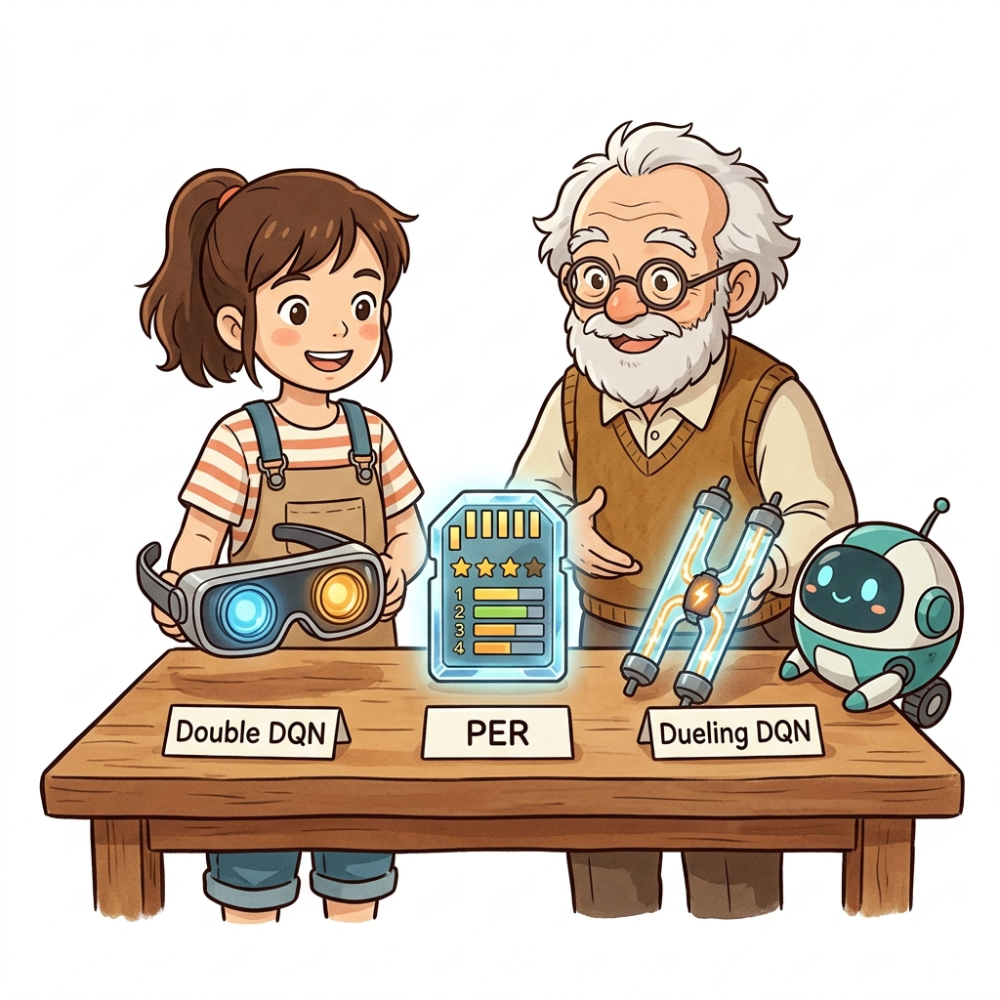
**그림 12-4-01** DQN의 3대 확장 계보: Double DQN, 우선순위 경험 재생(PER), Dueling DQN

---

### 12.4.1 Double DQN

#### 기존 DQN의 목표 신경망 복습

첫 번째 혁신 기법은 하도 판 하셀트(Hado van Hasselt) 등이 제안한 **Double DQN** [13]입니다. 

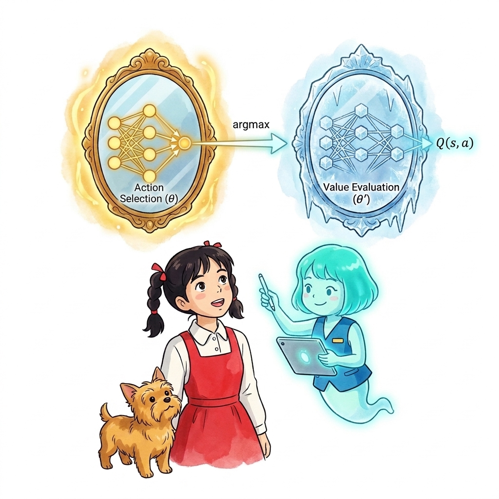
**그림 12-4-01-C** 행동을 선택하는 활성 신경망(θ)과 가치를 평가하는 목표 신경망(θ')을 마법의 거울처럼 분리하여 과대평가 편향을 제거하는 Double DQN의 핵심 원리

---

Double DQN을 이해하기 위해, 먼저 12.2절에서 배운 기존 DQN의 **목표 신경망(Target Network)** 구조를 복습해봅시다:

- **활성(메인) 신경망**: 매 스텝 가중치 파라미터 $\theta$(세타)가 경사하강법으로 갱신됨
- **목표 신경망**: 얼음처럼 고정되어 있다가 주기적으로만 복사되는 파라미터 $\theta'$(세타 프라임)

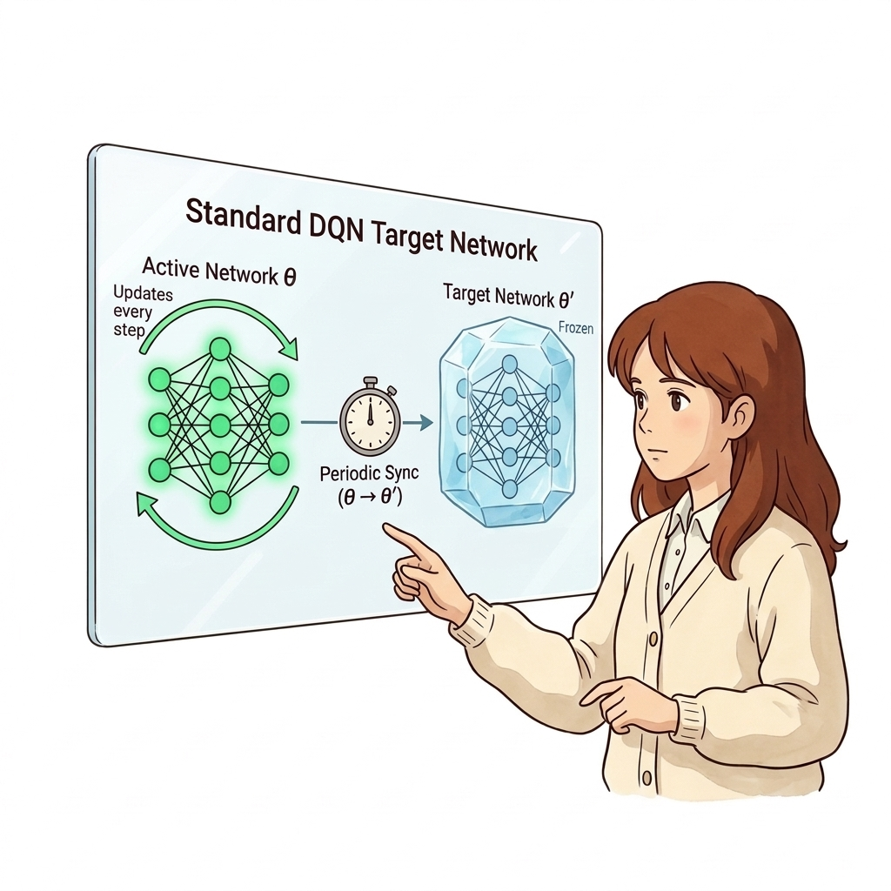
**그림 12-4-02** 기존 DQN의 목표 신경망 복습: 활성 신경망 θ와 주기적으로 동기화되는 얼어붙은 목표 신경망 θ'

---

#### 두 개의 Q-함수: $Q_{\theta}$와 $Q_{\theta'}$

- 메인 신경망이 근사하는 행동 가치 함수: $Q_{\theta}(s, a)$
- 목표 신경망이 근사하는 행동 가치 함수: $Q_{\theta'}(s, a)$

메인 신경망 파라미터 $\theta$는 에이전트의 현재 지식을 나타내고, 목표 신경망 파라미터 $\theta'$는 동기화되기 전까지 고정된 기준점 역할을 합니다.

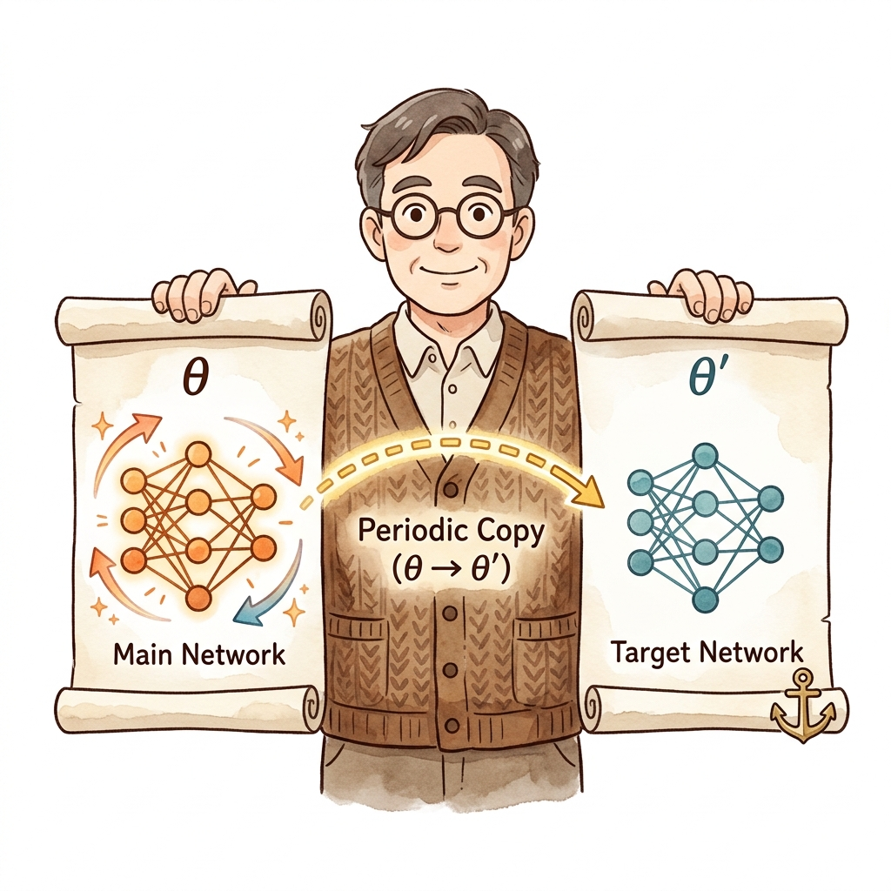
**그림 12-4-03** 매개변수가 서로 다른 두 신경망: 메인 신경망 θ와 목표 신경망 θ'의 역할 분담

---

#### 두 신경망의 수식 표현


**그림 12-4-04** 두 신경망이 근사하는 가치 함수 $Q_{\theta}(s, a)$와 $Q_{\theta'}(s, a)$의 수식 정의

이때 기존 DQN이 목표 가치(TD Target)를 계산하던 공식은 다음과 같았습니다:

$$\text{TD Target}_{\text{DQN}} = R_t + \gamma \max_a Q_{\theta'}(S_{t+1}, a)$$

- $\gamma$(감마): 미래 보상 할인율 ($0 \le \gamma < 1$)
- $\max_a$(맥스 에이): 다음 상태에서 가장 큰 Q-값을 선택하는 최댓값 연산자

---

#### 기존 DQN TD 목표 공식의 한계

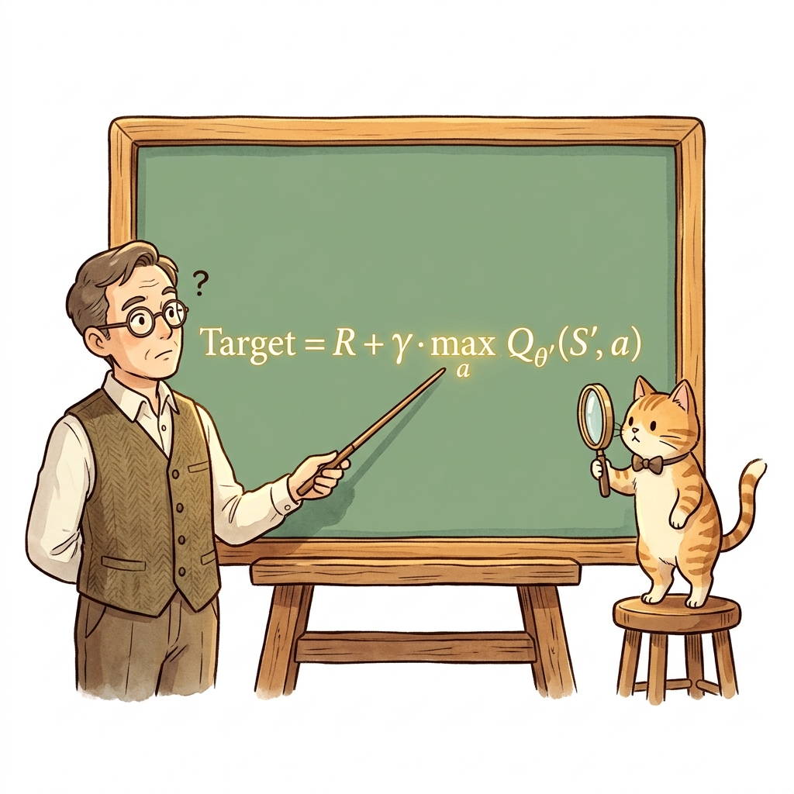
**그림 12-4-05** 기존 DQN의 TD 목표 공식: $R_t + \gamma \max_a Q_{\theta'}(S_{t+1}, a)$과 $\max$ 연산자

겉보기에는 아무런 문제가 없어 보이는 이 공식에는 아주 치명적인 수학적 함정이 숨어 있습니다. 바로 **$\max_a$ 연산자가 만들어내는 '과대평가 편향(Overestimation Bias)'**입니다.

---

#### $\max$ 연산자의 함정: 주사위 비유

> [!TIP]
> **왜 $\max$를 취하면 값이 뻥튀기될까요? (주사위 비유)**  
> 주사위 1개를 굴렸을 때 눈의 기댓값은 정확히 $3.5$입니다.  
> 그런데 주사위 5개를 동시에 던진 뒤 **"그중 가장 큰 눈($\max$)"**을 고르면 어떻게 될까요?  
> 최댓값의 평균은 $3.5$가 아니라 무려 **$4.45$ 이상**으로 훌쩍 치솟습니다!

---

#### 신경망이 예측하는 $Q_{\theta'}(s, a)$에는 항상 약간의 근사 오차와 노이즈가 섞여 있습니다. 

어떤 행동은 우연히 $+1$만큼 높게 예측되고, 어떤 행동은 $-1$만큼 낮게 예측됩니다. 

그런데 여기서 $\max$를 씌워버리면, **오차가 양(+)으로 튄 극단적인 값들만 귀신같이 골라내어 목표값으로 삼게 됩니다!**

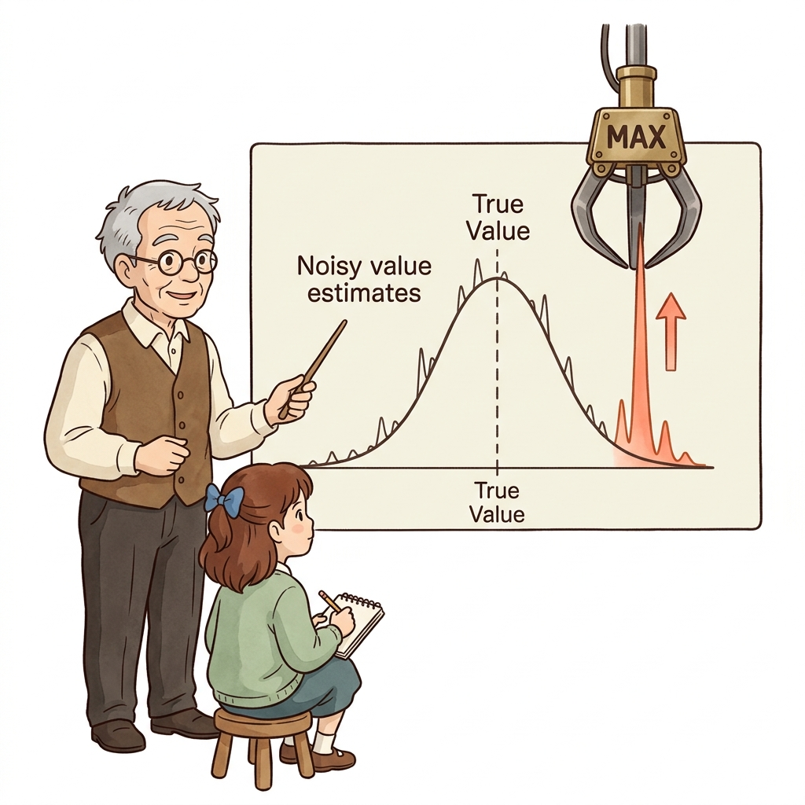
**그림 12-4-06** $\max$ 연산자의 함정: 오차가 포함된 추정치에서 최댓값을 고를 때 발생하는 양의 편향

---

#### 과대평가 편향(Overestimation Bias)의 파국

이처럼 $\max$ 때문에 부풀려진 목표값($\text{Target}$)을 향해 메인 신경망 $Q_{\theta}$가 학습되고, 그 메인 신경망이 다시 목표 신경망 $\theta'$로 복사됩니다.

- 뻥튀기된 예측이 또 다른 뻥튀기를 낳는 **양의 피드백 루프**가 발생합니다.
- 실제 참된 가치(Ground Truth)보다 Q-값이 $200\% \sim 300\%$ 이상 비정상적으로 치솟으며, 엉뚱한 비최적 행동을 최고라고 맹신하는 참사가 벌어집니다.

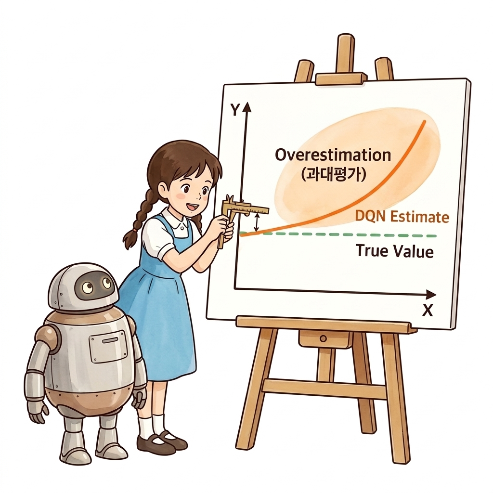
**그림 12-4-07** 과대평가(Overestimation) 편향: 참값 수평선 대비 비정상적으로 치솟는 DQN 추정치

---

#### Double DQN의 천재적 해법: 역할의 분리

Double DQN은 이 문제를 풀기 위해 **행동을 고르는 주체(선수)**와 **점수를 매기는 주체(심판)**를 분리했습니다:

$$\text{TD Target}_{\text{Double DQN}} = R_t + \gamma \, Q_{\theta'} \Big( S_{t+1}, \underbrace{\operatorname{argmax}_a Q_{\theta}(S_{t+1}, a)}_{\text{메인 신경망 } \theta \text{가 행동 선택}} \Big)$$

---


- **$\operatorname{argmax}_a$(아그맥스 에이)**: 가장 높은 Q-값을 갖는 행동의 인덱스($a^*$)를 선택합니다.
- **1단계 (행동 선택)**: 활발하게 학습 중인 메인 신경망 $Q_{\theta}$에게 *"다음 상태에서 가장 좋아 보이는 행동 $a^*$가 뭐니?"*라고 묻습니다.
- **2단계 (가치 평가)**: 선택된 행동 $a^*$의 실제 점수 평가는 엉뚱한 노이즈에 휩쓸리지 않도록 차분한 목표 신경망 $Q_{\theta'}$에게 맡깁니다.


**그림 12-4-08** Double DQN의 해법: $R_t + \gamma Q_{\theta'}(S_{t+1}, \operatorname{argmax}_a Q_{\theta}(S_{t+1}, a))$ 공식

---

#### 행동 선택($\theta$)과 가치 평가($\theta'$)의 디커플링

기존 DQN은 목표 신경망 혼자서 자기가 행동도 고르고 점수도 자기가 매겼기 때문에 자화자찬식 과대평가가 생겼습니다.

Double DQN은 **선수($\theta$)와 심판($\theta'$)을 철저히 분리(Decoupling)**함으로써, 우연한 노이즈로 한쪽 신경망의 특정 행동 값이 높게 튀더라도 다른 신경망이 이를 냉정하게 걸러내어 과대평가 거품을 원천 차단합니다.

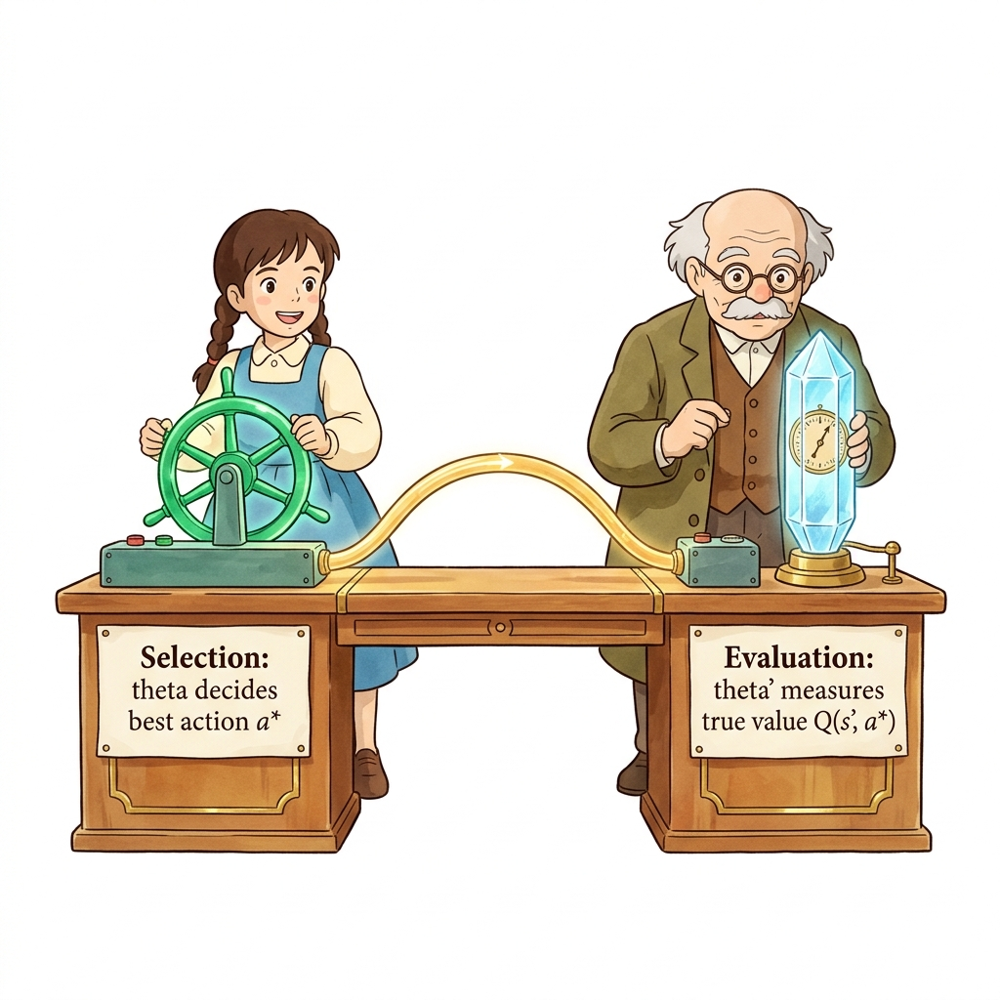
**그림 12-4-09** 행동 선택($\theta$)과 가치 평가($\theta'$)의 분리: 편향을 원천 차단하는 듀얼 콘솔

---

#### 거품이 꺼진 안정적인 수렴

Double DQN을 적용하면 비정상적으로 치솟던 Q-값의 거품이 사라지고, 신경망의 추정 곡선이 실제 환경의 참된 기대 수익을 정밀하게 따라가며 학습 속도와 최종 성능이 비약적으로 향상됩니다.


**그림 12-4-10** 편향 해소와 학습 안정화: 과대평가 거품이 꺼지고 참값을 안정적으로 추적하는 수렴

---

#### 과대평가 편향의 수학적 엄밀성

> [!NOTE]
> 과대평가 편향이 수학적으로 왜 반드시 양수($\ge 0$)가 되는지, 그리고 두 신경망을 분리했을 때 왜 기댓값 차원에서 편향이 상쇄되는지에 대한 엄밀한 수학적 정리는 본 교재의 **부록 C(Appendix C)**에 상세히 증명되어 있습니다.

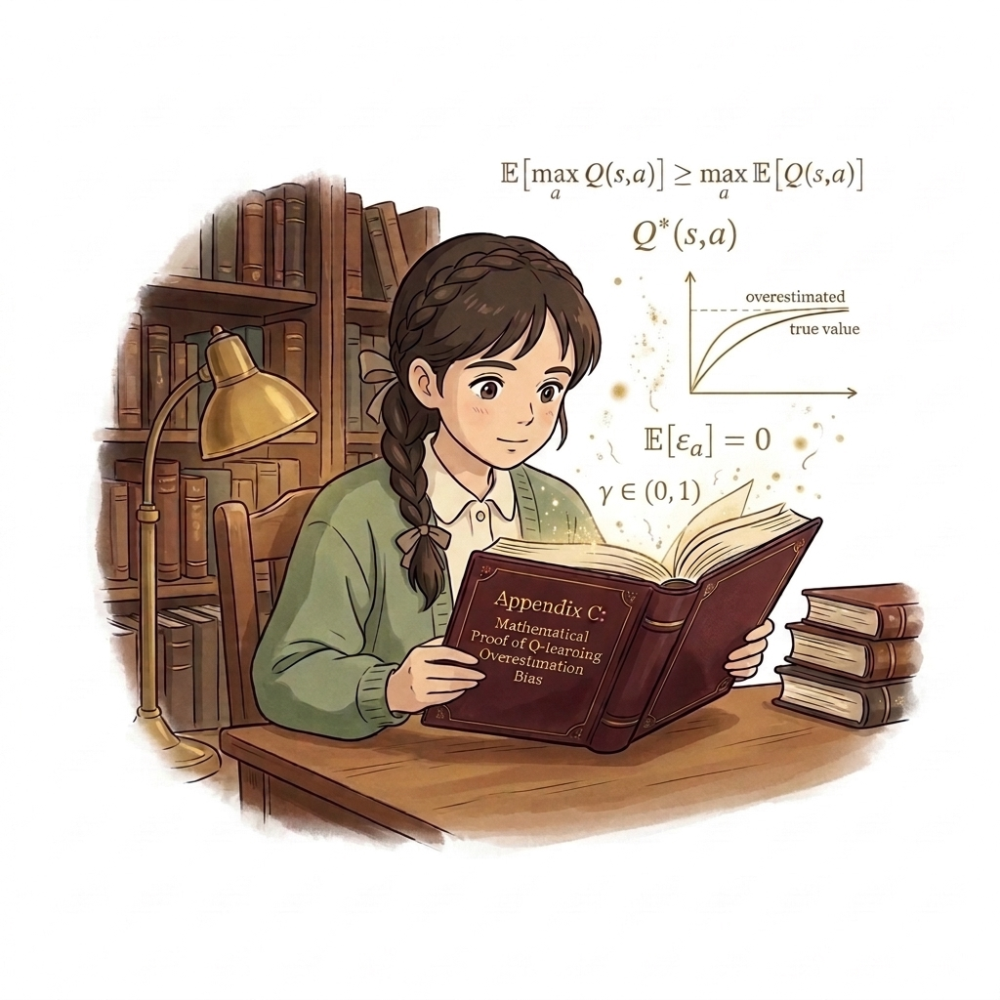
**그림 12-4-11** 부록 C: 과대평가 편향 해소의 수학적 증명과 탄탄한 이론적 토대

---

### 12.4.2 우선순위 경험 재생(PER)

#### 기존 균등 경험 재생(Uniform Replay)의 비효율

12.2절에서 다룬 기존 경험 재생 버퍼는 모든 경험 튜플 $E_t = (S_t, A_t, R_t, S_{t+1})$을 저장한 뒤, 학습할 때 **모든 데이터를 동일한 확률($1/N$)로 무작위 균등 추출**했습니다.


---

하지만 시험공부를 할 때 이미 100번 맞춰서 완벽히 아는 쉬운 문제와, 어제 풀다가 틀린 킬러 문제를 똑같은 빈도로 복습하는 것은 엄청난 시간 낭비입니다!

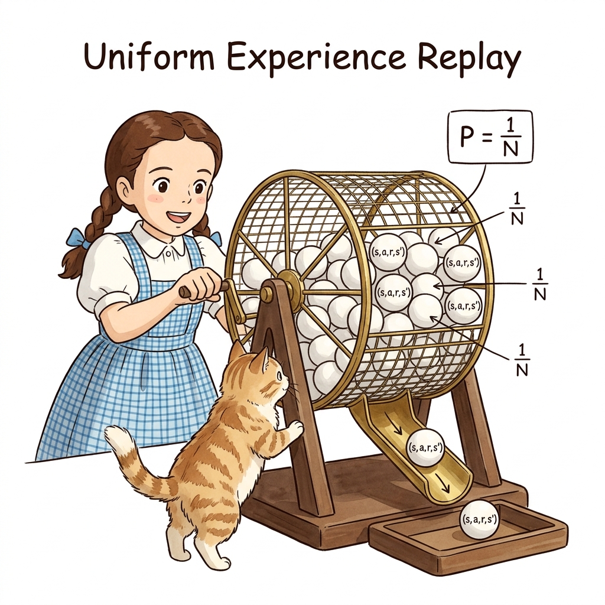
**그림 12-4-12** 기존 균등 경험 재생의 한계: 모든 경험이 중요도에 상관없이 동일한 $1/N$ 확률로 추출

---

#### 우선순위 경험 재생(PER)의 탄생: 오답 노트의 지혜

톰 샤울(Tom Schaul) 등이 제안한 **우선순위 경험 재생(Prioritized Experience Replay; PER)** [14]은 바로 이 '오답 노트'의 철학을 강화학습 버퍼에 이식한 기법입니다:

- 모든 경험을 똑같이 취급하지 않고, **에이전트가 아직 제대로 예측하지 못해 배울 점이 많은 중요한 경험에 높은 우선순위를 부여하여 더 자주 샘플링**합니다.


**그림 12-4-13** 우선순위 경험 재생(PER) 개념: 배울 점이 많은 중요한 경험에 황금 별을 매겨 우선 추출

---

#### 어떤 경험이 진짜 중요한 경험인가?

그렇다면 에이전트의 버퍼에 쌓인 수만 개의 경험 중, **"배울 점이 많은 경험"**은 도대체 어떤 기준으로 측정해야 할까요?

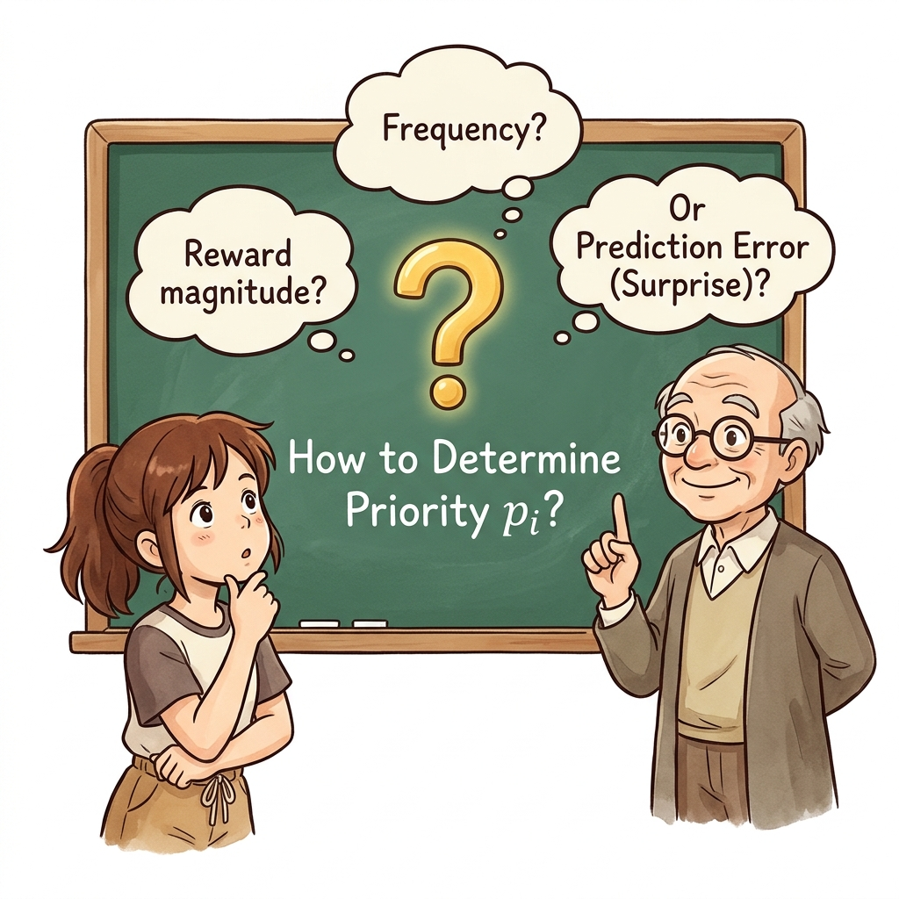
**그림 12-4-14** 핵심 질문: 경험 데이터의 우선순위는 도대체 어떤 기준으로 정해야 할까?

---

#### 우선순위의 척도: TD 오차 절댓값 $|\delta_t|$

그 답은 바로 벨만 방정식의 예측 차이인 **시간차 오차(TD Error, $\delta_t$; 델타 티)**의 크기입니다:

$$\delta_t = R_t + \gamma \max_a Q_{\theta'}(S_{t+1}, a) - Q_{\theta}(S_t, A_t)$$

---

- **우선순위 지표**: $|\delta_t| = \big| \text{목표값} - \text{현재 예측치} \big|$
- TD 오차의 절댓값은 **"에이전트가 그 순간에 느낀 놀람의 크기(Degree of Surprise)"**를 대변합니다.

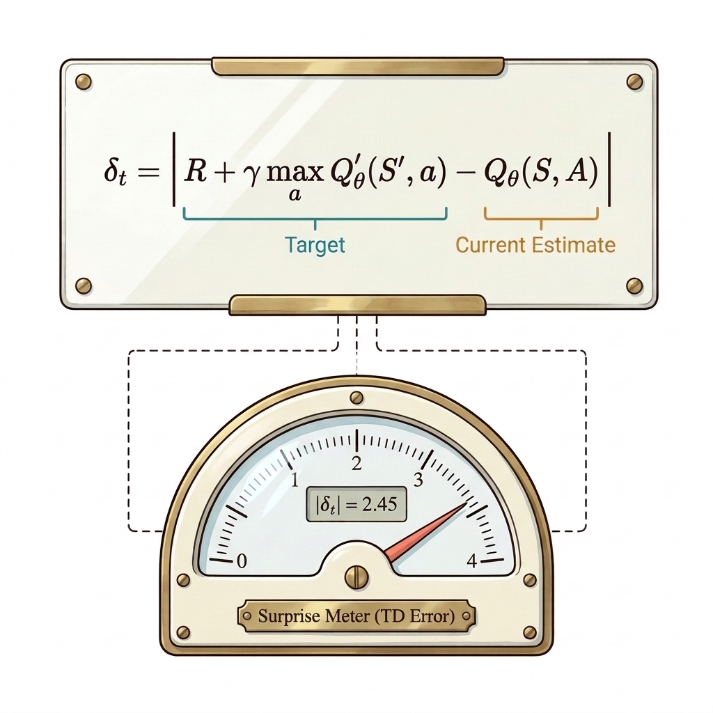
**그림 12-4-15** TD 오차 절댓값 $\delta_t$ 공식: 예상치와 실제 목표 사이의 놀람도(Surprise) 측정

---

#### $|\delta_t|$ 크기의 본질적 물리 의미

- **오차가 큰 경험 ($|\delta_t| \gg 0$)**: 에이전트의 예상이 완전히 빗나간 돌발 상황(절벽 추락, 갑작스러운 고득점 획득). 신경망 가중치를 대폭 수정해야 하는 **'황금 원석 데이터'**입니다.
- **오차가 거의 0인 경험 ($|\delta_t| \approx 0$)**: 신경망이 이미 정확히 예측하고 있는 평범한 일상 주행 데이터. 다시 학습해 봐야 가중치 변화가 거의 없습니다.

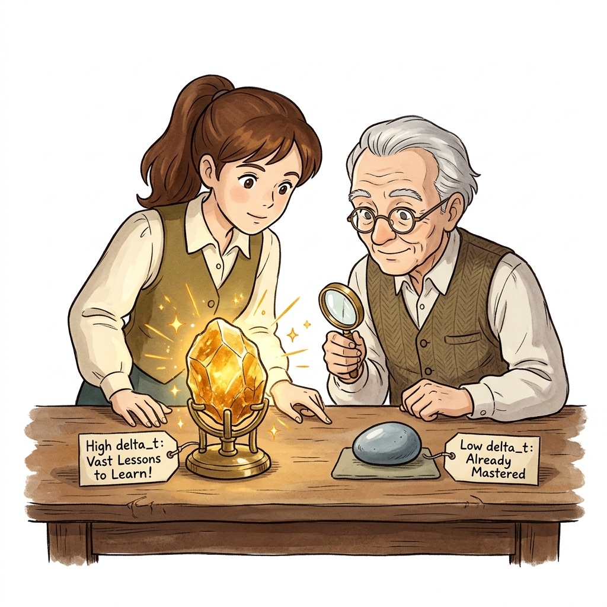
**그림 12-4-16** $\delta_t$ 크기의 본질적 의미: 큰 오차(배울 게 많은 황금 원석) vs 작은 오차(이미 마스터)

---

#### 오차가 큰 경험: 긴급 수정 교훈


**그림 12-4-17** 높은 TD 오차 (High $\delta_t$): 절벽 추락이나 돌발 고득점 등 에이전트에게 중요한 긴급 교훈

---

#### 오차가 작은 경험: 이미 통달한 데이터


**그림 12-4-18** 낮은 TD 오차 (Low $\delta_t$): 이미 충분히 익숙하여 가중치 수정이 거의 필요 없는 일상 데이터

---

#### PER의 5-토큰 경험 카트리지

따라서 우선순위 경험 재생에서는 버퍼에 $(S_t, A_t, R_t, S_{t+1})$ 4개만 넣는 것이 아니라, **현재의 오차 태그 $|\delta_t|$를 함께 묶어 5개 원소**를 저장합니다:

$$E_t = \big(S_t, A_t, R_t, S_{t+1}, |\delta_t|\big)$$

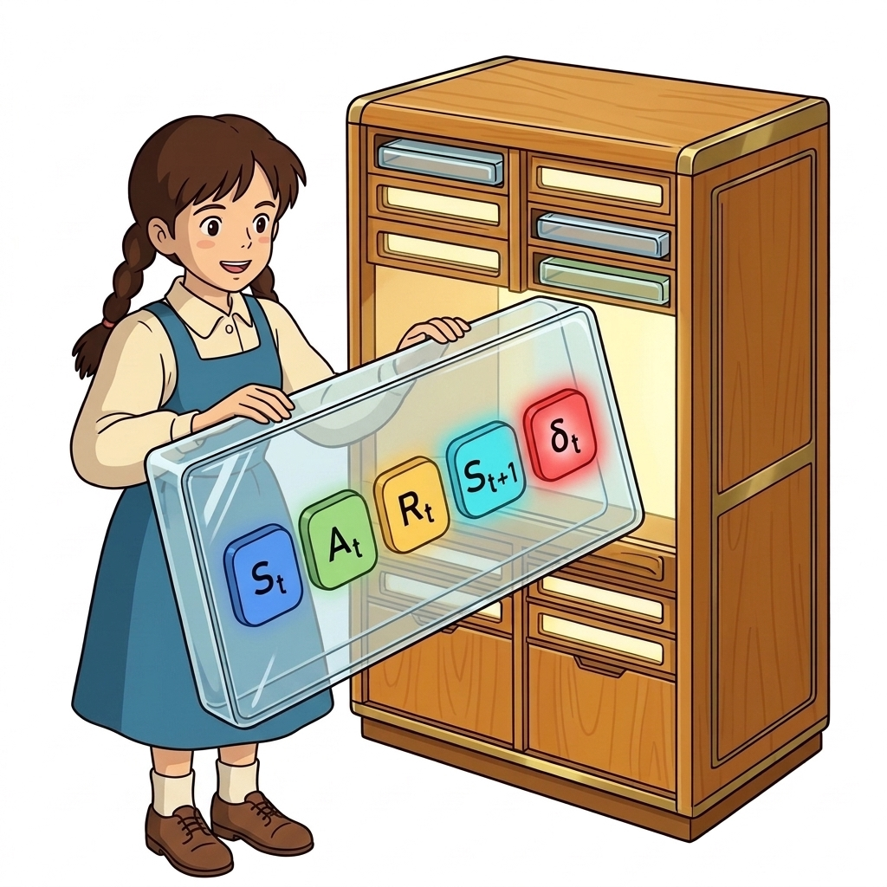
**그림 12-4-19** 오차 태그가 포함된 PER 5개 토큰 경험 카트리지: $(S_t, A_t, R_t, S_{t+1}, \delta_t)$

---

#### 오차 비례 룰렛 샘플링 확률 계산

버퍼에 담긴 $N$개의 경험 데이터 중 $i$번째 경험이 미니배치로 뽑힐 확률 $p_i$는 오차 크기에 비례하는 룰렛 원판 형태로 결정됩니다:

$$p_i = \frac{|\delta_i|}{\sum_{k=1}^{N} |\delta_k|}$$

---

- $\sum_{k=1}^N |\delta_k|$: 버퍼에 있는 모든 데이터의 오차 총합 ($\sum$은 시그마로 발음)
- 오차가 10배 큰 데이터는 10배 더 넓은 룰렛 칸을 차지하여, 미니배치로 추출될 확률이 10배 높아집니다!

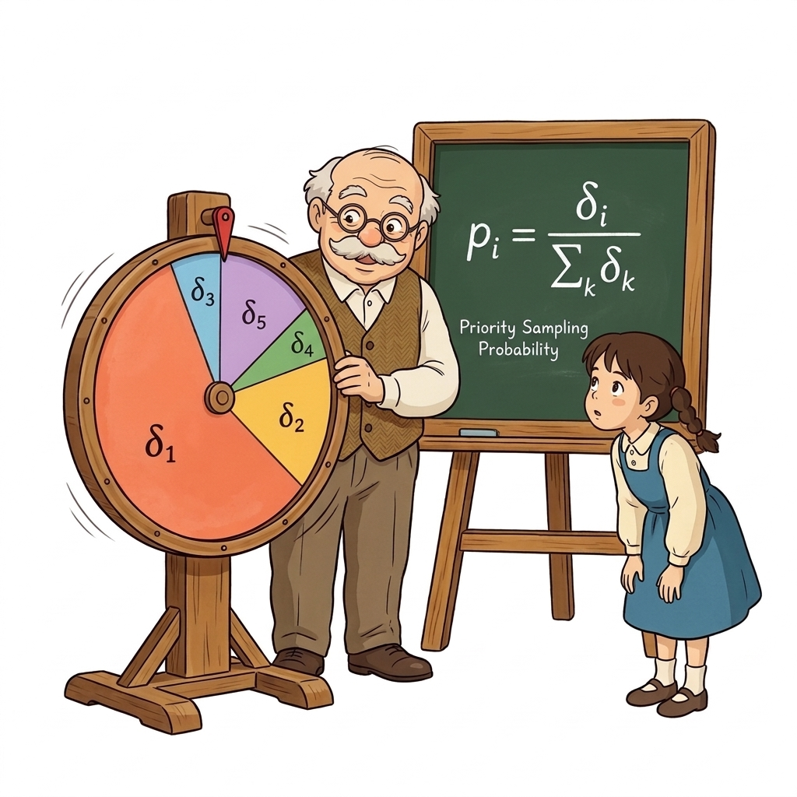
**그림 12-4-20** 오차 비례 확률 룰렛 원판과 계산 공식: $p_i = \delta_i / \sum \delta_k$

---

#### 황금 경험의 집중 추출과 초고속 학습

PER을 적용하면 에이전트는 평범한 데이터로 시간을 낭비하지 않고, **자신이 가장 취약했던 치명적 실수와 희귀한 대박 기회를 집중적으로 복습**하게 됩니다.

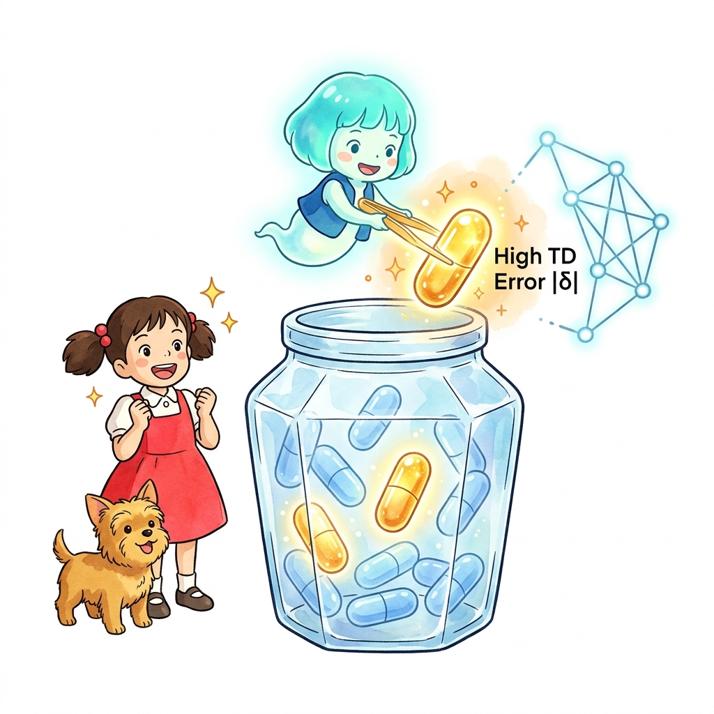
**그림 12-4-22-B** 대용량 경험 재생 수조에서 TD 오차가 큰 반짝이는 황금 캡슐(치명적 실수 및 극적인 성공 경험)을 선별 추출하여 집중 복습하는 지니와 도로시

---

결과적으로 똑같은 10만 스텝을 학습하더라도, 기존 균등 버퍼 대비 **수렴 속도가 2~3배 이상 비약적으로 빨라집니다.**


**그림 12-4-22** PER을 통한 학습 속도 초고속 가속: 중요 경험 집중 학습으로 수렴 시간 단축

---

### 12.4.3 Dueling DQN

#### 신경망 내부 구조의 근본적 혁신

세 번째 확장 기법인 **Dueling DQN** [15]은 학습 알고리즘이 아니라 **신경망의 내부 아키텍처 자체를 뜯어고친 혁신**입니다.

기존 Q-네트워크는 상태 $s$를 입력받아 각 행동의 $Q(s, a)$ 값을 한꺼번에 출력했습니다. 

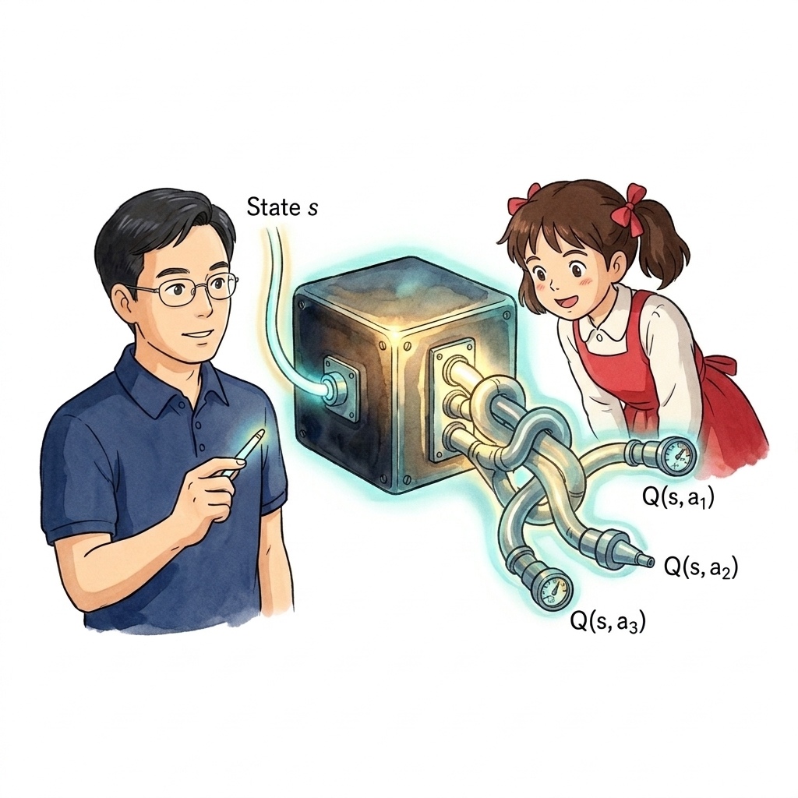
**그림 12-4-23-B** 하나의 블랙박스 큐브에서 모든 행동의 Q-값이 얽힌 채 출력되어 행동별 가치를 독립적으로 조율하기 어려운 기존 표준 Q-네트워크 구조

---

Dueling DQN은 가치 함수를 구성하는 두 가지 본질적인 요소를 간파하고 이를 네트워크 안에서 분리했습니다:

1. **상태 가치 $V(s)$**: 내가 지금 처한 상황 자체가 얼마나 유리한가?
2. **어드밴티지 $A(s, a)$**: 그 상황에서 특정 행동 $a$를 취하는 것이 평균보다 얼마나 더 우월한가?


**그림 12-4-23** 신경망 구조 자체의 혁신: 상태 가치와 행동 이점을 분리한 Dueling DQN의 서막

---

#### 어드밴티지 함수(Advantage Function)의 수학적 정의

어드밴티지 함수 $A_{\pi}(s, a)$는 **행동 가치 $Q(s, a)$에서 상태 가치 $V(s)$를 뺀 값**으로 정의됩니다:

$$A_{\pi}(s, a) = Q_{\pi}(s, a) - V_{\pi}(s) \tag{식 12.1}$$

---

- $Q_{\pi}(s, a)$: 상태 $s$에서 행동 $a$를 취한 뒤 정책 $\pi$를 따랐을 때의 기대 수익
- $V_{\pi}(s)$: 상태 $s$에서 처음부터 정책 $\pi$에 맡겼을 때 얻는 평균 기대 수익


**그림 12-4-24** 어드밴티지 함수 공식: $A_{\pi}(s, a) = Q_{\pi}(s, a) - V_{\pi}(s)$ (식 12.1)

---

#### 어드밴티지 부호의 물리적 의미

- **$A(s, a) > 0$ (양수)**: 이 행동은 정책의 평균적인 선택보다 **더 이롭고 뛰어난 묘수**입니다.
- **$A(s, a) < 0$ (음수)**: 이 행동은 평균적인 선택보다 **손해를 부르는 악수**입니다.
- **$A(s, a) \approx 0$**: 평균 수준의 평범한 행동입니다.

즉, 어드밴티지는 **상태의 좋고 나쁨과 무관하게 오직 "행동 간의 상대적 우열"만을 순수하게 분리해 낸 지표**입니다.

---

#### 가치 함수와 어드밴티지의 결합

[식 12.1]의 이항 정리를 통해, 우리가 구하고자 하는 최종 $Q(s, a)$는 상태 가치와 어드밴티지의 합으로 재구성할 수 있습니다:

$$Q_{\pi}(s, a) = V_{\pi}(s) + A_{\pi}(s, a) \tag{식 12.2}$$

---

#### Dueling DQN의 Y자 분기 아키텍처

Dueling DQN은 이 수학적 원리를 신경망에 그대로 구현했습니다:

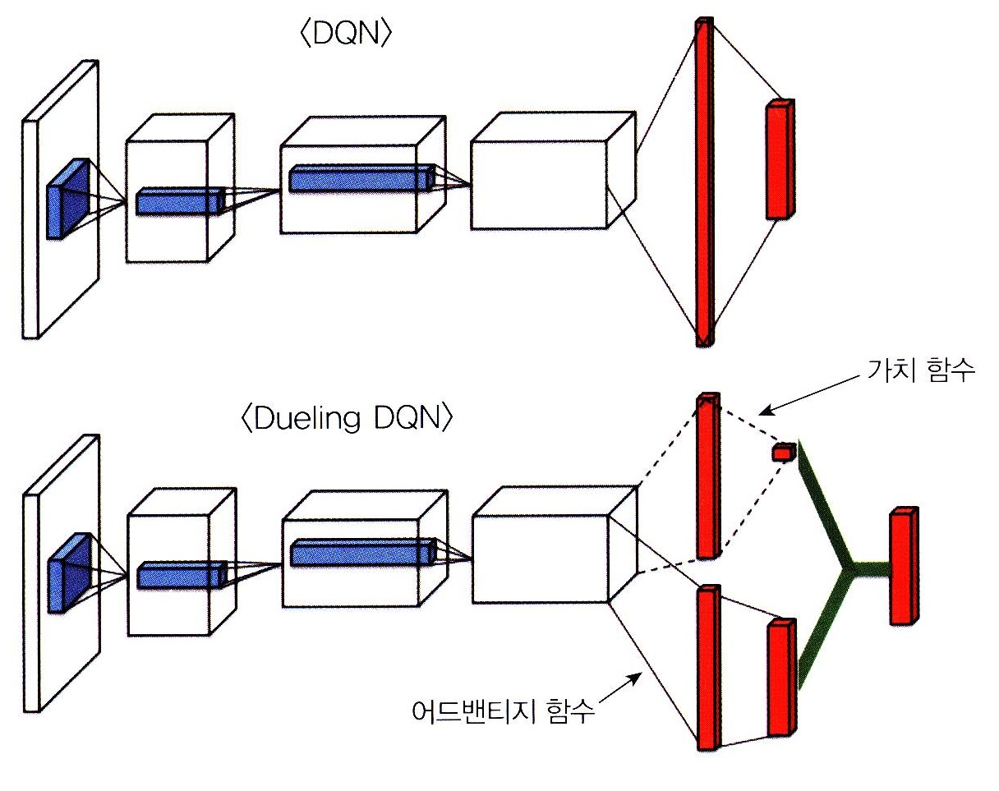
**그림 12-13** 기존 표준 DQN(위)과 Dueling DQN(아래)의 내부 아키텍처 비교

- 입력층과 초기 특징 추출 계층(합성곱 또는 은닉층)은 두 갈래가 공통으로 공유합니다.
- 마지막 단계에서 네트워크가 Y자 모양으로 갈라집니다:
  - **가치 스트림(Value Stream)**: 크기 1의 스칼라 값 $V(s)$를 출력
  - **어드밴티지 스트림(Advantage Stream)**: 행동 개수 크기의 벡터 $A(s, a)$를 출력
- 두 스트림을 합산하여 최종 $Q(s, a)$ 벡터를 조립합니다.

---

#### 실전 구현 시의 식별성(Identifiability) 문제 해결

단순히 $Q = V + A$로 더하면, $V$에 임의의 상수 $C$를 더하고 $A$에서 $C$를 빼도 똑같은 $Q$가 나오므로 신경망이 $V$와 $A$를 고유하게 분해(학습)하지 못합니다. 

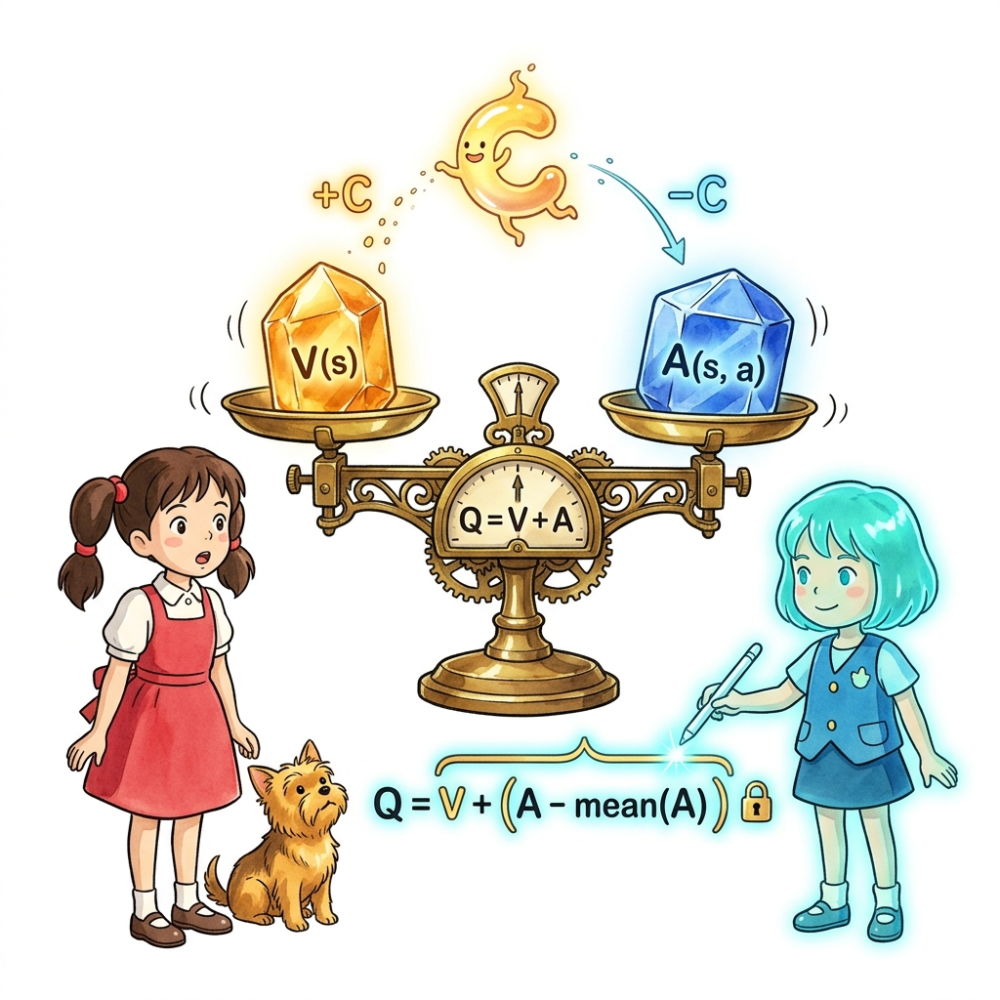
**그림 12-4-31-B** 상수 C에 의해 흔들리는 Q = V + A의 미식별성 저울을 어드밴티지 평균 차감 수식으로 안정적으로 고정하는 지니의 해법

---

이를 해결하기 위해 Dueling DQN 논문에서는 **어드밴티지의 평균값을 빼주는 기발한 정규화 수식**을 사용합니다:

$$Q(s, a; \theta, \alpha, \beta) = V(s; \theta, \beta) + \Big( A(s, a; \theta, \alpha) - \frac{1}{|\mathcal{A}|} \sum_{a'} A(s, a'; \theta, \alpha) \Big)$$

- 이 식 덕분에 가치 스트림은 정확하게 상태의 평균 가치 $V(s)$로 수렴하고, 어드밴티지는 평균이 0인 상대적 편차로 완벽하게 안정화됩니다.

---

#### 왜 Dueling DQN이 압도적으로 유리한가?

> [!TIP]
> **행동이 결과에 영향을 주지 않는 수많은 순간들**  
> 고속도로 운전 중 앞차가 수 킬로미터 앞에 있을 때, 액셀을 밟든 핸들을 가만히 두든 당장 사고가 나지 않습니다. 중요한 것은 **'현재 도로가 안전하다'는 상태 가치 $V(s)$ 자체**입니다.


**그림 12-4-32-B** 앞차가 멀리 있는 안전한 고속도로에서는 어떤 조작을 하든 안전하므로 상태 가치 V(s)가 학습의 대부분을 지배하는 직관적 비유

---

- **기존 DQN**: 어떤 행동이 안전한지 확인하려면 좌회전, 우회전, 정지 등 모든 행동을 한 번씩 다 해봐야만 각각의 $Q$를 겨우 배울 수 있었습니다.
- **Dueling DQN**: $V(s)$ 분기 하나만 학습되면, **에이전트가 직접 해보지 않은 모든 행동들의 $Q(s, a)$ 가치가 한꺼번에 동시에 갱신**됩니다!


**그림 12-4-32** 불가피한 실점 상황에서 기존 DQN의 한계: 모든 행동을 다 해봐야만 학습 가능

---

#### 상태 가치 V(s) 하나로 모든 행동 동시 갱신

〈퐁〉에서 공이 이미 플레이어 골대로 빨려 들어가는 불가피한 실점 상황에서도, Dueling DQN은 패들을 위로 올렸든 가만히 있었든 상관없이 $V(s)$가 $-1$점으로 하락하면서 모든 행동의 Q-값을 즉각 업데이트합니다. 

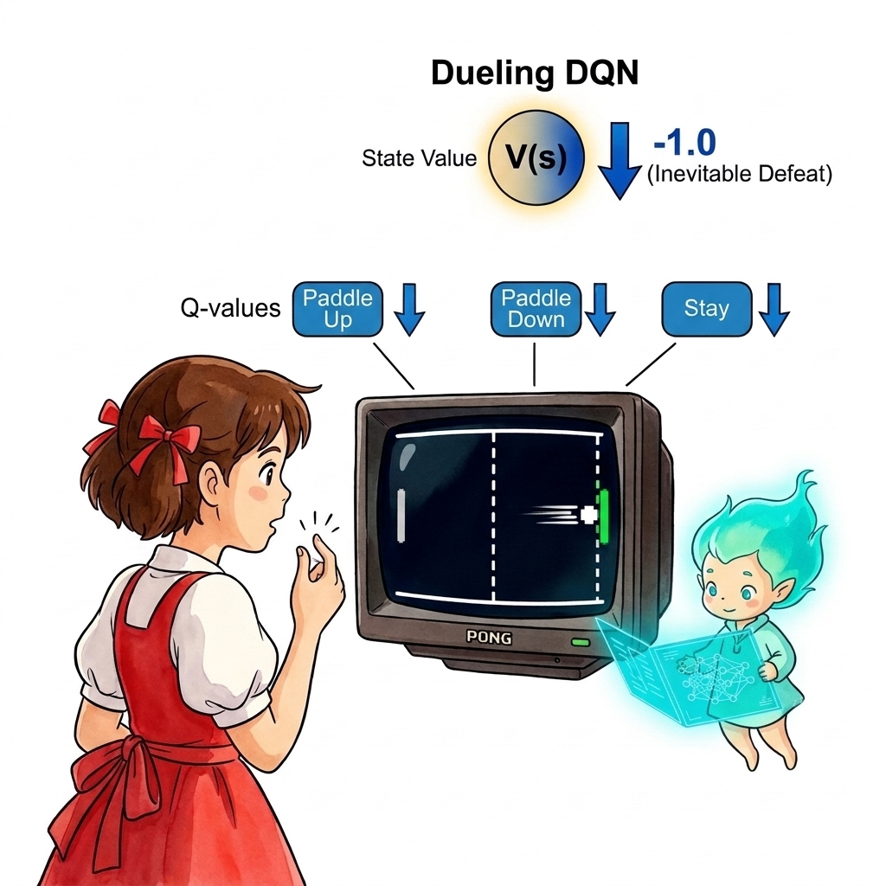
**그림 12-4-33-B** 불가피한 실점 상황에서 상태 가치 V(s)가 -1로 하락함과 동시에 모든 행동의 Q-값이 즉시 동기화되어 학습 효율을 극대화하는 Dueling DQN

---

이러한 탁월한 일반화 능력 덕분에 Dueling DQN은 학습 효율을 극대화합니다.


**그림 12-4-33** Dueling DQN의 번개 같은 깨달음: 상태 가치 $V(s)$ 하나만 배워도 모든 행동 Q값 즉각 갱신

---

#### [실습] DQN 3대 확장 기술 종합 검증

앞서 살펴본 Double DQN 편향 제거, PER 확률 룰렛, Dueling DQN 분기 연산을 직접 구현한 [step01_dqn_extensions_demo.py](file:///Users/hojin9/Library/Mobile%20Documents/com~apple~CloudDocs/02.강의/A06_강화학습/src/12_DQN/12_4_DQN_확장/step01_dqn_extensions_demo.py)의 핵심 코드를 확인해봅시다:

```python
# 1. Double DQN: 행동 선택(argmax)과 가치 평가(theta_prime) 분리
best_action = np.argmax(q_theta[next_state])
td_target = reward + gamma * q_target[next_state, best_action]

# 2. PER: TD 오차 절댓값 비례 확률 계산
probabilities = deltas / np.sum(deltas)

# 3. Dueling DQN: 평균 차감 재결합 공식
Q = V + (A - np.mean(A, axis=1, keepdims=True))
```

---

#### [실습 결과] 터미널 출력 화면 및 수치 검증

스크립트를 구동하면 3대 확장 기술의 수학적 효과가 선명한 수치로 입증됩니다:

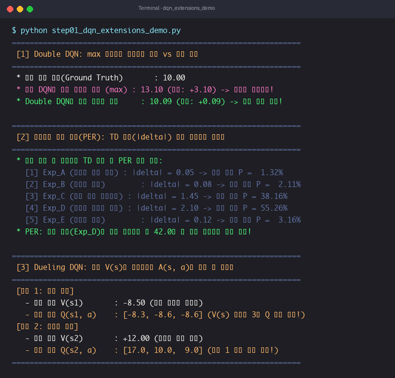
**그림 12-4-T1** DQN 3대 확장 기술 검증 터미널 실행 결과 (`ch12_4_step01_terminal.png`)

- **Double DQN**: 참값 10.00 대비 표준 DQN은 $13.10$(+3.10 거품)으로 폭증한 반면, Double DQN은 **$10.09$(+0.09)**로 편향을 완벽히 제거했습니다.
- **PER**: 돌발 보너스 경험(Exp_D)이 일상 경험(Exp_A)보다 **무려 42배 높은 확률(55.26%)로 집중 추출**되었습니다.
- **Dueling DQN**: $V(s_1) = -8.50$ 하나를 학습함으로써 위기 상황의 모든 행동 Q-값이 일괄 하향 갱신되었습니다.

---

#### [실습 시각화] 편향 해소 히스토그램과 PER 샘플링 분포

[step01_dqn_extensions_demo.py](file:///Users/hojin9/Library/Mobile%20Documents/com~apple~CloudDocs/02.강의/A06_강화학습/src/12_DQN/12_4_DQN_확장/step01_dqn_extensions_demo.py)가 생성한 분석 그래프입니다:

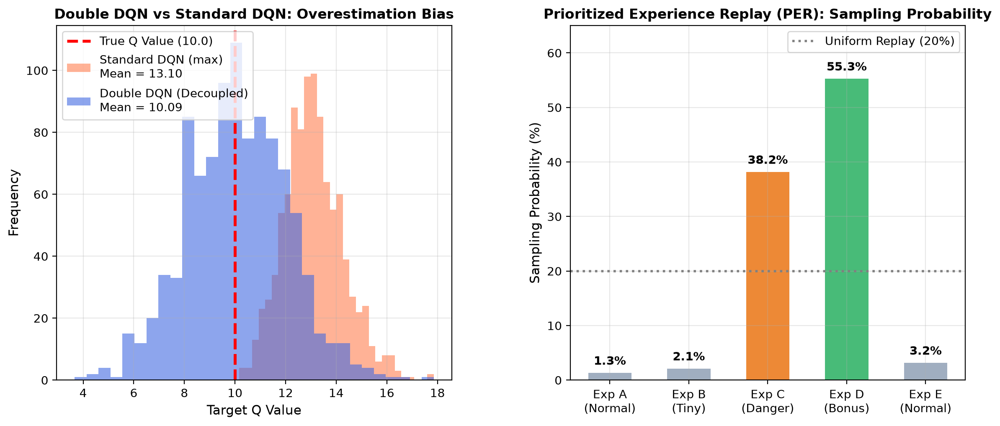
**그림 12-4-G1** Double DQN의 과대평가 편향 제거 히스토그램(좌) 및 PER의 중요도 비례 샘플링 확률 바차트(우)

---

#### 6대 확장의 집대성: Rainbow DQN

2017년 딥마인드는 마테오 헤셀(Matteo Hessel)을 중심으로 지금까지 제안된 독립적인 DQN 개선 기법들을 하나로 통합하면 어떤 결과가 나올지 실험했습니다:

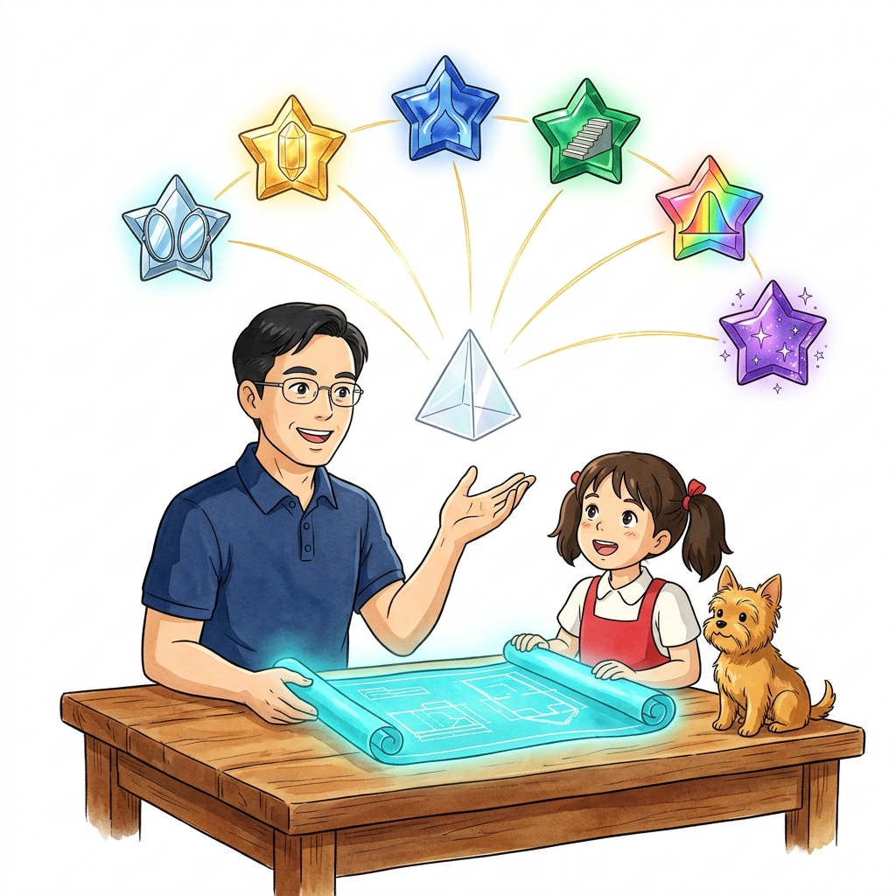
**그림 12-4-34-B** 독립적으로 발전해 온 6대 핵심 확장 기법(Double DQN, PER, Dueling, Multi-step, Distributional, Noisy Nets)을 하나의 통합 청사진으로 엮어내는 교수님과 도로시

---

1. **DQN** (기본형)
2. **Double DQN** (과대평가 편향 제거)
3. **Prioritized Experience Replay** (중요 경험 집중 학습)
4. **Dueling Network** (상태 가치와 어드밴티지 분리)
5. **Multi-step Learning** (N-스텝 부트스트래핑)
6. **Distributional RL** (가치 기댓값 대신 확률 분포 학습)
7. **Noisy Nets** (파라미터 노이즈를 통한 지능적 탐험)

이 6가지 기법을 단 하나의 통합 아키텍처로 융합한 것이 바로 **무지개빛 '레인보우(Rainbow) DQN'**입니다. 

---

Rainbow는 아타리 57개 전 게임에서 기존의 모든 기록을 압도적으로 갈아치우며 가치 기반(Value-Based) 심층 강화학습의 최고봉에 등극했습니다.

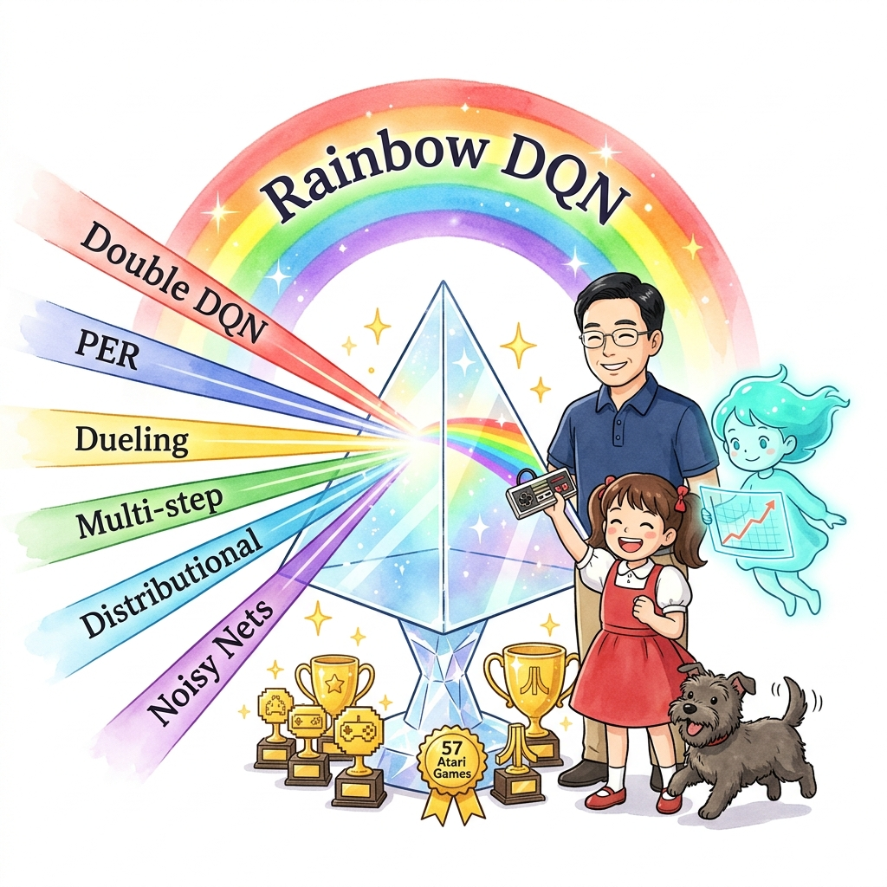
**그림 12-4-35-B** 6대 확장 기법이 무지개빛 프리즘으로 융합되어 아타리 57개 전 게임을 정복하고 가치 기반 강화학습의 정상에 오른 Rainbow DQN의 쾌거
