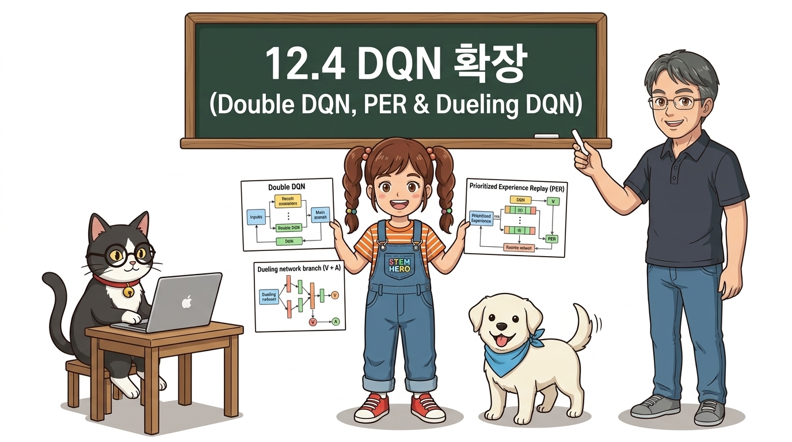
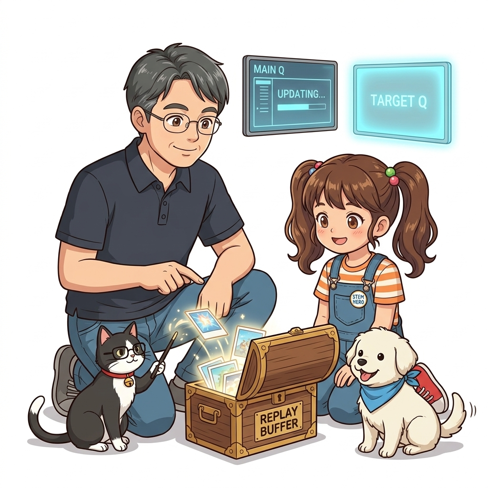
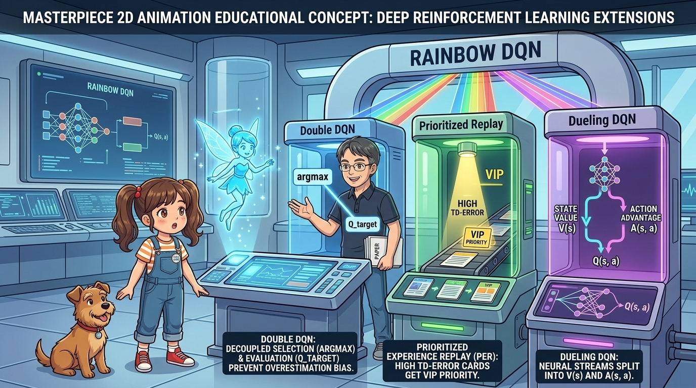
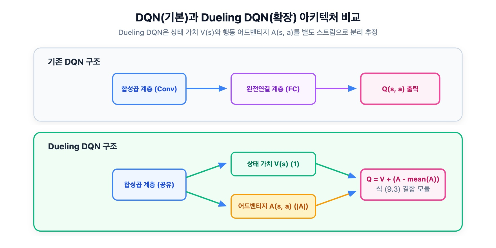
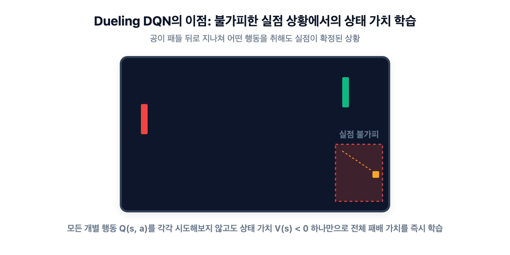

# 12.4 DQN의 3대 확장 기술: Double DQN, PER, Dueling DQN

**그림 12-4-1** Q1/Q2로 과대평가를 잡는 더블 DQN과 특정 징검다리를 우대하는 우선순위 Replay 기법을 칠판에 적어주는 지니

**그림 12-4-2** 행동 선택과 가치 평가를 분리한 Double DQN 포드, 배울 게 많은 오차 카드를 우선 추출하는 PER 포드, 상태 가치와 행동 이득을 분리한 Dueling DQN 포드를 살펴보는 도로시와 지니, 그리고 이들을 통합한 Rainbow DQN의 위력을 강의하는 이호진 교수님

기본 DQN의 태생적 한계였던 **과대평가 편향(Overestimation Bias)**, **비효율적 균등 샘플링**, **불필요한 중복 평가**를 근본적으로 해결한 대표적 3대 확장 기법인 **Double DQN**, **우선순위 경험 재생(PER: Prioritized Experience Replay)**, **Dueling DQN**의 수학적 원리와 구조를 깊이 있게 파헤쳐 봅시다!

---

## 12.4.1 Double DQN: 과대평가 편향의 해소

기존 DQN의 TD 목표를 다시 살펴봅시다:

$$
T_{\text{DQN}} = R_t + \gamma \max_a Q(S_{t+1}, a; \theta^-)
$$ &nbsp;&nbsp;&nbsp;&nbsp; *(식 12.3: 기본 DQN의 타깃)*

### 1) 왜 과대평가(Overestimation)가 일어날까?
신경망의 가치 추정치에는 항상 노이즈나 오차가 섞여 있습니다:
- 실제 참 가치가 모든 행동에 대해 0이라고 해도, 오차 때문에 어떤 행동은 +0.5, 어떤 행동은 -0.5로 추정될 수 있습니다.
- 이때 **max 연산자**를 취하면, 항상 양의 노이즈(+0.5)를 가진 행동만 골라 채택하게 됩니다!
- 수학적으로 기댓값에 대해 다음 부등식이 항상 성립합니다:
  $$
\mathbb{E}[\max(X_1, X_2)] \ge \max(\mathbb{E}[X_1], \mathbb{E}[X_2])
$$
- 이로 인해 Q값이 실제보다 항상 지나치게 부풀려지는 **최대화 편향(Maximization Bias)**이 누적되어 학습이 왜곡됩니다.

---

### 2) Double DQN의 해결책: '선택'과 '평가'의 철저한 분리

Double DQN은 두 신경망(메인망 *θ*, 타깃망 *θ*-)에게 역할을 분담시킵니다:
1. **행동 선택(Argmax)**: 현재 가장 똑똑하게 학습 중인 **메인 신경망 *θ***에게 맡깁니다:
   > ***a*\* = argmax*a* *Q*(*S**t*+1, *a*; *θ*)**
2. **가치 평가(Evaluation)**: 그 행동의 진짜 가치를 매길 때는 얼려둔 **타깃 신경망 *θ*-**에게 물어봅니다:
   > ***Q*(*S**t*+1, *a*\*; *θ*-)**

두 과정을 하나로 합치면 다음과 같은 **Double DQN의 TD 타깃 수식**이 완성됩니다:

> ***T*Double = *R**t* + *γ* · *Q*(*S**t*+1, argmax*a* *Q*(*S**t*+1, *a*; *θ*); *θ*-)** &nbsp;&nbsp;&nbsp;&nbsp; *(식 12.4: Double DQN 타깃)*

행동을 고르는 기준과 점수를 매기는 기준이 서로 다른 네트워크로 분리되었기 때문에, 한쪽에서 우연히 발생한 양의 노이즈가 다른 쪽에 전파되지 않아 **과대평가 편향이 완벽하게 소멸**합니다!

---

## 12.4.2 우선순위 경험 재생 (PER: Prioritized Experience Replay)

기존 경험 재생 버퍼는 모든 경험을 1/*N*의 동일한 확률로 무작위 균등 추출(Uniform Sampling)했습니다.

하지만 사람이 공부할 때 이미 완벽하게 맞힌 쉬운 문제는 넘어가고 **자주 틀리는 오답 노트를 집중 복습**하듯, 강화학습에서도 에이전트가 예상치 못한 충격을 받았던 '중요한 경험'을 더 자주 복습해야 합니다!

---

### 1) 우선순위의 기준: TD 오차의 크기 (*δ*)

어떤 경험이 '중요한 경험'일까요? 바로 모델의 예측과 실제 결과 사이의 오차가 큰 경험입니다:

> ***δ**i* = | *R**t* + *γ* max*a* *Q*(*S**t*+1, *a*; *θ*-) - *Q*(*S**t*, *A**t*; *θ*) |** &nbsp;&nbsp;&nbsp;&nbsp; *(식 12.5: TD 오차 절댓값)*

- |*δ**i*|가 크다는 것은 에이전트가 아직 그 상황을 제대로 이해하지 못해 **"배울 것이 아주 많다"**는 뜻입니다!
- 반대로 |*δ**i*| ≈ 0이라면 이미 완벽히 예측하고 있으므로 굳이 다시 학습할 필요가 없습니다.

---

### 2) 확률적 추출과 중요도 가중치 보정

버퍼에 담긴 *N*개의 경험 중 *i*번째 경험이 샘플링될 확률 *P*(*i*)는 TD 오차에 비례하여 설정됩니다:

> ***P*(*i*) = |*δ**i*|*α* / ∑*k* |*δ**k*|*α*** &nbsp;&nbsp;&nbsp;&nbsp; *(식 12.6: PER 추출 확률)*
> *(여기서 α는 우선순위의 반영 강도를 조절하는 하이퍼파라미터)*

오차가 큰 경험만 편식해서 뽑으면 데이터 분포가 심하게 왜곡되므로, 손실 함수에 **중요도 가중치 *w**i* = (1 / (*N* · *P*(*i*)))*β***를 곱해 학습의 편향을 보정합니다. 
이 기법을 통해 DQN의 학습 속도를 2배 이상 비약적으로 끌어올릴 수 있습니다.

---

## 12.4.3 Dueling DQN: 상태 가치와 행동 이득의 분리

신경망의 내부 구조를 혁신한 기법이 **Dueling DQN**입니다.

### 1) 어드밴티지 함수 (Advantage Function)
행동 가치 *Q*(*s*, *a*)와 상태 가치 *V*(*s*)의 차이를 **어드밴티지(이득) 함수**라고 부릅니다:

$$
A(s, a) = Q(s, a) - V(s)
$$

[식 12.7] 어드밴티지 함수

- ***V*(*s*) (상태 가치)**: 현재 상태 *s* 자체가 에이전트에게 얼마나 유리하거나 위험한 상태인가?
- ***A*(*s*, *a*) (행동 이득)**: 그 상태에서 다른 평균적인 행동들에 비해 특정 행동 *a*가 얼마나 더 우월한가?

이 식을 이항하면 다음과 같이 Q 함수를 두 요소의 합으로 쪼갤 수 있습니다:
> *Q*(*s*, *a*) = *V*(*s*) + *A*(*s*, *a*)

**그림 12-4-3** 일반 DQN(위)과 Dueling DQN(아래)의 신경망 아키텍처 비교. Dueling DQN은 합성곱 계층 이후 네트워크가 가치 함수 V(s)와 어드밴티지 함수 A(s, a)의 두 갈래(스트림)로 분기됩니다.

---

### 2) 왜 분기해서 학습해야 할까?
\<퐁\> 게임에서 공이 내 패들 반대편 구석으로 완전히 넘어가서 도저히 막을 수 없는 절망적인 상황을 상상해 봅시다:

**그림 12-4-4** 패배가 이미 확정된 상태. 이 상황에서는 위로 가든 아래로 가든 어차피 실점합니다.

- **일반 DQN**: 위로 가는 행동, 아래로 가는 행동, 가만히 있는 행동을 **모두 제각각 따로 경험해 보지 않으면** 각 행동의 Q값을 떨어뜨릴 수 없습니다.
- **Dueling DQN**: 행동과 무관하게 상태 자체의 점수인 **가치 스트림 *V*(*s*)의 값이 급격히 하락**합니다! 
  그 결과 단 한 번의 경험만으로도 해당 상태에서의 모든 행동 Q값들이 일괄적으로 하향 조정되어 학습 속도가 폭발적으로 빨라집니다.

---

### 3) 식별 가능성(Identifiability)과 평균 차감 연산

단순히 *Q* = *V* + *A*로 합치면 *V*와 *A*의 무수한 조합이 생겨 신경망이 고유한 해를 찾지 못합니다(식별 불가능 문제). 
따라서 실제 Dueling DQN에서는 어드밴티지의 평균을 빼주는 다음과 같은 안정적인 결합식을 사용합니다:

> ***Q*(*s*, *a*; *θ*) = *V*(*s*; *θ**V*) + [*A*(*s*, *a*; *θ**A*) - (1 / |*A*|) · ∑*a*&#39; *A*(*s*, *a*&#39;; *θ**A*)]** &nbsp;&nbsp;&nbsp;&nbsp; *(식 12.8: Dueling Q 결합식)*

---

## 12.4.4 무지개빛 궁극의 에이전트: Rainbow DQN

딥마인드는 이후 연구에서 DQN의 독립적인 6가지 핵심 확장 기법들을 한데 융합한 **Rainbow DQN(2017)**을 발표했습니다:
1. **Double DQN** (과대평가 방지)
2. **Prioritized Replay (PER)** (중요 경험 우선 학습)
3. **Dueling Networks** (상태 가치와 행동 이득 분리)
4. **Multi-Step Learning** (1-스텝 대신 *n*-스텝 TD 부트스트랩)
5. **Distributional RL (C51)** (Q 기댓값 대신 보상의 전체 확률 분포 학습)
6. **Noisy Nets** (*ε*-탐욕 대신 신경망 가중치 자체에 파라메트릭 노이즈 부여)

이 6가지 기술이 유기적으로 결합된 Rainbow DQN은 모든 아타리 벤치마크 점수 기록을 압도적으로 갈아치우며 가치 기반 심층 강화학습의 위대한 완성을 알렸습니다.
