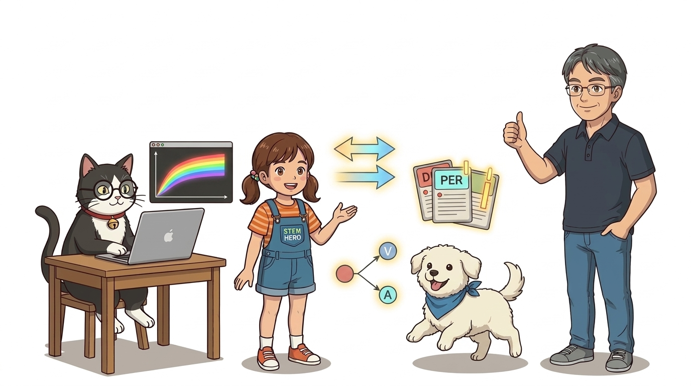
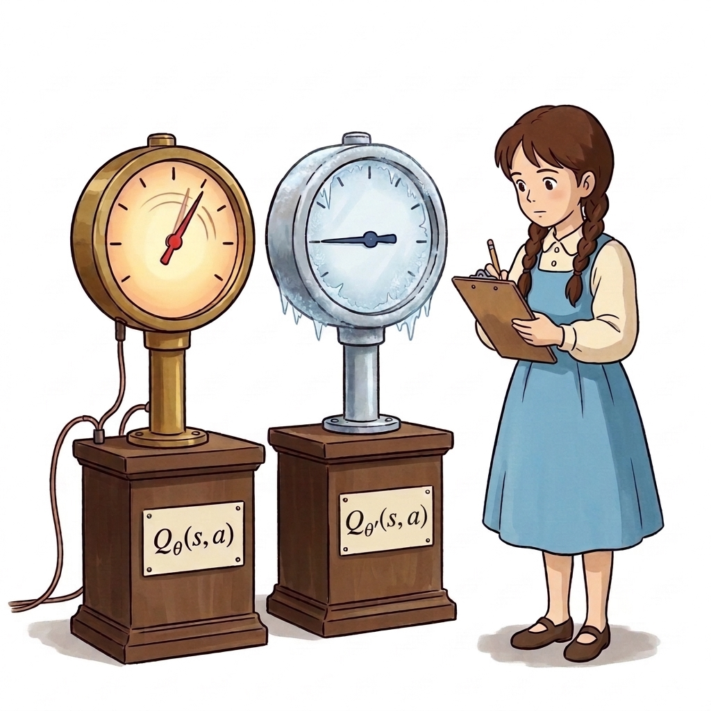
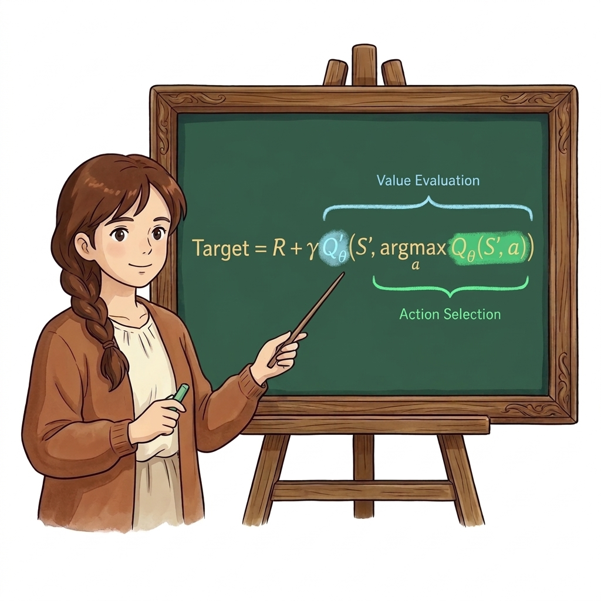
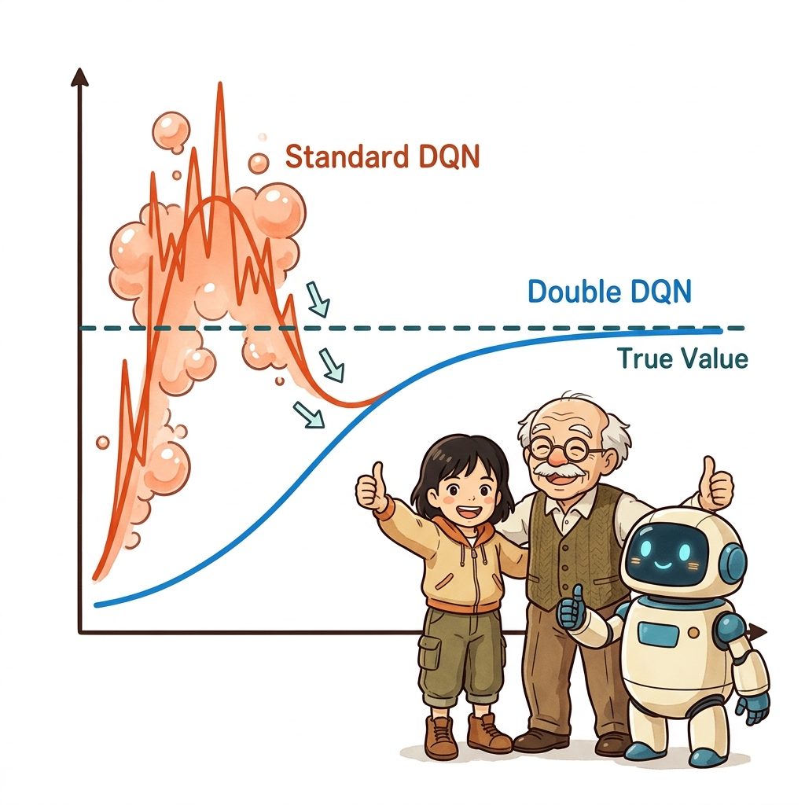
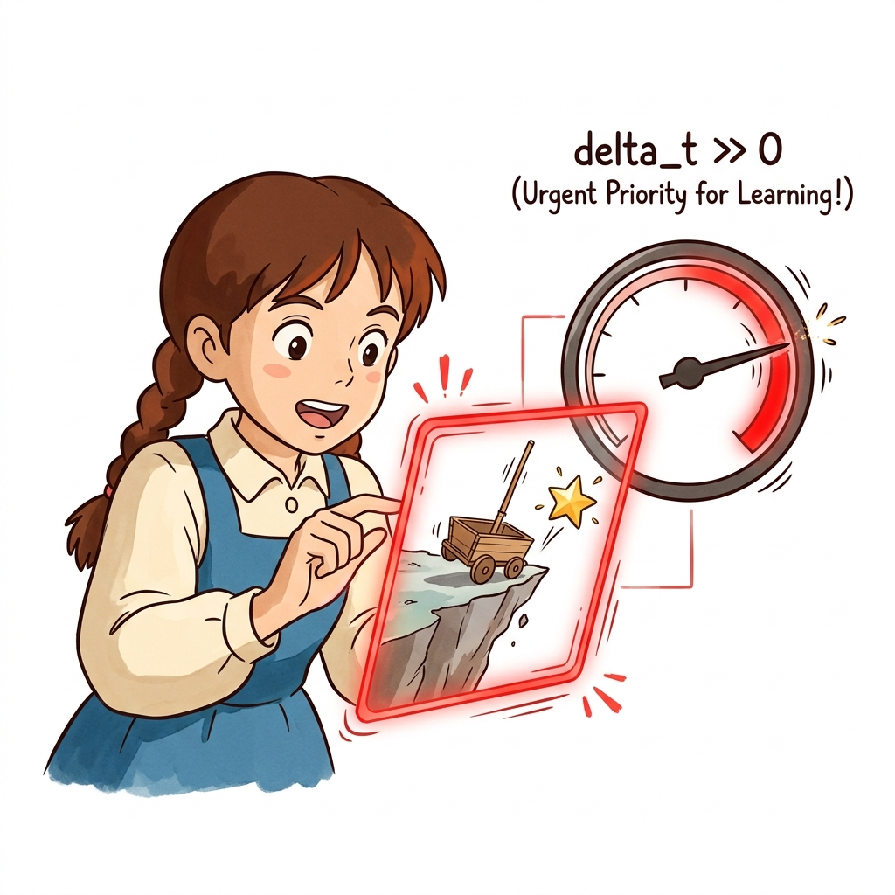
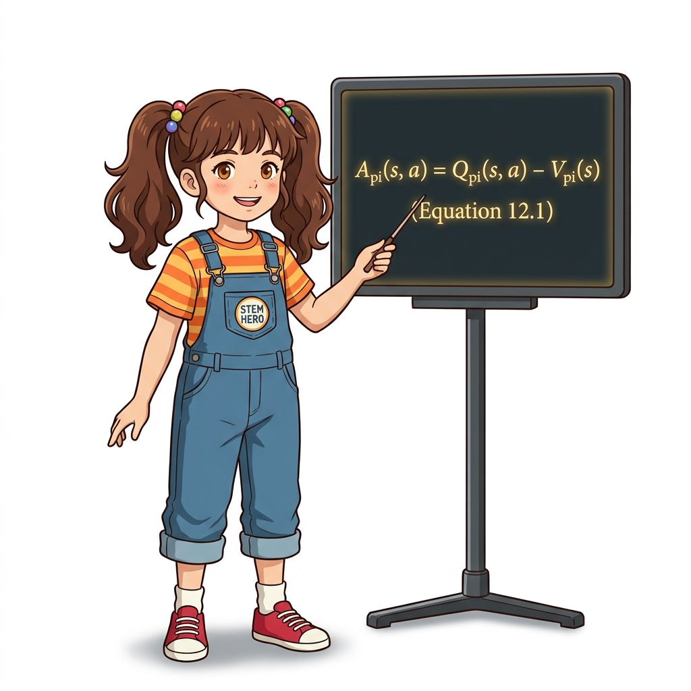
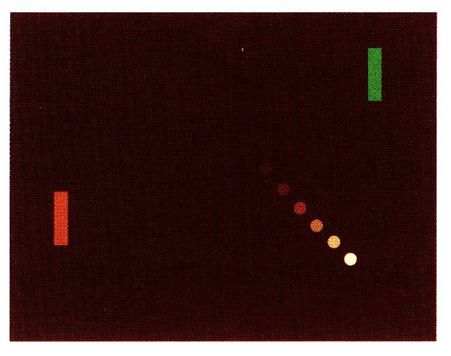

# 12.4 DQN 확장

---

**그림 12-4-0** 행동 선택과 가치 평가를 분리한 Double DQN 포드, 배울 게 많은 오차 카드를 우선 추출하는 PER 포드, 상태 가치와 행동 이득을 분리한 Dueling DQN 포드를 살펴보는 도로시와 지니, 그리고 이들을 통합한 Rainbow DQN의 위력을 강의하는 교수님

---

DQN은 딥러닝에서 가장 유명한 알고리즘에 속합니다. 그래서 DQN을 발전시킨 기법도 수없이 연구되고 제안되었죠. 이번 절에서는 그중 유명한 기법 세 가지를 소개하겠습니다.

**그림 12-4-01** DQN의 3대 확장 계보: Double DQN, 우선순위 경험 재생(PER), Dueling DQN
---

### 12.4.1 Double DQN

첫 번째 기법은 Double DQN [13]입니다. 설명에 앞서 DQN을 잠시 복습해보죠. DQN에서는 '목표 신경망'이라는 기법을 사용합니다. 

**그림 12-4-02** 기존 DQN의 목표 신경망 복습: 활성 신경망 θ와 주기적으로 동기화되는 얼어붙은 목표 신경망 θ'
---
원본 신경망 외에 매개변수가 다른 신경망(목표 신경망)을 하나 더 사용하는 것이죠. 

**그림 12-4-03** 매개변수가 서로 다른 두 신경망: 메인 신경망 θ와 목표 신경망 θ'의 역할 분담
---
두 신경망의 매개변수를 각각 $\theta$와 $\theta'$라고 하고, 두 신경망에 의해 표현되는 Q 함수를 $Q_{\theta}(s, a)$와 $Q_{\theta'}(s, a)$라고 합시다. 

**그림 12-4-04** 두 신경망이 근사하는 가치 함수 Q_θ(s, a)와 Q_θ'(s, a)의 수식 정의
---
이때 Q 함수 갱신에 사용하는 목표는 다음 식으로 표현됩니다.

$$R_t + \gamma \max_a Q_{\theta'}(S_{t+1}, a)$$

DQN에서는 $Q_{\theta}(s, a)$의 값을 이 식의 값과 가까워지게 학습하는데 이를 'TD 목표'라고 합니다. 

**그림 12-4-05** 기존 DQN의 TD 목표 공식: R_t + γ max_a Q_θ'(S_{t+1}, a)과 max 연산자
---
여기서 문제가 되는 부분은 $\max_a Q_{\theta'}(S_{t+1}, a)$입니다. 

**그림 12-4-06** max 연산자의 함정: 오차가 포함된 추정치에서 최댓값을 고를 때 발생하는 양의 편향
---
즉, 오차가 포함된 추정치($Q_{\theta'}$)에 $\max$ 연산을 수행하면 실제 Q 함수를 사용해 계산할 때보다 과대적합되는 문제가 생깁니다. 

**그림 12-4-07** 과대평가(Overestimation) 편향: 참값 수평선 대비 비정상적으로 치솟는 DQN 추정치
---
이 문제를 해결한 것이 Double DQN입니다. 
Double DQN에서는 다음 식을 TD 목표로 삼습니다.

$$R_t + \gamma Q_{\theta'}(S_{t+1}, \operatorname{argmax}_a Q_{\theta}(S_{t+1}, a))$$

**그림 12-4-08** Double DQN의 해법: R_t + γ Q_θ'(S_{t+1}, argmax_a Q_θ(S_{t+1}, a)) 공식
---

핵심은 $Q_{\theta}(s, a)$를 사용하여 최대가 되는 행동을 선택하고 실제 값은 $Q_{\theta'}(s, a)$에서 구하는 것입니다. 

**그림 12-4-09** 행동 선택(θ)과 가치 평가(θ')의 분리: 편향을 원천 차단하는 듀얼 콘솔
---

이렇게 두 개의 Q 함수를 구분하여 사용하기 때문에 과대적합이 사라지고 학습이 더 안정적으로 이루어집니다. 

**그림 12-4-10** 편향 해소와 학습 안정화: 과대평가 거품이 꺼지고 참값을 안정적으로 추적하는 수렴
---

과대적합이 구체적으로 무엇인지, 어떤 원리로 해소되는지는 부록 C에서 설명하고 있으니 관심 있는 분은 참고하기 바랍니다.

**그림 12-4-11** 부록 C: 과대평가 편향 해소의 수학적 증명과 탄탄한 이론적 토대
---

### 12.4.2 우선순위 경험 재생(PER)

DQN에서 사용되는 경험 재생은 경험 $E_t = (S_t, A_t, R_t, S_{t+1})$을 버퍼에 저장하고, 학습 시 버퍼에서 경험 데이터를 무작위로 추출하여 사용합니다. 

**그림 12-4-12** 기존 균등 경험 재생의 한계: 모든 경험이 중요도에 상관없이 동일한 1/N 확률로 추출
---
이를 더욱 발전시킨 것이 **우선순위 경험 재생**(prioritized experience replay [14], PER)입니다. 경험 데이터를 무작위로 선택하는 대신 이름 그대로 우선순위에 따라 선택되도록 한 기법입니다.

**그림 12-4-13** 우선순위 경험 재생(PER) 개념: 배울 점이 많은 중요한 경험에 황금 별을 매겨 우선 추출
---

그렇다면 경험 데이터의 우선순위는 어떻게 정할까요? 

**그림 12-4-14** 핵심 질문: 경험 데이터의 우선순위는 도대체 어떤 기준으로 정해야 할까?

---
자연스럽게 떠올릴 수 있는 방식은 다음 공식입니다.

$$\delta_t = \left| R_t + \gamma \max_a Q_{\theta'}(S_{t+1}, a) - Q_{\theta}(S_t, A_t) \right|$$

**그림 12-4-15** TD 오차 절댓값 δ_t 공식: 예상치와 실제 목표 사이의 놀람도(Surprise) 측정
---

이 식과 같이 TD 목표인 $R_t + \gamma \max_a Q_{\theta'}(S_{t+1}, a)$와 $Q_{\theta}(S_t, A_t)$의 차이를 구하여 그 절댓값을 $\delta_t$로 합니다($\delta$는 '델타'로 발음합니다). 

**그림 12-4-16** δ_t 크기의 본질적 의미: 큰 오차(배울 게 많은 황금 원석) vs 작은 오차(이미 마스터)
---

이때 $\delta_t$가 크면 그만큼 수정할 것이 많다는, 즉 배워야 할 게 많다는 뜻입니다. 

**그림 12-4-17** 높은 TD 오차 (High δ_t): 절벽 추락이나 돌발 고득점 등 에이전트에게 중요한 긴급 교훈
---

반대로 $\delta_t$가 작으면 이미 좋은 매개변수이고 배울 것이 적다는 뜻입니다.

**그림 12-4-18** 낮은 TD 오차 (Low δ_t): 이미 충분히 익숙하여 가중치 수정이 거의 필요 없는 일상 데이터
---

우선순위 경험 재생에서는 $\delta_t$까지를 경험 데이터에 포함시켜 $(S_t, A_t, R_t, S_{t+1}, \delta_t)$를 버퍼에 추가합니다. 

**그림 12-4-19** 오차 태그가 포함된 PER 5개 토큰 경험 카트리지: (S_t, A_t, R_t, S_{t+1}, δ_t)
---
그런 다음 버퍼에서 경험 데이터를 꺼낼 때 $\delta_t$를 이용하여 각 경험 데이터가 선택될 확률을 구합니다. 

**그림 12-4-20** 오차 비례 확률 룰렛 원판과 계산 공식: p_i = δ_i / Σ δ_k
---
예를 들어 버퍼에 담긴 경험 데이터가 $N$개라면, $i$번째 경험 데이터가 선택될 확률은 다음 식으로 표현됩니다.

$$p_i = \frac{\delta_i}{\sum_{k=1}^{N} \delta_k}$$

이 확률 $p_i$에 따라 버퍼에서 경험 데이터를 추출합니다. 

**그림 12-4-21** 우선순위 확률 p_i에 따라 버퍼에서 배울 게 많은 황금 경험을 집중 추출
---

우선순위 경험 재생을 사용하면 배울 게 많은 데이터일수록 우선적으로 사용되기 때문에 학습이 더 빨리 진행되리라 기대할 수 있습니다.

**그림 12-4-22** PER을 통한 학습 속도 초고속 가속: 중요 경험 집중 학습으로 수렴 시간 단축
---
### 12.4.3 Dueling DQN

마지막으로 Dueling DQN [15] 기법을 소개합니다. Dueling DQN은 신경망의 구조를 개선한 기법입니다. 

**그림 12-4-23** 신경망 구조 자체의 혁신: 상태 가치와 행동 이점을 분리한 Dueling DQN의 서막
---
이 기법에서 핵심은 어드밴티지 함수입니다. **어드밴티지 함수**(advantage function)는 Q 함수와 가치 함수의 차이이며 수식으로는 다음과 같습니다.

$$A_{\pi}(s, a) = Q_{\pi}(s, a) - V_{\pi}(s) \tag{식 12.1}$$

**그림 12-4-24** 어드밴티지 함수 공식: A_π(s, a) = Q_π(s, a) - V_π(s) (식 12.1)
---

[식 12.1]의 어드밴티지 함수는 $a$라는 행동이 정책 $\pi$에 따라 행동할 때보다 얼마나 좋은지(혹은 나쁜지)를 나타냅니다. 

**그림 12-4-25** 어드밴티지 함수의 물리적 의미: 행동 a가 정책 π보다 얼마나 더 이로운지/해로운지 측정
---
어떻게 이런 의미가 되는지는 오른쪽 두 항의 의미가 다음과 같음을 생각하면 어렵지 않게 이해될 것입니다.

* $Q_{\pi}(s, a)$: 상태 $s$에서 '특정 행동 $a$'를 취하고 그 이후에는 $\pi$에 따라 행동했을 때 얻을 수 있는 기대 수익
* $V_{\pi}(s)$: 상태 $s$에서 이후의 모든 행동을 정책 $\pi$에 따라 했을 때 얻을 수 있는 기대 수익

**그림 12-4-26** Q_π(s, a)와 V_π(s)의 개념적 차이: 특정 행동을 취하는 길 vs 정책에 따르는 길
---

즉 $Q_{\pi}(s, a)$와 $V_{\pi}(s)$의 차이는 상태 $s$에서 행동 $a$를 할 것인가, 아니면 정책 $\pi$에 따라 행동할 것인가의 차이입니다. 

**그림 12-4-27** 상태 s에서 특정 행동 a를 할 것인가, 아니면 정책 π에 맡길 것인가의 차이

---
다시 말해 어드밴티지 함수는 '$a$라는 행동이' '정책 $\pi$에 따라 선택되는 행동'보다 얼마나 이로운지를 나타내는 지표로 해석할 수 있습니다.

**그림 12-4-28** 어드밴티지 부호 해석: A > 0(초록 엄지척 - 훌륭한 선택) vs A < 0(빨간 경고 - 악수)

---

또한 어드밴티지 함수를 다음과 같이 변형하면 Q 함수를 구할 수 있습니다.

$$Q_{\pi}(s, a) = A_{\pi}(s, a) + V_{\pi}(s) \tag{식 12.2}$$

**그림 12-4-29** 어드밴티지와 가치 함수의 결합: Q_π(s, a) = V_π(s) + A_π(s, a) (식 12.2)

---

Dueling DQN은 [식 12.2]를 신경망으로 표현하는데, 그 구조는 [그림 12-13]과 같습니다.

**그림 12-13** DQN(위)과 Dueling DQN(아래) 비교*

---

〈DQN〉
〈Dueling DQN〉 - 가치 함수, 어드밴티지 함수

\* **그림 출처**: Wang, Ziyu, et al. "Dueling network architectures for deep reinforcement learning." International conference on machine learning. PMLR, 2016.

---

그림과 같이 중간까지는 똑같이 진행하다가 Dueling DQN에서는 어드밴티지 함수 $A(s, a)$와 가치 함수 $V(s)$로 분기합니다. 그리고 마지막으로 두 분기를 다시 합쳐 $Q(s, a)$를 출력합니다. 이 구조가 Dueling DQN의 특징입니다.

**그림 12-4-30** Dueling DQN 아키텍처: 공통 특징층에서 V(s)와 A(s, a)로 분기 후 재결합

---

그렇다면 어드밴티지 함수와 가치 함수를 분기하여 학습하면 어떤 점이 좋아질까요? 
주로 무슨 행동을 선택해도 결과가 달라지지 않는 상황에서는 이점이 생깁니다. 

**그림 12-4-31** 왜 분기하는가? 무슨 행동을 해도 결과가 달라지지 않는 상황에서의 압도적 이점

---

예를 들어 〈퐁〉 게임을 플레이하다가 [그림 12-14]와 같은 상황이 되었다고 상상해봅시다.

**그림 12-14** 공이 플레이어 진영에 진입하기 직전의 화면

---

이 상황에서는 어떤 행동을 해도 결과는 패배(마이너스 보상)입니다. 
DQN의 경우 어떤 상태 $s$에서 실제로 한 행동 $a$에 대해 $Q(s, a)$를 학습합니다. 

**그림 12-4-32** 불가피한 실점 상황에서 기존 DQN의 한계: 모든 행동을 다 해봐야만 학습 가능

---

그런데 지금의 예처럼 결과가 확정된 상황이라도 모든 행동을 시도해보지 않으면 $Q(s, a)$가 학습되지 않습니다. 반면 Dueling DQN은 한쪽 분기에서 가치 함수 $V(s)$를 경유합니다. 

**그림 12-4-33** Dueling DQN의 번개 같은 깨달음: 상태 가치 V(s) 하나만 배워도 모든 행동 Q값 즉각 갱신

---

가치 함수는 어떤 상태 $s$에서의 가치로, 행동은 전혀 고려하지 않지요. 따라서 이 그림의 상태를 경험하면 $V(s)$가 학습되어 다른 행동을 시도하지 않아도 $Q(s, a)$의 근사 성능이 좋아집니다. 이런 특성 덕분에 학습이 빨라지리라 기대할 수 있습니다.

**그림 12-4-34** 행동 시도 낭비 없이 상태 자체의 가치를 빠르게 학습하여 수렴 속도 극대화

---

이상으로 DQN의 확장 기법 세 가지를 소개했습니다. 참고로 14.3절에서는 DQN을 기반으로 한 더욱 발전된 알고리즘을 몇 가지 더 소개합니다.

**그림 12-4-35** 12장 DQN 확장 대단원과 6대 핵심 기술이 통합될 14장 Rainbow DQN 예고

