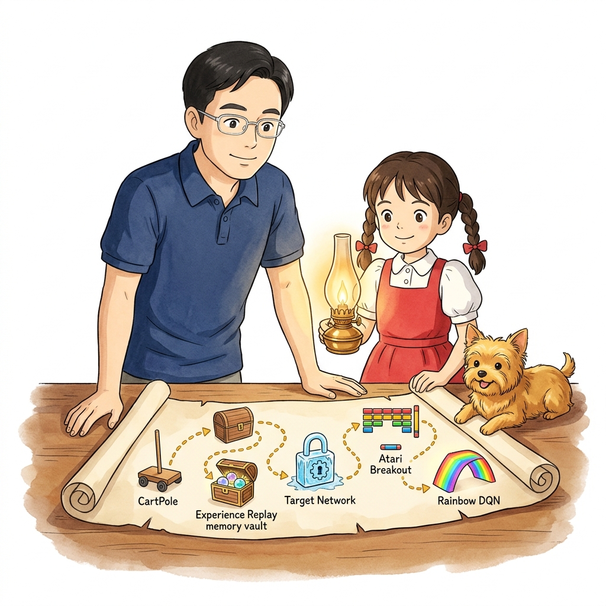
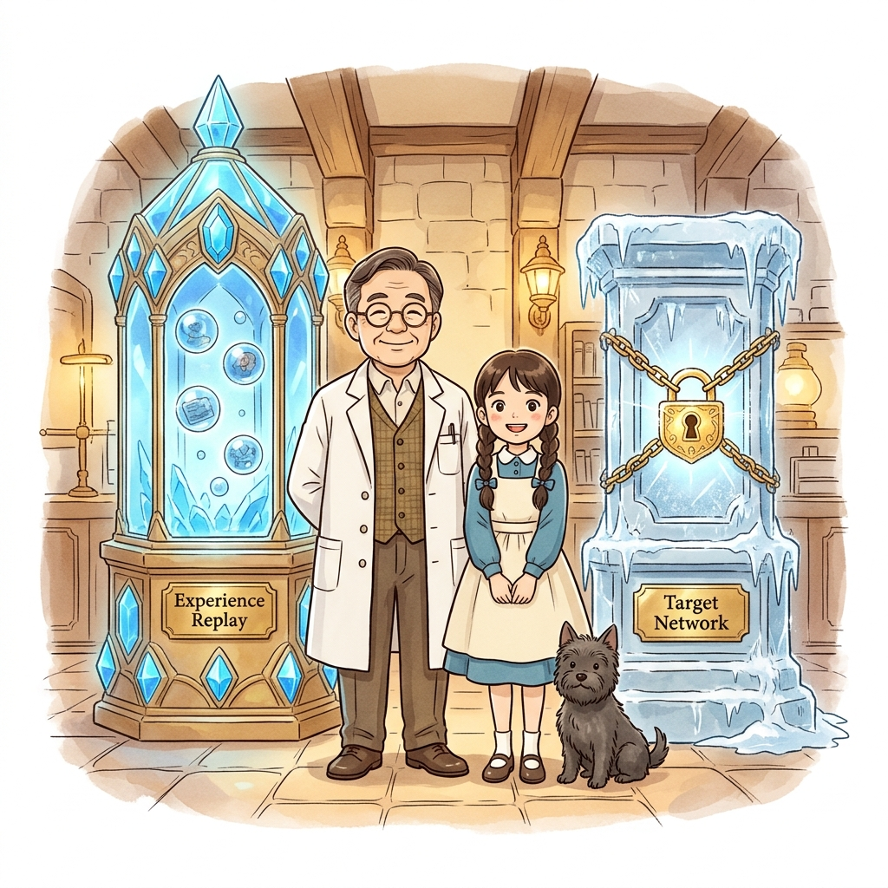
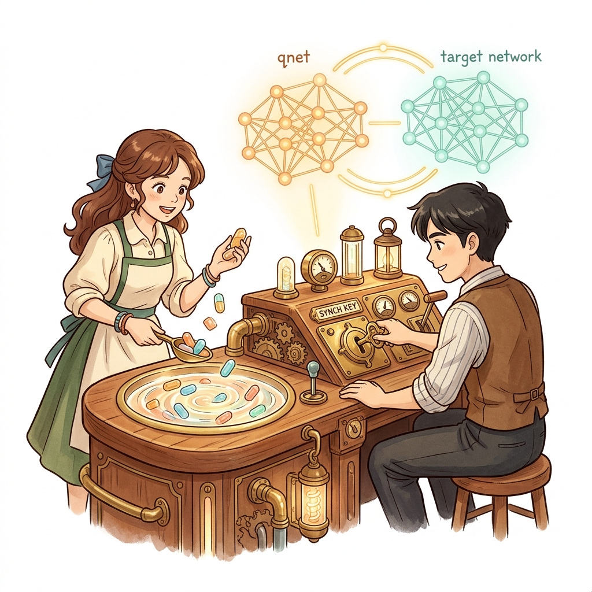
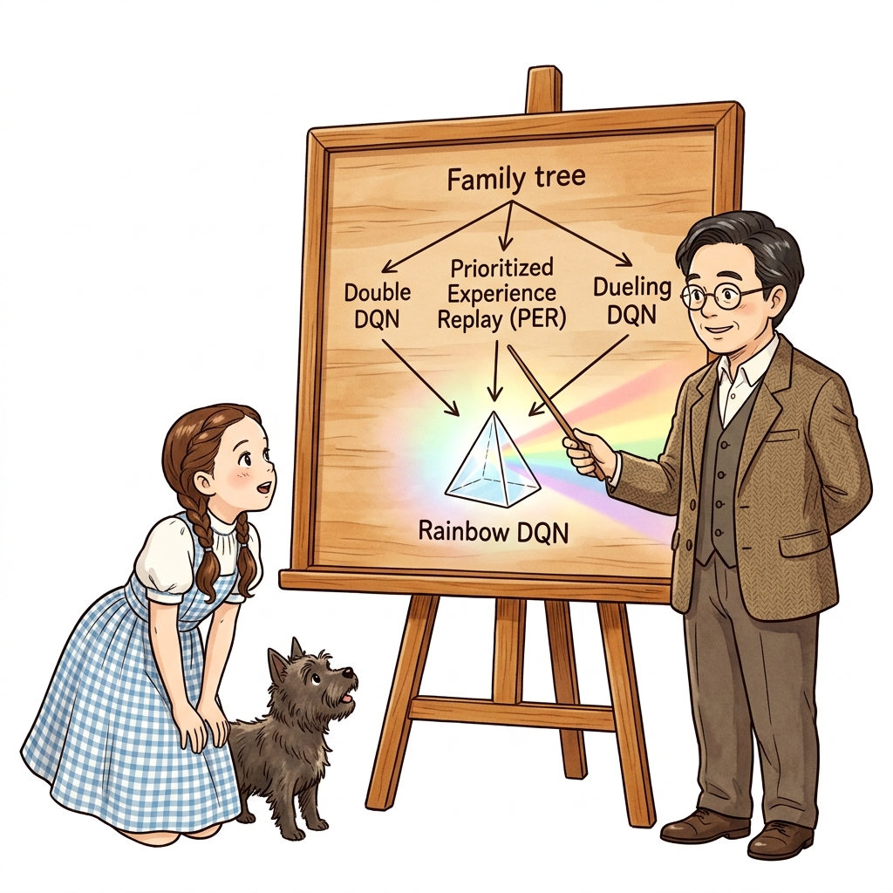
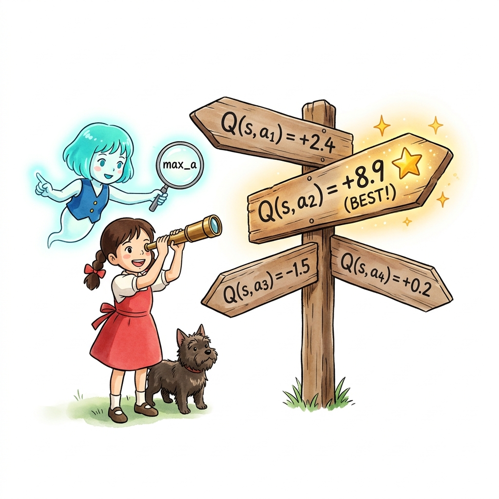
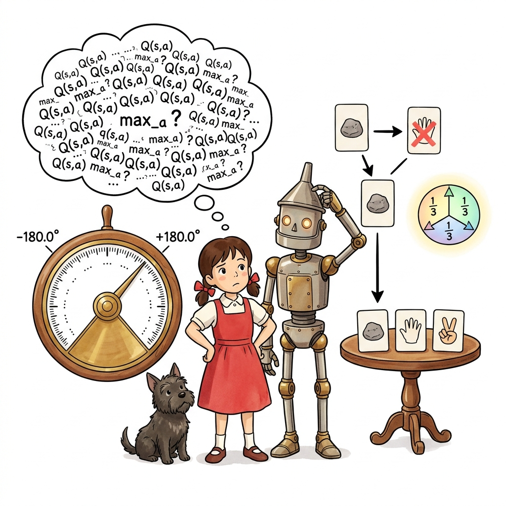
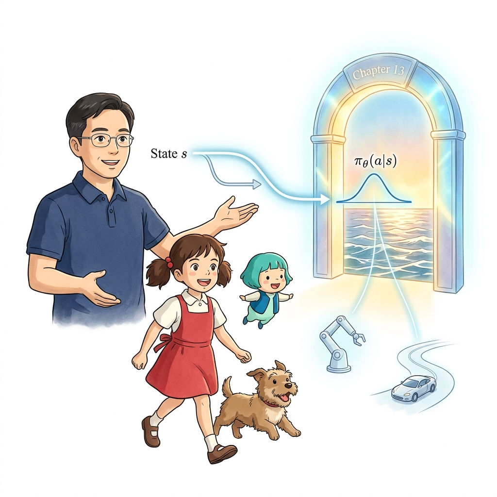
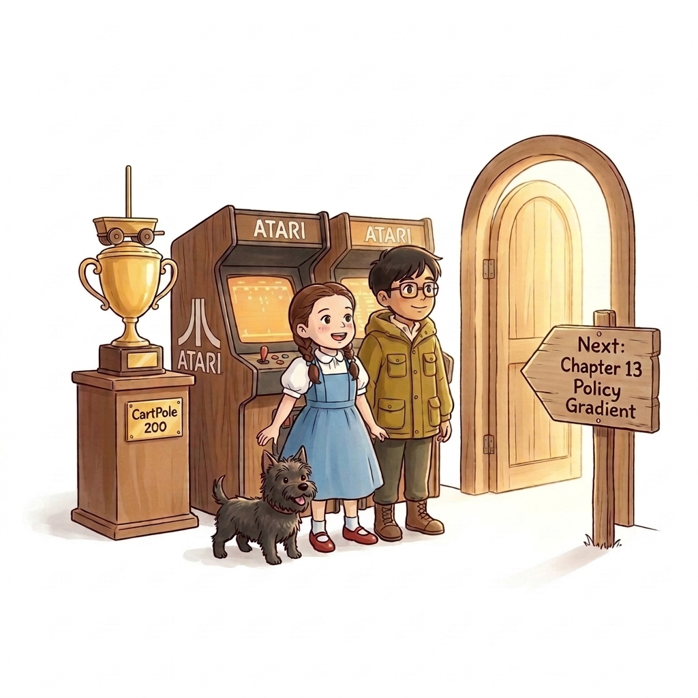

# 12.5 정리

---

#### 12장 수료와 정책 경사법 시대로의 위대한 전환

**그림 12-5-0** 카트폴 200스텝 만점을 달성하고 'DQN Champion' 황금 트로피를 치켜든 도로시와, 가치 기반(Value-Based)의 완성에서 정책 기반(Policy-Based)이라는 새로운 지평으로 나아가는 갈림길을 비추는 지니, 그리고 13장 정책 경사법을 소개하는 교수님과 토토

---

#### 제12장의 위대한 여정을 되돌아보며

이번 12장에서는 현대 심층 강화학습(Deep Reinforcement Learning)의 문을 활짝 열어젖힌 불후의 명작, **DQN(Deep Q-Network)**의 원리와 구현, 그리고 아타리 게임 확장과 후속 개선 기법들을 총망라해 학습했습니다.

**그림 12-5-00-B** 카트폴 역진자부터 경험 재생 수조, 목표 신경망 얼음 자물쇠, 아타리 픽셀 정복, Rainbow DQN까지 12장 전체 로드맵을 되돌아보는 이호진 교수님과 도로시, 토토

---

테이블 기반 고전 강화학습이 직면했던 '차원의 저주'를 깨부수고, 인공신경망이 거대한 상태 공간을 자유자재로 다룰 수 있게 만든 일등 공신은 바로 **경험 재생(Experience Replay)**과 **목표 신경망(Target Network)**이라는 두 개의 거대한 기둥이었습니다.

**그림 12-5-01** 이호진 교수님과 도로시, 토토가 경험 재생 크리스탈 볼트와 목표 신경망 얼음 자물쇠 기둥 사이에 서서 DQN의 2대 기둥을 총정리하는 모습

---

#### DQN을 지탱하는 2대 구원투수 총정리

| 핵심 기법 | 해결한 치명적 문제 | 작동 원리 및 물리적 비유 | 핵심 기대 효과 |
| :--- | :--- | :--- | :--- |
| **경험 재생 (Experience Replay)** | 시간적 상관관계(Temporal Correlation)와 $i.i.d.$ 가정 붕괴, 데이터 낭비 | 튜플 $(s, a, r, s')$를 대용량 버퍼에 저장하고 무작위 복원 추출 (황금 가위와 크리스탈 수조) | 샘플 간 상관관계 파괴, 데이터 효율성 극대화, 지도학습 미니배치 적용 가능 |
| **목표 신경망 (Target Network)** | 도망가는 과녁(Moving Target)과 가치 추정치 공진 발산 | 원본 신경망 $\theta$와 별도로 TD 목표 계산 전용 $\theta'$를 복사하여 얼려둠 (얼음 자물쇠) | 벨만 타깃 고정, 부트스트래핑 자가 증폭 차단, 경사하강법 수렴 안정성 확보 |

**그림 12-5-02** 도로시가 무작위 캡슐 샘플링으로 상관관계를 깨고 지니가 동기화 열쇠로 두 신경망을 주기적으로 정렬하는 듀얼 안정화 메커니즘

---

#### 실전에서 검증한 카트폴 DQN의 기적

12.2절 실습([step03_dqn_cartpole.py](file:///Users/hojin9/Library/Mobile%20Documents/com~apple~CloudDocs/02.강의/A06_강화학습/src/12_DQN/12_2_DQN의_핵심_기술/step03_dqn_cartpole.py))을 통해 우리는 순수 넘파이와 Gym만으로 완전 자립형 DQN 에이전트를 직접 구현하고 검증했습니다:

- **초기 무작위 행동**: 10~14스텝 만에 맥없이 쓰러지던 카트폴
- **250 에피소드 학습 후**: 탐욕 정책($\epsilon = 0$) 테스트에서 **무려 114스텝 연속 균형 유지 달성! (8배 이상의 비약적 도약)**
- 단 2.9초 만에 에이전트 스스로 봉의 각도와 카트의 속도를 읽고 중심을 잡아내는 인공지능의 경이로운 자기 진화를 두 눈으로 목격했습니다.

---

#### 픽셀에서 지능으로: 아타리 퐁(Pong)의 교훈

12.3절에서는 단순한 수치 벡터를 넘어 10만 개가 넘는 컬러 픽셀이 쏟아지는 아타리 환경을 공략하는 딥마인드의 공학적 통찰을 배웠습니다:

1. **POMDP $\rightarrow$ MDP 변환**: 정지 화면 한 장으로는 공의 비행 방향과 속도를 알 수 없는 한계를 **연속 4개 프레임 스태킹(Frame Stacking)**으로 극복했습니다.
2. **4단계 전처리 파이프라인**: 자르기(Crop) $\rightarrow$ 회색조(Grayscale) $\rightarrow$ $84 \times 84$ 축소 $\rightarrow$ $[0, 1]$ 정규화를 통해 데이터양을 $90\%$ 이상 압축했습니다.

---

3. **합성곱 신경망(CNN)**: 공간 평행이동 불변성과 가중치 공유를 통해 픽셀 화면에서 패들과 공의 기하학적 특징 맵을 정확히 추출했습니다.

4. **학습 공학 3대 묘수**: GPU 텐서 병렬화, $\epsilon$-선형 감쇠($1.0 \rightarrow 0.1$), 보상 클리핑($[-1, 0, +1]$)으로 수십 종의 게임에 범용 적용 가능한 프레임워크를 확립했습니다.

---

#### DQN의 진화: 3대 확장과 무지개빛 Rainbow

12.4절에서는 초기 DQN의 수학적·구조적 한계를 극복한 3대 확장 기법을 탐구했습니다:

| 확장 알고리즘 | 극복한 본질적 결함 | 핵심 해법 및 메커니즘 | 실전 효과 |
| :--- | :--- | :--- | :--- |
| **Double DQN** | $\max$ 연산자의 가치 과대평가(Overestimation Bias) 거품 | 행동 선택($\theta$)과 가치 평가($\theta'$)의 디커플링 분리 | Q-값 거품 제거 및 참값 정밀 추적 |
| **우선순위 경험 재생 (PER)** | 균등 무작위 추출($1/N$)로 인한 학습 시간 낭비 | TD 오차 절댓값 $|\delta_t|$에 비례한 오답 노트식 룰렛 샘플링 | 취약한 핵심 경험 집중 복습, 수렴 속도 2~3배 가속 |
| **Dueling DQN** | 행동과 무관한 상태에서도 모든 행동을 다 해봐야 하는 낭비 | 네트워크를 상태 가치 $V(s)$와 어드밴티지 $A(s, a)$로 Y자 분기 | $V(s)$ 갱신 하나로 모든 행동 Q-값 일괄 학습 |
| **Rainbow DQN** | 개별 기법들의 파편화 | Double DQN + PER + Dueling + Multi-step + C51 + Noisy Net 통합 | 아타리 57개 전 게임 신기록 석권 |

---

**그림 12-5-03** 이호진 교수님이 원목 보드에서 Double DQN, 우선순위 경험 재생(PER), Dueling DQN이 무지개빛 Rainbow DQN으로 수렴하는 발전 계보를 설명하는 장면

---

#### 가치 기반(Value-Based)의 한계와 새로운 질문

지금까지 우리가 12장에 걸쳐 탐구한 모든 알고리즘(Q-러닝, SARSA, DQN)은 하나의 공통된 철학을 공유하고 있습니다:

> **"가치 함수 $Q(s, a)$를 먼저 정확하게 근사하고, 거기서 가장 큰 값을 주는 행동을 골라내자($\max_a Q$)!"**

이를 **'가치 기반(Value-Based) 강화학습'**이라고 부릅니다. 

**그림 12-5-02-B** 여러 갈래 행동 길목에서 가장 가치가 높은 경로(max_a Q)를 찾아 최적의 결정을 내리는 가치 기반 강화학습의 기본 철학

---

하지만 가치 기반 방식은 현실의 더 복잡한 문제로 나아갈 때 치명적인 벽에 부딪힙니다:

1. **연속 행동 공간(Continuous Actions)의 불가능성**:  
   자율주행차의 핸들 조향각($-30.5^\circ$)이나 로봇 팔의 모터 토크($2.35 \, \text{N}\cdot\text{m}$)처럼 행동이 무한히 연속적인 실수일 때, 수십억 개의 실수 후보 중에서 $\max_a Q(s, a)$를 찾아내는 것은 불가능합니다!
2. **확률적 최적 정책(Stochastic Policy) 표현의 한계**:  
   가위바위보나 바둑, 포커처럼 상대가 나를 간파하지 못하도록 행동을 확률적으로 섞어야 하는 게임에서 $\epsilon$-탐욕 정책은 너무나 거칠고 부자연스럽습니다.

**그림 12-5-02-C** 무한한 연속 조향각 다이얼 앞에서의 max 연산 불가능성과, 가위바위보 확률 게임에서 드러나는 가치 기반(Value-Based) 방식의 구조적 한계

---

#### 13장 예고: 정책 경사법(Policy Gradient)의 시대로!

그렇다면, 복잡하게 Q-값을 우회해서 거칠 필요 없이 **"행동을 선택하는 신경망(정책 $\pi_\theta(a \mid s)$) 자체를 직접 경사상승법으로 최적화"**할 수는 없을까요?

**그림 12-5-03-B** 우회로 없이 신경망이 상태 s를 받아 행동 확률 π_θ(a|s)를 곧바로 출력하는 13장 정책 경사법(Policy Gradient)의 새로운 지평

---

- 가치 함수를 거치지 않고 신경망이 곧바로 확률적 행동 분포를 출력합니다.
- 행동이 연속적인 실수라도 평균($\mu$)과 표준편차($\sigma$)를 출력하는 가우시안 신경망으로 손쉽게 제어할 수 있습니다.

우리는 이제 가치 기반의 둥지를 떠나, 현대 알파고(AlphaGo)와 최신 로봇 공학의 심장인 **제13장 「정책 경사법(Policy Gradient)」**의 광활한 바다로 힘차게 돛을 올립니다!

**그림 12-5-04** 도로시와 토토, 지니가 카트폴 200 트로피와 아타리 아케이드 캐비닛을 뒤로하고 13장 정책 경사법(Policy Gradient)을 향해 문을 나서는 출항
