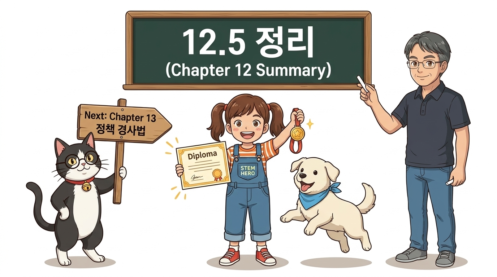
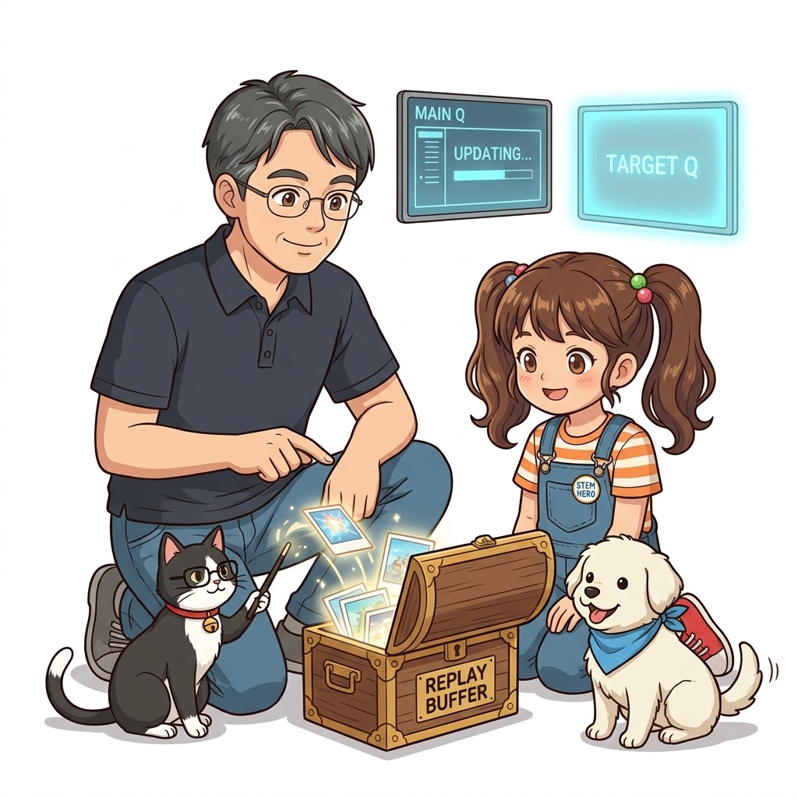
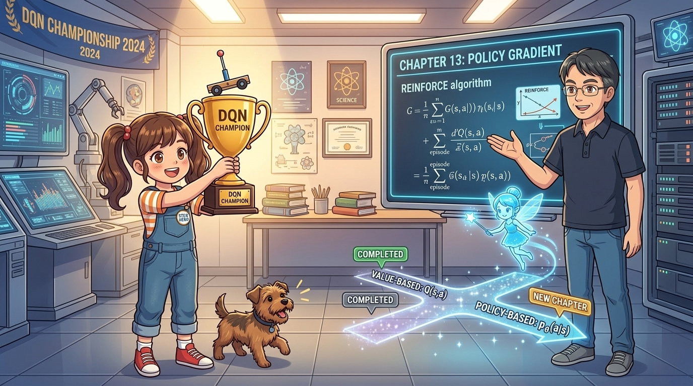

# 12.5 제12장 정리: 심층 Q-네트워크의 완성 및 정책 경사법으로의 도약

**그림 12-5-1** 카트폴(CartPole) 제어 완수 축하 훈장을 들고 지니 요정과 하이파이브를 하는 도로시

**그림 12-5-2** 카트폴 200스텝 만점을 달성하고 'DQN Champion' 황금 트로피를 치켜든 도로시와, 가치 기반(Value-Based, *Q*(*s*, *a*))의 완성에서 정책 기반(Policy-Based, *π**θ*(*a*|*s*))이라는 새로운 지평으로 나아가는 갈림길을 비추는 지니, 그리고 13장 정책 경사법(Policy Gradient)을 소개하는 이호진 교수님과 토토

강화학습을 인공지능 연구의 중심부로 우뚝 세운 기념비적인 알고리즘, **제12장 DQN(Deep Q-Network)**의 여정을 총정리합니다. 물리 시뮬레이션 환경 OpenAI Gym(Gymnasium)부터, 심층 강화학습의 안정성을 책임지는 **경험 재생**과 **목표 신경망**, 픽셀 기반 아타리(Atari) 혁명, 그리고 3대 확장 기법까지 복습하고, 가치 함수를 우회해 최적 행동 확률을 직접 조율하는 **제13장 정책 경사법(Policy Gradient)**으로 힘차게 도약해 봅시다!

---

## 12.5.1 제12장 핵심 학습 내용 총정리

| 절 구분 | 핵심 주제 | 핵심 메커니즘 및 수식 |
| :--- | :--- | :--- |
| **12.1 OpenAI Gym** | 연속 상태 물리 제어 | CartPole 4차원 연속 상태 [위치, 속도, 각도, 각속도], 표준 API(`reset()`, `step()`) |
| **12.2 DQN 핵심 기술** | 안정적 심층 강화학습 | **경험 재생**(i.i.d 달성) + **목표 신경망**(*θ*-로 과녁 고정): *T* = *R* + *γ* max *Q*(*S*&#39;, *a*; *θ*-) |
| **12.3 DQN과 아타리** | 시각 기반 심층 강화학습 | 4-프레임 스태킹 (POMDP → MDP), Nature CNN 구조, 보상 클리핑, 선형 입실론 감쇠 |
| **12.4 DQN 확장** | 최첨단 성능 극대화 | **Double DQN**(과대평가 차단), **PER**(오차 기반 우선 샘플링), **Dueling DQN**(*V*와 *A* 분리) |

---

## 12.5.2 DQN 계열 알고리즘 발전 계보도

| 알고리즘 | 해결한 문제점 및 핵심 아이디어 | 타깃 수식 또는 특징 |
| :--- | :--- | :--- |
| **DQN (2015)** | 신경망 강화학습의 발산 문제 해결 | *T* = *R* + *γ* max*a* *Q*(*S*&#39;, *a*; *θ*-) |
| **Double DQN (2015)** | max 연산자에 의한 가치 과대평가 편향 제거 | *T* = *R* + *γ* *Q*(*S*&#39;, argmax*a* *Q*(*S*&#39;, *a*; *θ*); *θ*-) |
| **Prioritized Replay (2015)** | 모든 경험을 균등하게 뽑는 낭비 제거 | TD 오차 |*δ**i*|*α*에 비례하여 중요 경험 우선 복습 |
| **Dueling DQN (2016)** | 행동 선택이 무의미한 상태에서의 비효율 제거 | *Q*(*s*, *a*) = *V*(*s*) + [*A*(*s*, *a*) - mean(*A*)] |
| **Rainbow DQN (2017)** | 위 3대 기술 + Multi-Step + C51 + NoisyNet 결합 | 모든 아타리 게임 벤치마크 최고 성능 달성 |

---

## 12.5.3 가치 기반(Value-Based)의 한계와 제13장 정책 경사법의 필연성

우리가 지금까지 7장부터 12장까지 걸어온 길은 모두 **가치 기반(Value-Based)** 강화학습이었습니다:
- 항상 상태 가치 *V*(*s*)나 행동 가치 *Q*(*s*, *a*)를 먼저 추정한 다음,
- 최적 행동을 찾기 위해 **argmax*a* *Q*(*s*, *a*)**를 수행했습니다.

하지만 현실의 수많은 복잡한 문제 앞에서 가치 기반 방식은 다음의 세 가지 치명적인 벽에 부딪힙니다:

1. **연속 행동 공간(Continuous Action Space) 제어 불가**:
   - 자율주행차의 스티어링 휠 각도(-45도 ~ +45도), 로봇 팔 관절의 모터 토크처럼 행동이 연속적인 실수값일 때, 무한대의 행동들 중에서 최댓값(`argmax`)을 찾는 것은 불가능합니다!
2. **확률적 최적 정책(Stochastic Policy) 표현 불가**:
   - 가위바위보나 포커 블러핑처럼 "특정 확률로 무작위성을 유지해야만 이길 수 있는 게임"에서 결정론적 argmax는 상대에게 패턴이 쉽게 읽힙니다.
3. **간접적인 최적화**:
   - 우리의 진짜 목표는 "누적 보상을 최대화하는 것"인데, DQN은 "Q 함수의 벨만 오차를 줄이는 회귀 문제"를 우회해서 풉니다.

> [!IMPORTANT]
> **패러다임의 대전환: 제13장 정책 경사법 (Policy Gradient)**
> 
> **"가치 함수 *Q*를 거치지 않고, 상태를 입력받아 각 행동의 선택 확률 *π**θ*(*a* | *s*)을 직접 출력하는 신경망을 만들고, 누적 보상이 높아지는 방향으로 정책 가중치 *θ*를 직접 경사 상승(Gradient Ascent)시키면 어떨까?"**
> 
> 이것이 바로 알파고(AlphaGo), 최신 로봇 공학, 그리고 챗GPT의 RLHF(인간 피드백 기반 강화학습)를 관통하는 핵심 기법인 **정책 경사법(Policy Gradient)**의 위대한 출발점입니다!

도로시, 지니, 토토, 그리고 이호진 교수님과 함께 13장으로 넘어가 정책 경사법의 마법, **REINFORCE 알고리즘**을 만나봅시다!
