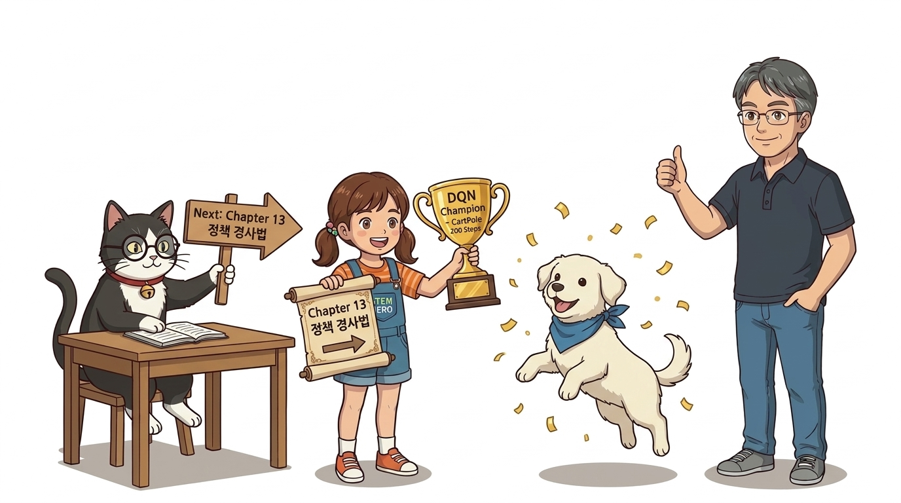
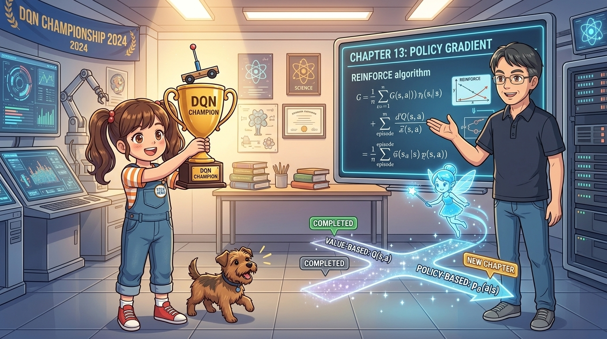

# 12.5 정리

**그림 12-5-0** 카트폴 200스텝 만점을 달성하고 'DQN Champion' 황금 트로피를 치켜든 도로시와, 가치 기반(Value-Based)의 완성에서 정책 기반(Policy-Based)이라는 새로운 지평으로 나아가는 갈림길을 비추는 지니, 그리고 13장 정책 경사법을 소개하는 이호진 교수님과 토토

---

이번 장에서는 DQN을 알아보았습니다. DQN의 핵심은 경험 재생과 목표 신경망입니다. 경험 재생은 경험 데이터를 반복해 사용하는 구조입니다. 경험 재생은 데이터의 효율을 높이고 샘플 사이의 상관성을 줄여줍니다. 목표 신경망은 TD 목표를 별도의 신경망에서 계산하는 기법입니다. 다른 신경망을 사용함으로써 TD 목표가 고정되어 신경망 학습이 안정적으로 이루어집니다.

DQN은 등장 후 시간이 제법 흘렀지만 여전히 중요한 기술입니다. 그 증거로 DQN 기반 기법들이 여전히 많이 연구되고 제안되고 있습니다. 이번 장에서는 DQN을 확장한 기법들인 Double DQN, 우선순위 경험 재생, Dueling DQN을 소개했습니다.

OpenAI Gym에 대해서도 알아보았습니다. Gym에는 다양한 문제가 준비되어 있고 일관된 인터페이스를 제공하여 다른 문제로 손쉽게 전환할 수 있습니다. 이번 장에서는 Gym이 제공하는 〈카트 폴〉 문제를 DQN으로 풀어보았습니다. 그리고 아타리를 플레이하는 데 필요한 기법들도 설명했습니다.
