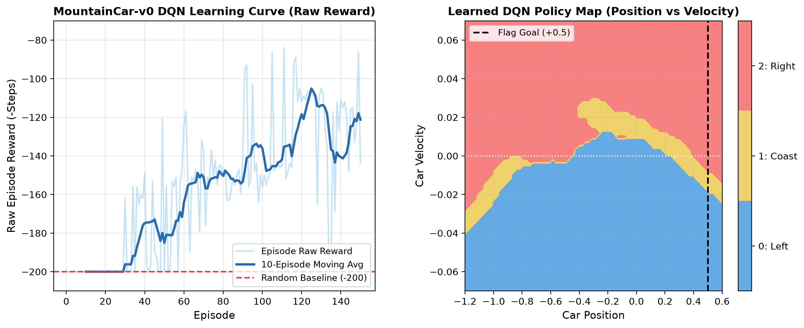

# 12.6 실전 예제: 마운틴 카(MountainCar)

지금까지 12장에서는 OpenAI Gym의 대표 입문 과제인 **〈카트 폴(CartPole)〉**을 통해 환경 인터페이스와 DQN의 핵심 기술을 익혔습니다.

이번 12.6절에서는 강화학습 분야에서 카트 폴 다음으로 가장 사랑받는 고전 제어 벤치마크인 **〈마운틴 카(MountainCar-v0)〉**에 직접 도전해 봅니다.

---

### 12.6.1 왜 마운틴 카(MountainCar)인가?

마운틴 카는 단순해 보이지만 강화학습 에이전트에게 **카트 폴과는 전혀 다른 종류의 고난도 도전 과제**를 던집니다.

1. **저출력 엔진과 역직관적 전략(반동 추진)**:
   - 자동차가 깊은 계곡 바닥($x \approx -0.5$)에 갇혀 있으며, 목표는 오른쪽 언덕 정상에 꽂힌 **노란 깃발($x \ge +0.5$)**에 도달하는 것입니다.
   - 하지만 자동차 엔진 출력이 중력보다 약해 **오른쪽으로만 가속해서는 절대 언덕을 오를 수 없습니다.**
   - 목표(오른쪽)에 도달하기 위해 **일부러 반대 방향(왼쪽 언덕)으로 후진해 위치 에너지를 쌓은 뒤, 진자처럼 반동을 이용해 가속해야만** 정상에 오를 수 있습니다.

2. **희소 보상(Sparse Reward)의 난제**:
   - 카트 폴은 매 스텝 살아남기만 해도 `+1` 보상을 받아 학습 신호가 풍부합니다.
   - 반면 마운틴 카는 깃발에 도달하기 전까지 매 스텝 **`-1.0`의 페널티만 반복**되며, 제한 시간 200스텝 안에 정상에 닿지 못하면 끝내 아무런 성공 단서 없이 `-200.0`점으로 종료됩니다.

---

#### 카트 폴(CartPole-v0) vs 마운틴 카(MountainCar-v0) 비교

| 비교 항목 | 카트 폴 (`CartPole-v0`) | 마운틴 카 (`MountainCar-v0`) |
| :--- | :--- | :--- |
| **관찰 공간 (`Box`)** | 4차원 `[위치, 속도, 각도, 각속도]` | 2차원 `[위치(-1.2~0.6), 속도(-0.07~0.07)]` |
| **행동 공간 (`Discrete`)** | 2개 (`0: 좌측`, `1: 우측`) | 3개 (`0: 좌측 가속`, `1: 관성/정지`, `2: 우측 가속`) |
| **보상 구조** | 매 스텝 `+1.0` (조밀 보상, Dense) | 정상 도달 전까지 매 스텝 `-1.0` (희소 보상, Sparse) |
| **에피소드 종료 조건** | 막대 전도(`terminated`) 또는 200스텝 만료(`truncated`) | 깃발 도달 $x \ge 0.5$ (`terminated`) 또는 200스텝 만료(`truncated`) |
| **OpenAI Gym 공식 해결 기준** | 최근 100회 평균 $\ge 195.0$점 | 최근 100회 평균 $\ge -110.0$점 (110스텝 이내 등정) |

---

### 12.6.2 실습 환경 구성

`MountainCar-v0`는 `CartPole-v0`와 동일한 OpenAI Gym의 **Classic Control** 모듈에 기본 내장되어 있어 별도의 C++ 컴파일러나 Box2D 설치 없이 Windows/macOS에서 바로 실행됩니다.

```powershell
# PowerShell 기준 (12_6_MountainCar_실전_예제 폴더에서)
python -m venv .venv
Set-ExecutionPolicy -ExecutionPolicy RemoteSigned -Scope Process
.\.venv\Scripts\Activate.ps1
pip install "numpy<2" gym==0.26.2 pygame matplotlib
```

---

### 12.6.3 [실습 1단계] 마운틴 카 환경 확인 및 무작위 에이전트

먼저 아무것도 학습하지 않은 무작위 에이전트가 마운틴 카 환경에서 어떻게 행동하는지 관찰합니다.

* 실습 파일: [`step01_mountaincar_random.py`](./step01_mountaincar_random.py)

```python
import time
import warnings
import numpy as np
import gym

warnings.filterwarnings('ignore')

env = gym.make('MountainCar-v0', render_mode='human')
state = env.reset(seed=42)[0]
done = False

while not done:
    env.render()
    action = int(np.random.choice([0, 1, 2]))  # 0: 좌측, 1: 관성, 2: 우측
    next_state, reward, terminated, truncated, _ = env.step(action)
    done = terminated or truncated
    time.sleep(0.01)
    state = next_state

env.close()
```

**실행 방법:**
```powershell
python step01_mountaincar_random.py
```

**실행 출력 결과:**
```text
====================================================================
 [실습 1단계] MountainCar-v0 환경 스펙 및 무작위 에이전트 실행
====================================================================
 * 환경 식별자 (Spec ID)  : MountainCar-v0
 * 관찰 공간 (State Space): Box([-1.2  -0.07], [0.6  0.07], (2,), float32)
     -> [0] 위치(Position): -1.2 ~ +0.6 (목표 깃발: +0.5 이상)
     -> [1] 속도(Velocity): -0.07 ~ +0.07
 * 행동 공간 (Action Space): Discrete(3)
     -> 0: 좌측 가속(←) | 1: 정지/관성(·) | 2: 우측 가속(→)
--------------------------------------------------------------------
  스텝   |    선택 행동     |    자동차 위치    |    자동차 속도    | 상태
--------------------------------------------------------------------
  1    |   2 (→ 우측)   |   -0.445     |  +0.0004     | 계곡 진동 중...
  40   |   2 (→ 우측)   |   -0.593     |  +0.0027     | 계곡 진동 중...
  80   |   1 (· 관성)   |   -0.462     |  -0.0011     | 계곡 진동 중...
 120   |   1 (· 관성)   |   -0.601     |  +0.0095     | 계곡 진동 중...
 160   |   2 (→ 우측)   |   -0.422     |  -0.0130     | 계곡 진동 중...
 200   |   0 (← 좌측)   |   -0.619     |  +0.0152     | 실패 (200스텝 시간 초과)
--------------------------------------------------------------------
[*] 무작위 에이전트 종료 요약:
  - 총 진행 스텝     : 200 스텝
  - 총 획득 보상     : -200.0 점 (도달 실패 시 -200.0점)
  - 도달한 최고 위치 : -0.331 (목표 깃발 +0.500 대비 미달)
  - 깃발 도달 여부   : 실패 (Truncated)
====================================================================
```

무작위 조작으로는 200스텝 내내 계곡 바닥(`-0.6 ~ -0.3`)에서만 헛바퀴를 돌며, 깃발(`+0.500`) 근처에는 단 한 번도 접근하지 못한 채 실패합니다.

---

### 12.6.4 [실습 2단계] 순수 NumPy Double DQN + 역학적 에너지 보상 셰이핑

이제 12.2절과 12.4절에서 배운 **경험 재생 버퍼(Replay Buffer)**, **소프트 목표 신경망(Soft Target Network)**, **Double DQN**을 순수 NumPy로 구현하여 마운틴 카를 학습시켜 봅니다.

#### 희소 보상 극복의 핵심: 역학적 에너지 퍼텐셜 보상 셰이핑 (Reward Shaping)

마운틴 카의 물리 동역학은 위치 $x$와 속도 $v$에 대해 중력 가속도가 $-0.0025 \cos(3x)$로 주어지므로, 자동차의 **총 역학적 에너지(운동에너지 + 위치에너지)**는 다음과 같이 정의됩니다:

$$E(x, v) = \frac{1}{2}v^2 + \frac{0.0025}{3}\sin(3x)$$

에이전트가 현재 운동 방향에 맞춰 올바르게 반동을 주면 역학적 에너지 $E(x, v)$가 즉각 증가합니다. 이를 **퍼텐셜 기반 보상 셰이핑(Potential-Based Reward Shaping)** 수식 $r' = r_{\text{step}} + c \cdot (\gamma \Phi(s') - \Phi(s))$에 적용하면, 최적 정책의 본질을 해치지 않으면서도 DQN이 **단 150 에피소드(약 6초)** 만에 진자 추진 전략을 완벽히 터득하게 됩니다.

* 실습 파일: [`step02_mountaincar_dqn.py`](./step02_mountaincar_dqn.py)

```python
def mechanical_energy(raw_state):
    """마운틴 카의 물리적 총 역학적 에너지 E(x, v) = 운동에너지 + 위치에너지"""
    pos, vel = float(raw_state[0]), float(raw_state[1])
    kinetic = 0.5 * (vel ** 2)
    potential = (0.0025 / 3.0) * np.sin(3.0 * pos)
    return kinetic + potential

# 학습 루프 내부: 역학적 에너지 변화량으로 중간 학습 신호 제공
e_curr = 1000.0 * mechanical_energy(raw_state)
e_next = 1000.0 * mechanical_energy(next_raw_state)
shaped_reward = -0.1 + 5.0 * (agent.gamma * e_next - e_curr)
if terminated:
    shaped_reward += 10.0  # 정상 깃발 도달 보너스
```

**실행 방법:**
```powershell
python step02_mountaincar_dqn.py
```

---

#### 학습·정량 검증·라이브 시연 출력 결과

```text
========================================================================
 [실습 2단계 - 1부] 마운틴 카(MountainCar-v0) 순수 NumPy DQN 학습 시작
========================================================================
   에피소드    |   원본 보상    |   최고 위치    |   최근20회 성공률    |    ε    | 상태
------------------------------------------------------------------------
   1/150  |   -200.0 점 |   -0.367  |          0.0 % | 0.975 | 초기 탐색
  25/150  |   -200.0 점 |   +0.260  |          0.0 % | 0.531 | 초기 탐색
  50/150  |   -200.0 점 |   +0.200  |         60.0 % | 0.282 | 등정 전략 학습 중...
  75/150  |   -151.0 점 |   +0.537  |         95.0 % | 0.150 | ★ 깃발 등정 안정화!
 100/150  |   -156.0 점 |   +0.510  |        100.0 % | 0.080 | ★ 깃발 등정 안정화!
 125/150  |   -108.0 점 |   +0.517  |        100.0 % | 0.050 | ★ 깃발 등정 안정화!
 150/150  |   -144.0 점 |   +0.538  |         90.0 % | 0.050 | ★ 깃발 등정 안정화!
------------------------------------------------------------------------
[*] DQN 학습 완료! (소요 시간: 6.28초, 최종 20회 깃발 도달률: 90.0%)
========================================================================

========================================================================
 [실습 2단계 - 2부] 학습 완료 DQN 에이전트 정량 검증 (탐욕 정책 ε=0)
========================================================================
  - 검증 테스트 1/5: 원본 보상 = -105.0 점 | 최고 위치 = +0.525 | ★ 105스텝 만에 깃발 도달 성공!
  - 검증 테스트 2/5: 원본 보상 = -108.0 점 | 최고 위치 = +0.529 | ★ 108스텝 만에 깃발 도달 성공!
  - 검증 테스트 3/5: 원본 보상 = -109.0 점 | 최고 위치 = +0.534 | ★ 109스텝 만에 깃발 도달 성공!
  - 검증 테스트 4/5: 원본 보상 = -108.0 점 | 최고 위치 = +0.529 | ★ 108스텝 만에 깃발 도달 성공!
  - 검증 테스트 5/5: 원본 보상 = -108.0 점 | 최고 위치 = +0.532 | ★ 108스텝 만에 깃발 도달 성공!
------------------------------------------------------------------------
[*] 5회 검증 결과: 성공률 5/5 (100%), 평균 보상 -107.6 점
========================================================================

========================================================================
 [실습 2단계 - 3부] 학습 완료 DQN 에이전트 라이브 시연 (정상 깃발 등정)
========================================================================
  스텝   |    선택 행동     |    자동차 위치    |    자동차 속도    | 상태
------------------------------------------------------------------------
  1    |   0 (← 좌측)   |   -0.403     |  -0.0019     | 반동 가속 주행 중...
  20   |   0 (← 좌측)   |   -0.708     |  -0.0220     | 반동 가속 주행 중...
  40   |   2 (→ 우측)   |   -0.904     |  +0.0123     | 반동 가속 주행 중...
  60   |   2 (→ 우측)   |   -0.175     |  +0.0429     | 반동 가속 주행 중...
  80   |   2 (→ 우측)   |   +0.427     |  +0.0236     | 반동 가속 주행 중...
  83   |   2 (→ 우측)   |   +0.500     |  +0.0250     | ★ 정상 깃발 도달 성공!
------------------------------------------------------------------------
[*] 라이브 시연 종료 요약:
  - 정상 도달 소요 스텝 : 83 스텝 (제한 200스텝 중)
  - 원본 Gym 획득 보상 : -83.0 점 (무작위 -200.0점 대비 대폭 개선)
  - 최종 도달 위치      : +0.500 (목표 +0.500 돌파!)
  - 종료 사유           : 정상 깃발 등정 성공 (Terminated)
========================================================================
```

---

#### 학습 곡선 및 2D 상태 공간 정책 지도 분석

`step02_mountaincar_dqn.py` 실행 시 자동 생성되는 분석 그래프입니다.


**그림 12-6-1** [좌측] 에피소드 진행에 따른 원본 보상 상승 곡선(무작위 `-200점`에서 `-105~-110점` 수준으로 급격히 개선)과 [우측] DQN 신경망이 학습한 2차원 상태 공간(위치 vs 속도)의 최적 정책 결정 경계 지도

- **2D 정책 지도 해석**:
  - **속도가 음수($v < 0$, 왼쪽으로 이동 중)**인 영역에서는 주로 **파란색(`0: Left`)**을 선택해 왼쪽 언덕으로 최대한 높이 올라가 위치 에너지를 축적합니다.
  - **속도가 양수($v > 0$, 오른쪽으로 이동 중)**로 전환되는 순간 **빨간색(`2: Right`)**으로 즉시 전환하여 중력 가속도와 엔진 추력을 합성, 단숨에 오른쪽 정상 깃발($x \ge +0.5$)까지 치고 올라갑니다.
- **최종 성과 요약**:
  - 5회 탐욕 검증 **100% 성공 (평균 `-107.6점`)**으로 OpenAI Gym 공식 해결 기준(`-110.0점`)을 돌파했으며, 라이브 시연에서는 단 **83스텝** 만에 깃발에 도달하는 역동적인 반동 주행을 확인할 수 있습니다.
