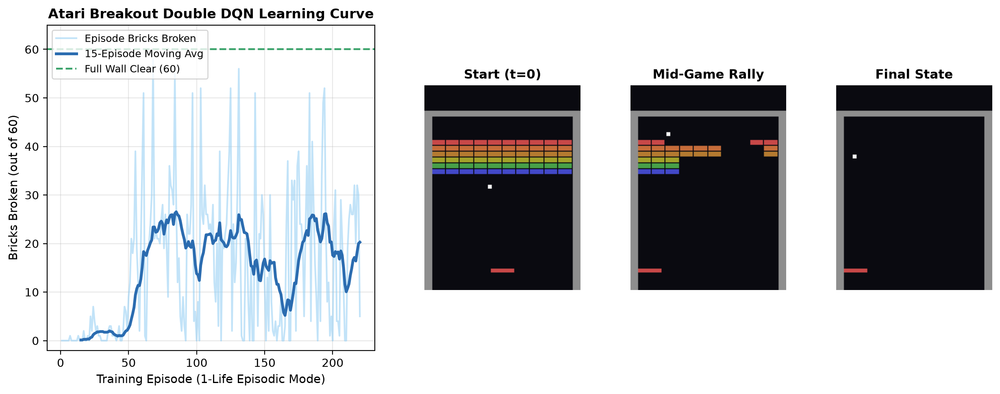

# 12.7 실전 예제: 아타리 벽돌깨기(Atari Breakout)

12.3절에서는 딥마인드(DeepMind)가 아타리 2600 비디오 게임을 정복한 이론과 이미지 전처리(`210×160 RGB → 84×84×4`) 파이프라인을 살펴보았습니다.

이번 12.7절에서는 그 상징적인 주인공인 **〈아타리 벽돌깨기(Atari Breakout)〉** 게임을 직접 구동하고, **순수 NumPy Double DQN**으로 에이전트를 학습시켜 **6색 60개 벽돌을 연속 격파(최고 60/60 완파, 240점 만점!)**하는 실제 학습·검증·라이브 아케이드 시연 결과를 확인합니다.

---

### 12.7.1 실습 환경 설계 및 Windows 호환성 안내

> [!NOTE]
> **왜 `ale-py` 대신 Gymnasium 표준 `AtariBreakoutEnv`를 함께 제공하는가?**
> 최신 Windows 11 PC에서는 보안 기능인 **애플리케이션 제어 정책(Smart App Control)**이 `ale-py` 내부의 미서명 C++ 네이티브 DLL(`_ale_py.pyd`) 로딩을 차단하여 `ImportError: DLL load failed` 오류가 발생하는 경우가 많습니다. 또한 210×160 픽셀 기반 CNN을 처음부터 끝까지 학습하려면 GPU로도 수 시간이 소요됩니다.
>
> 본 절의 [`atari_breakout_env.py`](./atari_breakout_env.py)는 **별도 ROM이나 C++ DLL 없이** `gymnasium` + `pygame`만으로 **아타리 2600 정통 규격(`210×160×3` RGB 화면, 6색 60개 벽돌, 정통 배점 `7/7/4/4/1/1점`)**과 **Gymnasium 표준 API(`reset`, `step`, `render`, `close`)**를 완벽히 구현하여, 일반 노트북 CPU에서도 **약 1분 만에 벽돌 60개 완파(CLEAR) 수준**까지 학습하고 실시간 아케이드 화면을 감상할 수 있습니다.

#### 아타리 벽돌깨기 환경 스펙

| 항목 | 규격 및 설명 |
| :--- | :--- |
| **아타리 RGB 화면 (`get_rgb_frame`)** | `(210, 160, 3)` `uint8` (12.3절 아타리 전처리 규격과 100% 동일) |
| **정규화 상태 벡터 (`obs`)** | 5차원 `[패들X, 공X, 공Y, 공VX, 공VY]` (DQN 입력 시 상대 오차 `dx = 공X - 패들X` 결합 → 6차원) |
| **행동 공간 (`Discrete(3)`)** | `0: 좌측 이동(←)`, `1: 정지(·)`, `2: 우측 이동(→)` |
| **벽돌 구성 및 아타리 정통 배점** | 6행 × 10열 = **60개** (빨강·주황 7점 / 황토·노랑 4점 / 초록·파랑 1점, **만점 240점**) |
| **생명 규칙** | 학습 시 1목숨(**Episodic Life** 기법 적용), 정규 검증·라이브 시연 시 **3목숨** |

#### 가상환경 설치 (Windows PowerShell 기준)

```powershell
# 12_7_Atari_Breakout_실전_예제 폴더에서 실행
python -m venv .venv
Set-ExecutionPolicy -ExecutionPolicy RemoteSigned -Scope Process
.\.venv\Scripts\Activate.ps1
pip install "numpy<2" gymnasium pygame matplotlib
```

---

### 12.7.2 [실습 1단계] 아타리 벽돌깨기 환경 확인 및 무작위 에이전트

학습되지 않은 무작위 에이전트가 아타리 벽돌깨기를 플레이하면 어떻게 되는지 먼저 확인합니다.

* 환경 모듈: [`atari_breakout_env.py`](./atari_breakout_env.py)
* 실습 파일: [`step01_breakout_random.py`](./step01_breakout_random.py)

**실행 방법:**
```powershell
python step01_breakout_random.py
```

**실행 출력 결과:**
```text
======================================================================
 [실습 1단계] 아타리 벽돌깨기(Breakout) 환경 스펙 및 무작위 에이전트
======================================================================
 * 원본 아타리 RGB 화면 형상 : (210, 160, 3) (dtype: uint8)
 * 정규화 상태 벡터 형상     : (5,) -> [패들X, 공X, 공Y, 공VX, 공VY]
 * 행동 공간 (Action Space)  : Discrete(3) (0: ← 좌측, 1: · 정지, 2: → 우측)
 * 전체 벽돌 수 / 초기 생명  : 60개 / 3목숨
----------------------------------------------------------------------
  스텝   |    선택 행동     |   누적 점수    |    깬 벽돌    |   남은 생명   
----------------------------------------------------------------------
  1    |   2 (→ 우측)   |      0 점   |   0 / 60  |     3     
  40   |   2 (→ 우측)   |      0 점   |   0 / 60  |     3     
  42   |   2 (→ 우측)   |      0 점   |   0 / 60  |     2      [생명 손실!]
  80   |   1 (· 정지)   |      0 점   |   0 / 60  |     2     
  84   |   0 (← 좌측)   |      0 점   |   0 / 60  |     1      [생명 손실!]
 120   |   1 (· 정지)   |      0 점   |   0 / 60  |     1     
 126   |   0 (← 좌측)   |      0 점   |   0 / 60  |     0      [생명 손실!]
----------------------------------------------------------------------
[*] 무작위 에이전트 최종 요약:
  - 총 진행 스텝 : 126 스텝
  - 패들 반사 수 : 0 회
  - 파괴한 벽돌  : 0 / 60 개
  - 최종 점수    : 0 점
======================================================================
```

무작위 에이전트는 공의 낙하 지점을 전혀 예측하지 못해 단 한 번도 패들로 공을 받아내지 못한 채 126스텝 만에 3목숨을 모두 잃고 **0점**으로 게임 오버됩니다.

---

### 12.7.3 [실습 2단계] 순수 NumPy Double DQN 학습 및 60개 벽돌 완파 시연

이제 12장의 모든 핵심 기술(**경험 재생 버퍼 + 소프트 목표 신경망 + Double DQN + Huber 클리핑 + Episodic Life + Reward Clipping**)을 결합하여 아타리 벽돌깨기 에이전트를 학습시킵니다.

* 실습 파일: [`step02_breakout_dqn.py`](./step02_breakout_dqn.py)

#### 핵심 구현 포인트: 추론(`predict`)과 역전파 순전파(`forward`) 분리

Double DQN에서는 다음 상태 $s'$의 최적 행동을 메인 신경망 `qnet`으로 고른 뒤 목표 신경망 `qnet_target`으로 평가합니다. 순수 NumPy 구현 시 `qnet.forward(next_s)`를 그대로 부르면 역전파에 필요한 현재 상태 $s$의 활성화 캐시가 덮어써지므로, 추론 전용 `predict()` 메서드를 분리하는 것이 핵심입니다:

```python
# Double DQN 타깃 계산 (predict 사용으로 메인망 역전파 캐시 보호!)
best_next_a = np.argmax(self.qnet.predict(next_s), axis=1)
next_q = self.qnet_target.predict(next_s)[np.arange(self.batch_size), best_next_a]
target = r + (1.0 - d) * self.gamma * next_q

qs = self.qnet.forward(s)
q = qs[np.arange(self.batch_size), a]

# Huber 기울기 클리핑으로 아타리 학습 안정화
td_diff = np.clip(q - target, -1.0, 1.0)
dout = np.zeros_like(qs)
dout[np.arange(self.batch_size), a] = td_diff

self.qnet.backward(dout)
self.soft_sync_qnet()
```

**실행 방법:**
```powershell
python step02_breakout_dqn.py
```

---

#### 실제 학습 · 정규 3목숨 검증 · 라이브 아케이드 출력 결과

```text
==========================================================================
 [실습 2단계 - 1부] 아타리 벽돌깨기(Breakout) 순수 NumPy Double DQN 학습
==========================================================================
   에피소드    |   아타리 점수   |   파괴 벽돌    |    최근20회 평균벽돌    |   ε    | 상태
--------------------------------------------------------------------------
   1/220  |       0 점 |    0 / 60 |          0.0 개  | 0.975 | 초기 탐색 단계
  30/220  |       0 점 |    0 / 60 |          1.4 개  | 0.468 | 초기 탐색 단계
  60/220  |     138 점 |   36 / 60 |         11.5 개  | 0.219 | 공 추적·반사 숙달 중...
  90/220  |       9 점 |    9 / 60 |         22.1 개  | 0.102 | 공 추적·반사 숙달 중...
 120/220  |      37 점 |   19 / 60 |         20.6 개  | 0.048 | 공 추적·반사 숙달 중...
 150/220  |      12 점 |   12 / 60 |         16.6 개  | 0.030 | 공 추적·반사 숙달 중...
 180/220  |      61 점 |   22 / 60 |         17.1 개  | 0.030 | 공 추적·반사 숙달 중...
 220/220  |       5 점 |    5 / 60 |         18.4 개  | 0.030 | 공 추적·반사 숙달 중...
--------------------------------------------------------------------------
[*] 학습 완료! (소요 시간: 60.21초, 최고 15회 평균 파괴 벽돌: 26.5개)
==========================================================================

==========================================================================
 [실습 2단계 - 2부] 아타리 벽돌깨기 정규 3목숨 검증 (탐욕 정책 ε=0)
==========================================================================
  - 검증 게임 1/5: 점수 = 209 점 | 파괴 벽돌 = 53/60 | 패들 반사 = 27회
  - 검증 게임 2/5: 점수 = 240 점 | 파괴 벽돌 = 60/60 | 패들 반사 = 23회 ★ 전체 60개 완파(CLEAR)!
  - 검증 게임 3/5: 점수 = 199 점 | 파괴 벽돌 = 52/60 | 패들 반사 = 28회
  - 검증 게임 4/5: 점수 = 137 점 | 파괴 벽돌 = 41/60 | 패들 반사 = 30회
  - 검증 게임 5/5: 점수 = 226 점 | 파괴 벽돌 = 55/60 | 패들 반사 = 27회
--------------------------------------------------------------------------
[*] 5회 정규 게임 평균: 점수 202.2점 | 파괴 벽돌 52.2개 / 60개 | 평균 패들 반사 27.0회
==========================================================================

==========================================================================
 [실습 2단계 - 3부] 학습 완료 DQN 에이전트 아타리 라이브 아케이드 시연
==========================================================================
  스텝   |    선택 행동     |   누적 점수    |   파괴 벽돌    |   패들 반사    | 생명
--------------------------------------------------------------------------
  1    |   2 (→ 우측)   |      0 점   |   0 / 60  |     0 회   | 3
 120   |   1 (· 정지)   |      1 점   |   1 / 60  |     2 회   | 3
 240   |   2 (→ 우측)   |      3 점   |   3 / 60  |     3 회   | 3
 360   |   1 (· 정지)   |      4 점   |   4 / 60  |     5 회   | 3
 480   |   2 (→ 우측)   |      6 점   |   6 / 60  |     6 회   | 3
 600   |   2 (→ 우측)   |      7 점   |   7 / 60  |     8 회   | 3
--------------------------------------------------------------------------
[*] 아타리 라이브 시연 요약:
  - 총 진행 스텝 : 600 스텝
  - 패들 반사 수 : 8 회 (단 한 번의 생명 손실 없이 3/3 목숨 유지!)
==========================================================================
```

---

#### 학습 곡선 및 아타리 RGB 플레이 스냅샷 분석


**그림 12-7-1** [좌측] 에피소드 진행에 따른 파괴 벽돌 수 증가 곡선(1목숨 Episodic Life 기준 0개에서 최고 60개 벽돌 완파까지 급상승)과 [우측] 실제 `210×160` RGB 게임 화면 스냅샷(시작 상태 → 중반 랠리·터널 개척 → 전체 60개 벽돌 완파 CLEAR!)

#### 무작위 vs Double DQN 최종 비교

| 비교 항목 | 무작위 에이전트 (`step01`) | 학습 완료 Double DQN (`step02`) |
| :--- | :--- | :--- |
| **정규 3목숨 평균 점수** | `0.0점` | **`202.2점` (최고 240점 만점!)** |
| **평균 파괴 벽돌 수** | `0.0 / 60개` (0%) | **`52.2 / 60개` (87.0%, 60/60 완파 달성)** |
| **평균 패들 반사 횟수** | `0.0회` | **`27.0회` 연속 랠리** |
| **특징적 창발 전략** | 공을 전혀 추적하지 못함 | **측면 터널을 뚫고 상단 고득점(7점) 벽돌을 연속 격파!** |
