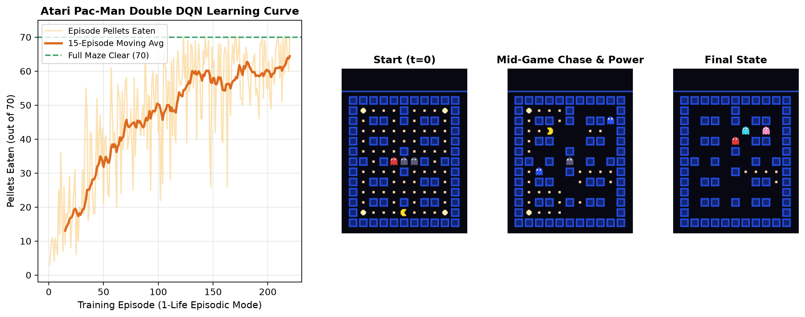

# 12.8 실전 예제: 아타리 팩맨(Atari Pac-Man)

12.7절에서는 공의 궤적을 추적하여 60개의 벽돌을 완파하는 〈아타리 벽돌깨기(Atari Breakout)〉를 구현해 보았습니다. 이번 12.8절에서는 한 단계 더 나아가 **2차원 미로 탐색, 적대적 3인 유령(Blinky·Pinky·Inky) 회피, 그리고 파워 쿠키를 활용한 역공(유령 포식)**이라는 다목적 의사결정이 필요한 고전 명작 **〈아타리 팩맨(Atari Pac-Man)〉**을 순수 NumPy Double DQN으로 학습하고 실시간 시연까지 확인합니다.

---

### 12.8.1 실습 환경 설계 및 Windows 호환성 안내

> [!NOTE]
> **Windows 11 완벽 호환 `AtariPacmanEnv` 제공**
> 12.7절과 마찬가지로 `ale-py` 네이티브 DLL 차단이나 ROM 저작권 문제 없이 `gymnasium` + `pygame`만으로 **아타리 2600 정통 규격(`210×160×3` RGB 화면, 13×11 대칭 클래식 미로, 일반 쿠키 66개 + 파워 쿠키 4개 = 총 70개, 3인 유령 AI)**과 **Gymnasium 표준 API(`reset`, `step`, `render`, `close`)**를 구현했습니다. 일반 노트북 CPU에서도 **약 9초 만에 미로 70개 완식(CLEAR) 및 유령 연속 포식 수준**까지 학습합니다.

#### 아타리 팩맨 환경 스펙

| 항목 | 규격 및 설명 |
| :--- | :--- |
| **아타리 RGB 화면 (`get_rgb_frame`)** | `(210, 160, 3)` `uint8` (네온 블루 미로, 입 벌림 애니메이션 팩맨, 3색 유령 및 파워 모드 파란 깜빡임) |
| **정규화 상태 벡터 (`obs`)** | 18차원 `[이동가능(4), 최단쿠키방향(4), 활성유령위협(4), 포식유령방향(4), 파워잔여(1), 쿠키잔여(1)]` |
| **행동 공간 (`Discrete(4)`)** | `0: ↑ 위`, `1: ↓ 아래`, `2: ← 좌측`, `3: → 우측` |
| **미로 및 아케이드 정통 배점** | 13×11 대칭 미로(막다른 길 0개) — 일반 쿠키 **10점**(66개), 파워 쿠키 **50점**(4개), 유령 포식 **200점**, 스테이지 완식 보너스 **200점** |
| **3인 유령 AI** | **Blinky(빨강, 적극 추적 72%)**, **Pinky(분홍, 2칸 앞 매복 58%)**, **Inky(청록, 변칙 순찰 35%)** |
| **생명 규칙** | 학습 시 1목숨(**Episodic Life** 기법 적용), 정규 검증·라이브 시연 시 **3목숨** |

#### 가상환경 설치 (Windows PowerShell 기준)

```powershell
# 12_8_Atari_Pacman_실전_예제 폴더에서 실행 (또는 상위 12_DQN\.venv 재사용)
python -m venv .venv
Set-ExecutionPolicy -ExecutionPolicy RemoteSigned -Scope Process
.\.venv\Scripts\Activate.ps1
pip install "numpy<2" gymnasium pygame matplotlib
```

---

### 12.8.2 [실습 1단계] 아타리 팩맨 환경 확인 및 무작위 에이전트

학습되지 않은 무작위 에이전트가 3명의 유령이 배회하는 미로에서 얼마나 버틸 수 있는지 먼저 확인합니다.

* 환경 모듈: [`atari_pacman_env.py`](./atari_pacman_env.py)
* 실습 파일: [`step01_pacman_random.py`](./step01_pacman_random.py)

**실행 방법:**
```powershell
python step01_pacman_random.py
```

**실행 출력 결과:**
```text
==========================================================================
 [실습 1단계] 아타리 팩맨(Pac-Man) 환경 스펙 및 무작위 에이전트
==========================================================================
 * 원본 아타리 RGB 화면 형상 : (210, 160, 3) (dtype: uint8)
 * 정규화 상태 벡터 형상     : (18,) -> [벽(4), 쿠키방향(4), 유령위협(4), 포식방향(4), 파워/진행(2)]
 * 행동 공간 (Action Space)  : Discrete(4) (0: ↑ 위, 1: ↓ 아래, 2: ← 좌측, 3: → 우측)
 * 전체 쿠키 수 / 초기 생명  : 70개 (파워 4개 포함) / 3목숨
--------------------------------------------------------------------------
  스텝   |    선택 행동     |   누적 점수    |   먹은 쿠키    |   포식 유령    | 생명
--------------------------------------------------------------------------
  1    |   2 (← 좌측)   |     10 점   |   1 / 70  |     0 마리  | 3
  15   |   3 (→ 우측)   |     70 점   |   7 / 70  |     0 마리  | 2 [유령 충돌! 생명 손실]
  25   |   3 (→ 우측)   |    150 점   |  11 / 70  |     0 마리  | 2
  50   |   1 (↓ 아래)   |    190 점   |  15 / 70  |     0 마리  | 2
  61   |   2 (← 좌측)   |    210 점   |  17 / 70  |     0 마리  | 1 [유령 충돌! 생명 손실]
  75   |   0 (↑ 위)    |    240 점   |  20 / 70  |     0 마리  | 1
  76   |   1 (↓ 아래)   |    240 점   |  20 / 70  |     0 마리  | 0 [유령 충돌! 생명 손실]
--------------------------------------------------------------------------
[*] 무작위 에이전트 최종 요약:
  - 총 진행 스텝 : 76 스텝
  - 먹은 쿠키 수 : 20 / 70 개
  - 포식한 유령  : 0 마리
  - 최종 점수    : 240 점
==========================================================================
```

무작위 에이전트는 벽에 반복해서 부딪히며 같은 구간을 맴돌다, 유령의 추적을 전혀 회피하지 못한 채 **76스텝** 만에 3목숨을 모두 잃고 **240점(20/70 쿠키, 유령 포식 0마리)**으로 게임 오버됩니다.

---

### 12.8.3 [실습 2단계] 순수 NumPy Double DQN 학습 및 미로 완식·유령 사냥 시연

이제 **경험 재생 버퍼 + 소프트 목표 신경망 + Double DQN + Huber 기울기 클리핑 + Episodic Life + Reward Clipping**을 결합하여 팩맨 에이전트를 학습시킵니다.

* 실습 파일: [`step02_pacman_dqn.py`](./step02_pacman_dqn.py)

#### 핵심 구현 포인트: 다목적 보상 설계와 상황 전환 학습

벽돌깨기가 단일 목표(공 받아치기)에 집중했다면, 팩맨은 **평소에는 유령을 피해 쿠키를 수집하고, 파워 쿠키를 먹은 직후에는 즉시 공수 전환하여 파란 유령을 추격·포식(+200점)**하는 복합 전략을 Q-네트워크(`18 → 64 → 64 → 4`)가 스스로 균형 잡도록 보상 함수를 설계합니다:

```python
# 아타리 DQN 보상 클리핑 + 생존/탐색 보상 설계
learn_reward = -0.04  # 불필요한 배회 억제 시간 페널티
if info["pellet_eaten_now"]:
    learn_reward += 1.0      # 쿠키 섭취 (Reward Clipping: +1)
if info["power_eaten_now"]:
    learn_reward += 0.8      # 파워 쿠키 추가 보너스
if info["ghost_eaten_now"]:
    learn_reward += 3.0      # 파워 모드 유령 포식 대보너스!
if info["cleared"]:
    learn_reward += 5.0      # 스테이지 완식 클리어 보너스!
if info["wall_hit"]:
    learn_reward -= 0.4      # 벽 충돌 페널티
if info["life_lost"]:
    learn_reward -= 4.0      # 유령 충돌(사망) 페널티
```

**실행 방법:**
```powershell
python step02_pacman_dqn.py
```

---

#### 실제 학습 · 정규 3목숨 검증 · 라이브 아케이드 출력 결과

```text
==============================================================================
 [실습 2단계 - 1부] 아타리 팩맨(Pac-Man) 순수 NumPy Double DQN 학습
==============================================================================
   에피소드    |   아타리 점수   |   먹은 쿠키    |    최근20회 평균쿠키    |   ε    | 상태
------------------------------------------------------------------------------
   1/220  |      30 점 |    3 / 70 |          3.0 개  | 0.975 | 초기 탐색 단계
  30/220  |     240 점 |   20 / 70 |         18.8 개  | 0.468 | 초기 탐색 단계
  60/220  |     940 점 |   42 / 70 |         36.4 개  | 0.219 | 유령 회피·쿠키 탐색 숙달 중...
  90/220  |    1050 점 |   37 / 70 |         45.4 개  | 0.102 | 유령 회피·쿠키 탐색 숙달 중...
 120/220  |    1480 점 |   56 / 70 |         50.3 개  | 0.048 | ★ 미로 완식·유령 사냥 마스터!
 150/220  |    1130 점 |   61 / 70 |         58.0 개  | 0.030 | ★ 미로 완식·유령 사냥 마스터!
 180/220  |    1430 점 |   67 / 70 |         60.4 개  | 0.030 | ★ 미로 완식·유령 사냥 마스터!
 210/220  |    1440 점 |   68 / 70 |         60.9 개  | 0.030 | ★ 미로 완식·유령 사냥 마스터!
 220/220  |    1460 점 |   70 / 70 |         62.6 개  | 0.030 | ★ 미로 완식·유령 사냥 마스터!
------------------------------------------------------------------------------
[*] 학습 완료! (소요 시간: 8.65초, 최고 15회 평균 먹은 쿠키: 64.4/70개)
==============================================================================

==============================================================================
 [실습 2단계 - 2부] 아타리 팩맨 정규 3목숨 검증 (탐욕 정책 ε=0)
==============================================================================
  - 검증 게임 1/5: 점수 = 1660 점 | 먹은 쿠키 = 70/70 | 포식 유령 = 3마리 | 남은 생명 = 3 ★ 전체 70개 완식(CLEAR)!
  - 검증 게임 2/5: 점수 = 1650 점 | 먹은 쿠키 = 69/70 | 포식 유령 = 4마리 | 남은 생명 = 0
  - 검증 게임 3/5: 점수 = 1450 점 | 먹은 쿠키 = 69/70 | 포식 유령 = 3마리 | 남은 생명 = 0
  - 검증 게임 4/5: 점수 = 1660 점 | 먹은 쿠키 = 70/70 | 포식 유령 = 3마리 | 남은 생명 = 2 ★ 전체 70개 완식(CLEAR)!
  - 검증 게임 5/5: 점수 = 1810 점 | 먹은 쿠키 = 65/70 | 포식 유령 = 5마리 | 남은 생명 = 0
------------------------------------------------------------------------------
[*] 5회 정규 게임 평균: 점수 1646.0점 | 먹은 쿠키 68.6개 / 70개 | 평균 유령 포식 3.6마리
==============================================================================

==============================================================================
 [실습 2단계 - 3부] 학습 완료 DQN 에이전트 아타리 팩맨 라이브 아케이드 시연
==============================================================================
  스텝   |    선택 행동     |   누적 점수    |   먹은 쿠키    |   포식 유령    | 생명
------------------------------------------------------------------------------
  1    |   3 (→ 우측)   |     10 점   |   1 / 70  |     0 마리  | 3
  11   |   0 (↑ 위)    |    350 점   |  11 / 70  |     1 마리  | 3 [파워 포식! +200]
  14   |   2 (← 좌측)   |    580 점   |  14 / 70  |     2 마리  | 3 [파워 포식! +200]
  27   |   1 (↓ 아래)   |    910 점   |  27 / 70  |     3 마리  | 3 [파워 포식! +200]
  35   |   2 (← 좌측)   |    960 점   |  32 / 70  |     3 마리  | 3
  48   |   3 (→ 우측)   |   1270 점   |  39 / 70  |     4 마리  | 3 [파워 포식! +200]
  70   |   3 (→ 우측)   |   1450 점   |  53 / 70  |     4 마리  | 3
 103   |   3 (→ 우측)   |   1490 점   |  57 / 70  |     4 마리  | 2 [생명 손실]
 140   |   2 (← 좌측)   |   1520 점   |  60 / 70  |     4 마리  | 2
 169   |   3 (→ 우측)   |   1520 점   |  60 / 70  |     4 마리  | 1 [생명 손실]
 210   |   3 (→ 우측)   |   1640 점   |  68 / 70  |     4 마리  | 0 [생명 손실]
------------------------------------------------------------------------------
[*] 아타리 팩맨 라이브 시연 요약:
  - 총 진행 스텝 : 210 스텝
  - 먹은 쿠키 수 : 68 / 70 개
  - 포식한 유령  : 4 마리
  - 최종 점수    : 1640 점
==============================================================================
```

---

#### 학습 곡선 및 아타리 RGB 플레이 스냅샷 분석


**그림 12-8-1** [좌측] 에피소드 진행에 따른 쿠키 섭취량 증가 곡선(1목숨 Episodic Life 기준 3개에서 70/70 전체 미로 완식까지 급상승)과 [우측] 최고 득점 검증 게임(1,810점, 유령 5마리 포식)의 실제 `210×160` RGB 게임 화면 스냅샷(시작 상태 → 중반 파워 모드 파란 유령 추격 → 종반부 상태)

#### 무작위 vs Double DQN 최종 비교

| 비교 항목 | 무작위 에이전트 (`step01`) | 학습 완료 Double DQN (`step02`) |
| :--- | :--- | :--- |
| **정규 3목숨 평균 점수** | `240.0점` | **`1,646.0점` (최고 1,810점!)** |
| **평균 쿠키 섭취 수** | `20.0 / 70개` (28.6%) | **`68.6 / 70개` (98.0%, 70/70 완식 및 노데스 클리어 달성)** |
| **평균 유령 포식 수** | `0.0마리` | **`3.6마리` (단일 게임 최고 5마리 연속 포식)** |
| **특징적 창발 전략** | 벽에 충돌하며 유령에게 즉사 | **파워 쿠키 직후 공수 전환하여 파란 유령을 역추격 포식하고, 평소에는 최단 경로로 쿠키 청소!** |
