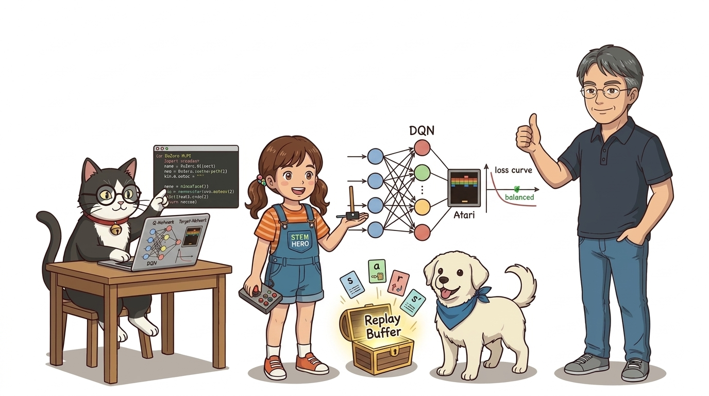
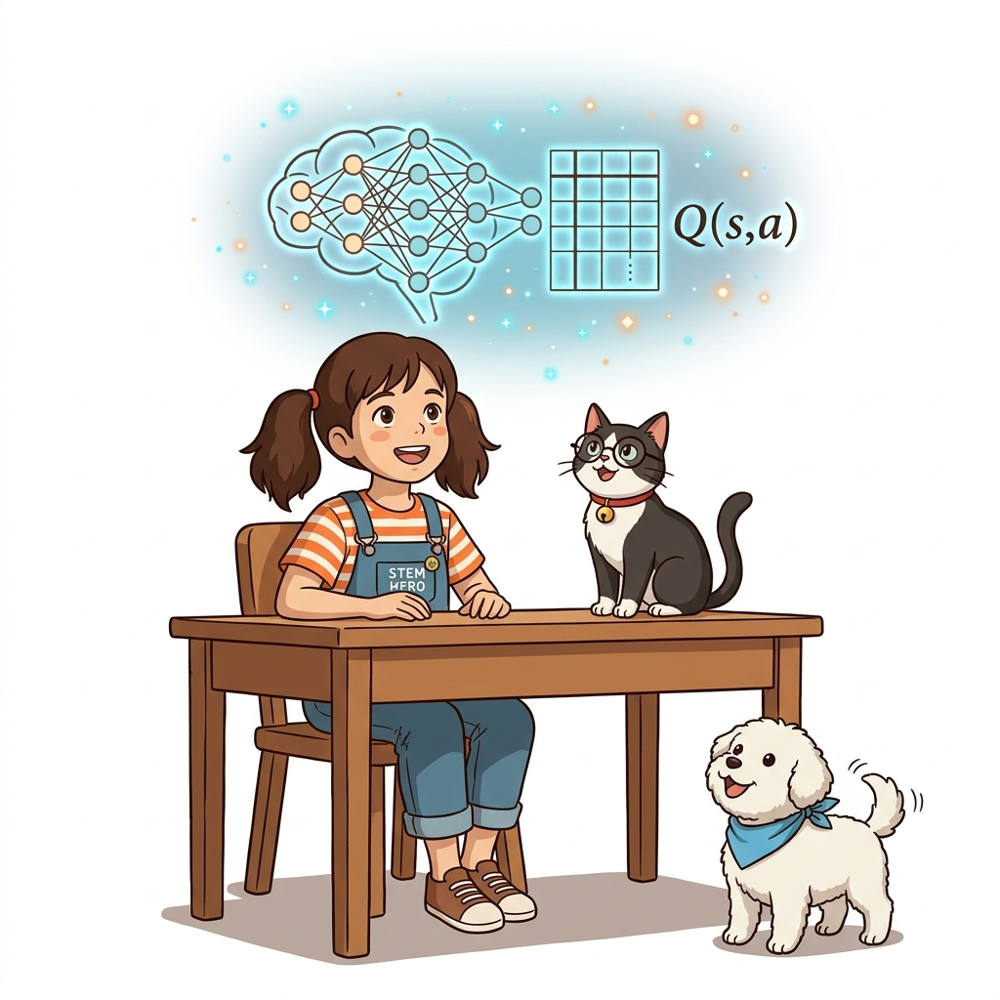
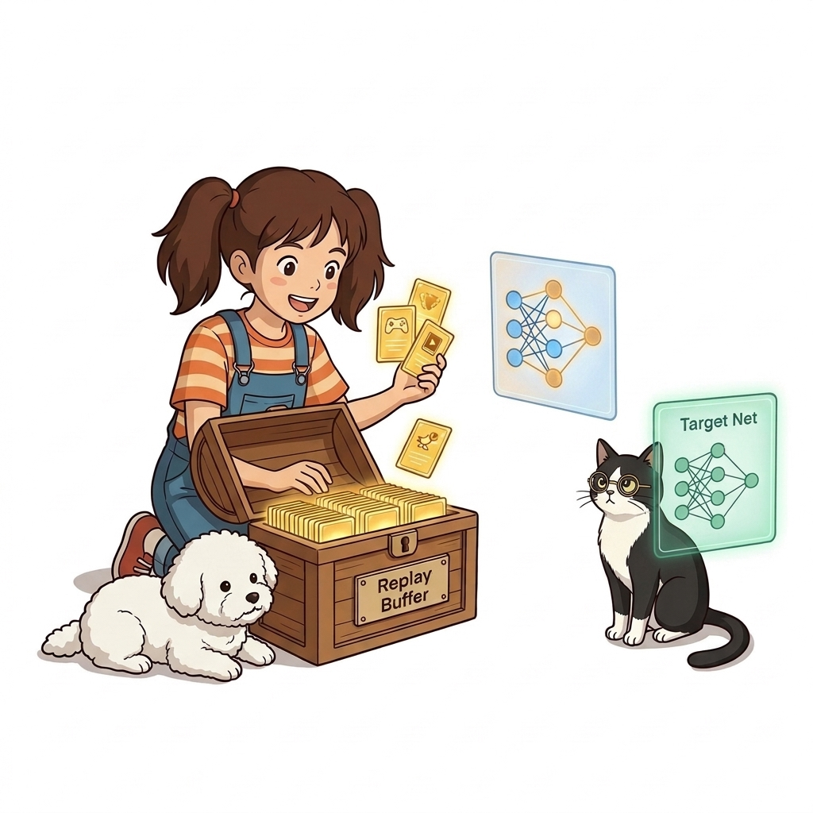
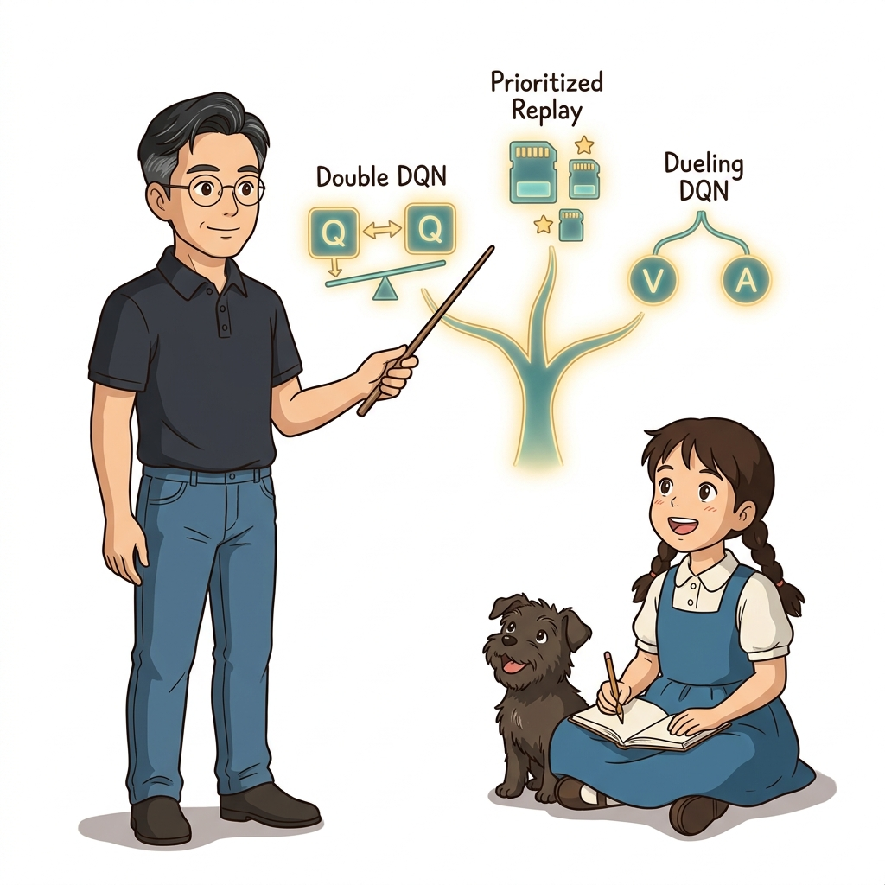
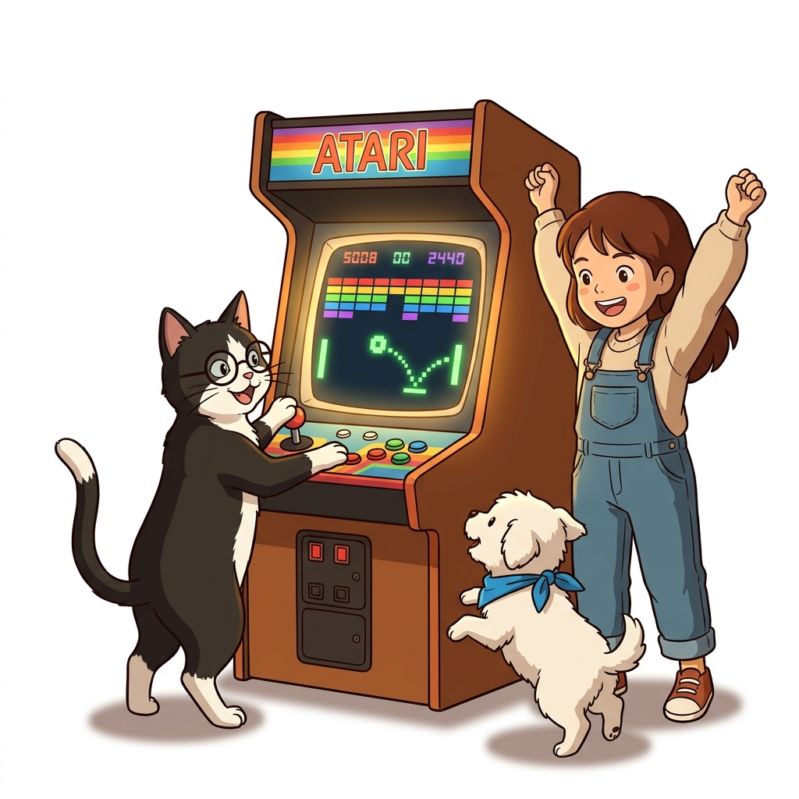
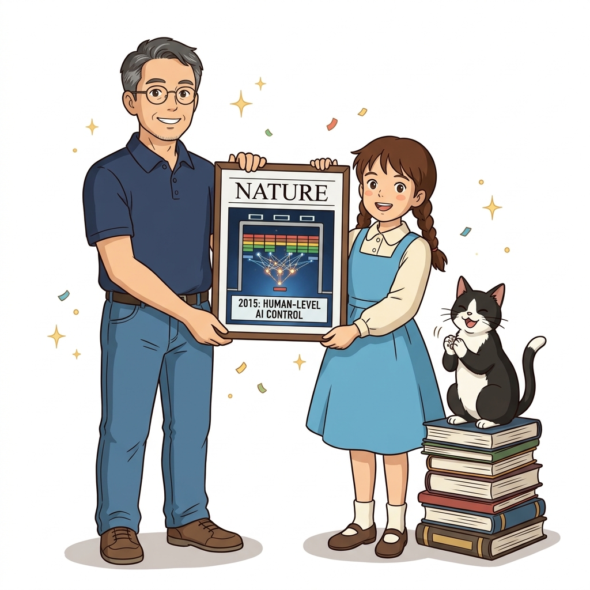
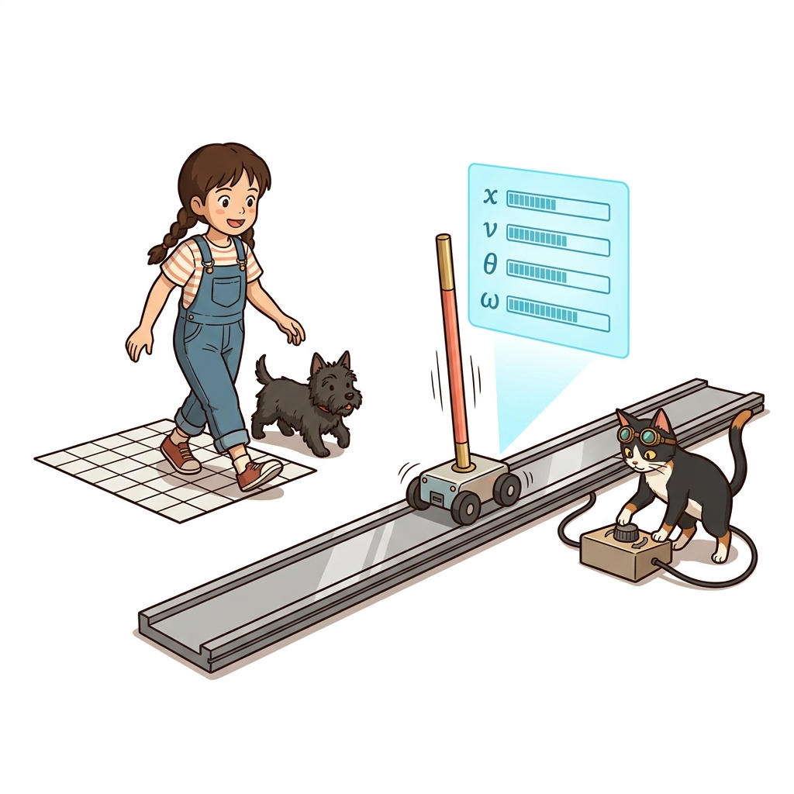

# CHAPTER 12 DQN

---
이번 장의 주제는 DQN입니다. 
DQN(Deep Q Network)은 Q 러닝과 신경망을 이용한 기법입니다. 

**그림 12-0-1** Q-러닝 알고리즘과 심층 인공신경망의 결합으로 탄생한 딥마인드의 전설적인 DQN(Deep Q-Network) 개념을 탐구하는 도로시와 지니
---
지난장에서 Q 러닝과 신경망을 결합하는 방법을 배웠는데, DQN은 여기에 새로운 기술인 '경험 재생'과 '목표 신경망'을 더한 것입니다. 

**그림 12-0-2** 과거의 모험 기록 카드상자(경험 재생, Replay Buffer)와 안정적인 기준선(목표 신경망, Target Network)을 대조 갱신하는 지니와 도로시
---
이번 장에서는 이 기술들에 대해 알아본 다음, 코드로 구현하여 효과까지 검증해보겠습니다. 나아가 DQN을 확장한 기법인 'Double DQN', '우선순위 경험 재생', 'Dueling DQN'도 소개합니다.

**그림 12-0-3** Double DQN, 우선순위 경험 재생(PER), Dueling DQN이라는 세 갈래 핵심 확장 기법의 로드맵을 소개하는 이호진 교수님
---
DQN은 비디오 게임과 같은 복잡한 문제도 훌륭하게 해결합니다. 그 덕분에 지금의 딥러닝 붐이 시작되었죠. 

**그림 12-0-4** 아타리(Atari) 고전 비디오 게임 환경에서 인간 수준의 초인적 플레이를 성공시키는 DQN 에이전트와 환호하는 도로시와 토토
---
이런 점에서 DQN은 딥러닝 분야의 기념비적인 연구라고 할 수 있습니다. DQN이 처음 발표된 건 2013년입니다. 벌써 세월이 꽤 흘렀지만 지금도 DQN을 기반으로 한 방법론이 활발하게 제안되고 있을 만큼 DQN은 여전히 중요한 알고리즘입니다.

**그림 12-0-5** 2015년 네이처(Nature) 표지를 장식하며 현대 딥러닝 붐의 서막을 연 DQN의 역사적 기념비성을 설명하는 이호진 교수님
---

또한 이번 장부터는 이전까지의 '그리드 월드'에서 벗어나 좀 더 실용적인 문제를 다룹니다. OpenAI Gym 라이브러리가 제공하는 〈카트 폴(Cart Pole)〉이 그 주인공입니다.

**그림 12-0-6** 단순한 2차원 바둑판 그리드 월드를 벗어나 연속 상태 공간의 고전 역학 제어 과제인 OpenAI Gym의 카트 폴(Cart Pole)에 도전하는 도로시와 토토
---

## 목차

- [12.1 OpenAI Gym](./12_1_OpenAI_Gym/index.md)
- [12.2 DQN의 핵심 기술](./12_2_DQN의_핵심_기술/index.md)
- [12.3 DQN과 아타리](./12_3_DQN과_아타리/index.md)
- [12.4 DQN 확장](./12_4_DQN_확장/index.md)
- [12.5 정리](./12_5_정리/index.md)
- [12.6 실전 예제: 마운틴 카(MountainCar)](./12_6_MountainCar_실전_예제/index.md)
- [12.7 실전 예제: 아타리 벽돌깨기(Atari Breakout)](./12_7_Atari_Breakout_실전_예제/index.md)
