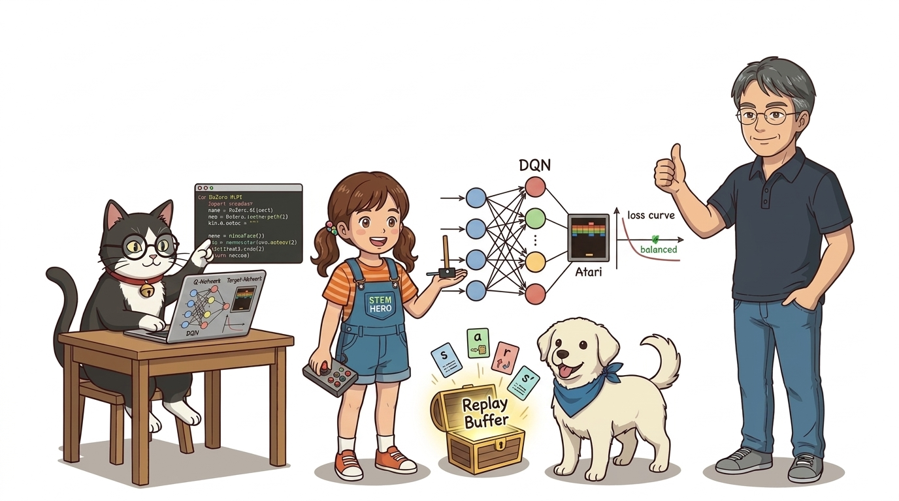
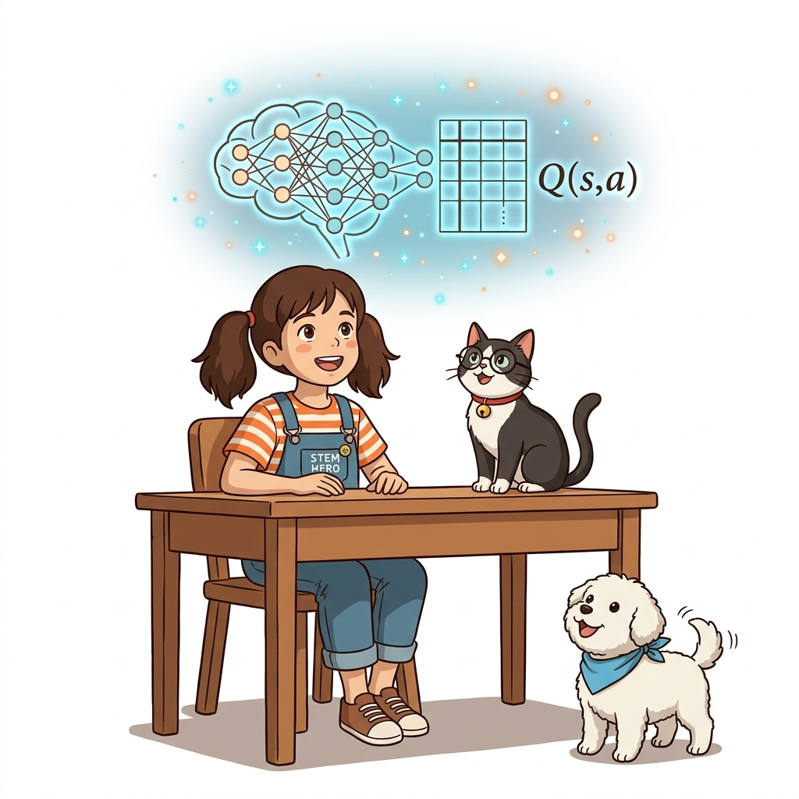
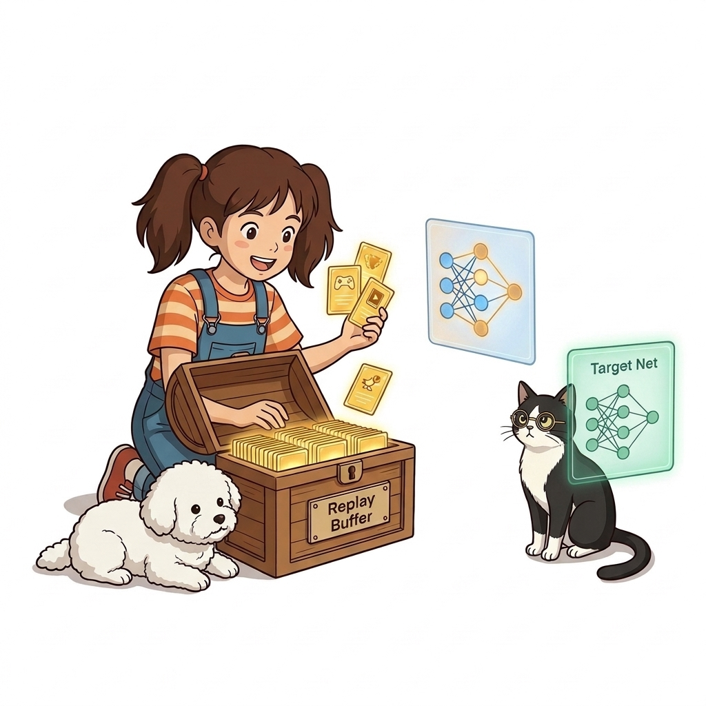
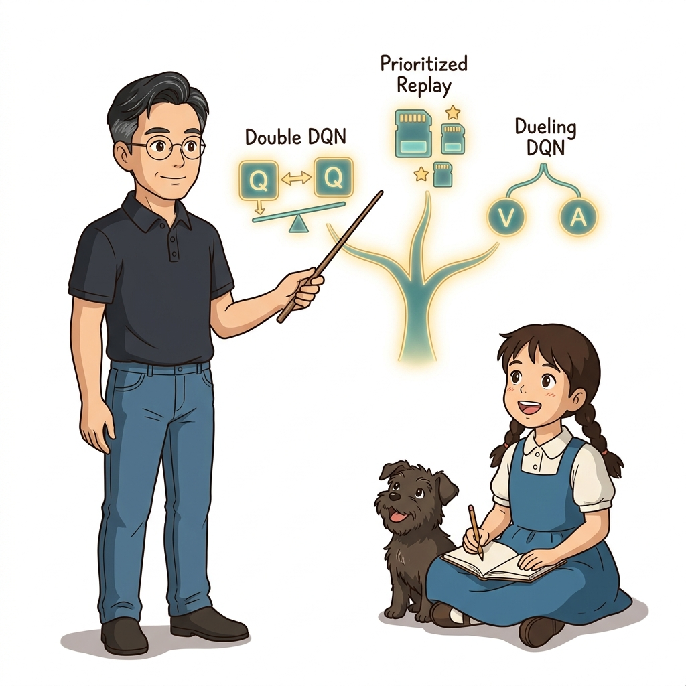
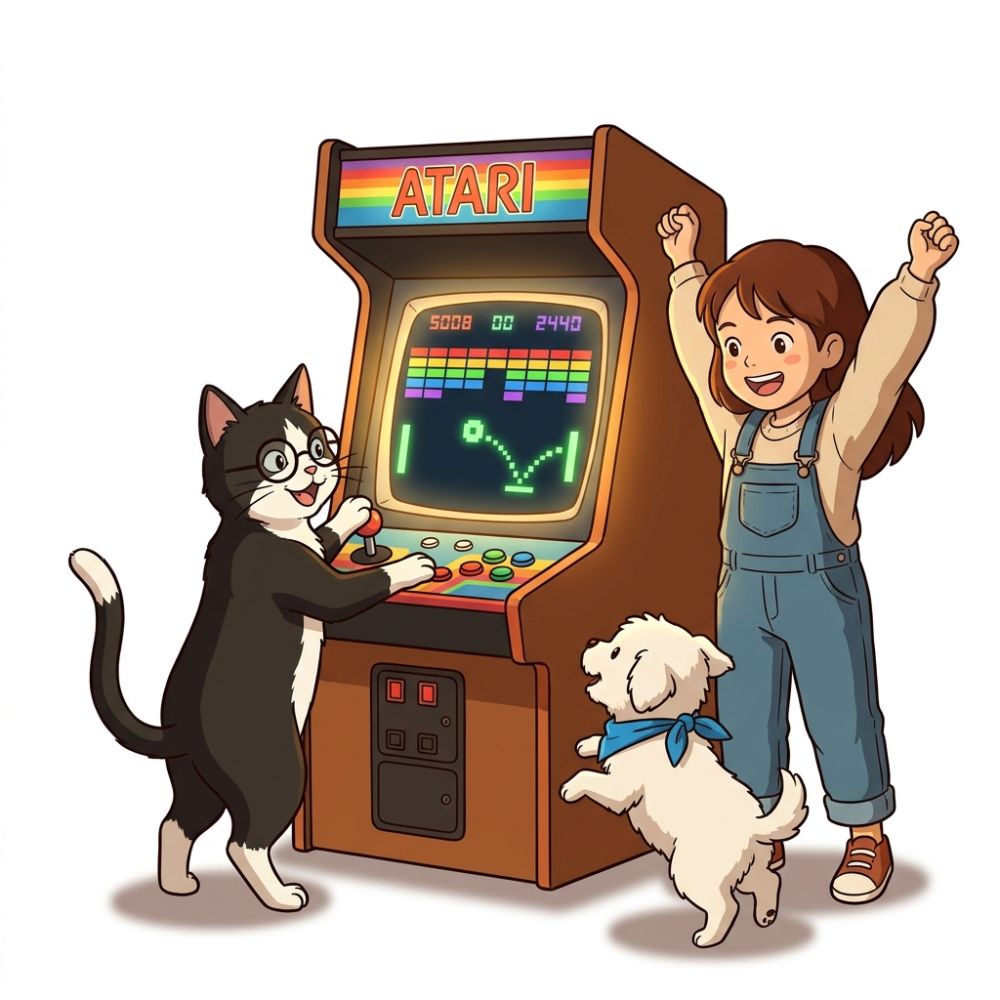
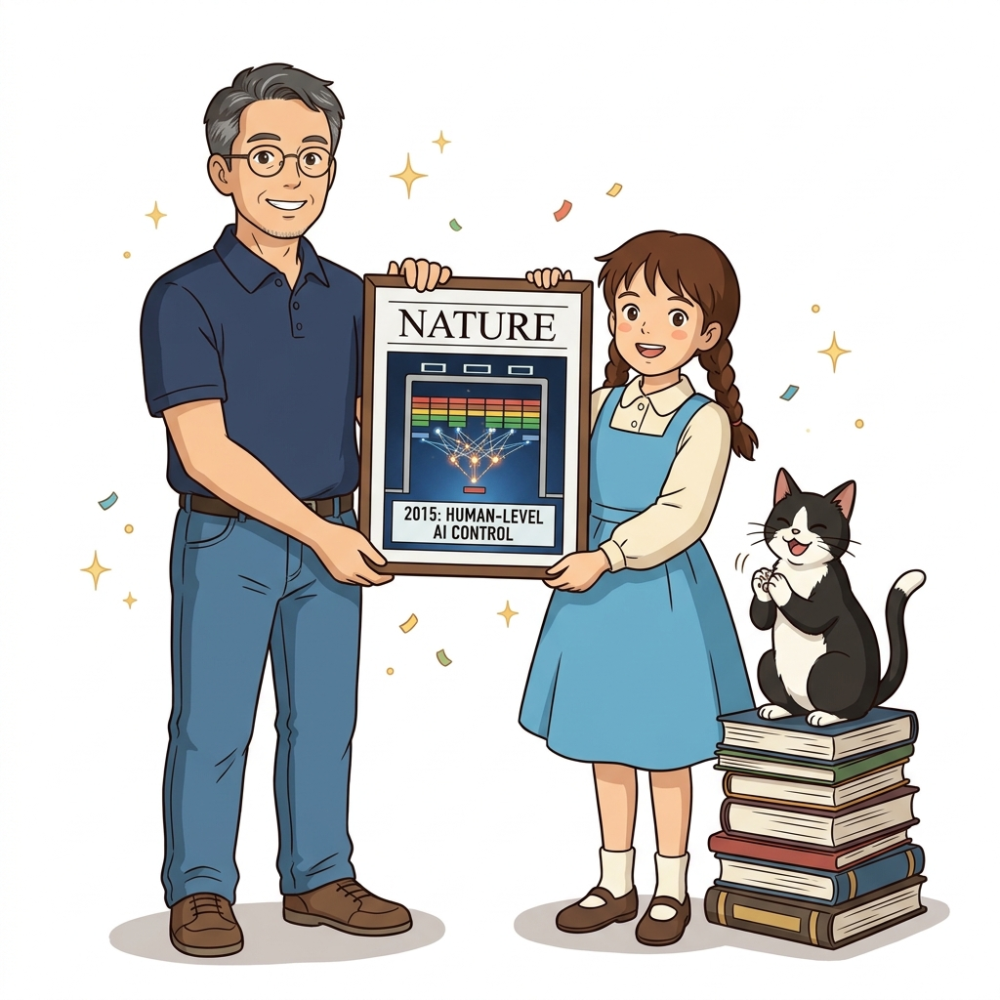
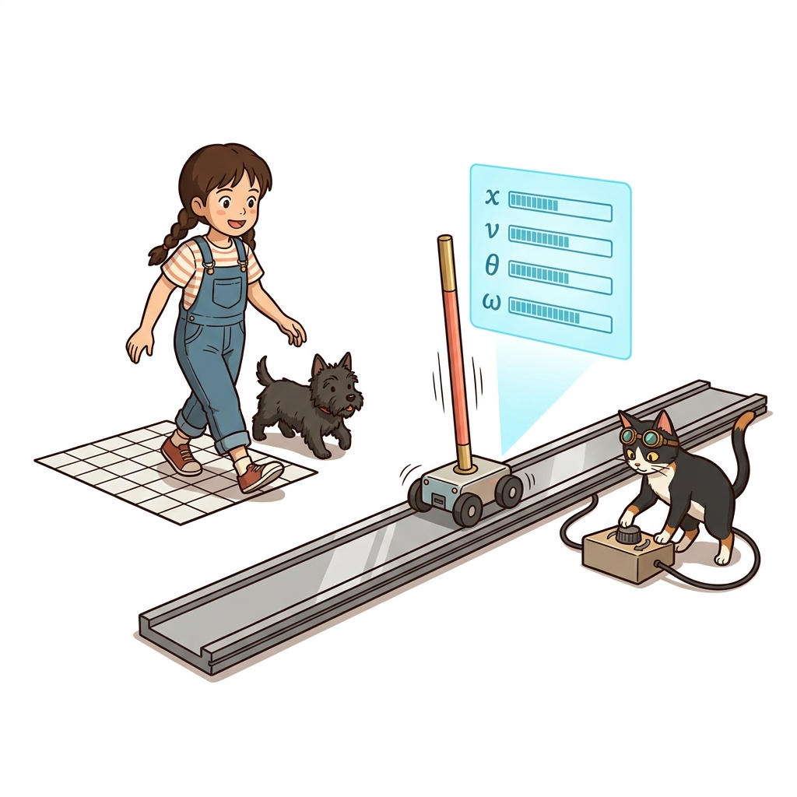

<b>CHAPTER 12</b>

# CHAPTER 12 DQN

> **[강의 스크립트]**
> 이번 제십이장에서는 현대 심층 강화학습의 문을 활짝 열어젖힌 역사적인 불후의 명작, 디큐엔에 대해 본격적으로 탐구합니다. 디큐엔은 딥마인드가 이천십삼년에 제안하고 이천십오년 네이처 표지를 장식한 알고리즘으로, 인공지능이 인간의 사전 지식 없이도 오직 화면 픽셀과 보상만으로 비디오 게임을 스스로 정복할 수 있음을 전 세계에 처음으로 증명했습니다. 화면의 표지에서 보듯, 지니와 도로시가 미지의 환경 속에서 신경망이라는 마법 같은 도구를 활용해 복잡한 물리 법칙과 전략을 깨우쳐 나가는 위대한 여정을 오늘 함께 시작해 보겠습니다.

---

이번 장의 주제는 DQN입니다. 
DQN(Deep Q Network)은 Q 러닝과 신경망을 이용한 기법입니다. 

**그림 12-0-1** Q-러닝 알고리즘과 심층 인공신경망의 결합으로 탄생한 딥마인드의 전설적인 DQN(Deep Q-Network) 개념을 탐구하는 도로시와 지니

> **[강의 스크립트]**
> 이번 장의 핵심 주제인 디큐엔의 본질을 먼저 짚어보겠습니다. 디큐엔은 딥 큐 네트워크의 약자로서, 우리가 앞선 장들에서 배운 가치 기반 강화학습의 대표 주자인 큐러닝과, 거대한 상태 공간을 유연하게 표현할 수 있는 심층 인공신경망을 유기적으로 결합한 것입니다. 과거에는 상태가 조금만 많아져도 표 안에 숫자를 다 적을 수 없는 상태 폭발 문제 때문에 현실 문제에 적용하지 못했습니다. 하지만 디큐엔은 신경망을 큐함수의 강력한 비선형 함수 근사기로 활용하여, 수만 개의 픽셀이나 연속적인 물리 상태가 주어지더라도 각 행동의 기대 가치를 매끄럽게 예측해 낼 수 있는 놀라운 인공지능 두뇌를 완성했습니다.

---

지난장에서 Q 러닝과 신경망을 결합하는 방법을 배웠는데, DQN은 여기에 새로운 기술인 '경험 재생'과 '목표 신경망'을 더한 것입니다. 

**그림 12-0-2** 과거의 모험 기록 카드상자(경험 재생, Replay Buffer)와 안정적인 기준선(목표 신경망, Target Network)을 대조 갱신하는 지니와 도로시

> **[강의 스크립트]**
> 우리가 지난 십일장에서 신경망과 큐러닝을 단순 결합했을 때 겪었던 문제점을 상기해 보십시오. 단순히 연결만 해서는 데이터 간의 시간적 상관관계와 움직이는 과녁 문제 때문에 학습이 십중팔구 발산해 버렸습니다. 딥마인드는 바로 이 치명적인 딜레마를 해결하기 위해 두 명의 구원투수를 등판시켰습니다. 그것이 바로 화면의 그림에 나오는 경험 재생과 목표 신경망입니다. 에이전트가 겪은 모험 기록을 크리스탈 수조 같은 대용량 버퍼에 차곡차곡 보관했다가 무작위로 복원 추출하여 시간적 연결고리를 산산이 깨부수는 경험 재생, 그리고 학습 도중 과녁이 제멋대로 도망가지 않도록 얼음 자물쇠로 꽁꽁 얼려 고정해 두는 목표 신경망이 유기적으로 결합함으로써 비로소 심층 강화학습의 안정적인 수렴이 완성된 것입니다.

---

이번 장에서는 이 기술들에 대해 알아본 다음, 코드로 구현하여 효과까지 검증해보겠습니다. 나아가 DQN을 확장한 기법인 'Double DQN', '우선순위 경험 재생', 'Dueling DQN'도 소개합니다.

**그림 12-0-3** Double DQN, 우선순위 경험 재생(PER), Dueling DQN이라는 세 갈래 핵심 확장 기법의 로드맵을 소개하는 이호진 교수님

> **[강의 스크립트]**
> 이번 장의 학업 로드맵은 매우 구체적이고 실전적입니다. 먼저 경험 재생과 목표 신경망의 수학적 원리를 이론적으로 완벽하게 파헤친 뒤, 외부 프레임워크의 블랙박스에 의존하지 않고 순수 파이썬과 넘파이 코드로 두 기법을 밑바닥부터 직접 구현하여 카트폴 제어 성능을 검증할 것입니다. 더 나아가 초기 디큐엔이 안고 있던 가치 과대평가 문제를 해결한 더블 디큐엔, 중요한 오답 경험을 집중적으로 복습하는 우선순위 경험 재생, 그리고 상태 가치와 행동 이득을 분리한 듀얼링 디큐엔까지 세 갈래의 대표적 확장 기술을 깊이 있게 다루게 됩니다.

---

DQN은 비디오 게임과 같은 복잡한 문제도 훌륭하게 해결합니다. 그 덕분에 지금의 딥러닝 붐이 시작되었죠. 

**그림 12-0-4** 아타리(Atari) 고전 비디오 게임 환경에서 인간 수준의 초인적 플레이를 성공시키는 DQN 에이전트와 환호하는 도로시와 토토

> **[강의 스크립트]**
> 디큐엔이 인공지능 역사에서 갖는 위상은 실로 독보적입니다. 화면의 아타리 비디오 게임 캐비닛을 보십시오. 과거의 인공지능은 체스나 장기처럼 인간이 세밀하게 손으로 깎아 만든 룰과 휴리스틱이 없으면 한 걸음도 움직이지 못했습니다. 하지만 디큐엔은 게임의 규칙이나 물리 법칙에 대한 사전 정보를 단 하나도 제공받지 않은 채, 오직 모니터 화면의 날것 그대로의 픽셀과 점수라는 보상 신호만을 관찰하여 스스로 조이스틱을 움직였습니다. 그리고 마침내 벽돌깨기와 퐁 등 수십 종의 게임에서 인간 챔피언의 점수를 뛰어넘는 초인적인 플레이를 달성함으로써, 전 세계 과학계와 산업계에 현대 딥러닝 붐을 폭발시키는 기폭제가 되었습니다.

---

이런 점에서 DQN은 딥러닝 분야의 기념비적인 연구라고 할 수 있습니다. DQN이 처음 발표된 건 2013년입니다. 벌써 세월이 꽤 흘렀지만 지금도 DQN을 기반으로 한 방법론이 활발하게 제안되고 있을 만큼 DQN은 여전히 중요한 알고리즘입니다.

**그림 12-0-5** 2015년 네이처(Nature) 표지를 장식하며 현대 딥러닝 붐의 서막을 연 DQN의 역사적 기념비성을 설명하는 이호진 교수님

> **[강의 스크립트]**
> 디큐엔의 연구 역사를 살펴보면, 이천십삼년 신경정보처리시스템학회 워크숍에서 최초의 가능성을 타진한 뒤 알고리즘 안정성을 대폭 보완하여 이천십오년 세계 최고의 과학 저널인 네이처의 표지 논문으로 등재되었습니다. 십여 년의 세월이 흐른 지금도 최신 강화학습 논문들이 가장 먼저 성능을 비교하는 표준 베이스라인으로 디큐엔을 채택하고 있으며, 자율주행, 로봇 제어, 데이터센터 에너지 절감 등 실세계 산업 현장의 수많은 의사결정 시스템에 디큐엔의 핵심 철학이 살아 숨 쉬고 있습니다.

---

또한 이번 장부터는 이전까지의 '그리드 월드'에서 벗어나 좀 더 실용적인 문제를 다룹니다. OpenAI Gym 라이브러리가 제공하는 〈카트 폴(Cart Pole)〉이 그 주인공입니다.

**그림 12-0-6** 단순한 2차원 바둑판 그리드 월드를 벗어나 연속 상태 공간의 고전 역학 제어 과제인 OpenAI Gym의 카트 폴(Cart Pole)에 도전하는 도로시와 토토

> **[강의 스크립트]**
> 특히 이번 십이장의 실습부터는 이전까지 우리가 다루었던 단순한 사각형 타일 격자판, 즉 그리드 월드를 완전히 졸업합니다. 전 세계 강화학습 연구의 표준 테스트베드인 오픈에이아이 짐 환경을 본격 도입하며, 그 첫 번째 도전 과제로 고전 제어 이론의 대표적 난제인 카트폴을 선정했습니다. 카트 위에 놓인 막대는 중력에 의해 끊임없이 넘어지려 하는 불안정한 역진자 시스템입니다. 카트의 위치와 속도, 막대의 각도와 각속도라는 네 개의 연속적인 물리량을 센서로 측정하여 넘어지지 않도록 균형을 잡는 실전 제어 문제를 디큐엔으로 멋지게 해결해 보겠습니다.

---

## 목차

- [12.1 OpenAI Gym](./12_1_OpenAI_Gym/index.md)
- [12.2 DQN의 핵심 기술](./12_2_DQN의_핵심_기술/index.md)
- [12.3 DQN과 아타리](./12_3_DQN과_아타리/index.md)
- [12.4 DQN 확장](./12_4_DQN_확장/index.md)
- [12.5 정리](./12_5_정리/index.md)

> **[강의 스크립트]**
> 십이장의 전체 목차와 학습 순서를 정리해 드리겠습니다. 먼저 십이점일 절에서는 오픈에이아이 짐 라이브러리의 설치와 표준 인터페이스를 익히고 카트폴 환경의 네 가지 물리 상태를 코드로 확인합니다. 십이점이 절에서는 디큐엔의 양대 기둥인 경험 재생과 목표 신경망의 수학적 원리를 증명하고 완전한 카트폴 디큐엔 에이전트를 밑바닥부터 구현합니다. 십이점삼 절에서는 십만 개가 넘는 화면 픽셀을 입력받아 게임을 정복하는 아타리 디큐엔과 합성곱 신경망의 학습 공학을 탐구합니다. 십이점사 절에서는 더블 디큐엔과 피이알, 듀얼링 디큐엔이라는 삼대 확장 기술을 학습하고, 마지막 십이점오 절에서 가치 기반 강화학습 전체를 총결산하며 다음 정책 경사법으로의 도약을 준비하겠습니다.
