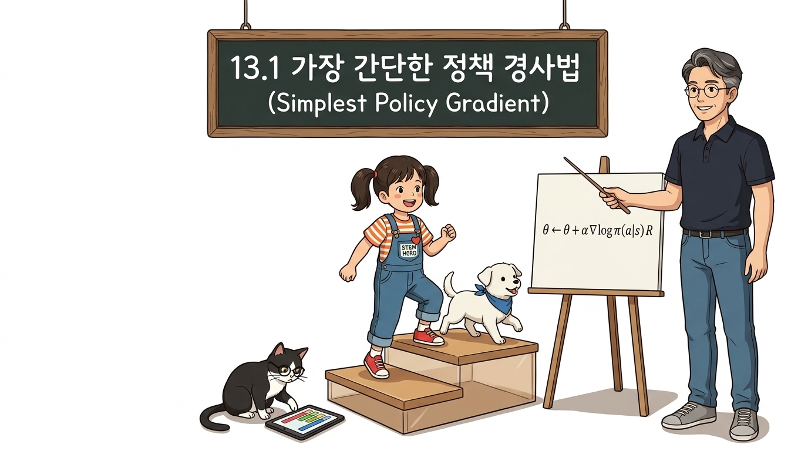
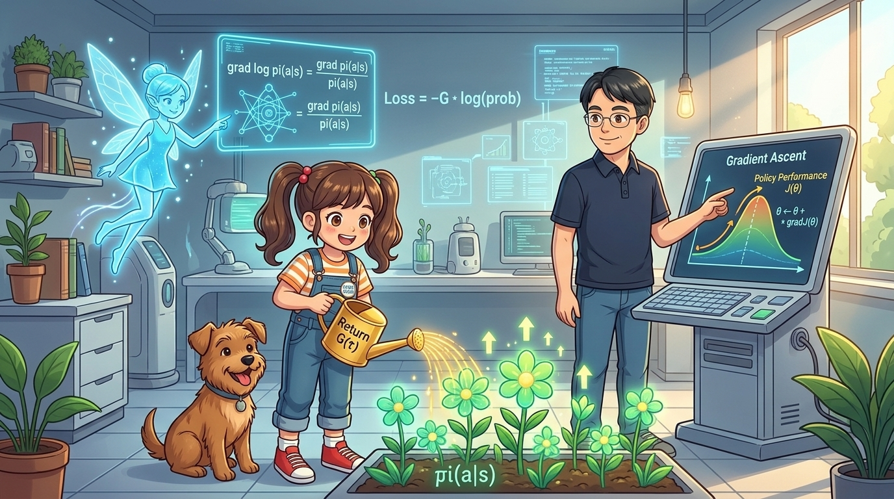
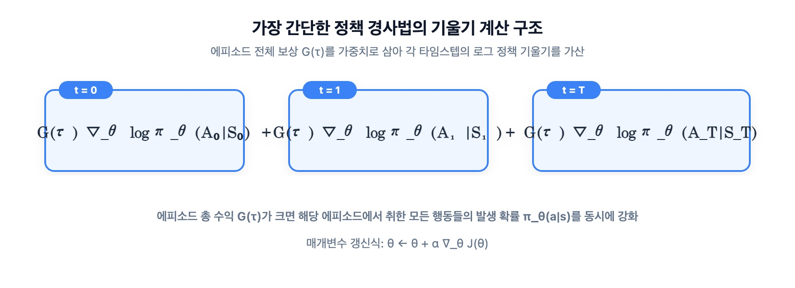
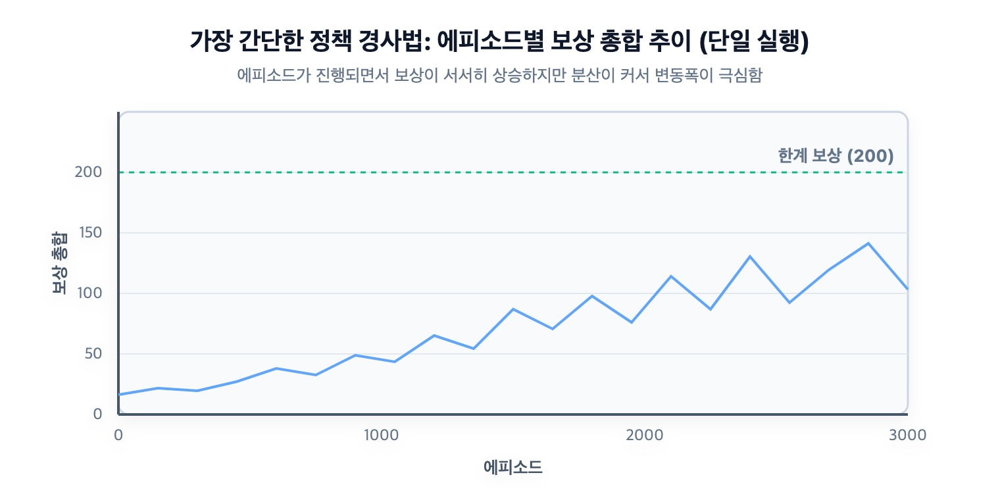
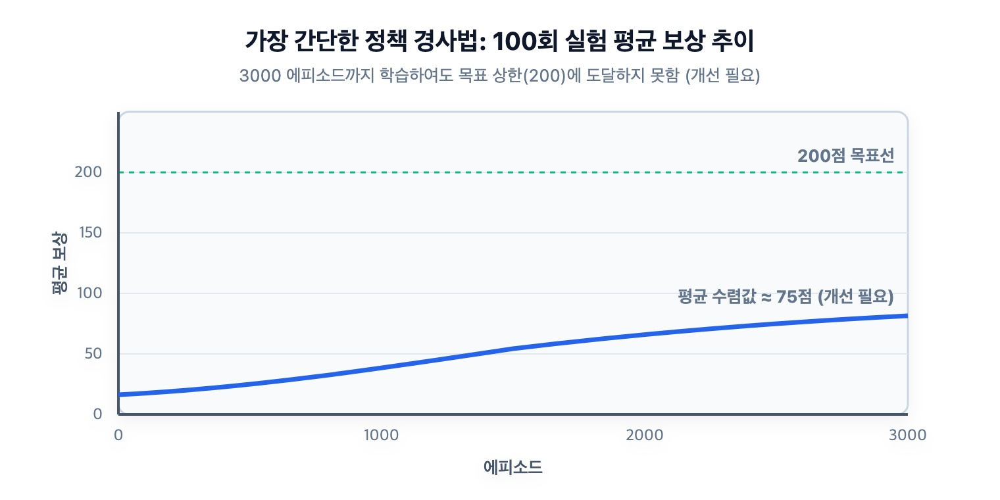

# 13.1 가장 간단한 정책 경사법: 정책을 직접 최적화하는 새로운 패러다임




**그림 13-1-1** 높은 누적 수익 *G*(*τ*)이라는 황금 물뿌리개로 좋은 행동 확률 꽃 *π*(*a*|*s*)을 키워내는 도로시와, 로그 미분 트릭(*grad log π*) 및 목적 함수-손실 함수 변환을 유도하는 지니, 그리고 정책 성과 언덕을 오르는 경사 상승법(Gradient Ascent)을 설명하는 이호진 교수님

가치 함수를 거쳐 최적 행동을 간접적으로 추론하던 기존 방식을 완전히 벗어나, 신경망이 행동의 선택 확률을 직접 출력하고 누적 수익을 최대화하도록 매개변수를 직접 조율하는 **정책 경사법(Policy Gradient)**의 기초 이론을 배웁니다. 환경의 복잡한 물리 전이 확률을 알지 못해도 미분이 가능한 **로그 미분 트릭(Log-Derivative Trick)**과 가장 단순한 형태의 정책 경사 알고리즘을 파이썬 코드로 유도해 봅시다!

---

## 13.1.1 가치 기반에서 정책 기반으로의 패러다임 전환

지금까지 우리가 배웠던 동적 계획법(DP), 몬테카를로(MC), TD, SARSA, DQN은 모두 **가치 기반(Value-Based)** 기법이었습니다:
- 상태 가치 *V*(*s*)나 행동 가치 *Q*(*s*, *a*)를 열심히 계산하고,
- 행동을 선택할 때는 *argmax*<sub>*a*</sub> *Q*(*s*, *a*)라는 결정론적 탐욕 규칙을 사용했습니다.

하지만 **정책 기반(Policy-Based)** 기법은 완전히 다른 길을 걷습니다:
- **정책 *π*<sub>*θ*</sub>(*a* | *s*) 자체를 신경망으로 모델링**합니다!
- 상태 *s*가 주어지면, 신경망은 각 행동을 취할 **확률값(0.0 ~ 1.0, 합계 1.0)**을 출력합니다.
- 그리고 **"에이전트가 얻는 총 누적 보상의 기댓값이 가장 커지도록"** 신경망의 가중치 *θ*를 직접 **경사 상승법(Gradient Ascent)**으로 밀어 올립니다!

---

## 13.1.2 정책 경사 정리와 로그 미분 트릭의 유도

### 1) 궤적(Trajectory)과 누적 수익

에이전트가 정책 *π*<sub>*θ*</sub>에 따라 환경과 상호작용하여 시작부터 끝까지 겪은 전체 시계열 경험을 **궤적(Trajectory, *τ*)**이라고 부릅니다:

> ### ***τ* = (*S*<sub>0</sub>, *A*<sub>0</sub>, *R*<sub>0</sub>, *S*<sub>1</sub>, *A*<sub>1</sub>, *R*<sub>1</sub>, &hellip;, *S*<sub>*T*</sub>, *A*<sub>*T*</sub>, *R*<sub>*T*</sub>, *S*<sub>*T*+1</sub>)**

이 궤적 *τ*에서 얻은 할인 누적 수익의 총합은 다음과 같습니다:

> ### ***G*(*τ*) = *R*<sub>0</sub> + *γR*<sub>1</sub> + *γ*<sup>2</sup>*R*<sub>2</sub> + &hellip; + *γ*<sup>*T*</sup>*R*<sub>*T*</sub>** &nbsp;&nbsp;&nbsp;&nbsp; *(식 13.1: 궤적 누적 수익)*

---

### 2) 정책의 목적 함수: 기대 수익 *J*(*θ*)

우리의 목표는 정책 *π*<sub>*θ*</sub>를 따랐을 때 얻게 되는 **누적 수익의 기댓값 *J*(*θ*)를 극대화**하는 최적의 가중치 *θ*<sup>\*</sup>를 찾는 것입니다:

> ### ***J*(*θ*) = E<sub>*τ* ~ *π*<sub>*θ*</sub></sub> [*G*(*τ*)]** &nbsp;&nbsp;&nbsp;&nbsp; *(식 13.2: 정책의 목적 함수)*

경사 상승법(Gradient Ascent)으로 *J*(*θ*)를 최대화하려면 목적 함수의 기울기인 **∇<sub>*θ*</sub> *J*(*θ*)**를 계산해야 합니다:

> ### ***θ* ← *θ* + *α* · ∇<sub>*θ*</sub> *J*(*θ*)**

---

### 3) 로그 미분 트릭 (The Log-Derivative Trick)

여기서 거대한 난관에 부딪힙니다: 기댓값 기호 E<sub>*τ*</sub> 안에는 에이전트의 정책뿐만 아니라, **우리가 전혀 알지 못하는 환경의 물리 전이 확률 *p*(*s*&#39; | *s*, *a*)**가 깊숙이 얽혀 있습니다! 환경의 확률 분포를 미분할 수 없는데 어떻게 ∇<sub>*θ*</sub> *J*(*θ*)를 구할 수 있을까요?

이 난제를 마법처럼 해결해 주는 수학 공식이 바로 **로그 미분 트릭(Log-Derivative Trick)**입니다. 미적분학의 연쇄 법칙에 의해 다음 항등식이 성립합니다:

> ### **∇<sub>*θ*</sub> log *f*(*θ*) = (∇<sub>*θ*</sub> *f*(*θ*)) / *f*(*θ*) &nbsp;&nbsp; ⟹ &nbsp;&nbsp; ∇<sub>*θ*</sub> *f*(*θ*) = *f*(*θ*) · ∇<sub>*θ*</sub> log *f*(*θ*)** &nbsp;&nbsp;&nbsp;&nbsp; *(식 13.4)*

이 항등식을 적용하면, 환경의 전이 확률 항들이 미분 과정에서 분모·분자로 기적처럼 상쇄되어 소거되며, 다음과 같은 **정책 경사 정리(Policy Gradient Theorem)**가 완성됩니다:

> ### **∇<sub>*θ*</sub> *J*(*θ*) = E<sub>*τ* ~ *π*<sub>*θ*</sub></sub> [ ∑<sub>*t*=0</sub><sup>*T*</sup> *G*(*τ*) · ∇<sub>*θ*</sub> log *π*<sub>*θ*</sub>(*A*<sub>*t*</sub> | *S*<sub>*t*</sub>) ]** &nbsp;&nbsp;&nbsp;&nbsp; *(식 13.3: 정책 경사 정리)*

---

### 💡 [식 13.3]의 물리적 의미: "칭찬은 고래도 춤추게 한다"


**그림 13-1-2** 정책 경사법의 계산 흐름. 각 스텝에서 취한 행동의 로그 확률 기울기에 전체 에피소드 수익 *G*(*τ*)를 가중치로 곱하여 합산합니다.

- **∇<sub>*θ*</sub> log *π*<sub>*θ*</sub>(*A*<sub>*t*</sub> | *S*<sub>*t*</sub>)**:
  "현재 상태 *S*<sub>*t*</sub>에서 에이전트가 선택했던 행동 *A*<sub>*t*</sub>를 취할 **확률을 가장 가파르게 증가시키는 파라미터 갱신 방향**"을 가리킵니다.
- **가중치 *G*(*τ*)**:
  그 에피소드 전체의 결과인 누적 수익입니다!
  - 만약 이번 에피소드에서 100점이라는 **높은 수익(*G* > 0)**을 거두었다면? 
    방금 취했던 모든 행동들의 선택 확률을 대폭 끌어올리도록 파라미터를 강력하게 밀어붙입니다(칭찬과 강화!).
  - 반대로 10점밖에 못 얻고 조기 침몰했다면? 
    작은 가중치만 주어 확률 증가를 억제하거나, 상대적인 약화를 유도합니다.

단 1개의 샘플 에피소드(궤적 *τ*)로부터 경사를 근사하는 **가장 간단한 정책 경사 갱신식**은 다음과 같습니다:

> ### **∇<sub>*θ*</sub> *J*(*θ*) ≈ ∑<sub>*t*=0</sub><sup>*T*</sup> *G*(*τ*) · ∇<sub>*θ*</sub> log *π*<sub>*θ*</sub>(*A*<sub>*t*</sub> | *S*<sub>*t*</sub>)** &nbsp;&nbsp;&nbsp;&nbsp; *(식 13.5)*

---

## 13.1.3 소프트맥스 정책 신경망과 대리 손실 함수

### 1) 정책 신경망: `Policy` 클래스
이산 행동 공간(좌/우 2개)에서 확률을 출력하기 위해 마지막 계층에 **소프트맥스(Softmax)** 함수를 적용합니다:

> ### ***y*<sub>*i*</sub> = *e*<sup>*x*<sub>*i*</sub></sup> / ∑<sub>*k*</sub> *e*<sup>*x*<sub>*k*</sub></sup>** &nbsp;&nbsp;&nbsp;&nbsp; *(식 13.6: 소프트맥스 확률)*

```python
from dezero import Model
import dezero.functions as F
import dezero.layers as L

class Policy(Model):
    def __init__(self, action_size):
        super().__init__()
        self.l1 = L.Linear(128)
        self.l2 = L.Linear(action_size)

    def forward(self, x):
        x = F.relu(self.l1(x))
        x = F.softmax(self.l2(x)) # 2개 행동의 합이 1.0이 되는 확률 벡터 반환
        return x
```

---

### 2) 경사 상승법을 딥러닝 손실 함수로 변환하는 비결

딥러닝 프레임워크(DeZero, PyTorch)의 옵티마이저는 손실을 최소화하는 **경사 하강법**만 지원합니다. 
목적 함수 *J*(*θ*)를 최대화하려면, **목적 함수에 마이너스(-) 부호를 붙여 대리 손실 함수(Surrogate Loss)**로 정의하면 됩니다:

> ### **Loss = - ∑<sub>*t*</sub> *G*(*τ*) · log *π*<sub>*θ*</sub>(*A*<sub>*t*</sub> | *S*<sub>*t*</sub>)**

이 `Loss`에 대해 `loss.backward()`를 실행하면, 자동으로 목적 함수 *J*(*θ*)를 최대화하는 올바른 방향으로 신경망 파라미터가 상승 갱신됩니다!

---

## 13.1.4 에이전트 구현 및 CartPole 실험

<div align="right"><b>ch09/simple_pg.py</b></div>

```python
import numpy as np
import gym
from dezero import optimizers
import dezero.functions as F

class SimplePGAgent:
    def __init__(self):
        self.gamma = 0.98
        self.lr = 0.0002
        self.action_size = 2

        self.memory = []                         # 1 에피소드의 (보상, 행동 확률) 저장소
        self.pi = Policy(self.action_size)       # 정책 신경망
        self.optimizer = optimizers.Adam(self.lr)
        self.optimizer.setup(self.pi)

    def get_action(self, state):
        state = state[np.newaxis, :]
        probs = self.pi(state)[0]                # 행동 확률 벡터 [p0, p1]
        action = np.random.choice(len(probs), p=probs.data) # 확률적 샘플링!
        return action, probs[action]             # 선택한 행동과 그 행동의 Variable 확률 반환

    def add(self, reward, prob):
        self.memory.append((reward, prob))

    def update(self):
        self.pi.cleargrads()

        # ❶ 궤적 전체의 수익 G(tau)를 역방향으로 누적 계산
        G = 0
        for reward, prob in reversed(self.memory):
            G = reward + self.gamma * G

        # ❷ 식 (13.5)에 따른 대리 손실 함수 계산: Loss = -G * sum(log pi)
        loss = 0
        for reward, prob in self.memory:
            loss += -F.log(prob) * G

        # ❸ 역전파 및 정책 신경망 갱신
        loss.backward()
        self.optimizer.update()
        self.memory.clear() # 에피소드 종료 후 메모리 비우기
```

### CartPole 환경 훈련 결과

```python
env = gym.make('CartPole-v0', render_mode='rgb_array')
agent = SimplePGAgent()
episodes = 3000
reward_history = []

for episode in range(episodes):
    state, info = env.reset()
    done = False
    total_reward = 0

    while not done:
        action, prob = agent.get_action(state)
        next_state, reward, terminated, truncated, info = env.step(action)
        done = terminated or truncated

        agent.add(reward, prob)
        state = next_state
        total_reward += reward

    agent.update() # 에피소드 종료 시 1회 일괄 갱신
    reward_history.append(total_reward)
```


**그림 13-1-3** 1회 실험에서의 에피소드별 보상 합계 추이. 심한 노이즈 속에서도 점진적인 보상 상승을 보입니다.


**그림 13-1-4** 100회 실험을 평균한 결과. 완만한 학습 곡선을 그리지만 3000 에피소드가 지나도 만점(200)에 도달하지 못합니다.

### 💡 가장 단순한 정책 경사법의 치명적 약점: "인과율의 무시"

[그림 13-1-4]를 보면 학습이 너무 느리고 만점에 도달하지 못합니다. 그 이유는 **식 (13.5)에서 에피소드의 모든 스텝에 '전체 총수익 *G*(*τ*)'를 똑같이 곱해버렸기 때문**입니다:
- 에피소드 초반 0~10스텝에서는 완벽하게 균형을 잡았는데, 100번째 스텝에서 어이없이 실수를 저질러 게임이 끝났다고 해봅시다.
- 이때 초반의 훌륭했던 행동들에게도 후반부 실수 때문에 깎여버린 낮은 총수익 *G*가 일괄 적용되어 억울하게 확률이 깎여버립니다!
- 반대로 초반에 엉뚱한 짓을 저질렀는데 나중에 운 좋게 오래 버텼다면, 초반의 엉터리 행동까지 칭찬을 받는 부조리가 일어납니다.

과거의 행동이 미래의 보상에만 영향을 미친다는 **인과율(Causality)**을 반영하여 이 모순을 해결하는 진짜 알고리즘, **REINFORCE**를 다음 13.2절에서 완성해 봅시다!
