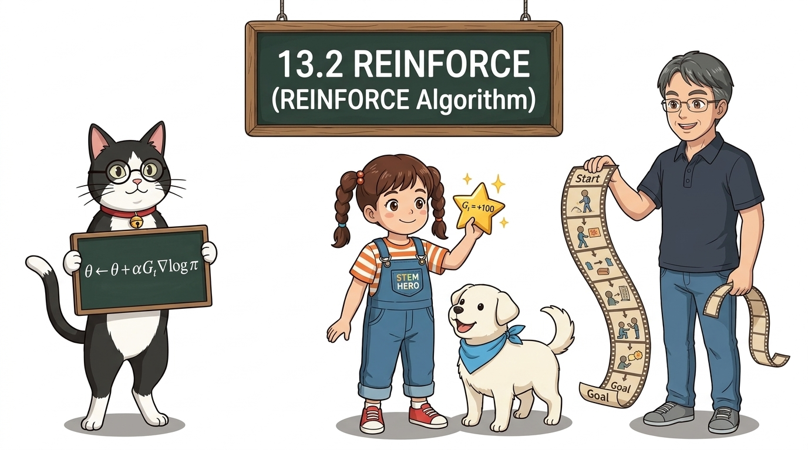
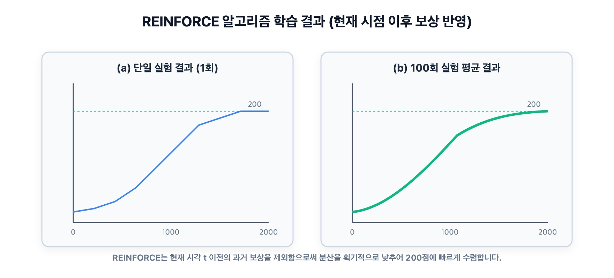

# 13.2 REINFORCE

**그림 13-2** 몬테카를로 샘플 에피소드 전체의 반환값을 기반으로 정책 가중치를 직접 업데이트하는 도로시와 지니


> 에피소드 전체의 미래 수익 $G_t$ 를 정책 경사에 반영하여 실용적이고 안정적인 갱신을 가능하게 하는 **REINFORCE(레인포스)** 알고리즘을 공부합니다. 과거의 무관한 보상 노이즈를 인과율(Causality)로 시원하게 걸러내고, 에이전트의 성공적인 경험 확률을 쑥쑥 키우는 최적 정책 계산법을 도로시, 지니 조교와 함께 구현해봅시다!

---

**REINFORCE**<sup>[16]</sup>는 13.1절에서 살펴본 가장 기초적인 정책 경사법을 실질적으로 개선한 몬테카를로 정책 경사 기법의 대표 주자입니다. 먼저 이론적 배경과 인과율(Causality)을 수식으로 도출한 다음, 앞 절의 코드를 일부 수정하는 형태로 간결하고 효율적인 역방향 누적 구현을 완성해 보겠습니다.

> [!NOTE]
> REINFORCE라는 이름은 '**RE**ward **I**ncrement = **N**onnegative **F**actor × **O**ffset **R**einforcement × **C**haracteristic **E**ligibility'의 머리글자를 따서 지어졌습니다(Ronald J. Williams, 1992).

---

## 13.2.1 REINFORCE 알고리즘의 원리와 인과율(Causality)

앞 절(13.1절)의 내용을 복습해보겠습니다. 가장 기본적인 정책 경사법은 에피소드 궤적 전체의 누적 할인 수익 *G*(*τ*)를 가중치로 삼아 정책 경사를 추정했습니다.

$$
\nabla_\theta J(\theta) = \mathbb{E}_{\tau \sim \pi_\theta} \left[ \sum_{t=0}^T G(\tau) \nabla_\theta \log \pi_\theta(A_t \mid S_t) \right]
$$

[식 13.7] 궤적 전체 반환값 기반 정책 경사

[식 13.7]의 $G(\tau)$ 는 에피소드 시작 시점($t=0$)부터 끝 시점($t=T$)까지 얻은 모든 보상의 할인 총합입니다:

$$
G(\tau) = R_0 + \gamma R_1 + \gamma^2 R_2 + \dots + \gamma^T R_T
$$

여기서 $G(\tau) \nabla_\theta \log \pi_\theta(A_t \mid S_t)$ 항을 면밀히 살펴보면 한 가지 심각한 낭비와 비효율이 숨어 있음을 발견할 수 있습니다. 특정 시점 $t$ 에서 행동 $A_t$ 를 선택할 확률에 '항상 일정한 전체 수익' $G(\tau)$ 를 통째로 곱하고 있다는 점입니다.

### 인과율(Causality): 미래의 보상만이 현재의 행동을 평가할 수 있다

어떤 행동이 좋은 행동인지 나쁜 행동인지는 오직 **그 행동을 취한 직후부터 미래에 걸쳐 얻게 되는 보상의 총합**으로만 평가되어야 합니다. 이것이 바로 강화학습과 물리 세계의 대원칙인 **인과율(Causality)**입니다.

행동을 취하기 '이전에' 이미 얻었던 과거의 보상($R_0, R_1, \dots, R_{t-1}$)은 시점 $t$ 에서 취한 행동 $A_t$ 의 좋고 나쁨과 아무런 인과적 관련이 없습니다. 예를 들어 바둑에서 50수째에 멋진 묘수를 두었는지 여부를 평가할 때, 10수째에 상대 돌을 잡았던 보상은 50수째 묘수의 가치와 아무 상관이 없습니다.

그럼에도 불구하고 [식 13.7]처럼 전체 수익 $G(\tau)$ 를 곱해버리면, 시점 $t$ 이전의 무관한 보상들이 거대한 **통계적 노이즈(분산, Variance)** 로 끼어들게 됩니다.

**그림 13-3** 과거의 무관한 보상 노이즈를 제거하고 인과율에 기반해 미래 보상 $G_t$ 만을 정책 갱신에 반영하는 REINFORCE


수학적으로 시점 $t$ 이전의 보상과 현재 정책 경사의 내적 기댓값을 전개하면 놀랍게도 정확히 **0**이 됩니다:

$$
\mathbb{E} \left[ \sum_{k=0}^{t-1} \gamma^k R_k \nabla_\theta \log \pi_\theta(A_t \mid S_t) \right] = 0
$$

이유는 단순합니다. 시점 $t$ 이전의 보상 합은 시점 $t$ 의 행동 $A_t$ 에 대해 상수처럼 취급될 수 있으며, 행동 확률의 총합이 1이므로 $\nabla_\theta \sum_a \pi_\theta(a \mid S_t) = \nabla_\theta (1) = 0$ 이 되기 때문입니다.

따라서 기댓값에 전혀 기여하지 못하면서 분산만 극단적으로 키우는 과거 보상들을 과감히 제거하고, **시점 $t$ 부터 에피소드 끝까지의 미래 누적 할인 보상 $G_t$** 만을 가중치로 사용하는 REINFORCE 목적식을 도출할 수 있습니다!

$$
\nabla_\theta J(\theta) = \mathbb{E}_{\tau \sim \pi_\theta} \left[ \sum_{t=0}^T G_t \nabla_\theta \log \pi_\theta(A_t \mid S_t) \right]
$$

[식 13.8] REINFORCE 알고리즘 (인과율 기반 정책 경사 정리)

여기서 미래 누적 할인 수익 $G_t$ 는 다음과 같이 정의됩니다:

$$
G_t = \sum_{k=t}^T \gamma^{k-t} R_k = R_t + \gamma R_{t+1} + \gamma^2 R_{t+2} + \dots + \gamma^{T-t} R_T
$$

이처럼 가중치를 $G_t$ 로 변경하면, 시점 $t$ 이전의 노이즈가 완벽히 소거되어 추정량의 편향(Bias)은 0을 유지하면서 분산(Variance)을 획기적으로 낮출 수 있습니다.

> [!NOTE]
> **편향-분산 트레이드오프 관점:**
> [식 13.7]의 단순 정책 경사와 [식 13.8]의 REINFORCE는 샘플 수가 무한대로 가면 모두 참된 정책 경사 $\nabla_\theta J(\theta)$ 에 동일하게 수렴합니다. 즉 두 식 모두 '불편 추정량(Unbiased Estimator)'입니다. 그러나 샘플이 유한한 실제 학습 환경에서 REINFORCE의 분산이 압도적으로 작기 때문에, 훨씬 적은 에피소드로도 빠르고 안정적인 최적 정책 수렴이 가능해집니다.

---

## 13.2.2 REINFORCE 알고리즘 구현

REINFORCE의 파이썬 구현은 13.1절의 `simple_pg.py`와 구조적으로 거의 동일합니다. 단 하나의 결정적인 차이는 에피소드가 끝난 후 호출되는 `Agent` 클래스의 `update()` 메서드에서 수익 $G_t$ 를 계산하는 방식입니다.

### 에피소드 역방향 순회(Backward Traversal) 기법

시점 $t=0$ 부터 $T$ 까지 정방향으로 매 시점마다 $G_t = \sum_{k=t}^T \gamma^{k-t} R_k$ 를 일일이 계산하면 $\mathcal{O}(T^2)$ 의 시간 복잡도가 소요됩니다.

하지만 에피소드의 마지막 시점 $T$ 부터 시작점 0까지 **역방향(reversed)** 으로 거꾸로 거슬러 올라가면 다음의 벨만 점화 관계식을 활용하여 단 $\mathcal{O}(T)$ 만에 모든 시점의 $G_t$ 를 완벽하게 계산할 수 있습니다:

$$
\begin{aligned}
G_T &= R_T \\
G_t &= R_t + \gamma G_{t+1}
\end{aligned}
$$

<div align="right"><b>ch09/reinforce.py</b></div>

```python
import numpy as np
import gym
from dezero import Model
from dezero import optimizers
import dezero.functions as F
import dezero.layers as L

class PolicyNet(Model):
    def __init__(self, action_size=2):
        super().__init__()
        self.l1 = L.Linear(128)
        self.l2 = L.Linear(action_size)

    def forward(self, x):
        x = F.relu(self.l1(x))
        x = F.softmax(self.l2(x))
        return x

class Agent:
    def __init__(self):
        self.gamma = 0.98
        self.lr = 0.0002
        self.pi = PolicyNet()
        self.optimizer = optimizers.Adam(self.lr).setup(self.pi)
        self.memory = []

    def get_action(self, state):
        state = state[np.newaxis, :]
        probs = self.pi(state)
        probs = probs[0]
        action = np.random.choice(len(probs), p=probs.data)
        return action, probs[action]

    def add(self, reward, prob):
        data = (reward, prob)
        self.memory.append(data)

    def update(self):
        self.pi.cleargrads()

        G, loss = 0, 0
        # 에피소드 메모리를 뒤쪽부터 거꾸로 순회하며 미래 수익 G_t를 효율적으로 누적
        for reward, prob in reversed(self.memory):
            G = reward + self.gamma * G             # G_t = R_t + gamma * G_{t+1}
            loss += -F.log(prob) * G                 # 대리 손실(Surrogate Loss) 누적

        loss.backward()                              # 역전파로 정책 신경망 그래디언트 계산
        self.optimizer.update()                      # Adam 옵티마이저로 가중치 갱신
        self.memory = []                             # 다음 에피소드를 위해 메모리 초기화
```

### 코드 핵심 라인 분석

1. **`for reward, prob in reversed(self.memory):`**:
   - `self.memory`에는 각 타임스텝마다 받은 보상(`reward`)과 그 당시 행동을 선택했던 DeZero 변수 형태의 확률(`prob`)이 순서대로 저장되어 있습니다.
   - `reversed()`를 통해 마지막 스텝부터 역순으로 탐색합니다.
2. **`G = reward + self.gamma * G`**:
   - 점화식 $G_t = R_t + \gamma G_{t+1}$ 을 단 한 줄의 코드로 구현했습니다. 이전 스텝의 수익에 할인율 `self.gamma`를 곱하고 현재 스텝의 보상을 더해 즉시 $G_t$ 를 완성합니다.
3. **`loss += -F.log(prob) * G`**:
   - DeZero의 함수 `F.log(prob)`를 통해 $\log \pi_\theta(A_t \mid S_t)$ 를 계산하고 여기에 미래 수익 `G`를 곱한 후 부호를 뒤집어 손실 함수에 더합니다.
   - 이 대리 손실(Surrogate Loss)을 최소화(경사 하강)하는 것은 목적 함수 $J(\theta)$ 를 최대화(경사 상승)하는 것과 완벽히 동치입니다.
4. **`loss.backward()` 및 `self.optimizer.update()`**:
   - DeZero 계산 그래프를 따라 누적된 모든 시점의 그래디언트를 한 번에 역전파하고, 정책 신경망 파라미터 $\theta$ 를 한 번에 갱신합니다.

---

## 13.2.3 CartPole 실험 및 성능 비교

REINFORCE 알고리즘을 CartPole 환경에서 1,000 에피소드 동안 학습시킨 결과입니다.

**그림 13-4** 에피소드별 보상 합계 추이(왼쪽은 1회 실행 시, 오른쪽은 100회 실행 평균)


### 실험 결과 분석

1. **학습 속도와 수렴성의 비약적 향상:**
   - 13.1절의 단순 정책 경사법이 1,000 에피소드가 지나도록 목표치 200점에 불안정하게 도달했던 반면, REINFORCE는 약 300~400 에피소드 부근에서 이미 목표 상한치인 **200점(최장 시간 균형 유지)**에 견고하게 도달합니다.
2. **분산 감소의 시각적 증명:**
   - 100회 실행 평균 곡선(오른쪽 그래프)을 보면, 과거 보상 노이즈가 제거됨에 따라 학습 곡선이 훨씬 매끄럽고 안정적인 우상향 궤적을 그리는 것을 확인할 수 있습니다.

하지만 REINFORCE도 여전히 몬테카를로 방식 특유의 한계(에피소드가 끝날 때까지 기다려야 하는 지연 갱신, 긴 에피소드에서의 누적 분산)를 가지고 있습니다. 다음 절에서는 이 분산을 한 번 더 극적으로 깎아내는 **베이스라인(Baseline)** 기법을 도입해 보겠습니다!
