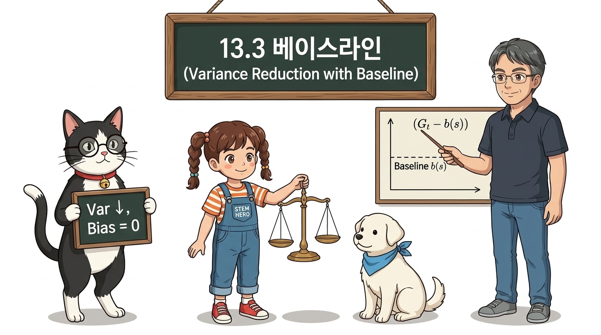
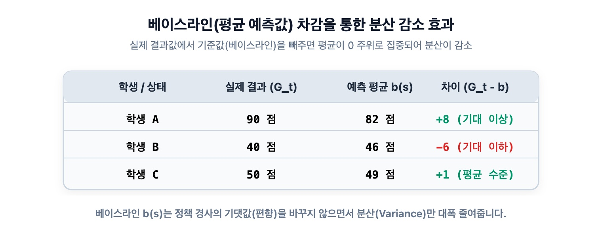
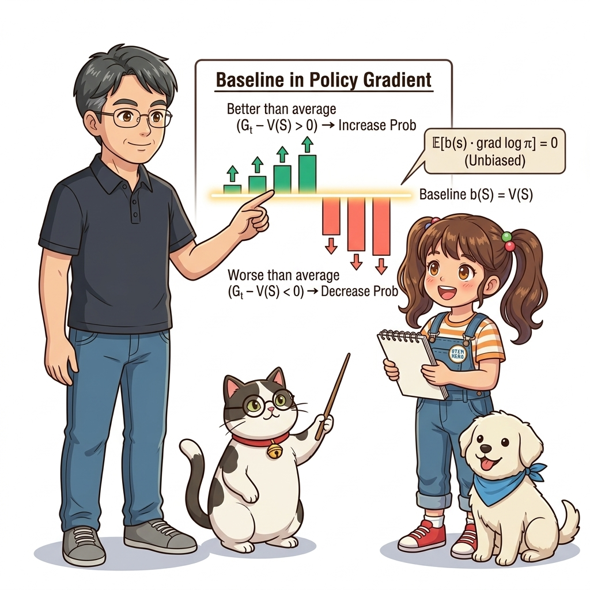

# 13.3 베이스라인

**그림 13-5** 평균적인 보상 기준선(Baseline)을 칠판에 긋고 이보다 잘한 모험 행동의 강도를 선별적으로 높이는 도로시와 지니


> 정책 경사법의 치명적 한계인 극심한 분산(Variance) 문제를 극복하기 위한 핵심 열쇠, **베이스라인(Baseline)** 도입 원리를 배웁니다. 매 에피소드마다 획득한 보상에서 평균적인 가치 기준선 *b*(*s*)를 차감해 줌으로써 양수 보상 쏠림을 해결하고 학습을 고도로 안정화하는 분산 저감 원리를 도로시, 지니 조교와 함께 파헤쳐봅시다!

---

앞서 13.2절에서 우리는 인과율(Causality)을 적용해 시점 *t* 이전의 무관한 과거 보상 노이즈를 제거한 REINFORCE를 완성했습니다. 하지만 REINFORCE는 여전히 몬테카를로 방식을 취하고 있어, 에피소드 길이가 길어지거나 환경의 확률적 변동성이 클 때 여전히 **높은 분산(Variance)**에 시달립니다.

이번 절에서는 정책 경사의 참된 기댓값(Bias = 0)은 100% 온전히 보존하면서도, 샘플의 분산만을 드라마틱하게 깎아내는 마법 같은 기술인 **베이스라인(Baseline)**을 소개합니다.

---

## 13.3.1 베이스라인의 직관적 아이디어: 예측값을 빼면 분산이 줄어든다

쉬운 일상 예시로 베이스라인의 위력을 먼저 체감해 보겠습니다. 세 학생 A, B, C가 어떤 시험을 치렀고 각각 90점, 40점, 50점을 받았다고 가정해 보죠.

| 학생 | 시험 점수 |
| :---: | :---: |
| **A** | 90점 |
| **B** | 40점 |
| **C** | 50점 |

세 점수의 분산(데이터가 평균 주위에 흩어진 정도)을 넘파이로 계산해 보겠습니다.

```python
import numpy as np

scores = np.array([90, 40, 50])
print("원 점수의 분산:", np.var(scores))
```

```text
원 점수의 분산: 466.6666666666667
```

원 점수의 분산은 약 466.67로 매우 큽니다. 데이터 편차가 심하기 때문입니다.

그런데 만약 세 학생의 **과거 평균 실력(예측 기준선)**을 이미 알고 있다고 해보겠습니다.
- A의 평소 평균: 82점
- B의 평소 평균: 46점
- C의 평소 평균: 49점

이 평소 평균을 **예측값(Baseline)**으로 삼아, '실제 점수'에서 '예측값'을 뺀 **편차(차이)**를 구해봅시다.



- **A의 편차:** 90 − 82 = **+8** (평소보다 8점 잘 봄)
- **B의 편차:** 40 − 46 = **−6** (평소보다 6점 못 봄)
- **C의 편차:** 50 − 49 = **+1** (평소와 거의 비슷함)

이제 이 편차 데이터 `[8, -6, 1]`의 분산을 계산해 보겠습니다.

```python
diff = np.array([8, -6, 1])
print("편차 데이터의 분산:", np.var(diff))
```

```text
편차 데이터의 분산: 32.666666666666664
```

놀랍게도 분산이 466.67에서 **32.67**로 무려 14배 이상 격감했습니다!

이 예시가 시사하는 핵심은 매우 명확합니다:
> **"어떤 결과값에서 적절한 기준선(예측값)을 빼주면 본래의 신호(Signal)는 보존되면서 데이터의 극심한 분산(Noise)을 대폭 줄일 수 있다."**

---

## 13.3.2 베이스라인을 적용한 정책 경사 정리

이제 이 통계적 지혜를 REINFORCE 목적식에 그대로 이식해 보겠습니다. 13.2절의 REINFORCE는 다음 수식으로 표현되었습니다:

> ∇<sub>*θ*</sub> *J*(*θ*) = E<sub>*τ* ~ *π*<sub>*θ*</sub></sub> [ ∑<sub>*t*=0</sub><sup>*T*</sup> *G*<sub>*t*</sub> ∇<sub>*θ*</sub> log *π*<sub>*θ*</sub>(*A*<sub>*t*</sub> | *S*<sub>*t*</sub>) ]

여기에 상태 *S*<sub>*t*</sub>에만 의존하는 임의의 기준 함수 *b*(*S*<sub>*t*</sub>)를 빼주는 형태로 수식을 확장합니다.

> ### (식 13.9) 베이스라인을 적용한 정책 경사 수식
> ∇<sub>*θ*</sub> *J*(*θ*) = E<sub>*τ* ~ *π*<sub>*θ*</sub></sub> [ ∑<sub>*t*=0</sub><sup>*T*</sup> (*G*<sub>*t*</sub> − *b*(*S*<sub>*t*</sub>)) ∇<sub>*θ*</sub> log *π*<sub>*θ*</sub>(*A*<sub>*t*</sub> | *S*<sub>*t*</sub>) ]

여기서 빼주는 항 *b*(*S*<sub>*t*</sub>)를 **베이스라인(Baseline)**이라고 부릅니다. 놀랍게도 *b*(*S*<sub>*t*</sub>)가 행동 *A*<sub>*t*</sub>에 의존하지 않고 오직 상태 *S*<sub>*t*</sub>에만 의존하는 함수라면, **어떤 함수를 가져다 써도 정책 경사의 기댓값은 전혀 변하지 않습니다!**

### 수학적 증명: 베이스라인 항의 기댓값은 왜 0인가?

베이스라인을 뺀 항의 기댓값을 직접 전개해 증명해 보겠습니다. 상태 *S*<sub>*t*</sub>가 주어진 상황에서 행동 *A*<sub>*t*</sub>에 대한 기댓값 부분만 떼어내어 계산합니다:

> E<sub>*A*<sub>*t*</sub> ~ *π*<sub>*θ*</sub></sub> [ *b*(*S*<sub>*t*</sub>) ∇<sub>*θ*</sub> log *π*<sub>*θ*</sub>(*A*<sub>*t*</sub> | *S*<sub>*t*</sub>) ]  
> = ∑<sub>*a*</sub> *π*<sub>*θ*</sub>(*a* | *S*<sub>*t*</sub>) · *b*(*S*<sub>*t*</sub>) · ∇<sub>*θ*</sub> log *π*<sub>*θ*</sub>(*a* | *S*<sub>*t*</sub>)

여기서 로그 미분법 공식 (∇ log *f* = ∇ *f* / *f*)에 의해 *π*<sub>*θ*</sub>(*a* | *S*<sub>*t*</sub>) · ∇<sub>*θ*</sub> log *π*<sub>*θ*</sub>(*a* | *S*<sub>*t*</sub>) = ∇<sub>*θ*</sub> *π*<sub>*θ*</sub>(*a* | *S*<sub>*t*</sub>)가 됩니다. 또한 *b*(*S*<sub>*t*</sub>)는 행동 *a*와 무관하므로 시그마 밖으로 묶어낼 수 있습니다:

> = *b*(*S*<sub>*t*</sub>) ∑<sub>*a*</sub> ∇<sub>*θ*</sub> *π*<sub>*θ*</sub>(*a* | *S*<sub>*t*</sub>)  
> = *b*(*S*<sub>*t*</sub>) ∇<sub>*θ*</sub> [ ∑<sub>*a*</sub> *π*<sub>*θ*</sub>(*a* | *S*<sub>*t*</sub>) ]

모든 가능한 행동 확률의 합은 정의상 항상 1입니다 (∑<sub>*a*</sub> *π*<sub>*θ*</sub>(*a* | *S*<sub>*t*</sub>) = 1). 상수 1의 기울기는 0입니다:

> = *b*(*S*<sub>*t*</sub>) ∇<sub>*θ*</sub> (1)  
> = *b*(*S*<sub>*t*</sub>) · 0 = **0**

**증명 종료!**  
베이스라인 항의 기댓값은 완전히 0이 되므로, 목적 함수의 기울기 ∇<sub>*θ*</sub> *J*(*θ*)에 단 1%의 편향(Bias)도 주지 않습니다. 그러면서도 (*G*<sub>*t*</sub> − *b*(*S*<sub>*t*</sub>))의 분산은 획기적으로 낮아지게 됩니다.

---

## 13.3.3 최적의 베이스라인: 상태 가치 함수 V(s)와 상대적 이점

그렇다면 베이스라인 *b*(*S*<sub>*t*</sub>)로 어떤 함수를 선택하는 것이 가장 이상적일까요?  
수학적으로 분산을 최소화하는 최적의 베이스라인은 바로 **현재 상태의 기대 수익을 나타내는 상태 가치 함수 *V*<sup>*π*<sub>*θ*</sub></sup>(*S*<sub>*t*</sub>)**입니다!

> ### (식 13.10) 가치 함수를 베이스라인으로 사용하는 정책 경사
> ∇<sub>*θ*</sub> *J*(*θ*) = E<sub>*τ* ~ *π*<sub>*θ*</sub></sub> [ ∑<sub>*t*=0</sub><sup>*T*</sup> (*G*<sub>*t*</sub> − *V*(*S*<sub>*t*</sub>)) ∇<sub>*θ*</sub> log *π*<sub>*θ*</sub>(*A*<sub>*t*</sub> | *S*<sub>*t*</sub>) ]

여기서 가중치 항인 (*G*<sub>*t*</sub> − *V*(*S*<sub>*t*</sub>))를 주목해 주십시오. 이 항은 강화학습에서 대단히 중요한 개념인 **이점(Advantage, *A*(*s*, *a*))**의 몬테카를로 추정량입니다:

> ### (식 13.11) 이점(Advantage)의 개념
> *A*(*S*<sub>*t*</sub>, *A*<sub>*t*</sub>) = *G*<sub>*t*</sub> − *V*(*S*<sub>*t*</sub>)  
> (실제 얻은 결과 − 그 상태에서 평균적으로 기대했던 결과)

**그림 13-6** 가치 함수 기준선 *V*(*S*)를 빼줌으로써 평균보다 뛰어난 행동만 선별 강화하고 양수 보상 쏠림을 방지하는 베이스라인의 원리


### 양수 보상 쏠림 현상(Positive Reward Problem)의 해결

CartPole 환경처럼 매 타임스텝마다 항상 +1의 보상을 주는 환경을 생각해 보십시오.
- **베이스라인이 없을 때:**  
  모든 시점의 보상이 양수이므로 *G*<sub>*t*</sub> > 0입니다. 따라서 에이전트가 어떤 멍청한 실수를 저질렀더라도, 에피소드가 우연히 조금 길게 이어졌다면 그 실수 행동의 확률조차 강제로 상승합니다! 모든 행동의 확률이 함께 올라가기 때문에 최적 행동을 가려내는 데 엄청난 양의 시행착오가 낭비됩니다.
- **베이스라인 *V*(*S*<sub>*t*</sub>)을 적용했을 때:**  
  현재 상태에서 평균적으로 50스텝을 버틸 수 있었다면 *V*(*S*<sub>*t*</sub>) ≈ 50입니다.
  - 만약 이번 행동으로 70스텝을 버텼다면: *G*<sub>*t*</sub> − *V*(*S*<sub>*t*</sub>) = 70 − 50 = **+20 (기대 이상! 확률 대폭 상향)**
  - 만약 이번 행동으로 20스텝만에 넘어져버렸다면: *G*<sub>*t*</sub> − *V*(*S*<sub>*t*</sub>) = 20 − 50 = **−30 (기대 이하! 실수이므로 확률 하향)**

이처럼 베이스라인은 단순히 분산을 줄이는 것을 넘어, **절대적인 보상 크기에 휘둘리지 않고 '평균 대비 상대적으로 잘했는가 못했는가'를 기준으로 정책을 똑똑하게 갱신**하도록 만듭니다.

---

## 13.3.4 막대가 균형을 잃은 카트 폴 극한 상황 분석

교재 본문의 [그림 13-8] 예시를 통해 베이스라인의 위력을 한 번 더 확인해 보겠습니다.


카트 폴의 막대가 심하게 기울어져서 어떤 조작을 하더라도 앞으로 정확히 3단계 뒤에 쓰러질 수밖에 없는 절망적인 상태 *s*가 되었다고 가정해 봅시다.

1. **기본 REINFORCE:**  
   3단계 뒤에 끝나므로 이 상태의 수익은 *G* = 3입니다. 순진한 REINFORCE는 이 상태에서 에이전트가 취한 행동 *a*에 대해 가중치 +3을 부여하여 행동 확률을 강화합니다. 어차피 3스텝 뒤에 죽을 운명인데, 무의미한 행동의 확률을 올리는 심각한 자원 낭비가 발생합니다.
2. **베이스라인 적용:**  
   가치 함수가 이 상태를 학습했다면 이미 *V*(*s*) = 3임을 알고 있습니다.  
   따라서 실제 가중치는 *G* − *V*(*s*) = 3 − 3 = **0**이 됩니다!  
   가중치가 0이므로 정책 네트워크는 쓸데없이 행동 확률을 건드리지 않고 파라미터를 그대로 보존합니다.

이처럼 베이스라인은 불가피한 상태에서의 학습 낭비를 차단하고, 의미 있는 차이를 만드는 결정적 순간의 행동에만 집중적으로 학습 역량을 투입하게 해줍니다.

그렇다면 베이스라인으로 쓰이는 상태 가치 함수 *V*(*s*)는 어떻게 알아낼 수 있을까요? 바로 또 다른 신경망을 두어 가치 함수를 함께 학습시키면 됩니다. 이것이 다음 절에서 배울 현대 강화학습의 최고봉, **행위자-비평자(Actor-Critic)**의 탄생 배경입니다!
