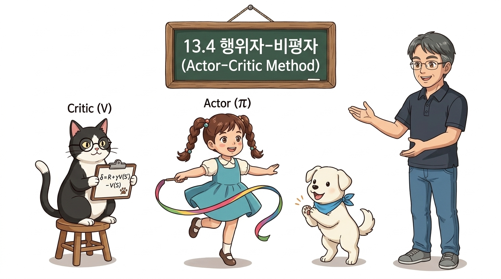
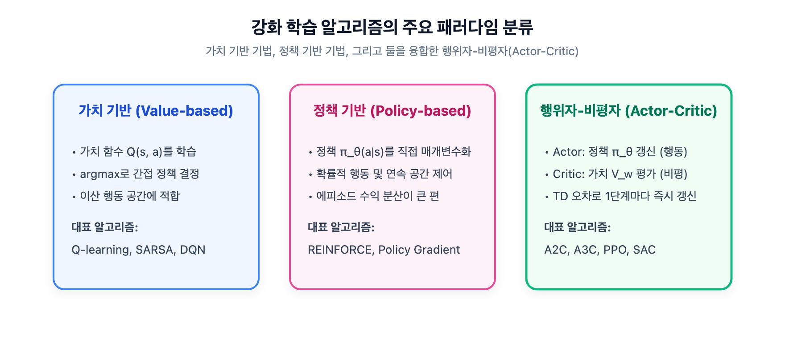
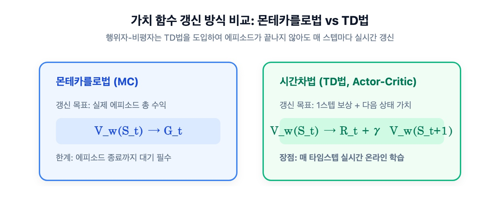
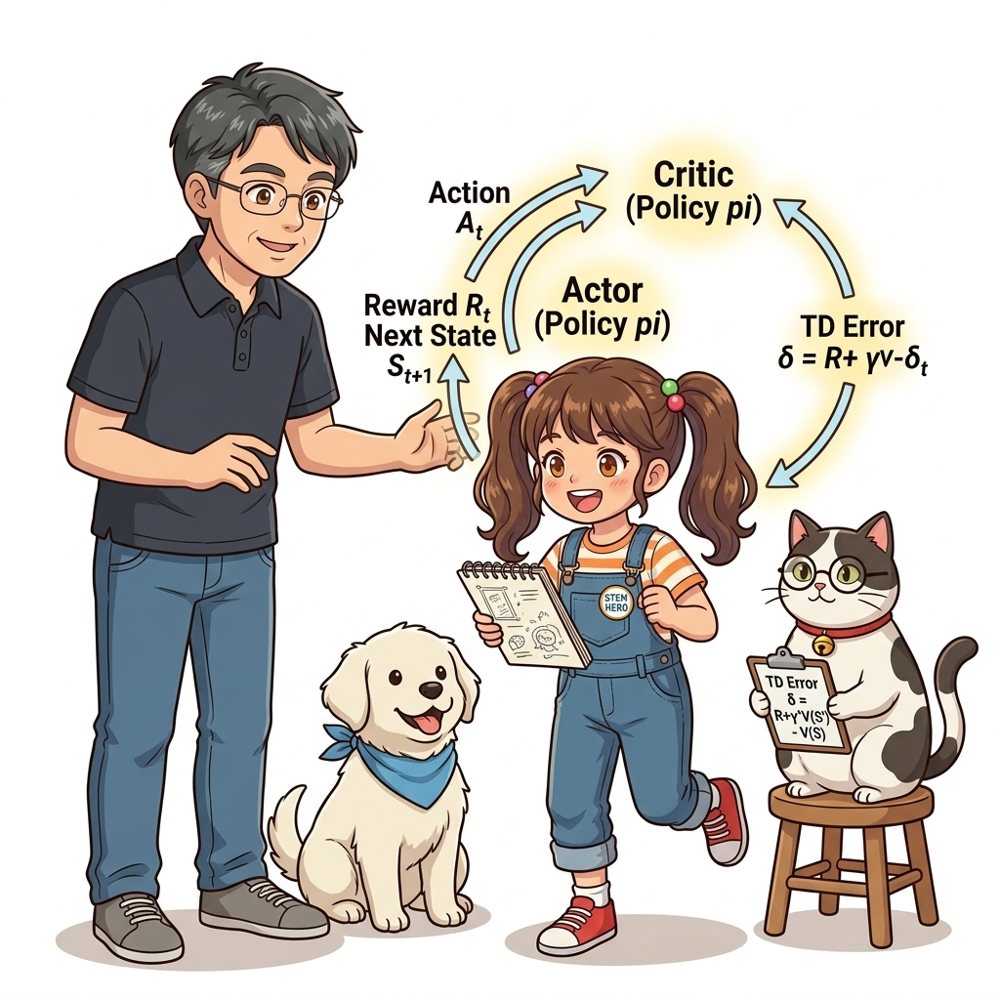
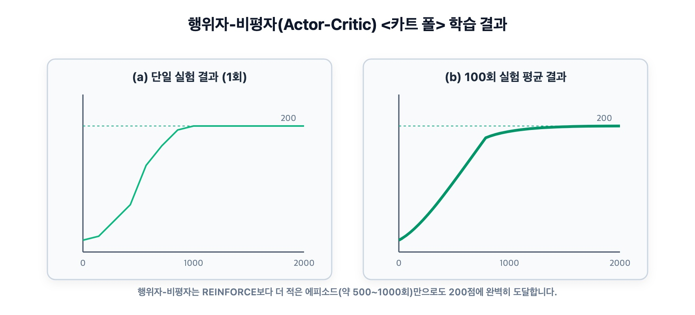

# 13.4 행위자-비평자 (Actor-Critic)

**그림 13-4** 무대 위에서 춤을 추는 행위자(Actor) 도로시와 심사판을 들고 평가해주는 비평자(Critic) 지니의 연계 구조


> 정책을 최적화하는 **행위자(Actor)**와 상태의 가치를 정밀하게 평가하는 **비평자(Critic)**가 협동하여 학습하는 심층 강화학습의 주류 프레임워크인 **Actor-Critic** 기법을 공부합니다. 에피소드가 끝날 때까지 기다리지 않고 매 스텝마다 실시간으로 갱신하는 TD 오차(Temporal Difference Error) 기반의 온-라인 학습 원리를 도로시, 지니 조교와 함께 완성해봅시다!

---

강화학습의 거대한 두 줄기는 바로 **가치 기반 기법(Value-based)**과 **정책 기반 기법(Policy-based)**입니다.
- **가치 기반 기법 (DQN, SARSA 등):** 가치 함수 *Q*(*s*, *a*)를 학습한 뒤 그리디(Greedy)하게 최적 행동을 고릅니다. 샘플 효율이 높고 분산이 상대적으로 작지만, 연속적인 행동 공간을 다루기 어렵고 정책이 결정론적으로 굳어지기 쉽습니다.
- **정책 기반 기법 (REINFORCE 등):** 정책 신경망 *π*<sub>*θ*</sub>(*a* | *s*)을 직접 최적화합니다. 연속 행동 제어가 가능하고 확률적 정책을 자연스럽게 다루지만, 몬테카를로 수익 추정으로 인해 분산이 매우 크고 에피소드가 끝날 때까지 기다려야 하는 지연 갱신 문제가 있습니다.



이 두 세계의 장점만을 절묘하게 결합할 수는 없을까요?  
바로 정책을 담당하는 **행위자(Actor)**와 가치를 담당하는 **비평자(Critic)**가 2인 3각 경기를 펼치는 **Actor-Critic(행위자-비평자)** 기법이 그 해답입니다!

---

## 13.4.1 행위자-비평자 알고리즘의 유도

13.3절에서 도출한 '베이스라인을 적용한 정책 경사 수식'을 다시 확인해 보겠습니다.

$$
\nabla_\theta J(\theta) = \mathbb{E}_{\tau \sim \pi_\theta} \left[ \sum_{t=0}^T (G_t - b(S_t)) \nabla_\theta \log \pi_\theta(A_t \mid S_t) \right]
$$

[식 13.12] 베이스라인 적용 정책 경사

[식 13.12]에서 베이스라인 $b(S_t)$ 로 신경망 파라미터 $w$ 로 모델링된 상태 가치 함수 $V_w(S_t)$ 를 채택합니다.

$$
\nabla_\theta J(\theta) = \mathbb{E}_{\tau \sim \pi_\theta} \left[ \sum_{t=0}^T (G_t - V_w(S_t)) \nabla_\theta \log \pi_\theta(A_t \mid S_t) \right]
$$

### 몬테카를로 반환값 *G*<sub>*t*</sub>를 TD 타깃으로 대체하기

여전히 치명적인 약점이 하나 남아 있습니다. 바로 가중치에 들어 있는 **수익 $G_t$** 입니다.  
$G_t = R_t + \gamma R_{t+1} + \dots + \gamma^{T-t} R_T$ 는 에피소드가 완전히 끝날 때까지 기다려야만 얻을 수 있는 몬테카를로 샘플입니다. 따라서 에피소드가 끝나기 전까지는 정책 신경망도, 가치 신경망도 단 한 걸음조차 갱신할 수 없습니다.



여기서 10장에서 배운 **시간차(TD, Temporal Difference) 학습법**의 지혜가 빛을 발합니다!  
수익 $G_t$ 의 기댓값은 정의상 상태 행동 가치 $Q(S_t, A_t)$ 이며, 1단계 벨만 방정식에 따라 다음과 같이 1스텝 보상과 다음 상태 가치로 근사할 수 있습니다:

$$
G_t \approx R_t + \gamma V_w(S_{t+1})
$$

이 1스텝 TD 타깃을 $G_t$ 자리에 과감히 대입하면, 역사적인 **Actor-Critic 정책 경사 정리**가 완성됩니다!

$$
\nabla_\theta J(\theta) = \mathbb{E} \left[ \sum_{t=0}^T (R_t + \gamma V_w(S_{t+1}) - V_w(S_t)) \nabla_\theta \log \pi_\theta(A_t \mid S_t) \right]
$$

[식 13.13] Actor-Critic 정책 경사 목적식

여기서 괄호 안의 핵심 가중치를 자세히 보십시오:

$$
\delta_t = R_t + \gamma V_w(S_{t+1}) - V_w(S_t)
$$

[식 13.14] TD 오차(Temporal Difference Error, $\delta_t$)

$\delta_t$ 는 바로 **1단계 시간차 오차(TD Error)** 입니다!  
- $R_t + \gamma V_w(S_{t+1})$: 행동 $A_t$ 를 직접 실행해본 후 실제로 관측된 '현실적인 가치'
- $V_w(S_t)$: 행동을 취하기 전에 상태 $S_t$ 에서 평균적으로 예상했던 '기대 가치'

따라서 $\delta_t$ 는 **"예상보다 얼마나 더 좋았는가(이점, Advantage)"** 를 정확히 대변하는 완벽한 성적표가 됩니다!

**그림 13-10** 행위자 도로시가 행동을 탐색하고 비평자 지니가 TD 오차 $\delta_t$ 로 성적을 매겨 매 스텝 실시간 피드백을 전달하는 Actor-Critic 협력 순환


### 행위자와 비평자의 손실 함수 구성

Actor-Critic에서는 두 개의 신경망이 서로 다른 손실 함수를 최소화하며 병렬로 동시에 진화합니다:

$$
\begin{aligned}
L_\pi(\theta) &= - \log \pi_\theta(A_t \mid S_t) \cdot \delta_t \quad (\text{행위자 대리 손실}) \\
L_v(w) &= \frac{1}{2} \left( V_w(S_t) - (R_t + \gamma V_w(S_{t+1})) \right)^2 \quad (\text{비평자 평균 제곱 오차})
\end{aligned}
$$

[식 13.15] 행위자(Actor)와 비평자(Critic)의 손실 함수

- **비평자(Critic, $V_w$):** TD 타깃과 자신의 예측값 $V_w(S_t)$ 사이의 평균 제곱 오차(MSE)를 최소화하여 상태 평가의 정확도를 끊임없이 끌어올립니다.
- **행위자(Actor, $\pi_\theta$):** 비평자가 매겨준 점수 $\delta_t$ 가 양수이면($\delta_t > 0$, 기대 이상!) 해당 행동의 선택 확률을 높이고, 음수이면($\delta_t < 0$, 기대 이하!) 선택 확률을 낮춥니다.

---

## 13.4.2 행위자-비평자 구현

이제 DeZero 프레임워크를 사용하여 Actor-Critic 에이전트를 직접 구현해 보겠습니다.

### 1) 정책 신경망과 가치 함수 신경망 모델링

<div align="right"><b>ch09/actor_critic.py</b></div>

```python
import numpy as np
import gym
from dezero import Model
from dezero import optimizers
import dezero.functions as F
import dezero.layers as L

class PolicyNet(Model):
    """행위자(Actor): 상태를 입력받아 각 행동의 확률 분포를 출력"""
    def __init__(self, action_size=2):
        super().__init__()
        self.l1 = L.Linear(128)
        self.l2 = L.Linear(action_size)

    def forward(self, x):
        x = F.relu(self.l1(x))
        x = self.l2(x)
        x = F.softmax(x)               # 행동 선택 확률 출력 (합이 1)
        return x

class ValueNet(Model):
    """비평자(Critic): 상태를 입력받아 해당 상태의 스칼라 가치 V(s)를 출력"""
    def __init__(self):
        super().__init__()
        self.l1 = L.Linear(128)
        self.l2 = L.Linear(1)          # 스칼라 가치값 1개 출력

    def forward(self, x):
        x = F.relu(self.l1(x))
        x = self.l2(x)
        return x
```

### 2) Agent 클래스와 실시간 스텝별 갱신 메서드

<div align="right"><b>ch09/actor_critic.py</b></div>

```python
class Agent:
    def __init__(self):
        self.gamma = 0.98
        self.lr_pi = 0.0002
        self.lr_v = 0.0005
        self.action_size = 2

        self.pi = PolicyNet()
        self.v = ValueNet()
        self.optimizer_pi = optimizers.Adam(self.lr_pi).setup(self.pi)
        self.optimizer_v = optimizers.Adam(self.lr_v).setup(self.v)

    def get_action(self, state):
        state = state[np.newaxis, :]   # 배치 차원 추가: (4,) -> (1, 4)
        probs = self.pi(state)
        probs = probs[0]
        # 행동 확률 분포에 따라 확률적으로 행동 샘플링
        action = np.random.choice(len(probs), p=probs.data)
        return action, probs[action]   # 선택된 행동 번호와 해당 확률 변수 반환

    def update(self, state, action_prob, reward, next_state, done):
        # 1. 배치 처리용 축 추가
        state = state[np.newaxis, :]
        next_state = next_state[np.newaxis, :]

        # 2. 비평자(Critic)의 TD 타깃 및 손실 계산
        # 에피소드 종료(done) 시 다음 상태 가치는 0으로 처리
        target = reward + self.gamma * self.v(next_state) * (1 - done)
        target.unchain()               # 준경사(Semi-gradient): TD 타깃으로의 역전파 차단!
        
        v = self.v(state)              # 현재 상태 가치 예측
        loss_v = F.mean_squared_error(v, target)  # Critic MSE 손실

        # 3. 행위자(Actor)의 대리 손실 계산
        delta = target - v             # TD 오차 delta (이점 추정량)
        delta.unchain()                # delta는 가중치 계수이므로 정책 역전파 시 상수로 고정!
        loss_pi = -F.log(action_prob) * delta     # Actor 손실

        # 4. 두 신경망의 그래디언트 초기화, 역전파, 가중치 갱신
        self.v.cleargrads()
        self.pi.cleargrads()
        loss_v.backward()
        loss_pi.backward()
        self.optimizer_v.update()
        self.optimizer_pi.update()
```

### 코드 속 결정적 디테일: `unchain()`의 역할

코드에서 가장 주의 깊게 살펴봐야 할 부분은 `target.unchain()`과 `delta.unchain()`입니다:
1. **`target.unchain()`:**
   - 11장 신경망 Q-러닝에서 배웠던 **준경사(Semi-gradient)** 원칙과 정확히 같습니다.
   - `target` 안에는 `self.v(next_state)`가 들어 있습니다. 만약 `unchain()`을 해주지 않으면, 역전파가 `next_state`의 가치 신경망으로까지 흘러 들어가 목표값 자체가 흔들리는 극심한 학습 불안정이 발생합니다. 타깃은 고정된 정답 레이블(정적 앵커)로 취급해야 하므로 계산 그래프의 연결고리를 끊어줍니다.
2. **`delta.unchain()`:**
   - `delta = target - v`에서 `v`는 `self.v(state)`를 참조하고 있습니다.
   - `loss_pi`를 계산할 때 `delta`를 그대로 곱하면, 행위자의 손실 `loss_pi`의 그래디언트가 비평자 신경망 `self.v`로 역류하여 비평자의 파라미터를 엉뚱하게 왜곡시킵니다.
   - 행위자 관점에서 `delta`는 순수한 '스칼라 가중치(칭찬 혹은 질책의 크기)'여야 하므로 연결고리를 반드시 끊어주어야 합니다.

---

## 13.4.3 학습 결과 및 평가

Actor-Critic 에이전트를 CartPole 환경에서 학습시킨 성능 곡선입니다.

**그림 13-11** 에피소드별 보상 총합의 추이(왼쪽은 1회 실행, 오른쪽은 100회 실행 평균)


### 학습 결과 총평

1. **실시간 온-라인 학습의 실현:**  
   REINFORCE처럼 에피소드가 끝날 때까지 기다리지 않고, **매 타임스텝마다 즉각적으로 정책과 가치 함수를 동시에 갱신**합니다. 이는 로봇 제어나 게임 환경처럼 에피소드가 매우 길거나 끝이 없는 연속적 태스크(Continuing Tasks)에서 압도적인 실용성을 발휘합니다.
2. **현대 심층 강화학습의 굳건한 뿌리:**  
   이 Actor-Critic 구조는 이후 분산 비동기 병렬 학습(A3C/A2C), 정책 갱신의 신뢰 구간을 보장하는 PPO(Proximal Policy Optimization), 그리고 연속 행동 공간의 최강자인 SAC(Soft Actor-Critic)로 직결되는 현대 강화학습의 위대한 초석입니다.
