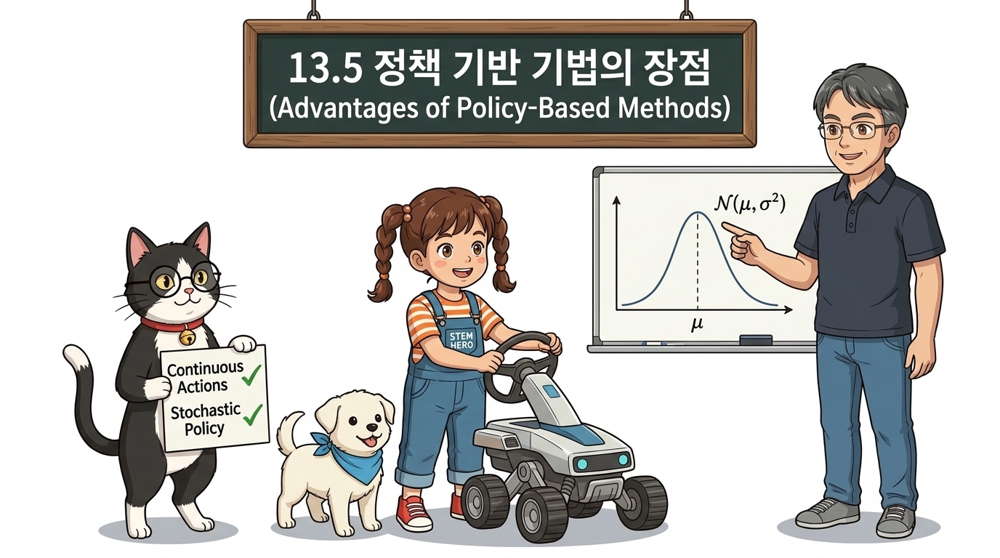
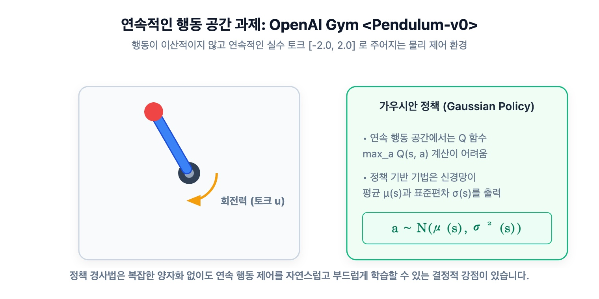
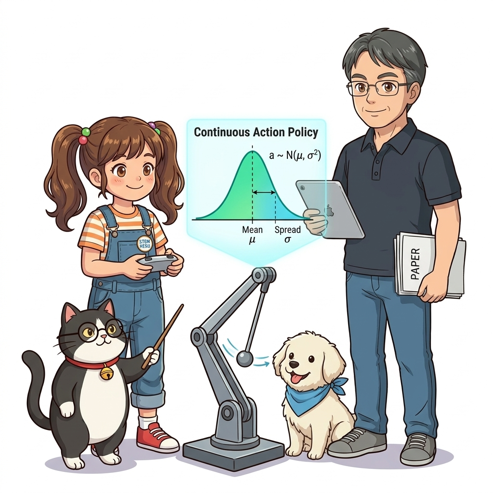

# 13.5 정책 기반 기법의 장점

**그림 13-5** 가치 표 대신 최적의 직접적인 길(정책 기반)을 선택하며, 안개 낀 미지의 연속 행동 공간을 탐험하는 도로시와 지니

> DQN과 같은 가치 기반 학습에 비해 **정책 기반 기법(Policy-Based Method)**이 지니는 독보적인 4대 강점을 총정리합니다. 정책 직접 모델링에 의한 최적화 효율성, 로봇 제어의 필수 관문인 연속 행동 공간(Continuous Action Space) 제어 능력, 가위바위보와 같은 확률적 최적 정책 학습, 그리고 부드러운 정책 전이에 의한 안정성까지 정책 경사법만의 치명적인 매력을 도로시, 지니 조교와 함께 알아봅시다!

---

지금까지 우리는 기본 정책 경사법부터 REINFORCE, 베이스라인, 그리고 Actor-Critic에 이르기까지 정책을 직접 파라미터화하여 최적화하는 다양한 기법들을 탐구했습니다.

그렇다면 11장과 12장에서 깊게 다룬 DQN 같은 **가치 기반 기법(Value-based Methods)**과 비교했을 때, **정책 기반 기법(Policy-based Methods)**은 왜 현대 로보틱스와 제어 공학, 그리고 최첨단 생성형 AI의 강화학습(RLHF)에서 없어서는 안 될 독보적인 위치를 차지하게 되었을까요? 대표적인 4가지 핵심 장점을 살펴보겠습니다.

---

## 1. 정책을 직접 모델링하므로 목표에 직결된다

강화학습에서 에이전트의 궁극적인 목적은 무엇일까요? 가치 함수를 예쁘게 계산하는 것은 수단일 뿐, **"상태 *s*에서 어떤 행동 *a*를 취해야 하는가"라는 최적 정책 *π*\*를 찾아내는 것**이 최종 목적입니다.

- **가치 기반 기법 (DQN):**  
  환경의 모든 상태-행동 쌍의 가치 *Q*(*s*, *a*)를 아주 정밀하게 맞추도록 신경망을 훈련한 다음, 그중 가장 큰 값을 취하는 간접적인 우회로(argmax *Q*)를 거칩니다.
- **정책 기반 기법 (Policy Gradient):**  
  가치라는 우회로를 거치지 않고, 정책 파라미터 *θ*를 누적 보상 목적 함수 *J*(*θ*)를 향해 **직접(Directly)** 경사 상승시킵니다.

### 가치 함수는 복잡하지만 정책은 단순한 경우

많은 현실 제어 문제에서 가치 함수의 참된 형태는 지극히 복잡하고 난해하지만, 정작 취해야 할 최적 행동 정책은 의외로 단순한 경우가 많습니다.

예를 들어 탁구 로봇이나 벽돌깨기 게임을 생각해 보십시오. 공이 라켓보다 위쪽에 있으면 '라켓을 위로 올린다', 아래쪽에 있으면 '라켓을 아래로 내린다'라는 정책 결정 경계선은 아주 간단한 선형 분리만으로도 충분히 표현될 수 있습니다.  
하지만 모든 공의 궤적과 벽의 반사각을 완벽히 예측하여 몇 점을 얻을지 정밀한 스칼라 가치 *Q*(*s*, *a*)를 오차 없이 추정하는 것은 천문학적으로 어렵습니다. 이러한 문제에서는 정책을 직접 학습하는 것이 훨씬 빠르고 효율적입니다.

---

## 2. 연속적인 행동 공간(Continuous Action Space)을 완벽하게 제어한다

DQN과 같은 가치 기반 기법의 가장 치명적인 아킬레스건은 바로 **행동 공간이 무한한 실수(연속값)일 때 적용하기가 극도로 어렵다**는 점입니다.

\<카트 폴\>처럼 왼쪽(0) 또는 오른쪽(1) 중 하나를 선택하는 이산 행동 공간에서는 두 행동의 Q값 `[Q(s, 0), Q(s, 1)]`을 계산한 뒤 `np.argmax()`를 취하면 그만입니다.

하지만 로봇 팔의 각 관절 회전 각도, 자율주행차의 스티어링 휠 조작 각도(−30.0° ~ +30.0°), 가속 페달 압력(0.0 ~ 1.0)과 같은 **연속 행동 공간**에서는 어떨까요?

### 이산화(Discretization)의 한계와 차원의 저주

가치 기반 기법을 연속 제어에 쓰려면 연속값을 0.1 단위로 잘게 쪼개는 이산화(Quantization)를 해야 합니다.  
하지만 자유도가 7개인 매니퓰레이터 로봇 팔에서 각 관절을 겨우 10개 구간으로만 쪼개도 가능한 행동 후보의 수는 107 = **1,000만 개**로 폭증합니다(차원의 저주). 매 스텝마다 1,000만 번의 Q값을 신경망으로 추론하여 최댓값을 찾는 것은 실시간 제어에서 불가능합니다.

### 가우스 정책(Gaussian Policy)을 통한 매끄러운 실수 출력

반면 정책 기반 기법은 신경망의 출력층을 **연속 확률 분포의 모수(Parameter)**로 설계함으로써 연속 행동 문제를 우아하게 해결합니다. 가장 대표적인 것이 **가우스 정책(정규분포 정책)**입니다.

$$
\pi_\theta(a \mid s) = \frac{1}{\sqrt{2\pi}\sigma_\theta(s)} \exp\left( - \frac{(a - \mu_\theta(s))^2}{2\sigma_\theta(s)^2} \right)
$$

[식 13.16] 1차원 연속 가우스 정책의 확률 밀도 함수

신경망은 상태 $s$ 를 입력받아 다음 두 가지 값을 직접 출력합니다:
1. **평균 $\mu_\theta(s)$:** 지금 상태에서 에이전트가 가할 최적 행동의 중심값 (예: 모터 회전 토크 +1.82 Nm)
2. **표준편차 $\sigma_\theta(s)$:** 탐색의 분산 정도 (학습 초기에는 크게 탐색하다가, 최적 정책에 수렴할수록 스스로 0에 가깝게 줄어듦)

**그림 13-13** 신경망이 평균과 분산을 출력하고, 연속 가우스 정규분포로부터 매끄러운 실수 모터 토크를 직접 샘플링하는 물리 AI 로봇 제어

에이전트는 이 정규분포로부터 행동을 샘플링하여 부드럽고 자연스러운 연속 제어를 즉각 수행할 수 있습니다.

---

## 3. 확률적 최적 정책(Stochastic Policy)을 스스로 학습할 수 있다

가치 기반 기법은 본질적으로 $Q(s, a)$ 가 가장 높은 행동 하나만을 무조건 선택하는 **결정론적 정책(Deterministic Policy)** 으로 귀결됩니다($\varepsilon$-탐욕의 탐색 구간을 제외하면).

하지만 현실 세계에는 **결정론적 행동을 취하면 무조건 패배하는 게임과 환경**이 무수히 존재합니다!

### 가위바위보와 포커(불완전 정보 게임)

가위바위보 게임을 떠올려보십시오. 만약 에이전트가 결정론적 알고리즘을 사용하여 "이 상태에서는 가위를 내는 것이 가치가 가장 높다"라며 항상 가위만을 낸다면, 상대방은 이를 즉시 간파하고 바위를 내어 에이전트를 완벽히 제압할 것입니다.  
가위바위보의 유일한 내시 균형(Nash Equilibrium)이자 무적의 최적 정책은 [가위 1/3, 바위 1/3, 보 1/3]의 확률로 무작위 행동을 섞는 **확률적 혼합 전략(Mixed Strategy)**뿐입니다.

### 부분 관측 환경(POMDP)에서의 상태 모호성(State Aliasing)

센서가 제한되어 서로 다른 두 물리적 상태가 에이전트에게 동일한 센서 관측값 *s*로 감지되는 경우가 있습니다.  
- 한 상태에서는 '오른쪽'으로 가야 출구이고,
- 다른 상태에서는 '왼쪽'으로 가야 출구인데,
- 에이전트의 관측 센서로는 두 방이 완전히 똑같이 보인다면?

결정론적 가치 기반 기법은 무조건 한 방향(예: 오른쪽)만을 고집하다가 무한 루프에 갇히게 됩니다. 반면 정책 기반 기법은 두 상태에서 [왼쪽 50%, 오른쪽 50%]의 최적 확률적 정책을 자연스럽게 수렴시켜 무한 루프를 깨고 탈출에 성공합니다.

---

## 4. 행동 선택 확률이 부드럽고 연속적으로 변화한다

가치 기반 기법(*ϵ*-탐욕 정책)에서는 가치 함수가 아주 미세하게 갱신되더라도 행동 방식이 **벼랑 끝에서 떨어지듯 급변(Discontinuous Jump)**할 수 있습니다.

예를 들어:
- *Q*(*s*, 좌) = 10.001, *Q*(*s*, 우) = 10.000 일 때: 100% '좌' 선택
- 다음 스텝에서 Q값이 아주 조금 바뀌어 *Q*(*s*, 좌) = 10.000, *Q*(*s*, 우) = 10.001 이 되면: 갑자기 100% '우' 선택

이러한 급격한 행동 변화는 환경과 상호작용하는 데이터 수집 분포를 일거에 뒤흔들어 신경망 학습에 심각한 진동(Oscillation)과 불안정을 초래합니다.

반면 정책 기반 기법은 행동 확률이 **소프트맥스 함수**에 의해 연속적으로 매끄럽게 정의됩니다. 경사 상승법의 학습률 *α*에 비례하여 확률 분포가 [50.1% vs 49.9%]에서 [50.2% vs 49.8%]로 **부드럽고 안정적으로 전이(Smooth Transition)**하기 때문에, 급격한 정책 붕괴 없이 견고하게 최적해로 수렴합니다.

---

## 5. 가치 기반 vs 정책 기반 종합 비교 매트릭스

| 비교 항목 | 가치 기반 기법 (DQN) | 정책 기반 기법 (PG / Actor-Critic) |
| :--- | :--- | :--- |
| **최적화 대상** | 행동 가치 함수 $Q(s, a)$ 간접 추정 | 정책 $\pi_\theta(a \mid s)$ 직접 최적화 |
| **행동 공간** | 이산적 행동 공간 (Discrete Only) | **이산 및 연속 행동 공간 (Continuous) 모두 완벽 지원** |
| **최적 정책 형태** | 결정론적 정책 (Deterministic, argmax) | **확률적 정책 (Stochastic) 및 결정론적 정책 모두 가능** |
| **행동 확률 변화** | 급격한 계단식 불연속 변화 (*ϵ*-greedy) | **매끄럽고 부드러운 연속 변화 (Softmax / Gaussian)** |
| **샘플 효율성** | 리플레이 버퍼를 통한 오프-정책 샘플 재사용 (우수) | 온-정책 기반일 때 샘플 효율 낮음 (Actor-Critic으로 보완) |
| **주요 응용 분야** | 바둑, 체스, 아타리 비디오 게임 | **로봇 제어, 자율주행, 드론 비행, LLM 정렬 (RLHF/PPO)** |

이제 가치 기반과 정책 기반의 장단점을 모두 마스터했습니다. 마지막 13.6절에서는 13장 전체의 이론과 수식 발전 과정을 완벽한 로드맵으로 한눈에 정리해 보겠습니다!
