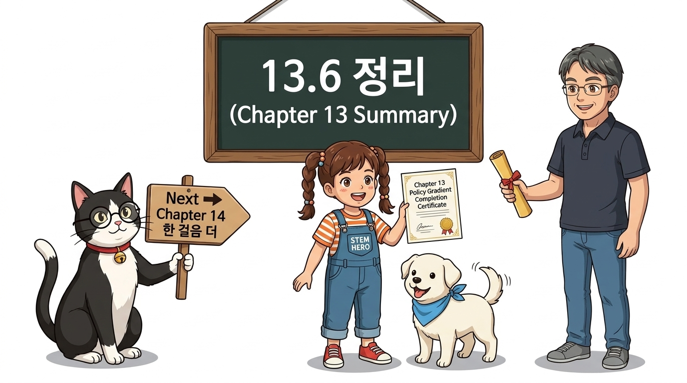
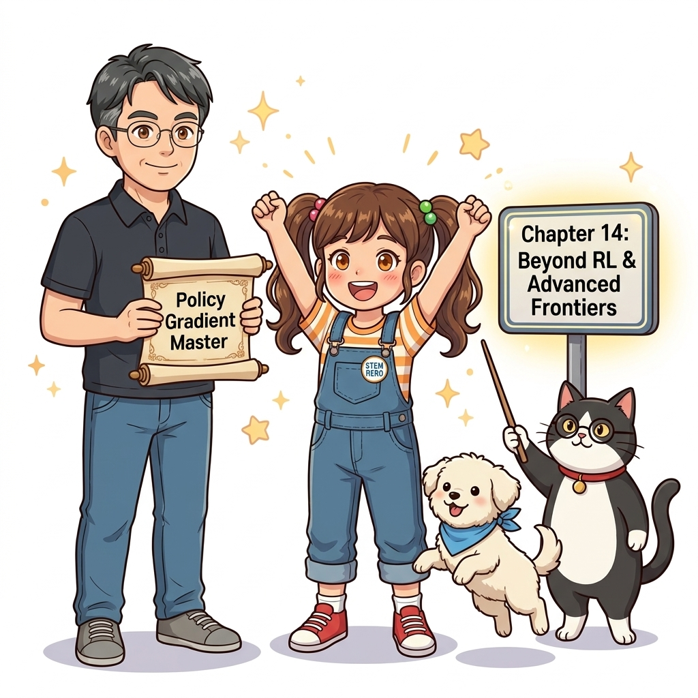

# 13.6 정리

**그림 13-6** 정책 경사법 수식을 멋지게 완수하고 지니와 함께 기쁨의 피크닉을 즐기며 다음 단원을 기쁘게 마주하는 도로시와 토토

> 13장 정책 경사법의 위대한 여정을 총정리합니다. 기본 정책 경사법에서 REINFORCE, 베이스라인, 그리고 현대 강화학습의 중심축인 Actor-Critic으로 이어지는 우아한 수학적 진화 과정을 한눈에 조망하고, 가중치 함수 Ψ*t*의 통합 공식과 4대 알고리즘 비교표를 통해 배운 내용을 완벽하게 정리해봅시다!

---

## 13.6.1 정책 경사법의 일반화된 통합 공식

13장에서 배운 모든 정책 경사 기법들은 놀랍게도 **단 하나의 일반화된 마스터 수식**으로 완벽하게 통합될 수 있습니다.

> ### (식 13.17) 정책 경사법 일반 통합 공식 (The Generalized Policy Gradient Formula)
> ∇*θ* *J*(*θ*) = E*τ* ~ *π**θ* [ ∑*t*=0*T* Ψ*t* ∇*θ* log *π**θ*(*A**t* | *S**t*) ]

이 식에서 본질적인 차이를 만드는 것은 단 하나, 바로 각 타임스텝의 행동이 얼마나 훌륭했는지를 평가하는 **가중치 함수 Ψ*t***입니다. 우리가 학습을 거듭하며 발전시켜 온 알고리즘들의 궤적은 곧 **"Ψ*t*의 노이즈와 분산을 어떻게 줄이고, 편향을 어떻게 다룰 것인가"**의 역사였습니다:

| 단계 | 알고리즘 | 가중치 항 Ψ*t*의 형태 | 수학적 의의 및 특징 |
| :---: | :--- | :--- | :--- |
| **1단계** | **가장 간단한 정책 경사법** | Ψ*t* = *G*(*τ*) | 에피소드 전체의 반환값을 사용. 과거의 무관한 보상이 노이즈로 끼어들어 **분산이 가장 큼**. |
| **2단계** | **REINFORCE** | Ψ*t* = *G**t* = ∑*k*=*t**T* *γ**k*−*t* *R**k* | **인과율(Causality)** 도입. 미래의 누적 보상만 반영하여 편향 없이 분산을 1차 저감. |
| **3단계** | **베이스라인 적용 REINFORCE** | Ψ*t* = *G**t* − *b*(*S**t*) | 상태 기준선 *b*(*s*)를 차감. E[*b*(*s*) ∇ log *π*] = 0이므로 **편향 없이 분산을 대폭 추가 저감**. |
| **4단계** | **행동 가치 기반 정책 경사** | Ψ*t* = *Q**π*(*S**t*, *A**t*) | 샘플 수익 대신 참된 행동 가치를 사용. (기댓값 기준 REINFORCE와 동치) |
| **5단계** | **어드밴티지 기반 정책 경사** | Ψ*t* = *A*(*S**t*, *A**t*) = *Q*(*S**t*, *A**t*) − *V*(*S**t*) | 상태 평균 대비 해당 행동의 순수한 우수함(Advantage)만을 추출하여 최적의 분산 달성. |
| **6단계** | **행위자-비평자 (Actor-Critic)** | Ψ*t* = *δ**t* = *R**t* + *γ* *V**w*(*S**t*+1) − *V**w*(*S**t*) | 1스텝 TD 오차를 이점 추정량으로 채택. **에피소드 종료를 기다리지 않고 매 스텝 즉시 갱신**. |

---

## 13.6.2 13장 4대 정책 경사 알고리즘 종합 비교

13장에서 직접 코드로 구현하고 이론을 도출했던 4대 핵심 기법을 한자리에서 비교 정리합니다:

| 비교 항목 | 13.1 기본 정책 경사법 | 13.2 REINFORCE | 13.3 베이스라인 REINFORCE | 13.4 행위자-비평자 (Actor-Critic) |
| :--- | :---: | :---: | :---: | :---: |
| **핵심 가중치 Ψ*t*** | 전체 수익 *G*(*τ*) | 미래 수익 *G**t* | 상대 이점 *G**t* − *V*(*S**t*) | TD 오차 *δ**t* = *R* + *γ* *V*(*S*') − *V*(*S*) |
| **학습 갱신 주기** | 에피소드 종료 후 (MC) | 에피소드 종료 후 (MC) | 에피소드 종료 후 (MC) | **매 타임스텝 즉시 (1-step TD)** |
| **분산 (Variance)** | 매우 높음 (Extreme) | 높음 (High) | 중간 (Moderate) | **낮음 (Low, 매우 안정적)** |
| **편향 (Bias)** | 없음 (Unbiased) | 없음 (Unbiased) | 없음 (Unbiased) | 약간 있음 (부트스트랩에 의한 Bias) |
| **필요 신경망 수** | 1개 (PolicyNet) | 1개 (PolicyNet) | 2개 (PolicyNet + ValueNet) | **2개 (PolicyNet + ValueNet 동시 학습)** |
| **연속 태스크 지원** | 불가능 (끝이 있어야 함) | 불가능 (끝이 있어야 함) | 불가능 (끝이 있어야 함) | **완벽 지원 (무한 지속 태스크 가능)** |

---

## 13.6.3 이번 장에서 배운 핵심 내용

1. **정책 경사 정리 (Policy Gradient Theorem):**
   - 환경 전이 확률의 그래디언트 ∇*P*를 몰라도, 로그 미분법(Log-derivative Trick)을 통해 누적 보상의 기댓값 경사 ∇*θ* *J*(*θ*)를 에이전트의 경험 샘플만으로 계산할 수 있습니다.
2. **인과율 (Causality):**
   - 과거의 보상은 현재 행동의 평가와 무관합니다. 미래 보상 *G**t*만을 가중치로 삼음으로써 분산을 크게 줄일 수 있습니다.
3. **베이스라인과 무편향성:**
   - 행동에 무관한 상태 기준 함수 *b*(*s*)를 차감해도 기댓값은 정확히 0이 되어 편향을 유발하지 않으며, 분산만을 효과적으로 감소시킵니다.
4. **행위자-비평자(Actor-Critic)의 실시간성:**
   - 비평자가 가치 함수를 TD법으로 학습하고, 행위자가 TD 오차 *δ**t*를 받아 매 스텝마다 실시간으로 정책을 진화시킵니다.

**그림 13-14** 정책 경사법의 전 과정을 마스터하고 기쁨의 수료증을 들고 있는 도로시와 이호진 교수님, 그리고 다음 단원을 향해 달리는 토토와 지니 조교

---

## 13.6.4 다음 장으로: 14장 한 걸음 더 (Advanced Frontiers)

우리는 이제 강화학습의 기초인 동적 프로그래밍(DP)부터 몬테카를로(MC), 시간차 학습(TD), Q-러닝, 심층 신경망과 결합한 DQN, 그리고 연속 제어와 최첨단 AI의 중추인 정책 경사법과 Actor-Critic까지 모두 정복했습니다.

마지막 **14장 [한 걸음 더]**에서는 본 교재를 넘어 현대 심층 강화학습이 어디로 진화하고 있는지, 그리고 현실 세계의 로봇과 피지컬 AI(Physical AI)를 지배하는 최첨단 프론티어(PPO, SAC, 모델 기반 RL, 오프라인 RL 등)의 광활한 세계를 조망해 보겠습니다!
