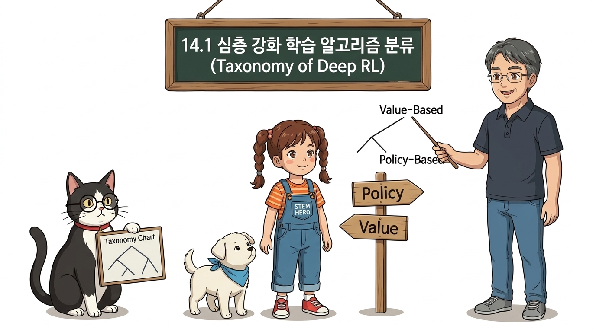
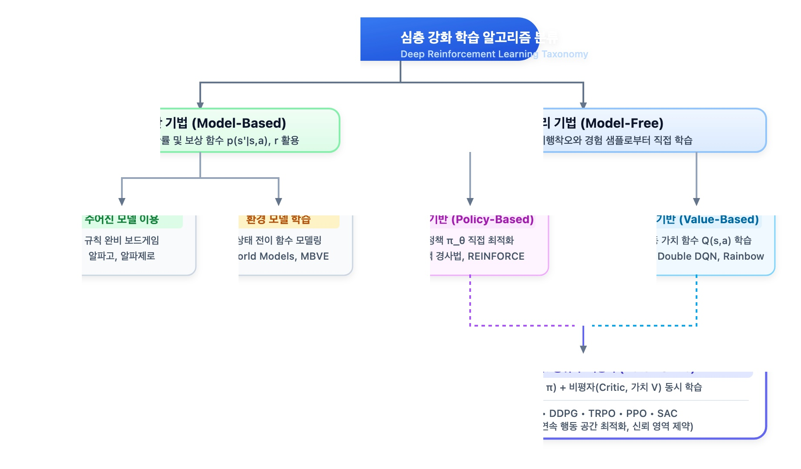
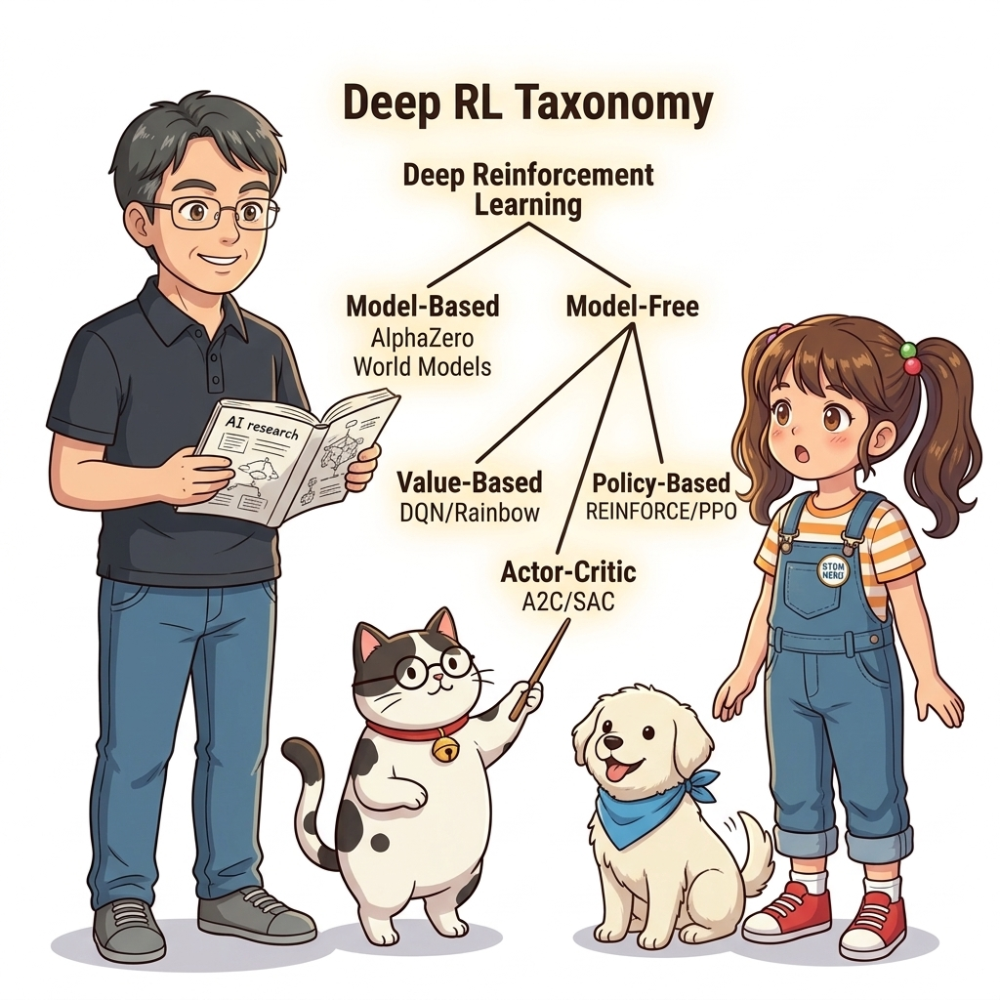

# 14.1 심층 강화 학습 알고리즘 분류

**그림 14-1** 가치 기반(Value-Based) 경로와 정책 기반(Policy-Based) 경로의 분기점을 가리키는 지니와 도로시

> 방대한 현대 심층 강화학습(Deep RL) 알고리즘들을 명확하고 일관된 기준에 의거하여 계통적으로 분류합니다. 환경 모델의 유무에 따른 모델 기반(Model-Based)과 모델 프리(Model-Free)의 갈림길, 그리고 가치 기반(Value-Based)과 정책 기반(Policy-Based)의 융합 구조를 도로시, 지니 조교와 함께 완벽하게 정리해봅시다!

---

현대 심층 강화학습은 수많은 연구자들의 아이디어가 융합되며 눈부신 발전을 거듭해 왔습니다. OpenAI의 분류 체계[20]를 바탕으로, 복잡하게 얽힌 심층 강화학습 알고리즘들의 계보를 한눈에 파악할 수 있는 통합 지도를 펼쳐보겠습니다.

**그림 14-2** 심층 강화학습의 양대 산맥인 모델 기반과 모델 프리, 그리고 정책 기반과 가치 기반의 상호 연계 계통도

---

## 1. 모델 기반 vs 모델 프리 (Model-Based vs Model-Free)

심층 강화학습에서 가장 근본적인 첫 번째 갈림길은 **환경 모델(Environment Model)**, 즉 상태 전이 확률 분포 *p*(*s*' | *s*, *a*)와 보상 함수 *r*(*s*, *a*, *s*')의 정보를 알고 있거나 직접 모델링하는가입니다.

### 1) 모델 기반 기법 (Model-Based Methods)

환경이 어떻게 반응할지 예측하는 시뮬레이터(모델)를 갖추고, 에이전트가 현실에서 직접 부딪치기 전에 머릿속으로 미래를 시뮬레이션(Planning)하여 최적 행동을 결정합니다.

- **주어진 모델(Given Model)을 활용하는 경우:**  
  바둑, 체스, 오셀로 같은 보드게임은 게임의 규칙(전이 확률과 승패 규칙)이 완벽하게 주어져 있습니다. 5장에서 배운 동적 프로그래밍(DP)이나 몬테카를로 트리 탐색(MCTS)을 결합한 **알파고(AlphaGo)**, **알파제로(AlphaZero)**가 여기에 해당합니다.
- **모델을 스스로 학습(Learned Model)하는 경우:**  
  현실 로봇 제어나 복잡한 비디오 게임처럼 환경 규칙을 모를 때, 에이전트가 과거의 관측 경험으로부터 "다음 상태와 보상이 어떻게 될 것인가"를 예측하는 세계 모델(World Model)을 신경망으로 직접 학습합니다.
  - 대표 기법: **World Models**[21], **MBVE(Model-Based Value Estimation)**[22], **MuZero**, **DreamerV3**
  - **장점:** 상상 속에서 수백만 번의 시뮬레이션을 돌려보므로 실제 환경과의 상호작용 횟수를 획기적으로 줄일 수 있습니다(탁월한 샘플 효율성).
  - **한계:** 학습된 신경망 모델이 실제 물리 환경과 미세하게 어긋나면(모델 편향, Model Bias), 상상 속에서는 완벽했던 행동이 실제 현실에서는 치명적인 오작동을 일으킬 위험이 있습니다.

### 2) 모델 프리 기법 (Model-Free Methods)

환경의 물리 법칙이나 전이 확률을 굳이 모델링하려 하지 않고, 환경과의 실제 상호작용(Trial and Error)을 통해 수집된 경험 샘플(*S*, *A*, *R*, *S*')로부터 가치나 정책을 직접 학습합니다.

- **장점:** 복잡하고 비선형적인 환경을 억지로 예측 모델링할 필요가 없어 모델 오류(편향)에 자유로우며 구현이 직관적입니다.
- **성과:** 현재까지 심층 강화학습이 달성한 수많은 혁신(아타리 정복, 로봇 보행, 대규모 언어 모델의 RLHF)의 대다수가 모델 프리 기법에서 탄생했습니다.

---

## 2. 모델 프리 기법의 세 갈래 길

모델 프리 기법은 최적화의 대상을 무엇으로 설정하느냐에 따라 크게 세 갈래로 나뉩니다:

| 분류 | 최적화 대상 | 대표 알고리즘 | 주요 특징 및 적합 분야 |
| :--- | :--- | :--- | :--- |
| **가치 기반 (Value-Based)** | 행동 가치 함수 $Q(s, a)$ | **DQN, Double DQN, Dueling DQN, Rainbow** | 이산 행동 공간에서 탁월한 안정성과 오프-정책 샘플 효율성 발휘 (게임, 추천 시스템) |
| **정책 기반 (Policy-Based)** | 정책 신경망 $\pi_\theta(a \mid s)$ | **REINFORCE, PPO, TRPO** | 연속 행동 공간 지원, 확률적 정책 학습, 직관적 수렴성 (자율주행, LLM 정렬) |
| **행위자-비평자 (Actor-Critic)** | 정책 $\pi_\theta$ 와 가치 $V_w$ 동시 최적화 | **A2C, A3C, DDPG, SAC** | 정책의 유연성과 가치의 분산 저감 효과를 결합한 현대 심층 강화학습의 최고 주류 |

---

## 3. 심층 강화학습의 발전 로드맵

우리는 11~12장에서 가치 기반의 정점인 **DQN**을, 13장에서는 정책 기반의 핵심인 **REINFORCE**와 **Actor-Critic**을 직접 코드로 구현했습니다.

이어지는 절에서는 이 탄탄한 기본기 위에서 현대 강화학습 연구의 최전선으로 도약합니다:
- **14.2절:** 비동기 병렬 학습(A3C/A2C), 연속 제어의 혁명(DDPG, SAC), 신뢰 영역 정책 최적화(TRPO, PPO)
- **14.3절:** 기댓값 대신 확률 분포 자체를 학습하는 분포 강화학습(C51, QR-DQN)과 DQN 확장 기술들의 집대성인 레인보우(Rainbow)
- **14.4절:** 세계를 뒤흔든 알파고(AlphaGo)와 물리 AI 로봇 제어의 실제 적용 사례
- **14.5절:** 심층 강화학습이 마주한 한계점과 미래 인공지능으로의 가능성
