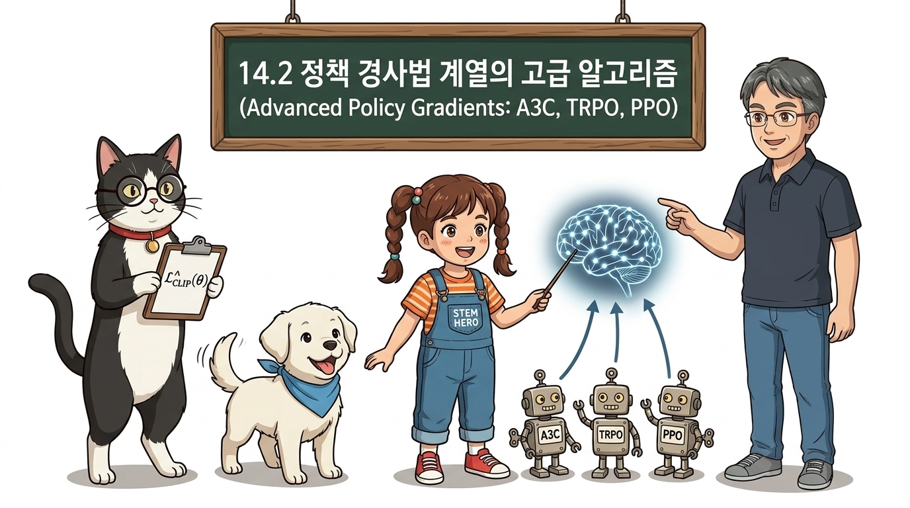
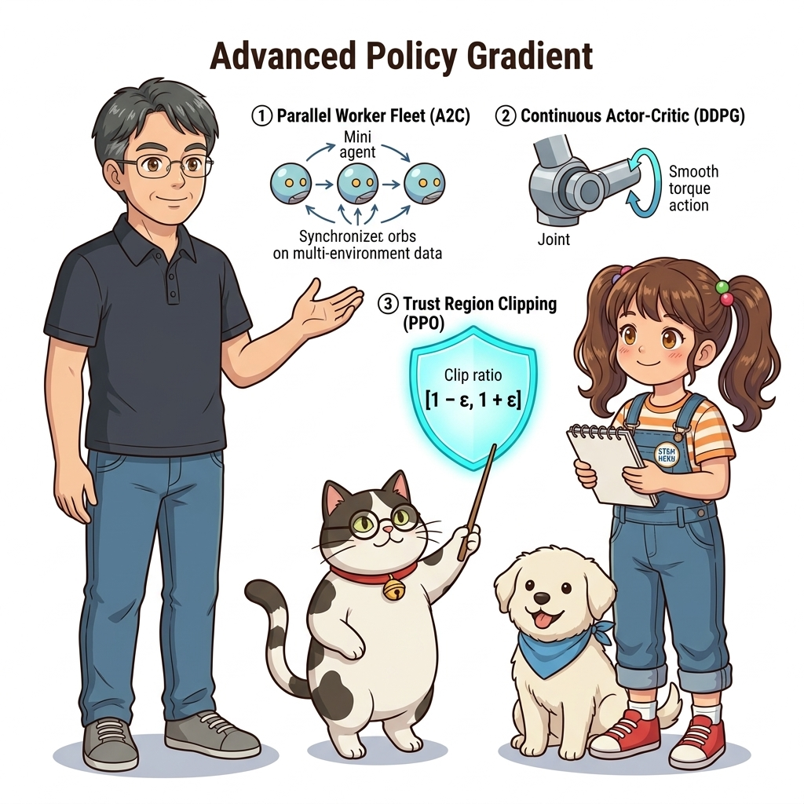
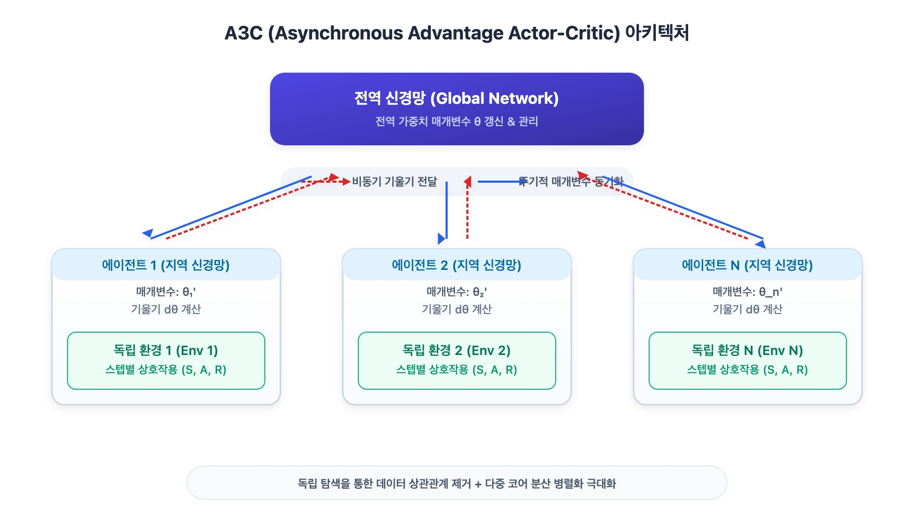
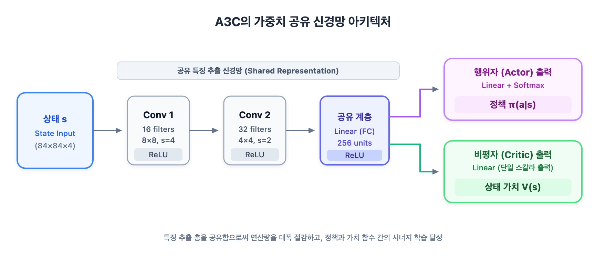
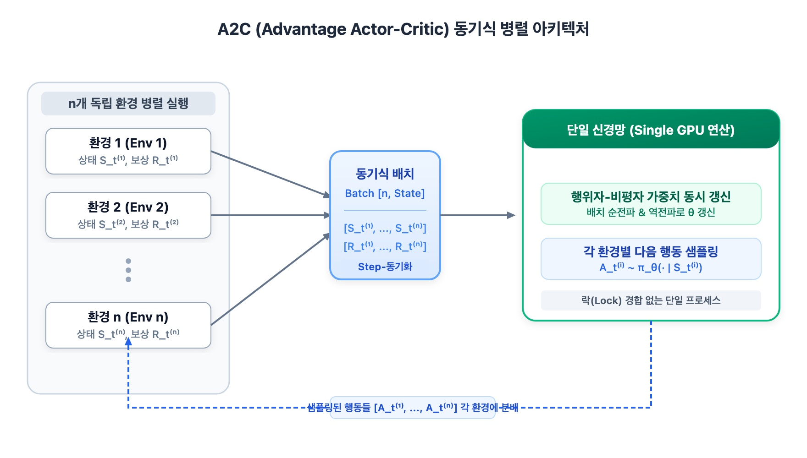
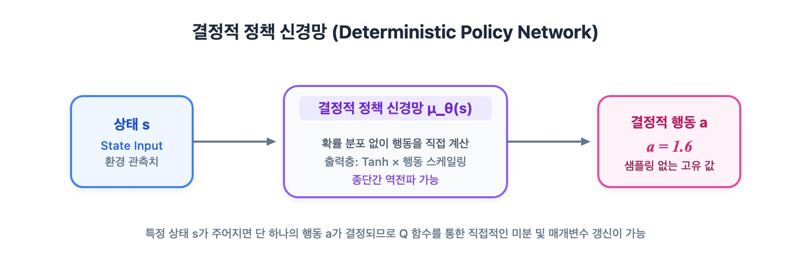
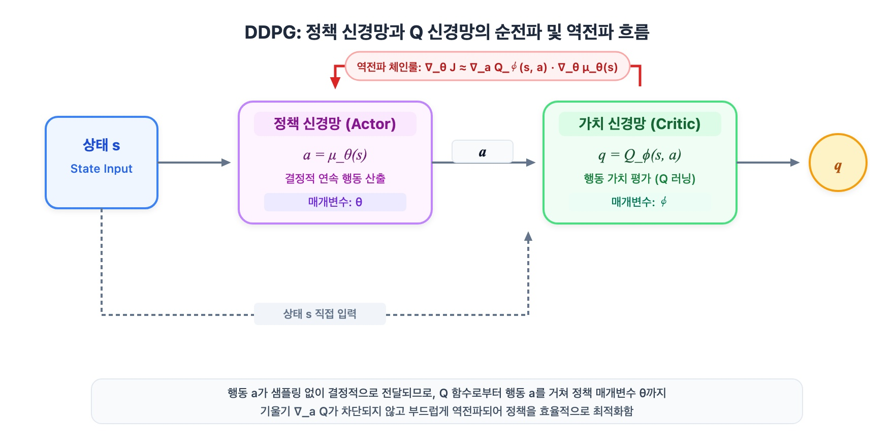

# 14.2 정책 경사법 계열의 고급 알고리즘

**그림 14-3** 비동기적으로 분산 학습을 전개하는 A3C/A2C 요원 인형들과 도로시의 학습 지휘선

> 정책 경사법의 이론적 한계를 보완해 산업 실용화 수준을 비약적으로 끌어올린 심층 강화학습의 주역들을 살펴봅니다. 병렬 시뮬레이션으로 데이터 상관관계를 파괴하는 **A3C/A2C**, 로봇 제어의 연속 행동 공간을 정복한 **DDPG**, 안전한 정책 갱신을 보장하여 ChatGPT(RLHF)의 핵심 엔진이 된 **TRPO/PPO**, 그리고 엔트로피를 극대화하는 **SAC**까지 도로시, 지니 조교와 함께 비교 분석해 봅시다!

---

13장에서 배운 기본 정책 경사법과 Actor-Critic은 직관적이고 강력하지만, 실제 복잡한 고차원 환경에서는 **샘플 효율성 부족**, **하이퍼파라미터 민감성**, **급격한 정책 붕괴(Policy Collapse)**라는 난관에 직면합니다. 

현대 심층 강화학습 연구자들은 이 한계를 극복하기 위해 정책 경사법을 눈부시게 진화시켰습니다. 가장 중요한 세 가지 핵심 발전 축을 집중 탐구해 보겠습니다:

1. **병렬 분산 학습 축:** A3C, A2C
2. **연속 결정론적 제어 축:** DDPG, SAC
3. **신뢰 영역 및 클리핑 축:** TRPO, PPO

**그림 14-8** 고급 정책 경사법의 3대 발전 기둥: 병렬 환경 동기화(A2C), 연속 모터 토크 제어(DDPG), 신뢰 영역 보호 클리핑(PPO)

---

## 14.2.1 A3C와 A2C: 병렬 환경을 통한 데이터 상관관계 파괴

12장의 DQN에서는 연속된 시간의 경험 데이터 간 상관관계(Correlation)를 끊기 위해 거대한 메모리 공간을 차지하는 '경험 재생(Experience Replay)' 버퍼를 필수적으로 사용했습니다. 하지만 경험 재생은 버퍼에 저장된 과거 데이터를 재활용하므로 오직 **오프-정책(Off-Policy)**에서만 작동하며, 현재의 최신 정책을 직접 평가해야 하는 **온-정책(On-Policy)** Actor-Critic에는 바로 적용할 수 없습니다.

딥마인드는 2016년, 경험 재생 버퍼 없이도 데이터 상관관계를 완벽하게 파괴하는 혁신적인 해법인 **A3C(Asynchronous Advantage Actor-Critic)**[23]를 발표했습니다.

### 1) A3C 아키텍처: 비동기 다중 워커 분산 학습

A3C는 하나의 중앙 전역 신경망(Global Network)과 여러 개의 독립된 CPU 코어에서 실행되는 지역 워커(Local Worker)들로 구성됩니다:
- 각 워커는 서로 다른 시드(Seed)를 가진 독립된 환경 인스턴스에서 독자적으로 행동을 탐색합니다.
- 워커마다 환경 상태가 완전히 제각각이므로, 이들이 수집하는 데이터 사이에는 시간적 상관관계가 완전히 사라집니다.
- 각 워커는 일정 스텝(예: 5스텝) 동안 경험을 모아 그래디언트를 계산한 뒤, 중앙 전역 신경망에 **비동기적(Asynchronous)**으로 밀어 넣어 파라미터를 갱신합니다.

또한 A3C는 [그림 14-3]처럼 합성곱(CNN) 특징 추출 계층의 가중치를 정책망($\pi$)과 가치망($V$)이 공유하는 효율적인 멀티태스크 구조를 확립했습니다.

### 2) A2C: 동기식 배치 벡터화의 승리

A3C의 비동기 방식은 락(Lock) 없이 자유롭게 파라미터를 갱신하는 장점이 있었지만, 워커가 그래디언트를 전송하는 순간 이미 전역 네트워크의 파라미터가 다른 워커에 의해 변경되어 있는 **과거 그래디언트(Stale Gradient)** 문제가 존재했습니다.

OpenAI는 이를 개선한 **A2C(Advantage Actor-Critic)**를 제시했습니다. 첫 번째 'A(Asynchronous)'를 떼어내고, 여러 환경의 스텝을 **동기식(Synchronous)**으로 맞추어 하나의 거대한 미니배치로 묶은 것입니다.

- 모든 병렬 환경에서 시점 $t$ 의 상태 $S_t^{(1)}, \dots, S_t^{(N)}$ 을 동시에 관측합니다.
- 이를 크기 *N*의 텐서 배치로 만들어 단일 GPU에서 고속 순전파 및 역전파를 수행합니다.
- 실험 결과 A2C는 A3C와 대등하거나 더 우수한 성능을 내면서도, 최신 GPU 텐서 가속을 100% 활용할 수 있어 오늘날 모든 심층 강화학습 라이브러리의 표준 구현체가 되었습니다.

---

## 14.2.2 DDPG: 연속 행동 공간의 결정론적 혁명

로봇의 관절 각도 제어나 자율주행 차량의 조향각처럼 행동이 무한한 실수 범위인 환경에서, DQN의 argmax 연산은 불가능에 가깝습니다.

13.5절에서 살펴본 것처럼 가우스 정규분포 $\mathcal{N}(\mu, \sigma^2)$ 에서 행동을 샘플링하는 방법도 있지만, **DDPG(Deep Deterministic Policy Gradient)**[24]는 행동을 확률적으로 뽑지 않고 **결정론적 실수 벡터 *a* = *μ**θ*(*s*)**로 신경망이 직접 출력하도록 설계했습니다.

### 결정론적 정책 경사 정리와 연쇄 법칙(Chain Rule)

DDPG는 Actor-Critic 아키텍처에 DQN의 경험 재생 버퍼와 타깃 네트워크를 성공적으로 이식했습니다:
- **행위자 (Actor, $\mu_\theta$):** 상태 $s$ 를 입력받아 연속 행동 $a = \mu_\theta(s)$ 를 직접 출력
- **비평자 (Critic, $Q_\phi$):** 상태 $s$ 와 연속 행동 $a$ 를 입력받아 스칼라 행동 가치 $Q_\phi(s, a)$ 를 평가

비평자 $Q_\phi(s, a)$ 의 출력이 최대화되도록 행위자 $\mu_\theta(s)$ 를 갱신할 때, 역전파의 연쇄 법칙이 아름답게 적용됩니다:

$$
\nabla_\theta J(\theta) = \mathbb{E} \left[ \left. \nabla_a Q_\phi(s, a) \right|_{a = \mu_\theta(s)} \cdot \nabla_\theta \mu_\theta(s) \right]
$$

1. 비평자 신경망을 통해 "행동 $a$ 를 어느 방향으로 수정해야 $Q$ 값이 커지는가"라는 기울기 $\nabla_a Q$ 를 먼저 구합니다.
2. 이 기울기를 행위자 신경망으로 그대로 흘려보내 행위자의 가중치 $\theta$ 를 갱신합니다!

### max 연산의 소거와 소프트 타깃 갱신

DQN에서는 다음 상태의 최댓값 max*a* *Q*(*S**t*+1, *a*)를 구하기 위해 수많은 후보를 탐색해야 했지만, DDPG에서는 이미 최적 행동을 출력하도록 훈련된 행위자 *μ**θ*가 존재하므로 단 한 번의 순전파로 대체됩니다:

> max*a* *Q**ϕ*(*s*, *a*) ≈ *Q**ϕ*(*s*, *μ**θ*(*s*))

또한 DDPG는 타깃 네트워크의 가중치를 일정 주기마다 통째로 복사하는 대신, 매 스텝마다 미세한 비율 *τ* (예: 0.005)만큼 서서히 이동시키는 **소프트 타깃 갱신(Soft Target Update)**을 도입하여 극도의 학습 안정성을 달성했습니다:

> *ϕ*target ← *τ* *ϕ* + (1 − *τ*) *ϕ*target

> [!TIP]
> **SAC (Soft Actor-Critic)로의 도약:**  
> DDPG의 Q값 과대평가 및 하이퍼파라미터 취약성을 해결하기 위해, 현대 연속 제어의 절대 강자로 떠오른 알고리즘이 바로 **SAC**입니다. SAC는 보상뿐만 아니라 정책의 엔트로피(Entropy, 무작위성)를 함께 최대화하는 최대 엔트로피 강화학습을 적용하여, 탐색 실패에 빠지지 않고 다양한 최적 행동 경로를 스스로 개척합니다.

---

## 14.2.3 TRPO와 PPO: 신뢰 영역과 클리핑 대리 손실

일반적인 딥러닝(지도학습)에서는 학습률이 조금 커서 손실 함수가 튀더라도 다음 배치에서 올바른 정답 레이블을 보고 회복할 수 있습니다.  
하지만 강화학습에서 한 번의 잘못된 파라미터 갱신으로 정책이 붕괴(Cliff Fall)하면, 망가진 정책이 엉터리 데이터만을 수집하게 되며 영원히 이전 성능으로 돌아오지 못하는 치명적인 악순환이 발생합니다.

이 문제를 해결하기 위해 **"새로운 정책이 이전 정책에서 너무 멀리 벗어나지 않도록 안전 범위를 강제하자"**라는 신뢰 영역(Trust Region) 개념이 탄생했습니다.

### 1) TRPO (Trust Region Policy Optimization)

TRPO[25]는 정책을 갱신할 때 이전 정책 $\pi_{\text{old}}$ 와 새 정책 $\pi$ 사이의 확률 분포 차이를 **쿨백-라이블러 발산(Kullback-Leibler Divergence, KLD)** 으로 측정하고, 이 값이 안전 임곗값 $\delta$ 이하가 되도록 엄격한 수학적 제약 조건을 부여합니다:

$$
\begin{aligned}
\max_\theta & \quad \mathbb{E} \left[ \frac{\pi_\theta(a \mid s)}{\pi_{\theta_{\text{old}}}(a \mid s)} A(s, a) \right] \\
\text{s.t.} & \quad \mathbb{E} \left[ D_{\text{KL}}(\pi_{\theta_{\text{old}}}(\cdot \mid s) \parallel \pi_\theta(\cdot \mid s)) \right] \le \delta
\end{aligned}
$$

이 제약 조건 덕분에 정책 성능이 단조 증가(Monotonic Improvement)함을 수학적으로 보장할 수 있었습니다. 하지만 2차 미분인 헤세 행렬(Hessian Matrix)과 켤레 기울기법(Conjugate Gradient)을 연산해야 하므로 계산 비용이 너무 크고 구현이 대단히 복잡했습니다.

### 2) PPO (Proximal Policy Optimization)

2017년 OpenAI의 존 슐만(John Schulman) 연구팀은 TRPO의 복잡한 2차 제약 최적화를 획기적으로 단순화한 **PPO**[26]를 발표했습니다.

핵심 아이디어는 이전 정책 대비 새 정책의 확률 비 $r_t(\theta)$ 가 1 근처의 안전 구간 $[1 - \epsilon, 1 + \epsilon]$ 을 벗어나지 못하도록 강제로 잘라내는(Clipping) 것입니다 (보통 $\epsilon = 0.2$ 사용).

$$
L^{\text{CLIP}}(\theta) = \hat{\mathbb{E}}_t \left[ \min\left( r_t(\theta) \hat{A}_t, \, \text{clip}(r_t(\theta), 1 - \epsilon, 1 + \epsilon) \hat{A}_t \right) \right]
$$

[식 14.1] PPO 클리핑 목적 함수 (Clipped Surrogate Objective)

여기서 확률 변화율 $r_t(\theta) = \frac{\pi_\theta(a_t \mid s_t)}{\pi_{\theta_{\text{old}}}(a_t \mid s_t)}$ 입니다.

- **이점 $\hat{A}_t > 0$ (좋은 행동):**  
  행동 확률을 높여야 하지만, $r_t(\theta)$ 가 $1 + \epsilon$(예: 1.2)을 초과하면 목적 함수가 상수로 묶여 그래디언트가 0이 됩니다. 즉, 한 번에 너무 욕심부려 정책을 급변시키지 못하도록 차단합니다.
- **이점 $\hat{A}_t < 0$ (나쁜 행동):**  
  행동 확률을 낮추어야 하지만, $r_t(\theta)$ 가 $1 - \epsilon$(예: 0.8) 밑으로 떨어지면 역시 클리핑되어 과도한 패널티로 인한 정책 붕괴를 예방합니다.

PPO는 1차 미분(일반 역전파)만으로 간단히 구현할 수 있으면서도 TRPO 이상의 뛰어난 성능과 놀라운 학습 안정성을 보여주었습니다. 그 결과 OpenAI Five(도타 2 세계 챔피언 격파), 물리 로봇 손(루빅스 큐브 해결), 그리고 오늘날 ChatGPT를 비롯한 대규모 언어 모델의 인간 피드백 기반 강화학습(RLHF)에 이르기까지 **현존하는 가장 성공적인 강화학습 알고리즘의 왕좌**를 차지하고 있습니다.
