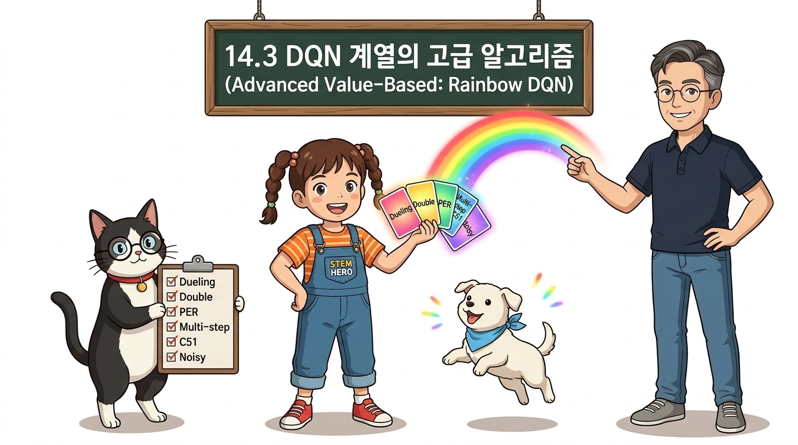
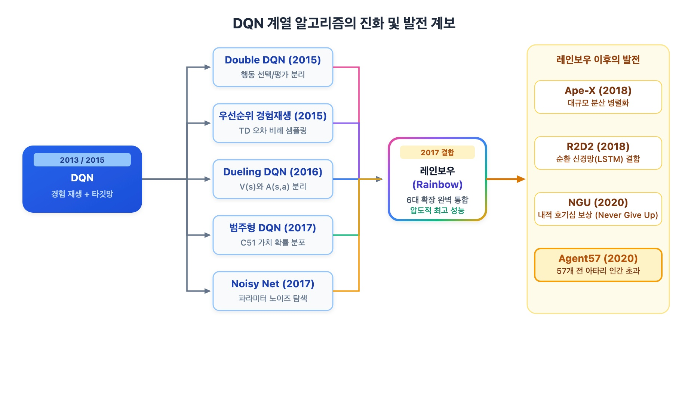
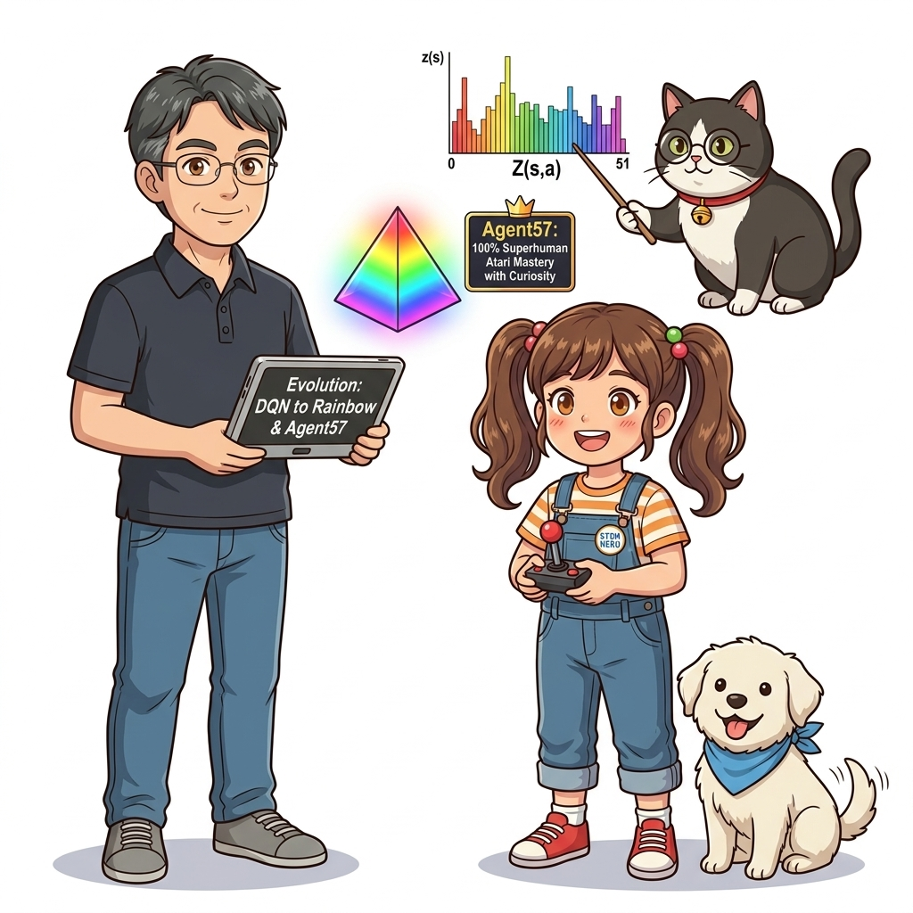
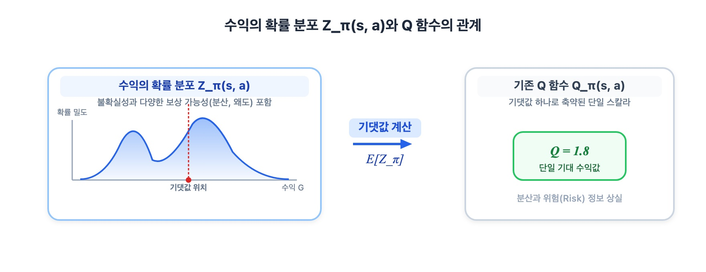
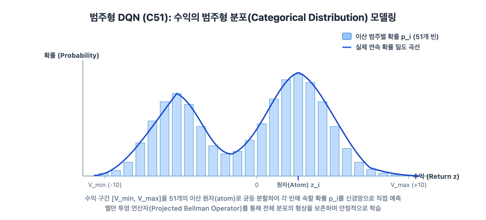
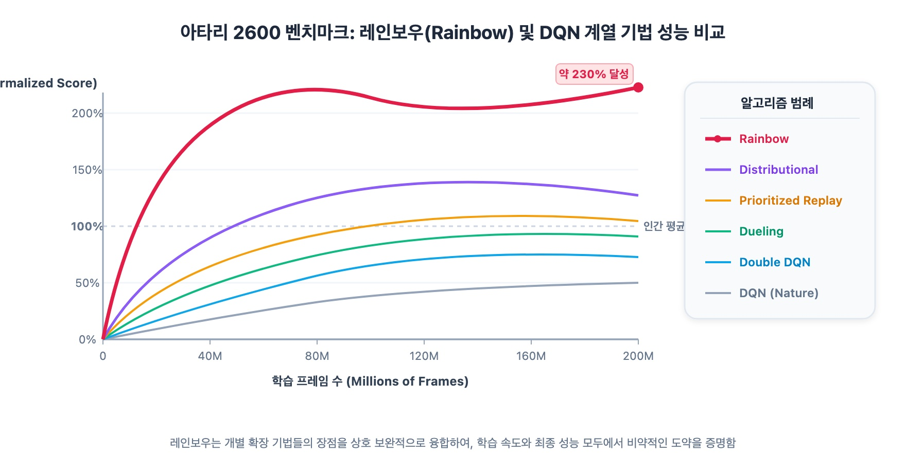

# 14.3 DQN 계열의 고급 알고리즘

**그림 14-4** 7가지 무지개 광채 카드를 보며 무지개 열차(Rainbow)에 가치 기반 고급 트릭들을 싣고 전진하는 도로시와 지니

> 12장에서 다룬 DQN을 궁극의 성능으로 끌어올린 혁신적인 DQN 계열 고급 알고리즘들을 공부합니다. 기대값 대신 가치의 확률 분포 자체를 예측하는 **분포 강화학습(Categorical DQN/C51)**, 매개변수에 노이즈를 섞어 자율 탐색을 유도하는 **Noisy Network**, 그리고 이 기법들을 총집결한 끝판왕 **레인보우(Rainbow DQN)**와 아타리 57개 전 종목을 인간 이상으로 정복한 **Agent57**까지 도로시, 지니 조교와 함께 정복해봅시다!

---

2015년 Nature 논문으로 발표된 DQN은 딥러닝과 강화학습의 결합을 알린 위대한 신호탄이었습니다. 하지만 오리지널 DQN은 과대평가 편향, 불안정한 탐색, 느린 수렴성이라는 한계를 안고 있었습니다.

연구자들은 DQN의 단점을 하나씩 해결하는 독립적인 개선 기법들을 고안해 냈고, 마침내 이 모든 기법을 하나의 유기체로 융합하여 상상을 초월하는 초인적 성능을 달성했습니다.

**그림 14-12** 6대 확장 기술을 결합한 레인보우(Rainbow DQN)와 호기심 내적 보상을 통해 아타리 57개 전 종목을 인간 이상으로 완전 정복한 Agent57의 진화도

---

## 14.3.1 분포 강화학습(Distributional RL)과 범주형 DQN (C51)

전통적인 가치 기반 강화학습(Q-러닝, DQN)의 핵심 목적은 다음 수식처럼 미래 누적 수익 $G_t$ 의 **단일한 평균값(기댓값)** 을 예측하는 것이었습니다:

$$
Q^\pi(s, a) = \mathbb{E}_\pi [ G_t \mid S_t = s, A_t = a ]
$$

### 기댓값의 함정: 수익의 전체 확률 분포를 보자

동일하게 기댓값이 +10점인 두 가지 행동이 있다고 가정해 봅시다:
- **행동 A:** 100% 확률로 안전하게 +10점 획득
- **행동 B:** 50% 확률로 잭팟 +1,000점 획득, 50% 확률로 패가망신 −980점 손실

오리지널 DQN의 Q 함수는 두 행동을 모두 똑같이 10점으로 평가하여 구별하지 못합니다. 단 하나의 스칼라 평균값 뒤에 숨겨진 **확률적 변동성과 위험(Risk)**의 전모가 완전히 뭉개져 버리기 때문입니다.

2017년 마크 벨마르(Marc Bellemare) 연구팀은 기댓값 대신 **수익의 확률 분포 자체 $Z^\pi(s, a)$ 를 학습하자**는 **분포 강화학습(Distributional RL)**[27]의 패러다임을 열었습니다!

### 범주형 DQN (Categorical DQN / C51)의 원리

수익 $G_t$ 가 취할 수 있는 범위를 최소값 $V_{\min}$ 부터 최대값 $V_{\max}$ 까지 일정 간격의 구간(Bin)으로 잘게 쪼갠 뒤, 신경망이 각 구간에 속할 확률을 소프트맥스로 출력하도록 만듭니다.

- 아타리 게임 벤치마크에서 구간의 개수(Atom)를 **51개**로 설정했을 때 가장 압도적인 성능을 보였기 때문에 **C51**이라는 별칭으로 널리 불립니다.
- 분포 강화학습은 가치 함수의 표현력을 극대화하고, 신경망 역전파 시 훨씬 풍부하고 안정적인 기울기 신호를 제공하여 강화학습의 학습 속도를 경이로운 수준으로 끌어올렸습니다.

---

## 14.3.2 Noisy Network: 신경망 스스로 학습하는 능동적 탐색

전통적인 DQN은 *ϵ*-탐욕 정책(Epsilon-Greedy)을 사용했습니다.  
하지만 *ϵ*값을 얼마로 시작하여 어떤 속도로 감쇠(Decay)시킬 것인지는 환경마다 전혀 다른 지독한 하이퍼파라미터 튜닝의 늪이었습니다. 또한 무작위 행동 선택은 아무런 맥락 없이 무의미하게 비틀거리는 '몸부림 탐색'에 불과했습니다.

**Noisy Network**[28]는 신경망의 완전 연결 계층 가중치 자체에 **학습 가능한 가우스 잡음(Parametric Noise)** 을 직접 주입합니다:

$$
y = (W + \sigma^W \odot \epsilon^W) x + (b + \sigma^b \odot \epsilon^b)
$$

- 신경망이 순전파를 수행할 때마다 가중치가 노이즈에 의해 자연스럽게 미세하게 요동치므로, *ϵ*-탐욕 정책 없이 순수한 탐욕 선택(`argmax`)만으로도 매우 지능적인 탐색이 이루어집니다.
- 놀랍게도 노이즈의 강도 *σ* 역시 역전파를 통해 에이전트 스스로 학습합니다! 탐색이 절실한 미지의 상태에서는 스스로 노이즈를 키우고, 최적 전략을 확립한 상태에서는 노이즈를 0으로 줄여 결단력 있게 행동합니다.

---

## 14.3.3 레인보우(Rainbow): 6대 독립 기술의 완벽한 융합

2017년 딥마인드의 헤셀(Matteo Hessel) 연구팀은 지난 수년간 제안된 DQN 계열의 6대 핵심 확장 기술들을 하나의 통일된 에이전트로 융합한 **레인보우(Rainbow)**[29]를 탄생시켰습니다.

| 융합된 6대 확장 기법 | 해결한 DQN의 고질적 문제점 |
| :--- | :--- |
| **1. Double DQN** | 가치 추정의 고질적인 과대평가(Overestimation) 편향 완벽 차단 |
| **2. 우선순위 경험 재생 (PER)** | TD 오차가 큰 중요한 전이 데이터를 더 자주 집중 학습하여 샘플 효율 극대화 |
| **3. Dueling Network** | 상태 가치 *V*(*s*)와 행동 이점 *A*(*s*, *a*)를 분리 모델링하여 상태 평가 안정화 |
| **4. 다중 스텝 학습 (*n*-step Learning)** | 1스텝 대신 *n*스텝 보상을 누적하여 TD 부트스트랩의 편향을 줄이고 보상 전파 가속 |
| **5. 분포 강화학습 (Distributional C51)** | 가치의 기댓값 대신 51개 빈의 확률 분포 *Z*(*s*, *a*)를 직접 모델링 |
| **6. Noisy Network** | 신경망 가중치 자체에 적응적 노이즈를 주입하여 *ϵ*-탐욕 의존도 탈피 |

### 레인보우의 결론과 제거 실험(Ablation Study)

아타리 57개 게임 실험 결과, 레인보우는 기존의 모든 단일 기법들을 아득히 초월하는 압도적인 학습 속도와 최고 점수를 달성했습니다.  
논문의 제거 실험(Ablation Study)에 따르면, 6가지 기술 중 단 하나라도 제거하면 성능이 유의미하게 하락했으며, 특히 **우선순위 경험 재생(PER)**, **다중 스텝 학습**, **분포 강화학습(C51)**의 기여도가 가장 결정적이었습니다.

---

## 14.3.4 레인보우를 넘어선 후속 분산/호기심 기반 알고리즘

레인보우 이후의 연구는 분산 병렬 컴퓨팅과 인간의 고유한 능력인 **호기심(Curiosity)**의 결합으로 나아갔습니다:

1. **Ape-X (2018):**  
   수백 대의 CPU 워커가 각기 다른 *ϵ*으로 데이터를 생성하고, 거대한 공유 우선순위 버퍼에 축적하여 GPU가 초고속으로 학습하는 대규모 분산 DQN 아키텍처.
2. **R2D2 (Recurrent Replay Distributed DQN, 2018):**  
   부분 관측 환경(POMDP)을 돌파하기 위해 LSTM 순환 신경망을 결합하고, 시계열 시퀀스를 경험 재생 버퍼에 저장하여 학습하는 고난도 엔지니어링을 완성.
3. **NGU (Never Give Up, 2020):**  
   보상이 극도로 희박한 게임(예: 몬테주마의 복수)에서 에이전트가 탐색을 조기 포기하지 않도록, 처음 보는 낯선 방에 들어섰을 때 스스로 보상을 부여하는 **내적 호기심 보상(Intrinsic Reward)** 메커니즘을 결합.
4. **Agent57 (2020):**  
   NGU의 호기심 탐색 메커니즘 위에 메타 컨트롤러(Meta-Controller)를 탑재하여, 57개 아타리 게임 전 종목에서 **인간 표준 점수 100%를 단 한 게임의 예외도 없이 모두 능가한 인류 역사상 최초의 범용 알고리즘**으로 등극했습니다.
