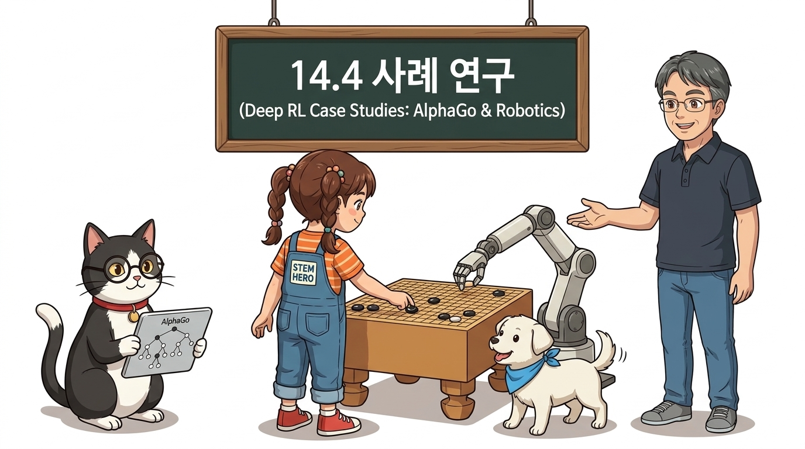
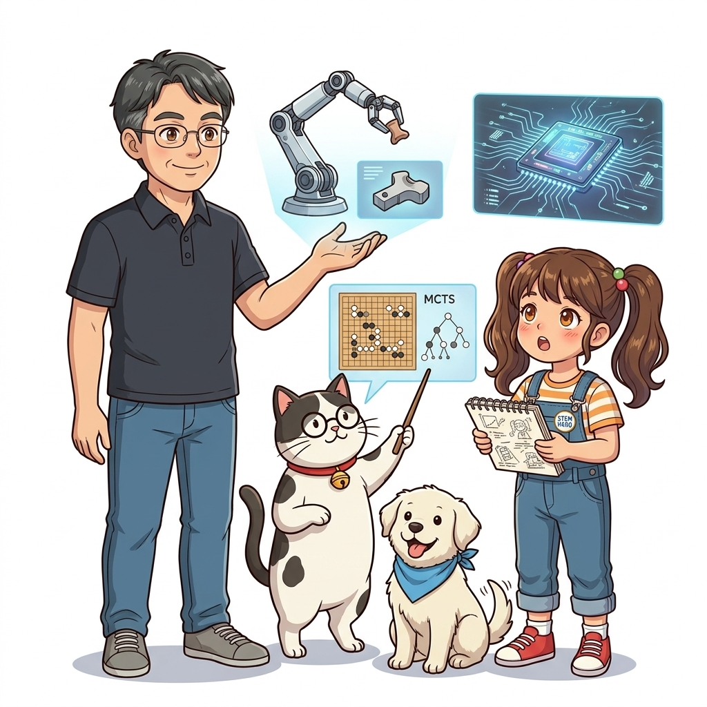
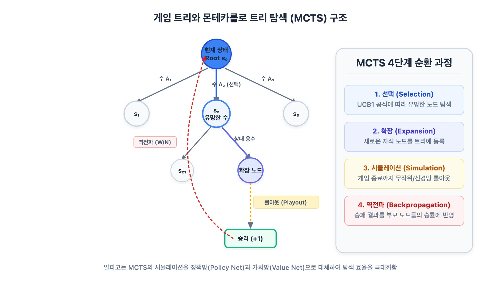
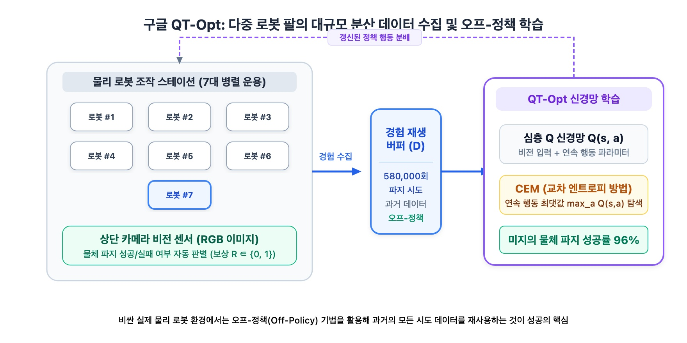
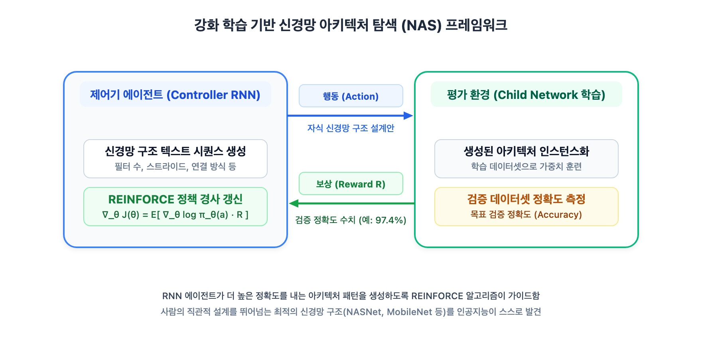

# 14.4 사례 연구

**그림 14-5** 바둑판(알파고), 로봇 제어, 반도체 칩 설계 등 현실 및 가상 세계의 정복 사례들을 칠판에 붙이며 설명해주는 지니와 눈이 반짝이는 도로시

> 인공지능 연구가 실험실의 시뮬레이션을 넘어 실생활과 산업에 적용되어 기적 같은 혁신을 불러일으킨 역사적 **사례 연구(Case Study)**들을 깊이 있게 해부합니다. 이세돌 9단과의 세기의 대결을 승리로 이끈 **알파고(AlphaGo)**의 몬테카를로 트리 탐색(MCTS) 메커니즘부터 실제 로봇 팔 제어, 반도체 칩 설계, 그리고 최신 생성형 AI의 인간 피드백 강화학습(RLHF)까지 강화학습이 도달한 위대한 정점들을 도로시, 지니 조교와 함께 생생하게 탐구해봅시다!

---

심층 강화학습은 아타리 비디오 게임이나 바둑판 같은 가상 세계의 장난감을 넘어, 오늘날 인류의 물리 세계와 산업 전반을 근본적으로 혁신하고 있습니다. 가장 기념비적인 핵심 성공 사례들을 살펴보겠습니다.

**그림 14-15** 초인적 지능을 증명한 알파고부터 물리 로보틱스 조작, 차세대 AI 반도체 칩 설계, 그리고 초거대 언어 모델 정렬에 이르는 심층 강화학습의 혁신 사례들

---

## 14.4.1 보드 게임: 지적 탐색의 정점과 알파고의 진화

바둑, 체스, 장기, 오셀로 같은 클래식 보드 게임은 세 가지 뚜렷한 수학적 특성을 가집니다:
1. **완전 정보 게임 (Perfect Information):** 바둑판 위의 모든 돌의 배치가 양쪽 플레이어에게 100% 투명하게 공개됩니다.
2. **제로섬 (Zero-Sum):** 한쪽의 이득은 정확히 상대방의 손실이며, 승자와 패자가 명확히 갈립니다.
3. **결정적 환경 (Deterministic):** 주사위 같은 우연 요소가 전혀 없이 돌을 놓는 즉시 상태가 100% 결정됩니다.

### 천문학적인 게임 트리(Game Tree)의 복잡도

보드 상태를 노드로, 다음 둘 수 있는 수(착점)를 간선으로 펼친 것을 **게임 트리**라고 부릅니다. 모든 경우의 수를 트리로 끝까지 펼칠 수만 있다면 5장에서 배운 동적 프로그래밍의 미니맥스(Minimax) 탐색으로 100% 필승법을 찾을 수 있습니다.

> [!NOTE]
> **게임 트리에서 가능한 총 상태(우주적 복잡도) 비교:**
> - **오셀로:** 약 1058개
> - **체스:** 약 10123개 (관측 가능한 전 우주의 원자 수인 1080개보다 훨씬 큼)
> - **장기:** 약 10226개
> - **바둑:** 약 10400개 이상!

바둑판의 경우의 수 10400개는 우주의 모든 원자를 컴퓨터로 만들어 우주의 시작부터 계산해도 단 1%도 펼쳐볼 수 없는 무한에 가까운 숫자입니다. 컴퓨터가 바둑에서 인간을 이기는 것은 영원히 불가능하다는 것이 2010년대 초반까지 학계의 정설이었습니다.

### 1) 알파고 (AlphaGo, 2016): MCTS와 딥러닝의 결합

2016년 딥마인드의 데미스 하사비스 연구팀이 개발한 **알파고(AlphaGo)**[35]는 **몬테카를로 트리 탐색(MCTS)**에 심층 신경망을 결합하여 이 불가능을 돌파했습니다:

- **정책 신경망 (Policy Network):** 19×19 바둑판 이미지를 입력받아, 다음에 둘 만한 가장 유망한 후보 수 몇 가지만을 좁혀서 제시합니다 (트리의 너비를 대폭 가지치기).
- **가치 신경망 (Value Network):** 현재의 바둑판 형세가 흑과 백 중 누구에게 몇 %의 확률로 유리한지 스칼라 승률을 즉각 추정합니다 (트리의 깊이를 가지치기).
- **MCTS와의 결합:** 무작위 롤아웃 대신 신경망의 정밀한 정책과 가치 평가를 지침 삼아 심층 트리 탐색을 수행했습니다.

알파고는 먼저 16만 개의 인간 프로기사 기보를 지도학습한 뒤, 수천만 번의 **셀프 플레이(Self-Play, 자신과의 대국)** 강화학습을 거쳐 이세돌 9단과의 역사적 대국에서 4:1로 승리했습니다.

### 2) 알파고 제로 (AlphaGo Zero, 2017): 인간 지식의 완전한 초월

오리지널 알파고는 여전히 인간의 기보를 초기 교재로 활용했습니다. 하지만 2017년의 **알파고 제로**[36]는 인간의 기보를 단 한 판도 보지 않고(Tabula Rasa), 오직 바둑 규칙만을 아는 백지상태에서 시작했습니다:

- 정책망과 가치망을 하나의 ResNet(잔차 신경망) 구조로 통일했습니다.
- 무작위 플레이아웃을 완전히 없애고 순수한 신경망 추론과 MCTS 탐색만으로 셀프 플레이를 거듭했습니다.
- **결과:** 단 3일간의 독학만으로 이세돌 9단을 이긴 오리지널 알파고를 **100대 0**으로 완벽하게 격파했습니다. 인간이 수천 년 동안 쌓아온 바둑의 정석과 패러다임이 인공지능에게는 오히려 국소 최적해(Local Optimum)에 갇히게 만드는 족쇄였음이 증명된 것입니다.

### 3) 알파제로(AlphaZero)와 뮤제로(MuZero)

- **알파제로 (2018):** 동일한 단일 신경망 알고리즘으로 바둑, 체스, 일본 장기(Shogi)의 세계 챔피언 프로그램을 훈련 시작 몇 시간 만에 모조리 제압하며 보드 게임의 종결자가 되었습니다.
- **뮤제로 (MuZero, 2020):** 심지어 게임의 규칙조차 알려주지 않고, 스스로 환경의 역학(잠재 세계 모델)을 학습하여 바둑뿐만 아니라 시각 정보만 주어지는 아타리 비디오 게임까지 동시에 평정했습니다.

---

## 14.4.2 피지컬 AI와 로봇 조작 제어

가상 시뮬레이터에서는 실패해도 시스템을 리셋하면 그만이지만, 현실 세계의 로봇은 넘어지거나 충돌하면 모터가 타버리고 수억 원짜리 기계가 파손됩니다.

### QT-Opt: 대규모 로봇 팜의 오프-정책 학습

구글은 7대의 실제 산업용 로봇 팔을 수개월 동안 24시간 연속 운용하여 80만 번 이상의 물건 집기(Grasping) 데이터를 수집했습니다[38]:
- **QT-Opt:** 카메라 시각 센서로부터 연속 관절 토크를 제어하는 대규모 분산 Q-러닝 알고리즘입니다.
- **오프-정책의 힘:** 과거에 실패했거나 이전 버전의 구형 정책이 수집했던 수십만 건의 경험 데이터를 버리지 않고 경험 재생 버퍼에 모두 집어넣어 재활용했습니다.
- **성과:** 난반사가 심한 투명 유리병, 형태가 찌그러지는 헝겊 인형 등 생전 처음 보는 미지의 물체도 **96%의 압도적인 성공률**로 집어 올리는 데 성공했습니다.

---

## 14.4.3 신경망 구조 탐색 (NAS, Neural Architecture Search)

"신경망을 만드는 최적의 신경망 구조는 사람이 직접 짜야만 하는가?"라는 질문에 강화학습이 혁신적인 답을 내놓았습니다.

구글 브레인의 조프(Barret Zoph)와 레(Quoc V. Le)는 **신경망 구조 자체를 생성하는 RNN 에이전트**를 고안했습니다[40]:
- **에이전트의 행동:** 레이어의 필터 크기, 스트라이드, 잔차 연결 여부 등의 구조를 텍스트 코드로 생성
- **환경의 보상:** 생성된 자식 신경망을 실제로 학습시킨 후 검증 데이터셋에서 측정한 최종 인식 정확도
- **정책 갱신:** REINFORCE 정책 경사법을 사용하여, 더 높은 성능을 내는 아키텍처를 출력하도록 RNN을 갱신

이렇게 발견된 아키텍처(NASNet, MobileNetV3 등)는 인간 엔지니어가 수년간 고민해 온 수동 설계를 가뿐히 뛰어넘는 놀라운 경량화와 정확도를 달성했습니다.

---

## 14.4.4 산업과 생성형 AI로의 거대한 확장

### 1) 초미세 반도체 칩 배치 설계 (Chip Floorplanning)

스마트폰과 서버에 들어가는 최신 반도체 칩은 수십억 개의 트랜지스터와 수만 개의 메모리 블록을 손톱만 한 실리콘 기판 위에 최적 배치해야 합니다.  
배선 길이가 길어지면 전력 소비가 급증하고 발열이 심해집니다. 인간 베테랑 설계자 팀이 달라붙어도 수개월이 걸리던 이 고난도 바둑판 배치를 구글은 강화학습 에이전트에 맡겼습니다[46]:
- 칩 배치를 하나의 거대한 게임으로 모델링하고 에이전트가 블록을 배치하도록 훈련.
- 단 **6시간 만에** 인간 최고 전문가가 몇 달간 작업한 것보다 배선 길이와 전력 효율이 모두 우수한 칩 레이아웃을 완성하여, 구글의 AI 전용 가속기인 **TPU v4/v5** 제작에 직접 적용되었습니다.

### 2) 데이터센터 및 스마트 빌딩 에너지 40% 절감

구글은 전 세계 데이터센터의 냉각 펌프, 칠러, 냉각탑의 수천 개 제어 밸브를 심층 강화학습 에이전트에 맡겼습니다. 외부 기온과 서버 부하 변동을 실시간으로 감지하여 냉각 효율을 최적화함으로써 **데이터센터 냉각 전력 소비를 무려 40% 절감**하는 놀라운 성과를 거두었습니다.

### 3) LLM의 심장: 인간 피드백 기반 강화학습 (RLHF)

오늘날 전 세계를 뒤흔들고 있는 ChatGPT, Claude, Gemini와 같은 대규모 언어 모델(LLM)이 인간의 지시를 고분고분 따르고 안전하고 윤리적인 답변을 생성할 수 있는 결정적 비결은 무엇일까요?  
바로 14.2절에서 배운 **PPO(Proximal Policy Optimization)** 기반의 **RLHF(Reinforcement Learning from Human Feedback)**입니다!

- **에이전트 (정책망):** 거대 언어 모델 (LLM)
- **행동 (Action):** 문맥에 맞춰 다음에 출력할 토큰(단어)들의 시퀀스
- **보상 (Reward):** 인간의 선호도를 흉내 내도록 훈련된 보상 모델(Reward Model)의 점수
- **최적화:** PPO를 통해 언어 모델이 본래의 문장 구사력(KL 발산 제약)을 잃지 않으면서도, 인간에게 가장 도움이 되고 안전한 답변을 출력하도록 파라미터를 미세조정(Fine-Tuning)합니다.

결국 현대 생성형 AI 혁명의 가장 깊은 엔진실 속에서도, 우리가 지금까지 배운 강화학습의 원리가 힘차게 고동치고 있는 것입니다!
