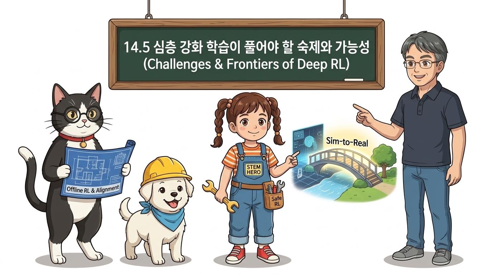
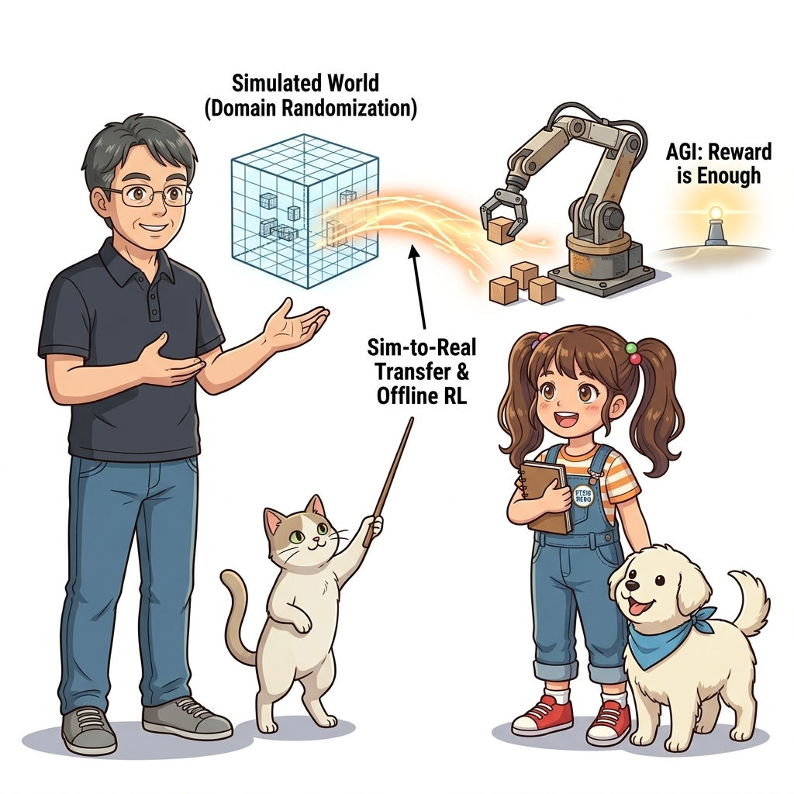
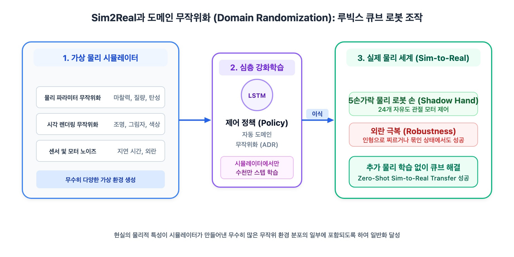
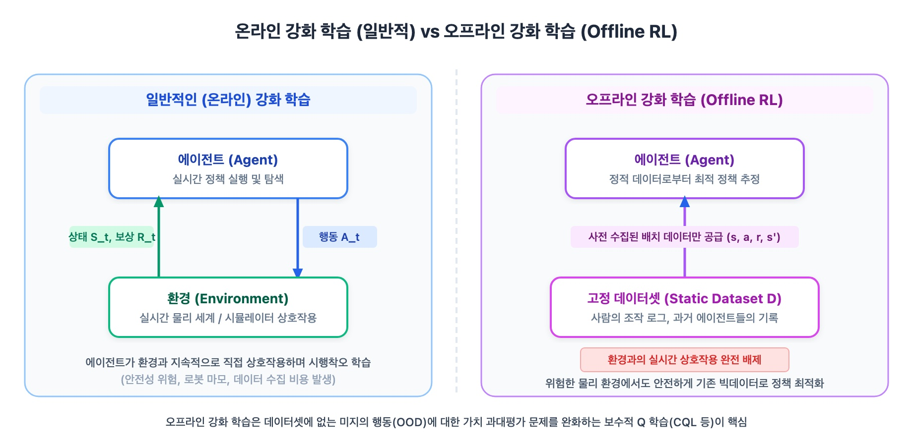

# 14.5 심층 강화 학습이 풀어야 할 숙제와 가능성

**그림 14-6** 가상 환경의 징검다리와 현실 세계의 깊은 틈새 사이에서 오프라인 강화학습(Offline RL) 다리를 안전하게 놓아주는 지니 요정

> 심층 강화학습이 실험실을 벗어나 실제 물리 현실과 산업 시스템에 안전하게 상용화되기 위해 반드시 넘어야 할 핵심 과제들과 미래 연구 지평을 전망합니다. 시뮬레이션과 현실의 간극을 좁히는 **Sim-to-Real**과 **도메인 무작위화**, 위험한 현장 시도를 원천 차단하는 **오프라인 강화학습(Offline RL)**과 **모방 학습(Imitation Learning)**, 실전 문제를 MDP로 정밀하게 정의하는 설계 팁, 그리고 "보상 극대화만으로 지능을 완성할 수 있는가"라는 **범용 인공지능(AGI)**을 향한 대담한 질문까지 도로시, 지니 조교와 함께 탐구해봅시다!

---

지금까지 우리는 강화학습의 수학적 기초부터 최첨단 심층 신경망 알고리즘까지 숨 가쁘게 달려왔습니다. 하지만 강화학습을 실제 자율주행차, 의료 진단, 수술 로봇, 원자력 발전소 제어와 같은 현실 세계(Real-world)에 배포하려고 할 때, 우리는 가상 시뮬레이터에서는 미처 겪어보지 못한 거대한 장벽들과 마주치게 됩니다.

이 장벽들을 돌파하기 위한 최신 연구 흐름과 실전 MDP 설계 노하우, 그리고 인공지능의 궁극적 목표인 범용 인공지능(AGI)으로의 가능성을 살펴보겠습니다.

**그림 14-17** 가상 시뮬레이터와 물리적 현실 사이의 간극(Reality Gap)을 메우는 Sim-to-Real 및 오프라인 강화학습, 그리고 범용 인공지능(AGI)을 향한 미래 지평선

---

## 14.5.1 현실 세계 적용을 위한 3대 핵심 돌파구

현실 세계에서 강화학습을 직접 학습시키기 어려운 이유는 명확합니다:
1. **하드웨어의 파손 위험:** 무작위 탐색을 하다가 로봇이 벽에 부딪치거나 계단에서 구르면 치명적인 물리적 파손이 일어납니다.
2. **시간과 비용의 한계:** 가상 시뮬레이터에서는 1초에 1,000만 번의 스텝을 고속 병렬로 돌릴 수 있지만, 현실의 1초는 오직 실제 1초일 뿐입니다.
3. **안전성(Safety) 문제:** 자율주행이나 의료 시스템에서의 단 한 번의 실패는 인명 피해로 직결됩니다.

연구자들은 이 문제를 해결하기 위해 다음과 같은 3가지 강력한 돌파구를 마련했습니다:

### 1) 시뮬레이션과 현실의 가교: Sim-to-Real과 도메인 무작위화

시뮬레이터(Isaac Gym, MuJoCo, PyBullet 등)에서 수억 번의 시행착오를 초고속으로 안전하게 거친 뒤, 학습된 정책 신경망을 실제 물리 로봇에 그대로 탑재(Zero-shot Transfer)하는 기법입니다.

- **현실 간극(Reality Gap):** 시뮬레이터의 마찰 계수, 모터 지연 시간(Latency), 조명 등이 실제 현실과 미세하게만 달라도 로봇은 현실에서 휘청거리며 실패합니다.
- **도메인 무작위화 (Domain Randomization):**  
  OpenAI의 5지 로봇 손 루빅스 큐브 프로젝트[47]처럼, 시뮬레이터 안에서 바닥의 마찰 계수(0.1 ~ 0.9), 모터 응답 지연(5ms ~ 50ms), 물체의 무게, 카메라 조명과 텍스처를 매 에피소드마다 극단적으로 무작위 변형합니다.  
  이처럼 온갖 혼란스럽고 가혹한 가상 환경 속에서 살아남은 정책은 물리 현실 세계의 미세한 오차를 "단지 시뮬레이터에서 겪었던 수많은 변종 환경 중 하나"로 인식하여, 현실에서도 놀랍도록 견고하게 작동합니다.

### 2) 안전한 데이터셋 기반 학습: 오프라인 강화학습 (Offline RL)

- **기존 온라인 강화학습:** 에이전트가 현실 환경과 끊임없이 상호작용하며 실시간으로 데이터를 직접 수집해야 함 (위험하고 비용이 큼).
- **오프라인 강화학습 (Data-Driven RL):**  
  환경과의 실시간 상호작용을 **완전히 0**으로 만듭니다. 이미 병원, 공장, 자동차에 오랜 세월 축적된 방대한 로그 데이터셋(전문가 운전 기록, 의사의 처방 기록)만을 정적으로 입력받아, 그 데이터셋 안에서 최적의 정책을 학습합니다.
- **분포 외 데이터(OOD) 해결:** 수집되지 않은 행동에 대해 Q값을 터무니없이 과대평가하는 문제를 막기 위해, 데이터셋의 행동 분포를 벗어나지 않도록 보수적인 제약을 거는 **보수적 Q-러닝(Conservative Q-Learning, CQL)** 등이 활발히 쓰입니다.

### 3) 전문가의 직관을 전수받는 모방 학습 (Imitation Learning)

인간은 자전거를 배울 때 무작위로 수천 번 넘어지며 배우지 않고, 부모님이 뒤를 잡아주거나 다른 사람의 모범 동작을 관찰하며 배웁니다.
- **행동 복제 (Behavior Cloning):** 전문가의 (상태, 행동) 데이터셋을 지도학습 방식으로 신경망에 주입하여 빠르게 기본기를 가르칩니다.
- **시연 기반 강화학습 (DQfD / RL with Demonstrations):** 전문가의 시연 데이터를 경험 재생 버퍼에 특별한 우선순위로 영구 보존하고, 강화학습의 보상 신호와 결합하여 전문가의 수준을 뛰어넘는 초인적 실력으로 도약시킵니다.

---

## 14.5.2 실전 문제를 MDP로 공식화하기 위한 5대 골든 룰

강화학습 교과서의 예제들은 상태, 행동, 보상이 이미 깔끔하게 정의되어 있습니다. 하지만 여러분이 마주할 현실의 비즈니스나 공학 문제는 거칠고 모호합니다. 현실 문제를 마르코프 결정 과정(MDP)으로 우아하게 모델링하기 위한 핵심 지침입니다:

### 1. 상태(State)의 마르코프성 보장하기
현재 상태 *S**t*에 "과거의 이력 없이도 미래를 예측하기에 충분한 정보"가 들어 있는지 검증해야 합니다.  
단 한 장의 카메라 사진에는 자동차의 위치만 있고 속도나 가속도 정보가 없습니다. 이럴 때는 12장에서 배운 **연속 프레임 스태킹(Frame Stacking)**을 쓰거나, LSTM 같은 **순환 신경망(RNN)**을 도입하여 부분 관측(POMDP) 문제를 해결해야 합니다.

### 2. 에이전트와 환경의 경계를 냉정하게 가르기
- 에이전트가 **직접 100% 임의로 통제할 수 있는 것**만이 에이전트의 내부입니다 (예: 모터 제어 신호, 전압, 디지털 출력).
- 로봇의 관절 기어, 배터리 잔량, 모터 온도처럼 에이전트가 통제하고 싶지만 물리 법칙의 지배를 받는 하드웨어 요소들은 모두 **환경(Environment)**으로 규정해야 모델링이 꼬이지 않습니다.

### 3. 보상 설계의 함정: 보상 해킹(Reward Hacking) 경계하기
에이전트는 개발자가 **의도한 마음**대로 행동하지 않고, 오직 **정의된 수식의 숫자**를 극대화하는 가장 기괴하고 엉뚱한 꼼수를 기가 막히게 찾아냅니다.
- *사례:* 보트 레이싱 게임(CoastRunners)에서 완주를 시키려고 '트랙에서 점수를 얻을 때마다 보상'을 주었더니, 보트가 결승선으로 가지 않고 좁은 만(Bay) 안에서 무한히 제자리 뱅뱅이를 돌며 아이템만 끝없이 먹다가 보트가 불타버리는 현상이 발생했습니다.
- **해결책:** 행동 중간 과정에 지나치게 자잘한 중간 보상(Shaping Reward)을 주지 말고, 최종 목표 달성에 명확한 보상을 부여하거나 잠재 기반 보상 형성(Potential-based Reward Shaping)을 사용해야 합니다.

### 4. 이산 행동 vs 연속 행동의 올바른 선택
- 선택지가 몇 개 안 되는 의사결정(게임, 주식 매수/매도/관망) -> **DQN, Rainbow**
- 부드러운 각도, 속도, 압력 등 물리 모터 제어 -> **SAC, PPO**

### 5. 시간 단위(Time Discretization)의 균형
타임스텝 간격 Δ*t*가 너무 짧으면(예: 1ms) 에피소드 길이가 수만 스텝으로 길어져 보상 전파가 극도로 어려워집니다. 반대로 너무 길면(예: 1초) 물리 충돌이나 미세한 균형 제어 타이밍을 놓쳐버립니다. 시스템의 물리적 시상수(Time Constant)를 고려한 최적의 주기 선정이 핵심입니다.

---

## 14.5.3 범용 인공지능(AGI)을 향한 궁극의 질문: "Reward is Enough"

오늘날 대부분의 AI는 바둑만 잘 두거나, 이미지만 잘 인식하거나, 번역만 잘하는 특화 인공지능(Narrow AI)입니다. 하지만 인간은 한 대의 뇌로 언어, 운전, 예술, 수학, 물리 도구 제작을 자유자재로 해냅니다. 이처럼 모든 도메인을 넘나드는 지능을 **범용 인공지능(Artificial General Intelligence, AGI)**이라고 부릅니다.

2021년 딥마인드의 데이비드 실버(David Silver), 사토인더 싱(Satinder Singh), 두냐 프레쿱(Doina Precup), 리처드 서튼(Richard Sutton)은 AI 학계에 거대한 충격을 안긴 기념비적 논문을 발표했습니다:

> **"Reward is Enough (보상 극대화만으로 충분하다)"**[50]

논문의 핵심 명제는 다음과 같습니다:
> **"인간과 동물이 지닌 지각(Perception), 언어(Language), 기억(Memory), 추론(Reasoning), 도구 사용, 심지어 사회적 협력과 자아의식에 이르는 모든 복잡한 지적 능력들은, 별개의 복잡한 알고리즘을 각각 만들어 붙일 필요 없이, 오직 풍부한 환경 속에서 누적 보상을 극대화(Maximizing Cumulative Reward)하려는 단 하나의 강화학습 목표를 추구하는 과정에서 자연스럽게 창발(Emergence)할 수 있다."**

이 가설이 참이든 아니든, 우리가 이 책을 통해 배운 **환경과의 역동적인 상호작용**, **시행착오를 통한 가치 평가**, 그리고 **더 나은 미래를 향해 정책을 스스로 진화시키는 강화학습의 본질**은, 기계가 진정한 지능을 획득하는 가장 자연스럽고 우아한 여정임에 틀림없습니다.
