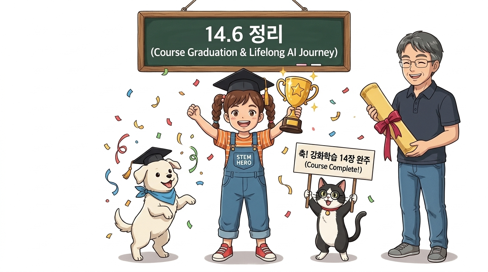
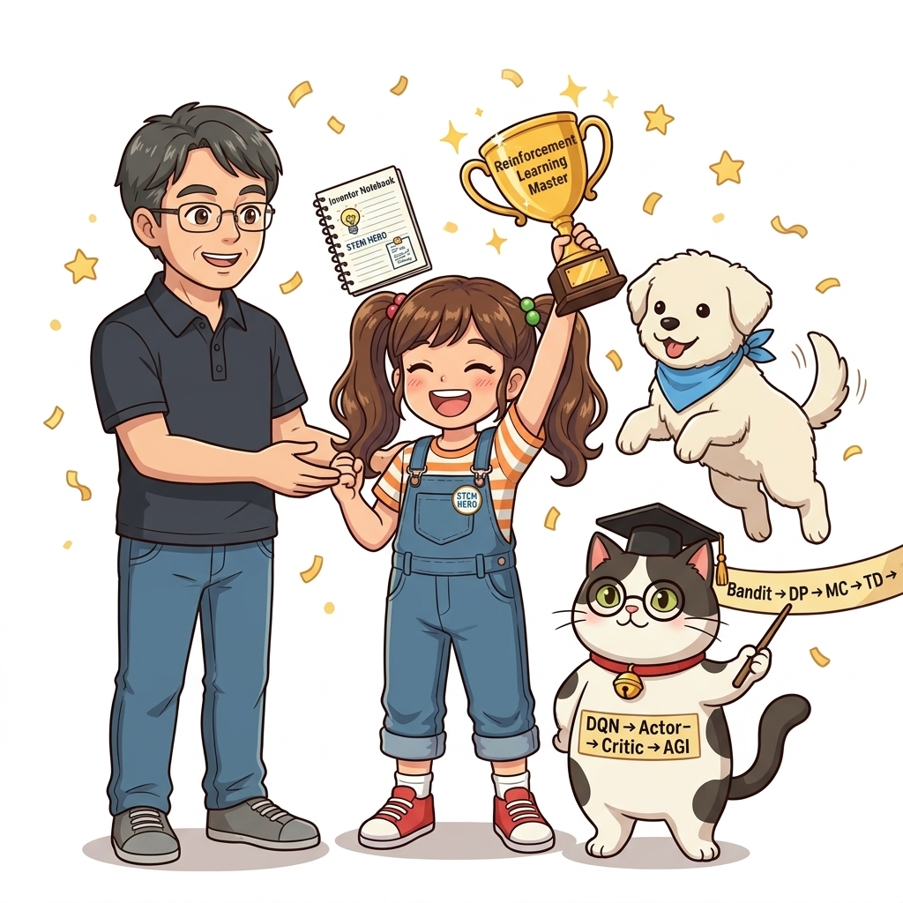

# 14.6 정리: 위대한 여정의 마침표, 그리고 새로운 시작

**그림 14-7** 밑바닥부터 시작한 강화학습 징검다리 지도를 끝까지 정주행 완료하고 감격하며 축배를 드는 도로시, 토토, 그리고 지니 요정

> 《밑바닥부터 시작하는 딥러닝 4: 강화학습편》의 모든 챕터를 완벽하게 완주한 여러분을 진심으로 축하합니다! 다중 슬롯머신부터 마르코프 결정 과정(MDP), 동적 프로그래밍(DP), 몬테카를로(MC), 시간차 학습(TD), Q-러닝, 심층 신경망과 결합한 DQN, 연속 제어와 정책 경사법, 그리고 현대 피지컬 AI와 AGI의 최전선에 이르기까지 우리가 함께 걸어온 위대한 지적 대장정을 총결산해봅시다!

---

## 14.6.1 우리가 함께 정복한 강화학습 마스터 로드맵

우리는 단순히 남이 만들어 둔 블랙박스 라이브러리를 가져다 쓰는 소비자에 머물지 않았습니다. 모든 수식의 수학적 유도 과정을 엄밀히 검증하고, DeZero 프레임워크를 기반으로 기초 신경망 엔진부터 에이전트와 환경의 상호작용 코드 한 줄 한 줄을 밑바닥부터 직접 구현하며 원리를 체득했습니다.

| 부 (Part) | 장 (Chapter) | 핵심 주제 | 우리가 마스터한 핵심 원리와 통찰 |
| :---: | :---: | :--- | :--- |
| **제1부 강화학습의 기초** | **1~4장** | **다중 슬롯머신 & MDP** | • 탐색과 이용의 딜레마 (Exploration vs Exploitation, *ϵ*-greedy) • 마르코프 결정 과정(MDP)의 4요소: 상태 *S*, 행동 *A*, 전이 확률 *P*, 보상 *R* • 벨만 기대 방정식과 벨만 최적 방정식의 수학적 도출 |
| **제2부 테이블형 학습법** | **5~6장** | **동적 프로그래밍 (DP)** | • 환경 모델을 완벽히 알 때: 정책 평가와 정책 개선 • 정책 반복(Policy Iteration)과 가치 반복(Value Iteration)의 수렴성 |
| | **7~9장** | **몬테카를로 & 시간차(TD)** | • 모델 프리 환경: 샘플 경험을 통한 정책 평가 • 몬테카를로법(MC)의 비편향성과 시간차 학습(TD)의 부트스트랩 효율성 • SARSA (온-정책 제어) vs Q-러닝 (오프-정책 최적 제어) |
| **제3부 심층 신경망과 DQN** | **10~12장** | **신경망 Q-러닝 & DQN** | • 테이블의 한계를 극복하는 함수 근사(Function Approximation) • DeZero 자동 미분(Autograd) 계산 그래프와 역전파 구현 • **DQN의 2대 혁신:** 경험 재생(Experience Replay) + 타깃 네트워크(Target Net) • Double DQN, 우선순위 경험 재생(PER), Dueling DQN 아키텍처 |
| **제4부 정책 경사법과 미래** | **13장** | **정책 경사법 & Actor-Critic** | • 로그 미분법(Log-derivative Trick)을 통한 정책 경사 정리 도출 • **인과율(Causality)**로 과거 노이즈를 제거한 REINFORCE • 기준선을 빼서 분산을 드라마틱하게 낮추는 **베이스라인(Baseline)** • 실시간 1-step TD 오차 피드백으로 정책과 가치를 동시 학습하는 **Actor-Critic** |
| | **14장** | **한 걸음 더 (Advanced Frontiers)** | • 모델 기반 vs 모델 프리 알고리즘 계통 분류 체계 • 병렬 동기화(A2C), 연속 토크 제어(DDPG/SAC), 신뢰 영역 클리핑(PPO) • 분포 강화학습(C51)과 통합 레인보우(Rainbow), 호기심 기반 Agent57 • 알파고(MCTS)와 피지컬 로보틱스, Sim-to-Real, 오프라인 RL, 그리고 AGI |

---

## 14.6.2 시대가 변해도 결코 흔들리지 않는 4대 불변의 지혜

인공지능 분야는 하루가 멀다 하고 새로운 논문과 현란한 이름의 프레임워크가 쏟아져 나옵니다. 하지만 겉모습의 화려함에 현혹될 필요가 없습니다. 최첨단 휴머노이드 로봇이든, 자율주행차든, 거대 언어 모델(LLM)을 정렬하는 RLHF든, 그 가장 밑바닥 엔진실에서 돌아가는 **강화학습의 본질적인 핵심 원리는 결코 변하지 않기 때문**입니다:

1. **상호작용을 통한 시행착오 (Trial and Error):**  
   정답 레이블이 주어지지 않아도, 환경과 온몸으로 부딪치며 보상 신호로부터 스스로 지식을 축적하는 자율적 학습 메커니즘.
2. **벨만 방정식의 점화적 부트스트랩 (Bootstrapping):**  
   "현재 상태의 가치는 다음 상태의 가치로부터 추정된다"라는 1단계 미래와의 일관성을 유지하며 가치를 갱신하는 시간차 학습의 미학.
3. **편향과 분산의 우아한 타협 (Bias-Variance Tradeoff):**  
   몬테카를로의 높은 분산을 시간차 학습의 약간의 편향으로 다스리고, 베이스라인과 어드밴티지 함수를 통해 가장 순수한 학습 신호를 추출해내는 통계적 절제미.
4. **목적 함수를 향한 직접적인 경사 상승 (Direct Policy Gradient):**  
   어려운 환경 전이 확률의 세부 역학을 몰라도, 에이전트의 경험 샘플만으로 정책의 파라미터를 누적 보상의 정상(Peak)을 향해 밀어 올리는 경사 상승의 위대함.

**그림 14-18** 강화학습 교재의 전 과정을 완벽히 마스터하고 영광의 졸업 트로피를 힘차게 들어 올린 도로시와 이호진 교수님, 학사모를 쓴 지니 조교와 환호하는 토토

---

## 14.6.3 여러분의 위대한 탐험을 응원하며

처음 1장에서 슬롯머신 손잡이를 당기던 어린아이 같던 우리의 에이전트는, 이제 스스로 환경을 탐색하고, 복잡한 신경망을 통해 가치와 행동을 스스로 평가하며, 인간 최고수를 뛰어넘고 물리 로봇의 팔을 정밀하게 제어하는 성숙한 지능체로 성장했습니다.

이 책을 끝까지 완독하고 모든 코드와 수식을 직접 체화해낸 여러분은 이미 전 세계 어디에 내놓아도 손색없는 단단한 심층 강화학습의 이론적 기초와 실전 구현력을 갖추었습니다.

이제 시뮬레이터를 끄고 현실의 세계로 눈을 돌려보십시오.  
여러분의 손끝에서 펼쳐질 새로운 로봇, 자율 시스템, 그리고 미래의 인공지능이 세상에 어떤 기적 같은 변화를 만들어낼지 가슴 깊이 기대합니다.

그동안 이 길고 깊은 지적 모험을 함께해 주셔서 진심으로 감사드립니다!
