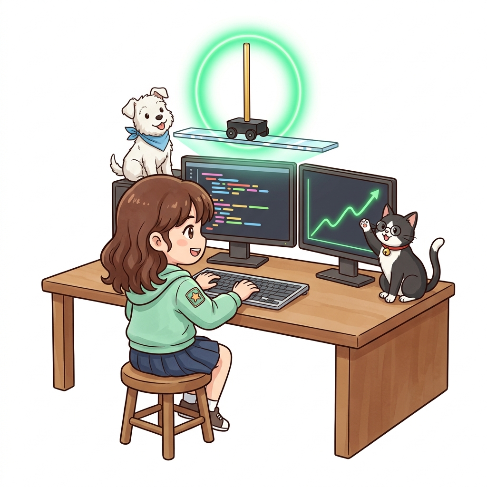

# 15.5 카트폴 실전 예제 구현

**그림 15-5** 파이토치로 작성한 REINFORCE 알고리즘으로 카트폴 시뮬레이션의 막대를 500스텝 완벽하게 직립 유지시키는 데 성공하고 기뻐하는 도로시와 지니


---

> **도로시와 지니의 코딩 워크숍**:
> "앞서 12장에서 DQN으로 카트폴을 풀었을 때는 Q-네트워크, 타깃 네트워크, 리플레이 버퍼, $\epsilon$-탐욕 스케줄링까지 챙길 것이 정말 많았어요.
> 그런데 REINFORCE 코드를 보면 깜짝 놀라실 거예요! 리플레이 버퍼도 없고, 타깃 네트워크도 필요 없습니다. 오직 하나의 정책 신경망만으로 에피소드를 주행하고, 누적 보상을 점수 함수에 곱해 역전파하는 것만으로 카트폴이 수직으로 우뚝 섭니다!"

---

### 1. 실습 환경: Gymnasium CartPole-v1

우리가 공략할 환경은 강화학습의 영원한 벤치마크인 **CartPole-v1**입니다:

* **상태 공간 (4차원 연속 벡터, `Box(4,)`)**:
  1. $s[0] = x$: 카트의 수평 위치 ($-4.8 \sim 4.8$)
  2. $s[1] = \dot{x}$: 카트의 이동 속도 ($-\infty \sim \infty$)
  3. $s[2] = \theta$: 막대의 기울기 각도 ($-0.418 \sim 0.418\,\text{rad} \approx \pm 24^\circ$)
  4. $s[3] = \dot{\theta}$: 막대의 각속도 ($-\infty \sim \infty$)
* **행동 공간 (2가지 이산 행동, `Discrete(2)`)**:
  - `0`: 카트를 왼쪽으로 밀기 (Push cart to the left)
  - `1`: 카트를 오른쪽으로 밀기 (Push cart to the right)
* **보상 및 종료 조건**:
  - 막대가 쓰러지지 않고 버티는 매 스텝마다 **`+1.0`** 보상 획득.
  - 막대 각도가 $\pm 12^\circ$를 벗어나거나 카트가 $\pm 2.4$ 범위를 이탈하면 에피소드 즉시 실패 종료 (`terminated`).
  - 최대 500스텝을 버텨내면 환경 해결로 간주 (`truncated`).

---

### 2. PyTorch 정책 신경망 설계

이산 행동 공간이므로 4차원 상태 벡터를 입력받아 은닉층 128개를 거친 뒤 소프트맥스(Softmax)를 통해 2개 행동의 확률 분포를 출력합니다:

```python
import torch
import torch.nn as nn

class PolicyNetwork(nn.Module):
    def __init__(self, state_dim=4, action_dim=2, hidden_dim=128):
        super(PolicyNetwork, self).__init__()
        self.net = nn.Sequential(
            nn.Linear(state_dim, hidden_dim),
            nn.ReLU(),
            nn.Linear(hidden_dim, action_dim),
            nn.Softmax(dim=-1) # 합이 1인 행동 확률 분포 [P(왼쪽), P(오른쪽)]
        )

    def forward(self, state):
        return self.net(state)
```

---

### 3. 확률적 행동 샘플링과 로그 확률 추적

`torch.distributions.Categorical` 클래스를 사용하면 신경망이 출력한 확률 분포에서 행동을 무작위 샘플링하고, 해당 행동의 로그 확률($\log \pi(a|s)$)을 한 줄로 계산할 수 있습니다:

```python
from torch.distributions import Categorical

def select_action(self, state):
    state_tensor = torch.from_numpy(state).float().unsqueeze(0)
    probs = self.policy(state_tensor)
    
    # 1. 범주형 확률 분포 생성
    dist = Categorical(probs)
    # 2. 분포로부터 행동 샘플링 (탐색과 활용이 자연스럽게 공존)
    action = dist.sample()
    
    # 3. 점수 함수 계산을 위해 log π(a|s)를 보관
    self.saved_log_probs.append(dist.log_prob(action))
    return action.item()
```

---

### 4. 반환값 $G_t$ 역순 계산 및 정규화

에피소드가 끝난 뒤 수집된 보상 리스트 `rewards = [r_1, r_2, ..., r_T]`를 뒤에서부터 역순으로 순회하며 할인 누적 반환값 $G_t$를 효율적으로 구합니다:

$$G_t = r_{t+1} + \gamma G_{t+1}$$

```python
discounted_returns = []
G = 0.0
for r in reversed(self.rewards):
    G = r + self.gamma * G
    discounted_returns.insert(0, G)

returns = torch.tensor(discounted_returns, dtype=torch.float32)

# 고분산 완화를 위한 Z-score 표준화
if len(returns) > 1:
    returns = (returns - returns.mean()) / (returns.std() + 1e-8)
```

---

### 5. 정책 손실 함수 계산 및 파라미터 갱신

파이토치의 기본 옵티마이저는 손실 최소화(경사하강법)를 수행하므로, 목적 함수 $J(\theta) = \sum \log \pi(a_t|s_t) G_t$에 음수 부호를 취한 **서로게이트 손실(Surrogate Loss)**을 정의합니다:

$$\mathcal{L}(\theta) = - \sum_{t=0}^{T-1} \log \pi_\theta(a_t \mid s_t) \cdot G_t$$

```python
policy_loss = []
for log_prob, G_t in zip(self.saved_log_probs, returns):
    # 좋은 행동(G_t > 0)은 log_prob을 증가시키는 방향으로 유도
    policy_loss.append(-log_prob * G_t)

loss = torch.stack(policy_loss).sum()

self.optimizer.zero_grad()
loss.backward()
self.optimizer.step()

# 다음 에피소드를 위해 메모리 비우기
self.saved_log_probs.clear()
self.rewards.clear()
```

---

### 6. 전체 실행 가능한 독립형 파이썬 스크립트

동일한 디렉토리에 위치한 [`step01_cartpole_reinforce.py`](./step01_cartpole_reinforce.py) 파일을 실행하면 약 200~300 에피소드 이내에 카트폴이 만점(500스텝)에 도달하는 모습을 직접 확인할 수 있습니다:

```bash
# REINFORCE 카트폴 학습 실행
python step01_cartpole_reinforce.py
```

**학습 진행 콘솔 출력 예시**:
```text
=== CartPole-v1 REINFORCE 학습 시작 (목표 점수: 475.0) ===
에피소드  20 | 최근 100회 평균 점수:  23.40 | 이번 에피소드:   18
에피소드  40 | 최근 100회 평균 점수:  32.15 | 이번 에피소드:   45
에피소드  60 | 최근 100회 평균 점수:  54.80 | 이번 에피소드:   89
에피소드  80 | 최근 100회 평균 점수:  88.30 | 이번 에피소드:  142
에피소드 100 | 최근 100회 평균 점수: 135.60 | 이번 에피소드:  210
에피소드 140 | 최근 100회 평균 점수: 284.50 | 이번 에피소드:  430
에피소드 180 | 최근 100회 평균 점수: 412.70 | 이번 에피소드:  500
에피소드 215 | 최근 100회 평균 점수: 476.30 | 이번 에피소드:  500

🎉 축하합니다! 에피소드 215에서 목표 점수(475.0)를 달성하며 조기 종료합니다!
```

---

### 7. DQN 대비 REINFORCE 구현의 간결함과 매력

1. **단 하나의 신경망**: 타깃 네트워크 동기화 주기나 지연 하이퍼파라미터가 없습니다.
2. **리플레이 버퍼 불필요**: 몬테카를로 방식이므로 에피소드가 끝나면 즉시 학습하고 버퍼를 비웁니다.
3. **탐색 하이퍼파라미터 제거**: $\epsilon$-decay 스케줄링을 정교하게 튜닝할 필요 없이, 신경망이 학습 초반에는 고른 확률을 출력하다가 점차 정답 행동으로 확률을 좁혀갑니다.
