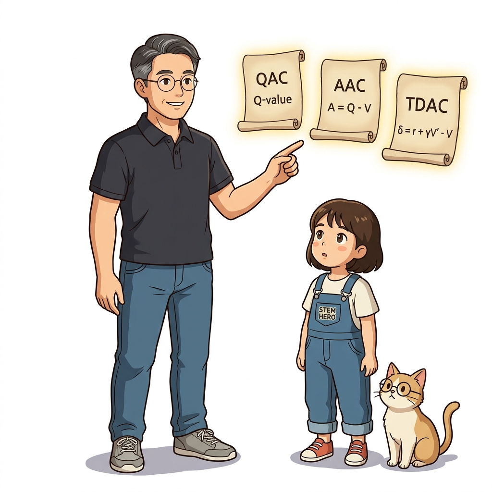

# 15.2 Critic의 가치함수 추정 방식과 구분: QAC, AAC, 그리고 TDAC

**그림 15-2** 이호진 교수님이 크리틱(Critic)의 3대 가치함수 추정 방식(QAC, AAC, TDAC)의 수학적 원리와 어드밴티지 도출 과정을 도로시와 지니에게 설명하는 모습

---

> **도로시와 토토의 비유로 이해하기**:
> 시험 문제를 맞혔을 때 칭찬을 받는 방식도 세 가지가 있습니다:
> 1. "이번 문제에서 1번을 찍었으니 80점짜리 행동이야!" (QAC: 행동 가치 $Q(s, a)$ 직접 제시)
> 2. "이 문제의 평균 점수는 50점인데, 너는 80점짜리 1번을 골랐으니 +30점이나 이득(Advantage)을 봤어!" (AAC: $Q(s, a) - V(s)$)
> 3. "원래 네 실력($V(s)$)은 50점이었는데, 1번을 풀고 다음 문제로 넘어간 뒤 보니 실제 실력이 80점($R + \gamma V(s')$)으로 껑충 뛰었네? +30점 서프라이즈!" (TDAC: TD 오차 $\delta_t$)
> 가장 똑똑한 방법은 바로 3번(TDAC)입니다. 왜냐하면 별도로 $Q$ 네트워크를 만들 필요 없이 단 하나의 $V$ 네트워크만으로 완벽한 평가가 가능하기 때문입니다!

---

## 15.2.1 정책 경사 정리의 일반화 형태

정책 경사 정리는 목적 함수 $J(\theta)$의 기울기를 다음과 같이 일반화된 형태로 표현할 수 있음을 증명합니다:

$$
\nabla_\theta J(\theta) = \mathbb{E}_{\pi_\theta} \left[ \nabla_\theta \log \pi_\theta(a \mid s) \, \Psi_t \right]
$$

[식 15.3] 일반화된 정책 경사 공식

여기서 **$\Psi_t$**는 행동 $a$의 우수성을 평가하는 '평가 척도(Critic Surrogate)'이며, 연구자들은 이 자리에 무엇을 넣느냐에 따라 크게 세 가지 클래식 액터-크리틱 알고리즘을 개발했습니다:

1. **$\Psi_t = Q(s, a)$**: **QAC (Q Actor-Critic)**
2. **$\Psi_t = A(s, a) = Q(s, a) - V(s)$**: **AAC (Advantage Actor-Critic)**
3. **$\Psi_t = \delta_t = R_{t+1} + \gamma V(S_{t+1}) - V(S_t)$**: **TDAC (Temporal Difference Actor-Critic)**

---

## 15.2.2 3대 Critic 추정 방식의 수식 비교

### 1) Q-Actor-Critic (QAC)
- **개념**: Critic이 **행동 가치 함수 $Q_w(s, a)$**를 직접 모델링합니다.
- **Actor 목적 함수 기울기**:
  $$
  \nabla_\theta J(\theta) = \mathbb{E} \left[ \nabla_\theta \log \pi_\theta(A_t \mid S_t) \, Q_w(S_t, A_t) \right]
  $$
- **Critic 손실 함수**: SARSA처럼 1스텝 TD 타깃을 사용하여 학습합니다:
  $$
  L(w) = \frac{1}{2} \left( R_{t+1} + \gamma Q_w(S_{t+1}, A_{t+1}) - Q_w(S_t, A_t) \right)^2
  $$
- **한계점**: $Q_w(s, a)$의 절대적인 스케일이 클 경우, 여전히 그래디언트의 분산이 충분히 줄어들지 않습니다. (예: 모든 행동의 $Q$값이 $+1000$ 근처라면 모든 행동 확률이 같이 올라가려 함)

---

### 2) Advantage Actor-Critic (AAC)
- **개념**: 행동 가치 $Q(s, a)$에서 기준선(Baseline)인 상태 가치 $V(s)$를 차감한 **어드밴티지(Advantage)**를 평가지표로 사용합니다:
  $$
  A(s, a) = Q(s, a) - V(s)
  $$
- **왜 분산이 줄어드는가? (수학적 증명)**:
  상태 $s$에만 의존하는 임의의 함수 $B(s)$를 목적 함수 기울기에서 빼주어도 기댓값은 정확히 0이 됩니다:
  $$
  \mathbb{E}_{a \sim \pi} \left[ \nabla_\theta \log \pi_\theta(a \mid s) \, B(s) \right] = \sum_a \pi_\theta(a \mid s) \frac{\nabla_\theta \pi_\theta(a \mid s)}{\pi_\theta(a \mid s)} B(s) = B(s) \nabla_\theta \sum_a \pi_\theta(a \mid s) = B(s) \nabla_\theta (1) = 0
  $$
  따라서 평균 기대 보상에 해당하는 **상태 가치 $V(s)$를 베이스라인으로 차감**하면 편향(Bias)은 1도 생기지 않으면서 분산(Variance)만 획기적으로 낮출 수 있습니다!
- **한계점**: $Q_w(s, a)$ 신경망과 $V_v(s)$ 신경망을 **둘 다 따로 학습**시켜야 하므로 연산량과 메모리가 2배로 듭니다.

---

### 3) TD Actor-Critic (TDAC) — 현대적 표준
- **개념**: 1스텝 TD 오차 $\delta_t$가 어드밴티지 $A(s, a)$의 훌륭한 **불편 추정량(Unbiased Estimate)**이라는 사실을 활용합니다!
  $$
  A(S_t, A_t) = Q(S_t, A_t) - V(S_t) \approx \left( R_{t+1} + \gamma V(S_{t+1}) \right) - V(S_t) = \delta_t
  $$
- **경이로운 공학적 이점**:
  - $Q$ 네트워크를 완전히 없애고, **오직 상태 가치망 $V_w(s)$ 하나만 유지**하면 충분합니다!
  - Critic은 상태 가치망 $V_w(s)$의 평균제곱오차(MSE)를 최소화하도록 갱신됩니다:
    $$
    L(w) = \frac{1}{2} \delta_t^2 = \frac{1}{2} \left( R_{t+1} + \gamma V_{w^-}(S_{t+1}) - V_w(S_t) \right)^2
    $$
  - Actor는 계산된 $\delta_t$를 스칼라 가중치로 삼아 즉시 갱신됩니다:
    $$
    \theta \leftarrow \theta + \alpha_\theta \, \delta_t \nabla_\theta \log \pi_\theta(A_t \mid S_t)
    $$

---

## 15.2.3 3대 Critic 모델링 기법 종합 비교표

| 분류 | 추정 가치 함수 | 필요한 신경망 개수 | 분산 수준 | 계산 효율성 | 비고 |
| :--- | :--- | :--- | :--- | :--- | :--- |
| **QAC** | $Q(s, a)$ | 2개 ($\pi_\theta, Q_w$) | 중간 | 보통 | 절대 가치 크기로 인한 분산 잔존 |
| **AAC** | $Q(s, a) - V(s)$ | 3개 ($\pi_\theta, Q_w, V_v$) | 낮음 | 낮음 | $Q$와 $V$ 이중 학습 부담 |
| **TDAC** | $\delta_t = R + \gamma V' - V$ | **2개 ($\pi_\theta, V_w$)** | **매우 낮음** | **최상** | **현대 A2C, PPO의 사실상 표준** |

이처럼 TD 오차 $\delta_t$를 활용하는 TDAC 방식은 단일 상태 가치망 $V(s)$만으로 행동의 상대적 우수성(이점)을 완벽하게 근사할 수 있어, 심층 강화학습의 실질적인 표준 구현 방식으로 정착되었습니다.
