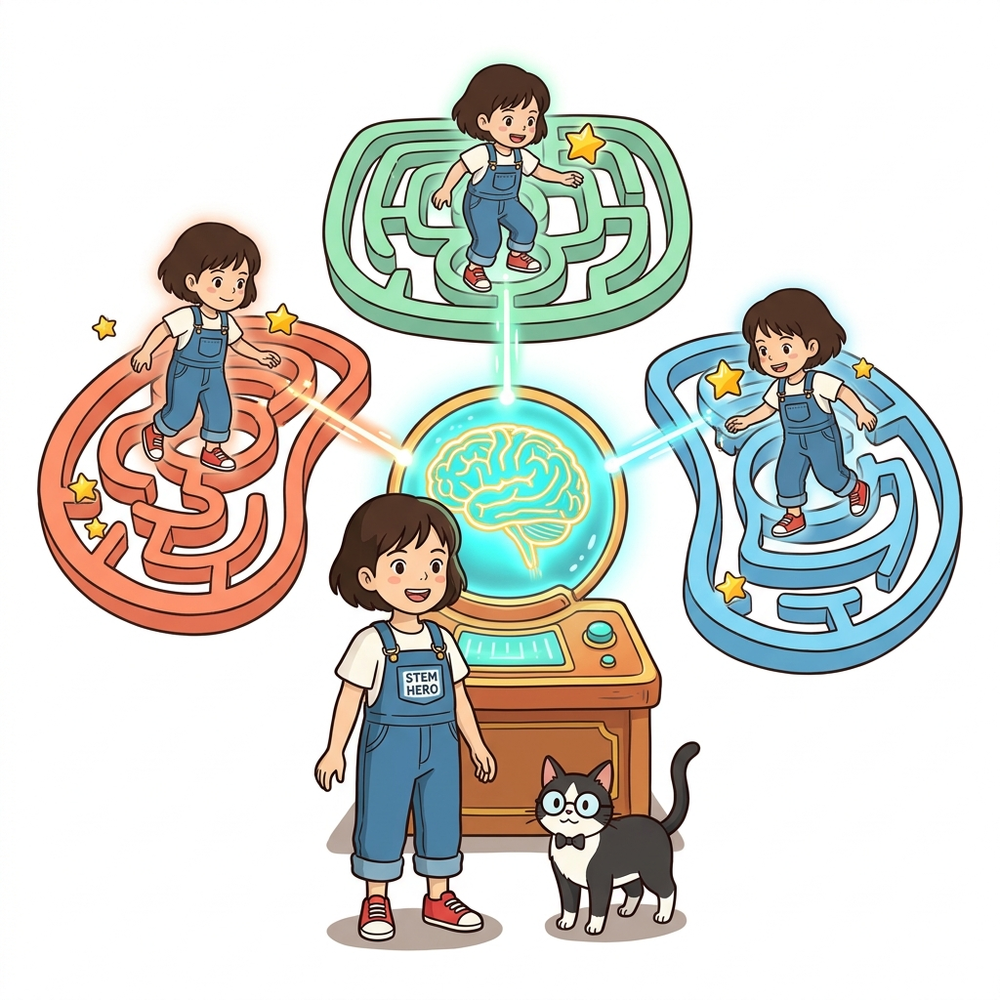

# 15.3 A3C와 A2C 병렬 강화학습: 경험 재생 버퍼 없이 분산을 깨부수는 병렬 분산의 힘


**그림 15-3** 세 명의 분신 도로시가 서로 다른 미로를 동시에 탐색하며 수집한 경험 그래디언트를 중앙의 마스터 두뇌(Master Brain)로 모아 동기화하는 병렬 액터-크리틱 메커니즘

---

> **도로시와 토토의 비유로 이해하기**:
> 12장 DQN에서는 연속된 시간의 상관관계(Correlation)를 끊기 위해 방대한 '경험 재생 버퍼(Replay Buffer)'라는 거대한 기억 창고를 만들고 데이터를 뒤섞어야만 했습니다.
> 하지만 지니가 도로시에게 마법의 나루토 분신술을 가르쳐 주었습니다! 세 명의 도로시 분신이 서로 다른 맵에서 동시에 모험을 떠난다면(병렬 환경), 각자 겪는 경험이 이미 완전히 독립적이므로 무거운 리플레이 버퍼를 둘 필요가 없습니다. 각 분신이 얻은 깨달음(그래디언트)을 중앙 본부의 지니에게 바로바로 전송하면 그만입니다!

---

## 15.3.1 왜 온폴리시(On-policy)는 경험 재생 버퍼를 쓸 수 없는가?

12장 DQN의 성공 비결 중 하나는 **경험 재생 버퍼(Experience Replay Buffer)**였습니다:
1. 연속된 데이터 사이의 강한 시간적 상관성(Temporal Correlation)을 파괴하여 샘플을 i.i.d.(독립 항등 분포)로 변환
2. 데이터 재사용을 통한 샘플 효율성 극대화

하지만 **정책 경사법(Actor-Critic 포함)은 온폴리시(On-Policy) 알고리즘**입니다:
- 정책 경사 수식 $\mathbb{E}_{a \sim \pi_\theta} [\nabla_\theta \log \pi_\theta(a|s) A(s, a)]$는 **현재 갱신 중인 정책 $\pi_\theta$로부터 직접 생성된 샘플**에서만 수학적으로 유효합니다!
- 과거의 옛날 정책 $\pi_{\theta_{\text{old}}}$으로 수집해 둔 버퍼의 데이터를 가져와 학습하면 정책 분포 불일치(Distribution Mismatch)가 발생하여 학습이 완전히 붕괴합니다.

그렇다면 리플레이 버퍼를 사용하지 않고 어떻게 데이터 상관성을 깨부술 수 있을까요? 
딥마인드(DeepMind)의 볼로디미르 므니히(Volodymyr Mnih) 연구팀은 2016년 **"병렬화(Parallelization)"**라는 천재적인 해법을 제시했습니다.

---

## 15.3.2 A3C (Asynchronous Advantage Actor-Critic)

A3C는 단일 컴퓨터의 다중 CPU 코어를 활용하여, **여러 개의 독립된 작업자(Worker) 환경을 비동기식(Asynchronous)으로 동시에 실행**하는 아키텍처입니다:

```
                          ┌───────────────────────────┐
                          │  Global Network (θ, w)    │
                          └───────────▲───────────────┘
                                      │ 비동기 그래디언트 전달 / 최신 가중치 동기화
         ┌────────────────────────────┼────────────────────────────┐
         │                            │                            │
 ┌───────┴──────────┐         ┌───────┴──────────┐         ┌───────┴──────────┐
 │ Worker 1 (θ_1)   │         │ Worker 2 (θ_2)   │         │ Worker N (θ_N)   │
 │ • 독립 환경 인스턴스│         │ • 독립 환경 인스턴스│         │ • 독립 환경 인스턴스│
 │ • n-스텝 롤아웃  │         │ • n-스텝 롤아웃  │         │ • n-스텝 롤아웃  │
 │ • dθ_1 누적/전송 │         │ • dθ_2 누적/전송 │         │ • dθ_N 누적/전송 │
 └──────────────────┘         └──────────────────┘         └──────────────────┘
```

### A3C의 핵심 동작 메커니즘
1. **글로벌 네트워크(Global Network)**와 각 작업자 전용 **로컬 네트워크(Local Network)**를 유지합니다.
2. 각 작업자는 자신만의 로컬 복사본 파라미터로 환경을 $t_{\max}$ 스텝(보통 5~20스텝) 동안 탐색하며 궤적을 수집합니다.
3. n-스텝 누적 수익과 가치 예측을 통해 로컬 그래디언트 $d\theta, dw$를 계산합니다:
   $$
   R_t = \sum_{i=0}^{k-1} \gamma^i R_{t+i+1} + \gamma^k V(S_{t+k})
   $$
   $$
   d\theta \leftarrow d\theta + \nabla_\theta \log \pi_\theta(A_t|S_t) (R_t - V(S_t)) + \beta \nabla_\theta H(\pi_\theta(\cdot|S_t))
   $$
   *(여기서 $H(\pi)$는 탐색을 장려하기 위한 엔트로피 정규화 항입니다.)*
4. 작업자는 락(Lock) 없이 비동기적으로 글로벌 네트워크의 파라미터를 갱신(Hogwild! 스타일)하고, 최신 글로벌 파라미터를 자신의 로컬로 복사해 옵니다.

---

## 15.3.3 A2C (Advantage Actor-Critic) — 동기식의 귀환

A3C가 발표된 후, OpenAI 연구진은 중요한 의문을 던졌습니다: **"과연 비동기성(Asynchrony) 자체가 성능 향상의 핵심이었을까?"**

실험 결과, 비동기 갱신은 파라미터 지연(Stale Gradients)으로 인한 노이즈가 존재하며 GPU를 효율적으로 활용하지 못하는 단점이 있었습니다. OpenAI는 이를 해결한 **동기식(Synchronous) 버전인 A2C(Advantage Actor-Critic)**를 제안했습니다:

### A2C의 아키텍처적 우수성
1. **동기식 배치 수집 (Batched Stepping)**:
   - 모든 작업자가 동시에 1스텝씩(또는 n스텝씩) 환경을 진행합니다.
   - 예: 16개 환경이 동시에 5스텝을 진행하면 총 $16 \times 5 = 80$개의 전이(Transition) 데이터가 단일 배치 텐서로 모입니다.
2. **GPU 가속 최적화**:
   - 모인 거대한 배치를 최신 GPU에 한 번에 올려 순전파(Forward) 및 역전파(Backward)를 대규모 병렬 연산합니다.
3. **더 우수한 표본 효율성과 안정성**:
   - 오래된 그래디언트의 충돌이 전혀 없으므로 A3C보다 훨씬 안정적으로 수렴하며, GPU 연산 덕분에 벽시계 시간(Wall-clock Time) 기준 학습 속도가 압도적으로 빠릅니다.

---

## 15.3.4 A3C vs A2C 비교 요약

| 비교 항목 | A3C (Asynchronous) | A2C (Synchronous) |
| :--- | :--- | :--- |
| **작업자 동기화** | 비동기 (Lock-free, 제각각 업데이트) | **동기식 (배치 동기화 후 일괄 갱신)** |
| **주 하드웨어** | 멀티코어 CPU (Core i7, Xeon 등) | **GPU 가속 (CUDA 텐서 병렬 연산)** |
| **파라미터 지연** | 존재함 (다른 워커가 갱신한 뒤 덮어씀) | **없음 (항상 최신 파라미터로 동기화)** |
| **구현 난이도** | 스레딩/프로세싱 락 관리로 복잡함 | **간결하고 직관적 (Gym VectorEnv 표준 지원)** |
| **현대적 위상** | 분산 강화학습의 역사적 시발점 | **PPO, SAC의 배치 수집 백본으로 계승** |
