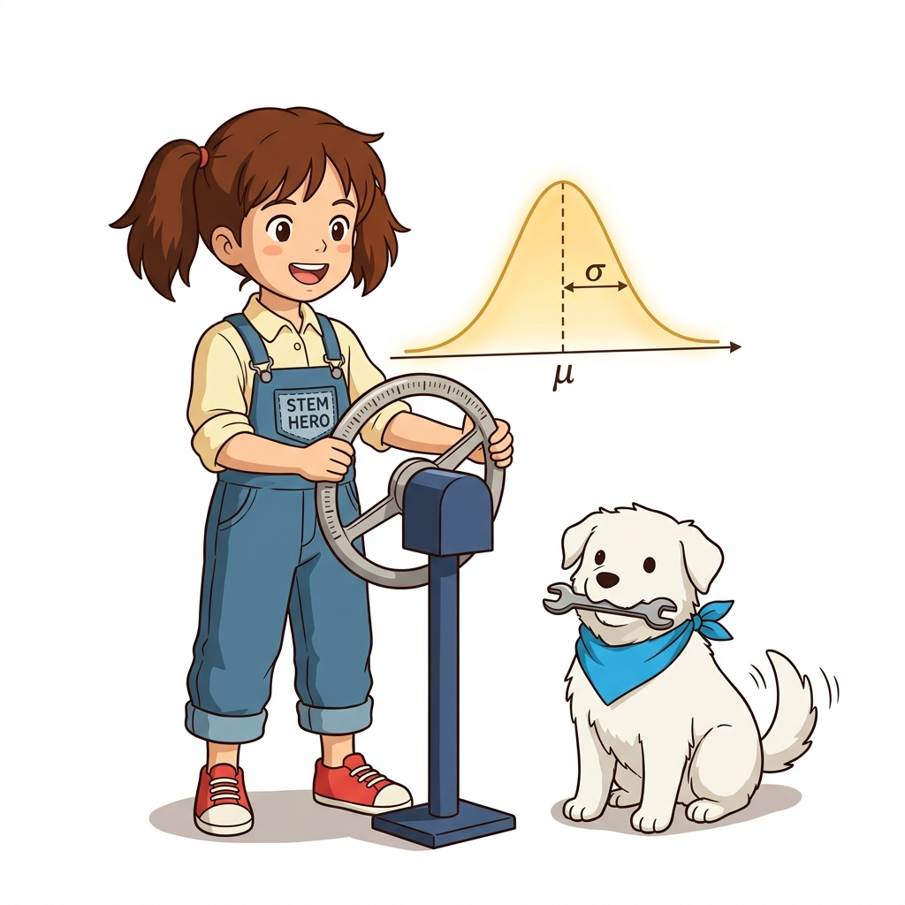

# 15.4 연속 행동 공간과 가우시안 정책: 로봇과 자율주행을 위한 아날로그 제어


**그림 15-4** 부드러운 아날로그 로봇 조작 휠을 회전시키며 황금빛 가우시안 확률분포 정규곡선($\mathcal{N}(\mu, \sigma^2)$)에서 최적 토크를 도출하는 도로시와 보조 토토

---

> **도로시와 토토의 비유로 이해하기**:
> 지금까지 우리가 다룬 아타리 게임이나 그리드월드는 '왼쪽(0)', '오른쪽(1)', '발사(2)'처럼 버튼을 뚝뚝 누르는 **이산(Discrete)** 행동이었습니다.
> 하지만 도로시가 자율주행 자동차를 운전할 때 핸들을 "왼쪽으로 13.7도 꺾고 가속 페달을 34.2% 깊이로 밟아야 한다"면 어떨까요? 이처럼 무한히 연속적인 실수값(Continuous)을 조작해야 할 때는, 신경망이 특정 행동 번호 대신 **정규분포의 중심점인 평균($\mu$)과 퍼짐 정도인 표준편차($\sigma$)**를 출력하게 만듭니다!

---

## 15.4.1 왜 가치 기반(DQN)은 연속 행동을 다루기 힘든가?

DQN에서는 최적 행동을 결정할 때 항상 다음과 같은 탐욕적 $\arg\max$ 연산을 수행합니다:

$$
a^* = \arg\max_{a \in \mathcal{A}} Q(s, a)
$$

- 이산 행동 공간($|\mathcal{A}| = 4$)에서는 4개 행동의 $Q$값을 모두 계산한 뒤 가장 큰 값을 고르면 되므로 전혀 문제가 없습니다.
- 하지만 행동이 실수 벡터($a \in [-1.0, +1.0]$)인 연속 공간에서는, $Q(s, a)$를 최대로 만드는 $a$를 찾기 위해 매 스텝마다 경사 하강법이나 수치 최적화 루프를 무한히 돌려야 하므로 실시간 제어가 물리적으로 불가능합니다.

반면 **정책 기반 기법(Policy Gradient / Actor-Critic)**은 행동 $a$를 신경망이 직접 출력하므로 연속 행동 공간을 아주 자연스럽고 우아하게 다룰 수 있습니다!

---

## 15.4.2 가우시안 정책 (Gaussian Policy)

연속 행동을 다루는 가장 표준적인 기법은 정책을 **정규분포(가우시안 분포, Gaussian Distribution)**로 가정하는 것입니다:

$$
\pi_\theta(a \mid s) = \frac{1}{\sqrt{2\pi \sigma^2(s)}} \exp\left( -\frac{(a - \mu(s))^2}{2\sigma^2(s)} \right)
$$

[식 15.4] 1차원 연속 행동에 대한 가우시안 정책 밀도 함수

신경망(Actor)은 상태 $s$를 입력받아 다음 두 가지 파라미터를 출력합니다:
1. **평균 $\mu_\theta(s)$**: 현재 상태에서 가장 바람직하다고 판단되는 대표 행동 값 (예: 핸들 각도 $0^\circ$)
2. **표준편차 $\sigma_\theta(s)$**: 탐색(Exploration)을 위한 불확실성의 크기. (항상 양수여야 하므로 $\exp$ 함수나 Softplus를 적용하여 활성화합니다.)

```
                 상태 벡터 s (차원: D)
                         │
               ┌─────────▼─────────┐
               │    Shared Layers  │
               └────┬─────────┬────┘
                    │         │
          ┌─────────▼──┐   ┌──▼─────────┐
          │ Mean Layer │   │ Std Layer  │
          └─────┬──────┘   └─────┬──────┘
                │ μ(s)           │ σ(s) > 0
                └─────────┬──────┘
                          ▼
            정규분포 샘플링: a ~ N(μ(s), σ(s)^2)
```

---

## 15.4.3 가우시안 정책의 로그 미분(Log-Derivative) 유도

정책 경사 정리를 적용하기 위해 $\log \pi_\theta(a|s)$를 취하고 미분을 전개해 보면 놀랍도록 직관적인 형태가 나타납니다:

$$
\log \pi_\theta(a \mid s) = -\frac{1}{2} \log(2\pi) - \log \sigma(s) - \frac{(a - \mu(s))^2}{2\sigma(s)^2}
$$

이제 평균 $\mu$에 대한 편미분을 구해보면:

$$
\nabla_\mu \log \pi_\theta(a \mid s) = \frac{a - \mu(s)}{\sigma(s)^2}
$$

[식 15.5] 가우시안 정책의 평균에 대한 그래디언트

이 수식이 의미하는 물리적 직관은 다음과 같습니다:
- 만약 샘플링된 행동 $a$가 평균 $\mu$보다 오른쪽에 있었고($a > \mu$), Critic의 평가 결과 이 행동이 긍정적($A(s, a) > 0$)이었다면:
  $$\nabla_\theta J \propto \frac{a - \mu}{\sigma^2} A(s, a) > 0$$
  $\rightarrow$ **평균 $\mu$를 행동 $a$ 쪽으로 오른쪽으로 이동**시킵니다!
- 반대로 그 행동이 나쁜 결과를 낳았다면($A(s, a) < 0$), 평균 $\mu$를 반대쪽으로 밀어냅니다.

---

## 15.4.4 재파라미터화 트릭 (Reparameterization Trick)

신경망 학습 시 정규분포에서 직접 샘플링($a \sim \mathcal{N}(\mu, \sigma^2)$)을 수행하면, 샘플링 노드가 미분 불가능(Non-differentiable)해져 오차역전파가 끊어지는 문제가 발생합니다.

이를 해결하기 위해 확률적 노이즈를 외부로 격리하는 **재파라미터화 트릭(Reparameterization Trick)**을 적용합니다:

$$
\epsilon \sim \mathcal{N}(0, I) \quad (\text{독립 표준 정규 노이즈})
$$
$$
a = \mu_\theta(s) + \sigma_\theta(s) \odot \epsilon
$$

[식 15.6] 재파라미터화 표현식

이제 샘플링 연산은 파라미터 $\theta$가 없는 외부 노이즈 $\epsilon$에서만 일어나므로, 액터 네트워크의 가중치 $\theta$에 대해 출력 $a$를 거쳐 손실 함수까지 **기울기가 막힘없이 직접 역전파(Backpropagation)**될 수 있습니다. 이 기법은 이후 14장과 16장의 최신 연속 제어 알고리즘인 **SAC (Soft Actor-Critic)** 및 VAE의 핵심 기술로 맹활약합니다.
