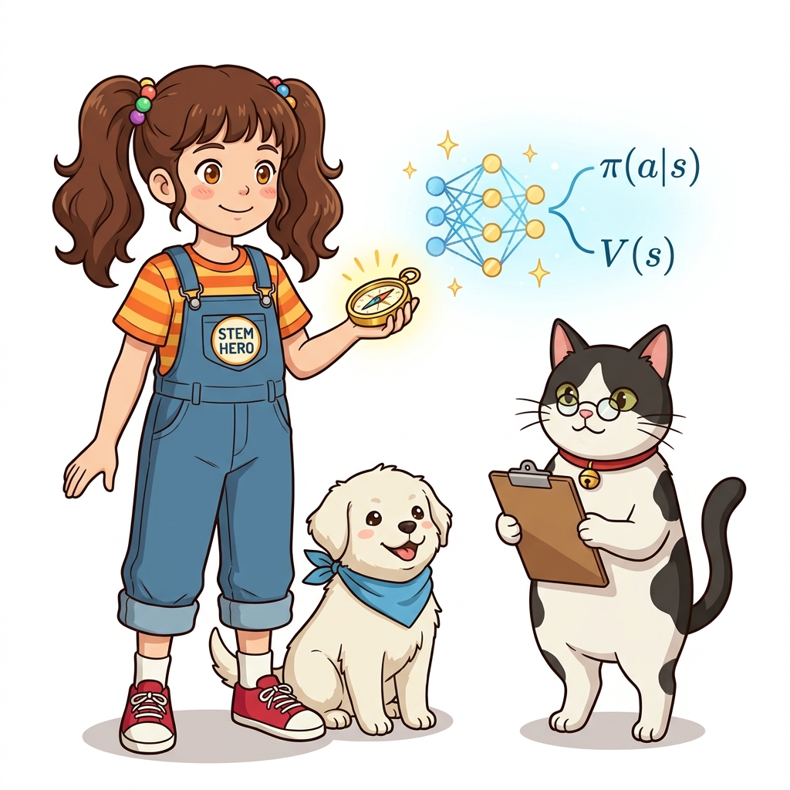

# CHAPTER 16 액터-크리틱 (Actor-Critic)

**그림 15-0** 최적 행동을 자신 있게 선택하는 '액터(Actor)' 도로시와, 냉철하고 따뜻하게 행동의 가치를 평가해 주는 '크리틱(Critic)' 지니의 완벽한 앙상블

---

> **도로시와 토토의 비유로 이해하기**:
> 연극 무대 위에서 멋지게 춤추고 연기하는 주인공이 바로 **액터(Actor, 도로시)**입니다! 하지만 무대 아래 객석에는 연출가이자 평론가인 **크리틱(Critic, 고양이 지니)**이 앉아 있어서, 도로시가 취한 스텝이 얼마나 훌륭했는지($V(s)$ 또는 Advantage)를 실시간으로 채점해 줍니다. 도로시는 에피소드가 다 끝날 때까지 불안하게 기다릴 필요 없이, 지니의 귓속말 조언(TD 오차)을 듣고 매 순간 즉각 스텝을 교정하며 눈부시게 성장합니다.

---

## 15.0 개요: 정책 기반과 가치 기반의 융합

우리는 12장에서 가치 함수를 근사하여 최적 행동을 간접 도출하는 **가치 기반(Value-based) 기법(DQN)**을 배웠고, 13장에서는 누적 보상을 최대화하도록 정책 신경망을 직접 경사 상승법으로 밀어 올리는 **정책 기반(Policy-based) 기법(REINFORCE)**을 배웠습니다.

하지만 순수 REINFORCE 알고리즘에는 치명적인 약점이 있었습니다:
1. **극심한 분산(High Variance)**: 에피소드가 끝난 뒤 얻어지는 단 하나의 몬테카를로 반환값($G_t$)에 의존하므로, 주사위 던지기처럼 우연에 의해 그래디언트가 심하게 요동칩니다.
2. **오프라인 지연 갱신**: 에피소드가 완전히 종료(Terminated)될 때까지 파라미터를 단 1회도 갱신할 수 없습니다.

**액터-크리틱(Actor-Critic)**은 이 두 거대한 흐름의 장점만을 취합하여 탄생한 현대 심층 강화학습의 주류 패러다임입니다:
- **액터 (Actor, $\pi_\theta(a|s)$)**: 상태 $s$를 입력받아 어떤 행동 $a$를 취할지 확률을 결정합니다 (정책 신경망).
- **크리틱 (Critic, $V_w(s)$ 또는 $Q_w(s,a)$)**: 액터가 내린 결정이 현재 상태에서 기대치보다 얼마나 좋았는지를 평가합니다 (가치 신경망).

이 둘이 실시간으로 피드백 루프를 형성함으로써, 액터는 크리틱이 알려준 **이점(Advantage) 또는 시간차(TD) 오차**를 가이드 삼아 매 스텝마다 분산 없이 안정적으로 정책을 업데이트합니다.

---

## 학습 로드맵 (Roadmap)

본 장에서는 액터-크리틱의 기초 이론부터 시작하여 다양한 크리틱 구조, 분산/병렬 확장, 연속 제어, 그리고 실제 파이썬 구현까지 단계별로 완벽하게 마스터합니다:

1. **[15.1 Actor-Critic 기초와 도입 배경](./16_1_Actor-Critic_기초와_도입_배경/)**:
   - REINFORCE의 몬테카를로 한계와 분산 축소의 필연성
   - 액터와 크리틱의 이중 상호작용 피드백 루프
2. **[15.2 Critic의 가치함수 추정 방식과 구분](./16_2_Critic의_가치함수_추정_방식/)**:
   - QAC (Q-Actor-Critic), AAC (Advantage Actor-Critic), TDAC (TD Actor-Critic)의 수식 유도와 비교
   - 베이스라인 감산을 통한 분산 감소 증명
3. **[15.3 A3C와 A2C 병렬 강화학습](./16_3_A3C와_A2C_병렬_강화학습/)**:
   - 다중 작업자(Workers)를 활용한 비동기(A3C) vs 동기식(A2C) 아키텍처
   - 경험 재생 버퍼 없이 데이터 상관관계를 파괴하는 병렬화의 마법
4. **[15.4 연속 행동 공간과 가우시안 정책](./16_4_연속_행동_공간과_가우시안_정책/)**:
   - 로봇 팔 제어, 자율주행 등 실수형 연속 행동 공간 처리 기법
   - 가우시안 정책 신경망 ($\mu_\theta, \sigma_\theta$)과 재파라미터화 트릭(Reparameterization Trick)
5. **[15.5 실전 예제 구현: CartPole & Pendulum](./16_5_실전_예제_구현/)**:
   - PyTorch를 활용한 2-Head / 독립 신경망 Actor-Critic 실전 구현 및 성능 분석
6. **[15.6 정리 및 요약](./16_6_정리/)**:
   - 16장 핵심 공식 요약, 장단점 비교, 16장(TRPO & PPO)으로의 연결 고리
