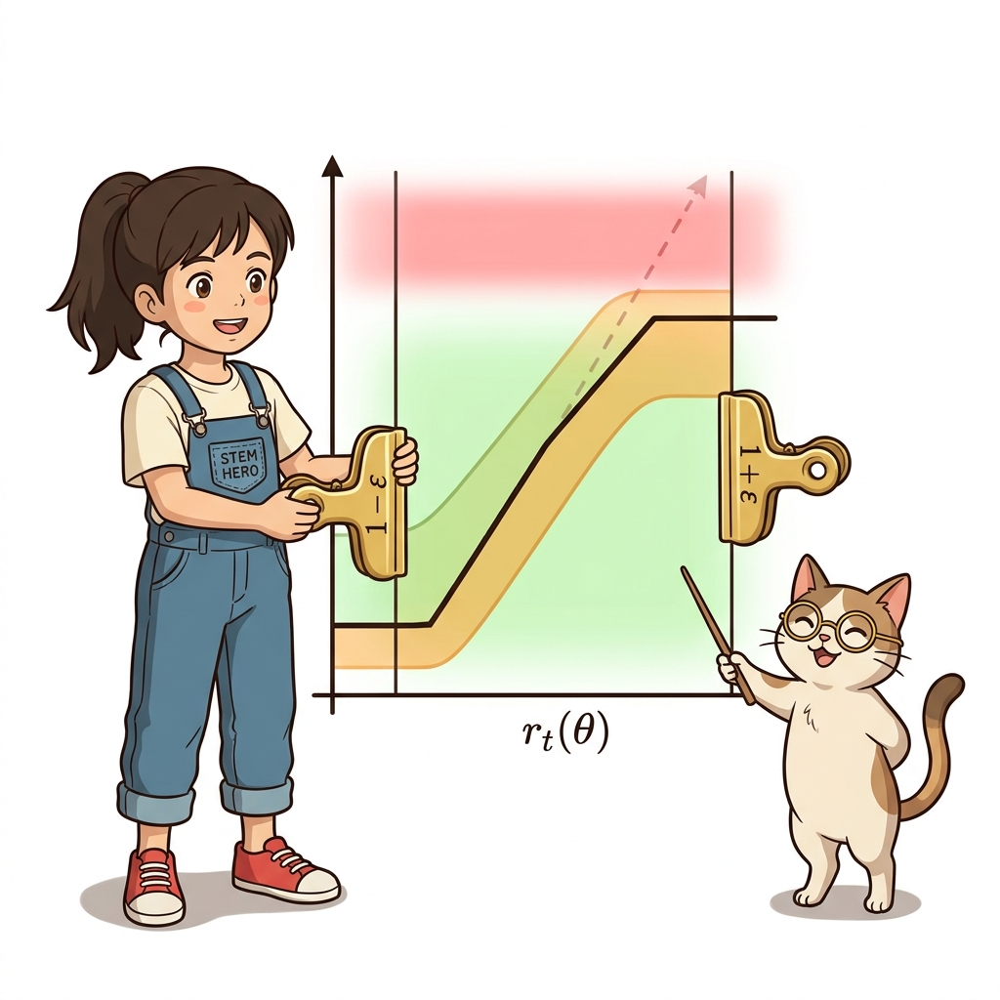

# 16.3 근접 정책 최적화 (PPO): 클리핑 목적 함수와 일반화된 이점 추정 (GAE)


**그림 16-3** 확률 비율 $r_t(\theta)$가 안전한 경계선($[1-\epsilon, 1+\epsilon]$)을 벗어나지 않도록 두 개의 황금 클립으로 고정하여 과도한 정책 갱신을 차단하는 도로시와 지니의 클리핑 메커니즘

---

> **도로시와 토토의 비유로 이해하기**:
> TRPO의 KL 제약 조건이 거대하고 무거운 레이저 측정기(2차 피셔 행렬과 켤레 기울기법)였다면, PPO는 누구나 주머니에 넣고 다닐 수 있는 **가장 단순한 문구용 집게(클립, Clip)**입니다!
> 도로시가 이전보다 어떤 행동의 확률을 올리려 할 때, 지니가 집게로 딱 집어서 **"이전보다 최대 1.2배($1+\epsilon$)까지만 올릴 수 있어! 그 이상은 아무리 이득이 커도 무시할 거야!"**라고 못 박아두는 것입니다. 놀랍게도 이 단순한 집게 하나가 수천 줄의 복잡한 2차 최적화 수학식보다 훨씬 더 빠르고 안정적으로 동작합니다!

---

## 16.3.1 TRPO의 한계와 PPO의 철학

TRPO는 이론적으로 아름다웠지만, 실무에서는 다음과 같은 심각한 한계가 있었습니다:
1. **복잡한 2차 최적화**: 표준 딥러닝 프레임워크(PyTorch, TensorFlow)의 표준 옵티마이저(Adam 등)를 쓸 수 없고, 켤레 기울기법과 라인 서치 코드를 복잡하게 짜야 했습니다.
2. **신경망 구조 공유 불가능**: 가치망(Critic)과 정책망(Actor)이 가중치를 공유하면 KL 제약 조건을 정의하기 극도로 까다로워 독립 신경망을 강제해야 했습니다.
3. **확장성 부족**: 분산 환경이나 대규모 언어 모델(LLM)에 적용하기에는 연산 오버헤드가 너무 컸습니다.

2017년 OpenAI의 존 슐만(John Schulman) 연구팀은 **PPO (Proximal Policy Optimization)**를 발표하며 다음과 같은 핵심 철학을 제시했습니다:
> **"복잡한 2차 제약 조건을 풀지 말고, 표준적인 1차 경사 하강법(Adam)으로 최적화할 수 있도록 목적 함수 자체를 '클리핑(Clipping)'하자!"**

---

## 16.3.2 PPO-Clip 클리핑 목적 함수 (Clipped Surrogate Objective)

PPO의 핵심은 새 정책과 이전 정책의 **확률 비율(Probability Ratio)**을 정의하는 것에서 시작합니다:

$$
r_t(\theta) = \frac{\pi_\theta(A_t \mid S_t)}{\pi_{\theta_{\text{old}}}(A_t \mid S_t)} \quad \left(r_t(\theta_{\text{old}}) = 1.0\right)
$$

[식 16.11] 정책 확률 비율 $r_t(\theta)$

클리핑이 없는 순수 대체 목적 함수는 $r_t(\theta) \hat{A}_t$ 입니다. 만약 $r_t(\theta)$가 너무 커지면(예: $10.0$), 파라미터가 비정상적으로 급변할 수 있습니다. 
따라서 PPO는 $r_t(\theta)$를 **$[1-\epsilon, 1+\epsilon]$ (통상 $\epsilon = 0.2$) 범위로 강제 클리핑**하고, 원래 값과 클리핑된 값 중 **더 보수적인 최소값(min)**을 취합니다:

$$
L^{\text{CLIP}}(\theta) = \hat{\mathbb{E}}_t \left[ \min\left( r_t(\theta) \hat{A}_t, \; \text{clip}(r_t(\theta), 1-\epsilon, 1+\epsilon) \hat{A}_t \right) \right]
$$

[식 16.12] PPO-Clip 목적 함수

### 왜 $\min$ 연산을 취하는가? (비관적 하한선, Pessimistic Bound)

이 수식의 동작 원리는 어드밴티지 $\hat{A}_t$의 부호에 따라 두 가지로 완벽하게 나뉩니다:

```
           [경우 1: A > 0 (좋은 행동)]                     [경우 2: A < 0 (나쁜 행동)]
    목적함수                                        목적함수
       ▲                                               ▲
       │        클리핑 (기울기 0)                         │
       │       ┌───────────────────                    │               r_t * A
       │      /                                        │              /
       │     /  r_t * A                                │             /
       │    /                                          │            /
       │   /                                           │           ┌───────────────────
       │  /                                            │          /  클리핑 (기울기 0)
       └─┼──────┼──────────────► r_t                   └─────────┼──────┼──────────────► r_t
         1    1+ε                                              1-ε     1
```

1. **$\hat{A}_t > 0$ (행동이 기대보다 우수했던 경우)**:
   - 정책을 개선하여 $r_t(\theta) > 1$로 확률을 올리고 싶습니다.
   - 하지만 $r_t$가 $1+\epsilon$ (예: $1.2$)을 넘어서면, $\min$ 연산에 의해 목적 함수는 $(1+\epsilon)\hat{A}_t$라는 상수로 굳어집니다!
   - 즉, **$r_t > 1+\epsilon$ 구간에서는 기울기가 $0$이 되어 더 이상 확률을 과도하게 올리지 못하도록 안전하게 막아섭니다.**
2. **$\hat{A}_t < 0$ (행동이 기대보다 나빴던 경우)**:
   - 해당 행동을 처벌하기 위해 $r_t(\theta) < 1$로 확률을 낮추고 싶습니다.
   - $r_t$가 $1-\epsilon$ (예: $0.8$) 밑으로 떨어지면 클리핑 상수가 되지만, $\min$ 연산 때문에 $r_t \hat{A}_t$가 그대로 선택되어 확률을 마음껏 0으로 떨어뜨릴 수 있습니다. 단, $r_t > 1$인 반대 방향(나쁜 행동인데 확률이 증가하는 방향)으로 폭주하는 것은 철저히 응징합니다.

이 기막힌 설계 덕분에 PPO는 **목적 함수의 비관적 하한선(Pessimistic Lower Bound)**을 완벽히 형성하며 정책의 안정성을 보장합니다.

---

## 16.3.3 일반화된 이점 추정 (GAE: Generalized Advantage Estimation)

PPO가 최고의 성능을 발휘하려면 어드밴티지 $\hat{A}_t$ 역시 편향과 분산의 이상적인 균형을 이루어야 합니다. 슐만 연구팀(2016)이 고안한 **GAE(Generalized Advantage Estimation)**는 TD($\lambda$)의 원리를 어드밴티지에 적용한 기법입니다:

1. **시간차 오차(TD Error) 시퀀스**:
   $$
   \delta_t^V = R_{t+1} + \gamma V(S_{t+1}) - V(S_t)
   $$
2. **$\lambda$-할인 누적 가중합**:
   $$
   \hat{A}_t^{\text{GAE}(\gamma, \lambda)} = \sum_{l=0}^\infty (\gamma \lambda)^l \delta_{t+l}^V
   $$

[식 16.13] GAE(γ, λ) 어드밴티지 수식

- **$\lambda = 0$ 일 때**: $\hat{A}_t = \delta_t^V = R + \gamma V' - V$ (1스텝 TD, 편향 높음, 분산 최저)
- **$\lambda = 1$ 일 때**: $\hat{A}_t = \sum_{l=0}^\infty \gamma^l R_{t+l+1} - V(S_t) = G_t - V(S_t)$ (몬테카를로, 편향 0, 분산 최고)
- **통상적인 실전 설정**: $\lambda \in [0.95, 0.98]$로 설정하면, 약간의 편향만을 허용하면서 몬테카를로의 극심한 분산을 극적으로 차단하여 최적의 성능을 끌어냅니다.

---

## 16.3.4 PPO의 최종 통합 손실 함수

실제 신경망 훈련 시에는 정책 손실(Actor), 가치 손실(Critic), 그리고 탐색을 장려하는 엔트로피 보너스(Entropy Bonus)를 단 하나의 손실 함수로 결합하여 **Adam 옵티마이저로 한 번에 최적화**합니다:

$$
L_t^{\text{PPO}}(\theta) = \hat{\mathbb{E}}_t \left[ L_t^{\text{CLIP}}(\theta) - c_1 L_t^{\text{VF}}(\theta) + c_2 S[\pi_\theta](S_t) \right]
$$

[식 16.14] PPO의 최종 엔드투엔드 통합 목적 함수

- $L_t^{\text{VF}}(\theta) = \left( V_\theta(S_t) - V_t^{\text{target}} \right)^2$: 가치 함수 평균제곱오차 (보통 $c_1 = 0.5$)
- $S[\pi_\theta](S_t) = -\sum_a \pi(a|S_t) \log \pi(a|S_t)$: 엔트로피 정규화 항으로, 정책이 조기에 특정 행동으로 편중(Premature Convergence)되는 것을 방지 (보통 $c_2 = 0.01$)
