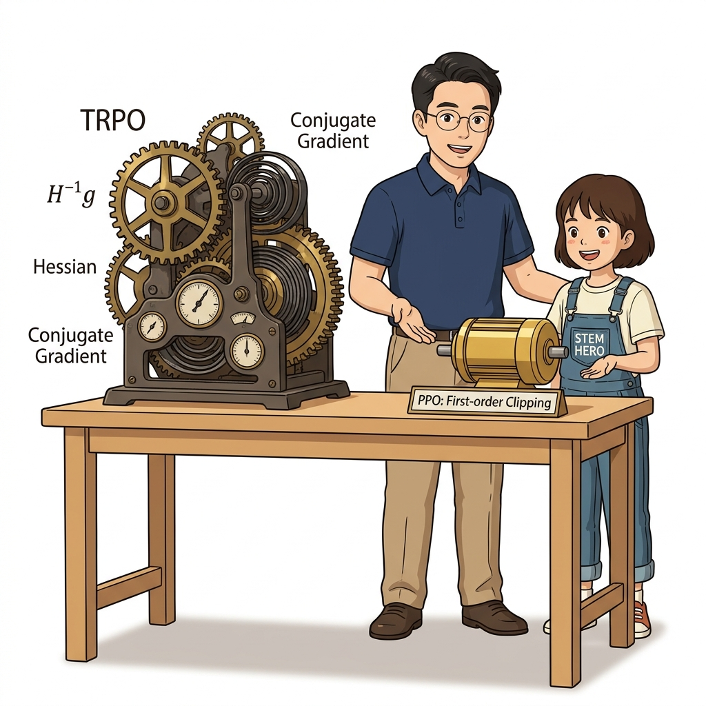

# 16.4 TRPO와 PPO 비교 분석 및 실전 튜닝 팁: 이론적 우아함과 공학적 실용성


**그림 16-4** 복잡한 2차 기어 장치(Hessian, Conjugate Gradient)의 TRPO 기계와, 초경량 1차 클리핑 엔진의 세련된 PPO 모터를 비교하며 실전 강화학습 노하우를 전수하는 이호진 교수님과 도로시

---

> **도로시와 토토의 비유로 이해하기**:
> TRPO가 마치 수천 개의 정밀 톱니바퀴로 이루어진 천문시계라면, PPO는 스마트폰의 디지털시계와 같습니다.
> 천문시계는 장인의 수학적 설계가 돋보이지만 수리하기 어렵고 무겁습니다. 반면 디지털시계는 가볍고 단순하며 어디에나(로봇, 자율주행, LLM) 즉시 탑재할 수 있습니다. 오늘날 전 세계 AI 연구실이 PPO를 선택한 비결이 바로 여기에 있습니다!

---

## 16.4.1 TRPO vs PPO 대조 분석

| 비교 항목 | TRPO (Trust Region Policy Optimization) | PPO (Proximal Policy Optimization) |
| :--- | :--- | :--- |
| **최적화 차수** | **2차 최적화 (Second-order)**<br>(피셔 정보 행렬 $F$, 테일러 2차 근사) | **1차 최적화 (First-order)**<br>(표준 SGD / Adam 사용 가능) |
| **제약 조건 처리** | **엄격한 하드 제약 조건 (Hard Constraint)**<br>$\mathbb{E}[D_{\text{KL}}] \le \delta$ | **목적 함수 내장 클리핑 (Clipped Objective)**<br>$\text{clip}(r_t, 1-\epsilon, 1+\epsilon)$ |
| **핵심 계산 알고리즘** | • 켤레 기울기법 (Conjugate Gradient)<br>• 백트래킹 라인 서치 (Line Search)<br>• Hessian-벡터 곱 ($Hv$) | • 미니배치 샘플링 (Minibatch SGD)<br>• 다중 에포크 (Multi-epoch Updates)<br>• 표준 역전파 (Backpropagation) |
| **네트워크 구조** | Actor와 Critic의 가중치 공유 불가능 (독립 분리) | **2-Head 파라미터 공유 구조 완벽 지원** |
| **계산 복잡도** | 매우 높음 (대규모 파라미터 적용 불가) | **매우 낮음 (선형 복잡도 $\mathcal{O}(N)$)** |
| **현대적 응용** | 로보틱스 초기 이론 연구 | **ChatGPT(RLHF), 로봇 제어, 게임 AI의 표준** |

---

## 16.4.2 PPO의 숨은 공신: 실전 성능을 결정하는 5대 구현 비결

2020년 구글 브레인과 엔그(Andrychowicz et al.) 연구팀은 **"PPO의 뛰어난 성능은 클리핑 수식 자체뿐만 아니라 숨겨진 코드 레벨의 구현 기법들에서 절반 이상 나온다"**는 사실을 밝혔습니다. 실전에서 반드시 적용해야 할 5대 튜닝 팁은 다음과 같습니다:

### 1) 일반화된 이점 추정 (GAE) 정규화
미니배치 단위로 어드밴티지 $\hat{A}_t$를 계산한 직후, **평균 0, 표준편차 1로 표준화(Normalization)**합니다:
$$
\hat{A}_t \leftarrow \frac{\hat{A}_t - \text{mean}(\hat{A})}{\text{std}(\hat{A}) + 10^{-8}}
$$
- 이 정규화는 에피소드 보상 스케일에 상관없이 그래디언트의 크기를 일정하게 유지시켜 학습을 극도로 안정화합니다.

### 2) 직교 가중치 초기화 (Orthogonal Initialization)
신경망의 선형 레이어를 초기화할 때 일반 가우시안 대신 **직교 행렬(Orthogonal Matrix)**로 초기화하고, 출력 레이어의 이득(Gain)을 다르게 조절합니다:
- 특징 추출 은닉층: $\text{Gain} = \sqrt{2}$ (ReLU 활성화 최적화)
- 정책망(Actor) 출력층: $\text{Gain} = 0.01$ (초기 모든 행동 확률이 거의 균등하게 나와 폭넓은 탐색 유도)
- 가치망(Critic) 출력층: $\text{Gain} = 1.0$

### 3) 학습률 선형 어닐링 (Learning Rate Annealing)
학습 초기에는 $\alpha = 3 \times 10^{-4}$로 출발하여, 전체 타임스텝이 진행됨에 따라 **0까지 선형적으로 감소(Linear Decay)**시킵니다. 후반부 정책의 미세 안착에 필수적입니다.

### 4) 그래디언트 클리핑 (Gradient Clipping)
Adam 옵티마이저로 역전파를 수행하기 직전, 파라미터 기울기 텐서의 전역 $L_2$ 노름을 최대 $0.5$로 강제 클리핑합니다:
```python
torch.nn.utils.clip_grad_norm_(model.parameters(), max_norm=0.5)
```
- 이는 가치 추정이 일시적으로 튈 때 신경망 가중치가 폭주하는 것을 원천 차단합니다.

### 5) 다중 에포크와 미니배치 재사용 (Sample Efficiency)
수집된 경험 궤적 데이터($N_{\text{steps}} \times N_{\text{envs}}$)를 한 번만 쓰고 버리는 일반 온폴리시와 달리, PPO는 클리핑 덕분에 **동일한 경험 데이터를 3~10 에포크(Epoch) 동안 셔플하며 여러 번 재사용**할 수 있습니다. 이것이 PPO가 온폴리시이면서도 극도로 높은 샘플 효율성을 달성하는 핵심 비결입니다!
