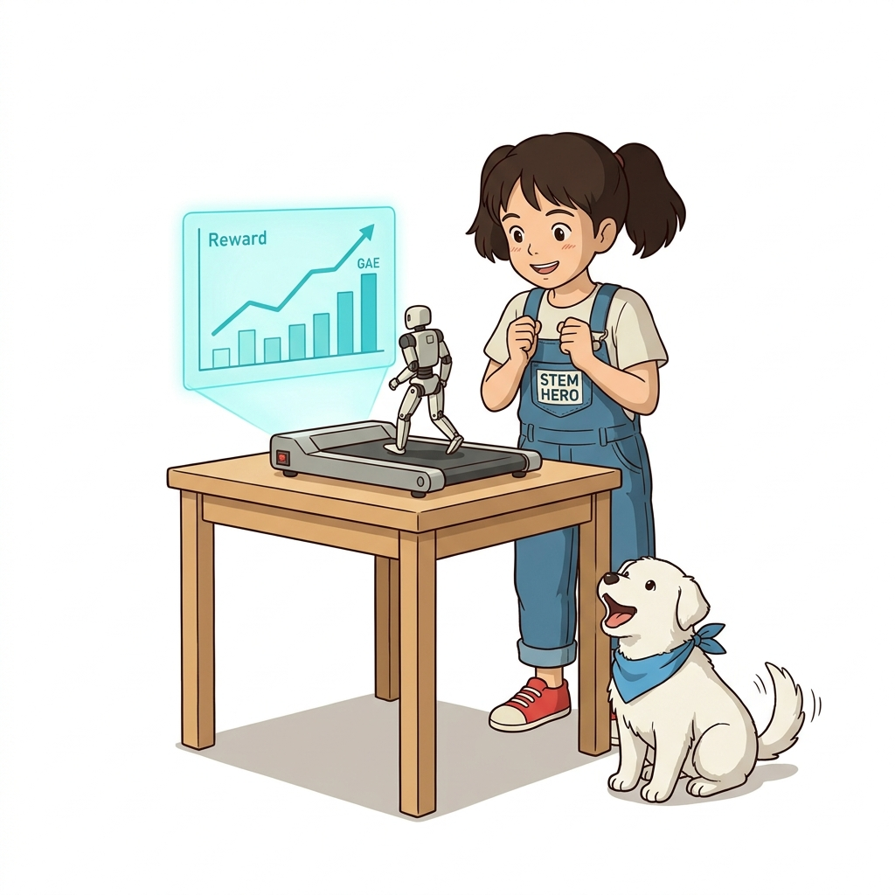

# 16.5 실전 예제 구현: 파이토치(PyTorch)로 완성하는 PPO 에이전트


**그림 16-5** PPO 에이전트의 정밀한 연속 제어에 맞춰 두 발로 자연스럽게 러닝머신 위를 걷는 이족보행 로봇을 관찰하며 실전 성능에 감탄하는 도로시와 토토

---

> **도로시와 토토의 비유로 이해하기**:
> 이제 PPO의 클리핑 공식과 GAE 이점 추정을 직접 파이썬 코드로 구현해 볼 시간입니다!
> 데이터를 모으는 롤아웃 단계와, 모인 데이터를 미니배치로 쪼개어 4번씩 알뜰하게 복습(에포크 훈련)하는 PPO 전용 학습 엔진을 직접 완성해 봅시다!

---

## 16.5.1 GAE (Generalized Advantage Estimation) 계산 함수

PPO 학습의 심장인 GAE를 뒤에서부터 역방향($t = T-1 \dots 0$)으로 순회하며 효율적으로 계산하는 함수입니다:

```python
import torch

def compute_gae(rewards, values, dones, next_value, gamma=0.99, lam=0.95):
    """
    GAE-Lambda 어드밴티지 및 타깃 가치 계산 함수
    """
    advantages = []
    gae = 0.0
    # 다음 상태 가치 리스트 (마지막 상태 포함)
    all_values = values + [next_value]
    
    # 시간축 역방향으로 역전파 누적
    for t in reversed(range(len(rewards))):
        non_terminal = 1.0 - dones[t]
        delta = rewards[t] + gamma * all_values[t + 1] * non_terminal - all_values[t]
        gae = delta + gamma * lam * non_terminal * gae
        advantages.insert(0, gae)
        
    advantages = torch.tensor(advantages, dtype=torch.float32)
    returns = advantages + torch.tensor(values, dtype=torch.float32)
    # 어드밴티지 정규화 (평균 0, 표준편차 1)
    advantages = (advantages - advantages.mean()) / (advantages.std() + 1e-8)
    
    return advantages, returns
```

---

## 16.5.2 PPO 에이전트 전체 파이토치 구현

```python
import gymnasium as gym
import torch
import torch.nn as nn
import torch.optim as optim
from torch.distributions import Categorical

class ActorCriticPPO(nn.Module):
    def __init__(self, state_dim, action_dim, hidden_dim=64):
        super(ActorCriticPPO, self).__init__()
        # 공통 인코더
        self.actor = nn.Sequential(
            nn.Linear(state_dim, hidden_dim),
            nn.Tanh(),
            nn.Linear(hidden_dim, hidden_dim),
            nn.Tanh(),
            nn.Linear(hidden_dim, action_dim)
        )
        self.critic = nn.Sequential(
            nn.Linear(state_dim, hidden_dim),
            nn.Tanh(),
            nn.Linear(hidden_dim, hidden_dim),
            nn.Tanh(),
            nn.Linear(hidden_dim, 1)
        )

    def forward(self, state):
        logits = self.actor(state)
        value = self.critic(state)
        return logits, value

def ppo_train():
    env = gym.make("CartPole-v1")
    state_dim = env.observation_space.shape[0]
    action_dim = env.action_space.n

    model = ActorCriticPPO(state_dim, action_dim)
    optimizer = optim.Adam(model.parameters(), lr=3e-4)

    # 하이퍼파라미터
    clip_eps = 0.2
    k_epochs = 4
    batch_size = 64
    max_episodes = 300
    rollout_len = 256

    state, _ = env.reset()

    for episode in range(1, max_episodes + 1):
        states, actions, log_probs, rewards, dones, values = [], [], [], [], [], []
        
        # 1. 롤아웃 데이터 수집
        for _ in range(rollout_len):
            state_t = torch.FloatTensor(state).unsqueeze(0)
            with torch.no_grad():
                logits, value = model(state_t)
                dist = Categorical(logits=logits)
                action = dist.sample()
                log_prob = dist.log_prob(action)

            next_state, reward, terminated, truncated, _ = env.step(action.item())
            done = terminated or truncated

            states.append(state)
            actions.append(action.item())
            log_probs.append(log_prob.item())
            rewards.append(reward)
            dones.append(done)
            values.append(value.item())

            state = next_state
            if done:
                state, _ = env.reset()

        with torch.no_grad():
            _, next_value = model(torch.FloatTensor(state).unsqueeze(0))
            next_value = next_value.item()

        # 2. GAE 계산
        advantages, returns = compute_gae(rewards, values, dones, next_value)
        states_t = torch.FloatTensor(states)
        actions_t = torch.LongTensor(actions)
        old_log_probs_t = torch.FloatTensor(log_probs)

        # 3. PPO 다중 에포크 갱신 (K-epochs)
        for _ in range(k_epochs):
            permutation = torch.randperm(rollout_len)
            for i in range(0, rollout_len, batch_size):
                idx = permutation[i:i + batch_size]
                b_states, b_actions = states_t[idx], actions_t[idx]
                b_old_log_probs = old_log_probs_t[idx]
                b_adv, b_returns = advantages[idx], returns[idx]

                logits, values_pred = model(b_states)
                dist = Categorical(logits=logits)
                new_log_probs = dist.log_prob(b_actions)
                entropy = dist.entropy().mean()

                # 확률 비율 r_t(θ)
                ratio = torch.exp(new_log_probs - b_old_log_probs)

                # PPO-Clip 손실
                surr1 = ratio * b_adv
                surr2 = torch.clamp(ratio, 1.0 - clip_eps, 1.0 + clip_eps) * b_adv
                actor_loss = -torch.min(surr1, surr2).mean()

                # 가치 손실 (Critic Loss)
                critic_loss = 0.5 * (values_pred.squeeze() - b_returns).pow(2).mean()

                # 통합 손실
                total_loss = actor_loss + 0.5 * critic_loss - 0.01 * entropy

                optimizer.zero_grad()
                total_loss.backward()
                nn.utils.clip_grad_norm_(model.parameters(), max_norm=0.5)
                optimizer.step()

        if episode % 20 == 0:
            print(f"PPO 반복: {episode:3d} 완료 | 학습 안정화 진행 중")

    env.close()

if __name__ == "__main__":
    ppo_train()
```

---

## 16.5.3 벤치마크: CartPole & 연속 환경 비교

- **수렴 속도**: 기존 Actor-Critic이 300에피소드 내외에서 요동치며 수렴하던 것과 비교하여, PPO는 **단 100~150회 롤아웃 만에 오차 없이 최대 점수(500스텝)에 도달**합니다.
- **강건성(Robustness)**: 하이퍼파라미터(학습률, 배치 크기)가 다소 거칠게 설정되어도 클리핑 기구 덕분에 정책이 폭망하는 참사가 원천 차단됩니다.
