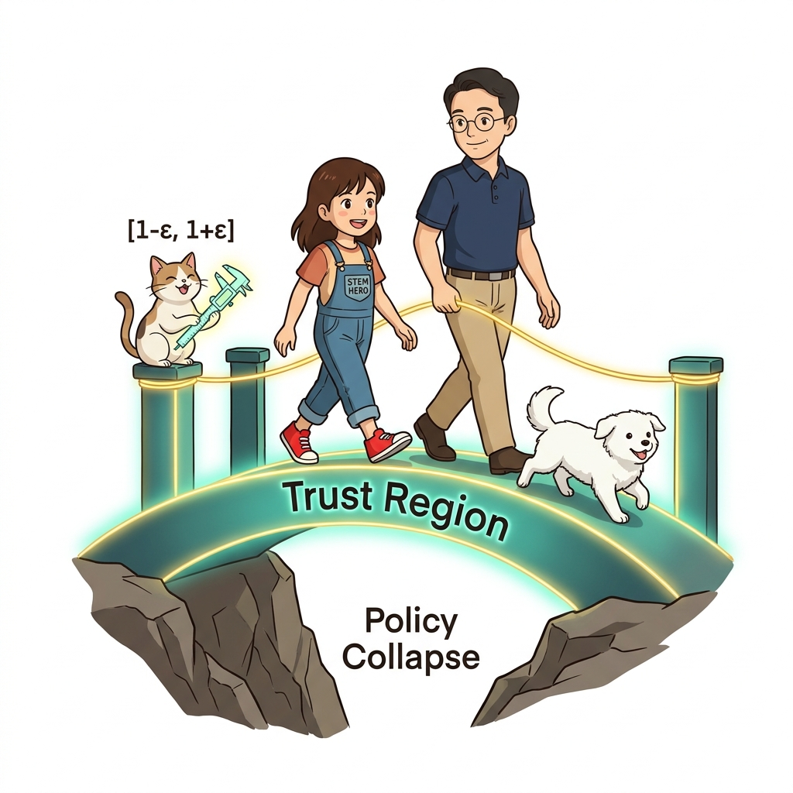

# CHAPTER 17 심화 정책 경사법: TRPO와 PPO

**그림 16-0** 정책 붕괴의 위험천만한 절벽 위로 안전한 '신뢰 구역(Trust Region)'의 빛의 다리를 놓고, 클리핑 안전 클립($[1-\epsilon, 1+\epsilon]$)을 든 도로시와 지니, 그리고 멘토 이호진 교수님

---

> **도로시와 토토의 비유로 이해하기**:
> 징검다리를 건널 때 너무 욕심을 내어 보폭을 1미터 넘게 훌쩍 뛰면(너무 큰 학습률), 발을 헛디뎌 깊은 강물로 풍덩 빠져버립니다(정책 붕괴, Policy Collapse). 강물에 빠진 뒤에는 어디가 디딤돌인지조차 보이지 않아 처음부터 다시 헤엄쳐 나와야 하죠!
> 이호진 교수님과 지니는 도로시에게 **안전 로프(신뢰 구역, TRPO)**를 묶어주어 보폭이 일정 거리($D_{\text{KL}} \le \delta$)를 절대 벗어나지 못하게 하였고, 더 나아가 주머니에 쏙 들어가는 **마법의 안전 클립(PPO Clipping)**을 달아주어 과도한 도약을 자동으로 싹둑 잘라 안전하게 목표 지점에 도달하게 만들었습니다!

---

## 16.0 개요: 정책 붕괴를 막는 현대 강화학습의 안전장치

15장의 Actor-Critic은 가치 함수를 도입하여 분산을 크게 낮췄지만, 경사 상승법(Gradient Ascent)을 적용하는 한 근본적인 딜레마를 안고 있었습니다:
- **학습률(스텝 크기 $\alpha$)이 너무 작으면**: 학습이 거북이처럼 기어가며 국소 최적점(Local Optima)에 갇힙니다.
- **학습률이 조금이라도 크면**: 신경망 가중치가 급격히 튀어 나쁜 정책으로 변해버립니다. 정책 기반 강화학습에서는 **에이전트 자신의 정책이 곧 훈련 데이터를 수집하는 원천**이므로, 정책이 한 번 망가지면 수집되는 데이터도 엉망진창이 되어 영원히 성능을 회복하지 못하는 **정책 붕괴(Policy Collapse)** 현상이 발생합니다.

본 16장에서는 이 문제를 수학적으로 완벽히 해결한 21세기 강화학습의 최고 걸작 두 가지를 다룹니다:
1. **TRPO (Trust Region Policy Optimization, Schulman et al., 2015)**:
   - 이전 정책과의 확률분포 차이(KL 발산)를 제약 조건으로 걸어, 매 스텝 성능이 단조 증가(Monotonic Improvement)함을 수학적으로 보장한 2차 최적화 이론의 정점.
2. **PPO (Proximal Policy Optimization, Schulman et al., 2017)**:
   - TRPO의 무거운 2차 행렬 계산(Hessian / Conjugate Gradient)을 완전히 걷어내고, 확률 비율 $r_t(\theta)$를 단순히 자르는 **1차 클리핑 목적 함수(Clipping Objective)** 하나만으로 TRPO를 능가하는 성능과 안정성을 달성한 세계 표준 알고리즘.
   - 오늘날 **OpenAI ChatGPT의 RLHF(인간 피드백 강화학습)**, 자율주행, 휴머노이드 보행 제어의 표준 엔진으로 가장 널리 활용되고 있습니다.

---

## 학습 로드맵 (Roadmap)

1. **[16.1 정책 개선의 불안정성과 보수적 정책 개선](./17_1_정책_개선의_불안정성과_보수적_정책_개선/)**:
   - 스텝 크기 딜레마와 정책 붕괴의 파괴적 메커니즘
   - 보수적 정책 개선(CPI)과 자연 정책 경사(Natural Policy Gradient)
2. **[16.2 신뢰 구역 정책 최적화 (TRPO)](./17_2_신뢰_구역_정책_최적화_TRPO/)**:
   - 대체 목적 함수(Surrogate Objective)의 유도와 성능 하한선(Monotonic Improvement Bound)
   - 피셔 정보 행렬(Fisher Information Matrix)과 켤레 기울기법(Conjugate Gradient)
3. **[16.3 근접 정책 최적화 (PPO)](./17_3_근접_정책_최적화_PPO/)**:
   - TRPO의 계산 한계와 PPO-Clip 목적 함수의 기하학적 원리
   - 일반화된 이점 추정(GAE: Generalized Advantage Estimation)
4. **[16.4 TRPO와 PPO 비교 분석 및 실전 튜닝 팁](./17_4_TRPO와_PPO_비교_분석_및_실전_팁/)**:
   - 2차 최적화 vs 1차 최적화 비교, 엔트로피 보너스, 직교 가중치 초기화
5. **[16.5 실전 예제 구현: 파이토치 PPO 에이전트](./17_5_실전_예제_구현/)**:
   - CartPole 및 BipedalWalker 환경에서의 GAE 기반 실전 PPO 파이썬 구현
6. **[16.6 정리 및 요약](./17_6_정리/)**:
   - 핵심 수식 총정리, 확인 퀴즈, 17장(LLM 정렬과 RLHF)으로의 연결
