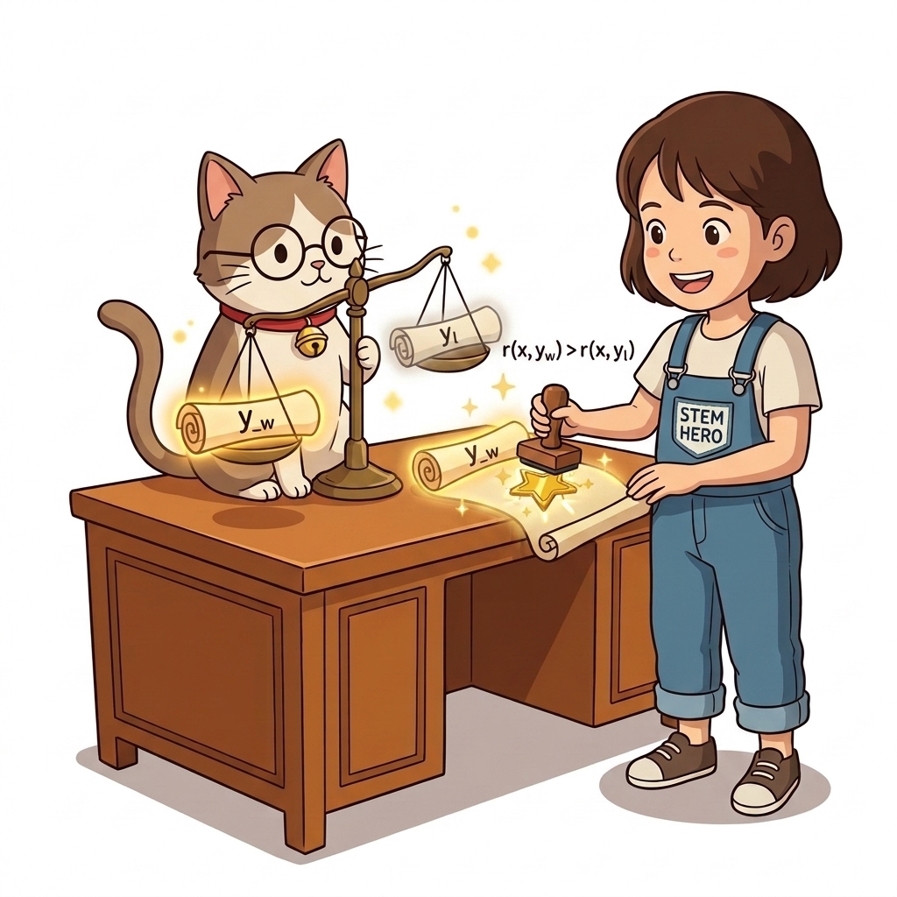

# 17.2 보상 모델링 (Reward Modeling): 인간의 주관적 선호를 스칼라 점수로 계량화하기

**그림 17-2** 두 개의 답변 두루마리($y_w$ vs $y_l$)를 저울에 올려놓고 브래들리-테리 모델을 기반으로 더 우수한 답변에 황금 보상 도장을 찍어주는 판사 지니와 보조 도로시

---

> **도로시와 토토의 비유로 이해하기**:
> 강화학습을 하려면 에이전트에게 잘했을 때 "+10점", 못했을 때 "-10점"이라는 보상(Reward)을 주어야 합니다.
> 바둑은 '승리(+1)', 게임은 '점수(+10)'라는 명확한 컴퓨터 규칙이 있지만, "이 시가 감동적인가?", "이 코드가 읽기 편한가?"는 컴퓨터가 스스로 점수를 매길 수 없습니다.
> 그렇다고 사람이 컴퓨터 앞에 24시간 앉아서 매 초마다 생성되는 수백만 개의 문장에 직접 점수를 매길 수도 없습니다(비용과 시간의 한계).
> 해결책은 바로 **"인간의 마음을 흉내 내어 점수를 대신 매겨주는 AI 채점관(보상 모델, Reward Model)"**을 별도로 훈련시키는 것입니다!

---

## 17.2.1 인간 선호 쌍 데이터셋 ($y_w \succ y_l$)

인간 평가자(Labeler)에게 특정 프롬프트 $x$에 대한 AI의 답변 $y$를 보고 "이 답변은 87.3점이다"라고 절대적인 점수를 매기게 하면 평가자마다 기준이 제각각이라 극심한 주관적 노이즈가 발생합니다.

하지만 **두 개의 답변 $(y_1, y_2)$을 나란히 보여주고 "어느 쪽이 더 나은가요?"라고 묻는 상대적 비교(Pairwise Comparison)**는 누구나 쉽게 일관된 판단을 내릴 수 있습니다:

$$
\mathcal{D}_{\text{pair}} = \left\{ (x^{(i)}, y_w^{(i)}, y_l^{(i)}) \right\}_{i=1}^N
$$

- $x$: 사용자의 질문 프롬프트 (예: "자전거 타는 법을 세 줄로 요약해 줘")
- $y_w$ (Winner): 인간이 더 우수하고 안전하다고 선택한 승자 답변
- $y_l$ (Loser): 덜 유용하거나 편향된 패자 답변 ($y_w \succ y_l$)

---

## 17.2.2 브래들리-테리 (Bradley-Terry) 선호도 확률 모델

보상 모델 $r_\psi(x, y)$는 임의의 프롬프트 $x$와 답변 $y$를 입력받아 하나의 실수 스칼라 점수를 출력하는 트랜스포머 신경망입니다.

통계학의 유명한 랭킹 이론인 **브래들리-테리(Bradley-Terry, 1952) 모델**에 따르면, 인간이 답변 $y_l$ 대신 $y_w$를 선택할 확률은 두 답변에 대한 잠재 보상 점수의 차이에 시그모이드(Sigmoid, $\sigma$)를 씌운 값으로 정밀하게 모델링됩니다:

$$
P(y_w \succ y_l \mid x) = \sigma\left( r_\psi(x, y_w) - r_\psi(x, y_l) \right) = \frac{1}{1 + \exp\left( -(r_\psi(x, y_w) - r_\psi(x, y_l)) \right)}
$$

[식 17.1] 브래들리-테리 쌍대 비교 확률 모델

이 수식의 의미는 다음과 같습니다:
- $r_\psi(x, y_w) \gg r_\psi(x, y_l)$ 이면, $y_w$가 승리할 확률은 $1.0$에 수렴합니다.
- 두 답변의 보상이 같으면($r_\psi(y_w) = r_\psi(y_l)$), 승리 확률은 반반($0.5$)입니다.

---

## 17.2.3 보상 모델의 목적 함수와 손실 함수 유도

우리는 관측된 인간의 선택 데이터셋 $\mathcal{D}_{\text{pair}}$에 대해 음의 로그 우도(Negative Log-Likelihood)를 최소화하도록 보상 모델의 파라미터 $\psi$를 교차 엔트로피 손실로 학습시킵니다:

$$
\mathcal{L}_{\text{RM}}(\psi) = -\mathbb{E}_{(x, y_w, y_l) \sim \mathcal{D}} \left[ \log \sigma\left( r_\psi(x, y_w) - r_\psi(x, y_l) \right) \right]
$$

[식 17.2] 보상 모델 학습 손실 함수

### $K$개 답변에 대한 일반화 (플래킷-루스, Plackett-Luce 모델)
만약 인간 평가자가 1개의 질문에 대해 4개의 답변 $(y_1, y_2, y_3, y_4)$에 대해 순위($y_1 \succ y_2 \succ y_3 \succ y_4$)를 매겼다면, $\binom{4}{2} = 6$개의 선호 쌍을 도출하여 다음과 같이 일괄 최적화합니다:

$$
\mathcal{L}_{\text{RM}}(\psi) = -\frac{1}{\binom{K}{2}} \mathbb{E} \left[ \sum_{j < k} \log \sigma\left( r_\psi(x, y_j) - r_\psi(x, y_k) \right) \right]
$$

---

## 17.2.4 보상 해킹 (Reward Hacking)의 위험성

보상 모델이 성공적으로 훈련되면, 드디어 PPO 에이전트를 위한 자동 채점기가 완성됩니다. 하지만 신경망 채점관에게는 항상 **'보상 해킹(Reward Hacking)'**이라는 거대한 함정이 도사리고 있습니다:
- **답변 길이 편향 (Verbosity Bias)**: 보상 모델이 긴 답변에 높은 점수를 주는 경향을 발견하면, 언어모델 에이전트는 알맹이 없는 미사여구를 수천 자씩 무한히 늘어놓으며 점수만 따내려 합니다.
- **아첨 편향 (Sycophancy)**: 사용자가 틀린 주장을 하더라도 맞장구를 치며 무조건 아첨하는 답변을 생성합니다.

이러한 보상 해킹을 방지하기 위해, 다음 절에서 배울 **KL 발산 제약 조건(KL Penalty)**이 필수적으로 결합됩니다!
