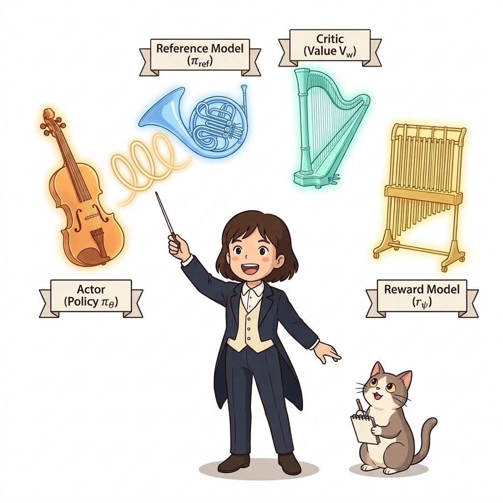

# 17.3 RLHF 파이프라인과 PPO 정렬: 4대 모델의 오케스트라와 KL 페널티


**그림 17-3** 지휘자 도로시의 지휘봉 아래 Actor, Critic, Reference Model, Reward Model이라는 4대의 거대한 신경망이 KL 페널티 조율줄로 연결되어 조화로운 출력을 완성하는 PPO-RLHF 4중주 오케스트라

---

> **도로시와 토토의 비유로 이해하기**:
> 클래식 PPO-RLHF를 돌리기 위해서는 GPU 메모리 위에 무려 4개의 거대한 AI 모델이 동시에 악기를 연주해야 합니다!
> 1. **제1 바이올린 (Actor $\pi_\theta$)**: 열심히 새로운 문장을 연주하는 생성자
> 2. **첼로 (Critic $V_w$)**: 지금 연주가 전체 흐름상 몇 점짜리인지 예측하는 평가자
> 3. **심사위원 (Reward Model $r_\psi$)**: 문장이 끝났을 때 인간의 채점 기준표로 최종 점수를 매기는 심사위원
> 4. **악보 원본 (Reference Model $\pi_{\text{ref}}$)**: Actor가 점수만 잘 받겠다고 너무 해괴한 변주곡을 연주하지 못하게(원래 언어 능력을 잃지 않게) 붙잡아주는 닻(Anchor)
> 이 4중주가 완벽한 하모니를 이룰 때 비로소 ChatGPT 같은 마법의 대화 모델이 탄생합니다!

---

## 17.3.1 InstructGPT의 3단계 전체 파이프라인

오픈AI가 논문 *"Training language models to follow instructions with human feedback"* (Ouyang et al., 2022)에서 정립한 표준 RLHF 아키텍처는 다음과 같습니다:

```
[1단계: 지도학습 미세조정]
  프롬프트 x ───> 전문가 레이블러의 모범 답변 작성 ───> SFT 모델 (π_SFT) 학습
                                                            │ (가중치 복사)
                                                            ▼
[2단계: 보상 모델 학습]
  프롬프트 x ───> SFT 모델에서 여러 답변 생성 (y_1, y_2) ───> 인간 랭킹 (y_w ≻ y_l) ───> 보상 모델 (r_ψ) 학습
                                                                                               │
                                                                                               ▼
[3단계: PPO 기반 강화학습]
  프롬프트 x ───> [ Actor (π_θ) ] ───> 생성 문장 y ───┬───> [ Reward Model (r_ψ) ] ──> 보상 r
                        │                             │
                        │                             └───> [ Ref Model (π_ref) ] ──> KL 페널티
                        ▼                                                                   │
                  [ Critic (V_w) ] ◄────────────────────────────────────────────────────────┘
                        │
                        ▼ (PPO 갱신)
                  Actor & Critic 파라미터 업데이트
```

---

## 17.3.2 강화학습 목적 함수와 KL 발산 페널티

PPO 에이전트의 목표는 보상 모델의 점수를 최대화하는 것입니다. 하지만 단순히 보상 점수 $r_\psi(x, y)$만 쫓아가다 보면 다음과 같은 **치명적인 두 가지 부작용**이 발생합니다:
1. **모드 붕괴(Mode Collapse)**: 보상 모델이 높은 점수를 주는 특정 몇 가지 문맥만 반복해서 읊조리는 앵무새가 됩니다.
2. **언어 능력 상실(Language Degradation)**: 인간 문법 규칙을 무시하고 오직 보상 모델의 취약점(버그)만을 자극하는 외계어 토큰들의 나열을 쏟아냅니다.

이를 방지하기 위해, **학습 중인 정책 $\pi_\theta$가 원래의 SFT 모델($\pi_{\text{ref}}$)로부터 너무 멀어지지 않도록 하는 KL 발산 페널티(KL Penalty)**를 즉시 보상에 결합합니다:

$$
R_{\text{total}}(x, y) = r_\psi(x, y) - \beta D_{\text{KL}}\left( \pi_\theta(y \mid x) \parallel \pi_{\text{ref}}(y \mid x) \right)
$$

[식 17.3] KL 페널티가 결합된 최종 보상 함수

실제 토큰 단위(Token-level) 구현에서는 각 타임스텝 $t$마다 다음과 같은 토큰별 보상을 정의하여 Critic에게 넘겨줍니다:

$$
R_t = \begin{cases}
-\beta \left( \log \pi_\theta(y_t \mid x, y_{<t}) - \log \pi_{\text{ref}}(y_t \mid x, y_{<t}) \right), & t < T \\
r_\psi(x, y) - \beta \left( \log \pi_\theta(y_T \mid x, y_{<T}) - \log \pi_{\text{ref}}(y_T \mid x, y_{<T}) \right), & t = T
\end{cases}
$$

[식 17.4] 토큰별 KL 보상 분배 공식

- $\beta$는 KL 페널티 계수(통상 $0.01 \sim 0.1$)입니다.
- $\beta$가 높을수록 원래 모델의 지식과 문법을 보존하고, 낮을수록 보상 점수 극대화에 공격적으로 매진합니다.

---

## 17.3.3 PPO-RLHF의 치명적 한계: 메모리 4대 모델의 저주

PPO를 통한 RLHF는 탁월한 성능을 입증했지만, 전 세계 엔지니어들에게 엄청난 고통을 안겨주었습니다:
1. **메모리 병목**: 70B(700억 파라미터) LLaMA 모델을 RLHF하려면, Actor(70B), Critic(70B), Reference(70B), Reward(70B)라는 총 **2800억 개 파라미터 분량의 모델이 동시에 GPU VRAM에 상주**해야 합니다!
2. **극심한 훈련 불안정성**: 생성 모델과 가치 모델이 서로 다른 학습률로 상호작용하면서 PPO 학습 루프가 자주 붕괴하거나 발산했습니다.

"보상 모델과 Critic 없이, 오직 선호도 데이터만으로 정책을 직접 최적화할 수는 없을까?" 
이 물음에서 출발한 혁신이 바로 다음 절의 **DPO (Direct Preference Optimization)**입니다!
