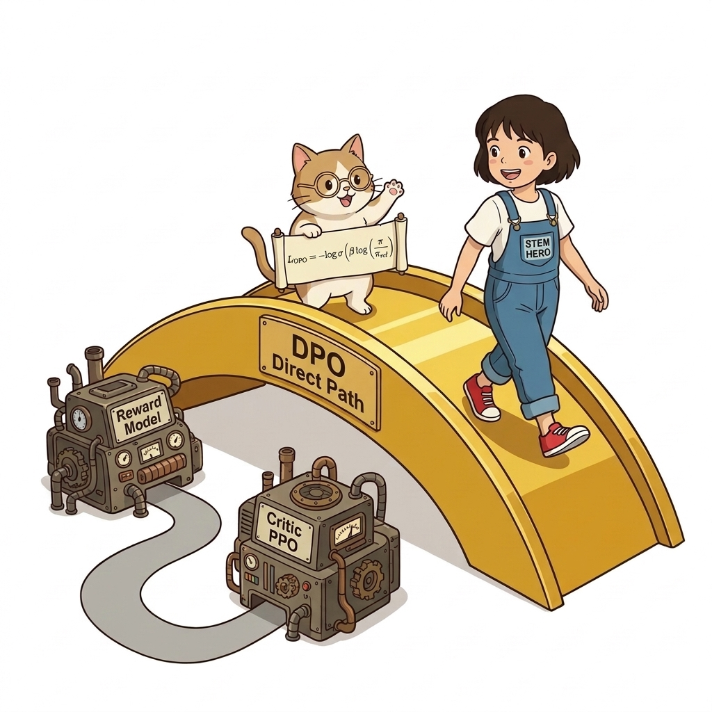

# 17.4 직접 선호 최적화 (DPO): 보상 모델과 Critic을 걷어낸 수학적 지름길

**그림 17-4** 복잡한 보상 모델과 PPO 크리틱 장치를 완전히 건너뛰고, 우아한 닫힌 해 수식 하나로 선호도 쌍에서 정책으로 직행하는 지름길 다리를 건너는 도로시와 지니

---

> **도로시와 토토의 비유로 이해하기**:
> 지금까지 우리는 영희의 마음(인간 선호도)을 알기 위해, 먼저 "영희의 마음을 흉내 내는 로봇(보상 모델)"을 만들고, 그 로봇에게 채점을 받으며 도로시가 춤(PPO)을 연습했습니다.
> 그런데 스탠퍼드 대학의 라파일로프(Rafailov) 교수님이 놀라운 사실을 발견했습니다!
> **"수학적으로 식을 깔끔하게 정리해 보니, 중간에 가짜 로봇(보상 모델)을 만들 필요가 전혀 없네? 그냥 영희가 좋아했던 글($y_w$)과 싫어했던 글($y_l$)을 보고 곧바로 도로시의 머릿속 정책 확률을 조절하면 수학적으로 완전히 똑같은 결과를 얻을 수 있어!"**
> 이것이 바로 오늘날 오픈소스 LLM 진영을 평정한 **DPO(Direct Preference Optimization)**의 기적입니다!

---

## 17.4.1 DPO의 이론적 도출: 최적 보상 함수의 역치환

스탠퍼드 연구팀(Rafailov et al., NeurIPS 2023)은 KL 제약이 걸린 RLHF의 목적 함수를 깊이 파고들었습니다:

$$
\max_\pi \mathbb{E}_{x \sim \mathcal{D}, y \sim \pi} \left[ r(x, y) \right] - \beta D_{\text{KL}}\left( \pi(y \mid x) \parallel \pi_{\text{ref}}(y \mid x) \right)
$$

놀랍게도 이 볼록 최적화 문제의 **최적 정책 $\pi^*(y \mid x)$는 해석적인 닫힌 형태(Closed-form Solution)**로 정확히 구해집니다:

$$
\pi^*(y \mid x) = \frac{1}{Z(x)} \pi_{\text{ref}}(y \mid x) \exp\left( \frac{1}{\beta} r(x, y) \right)
$$

[식 17.5] 최적 정책의 깁스-볼츠만 분포 표현식 (단, $Z(x) = \sum_y \pi_{\text{ref}}(y \mid x) \exp\left(\frac{1}{\beta} r(x, y)\right)$)

이제 이 수식의 양변에 로그를 취하고 정리하면, **보상 함수 $r(x, y)$를 정책 확률 $\pi$와 참조 정책 $\pi_{\text{ref}}$의 비율로 역추출**할 수 있습니다!

$$
r(x, y) = \beta \log \frac{\pi^*(y \mid x)}{\pi_{\text{ref}}(y \mid x)} + \beta \log Z(x)
$$

[식 17.6] 정책으로 표현된 암묵적 보상 함수 (Implicit Reward)

---

## 17.4.2 DPO 손실 함수 (The DPO Objective)

이제 식 [17.6]의 암묵적 보상 표현을 17.2절에서 배웠던 브래들리-테리 선호 손실 함수에 그대로 대입합니다. 
그러면 계산하기 까다로웠던 정규화 분모 상수 $\beta \log Z(x)$가 뺄셈에 의해 **마법처럼 소거(Cancel Out)**됩니다!

$$
r(x, y_w) - r(x, y_l) = \beta \log \frac{\pi_\theta(y_w \mid x)}{\pi_{\text{ref}}(y_w \mid x)} - \beta \log \frac{\pi_\theta(y_l \mid x)}{\pi_{\text{ref}}(y_l \mid x)}
$$

이를 대입한 최종 DPO 손실 함수는 다음과 같습니다:

$$
\mathcal{L}_{\text{DPO}}(\theta) = -\mathbb{E}_{(x, y_w, y_l) \sim \mathcal{D}} \left[ \log \sigma \left( \beta \log \frac{\pi_\theta(y_w \mid x)}{\pi_{\text{ref}}(y_w \mid x)} - \beta \log \frac{\pi_\theta(y_l \mid x)}{\pi_{\text{ref}}(y_l \mid x)} \right) \right]
$$

[식 17.7] DPO의 핵심 손실 함수

---

## 17.4.3 PPO-RLHF vs DPO 비교 요약

| 비교 항목 | PPO-RLHF (오픈AI 방식) | DPO (스탠퍼드 직접 최적화) |
| :--- | :--- | :--- |
| **필요 모델 수** | **4개** (Actor, Critic, Ref, Reward) | **2개** (Actor, Reference) |
| **보상 모델 학습** | 별도로 사전에 훈련해야 함 | **필요 없음 (정책에 암묵적으로 내재)** |
| **강화학습 루프** | 텍스트 생성 $\rightarrow$ 가치 평가 $\rightarrow$ PPO 갱신 | **강화학습 루프 없음 (순수 지도학습 분류 손실)** |
| **훈련 안정성** | 불안정함 (하이퍼파라미터에 극도로 민감) | **매우 안정적 (표준 교차 엔트로피처럼 수렴)** |
| **GPU 메모리 요구량** | 초거대 GPU 클러스터 필수 | **단일 노드/소규모 GPU로도 파인튜닝 가능** |
| **현대적 위상** | 대규모 상용 모델의 최종 미세조정 | **오픈소스 진영(Llama, Mistral)의 표준 정렬 기법** |
