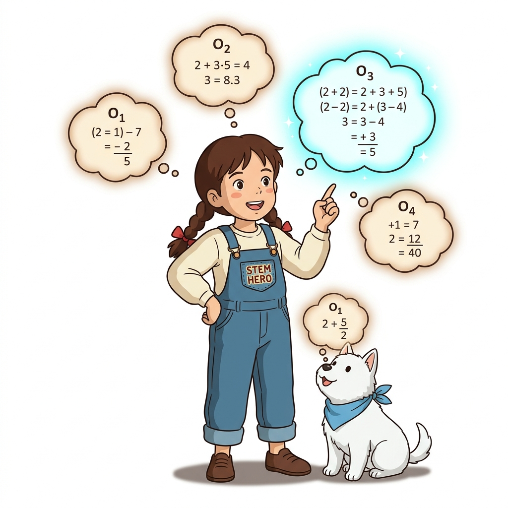

# 17.5 GRPO와 추론형 LLM 정렬: DeepSeek-R1의 혁신과 상대적 그룹 보상

**그림 17-5** 복잡한 수학 추론 문제에 대해 4개의 서로 다른 사고의 사슬(Chain of Thought)을 생성하고, 별도의 Critic 없이 그룹 내 상대적 우열을 비교하여 최적의 풀이 경로를 찾아내는 도로시와 토토

---

> **도로시와 토토의 비유로 이해하기**:
> 어려운 올림피아드 수학 문제를 풀 때, 문제집 뒤의 해설지를 보지 않고도 실력을 올리는 방법이 있습니다!
> 도로시가 같은 문제에 대해 서로 다른 풀이 방법 4가지($o_1, o_2, o_3, o_4$)를 혼자서 연습장에 쭉 써봅니다.
> 그리고 정답과 풀이 과정을 채점해 보았더니, 3번 풀이는 정답을 맞혔고 논리도 명쾌한 반면 1번과 4번은 엉뚱한 길로 샜습니다.
> 이때 비싼 과외 선생님(가치 신경망 Critic)을 모실 필요 없이, **"내가 쓴 4개 풀이 중에서 3번이 평균보다 훨씬 훌륭하네!"라는 그룹 내 상대적 비교(Group Relative)**만으로도 3번의 사고방식 확률을 대폭 강화할 수 있습니다. 이것이 2025년 전 세계 AI 판도를 뒤흔든 **DeepSeek-R1의 GRPO 알고리즘**의 비밀입니다!

---

## 17.5.1 추론형 언어모델(Reasoning LLMs)의 도래와 강화학습

OpenAI o1 및 **DeepSeek-R1(2025)**의 등장은 대형언어모델 정렬 패러다임을 '단순한 예의 바른 대화'에서 **'수학, 코딩, 과학적 추론(Reasoning) 능력의 자가 강화'**로 완전히 전환시켰습니다.

- 수학 문제나 알고리즘 코딩은 모호한 주관적 선호도가 아니라, **컴파일 성공 여부 및 수식 정답 일치 여부라는 명확하고 검증 가능한 규칙 기반 보상(Rule-based Verification)**이 존재합니다.
- 복잡한 문제를 풀기 위해 모델은 최종 답을 내놓기 전 내부적으로 긴 **사고의 사슬(CoT: Chain-of-Thought)**을 전개해야 합니다.

---

## 17.5.2 GRPO (Group Relative Policy Optimization)의 수학적 원리

DeepSeek 연구진이 고안한 **GRPO**는 PPO의 가장 큰 병목이었던 **가치 네트워크(Critic)를 완전히 제거**하여 GPU 메모리를 대폭 절감하면서도, PPO의 클리핑 안정성을 그대로 유지한 혁신적 알고리즘입니다:

### 1) 그룹 샘플링 (Group Generation)
하나의 질문 프롬프트 $q$에 대해, 이전 정책 $\pi_{\theta_{\text{old}}}$로부터 **$G$개의 서로 다른 응답 후보군 $\{o_1, o_2, \dots, o_G\}$을 동시에 병렬 생성**합니다.

### 2) 그룹 내 상대적 어드밴티지(Advantage) 산출
각 출력 $o_i$에 대해 규칙 기반 검증기(정답 여부, 포맷 준수 여부)가 채점한 보상 점수 $r_i$를 구한 뒤, **해당 그룹의 표본 평균과 표준편차를 사용하여 어드밴티지를 직접 계산**합니다:

$$
\bar{r} = \frac{1}{G} \sum_{i=1}^G r_i, \quad \sigma_r = \sqrt{\frac{1}{G} \sum_{i=1}^G (r_i - \bar{r})^2}
$$
$$
\hat{A}_i = \frac{r_i - \bar{r}}{\sigma_r + \epsilon}
$$

[식 17.8] GRPO의 그룹 상대적 어드밴티지 계산 공식

- **Critic 네트워크가 전혀 필요 없습니다!**
- 같은 질문에 대해 생성된 $G$개의 답변들 사이의 상대적 편차 자체가 곧 자연스러운 어드밴티지가 됩니다.

---

## 17.5.3 GRPO의 목적 함수

GRPO는 PPO-Clip 형태의 클리핑을 적용하면서, 기준 정책과의 KL 발산 역시 역방향 정규화(Unbiased Estimator)로 우아하게 통합합니다:

$$
\mathcal{J}_{\text{GRPO}}(\theta) = \mathbb{E}_{\substack{q \sim P(Q) \\ \{o_i\}_{i=1}^G \sim \pi_{\theta_{\text{old}}}(O \mid q)}} \left[ \frac{1}{G} \sum_{i=1}^G \frac{1}{|o_i|} \sum_{t=1}^{|o_i|} \left( \min\left( \frac{\pi_\theta(o_{i, t} \mid q, o_{i, <t})}{\pi_{\theta_{\text{old}}}(o_{i, t} \mid q, o_{i, <t})} \hat{A}_i, \; \text{clip}\left( \frac{\pi_\theta}{\pi_{\theta_{\text{old}}}}, 1-\epsilon, 1+\epsilon \right) \hat{A}_i \right) - \beta D_{\text{KL}}(\pi_\theta \parallel \pi_{\text{ref}}) \right) \right]
$$

[식 17.9] GRPO 최종 목적 함수

---

## 17.5.4 과정 보상 모델 (PRM)과 AI 피드백 (RLAIF)

- **결과 보상 모델 (ORM: Outcome Reward Model)**:
  - 수식이 10줄일 때 최종 답만 맞으면 $+1$, 틀리면 $0$을 줍니다. 중간에 치명적인 논리 오류가 있어도 우연히 답이 맞으면 잘못된 풀이를 보상하는 문제가 생깁니다.
- **과정 보상 모델 (PRM: Process Reward Model)**:
  - 수학 문제의 매 단계(Step-by-step)마다 논리적 타당성을 채점합니다. 모델이 올바른 사고 궤적을 밟아가도록 정밀 유도합니다.
- **RLAIF (RL from AI Feedback)**:
  - 인간 레이블러 대신 GPT-4 같은 상위 초거대 언어모델이 채점관 역할을 대신 수행하여, 무한대의 고품질 선호도 데이터를 자동 생산하는 현대 정렬의 표준 기법입니다.
