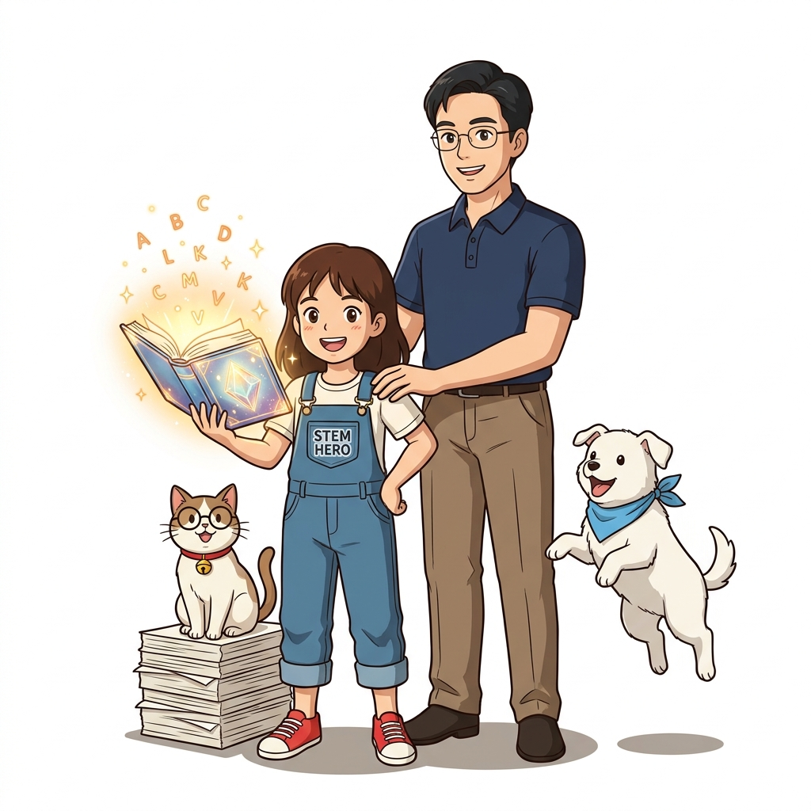

# 17.6 정리 및 요약: LLM 정렬의 대진화, RLHF에서 GRPO까지

**그림 17-6** 인간의 의도와 정렬된 지혜의 빛을 뿜어내는 마법의 LLM 수정을 함께 든 도로시와 멘토 이호진 교수님, 그리고 지니와 토토의 축하 연회

---

## 17.6.1 17장에서 배운 핵심 원리 총정리

1. **사전 학습(Pre-training)과 정렬(Alignment)의 분리**:
   - 대규모 원시 텍스트로 학습된 기본 모델(Base LLM)은 방대한 세계 지식을 압축하고 있으나, 환각, 유해성, 지시 불이행이라는 근본적 한계를 지닙니다.
   - 사후 학습(Post-training)은 지도학습 미세조정(SFT)과 강화학습 정렬(RL)을 통해 언어모델을 **유용성(Helpful), 진실성(Honest), 무해성(Harmless)**의 3H 원칙에 맞게 조율합니다.

2. **보상 모델링(Reward Modeling)**:
   - 인간의 주관적 선호도를 안정적으로 학습하기 위해 두 답변 간의 쌍대 비교($y_w \succ y_l$)를 수집합니다.
   - **브래들리-테리(Bradley-Terry) 모델** $P(y_w \succ y_l) = \sigma(r(y_w) - r(y_l))$을 기반으로 교차 엔트로피 손실을 최소화하여 스칼라 채점기를 완성합니다.

3. **PPO 기반 RLHF의 4중주와 KL 페널티**:
   - Actor, Critic, Reference, Reward라는 4대 모델이 상호작용합니다.
   - 보상 해킹과 언어 능력 붕괴를 막기 위해 기본 모델과의 **KL 발산 페널티($R = r - \beta D_{\text{KL}}$)**를 필수적으로 부과합니다.

4. **DPO (Direct Preference Optimization)**:
   - 복잡한 보상 모델과 Critic PPO 루프를 생략하고, 최적 정책과 암묵적 보상의 닫힌 해 관계를 이용하여 **선호도 데이터셋에서 정책을 직접 1차 경사 하강법으로 최적화**하는 경이로운 단순성을 달성했습니다.

5. **GRPO와 추론형 AI (DeepSeek-R1)**:
   - 수학, 코딩 등 검증 가능한 규칙 기반 보상 환경에서, 질문당 $G$개의 출력을 생성한 뒤 **그룹 내 상대적 편차($\frac{r_i - \bar{r}}{\sigma}$)**로 어드밴티지를 산출함으로써 Critic 네트워크를 완전히 제거하고 초거대 추론 모델을 완성했습니다.

---

## 17.6.2 정렬 기법별 핵심 비교표

| 기법 | 핵심 메커니즘 | 필요 모델 수 | 장점 | 주요 적용처 |
| :--- | :--- | :---: | :--- | :--- |
| **SFT** | 교사 강제(Teacher Forcing) 교차 엔트로피 | 1개 | 대화 양식 습득이 빠름 | 모든 LLM의 사후 학습 1단계 |
| **PPO-RLHF** | 보상 모델 기반의 가치-정책 최적화 | **4개** | 복잡한 인간 선호 반영 극대화 | ChatGPT, GPT-4, Claude |
| **DPO** | 닫힌 해 역치환을 통한 직접 선호 최적화 | **2개** | 강화학습 루프 없음, 극도로 안정적 | LLaMA-3, Mistral, Qwen |
| **GRPO** | 그룹 내 상대적 보상으로 Critic 대체 | **2개** | Critic 메모리 0, 자가 추론 강화 | **DeepSeek-R1 (2025 추론 혁명)** |

---

## 17.6.3 확인 퀴즈 (Quiz)

**Q1. PPO-RLHF에서 보상 함수에 참조 모델과의 KL 발산 페널티($-\beta D_{\text{KL}}(\pi_\theta \parallel \pi_{\text{ref}})$)를 부여하지 않았을 때 발생할 수 있는 가장 대표적인 부작용 두 가지는 무엇인가요?**
- **정답**: **보상 해킹(Reward Hacking)과 언어 능력 상실(Language Degradation / Mode Collapse)**
- **해설**: 보상 점수만 맹목적으로 추구하다 보면 알맹이 없는 미사여구만 길게 늘어놓거나(길이 편향), 보상 모델의 취약점을 공략하는 외계어 토큰열을 생성하며 원래 지식과 문법을 파괴하게 됩니다.

**Q2. DPO(Direct Preference Optimization)가 PPO-RLHF 대비 갖는 가장 혁신적인 공학적 장점은 무엇인가요?**
- **정답**: **별도의 보상 모델(Reward Model)과 가치 모델(Critic)을 훈련시킬 필요 없이, 선호 쌍 데이터로부터 단일 손실 함수로 정책을 직접 지도학습처럼 안정적으로 훈련할 수 있다는 점.**

---

## 17.6.4 다음 장(Chapter 18)으로의 도약

강화학습이 텍스트라는 거대한 언어 공간을 정복하는 과정을 살펴보았습니다.
그렇다면 강화학습이 역사상 가장 드라마틱하게 인간의 최고 지성을 무너뜨렸던 무대는 어디였을까요?

다음 18장에서는 $10^{170}$이라는 우주의 원자 수보다 많은 경우의 수를 자랑하는 바둑에서 이세돌 9단을 꺾은 **AlphaGo와 AlphaGo Zero**, 그리고 전장의 안개와 극한의 실시간 제어가 맞물린 스타크래프트 II의 **AlphaStar**, Dota 2의 **OpenAI Five**가 펼치는 **게임 인공지능의 전설적인 승부와 기술 아키텍처**를 탐구합니다!
